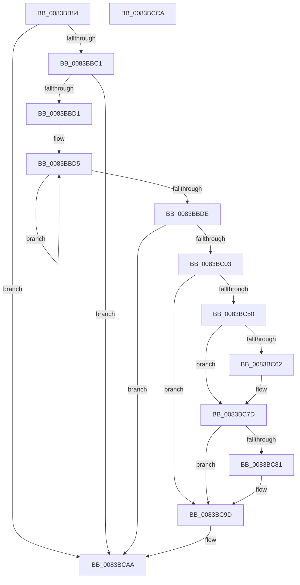

# VhdVerifyBootDisk

- RVA: `0x0083BB84`–`0x0083BCCB` (길이 `327` bytes)
- VA: `0x000000014083BB84`
- 실행 섹션: `PAGE`
- PDB 이름 있음: `예`; PDB Function 태그: `아니요`
- unwind 정보 RVA: `0x000DB29C`
- 디코드: `84`개 명령, `327/327` bytes 표시
- 미해석 바이트: `0` (있으면 어셈블리에 `.byte`로 보존)

> 이 문서는 커널 이미지의 기계어와 PDB 기호를 분석해 생성했습니다. 4번과 5번은 함수 원형과 자료형을 바이너리 사용 방식에서 추정한 C 해석이며 원본 소스 복구 결과는 아닙니다.

## 1. Dependencies

- 직접 호출 지점: **7**; 고유 호출 대상: **7**
- 직접 호출자로 확인된 함수: **1**
- RIP 상대 이미지 참조: **1**

### Outgoing calls
- `0x0083BBF2` → [ExAllocatePool2](../../poolcode/B8/ExAllocatePool2_function_00B820F0.md) (function, `0x00B820F0`)
- `0x0083BC12` → [KeInitializeEvent](../../text/40/KeInitializeEvent_function_0040DD10.md) (function, `0x0040DD10`)
- `0x0083BC46` → [IoBuildDeviceIoControlRequest](../../text/20/IoBuildDeviceIoControlRequest_function_00204FD0.md) (function, `0x00204FD0`)
- `0x0083BC56` → [IofCallDriver](../../text/29/IofCallDriver_function_0029B4B0.md) (function, `0x0029B4B0`)
- `0x0083BC74` → [KeWaitForSingleObject](../../text/20/KeWaitForSingleObject_function_0020E6B0.md) (function, `0x0020E6B0`)
- `0x0083BC8F` → [wcsicmp](../../text/50/wcsicmp_function_00500080.md) (function, `0x00500080`)
- `0x0083BCA5` → [ExFreePoolWithTag](../../poolcode/B8/ExFreePoolWithTag_function_00B82870.md) (function, `0x00B82870`)

### Direct callers
- [IopCreateArcName](../A8/IopCreateArcName_function_00A8D580.md) at `0x00A8DA09`

### Static image references
- `0x0083BBC1` → RVA `0x00EF00F0` (`.data`; read)

## 2. Other-region calls and transfers

- 다른 실행 섹션으로 향하는 call: **7**
  - `0x0083BBF2` → [ExAllocatePool2](../../poolcode/B8/ExAllocatePool2_function_00B820F0.md) (`PAGE` → `POOLCODE`)
  - `0x0083BC12` → [KeInitializeEvent](../../text/40/KeInitializeEvent_function_0040DD10.md) (`PAGE` → `.text`)
  - `0x0083BC46` → [IoBuildDeviceIoControlRequest](../../text/20/IoBuildDeviceIoControlRequest_function_00204FD0.md) (`PAGE` → `.text`)
  - `0x0083BC56` → [IofCallDriver](../../text/29/IofCallDriver_function_0029B4B0.md) (`PAGE` → `.text`)
  - `0x0083BC74` → [KeWaitForSingleObject](../../text/20/KeWaitForSingleObject_function_0020E6B0.md) (`PAGE` → `.text`)
  - `0x0083BC8F` → [wcsicmp](../../text/50/wcsicmp_function_00500080.md) (`PAGE` → `.text`)
  - `0x0083BCA5` → [ExFreePoolWithTag](../../poolcode/B8/ExFreePoolWithTag_function_00B82870.md) (`PAGE` → `POOLCODE`)
- 별도 외부 분기/꼬리 이동을 확인하지 못했습니다.

## 3. Assembly (complete function range)

```asm
0083BB84  4C 8B DC                        mov r11, rsp
0083BB87  49 89 5B 08                     mov qword ptr [r11 + 8], rbx
0083BB8B  49 89 6B 10                     mov qword ptr [r11 + 0x10], rbp
0083BB8F  49 89 73 18                     mov qword ptr [r11 + 0x18], rsi
0083BB93  49 89 7B 20                     mov qword ptr [r11 + 0x20], rdi
0083BB97  41 57                           push r15
0083BB99  48 81 EC 80 00 00 00            sub rsp, 0x80
0083BBA0  0F 57 C0                        xorps xmm0, xmm0
0083BBA3  33 C0                           xor eax, eax
0083BBA5  33 DB                           xor ebx, ebx
0083BBA7  48 8B F1                        mov rsi, rcx
0083BBAA  0F 11 44 24 60                  movups xmmword ptr [rsp + 0x60], xmm0
0083BBAF  49 89 43 E8                     mov qword ptr [r11 - 0x18], rax
0083BBB3  0F 11 44 24 50                  movups xmmword ptr [rsp + 0x50], xmm0
0083BBB8  48 85 C9                        test rcx, rcx
0083BBBB  0F 84 E9 00 00 00               je 0x14083bcaa
0083BBC1  48 8B 15 28 45 6B 00            mov rdx, qword ptr [rip + 0x6b4528]
0083BBC8  48 85 D2                        test rdx, rdx
0083BBCB  0F 84 D9 00 00 00               je 0x14083bcaa
0083BBD1  48 83 C8 FF                     or rax, 0xffffffffffffffff
0083BBD5  48 FF C0                        inc rax
0083BBD8  66 39 1C 42                     cmp word ptr [rdx + rax*2], bx
0083BBDC  75 F7                           jne 0x14083bbd5
0083BBDE  8D 2C 45 02 00 00 00            lea ebp, [rax*2 + 2]
0083BBE5  B9 40 00 00 00                  mov ecx, 0x40
0083BBEA  8B D5                           mov edx, ebp
0083BBEC  41 B8 56 68 64 42               mov r8d, 0x42646856
0083BBF2  E8 F9 64 34 00                  call 0x140b820f0
0083BBF7  48 8B F8                        mov rdi, rax
0083BBFA  48 85 C0                        test rax, rax
0083BBFD  0F 84 A7 00 00 00               je 0x14083bcaa
0083BC03  45 33 C0                        xor r8d, r8d
0083BC06  48 8D 4C 24 60                  lea rcx, [rsp + 0x60]
0083BC0B  45 8D 78 01                     lea r15d, [r8 + 1]
0083BC0F  41 8B D7                        mov edx, r15d
0083BC12  E8 F9 20 BD FF                  call 0x14040dd10
0083BC17  48 8D 44 24 50                  lea rax, [rsp + 0x50]
0083BC1C  45 33 C9                        xor r9d, r9d
0083BC1F  48 89 44 24 40                  mov qword ptr [rsp + 0x40], rax
0083BC24  45 33 C0                        xor r8d, r8d
0083BC27  48 8D 44 24 60                  lea rax, [rsp + 0x60]
0083BC2C  48 8B D6                        mov rdx, rsi
0083BC2F  48 89 44 24 38                  mov qword ptr [rsp + 0x38], rax
0083BC34  B9 28 59 2D 00                  mov ecx, 0x2d5928
0083BC39  88 5C 24 30                     mov byte ptr [rsp + 0x30], bl
0083BC3D  89 6C 24 28                     mov dword ptr [rsp + 0x28], ebp
0083BC41  48 89 7C 24 20                  mov qword ptr [rsp + 0x20], rdi
0083BC46  E8 85 93 9C FF                  call 0x140204fd0
0083BC4B  48 85 C0                        test rax, rax
0083BC4E  74 4D                           je 0x14083bc9d
0083BC50  48 8B D0                        mov rdx, rax
0083BC53  48 8B CE                        mov rcx, rsi
0083BC56  E8 55 F8 A5 FF                  call 0x14029b4b0
0083BC5B  3D 03 01 00 00                  cmp eax, 0x103
0083BC60  75 1B                           jne 0x14083bc7d
0083BC62  45 33 C9                        xor r9d, r9d
0083BC65  48 89 5C 24 20                  mov qword ptr [rsp + 0x20], rbx
0083BC6A  45 33 C0                        xor r8d, r8d
0083BC6D  48 8D 4C 24 60                  lea rcx, [rsp + 0x60]
0083BC72  33 D2                           xor edx, edx
0083BC74  E8 37 2A 9D FF                  call 0x14020e6b0
0083BC79  8B 44 24 50                     mov eax, dword ptr [rsp + 0x50]
0083BC7D  85 C0                           test eax, eax
0083BC7F  78 1C                           js 0x14083bc9d
0083BC81  48 8B 15 68 44 6B 00            mov rdx, qword ptr [rip + 0x6b4468]
0083BC88  48 8B CF                        mov rcx, rdi
0083BC8B  48 83 C2 02                     add rdx, 2
0083BC8F  E8 EC 43 CC FF                  call 0x140500080
0083BC94  85 C0                           test eax, eax
0083BC96  0F B6 DB                        movzx ebx, bl
0083BC99  41 0F 44 DF                     cmove ebx, r15d
0083BC9D  BA 56 68 64 42                  mov edx, 0x42646856
0083BCA2  48 8B CF                        mov rcx, rdi
0083BCA5  E8 C6 6B 34 00                  call 0x140b82870
0083BCAA  4C 8D 9C 24 80 00 00 00         lea r11, [rsp + 0x80]
0083BCB2  8A C3                           mov al, bl
0083BCB4  49 8B 5B 10                     mov rbx, qword ptr [r11 + 0x10]
0083BCB8  49 8B 6B 18                     mov rbp, qword ptr [r11 + 0x18]
0083BCBC  49 8B 73 20                     mov rsi, qword ptr [r11 + 0x20]
0083BCC0  49 8B 7B 28                     mov rdi, qword ptr [r11 + 0x28]
0083BCC4  49 8B E3                        mov rsp, r11
0083BCC7  41 5F                           pop r15
0083BCC9  C3                              ret
0083BCCA  CC                              int3
```

## 4. C-style interpretation (structured pseudocode)

```c
__int64 __fastcall VhdVerifyBootDisk(__int64 a1, __int64 a2, __int64 a3, int a4)
{
    __int64 result;
    __int64 v_rbx;
    __int64 v_rsp;
    unsigned __int64 v_stack_m28;
    unsigned __int64 v_stack_m38;
    unsigned __int64 v_stack_m48;
    unsigned __int64 v_stack_m50;
    unsigned __int8 v_stack_m58;
    unsigned int v_stack_m60;
    unsigned __int64 v_stack_m68;
    unsigned __int64 v_stack_m8;

    *(unsigned __int64 *)(v_rsp + 8) = v_rbx;
    *(unsigned __int64 *)(v_rsp + 16) = v_rbp;
    *(unsigned __int64 *)(v_rsp + 24) = v_rsi;
    *(unsigned __int64 *)(v_rsp + 32) = v_rdi;
    v_rsp = (v_rsp) - (128);
    result = 0;
    v_rbx = 0;
    v_stack_m28 = v_xmm0;
    *(unsigned __int64 *)(v_rsp - 24) = 0;
    v_stack_m38 = v_xmm0;
    if (a1 == 0) goto loc_0083BCAA;
    if (*(unsigned __int64 *)(v_rip + 7030056) == 0) goto loc_0083BCAA;
    result = (result) | (-1);
loc_0083BBD5:
    result = (result) + 1;
    if ((*(unsigned __int16 *)(*(unsigned __int64 *)(v_rip + 7030056) + result * 2)) != 0) goto loc_0083BBD5;
    result = ExAllocatePool2(64, (unsigned int)((unsigned int)(result * 2 + 2)), (unsigned int)(0x42646856ULL), a4);
    if (result == 0) goto loc_0083BCAA;
    a3 = 0;
    result = KeInitializeEvent(v_stack_m28, (unsigned int)((unsigned int)(a3 + 1)), a3, a4);
    a4 = 0;
    v_stack_m48 = v_stack_m38;
    a3 = 0;
    v_stack_m50 = v_stack_m28;
    v_stack_m58 = 0;
    v_stack_m60 = (unsigned int)(result * 2 + 2);
    v_stack_m68 = result;
    result = IoBuildDeviceIoControlRequest((unsigned int)(0x2D5928ULL), a1, a3, a4);
    if (result == 0) goto loc_0083BC9D;
    result = IofCallDriver(a1, result, a3, a4);
    if (((unsigned int)(result)) == 259) {
        a4 = 0;
        v_stack_m68 = 0;
        a3 = 0;
        a1 = v_stack_m28;
        a2 = 0;
        result = KeWaitForSingleObject(a1, a2, a3, a4);
        result = v_stack_m38;
    }
    if (!(sign_flag)) {
        a2 = *(unsigned __int64 *)(v_rip + 7029864);
        a1 = result;
        a2 = (a2) + (2);
        result = wcsicmp(a1, a2, a3, a4);
        v_rbx = 0;
        if ((unsigned int)(result) == 0) { v_rbx = (unsigned int)(a3 + 1); }
    }
    result = ExFreePoolWithTag(result, (unsigned int)(0x42646856ULL), a3, a4);
loc_0083BCAA:
    return (unsigned __int8)(v_rbx);
}
```

## 5. (Beta) C Style

```c
int64_t VhdVerifyBootDisk(int64_t Arg1, int64_t Arg2, int64_t Arg3, int32_t Arg4)
{
    int64_t result;
    int64_t local_rbx;
    int64_t local_rsp;
    uint64_t v_stack_m28;
    uint64_t v_stack_m38;
    uint64_t v_stack_m48;
    uint64_t v_stack_m50;
    uint8_t v_stack_m58;
    uint32_t v_stack_m60;
    uint64_t v_stack_m68;
    uint64_t v_stack_m8;

    *(uint64_t *)(local_rsp + 0x8) = local_rbx;
    *(uint64_t *)(local_rsp + 0x10) = local_rbp;
    *(uint64_t *)(local_rsp + 0x18) = local_rsi;
    *(uint64_t *)(local_rsp + 0x20) = local_rdi;
    local_rsp = (local_rsp) - (128);
    result = 0;
    local_rbx = 0;
    v_stack_m28 = v_xmm0;
    *(uint64_t *)(local_rsp - 0x18) = 0;
    v_stack_m38 = v_xmm0;
    if (Arg1 == 0) goto loc_0083BCAA;
    if (*(uint64_t *)(v_rip + 0x6B4528) == 0) goto loc_0083BCAA;
    result = (result) | (-1);
loc_0083BBD5:
    result = (result) + 1;
    if ((*(uint16_t *)(*(uint64_t *)(v_rip + 0x6B4528) + result * 2)) != 0) goto loc_0083BBD5;
    result = ExAllocatePool2(64, (uint32_t)((uint32_t)(result * 2 + 2)), (uint32_t)(0x42646856ULL), Arg4);
    if (result == 0) goto loc_0083BCAA;
    Arg3 = 0;
    result = KeInitializeEvent(v_stack_m28, (uint32_t)((uint32_t)(Arg3 + 1)), Arg3, Arg4);
    Arg4 = 0;
    v_stack_m48 = v_stack_m38;
    Arg3 = 0;
    v_stack_m50 = v_stack_m28;
    v_stack_m58 = 0;
    v_stack_m60 = (uint32_t)(result * 2 + 2);
    v_stack_m68 = result;
    result = IoBuildDeviceIoControlRequest((uint32_t)(0x2D5928ULL), Arg1, Arg3, Arg4);
    if (result == 0) goto loc_0083BC9D;
    result = IofCallDriver(Arg1, result, Arg3, Arg4);
    if (((uint32_t)(result)) == 259) {
        Arg4 = 0;
        v_stack_m68 = 0;
        Arg3 = 0;
        Arg1 = v_stack_m28;
        Arg2 = 0;
        result = KeWaitForSingleObject(Arg1, Arg2, Arg3, Arg4);
        result = v_stack_m38;
    }
    if (!(sign_flag)) {
        Arg2 = *(uint64_t *)(v_rip + 0x6B4468);
        Arg1 = result;
        Arg2 = (Arg2) + (2);
        result = wcsicmp(Arg1, Arg2, Arg3, Arg4);
        local_rbx = 0;
        if ((uint32_t)(result) == 0) { local_rbx = (uint32_t)(Arg3 + 1); }
    }
    result = ExFreePoolWithTag(result, (uint32_t)(0x42646856ULL), Arg3, Arg4);
loc_0083BCAA:
    return (uint8_t)(local_rbx);
}
```

## 6. Execution-region graph

[열기: 2D/3D 그래프와 함수 탐색 컨트롤 패널](../../../control-panel.html?section=page&rva=0x0083BB84&view=graph)

- 2D 그래프는 위에서 아래로 흐르고, 3D 그래프는 빈 공간을 드래그해 회전합니다. Shift+드래그는 이동, 휠은 확대·축소, 함수 노드 선택은 대상 보고서 이동입니다.

### Static fallback


