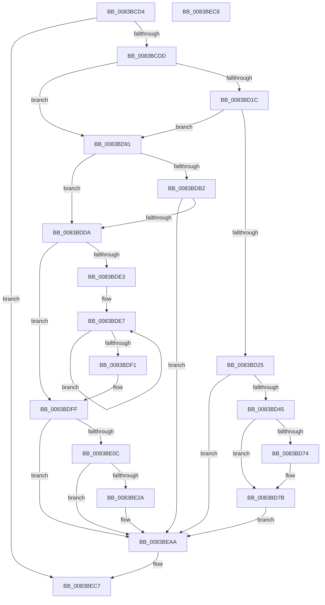

# VhdiAutoAttachOneVhd

- RVA: `0x0083BCD4`–`0x0083BEC9` (길이 `501` bytes)
- VA: `0x000000014083BCD4`
- 실행 섹션: `PAGE`
- PDB 이름 있음: `예`; PDB Function 태그: `아니요`
- unwind 정보 RVA: `0x000DB1CC`
- 디코드: `123`개 명령, `501/501` bytes 표시
- 미해석 바이트: `0` (있으면 어셈블리에 `.byte`로 보존)

> 이 문서는 커널 이미지의 기계어와 PDB 기호를 분석해 생성했습니다. 4번과 5번은 함수 원형과 자료형을 바이너리 사용 방식에서 추정한 C 해석이며 원본 소스 복구 결과는 아닙니다.

## 1. Dependencies

- 직접 호출 지점: **9**; 고유 호출 대상: **9**
- 직접 호출자로 확인된 함수: **2**
- RIP 상대 이미지 참조: **9**

### Outgoing calls
- `0x0083BD34` → [ExAllocatePool2](../../poolcode/B8/ExAllocatePool2_function_00B820F0.md) (function, `0x00B820F0`)
- `0x0083BD5C` → [memcpy](../../text/6C/memcpy_function_006C6840.md) (function, `0x006C6840`)
- `0x0083BDA7` → [RtlAcquirePrivilege](../87/RtlAcquirePrivilege_function_00879120.md) (function, `0x00879120`)
- `0x0083BDC2` → [VhdiMountVhdFile](VhdiMountVhdFile_function_0083BED0.md) (function, `0x0083BED0`)
- `0x0083BDCD` → [RtlReleasePrivilege](../A6/RtlReleasePrivilege_function_00A685A0.md) (function, `0x00A685A0`)
- `0x0083BDFA` → [McTemplateK0hzr0d_EtwWriteTransfer](../../text/6A/McTemplateK0hzr0d_EtwWriteTransfer_function_006A8418.md) (function, `0x006A8418`)
- `0x0083BE1D` → [tlgKeywordOn](../../text/42/tlgKeywordOn_function_0042EAA0.md) (function, `0x0042EAA0`)
- `0x0083BEA5` → [tlgWriteTransfer_EtwWriteTransfer](../../text/42/tlgWriteTransfer_EtwWriteTransfer_function_004260E0.md) (function, `0x004260E0`)
- `0x0083BEB1` → [_security_check_cookie](../../text/6A/_security_check_cookie_function_006AC640.md) (function, `0x006AC640`)

### Direct callers
- [VhdDeferredAutoAttachVirtualDisks](../../text/6A/VhdDeferredAutoAttachVirtualDisks_function_006A84A8.md) at `0x006A84FB`
- [VhdAutoAttachVirtualDisks](../../init/C6/VhdAutoAttachVirtualDisks_function_00C6D934.md) at `0x00C6DB05`

### Static image references
- `0x0083BCF3` → RVA `0x00E0A740` (`.data`; read)
- `0x0083BD06` → RVA `0x00E66279` (`.data`; read)
- `0x0083BD1C` → RVA `0x00E6627A` (`.data`; read)
- `0x0083BD61` → RVA `0x00E65190` (`.data`; read)
- `0x0083BD68` → RVA `0x00E65188` (`.data`; read)
- `0x0083BD85` → RVA `0x00E65190` (`.data`; write)
- `0x0083BDDA` → RVA `0x00F8D8D4` (`.data`; read)
- `0x0083BDFF` → RVA `0x00E06E68` (`.data`; read)
- `0x0083BE3A` → RVA `0x0005AC97` (`.rdata`; read)

## 2. Other-region calls and transfers

- 다른 실행 섹션으로 향하는 call: **6**
  - `0x0083BD34` → [ExAllocatePool2](../../poolcode/B8/ExAllocatePool2_function_00B820F0.md) (`PAGE` → `POOLCODE`)
  - `0x0083BD5C` → [memcpy](../../text/6C/memcpy_function_006C6840.md) (`PAGE` → `.text`)
  - `0x0083BDFA` → [McTemplateK0hzr0d_EtwWriteTransfer](../../text/6A/McTemplateK0hzr0d_EtwWriteTransfer_function_006A8418.md) (`PAGE` → `.text`)
  - `0x0083BE1D` → [tlgKeywordOn](../../text/42/tlgKeywordOn_function_0042EAA0.md) (`PAGE` → `.text`)
  - `0x0083BEA5` → [tlgWriteTransfer_EtwWriteTransfer](../../text/42/tlgWriteTransfer_EtwWriteTransfer_function_004260E0.md) (`PAGE` → `.text`)
  - `0x0083BEB1` → [_security_check_cookie](../../text/6A/_security_check_cookie_function_006AC640.md) (`PAGE` → `.text`)
- 별도 외부 분기/꼬리 이동을 확인하지 못했습니다.

## 3. Assembly (complete function range)

```asm
0083BCD4  48 85 C9                        test rcx, rcx
0083BCD7  0F 84 EA 01 00 00               je 0x14083bec7
0083BCDD  55                              push rbp
0083BCDE  53                              push rbx
0083BCDF  56                              push rsi
0083BCE0  57                              push rdi
0083BCE1  41 54                           push r12
0083BCE3  41 56                           push r14
0083BCE5  41 57                           push r15
0083BCE7  48 8D 6C 24 D9                  lea rbp, [rsp - 0x27]
0083BCEC  48 81 EC C0 00 00 00            sub rsp, 0xc0
0083BCF3  48 8B 05 46 EA 5C 00            mov rax, qword ptr [rip + 0x5cea46]
0083BCFA  48 33 C4                        xor rax, rsp
0083BCFD  48 89 45 17                     mov qword ptr [rbp + 0x17], rax
0083BD01  45 33 E4                        xor r12d, r12d
0083BD04  8B F2                           mov esi, edx
0083BD06  44 38 25 6C A5 62 00            cmp byte ptr [rip + 0x62a56c], r12b
0083BD0D  45 8B F9                        mov r15d, r9d
0083BD10  4D 8B F0                        mov r14, r8
0083BD13  4C 89 65 9F                     mov qword ptr [rbp - 0x61], r12
0083BD17  48 8B F9                        mov rdi, rcx
0083BD1A  74 75                           je 0x14083bd91
0083BD1C  44 38 25 57 A5 62 00            cmp byte ptr [rip + 0x62a557], r12b
0083BD23  74 6C                           je 0x14083bd91
0083BD25  48 8D 56 2A                     lea rdx, [rsi + 0x2a]
0083BD29  B9 00 01 00 00                  mov ecx, 0x100
0083BD2E  41 B8 56 68 64 42               mov r8d, 0x42646856
0083BD34  E8 B7 63 34 00                  call 0x140b820f0
0083BD39  48 8B D8                        mov rbx, rax
0083BD3C  48 85 C0                        test rax, rax
0083BD3F  0F 84 65 01 00 00               je 0x14083beaa
0083BD45  44 89 78 10                     mov dword ptr [rax + 0x10], r15d
0083BD49  48 8D 48 24                     lea rcx, [rax + 0x24]
0083BD4D  41 0F 10 06                     movups xmm0, xmmword ptr [r14]
0083BD51  44 8B C6                        mov r8d, esi
0083BD54  48 8B D7                        mov rdx, rdi
0083BD57  F3 0F 7F 40 14                  movdqu xmmword ptr [rax + 0x14], xmm0
0083BD5C  E8 DF AA E8 FF                  call 0x1406c6840
0083BD61  48 8B 05 28 94 62 00            mov rax, qword ptr [rip + 0x629428]
0083BD68  48 8D 0D 19 94 62 00            lea rcx, [rip + 0x629419]
0083BD6F  48 39 08                        cmp qword ptr [rax], rcx
0083BD72  74 07                           je 0x14083bd7b
0083BD74  41 8D 4C 24 03                  lea ecx, [r12 + 3]
0083BD79  CD 29                           int 0x29
0083BD7B  48 89 0B                        mov qword ptr [rbx], rcx
0083BD7E  48 89 43 08                     mov qword ptr [rbx + 8], rax
0083BD82  48 89 18                        mov qword ptr [rax], rbx
0083BD85  48 89 1D 04 94 62 00            mov qword ptr [rip + 0x629404], rbx
0083BD8C  E9 19 01 00 00                  jmp 0x14083beaa
0083BD91  45 33 C0                        xor r8d, r8d
0083BD94  C7 45 97 1C 00 00 00            mov dword ptr [rbp - 0x69], 0x1c
0083BD9B  4C 8D 4D 9F                     lea r9, [rbp - 0x61]
0083BD9F  48 8D 4D 97                     lea rcx, [rbp - 0x69]
0083BDA3  41 8D 50 01                     lea edx, [r8 + 1]
0083BDA7  E8 74 D3 03 00                  call 0x140879120
0083BDAC  8B D8                           mov ebx, eax
0083BDAE  85 C0                           test eax, eax
0083BDB0  78 28                           js 0x14083bdda
0083BDB2  45 33 C9                        xor r9d, r9d
0083BDB5  4C 89 74 24 20                  mov qword ptr [rsp + 0x20], r14
0083BDBA  45 8B C7                        mov r8d, r15d
0083BDBD  8B D6                           mov edx, esi
0083BDBF  48 8B CF                        mov rcx, rdi
0083BDC2  E8 09 01 00 00                  call 0x14083bed0
0083BDC7  48 8B 4D 9F                     mov rcx, qword ptr [rbp - 0x61]
0083BDCB  8B D8                           mov ebx, eax
0083BDCD  E8 CE C7 22 00                  call 0x140a685a0
0083BDD2  85 DB                           test ebx, ebx
0083BDD4  0F 89 D0 00 00 00               jns 0x14083beaa
0083BDDA  F6 05 F3 1A 75 00 04            test byte ptr [rip + 0x751af3], 4
0083BDE1  74 1C                           je 0x14083bdff
0083BDE3  49 83 C9 FF                     or r9, 0xffffffffffffffff
0083BDE7  49 FF C1                        inc r9
0083BDEA  66 46 39 24 4F                  cmp word ptr [rdi + r9*2], r12w
0083BDEF  75 F6                           jne 0x14083bde7
0083BDF1  89 5C 24 28                     mov dword ptr [rsp + 0x28], ebx
0083BDF5  48 89 7C 24 20                  mov qword ptr [rsp + 0x20], rdi
0083BDFA  E8 19 C6 E6 FF                  call 0x1406a8418
0083BDFF  83 3D 62 B0 5C 00 05            cmp dword ptr [rip + 0x5cb062], 5
0083BE06  0F 86 9E 00 00 00               jbe 0x14083beaa
0083BE0C  48 BA 00 00 00 00 00 40 00 00   movabs rdx, 0x400000000000
0083BE16  48 8D 0D 4B B0 5C 00            lea rcx, [rip + 0x5cb04b]
0083BE1D  E8 7E 2C BF FF                  call 0x14042eaa0
0083BE22  84 C0                           test al, al
0083BE24  0F 84 80 00 00 00               je 0x14083beaa
0083BE2A  48 8D 45 9F                     lea rax, [rbp - 0x61]
0083BE2E  48 C7 45 9F 00 00 00 02         mov qword ptr [rbp - 0x61], 0x2000000
0083BE36  48 89 45 C7                     mov qword ptr [rbp - 0x39], rax
0083BE3A  48 8D 15 56 EE 81 FF            lea rdx, [rip - 0x7e11aa]
0083BE41  48 8D 45 EF                     lea rax, [rbp - 0x11]
0083BE45  48 C7 45 CF 08 00 00 00         mov qword ptr [rbp - 0x31], 8
0083BE4D  48 89 45 D7                     mov qword ptr [rbp - 0x29], rax
0083BE51  48 8D 0D 10 B0 5C 00            lea rcx, [rip + 0x5cb010]
0083BE58  48 8D 45 97                     lea rax, [rbp - 0x69]
0083BE5C  48 C7 45 DF 02 00 00 00         mov qword ptr [rbp - 0x21], 2
0083BE64  48 89 45 07                     mov qword ptr [rbp + 7], rax
0083BE68  83 E6 FE                        and esi, 0xfffffffe
0083BE6B  48 8D 45 A7                     lea rax, [rbp - 0x59]
0083BE6F  48 89 7D E7                     mov qword ptr [rbp - 0x19], rdi
0083BE73  48 89 44 24 28                  mov qword ptr [rsp + 0x28], rax
0083BE78  45 33 C9                        xor r9d, r9d
0083BE7B  45 33 C0                        xor r8d, r8d
0083BE7E  C7 44 24 20 07 00 00 00         mov dword ptr [rsp + 0x20], 7
0083BE86  89 75 EF                        mov dword ptr [rbp - 0x11], esi
0083BE89  44 89 65 F3                     mov dword ptr [rbp - 0xd], r12d
0083BE8D  4C 89 75 F7                     mov qword ptr [rbp - 9], r14
0083BE91  48 C7 45 FF 10 00 00 00         mov qword ptr [rbp - 1], 0x10
0083BE99  44 89 7D 97                     mov dword ptr [rbp - 0x69], r15d
0083BE9D  48 C7 45 0F 04 00 00 00         mov qword ptr [rbp + 0xf], 4
0083BEA5  E8 36 A2 BE FF                  call 0x1404260e0
0083BEAA  48 8B 4D 17                     mov rcx, qword ptr [rbp + 0x17]
0083BEAE  48 33 CC                        xor rcx, rsp
0083BEB1  E8 8A 07 E7 FF                  call 0x1406ac640
0083BEB6  48 81 C4 C0 00 00 00            add rsp, 0xc0
0083BEBD  41 5F                           pop r15
0083BEBF  41 5E                           pop r14
0083BEC1  41 5C                           pop r12
0083BEC3  5F                              pop rdi
0083BEC4  5E                              pop rsi
0083BEC5  5B                              pop rbx
0083BEC6  5D                              pop rbp
0083BEC7  C3                              ret
0083BEC8  CC                              int3
```

## 4. C-style interpretation (structured pseudocode)

```c
__int64 __fastcall VhdiAutoAttachOneVhd(__int64 a1, int a2, __int64 a3, int a4)
{
    __int64 result;
    __int64 v_r12;
    __int64 v_rsi;
    __int64 v_rsp;
    unsigned __int64 v_stack_m48;
    unsigned __int64 v_stack_m50;
    unsigned __int64 v_stack_m58;
    unsigned __int64 v_stack_m5F;
    unsigned __int64 v_stack_m60;
    unsigned __int64 v_stack_m68;
    unsigned int v_stack_m6C;
    unsigned __int64 v_stack_m70;
    unsigned __int64 v_stack_m78;
    unsigned __int64 v_stack_m80;
    unsigned __int64 v_stack_m88;
    unsigned __int64 v_stack_m90;
    unsigned __int64 v_stack_m98;
    unsigned __int64 v_stack_mB8;
    unsigned __int64 v_stack_mC0;
    unsigned int v_stack_mC8;
    unsigned int v_stack_mD0;
    unsigned __int64 v_stack_mD8;

    if (a1 == 0) goto loc_0083BEC7;
    v_rsp = (v_rsp) - (192);
    result = (*(unsigned __int64 *)(v_rip + 6089286)) ^ (v_rsp);
    v_stack_m48 = result;
    v_r12 = 0;
    v_stack_mC0 = 0;
    if ((*(unsigned __int8 *)(v_rip + 6464876)) == 0) goto loc_0083BD91;
    if ((*(unsigned __int8 *)(v_rip + 6464855)) == 0) goto loc_0083BD91;
    result = ExAllocatePool2(256, (unsigned int)(a2) + 42, (unsigned int)(0x42646856ULL), a4);
    if (result == 0) goto loc_0083BEAA;
    *(unsigned int *)(result + 16) = (unsigned int)((unsigned int)(a4));
    *(unsigned __int64 *)(result + 20) = v_xmm0;
    result = memcpy(result + 36, a1, (unsigned int)((unsigned int)((unsigned int)(a2))), a4);
    if ((*(unsigned __int64 *)(*(unsigned __int64 *)(v_rip + 6460456))) != (v_rip + 6460441)) {
        a1 = v_r12 + 3;
    }
    *(unsigned __int64 *)(result) = a1;
    *(unsigned __int64 *)(result + 8) = *(unsigned __int64 *)(v_rip + 6460456);
    *(unsigned __int64 *)(*(unsigned __int64 *)(v_rip + 6460456)) = result;
    *(unsigned __int64 *)(v_rip + 6460420) = result;
    goto loc_0083BEAA;
loc_0083BD91:
    a3 = 0;
    v_stack_mC8 = 28;
    result = RtlAcquirePrivilege(v_stack_mC8, a3 + 1, a3, v_stack_mC0);
    if (sign_flag) goto loc_0083BDDA;
    a4 = 0;
    v_stack_mD8 = 0;
    result = VhdiMountVhdFile(a1, (unsigned int)((unsigned int)((unsigned int)(a2))), (unsigned int)((unsigned int)((unsigned int)(a4))), a4);
    result = RtlReleasePrivilege(v_stack_mC0, (unsigned int)((unsigned int)((unsigned int)(a2))), (unsigned int)((unsigned int)((unsigned int)(a4))), a4);
    if (!sign_flag) goto loc_0083BEAA;
loc_0083BDDA:
    if (((*(unsigned __int8 *)(v_rip + 7674611)) & (4)) == 0) goto loc_0083BDFF;
    a4 = (a4) | (-1);
loc_0083BDE7:
    a4 = (a4) + 1;
    if ((*(unsigned __int16 *)(a1 + a4 * 2)) != 0) goto loc_0083BDE7;
    v_stack_mD0 = (unsigned int)((unsigned int)((unsigned int)(result)));
    v_stack_mD8 = a1;
    result = McTemplateK0hzr0d_EtwWriteTransfer(v_stack_mC0, (unsigned int)((unsigned int)((unsigned int)(a2))), (unsigned int)((unsigned int)((unsigned int)(a4))), a4);
loc_0083BDFF:
    if ((*(unsigned int *)(v_rip + 6074466)) <= 5) goto loc_0083BEAA;
    result = tlgKeywordOn(v_rip + 6074443, (unsigned int)((unsigned int)((unsigned int)(a2))), (unsigned int)((unsigned int)((unsigned int)(a4))), a4);
    v_rsi = (unsigned int)(a2);
    if ((unsigned __int8)(result) != 0) {
        result = v_stack_mC0;
        v_stack_mC0 = 0x2000000ULL;
        v_stack_m98 = result;
        a2 = v_rip - 8262058;
        result = v_stack_m70;
        v_stack_m90 = 8;
        v_stack_m88 = result;
        a1 = v_rip + 6074384;
        result = v_stack_mC8;
        v_stack_m80 = 2;
        v_stack_m58 = result;
        v_rsi = (unsigned int)(((unsigned int)(a2)) & (0xFFFFFFFEULL));
        result = v_stack_mB8;
        v_stack_m78 = a1;
        v_stack_mD0 = result;
        a4 = 0;
        a3 = 0;
        v_stack_mD8 = 7;
        v_stack_m70 = (unsigned int)(v_rsi);
        v_stack_m6C = 0;
        v_stack_m68 = 0;
        v_stack_m60 = 16;
        v_stack_mC8 = (unsigned int)((unsigned int)(a4));
        v_stack_m50 = 4;
        result = tlgWriteTransfer_EtwWriteTransfer(a1, a2, a3, a4);
    }
    a1 = (v_stack_m48) ^ (v_rsp);
    result = _security_check_cookie(a1, a2, a3, a4);
    v_rsp = (v_rsp) + (192);
loc_0083BEC7:
    return result;
}
```

## 5. (Beta) C Style

```c
int64_t VhdiAutoAttachOneVhd(int64_t Arg1, void *Arg2, void *Arg3, int32_t Arg4)
{
    uint8_t *arg2 = (uint8_t *)Arg2;
    uint8_t *arg3 = (uint8_t *)Arg3;

    int64_t result;
    int64_t local_r12;
    int64_t local_rsi;
    int64_t local_rsp;
    uint64_t v_stack_m48;
    uint64_t v_stack_m50;
    uint64_t v_stack_m58;
    uint64_t v_stack_m5F;
    uint64_t v_stack_m60;
    uint64_t v_stack_m68;
    uint32_t v_stack_m6C;
    uint64_t v_stack_m70;
    uint64_t v_stack_m78;
    uint64_t v_stack_m80;
    uint64_t v_stack_m88;
    uint64_t v_stack_m90;
    uint64_t v_stack_m98;
    uint64_t v_stack_mB8;
    uint64_t v_stack_mC0;
    uint32_t v_stack_mC8;
    uint32_t v_stack_mD0;
    uint64_t v_stack_mD8;

    if (Arg1 == 0) goto loc_0083BEC7;
    local_rsp = (local_rsp) - (192);
    result = (*(uint64_t *)(v_rip + 0x5CEA46)) ^ (local_rsp);
    v_stack_m48 = result;
    local_r12 = 0;
    v_stack_mC0 = 0;
    if ((*(uint8_t *)(v_rip + 0x62A56C)) == 0) goto loc_0083BD91;
    if ((*(uint8_t *)(v_rip + 0x62A557)) == 0) goto loc_0083BD91;
    result = ExAllocatePool2(256, (uint32_t)(Arg2) + 42, (uint32_t)(0x42646856ULL), Arg4);
    if (result == 0) goto loc_0083BEAA;
    *(uint32_t *)(result + 0x10) = (uint32_t)((uint32_t)(Arg4));
    *(uint64_t *)(result + 0x14) = v_xmm0;
    result = memcpy(result + 36, Arg1, (uint32_t)((uint32_t)((uint32_t)(Arg2))), Arg4);
    if ((*(uint64_t *)(*(uint64_t *)(v_rip + 0x629428))) != (v_rip + 6460441)) {
        Arg1 = local_r12 + 3;
    }
    *(uint64_t *)(result) = Arg1;
    *(uint64_t *)(result + 0x8) = *(uint64_t *)(v_rip + 0x629428);
    *(uint64_t *)(*(uint64_t *)(v_rip + 0x629428)) = result;
    *(uint64_t *)(v_rip + 0x629404) = result;
    goto loc_0083BEAA;
loc_0083BD91:
    Arg3 = 0;
    v_stack_mC8 = 28;
    result = RtlAcquirePrivilege(v_stack_mC8, Arg3 + 1, Arg3, v_stack_mC0);
    if (sign_flag) goto loc_0083BDDA;
    Arg4 = 0;
    v_stack_mD8 = 0;
    result = VhdiMountVhdFile(Arg1, (uint32_t)((uint32_t)((uint32_t)(Arg2))), (uint32_t)((uint32_t)((uint32_t)(Arg4))), Arg4);
    result = RtlReleasePrivilege(v_stack_mC0, (uint32_t)((uint32_t)((uint32_t)(Arg2))), (uint32_t)((uint32_t)((uint32_t)(Arg4))), Arg4);
    if (!sign_flag) goto loc_0083BEAA;
loc_0083BDDA:
    if (((*(uint8_t *)(v_rip + 0x751AF3)) & (4)) == 0) goto loc_0083BDFF;
    Arg4 = (Arg4) | (-1);
loc_0083BDE7:
    Arg4 = (Arg4) + 1;
    if ((*(uint16_t *)(Arg1 + Arg4 * 2)) != 0) goto loc_0083BDE7;
    v_stack_mD0 = (uint32_t)((uint32_t)((uint32_t)(result)));
    v_stack_mD8 = Arg1;
    result = McTemplateK0hzr0d_EtwWriteTransfer(v_stack_mC0, (uint32_t)((uint32_t)((uint32_t)(Arg2))), (uint32_t)((uint32_t)((uint32_t)(Arg4))), Arg4);
loc_0083BDFF:
    if ((*(uint32_t *)(v_rip + 0x5CB062)) <= 5) goto loc_0083BEAA;
    result = tlgKeywordOn(v_rip + 6074443, (uint32_t)((uint32_t)((uint32_t)(Arg2))), (uint32_t)((uint32_t)((uint32_t)(Arg4))), Arg4);
    local_rsi = (uint32_t)(Arg2);
    if ((uint8_t)(result) != 0) {
        result = v_stack_mC0;
        v_stack_mC0 = 0x2000000ULL;
        v_stack_m98 = result;
        Arg2 = v_rip - 8262058;
        result = v_stack_m70;
        v_stack_m90 = 8;
        v_stack_m88 = result;
        Arg1 = v_rip + 6074384;
        result = v_stack_mC8;
        v_stack_m80 = 2;
        v_stack_m58 = result;
        local_rsi = (uint32_t)(((uint32_t)(Arg2)) & (0xFFFFFFFEULL));
        result = v_stack_mB8;
        v_stack_m78 = Arg1;
        v_stack_mD0 = result;
        Arg4 = 0;
        Arg3 = 0;
        v_stack_mD8 = 7;
        v_stack_m70 = (uint32_t)(local_rsi);
        v_stack_m6C = 0;
        v_stack_m68 = 0;
        v_stack_m60 = 16;
        v_stack_mC8 = (uint32_t)((uint32_t)(Arg4));
        v_stack_m50 = 4;
        result = tlgWriteTransfer_EtwWriteTransfer(Arg1, Arg2, Arg3, Arg4);
    }
    Arg1 = (v_stack_m48) ^ (local_rsp);
    result = _security_check_cookie(Arg1, Arg2, Arg3, Arg4);
    local_rsp = (local_rsp) + (192);
loc_0083BEC7:
    return result;
}
```

### 관측된 메모리 오프셋

구조체 형식이 확인되지 않은 접근은 인자 기준의 오프셋으로만 기록했습니다.

| 기준 인자 | 오프셋 표현 | 폭 (bit) | 접근 |
|---|---:|---:|---|
| `Arg2` | `+ 0x2A` | `64` | `R` |
| `Arg3` | `+ 0x0` | `128` | `R` |

## 6. Execution-region graph

[열기: 2D/3D 그래프와 함수 탐색 컨트롤 패널](../../../control-panel.html?section=page&rva=0x0083BCD4&view=graph)

- 2D 그래프는 위에서 아래로 흐르고, 3D 그래프는 빈 공간을 드래그해 회전합니다. Shift+드래그는 이동, 휠은 확대·축소, 함수 노드 선택은 대상 보고서 이동입니다.

### Static fallback


