# VhdiMountVhdFile

- RVA: `0x0083BED0`–`0x0083C50D` (길이 `1,597` bytes)
- VA: `0x000000014083BED0`
- 실행 섹션: `PAGE`
- PDB 이름 있음: `예`; PDB Function 태그: `아니요`
- unwind 정보 RVA: `0x000DB1F0`
- 디코드: `393`개 명령, `1,597/1,597` bytes 표시
- 미해석 바이트: `0` (있으면 어셈블리에 `.byte`로 보존)

> 이 문서는 커널 이미지의 기계어와 PDB 기호를 분석해 생성했습니다. 4번과 5번은 함수 원형과 자료형을 바이너리 사용 방식에서 추정한 C 해석이며 원본 소스 복구 결과는 아닙니다.

## 1. Dependencies

- 직접 호출 지점: **33**; 고유 호출 대상: **20**
- 직접 호출자로 확인된 함수: **2**
- RIP 상대 이미지 참조: **4**

### Outgoing calls
- `0x0083BF99` → [memset](../../text/6C/memset_function_006C6C40.md) (function, `0x006C6C40`)
- `0x0083BFAF` → [IoGetDeviceInterfaces](../95/IoGetDeviceInterfaces_function_00953340.md) (function, `0x00953340`)
- `0x0083BFDA` → [RtlInitUnicodeString](../../text/42/RtlInitUnicodeString_function_0042A780.md) (function, `0x0042A780`)
- `0x0083BFF1` → [IoGetDeviceObjectPointer](../95/IoGetDeviceObjectPointer_function_00953220.md) (function, `0x00953220`)
- `0x0083C016` → [ExAllocatePool2](../../poolcode/B8/ExAllocatePool2_function_00B820F0.md) (function, `0x00B820F0`)
- `0x0083C05A` → [memcpy](../../text/6C/memcpy_function_006C6840.md) (function, `0x006C6840`)
- `0x0083C077` → [ExAllocatePool2](../../poolcode/B8/ExAllocatePool2_function_00B820F0.md) (function, `0x00B820F0`)
- `0x0083C08F` → [KeInitializeEvent](../../text/40/KeInitializeEvent_function_0040DD10.md) (function, `0x0040DD10`)
- `0x0083C0C4` → [IoBuildDeviceIoControlRequest](../../text/20/IoBuildDeviceIoControlRequest_function_00204FD0.md) (function, `0x00204FD0`)
- `0x0083C0E3` → [IofCallDriver](../../text/29/IofCallDriver_function_0029B4B0.md) (function, `0x0029B4B0`)
- `0x0083C102` → [KeWaitForSingleObject](../../text/20/KeWaitForSingleObject_function_0020E6B0.md) (function, `0x0020E6B0`)
- `0x0083C16C` → [wcscat_s](../../text/50/wcscat_s_function_00506410.md) (function, `0x00506410`)
- `0x0083C182` → [wcsncat_s](../../text/50/wcsncat_s_function_00506540.md) (function, `0x00506540`)
- `0x0083C18E` → [RtlInitUnicodeString](../../text/42/RtlInitUnicodeString_function_0042A780.md) (function, `0x0042A780`)
- `0x0083C28E` → [ZwCreateFile](../../text/6A/ZwCreateFile_function_006ADB70.md) (function, `0x006ADB70`)
- `0x0083C2C0` → [ObReferenceObjectByHandle](../86/ObReferenceObjectByHandle_function_00868DB0.md) (function, `0x00868DB0`)
- `0x0083C2D7` → [IoGetRelatedDeviceObject](../../text/29/IoGetRelatedDeviceObject_function_0029B120.md) (function, `0x0029B120`)
- `0x0083C306` → [KeInitializeEvent](../../text/40/KeInitializeEvent_function_0040DD10.md) (function, `0x0040DD10`)
- `0x0083C34B` → [IoBuildDeviceIoControlRequest](../../text/20/IoBuildDeviceIoControlRequest_function_00204FD0.md) (function, `0x00204FD0`)
- `0x0083C36A` → [IofCallDriver](../../text/29/IofCallDriver_function_0029B4B0.md) (function, `0x0029B4B0`)
- `0x0083C38B` → [KeWaitForSingleObject](../../text/20/KeWaitForSingleObject_function_0020E6B0.md) (function, `0x0020E6B0`)
- `0x0083C3DF` → [KeInitializeEvent](../../text/40/KeInitializeEvent_function_0040DD10.md) (function, `0x0040DD10`)
- `0x0083C418` → [IoBuildDeviceIoControlRequest](../../text/20/IoBuildDeviceIoControlRequest_function_00204FD0.md) (function, `0x00204FD0`)
- `0x0083C437` → [IofCallDriver](../../text/29/IofCallDriver_function_0029B4B0.md) (function, `0x0029B4B0`)
- `0x0083C458` → [KeWaitForSingleObject](../../text/20/KeWaitForSingleObject_function_0020E6B0.md) (function, `0x0020E6B0`)
- `0x0083C483` → [KeBugCheckEx](../../text/4F/KeBugCheckEx_function_004FD660.md) (function, `0x004FD660`)
- `0x0083C48D` → [ZwClose](../../text/6A/ZwClose_function_006AD2B0.md) (function, `0x006AD2B0`)
- `0x0083C49F` → [ExFreePoolWithTag](../../poolcode/B8/ExFreePoolWithTag_function_00B82870.md) (function, `0x00B82870`)
- `0x0083C4B1` → [ExFreePoolWithTag](../../poolcode/B8/ExFreePoolWithTag_function_00B82870.md) (function, `0x00B82870`)
- `0x0083C4BE` → [ObfDereferenceObject](../../text/2F/ObfDereferenceObject_function_002F9350.md) (function, `0x002F9350`)
- `0x0083C4CC` → [ObfDereferenceObject](../../text/2F/ObfDereferenceObject_function_002F9350.md) (function, `0x002F9350`)
- `0x0083C4DB` → [ExFreePoolWithTag](../../poolcode/B8/ExFreePoolWithTag_function_00B82870.md) (function, `0x00B82870`)
- `0x0083C4EC` → [_security_check_cookie](../../text/6A/_security_check_cookie_function_006AC640.md) (function, `0x006AC640`)

### Direct callers
- [VhdiAutoAttachOneVhd](VhdiAutoAttachOneVhd_function_0083BCD4.md) at `0x0083BDC2`
- [VhdInitialize](../../init/C6/VhdInitialize_function_00C6DBB4.md) at `0x00C6DDDF`

### Static image references
- `0x0083BEEF` → RVA `0x00E0A740` (`.data`; read)
- `0x0083BFA8` → RVA `0x00041B40` (`.rdata`; read)
- `0x0083C02D` → RVA `0x000112D0` (`.rdata`; read)
- `0x0083C162` → RVA `0x00AFC990` (` ?? ::NNGAKEGL::`string'`; read)

## 2. Other-region calls and transfers

- 다른 실행 섹션으로 향하는 call: **30**
  - `0x0083BF99` → [memset](../../text/6C/memset_function_006C6C40.md) (`PAGE` → `.text`)
  - `0x0083BFDA` → [RtlInitUnicodeString](../../text/42/RtlInitUnicodeString_function_0042A780.md) (`PAGE` → `.text`)
  - `0x0083C016` → [ExAllocatePool2](../../poolcode/B8/ExAllocatePool2_function_00B820F0.md) (`PAGE` → `POOLCODE`)
  - `0x0083C05A` → [memcpy](../../text/6C/memcpy_function_006C6840.md) (`PAGE` → `.text`)
  - `0x0083C077` → [ExAllocatePool2](../../poolcode/B8/ExAllocatePool2_function_00B820F0.md) (`PAGE` → `POOLCODE`)
  - `0x0083C08F` → [KeInitializeEvent](../../text/40/KeInitializeEvent_function_0040DD10.md) (`PAGE` → `.text`)
  - `0x0083C0C4` → [IoBuildDeviceIoControlRequest](../../text/20/IoBuildDeviceIoControlRequest_function_00204FD0.md) (`PAGE` → `.text`)
  - `0x0083C0E3` → [IofCallDriver](../../text/29/IofCallDriver_function_0029B4B0.md) (`PAGE` → `.text`)
  - `0x0083C102` → [KeWaitForSingleObject](../../text/20/KeWaitForSingleObject_function_0020E6B0.md) (`PAGE` → `.text`)
  - `0x0083C16C` → [wcscat_s](../../text/50/wcscat_s_function_00506410.md) (`PAGE` → `.text`)
  - `0x0083C182` → [wcsncat_s](../../text/50/wcsncat_s_function_00506540.md) (`PAGE` → `.text`)
  - `0x0083C18E` → [RtlInitUnicodeString](../../text/42/RtlInitUnicodeString_function_0042A780.md) (`PAGE` → `.text`)
  - `0x0083C28E` → [ZwCreateFile](../../text/6A/ZwCreateFile_function_006ADB70.md) (`PAGE` → `.text`)
  - `0x0083C2D7` → [IoGetRelatedDeviceObject](../../text/29/IoGetRelatedDeviceObject_function_0029B120.md) (`PAGE` → `.text`)
  - `0x0083C306` → [KeInitializeEvent](../../text/40/KeInitializeEvent_function_0040DD10.md) (`PAGE` → `.text`)
  - `0x0083C34B` → [IoBuildDeviceIoControlRequest](../../text/20/IoBuildDeviceIoControlRequest_function_00204FD0.md) (`PAGE` → `.text`)
  - `0x0083C36A` → [IofCallDriver](../../text/29/IofCallDriver_function_0029B4B0.md) (`PAGE` → `.text`)
  - `0x0083C38B` → [KeWaitForSingleObject](../../text/20/KeWaitForSingleObject_function_0020E6B0.md) (`PAGE` → `.text`)
  - `0x0083C3DF` → [KeInitializeEvent](../../text/40/KeInitializeEvent_function_0040DD10.md) (`PAGE` → `.text`)
  - `0x0083C418` → [IoBuildDeviceIoControlRequest](../../text/20/IoBuildDeviceIoControlRequest_function_00204FD0.md) (`PAGE` → `.text`)
  - `0x0083C437` → [IofCallDriver](../../text/29/IofCallDriver_function_0029B4B0.md) (`PAGE` → `.text`)
  - `0x0083C458` → [KeWaitForSingleObject](../../text/20/KeWaitForSingleObject_function_0020E6B0.md) (`PAGE` → `.text`)
  - `0x0083C483` → [KeBugCheckEx](../../text/4F/KeBugCheckEx_function_004FD660.md) (`PAGE` → `.text`)
  - `0x0083C48D` → [ZwClose](../../text/6A/ZwClose_function_006AD2B0.md) (`PAGE` → `.text`)
  - `0x0083C49F` → [ExFreePoolWithTag](../../poolcode/B8/ExFreePoolWithTag_function_00B82870.md) (`PAGE` → `POOLCODE`)
  - `0x0083C4B1` → [ExFreePoolWithTag](../../poolcode/B8/ExFreePoolWithTag_function_00B82870.md) (`PAGE` → `POOLCODE`)
  - `0x0083C4BE` → [ObfDereferenceObject](../../text/2F/ObfDereferenceObject_function_002F9350.md) (`PAGE` → `.text`)
  - `0x0083C4CC` → [ObfDereferenceObject](../../text/2F/ObfDereferenceObject_function_002F9350.md) (`PAGE` → `.text`)
  - `0x0083C4DB` → [ExFreePoolWithTag](../../poolcode/B8/ExFreePoolWithTag_function_00B82870.md) (`PAGE` → `POOLCODE`)
  - `0x0083C4EC` → [_security_check_cookie](../../text/6A/_security_check_cookie_function_006AC640.md) (`PAGE` → `.text`)
- 별도 외부 분기/꼬리 이동을 확인하지 못했습니다.

## 3. Assembly (complete function range)

```asm
0083BED0  48 89 5C 24 20                  mov qword ptr [rsp + 0x20], rbx
0083BED5  55                              push rbp
0083BED6  56                              push rsi
0083BED7  57                              push rdi
0083BED8  41 54                           push r12
0083BEDA  41 55                           push r13
0083BEDC  41 56                           push r14
0083BEDE  41 57                           push r15
0083BEE0  48 8D AC 24 B0 FE FF FF         lea rbp, [rsp - 0x150]
0083BEE8  48 81 EC 50 02 00 00            sub rsp, 0x250
0083BEEF  48 8B 05 4A E8 5C 00            mov rax, qword ptr [rip + 0x5ce84a]
0083BEF6  48 33 C4                        xor rax, rsp
0083BEF9  48 89 85 40 01 00 00            mov qword ptr [rbp + 0x140], rax
0083BF00  45 33 E4                        xor r12d, r12d
0083BF03  48 89 4D 80                     mov qword ptr [rbp - 0x80], rcx
0083BF07  0F 57 C0                        xorps xmm0, xmm0
0083BF0A  44 88 4C 24 60                  mov byte ptr [rsp + 0x60], r9b
0083BF0F  48 8B C1                        mov rax, rcx
0083BF12  44 89 44 24 78                  mov dword ptr [rsp + 0x78], r8d
0083BF17  33 C9                           xor ecx, ecx
0083BF19  44 8B EA                        mov r13d, edx
0083BF1C  4C 89 65 88                     mov qword ptr [rbp - 0x78], r12
0083BF20  0F 57 C9                        xorps xmm1, xmm1
0083BF23  4C 89 64 24 70                  mov qword ptr [rsp + 0x70], r12
0083BF28  45 8B FC                        mov r15d, r12d
0083BF2B  48 89 4D B0                     mov qword ptr [rbp - 0x50], rcx
0083BF2F  41 8B F4                        mov esi, r12d
0083BF32  48 89 4D E0                     mov qword ptr [rbp - 0x20], rcx
0083BF36  41 8B FC                        mov edi, r12d
0083BF39  89 4D E8                        mov dword ptr [rbp - 0x18], ecx
0083BF3C  45 8B F4                        mov r14d, r12d
0083BF3F  48 89 8D C0 00 00 00            mov qword ptr [rbp + 0xc0], rcx
0083BF46  4C 89 64 24 68                  mov qword ptr [rsp + 0x68], r12
0083BF4B  4C 89 65 B8                     mov qword ptr [rbp - 0x48], r12
0083BF4F  0F 11 45 F0                     movups xmmword ptr [rbp - 0x10], xmm0
0083BF53  0F 11 4D A0                     movups xmmword ptr [rbp - 0x60], xmm1
0083BF57  0F 11 45 00                     movups xmmword ptr [rbp], xmm0
0083BF5B  0F 11 4D 90                     movups xmmword ptr [rbp - 0x70], xmm1
0083BF5F  0F 11 45 C0                     movups xmmword ptr [rbp - 0x40], xmm0
0083BF63  0F 11 45 D0                     movups xmmword ptr [rbp - 0x30], xmm0
0083BF67  0F 11 85 90 00 00 00            movups xmmword ptr [rbp + 0x90], xmm0
0083BF6E  0F 11 85 A0 00 00 00            movups xmmword ptr [rbp + 0xa0], xmm0
0083BF75  0F 11 85 B0 00 00 00            movups xmmword ptr [rbp + 0xb0], xmm0
0083BF7C  48 85 C0                        test rax, rax
0083BF7F  75 0A                           jne 0x14083bf8b
0083BF81  BB 0D 00 00 C0                  mov ebx, 0xc000000d
0083BF86  E9 D5 04 00 00                  jmp 0x14083c460
0083BF8B  85 D2                           test edx, edx
0083BF8D  74 F2                           je 0x14083bf81
0083BF8F  33 D2                           xor edx, edx
0083BF91  48 8D 4D 30                     lea rcx, [rbp + 0x30]
0083BF95  44 8D 42 54                     lea r8d, [rdx + 0x54]
0083BF99  E8 A2 AC E8 FF                  call 0x1406c6c40
0083BF9E  4C 8D 4C 24 68                  lea r9, [rsp + 0x68]
0083BFA3  45 33 C0                        xor r8d, r8d
0083BFA6  33 D2                           xor edx, edx
0083BFA8  48 8D 0D 91 5B 80 FF            lea rcx, [rip - 0x7fa46f]
0083BFAF  E8 8C 73 11 00                  call 0x140953340
0083BFB4  48 8B 74 24 68                  mov rsi, qword ptr [rsp + 0x68]
0083BFB9  8B D8                           mov ebx, eax
0083BFBB  85 C0                           test eax, eax
0083BFBD  0F 88 9D 04 00 00               js 0x14083c460
0083BFC3  66 44 39 26                     cmp word ptr [rsi], r12w
0083BFC7  75 0A                           jne 0x14083bfd3
0083BFC9  BB 25 02 00 C0                  mov ebx, 0xc0000225
0083BFCE  E9 8D 04 00 00                  jmp 0x14083c460
0083BFD3  48 8B D6                        mov rdx, rsi
0083BFD6  48 8D 4D F0                     lea rcx, [rbp - 0x10]
0083BFDA  E8 A1 E7 BE FF                  call 0x14042a780
0083BFDF  4C 8D 4C 24 70                  lea r9, [rsp + 0x70]
0083BFE4  BA 00 00 00 10                  mov edx, 0x10000000
0083BFE9  4C 8D 45 B8                     lea r8, [rbp - 0x48]
0083BFED  48 8D 4D F0                     lea rcx, [rbp - 0x10]
0083BFF1  E8 2A 72 11 00                  call 0x140953220
0083BFF6  8B D8                           mov ebx, eax
0083BFF8  85 C0                           test eax, eax
0083BFFA  0F 88 60 04 00 00               js 0x14083c460
0083C000  41 8D 5D 02                     lea ebx, [r13 + 2]
0083C004  B9 40 00 00 00                  mov ecx, 0x40
0083C009  44 8D 63 20                     lea r12d, [rbx + 0x20]
0083C00D  41 B8 56 68 64 42               mov r8d, 0x42646856
0083C013  41 8B D4                        mov edx, r12d
0083C016  E8 D5 60 34 00                  call 0x140b820f0
0083C01B  48 8B F8                        mov rdi, rax
0083C01E  48 85 C0                        test rax, rax
0083C021  75 0A                           jne 0x14083c02d
0083C023  BB 17 00 00 C0                  mov ebx, 0xc0000017
0083C028  E9 33 04 00 00                  jmp 0x14083c460
0083C02D  0F 10 05 9C 52 7D FF            movups xmm0, xmmword ptr [rip - 0x82ad64]
0083C034  48 8B 55 80                     mov rdx, qword ptr [rbp - 0x80]
0083C038  48 8D 48 20                     lea rcx, [rax + 0x20]
0083C03C  4D 8B C5                        mov r8, r13
0083C03F  48 C7 00 01 00 00 00            mov qword ptr [rax], 1
0083C046  F3 0F 7F 40 08                  movdqu xmmword ptr [rax + 8], xmm0
0083C04B  C7 40 18 20 00 00 00            mov dword ptr [rax + 0x18], 0x20
0083C052  89 58 1C                        mov dword ptr [rax + 0x1c], ebx
0083C055  4C 89 6C 24 68                  mov qword ptr [rsp + 0x68], r13
0083C05A  E8 E1 A7 E8 FF                  call 0x1406c6840
0083C05F  44 8D AB 02 02 00 00            lea r13d, [rbx + 0x202]
0083C066  B9 40 00 00 00                  mov ecx, 0x40
0083C06B  41 8D 5D 1C                     lea ebx, [r13 + 0x1c]
0083C06F  41 B8 56 68 64 42               mov r8d, 0x42646856
0083C075  8B D3                           mov edx, ebx
0083C077  E8 74 60 34 00                  call 0x140b820f0
0083C07C  4C 8B F0                        mov r14, rax
0083C07F  48 85 C0                        test rax, rax
0083C082  74 9F                           je 0x14083c023
0083C084  45 33 C0                        xor r8d, r8d
0083C087  48 8D 4D A0                     lea rcx, [rbp - 0x60]
0083C08B  41 8D 50 01                     lea edx, [r8 + 1]
0083C08F  E8 7C 1C BD FF                  call 0x14040dd10
0083C094  48 8B 54 24 70                  mov rdx, qword ptr [rsp + 0x70]
0083C099  48 8D 45 90                     lea rax, [rbp - 0x70]
0083C09D  48 89 44 24 40                  mov qword ptr [rsp + 0x40], rax
0083C0A2  45 8B CC                        mov r9d, r12d
0083C0A5  48 8D 45 A0                     lea rax, [rbp - 0x60]
0083C0A9  4C 8B C7                        mov r8, rdi
0083C0AC  48 89 44 24 38                  mov qword ptr [rsp + 0x38], rax
0083C0B1  B9 2C 59 2D 00                  mov ecx, 0x2d592c
0083C0B6  44 88 7C 24 30                  mov byte ptr [rsp + 0x30], r15b
0083C0BB  89 5C 24 28                     mov dword ptr [rsp + 0x28], ebx
0083C0BF  4C 89 74 24 20                  mov qword ptr [rsp + 0x20], r14
0083C0C4  E8 07 8F 9C FF                  call 0x140204fd0
0083C0C9  45 33 E4                        xor r12d, r12d
0083C0CC  48 85 C0                        test rax, rax
0083C0CF  75 0A                           jne 0x14083c0db
0083C0D1  BB 9A 00 00 C0                  mov ebx, 0xc000009a
0083C0D6  E9 85 03 00 00                  jmp 0x14083c460
0083C0DB  48 8B 4C 24 70                  mov rcx, qword ptr [rsp + 0x70]
0083C0E0  48 8B D0                        mov rdx, rax
0083C0E3  E8 C8 F3 A5 FF                  call 0x14029b4b0
0083C0E8  8B D8                           mov ebx, eax
0083C0EA  3D 03 01 00 00                  cmp eax, 0x103
0083C0EF  75 19                           jne 0x14083c10a
0083C0F1  45 33 C9                        xor r9d, r9d
0083C0F4  4C 89 64 24 20                  mov qword ptr [rsp + 0x20], r12
0083C0F9  45 33 C0                        xor r8d, r8d
0083C0FC  48 8D 4D A0                     lea rcx, [rbp - 0x60]
0083C100  33 D2                           xor edx, edx
0083C102  E8 A9 25 9D FF                  call 0x14020e6b0
0083C107  8B 5D 90                        mov ebx, dword ptr [rbp - 0x70]
0083C10A  85 DB                           test ebx, ebx
0083C10C  0F 88 4E 03 00 00               js 0x14083c460
0083C112  41 8B 5E 14                     mov ebx, dword ptr [r14 + 0x14]
0083C116  66 B9 5C 00                     mov cx, 0x5c
0083C11A  49 03 DE                        add rbx, r14
0083C11D  66 39 0B                        cmp word ptr [rbx], cx
0083C120  75 1A                           jne 0x14083c13c
0083C122  66 39 4B 02                     cmp word ptr [rbx + 2], cx
0083C126  75 14                           jne 0x14083c13c
0083C128  66 83 7B 04 2E                  cmp word ptr [rbx + 4], 0x2e
0083C12D  75 0D                           jne 0x14083c13c
0083C12F  66 39 4B 06                     cmp word ptr [rbx + 6], cx
0083C133  75 07                           jne 0x14083c13c
0083C135  C7 43 02 3F 00 3F 00            mov dword ptr [rbx + 2], 0x3f003f
0083C13C  41 D1 ED                        shr r13d, 1
0083C13F  48 83 C8 FF                     or rax, 0xffffffffffffffff
0083C143  48 FF C0                        inc rax
0083C146  66 44 39 24 43                  cmp word ptr [rbx + rax*2], r12w
0083C14B  75 F6                           jne 0x14083c143
0083C14D  4C 8B 65 80                     mov r12, qword ptr [rbp - 0x80]
0083C151  66 39 4C 43 FE                  cmp word ptr [rbx + rax*2 - 2], cx
0083C156  74 19                           je 0x14083c171
0083C158  66 41 39 0C 24                  cmp word ptr [r12], cx
0083C15D  74 12                           je 0x14083c171
0083C15F  41 8B D5                        mov edx, r13d
0083C162  4C 8D 05 27 08 2C 00            lea r8, [rip + 0x2c0827]
0083C169  48 8B CB                        mov rcx, rbx
0083C16C  E8 9F A2 CC FF                  call 0x140506410
0083C171  4C 8B 4C 24 68                  mov r9, qword ptr [rsp + 0x68]
0083C176  4D 8B C4                        mov r8, r12
0083C179  49 D1 E9                        shr r9, 1
0083C17C  48 8B CB                        mov rcx, rbx
0083C17F  41 8B D5                        mov edx, r13d
0083C182  E8 B9 A3 CC FF                  call 0x140506540
0083C187  48 8B D3                        mov rdx, rbx
0083C18A  48 8D 4D 00                     lea rcx, [rbp]
0083C18E  E8 ED E5 BE FF                  call 0x14042a780
0083C193  0F 10 0D A6 59 80 FF            movups xmm1, xmmword ptr [rip - 0x7fa65a]
0083C19A  45 33 E4                        xor r12d, r12d
0083C19D  C7 44 24 50 67 00 00 00         mov dword ptr [rsp + 0x50], 0x67
0083C1A5  0F 57 C0                        xorps xmm0, xmm0
0083C1A8  C7 45 C0 30 00 00 00            mov dword ptr [rbp - 0x40], 0x30
0083C1AF  F3 0F 7F 45 E0                  movdqu xmmword ptr [rbp - 0x20], xmm0
0083C1B4  4C 89 65 C8                     mov qword ptr [rbp - 0x38], r12
0083C1B8  48 8D 45 00                     lea rax, [rbp]
0083C1BC  48 89 45 D0                     mov qword ptr [rbp - 0x30], rax
0083C1C0  4C 8D 4D 90                     lea r9, [rbp - 0x70]
0083C1C4  33 C0                           xor eax, eax
0083C1C6  C7 45 D8 00 02 00 00            mov dword ptr [rbp - 0x28], 0x200
0083C1CD  89 85 34 01 00 00               mov dword ptr [rbp + 0x134], eax
0083C1D3  4C 8D 45 C0                     lea r8, [rbp - 0x40]
0083C1D7  44 89 A5 D0 00 00 00            mov dword ptr [rbp + 0xd0], r12d
0083C1DE  BA 00 00 00 80                  mov edx, 0x80000000
0083C1E3  C7 85 D4 00 00 00 80 07 54 00   mov dword ptr [rbp + 0xd4], 0x540780
0083C1ED  8D 48 54                        lea ecx, [rax + 0x54]
0083C1F0  48 B8 56 49 52 54 44 53 4B 00   movabs rax, 0x4b534454524956
0083C1FA  48 89 85 D8 00 00 00            mov qword ptr [rbp + 0xd8], rax
0083C201  41 0F 10 06                     movups xmm0, xmmword ptr [r14]
0083C205  8A 44 24 60                     mov al, byte ptr [rsp + 0x60]
0083C209  89 4D 54                        mov dword ptr [rbp + 0x54], ecx
0083C20C  F6 D8                           neg al
0083C20E  41 8B 46 10                     mov eax, dword ptr [r14 + 0x10]
0083C212  1B C9                           sbb ecx, ecx
0083C214  89 45 50                        mov dword ptr [rbp + 0x50], eax
0083C217  8B 85 80 00 00 00               mov eax, dword ptr [rbp + 0x80]
0083C21D  83 E1 04                        and ecx, 4
0083C220  89 4D 58                        mov dword ptr [rbp + 0x58], ecx
0083C223  41 8D 4C 24 02                  lea ecx, [r12 + 2]
0083C228  0F 29 85 F0 00 00 00            movaps xmmword ptr [rbp + 0xf0], xmm0
0083C22F  0F 28 45 50                     movaps xmm0, xmmword ptr [rbp + 0x50]
0083C233  89 4D 64                        mov dword ptr [rbp + 0x64], ecx
0083C236  89 85 30 01 00 00               mov dword ptr [rbp + 0x130], eax
0083C23C  48 8D 85 D0 00 00 00            lea rax, [rbp + 0xd0]
0083C243  48 89 44 24 48                  mov qword ptr [rsp + 0x48], rax
0083C248  44 89 64 24 40                  mov dword ptr [rsp + 0x40], r12d
0083C24D  89 4C 24 38                     mov dword ptr [rsp + 0x38], ecx
0083C251  48 8D 4D 88                     lea rcx, [rbp - 0x78]
0083C255  0F 29 85 00 01 00 00            movaps xmmword ptr [rbp + 0x100], xmm0
0083C25C  0F 28 45 70                     movaps xmm0, xmmword ptr [rbp + 0x70]
0083C260  0F 29 8D E0 00 00 00            movaps xmmword ptr [rbp + 0xe0], xmm1
0083C267  0F 28 4D 60                     movaps xmm1, xmmword ptr [rbp + 0x60]
0083C26B  C7 44 24 30 01 00 00 00         mov dword ptr [rsp + 0x30], 1
0083C273  C7 44 24 28 80 00 00 00         mov dword ptr [rsp + 0x28], 0x80
0083C27B  0F 29 8D 10 01 00 00            movaps xmmword ptr [rbp + 0x110], xmm1
0083C282  0F 29 85 20 01 00 00            movaps xmmword ptr [rbp + 0x120], xmm0
0083C289  4C 89 64 24 20                  mov qword ptr [rsp + 0x20], r12
0083C28E  E8 DD 18 E7 FF                  call 0x1406adb70
0083C293  8B D8                           mov ebx, eax
0083C295  85 C0                           test eax, eax
0083C297  0F 88 C3 01 00 00               js 0x14083c460
0083C29D  48 8B 4D 88                     mov rcx, qword ptr [rbp - 0x78]
0083C2A1  48 8D 44 24 68                  lea rax, [rsp + 0x68]
0083C2A6  4C 89 64 24 28                  mov qword ptr [rsp + 0x28], r12
0083C2AB  45 33 C9                        xor r9d, r9d
0083C2AE  45 33 C0                        xor r8d, r8d
0083C2B1  48 89 44 24 20                  mov qword ptr [rsp + 0x20], rax
0083C2B6  BA 00 00 10 C0                  mov edx, 0xc0100000
0083C2BB  4C 89 64 24 68                  mov qword ptr [rsp + 0x68], r12
0083C2C0  E8 EB CA 02 00                  call 0x140868db0
0083C2C5  4C 8B 7C 24 68                  mov r15, qword ptr [rsp + 0x68]
0083C2CA  8B D8                           mov ebx, eax
0083C2CC  85 C0                           test eax, eax
0083C2CE  0F 88 8C 01 00 00               js 0x14083c460
0083C2D4  49 8B CF                        mov rcx, r15
0083C2D7  E8 44 EE A5 FF                  call 0x14029b120
0083C2DC  4C 8B AD B0 01 00 00            mov r13, qword ptr [rbp + 0x1b0]
0083C2E3  33 DB                           xor ebx, ebx
0083C2E5  4C 8B E0                        mov r12, rax
0083C2E8  4D 85 ED                        test r13, r13
0083C2EB  0F 84 CD 00 00 00               je 0x14083c3be
0083C2F1  0F 57 C0                        xorps xmm0, xmm0
0083C2F4  8D 53 01                        lea edx, [rbx + 1]
0083C2F7  45 33 C0                        xor r8d, r8d
0083C2FA  48 8D 4D A0                     lea rcx, [rbp - 0x60]
0083C2FE  0F 11 45 10                     movups xmmword ptr [rbp + 0x10], xmm0
0083C302  0F 11 45 20                     movups xmmword ptr [rbp + 0x20], xmm0
0083C306  E8 05 1A BD FF                  call 0x14040dd10
0083C30B  48 8D 45 90                     lea rax, [rbp - 0x70]
0083C30F  C7 44 24 70 0E 00 00 00         mov dword ptr [rsp + 0x70], 0xe
0083C317  48 89 44 24 40                  mov qword ptr [rsp + 0x40], rax
0083C31C  44 8D 4B 04                     lea r9d, [rbx + 4]
0083C320  48 8D 45 A0                     lea rax, [rbp - 0x60]
0083C324  49 8B D4                        mov rdx, r12
0083C327  48 89 44 24 38                  mov qword ptr [rsp + 0x38], rax
0083C32C  4C 8D 44 24 70                  lea r8, [rsp + 0x70]
0083C331  88 5C 24 30                     mov byte ptr [rsp + 0x30], bl
0083C335  48 8D 45 10                     lea rax, [rbp + 0x10]
0083C339  C7 44 24 28 20 00 00 00         mov dword ptr [rsp + 0x28], 0x20
0083C341  B9 40 19 2D 00                  mov ecx, 0x2d1940
0083C346  48 89 44 24 20                  mov qword ptr [rsp + 0x20], rax
0083C34B  E8 80 8C 9C FF                  call 0x140204fd0
0083C350  48 8B D0                        mov rdx, rax
0083C353  48 85 C0                        test rax, rax
0083C356  0F 84 75 FD FF FF               je 0x14083c0d1
0083C35C  48 8B 80 B8 00 00 00            mov rax, qword ptr [rax + 0xb8]
0083C363  49 8B CC                        mov rcx, r12
0083C366  4C 89 78 E8                     mov qword ptr [rax - 0x18], r15
0083C36A  E8 41 F1 A5 FF                  call 0x14029b4b0
0083C36F  8B D8                           mov ebx, eax
0083C371  3D 03 01 00 00                  cmp eax, 0x103
0083C376  75 1B                           jne 0x14083c393
0083C378  33 C0                           xor eax, eax
0083C37A  48 8D 4D A0                     lea rcx, [rbp - 0x60]
0083C37E  45 33 C9                        xor r9d, r9d
0083C381  48 89 44 24 20                  mov qword ptr [rsp + 0x20], rax
0083C386  45 33 C0                        xor r8d, r8d
0083C389  33 D2                           xor edx, edx
0083C38B  E8 20 23 9D FF                  call 0x14020e6b0
0083C390  8B 5D 90                        mov ebx, dword ptr [rbp - 0x70]
0083C393  85 DB                           test ebx, ebx
0083C395  0F 88 C5 00 00 00               js 0x14083c460
0083C39B  49 8B 45 00                     mov rax, qword ptr [r13]
0083C39F  48 2B 45 18                     sub rax, qword ptr [rbp + 0x18]
0083C3A3  75 08                           jne 0x14083c3ad
0083C3A5  49 8B 45 08                     mov rax, qword ptr [r13 + 8]
0083C3A9  48 2B 45 20                     sub rax, qword ptr [rbp + 0x20]
0083C3AD  33 DB                           xor ebx, ebx
0083C3AF  48 85 C0                        test rax, rax
0083C3B2  74 0A                           je 0x14083c3be
0083C3B4  BB 34 00 3A C0                  mov ebx, 0xc03a0034
0083C3B9  E9 A2 00 00 00                  jmp 0x14083c460
0083C3BE  8B 44 24 78                     mov eax, dword ptr [rsp + 0x78]
0083C3C2  B9 01 00 00 00                  mov ecx, 1
0083C3C7  89 8D 90 00 00 00               mov dword ptr [rbp + 0x90], ecx
0083C3CD  83 C8 04                        or eax, 4
0083C3D0  8B D1                           mov edx, ecx
0083C3D2  89 85 94 00 00 00               mov dword ptr [rbp + 0x94], eax
0083C3D8  48 8D 4D A0                     lea rcx, [rbp - 0x60]
0083C3DC  45 33 C0                        xor r8d, r8d
0083C3DF  E8 2C 19 BD FF                  call 0x14040dd10
0083C3E4  48 8D 45 90                     lea rax, [rbp - 0x70]
0083C3E8  41 B9 38 00 00 00               mov r9d, 0x38
0083C3EE  48 89 44 24 40                  mov qword ptr [rsp + 0x40], rax
0083C3F3  4C 8D 85 90 00 00 00            lea r8, [rbp + 0x90]
0083C3FA  48 8D 45 A0                     lea rax, [rbp - 0x60]
0083C3FE  49 8B D4                        mov rdx, r12
0083C401  48 89 44 24 38                  mov qword ptr [rsp + 0x38], rax
0083C406  B9 1C 19 2D 00                  mov ecx, 0x2d191c
0083C40B  88 5C 24 30                     mov byte ptr [rsp + 0x30], bl
0083C40F  89 5C 24 28                     mov dword ptr [rsp + 0x28], ebx
0083C413  48 89 5C 24 20                  mov qword ptr [rsp + 0x20], rbx
0083C418  E8 B3 8B 9C FF                  call 0x140204fd0
0083C41D  48 8B D0                        mov rdx, rax
0083C420  48 85 C0                        test rax, rax
0083C423  0F 84 A8 FC FF FF               je 0x14083c0d1
0083C429  48 8B 80 B8 00 00 00            mov rax, qword ptr [rax + 0xb8]
0083C430  49 8B CC                        mov rcx, r12
0083C433  4C 89 78 E8                     mov qword ptr [rax - 0x18], r15
0083C437  E8 74 F0 A5 FF                  call 0x14029b4b0
0083C43C  8B D8                           mov ebx, eax
0083C43E  3D 03 01 00 00                  cmp eax, 0x103
0083C443  75 1B                           jne 0x14083c460
0083C445  33 C0                           xor eax, eax
0083C447  48 8D 4D A0                     lea rcx, [rbp - 0x60]
0083C44B  45 33 C9                        xor r9d, r9d
0083C44E  48 89 44 24 20                  mov qword ptr [rsp + 0x20], rax
0083C453  45 33 C0                        xor r8d, r8d
0083C456  33 D2                           xor edx, edx
0083C458  E8 53 22 9D FF                  call 0x14020e6b0
0083C45D  8B 5D 90                        mov ebx, dword ptr [rbp - 0x70]
0083C460  45 33 E4                        xor r12d, r12d
0083C463  44 38 64 24 60                  cmp byte ptr [rsp + 0x60], r12b
0083C468  74 1F                           je 0x14083c489
0083C46A  85 DB                           test ebx, ebx
0083C46C  79 24                           jns 0x14083c492
0083C46E  4C 63 C3                        movsxd r8, ebx
0083C471  41 8D 54 24 05                  lea edx, [r12 + 5]
0083C476  45 33 C9                        xor r9d, r9d
0083C479  4C 89 64 24 20                  mov qword ptr [rsp + 0x20], r12
0083C47E  B9 2F 01 00 00                  mov ecx, 0x12f
0083C483  E8 D8 11 CC FF                  call 0x1404fd660
0083C488  CC                              int3
0083C489  48 8B 4D 88                     mov rcx, qword ptr [rbp - 0x78]
0083C48D  E8 1E 0E E7 FF                  call 0x1406ad2b0
0083C492  48 85 FF                        test rdi, rdi
0083C495  74 0D                           je 0x14083c4a4
0083C497  BA 56 68 64 42                  mov edx, 0x42646856
0083C49C  48 8B CF                        mov rcx, rdi
0083C49F  E8 CC 63 34 00                  call 0x140b82870
0083C4A4  4D 85 F6                        test r14, r14
0083C4A7  74 0D                           je 0x14083c4b6
0083C4A9  BA 56 68 64 42                  mov edx, 0x42646856
0083C4AE  49 8B CE                        mov rcx, r14
0083C4B1  E8 BA 63 34 00                  call 0x140b82870
0083C4B6  4D 85 FF                        test r15, r15
0083C4B9  74 08                           je 0x14083c4c3
0083C4BB  49 8B CF                        mov rcx, r15
0083C4BE  E8 8D CE AB FF                  call 0x1402f9350
0083C4C3  48 8B 4D B8                     mov rcx, qword ptr [rbp - 0x48]
0083C4C7  48 85 C9                        test rcx, rcx
0083C4CA  74 05                           je 0x14083c4d1
0083C4CC  E8 7F CE AB FF                  call 0x1402f9350
0083C4D1  48 85 F6                        test rsi, rsi
0083C4D4  74 0A                           je 0x14083c4e0
0083C4D6  33 D2                           xor edx, edx
0083C4D8  48 8B CE                        mov rcx, rsi
0083C4DB  E8 90 63 34 00                  call 0x140b82870
0083C4E0  8B C3                           mov eax, ebx
0083C4E2  48 8B 8D 40 01 00 00            mov rcx, qword ptr [rbp + 0x140]
0083C4E9  48 33 CC                        xor rcx, rsp
0083C4EC  E8 4F 01 E7 FF                  call 0x1406ac640
0083C4F1  48 8B 9C 24 A8 02 00 00         mov rbx, qword ptr [rsp + 0x2a8]
0083C4F9  48 81 C4 50 02 00 00            add rsp, 0x250
0083C500  41 5F                           pop r15
0083C502  41 5E                           pop r14
0083C504  41 5D                           pop r13
0083C506  41 5C                           pop r12
0083C508  5F                              pop rdi
0083C509  5E                              pop rsi
0083C50A  5D                              pop rbp
0083C50B  C3                              ret
0083C50C  CC                              int3
```

## 4. C-style interpretation (structured pseudocode)

```c
__int64 __fastcall VhdiMountVhdFile(__int64 a1, int a2, int a3, unsigned __int8 a4, __int64 a5)
{
    __int64 result;
    __int64 v_r12;
    __int64 v_r13;
    __int64 v_rbx;
    __int64 v_rsp;
    unsigned int v_stack_m108;
    unsigned __int64 v_stack_m118;
    unsigned int v_stack_m124;
    unsigned __int64 v_stack_m128;
    unsigned int v_stack_m130;
    unsigned int v_stack_m134;
    unsigned int v_stack_m138;
    unsigned __int64 v_stack_m158;
    unsigned __int64 v_stack_m168;
    unsigned __int64 v_stack_m170;
    unsigned __int64 v_stack_m178;
    unsigned __int64 v_stack_m188;
    unsigned __int64 v_stack_m198;
    unsigned int v_stack_m1A0;
    unsigned __int64 v_stack_m1A8;
    unsigned int v_stack_m1B0;
    unsigned __int64 v_stack_m1B8;
    unsigned __int64 v_stack_m1C0;
    unsigned __int64 v_stack_m1C8;
    unsigned __int64 v_stack_m1D0;
    unsigned __int64 v_stack_m1D8;
    unsigned __int64 v_stack_m1E8;
    unsigned __int64 v_stack_m1F8;
    unsigned __int64 v_stack_m200;
    unsigned __int64 v_stack_m208;
    unsigned int v_stack_m210;
    unsigned __int64 v_stack_m218;
    unsigned __int64 v_stack_m220;
    unsigned __int8 v_stack_m228;
    unsigned int v_stack_m238;
    unsigned __int64 v_stack_m240;
    unsigned __int64 v_stack_m248;
    unsigned __int64 v_stack_m250;
    unsigned __int8 v_stack_m258;
    unsigned int v_stack_m260;
    unsigned __int64 v_stack_m268;
    unsigned __int64 v_stack_m48;
    unsigned int v_stack_m54;
    unsigned int v_stack_m58;
    unsigned __int64 v_stack_m68;
    unsigned __int64 v_stack_m78;
    unsigned __int64 v_stack_m88;
    unsigned __int64 v_stack_m98;
    unsigned __int64 v_stack_mA8;
    unsigned __int64 v_stack_mB0;
    unsigned int v_stack_mB4;
    unsigned int v_stack_mB8;
    unsigned __int64 v_stack_mC8;
    unsigned __int64 v_stack_mD8;
    unsigned __int64 v_stack_mE8;
    unsigned int v_stack_mF4;
    unsigned __int64 v_stack_mF8;
    unsigned __int64 v_stack_p20;

    v_stack_p20 = v_rbx;
    v_rsp = (v_rsp) - (592);
    result = (*(unsigned __int64 *)(v_rip + 6088778)) ^ (v_rsp);
    v_stack_m48 = result;
    v_r12 = 0;
    v_stack_m208 = a1;
    v_stack_m228 = a4;
    v_stack_m210 = a3;
    a1 = 0;
    v_stack_m200 = 0;
    v_stack_m218 = 0;
    v_stack_m1D8 = 0;
    v_stack_m1A8 = 0;
    v_stack_m1A0 = 0;
    v_stack_mC8 = 0;
    v_stack_m220 = 0;
    v_stack_m1D0 = 0;
    v_stack_m198 = v_xmm0;
    v_stack_m1E8 = v_xmm1;
    v_stack_m188 = v_xmm0;
    v_stack_m1F8 = v_xmm1;
    v_stack_m1C8 = v_xmm0;
    v_stack_m1B8 = v_xmm0;
    v_stack_mF8 = v_xmm0;
    v_stack_mE8 = v_xmm0;
    v_stack_mD8 = v_xmm0;
    if (0 != 0) goto loc_0083BF8B;
loc_0083BF81:
    goto loc_0083C460;
loc_0083BF8B:
    if (a2 == 0) goto loc_0083BF81;
    a2 = 0;
    result = memset(v_stack_m158, a2, a2 + 84, a4);
    a3 = 0;
    a2 = 0;
    result = IoGetDeviceInterfaces(v_rip - 8365167, a2, a3, v_stack_m220);
    if (sign_flag) goto loc_0083C460;
    if ((*(unsigned __int16 *)(v_stack_m220)) != 0) goto loc_0083BFD3;
    goto loc_0083C460;
loc_0083BFD3:
    result = RtlInitUnicodeString(v_stack_m198, v_stack_m220, a3, v_stack_m220);
    result = IoGetDeviceObjectPointer(v_stack_m198, (unsigned int)(0x10000000ULL), v_stack_m1D0, v_stack_m218);
    if (sign_flag) goto loc_0083C460;
    result = ExAllocatePool2(64, (unsigned int)((unsigned int)((unsigned int)(a2) + 2 + 32)), (unsigned int)(0x42646856ULL), v_stack_m218);
    if (result != 0) goto loc_0083C02D;
loc_0083C023:
    goto loc_0083C460;
loc_0083C02D:
    *(unsigned __int64 *)(result) = 1;
    *(unsigned __int64 *)(result + 8) = v_xmm0;
    *(unsigned int *)(result + 24) = 32;
    *(unsigned int *)(result + 28) = (unsigned int)((unsigned int)(0xC0000017ULL));
    v_stack_m220 = (unsigned int)(a2);
    result = memcpy(result + 32, v_stack_m208, (unsigned int)(a2), v_stack_m218);
    result = ExAllocatePool2(64, (unsigned int)((unsigned int)((unsigned int)(0xC0000017ULL) + 514 + 28)), (unsigned int)(0x42646856ULL), v_stack_m218);
    if (result == 0) goto loc_0083C023;
    a3 = 0;
    result = KeInitializeEvent(v_stack_m1E8, a3 + 1, a3, v_stack_m218);
    v_stack_m248 = v_stack_m1F8;
    v_stack_m250 = v_stack_m1E8;
    v_stack_m258 = 0;
    v_stack_m260 = (unsigned int)((unsigned int)(0xC0000017ULL) + 514 + 28);
    v_stack_m268 = result;
    result = IoBuildDeviceIoControlRequest((unsigned int)(0x2D592CULL), v_stack_m218, result, (unsigned int)((unsigned int)((unsigned int)(a2) + 2 + 32)));
    v_r12 = 0;
    if (result != 0) goto loc_0083C0DB;
loc_0083C0D1:
    goto loc_0083C460;
loc_0083C0DB:
    result = IofCallDriver(v_stack_m218, result, result, (unsigned int)((unsigned int)((unsigned int)(a2) + 2 + 32)));
    v_rbx = (unsigned int)((unsigned int)(result));
    if (((unsigned int)(result)) == 259) {
        a4 = 0;
        v_stack_m268 = 0;
        a3 = 0;
        a1 = v_stack_m1E8;
        a2 = 0;
        result = KeWaitForSingleObject(a1, a2, a3, a4);
        v_rbx = v_stack_m1F8;
    }
    if (sign_flag) goto loc_0083C460;
    v_rbx = ((unsigned int)(*(unsigned int *)(result + 20))) + (result);
    if ((*(unsigned __int16 *)(v_rbx)) != 92) goto loc_0083C13C;
    if ((*(unsigned __int16 *)(v_rbx + 2)) != 92) goto loc_0083C13C;
    if ((*(unsigned __int16 *)(v_rbx + 4)) != 46) goto loc_0083C13C;
    if ((*(unsigned __int16 *)(v_rbx + 6)) == 92) {
        *(unsigned int *)(v_rbx + 2) = 0x3F003FULL;
    }
    v_r13 = (unsigned int)(((unsigned int)(0xC0000017ULL) + 514) >> (1));
    result = (result) | (-1);
loc_0083C143:
    result = (result) + 1;
    if ((*(unsigned __int16 *)(v_rbx + result * 2)) != 0) goto loc_0083C143;
    if ((*(unsigned __int16 *)(v_rbx + result * 2 - 2)) == 92) goto loc_0083C171;
    if ((*(unsigned __int16 *)(v_stack_m208)) != 92) {
        a2 = (unsigned int)(v_r13);
        a3 = v_rip + 2885671;
        a1 = v_rbx;
        result = wcscat_s(a1, a2, a3, a4);
    }
    a4 = (v_stack_m220) >> (1);
    result = wcsncat_s(v_rbx, (unsigned int)((unsigned int)(v_r13)), v_stack_m208, a4);
    result = RtlInitUnicodeString(v_stack_m188, v_rbx, v_stack_m208, a4);
    v_r12 = 0;
    v_stack_m238 = 103;
    v_stack_m1C8 = 48;
    v_stack_m1A8 = v_xmm0;
    v_stack_m1C0 = 0;
    v_stack_m1B8 = v_stack_m188;
    result = 0;
    v_stack_m1B0 = 512;
    v_stack_m54 = 0;
    v_stack_mB8 = 0;
    v_stack_mB4 = 0x540780ULL;
    v_stack_mB0 = 0;
    v_stack_m134 = (unsigned int)(result + 84);
    result = (unsigned __int8)(-(v_stack_m228));
    v_stack_m138 = (unsigned int)((unsigned int)(*(unsigned int *)(result + 16)));
    a1 = (unsigned int)((result + 84) & (4));
    v_stack_m130 = (unsigned int)(a1);
    v_stack_m98 = v_xmm0;
    v_stack_m124 = (unsigned int)(v_r12 + 2);
    v_stack_m58 = (unsigned int)((unsigned int)(v_stack_m108));
    v_stack_m240 = v_stack_mB8;
    v_stack_m248 = 0;
    v_stack_m250 = (unsigned int)(v_r12 + 2);
    v_stack_m88 = v_xmm0;
    v_stack_mA8 = v_xmm1;
    v_stack_m258 = 1;
    v_stack_m260 = 128;
    v_stack_m78 = v_xmm1;
    v_stack_m68 = v_xmm0;
    v_stack_m268 = 0;
    result = ZwCreateFile(v_stack_m200, (unsigned int)(0x80000000ULL), v_stack_m1C8, v_stack_m1F8);
    if (sign_flag) goto loc_0083C460;
    v_stack_m260 = 0;
    a4 = 0;
    a3 = 0;
    v_stack_m268 = v_stack_m220;
    v_stack_m220 = 0;
    result = ObReferenceObjectByHandle(v_stack_m200, (unsigned int)(0xC0100000ULL), a3, a4);
    if (sign_flag) goto loc_0083C460;
    result = IoGetRelatedDeviceObject(v_stack_m220, (unsigned int)(0xC0100000ULL), a3, a4);
    v_rbx = 0;
    if (a5 == 0) goto loc_0083C3BE;
    a3 = 0;
    v_stack_m178 = v_xmm0;
    v_stack_m168 = v_xmm0;
    result = KeInitializeEvent(v_stack_m1E8, v_rbx + 1, a3, a4);
    v_stack_m218 = 14;
    v_stack_m248 = v_stack_m1F8;
    v_stack_m250 = v_stack_m1E8;
    v_stack_m258 = 0;
    v_stack_m260 = 32;
    v_stack_m268 = v_stack_m178;
    result = IoBuildDeviceIoControlRequest((unsigned int)(0x2D1940ULL), result, v_stack_m218, v_rbx + 4);
    if (result == 0) goto loc_0083C0D1;
    *(unsigned __int64 *)(*(unsigned __int64 *)(result + 184) - 24) = v_stack_m220;
    result = IofCallDriver(result, result, v_stack_m218, v_rbx + 4);
    v_rbx = (unsigned int)((unsigned int)(result));
    if (((unsigned int)(result)) == 259) {
        result = 0;
        a1 = v_stack_m1E8;
        a4 = 0;
        v_stack_m268 = 0;
        a3 = 0;
        a2 = 0;
        result = KeWaitForSingleObject(a1, a2, a3, a4);
        v_rbx = v_stack_m1F8;
    }
    if (sign_flag) goto loc_0083C460;
    result = (*(unsigned __int64 *)(a5)) - (v_stack_m170);
    if (!(condition_is_not_equal)) {
        result = *(unsigned __int64 *)(a5 + 8);
        result = (result) - (v_stack_m168);
    }
    v_rbx = 0;
    if (result == 0) goto loc_0083C3BE;
    goto loc_0083C460;
loc_0083C3BE:
    v_stack_mF8 = 1;
    result = (unsigned int)(((unsigned int)(v_stack_m210)) | (4));
    v_stack_mF4 = (unsigned int)(result);
    a3 = 0;
    result = KeInitializeEvent(v_stack_m1E8, 1, a3, a4);
    v_stack_m248 = v_stack_m1F8;
    v_stack_m250 = v_stack_m1E8;
    v_stack_m258 = (unsigned __int8)((unsigned int)(0xC03A0034ULL));
    v_stack_m260 = (unsigned int)((unsigned int)(0xC03A0034ULL));
    v_stack_m268 = (unsigned int)(0xC03A0034ULL);
    result = IoBuildDeviceIoControlRequest((unsigned int)(0x2D191CULL), result, v_stack_mF8, 56);
    if (result == 0) goto loc_0083C0D1;
    *(unsigned __int64 *)(*(unsigned __int64 *)(result + 184) - 24) = v_stack_m220;
    result = IofCallDriver(result, result, v_stack_mF8, 56);
    v_rbx = (unsigned int)((unsigned int)(result));
    if (((unsigned int)(result)) == 259) {
        result = 0;
        a1 = v_stack_m1E8;
        a4 = 0;
        v_stack_m268 = 0;
        a3 = 0;
        a2 = 0;
        result = KeWaitForSingleObject(a1, a2, a3, a4);
        v_rbx = v_stack_m1F8;
    }
    v_r12 = 0;
    if (v_stack_m228 == 0) goto loc_0083C489;
    if (!sign_flag) goto loc_0083C492;
    a4 = 0;
    v_stack_m268 = 0;
    result = KeBugCheckEx(303, v_r12 + 5, (int)((unsigned int)(v_rbx)), a4);
loc_0083C489:
    result = ZwClose(v_stack_m200, v_r12 + 5, (int)((unsigned int)(v_rbx)), a4);
loc_0083C492:
    if (result != 0) {
        a2 = 0x42646856ULL;
        a1 = result;
        result = ExFreePoolWithTag(a1, a2, (int)((unsigned int)(v_rbx)), a4);
    }
    if (result != 0) {
        a2 = 0x42646856ULL;
        a1 = result;
        result = ExFreePoolWithTag(a1, a2, (int)((unsigned int)(v_rbx)), a4);
    }
    if (v_stack_m220 != 0) {
        a1 = v_stack_m220;
        result = ObfDereferenceObject(a1, a2, (int)((unsigned int)(v_rbx)), a4);
    }
    if (v_stack_m1D0 != 0) {
        result = ObfDereferenceObject(v_stack_m1D0, a2, (int)((unsigned int)(v_rbx)), a4);
    }
    if (v_stack_m220 != 0) {
        a2 = 0;
        a1 = v_stack_m220;
        result = ExFreePoolWithTag(a1, a2, (int)((unsigned int)(v_rbx)), a4);
    }
    a1 = (v_stack_m48) ^ (v_rsp);
    result = _security_check_cookie(a1, a2, (int)((unsigned int)(v_rbx)), a4);
    v_rsp = (v_rsp) + (592);
    return result;
}
```

## 5. (Beta) C Style

```c
int64_t VhdiMountVhdFile(int64_t Arg1, void *Arg2, int32_t Arg3, uint8_t Arg4, int64_t Arg5)
{
    uint8_t *arg2 = (uint8_t *)Arg2;

    int64_t result;
    int64_t local_r12;
    int64_t local_r13;
    int64_t local_rbx;
    int64_t local_rsp;
    uint32_t v_stack_m108;
    uint64_t v_stack_m118;
    uint32_t v_stack_m124;
    uint64_t v_stack_m128;
    uint32_t v_stack_m130;
    uint32_t v_stack_m134;
    uint32_t v_stack_m138;
    uint64_t v_stack_m158;
    uint64_t v_stack_m168;
    uint64_t v_stack_m170;
    uint64_t v_stack_m178;
    uint64_t v_stack_m188;
    uint64_t v_stack_m198;
    uint32_t v_stack_m1A0;
    uint64_t v_stack_m1A8;
    uint32_t v_stack_m1B0;
    uint64_t v_stack_m1B8;
    uint64_t v_stack_m1C0;
    uint64_t v_stack_m1C8;
    uint64_t v_stack_m1D0;
    uint64_t v_stack_m1D8;
    uint64_t v_stack_m1E8;
    uint64_t v_stack_m1F8;
    uint64_t v_stack_m200;
    uint64_t v_stack_m208;
    uint32_t v_stack_m210;
    uint64_t v_stack_m218;
    uint64_t v_stack_m220;
    uint8_t v_stack_m228;
    uint32_t v_stack_m238;
    uint64_t v_stack_m240;
    uint64_t v_stack_m248;
    uint64_t v_stack_m250;
    uint8_t v_stack_m258;
    uint32_t v_stack_m260;
    uint64_t v_stack_m268;
    uint64_t v_stack_m48;
    uint32_t v_stack_m54;
    uint32_t v_stack_m58;
    uint64_t v_stack_m68;
    uint64_t v_stack_m78;
    uint64_t v_stack_m88;
    uint64_t v_stack_m98;
    uint64_t v_stack_mA8;
    uint64_t v_stack_mB0;
    uint32_t v_stack_mB4;
    uint32_t v_stack_mB8;
    uint64_t v_stack_mC8;
    uint64_t v_stack_mD8;
    uint64_t v_stack_mE8;
    uint32_t v_stack_mF4;
    uint64_t v_stack_mF8;
    uint64_t v_stack_p20;

    v_stack_p20 = local_rbx;
    local_rsp = (local_rsp) - (592);
    result = (*(uint64_t *)(v_rip + 0x5CE84A)) ^ (local_rsp);
    v_stack_m48 = result;
    local_r12 = 0;
    v_stack_m208 = Arg1;
    v_stack_m228 = Arg4;
    v_stack_m210 = Arg3;
    Arg1 = 0;
    v_stack_m200 = 0;
    v_stack_m218 = 0;
    v_stack_m1D8 = 0;
    v_stack_m1A8 = 0;
    v_stack_m1A0 = 0;
    v_stack_mC8 = 0;
    v_stack_m220 = 0;
    v_stack_m1D0 = 0;
    v_stack_m198 = v_xmm0;
    v_stack_m1E8 = v_xmm1;
    v_stack_m188 = v_xmm0;
    v_stack_m1F8 = v_xmm1;
    v_stack_m1C8 = v_xmm0;
    v_stack_m1B8 = v_xmm0;
    v_stack_mF8 = v_xmm0;
    v_stack_mE8 = v_xmm0;
    v_stack_mD8 = v_xmm0;
    if (0 != 0) goto loc_0083BF8B;
loc_0083BF81:
    goto loc_0083C460;
loc_0083BF8B:
    if (Arg2 == NULL) goto loc_0083BF81;
    Arg2 = 0;
    result = memset(v_stack_m158, Arg2, Arg2 + 84, Arg4);
    Arg3 = 0;
    Arg2 = 0;
    result = IoGetDeviceInterfaces(v_rip - 8365167, Arg2, Arg3, v_stack_m220);
    if (sign_flag) goto loc_0083C460;
    if ((*(uint16_t *)(v_stack_m220)) != 0) goto loc_0083BFD3;
    goto loc_0083C460;
loc_0083BFD3:
    result = RtlInitUnicodeString(v_stack_m198, v_stack_m220, Arg3, v_stack_m220);
    result = IoGetDeviceObjectPointer(v_stack_m198, (uint32_t)(0x10000000ULL), v_stack_m1D0, v_stack_m218);
    if (sign_flag) goto loc_0083C460;
    result = ExAllocatePool2(64, (uint32_t)((uint32_t)((uint32_t)(Arg2) + 2 + 32)), (uint32_t)(0x42646856ULL), v_stack_m218);
    if (result != 0) goto loc_0083C02D;
loc_0083C023:
    goto loc_0083C460;
loc_0083C02D:
    *(uint64_t *)(result) = 1;
    *(uint64_t *)(result + 0x8) = v_xmm0;
    *(uint32_t *)(result + 0x18) = 32;
    *(uint32_t *)(result + 0x1C) = (uint32_t)((uint32_t)(0xC0000017ULL));
    v_stack_m220 = (uint32_t)(Arg2);
    result = memcpy(result + 32, v_stack_m208, (uint32_t)(Arg2), v_stack_m218);
    result = ExAllocatePool2(64, (uint32_t)((uint32_t)((uint32_t)(0xC0000017ULL) + 514 + 28)), (uint32_t)(0x42646856ULL), v_stack_m218);
    if (result == 0) goto loc_0083C023;
    Arg3 = 0;
    result = KeInitializeEvent(v_stack_m1E8, Arg3 + 1, Arg3, v_stack_m218);
    v_stack_m248 = v_stack_m1F8;
    v_stack_m250 = v_stack_m1E8;
    v_stack_m258 = 0;
    v_stack_m260 = (uint32_t)((uint32_t)(0xC0000017ULL) + 514 + 28);
    v_stack_m268 = result;
    result = IoBuildDeviceIoControlRequest((uint32_t)(0x2D592CULL), v_stack_m218, result, (uint32_t)((uint32_t)((uint32_t)(Arg2) + 2 + 32)));
    local_r12 = 0;
    if (result != 0) goto loc_0083C0DB;
loc_0083C0D1:
    goto loc_0083C460;
loc_0083C0DB:
    result = IofCallDriver(v_stack_m218, result, result, (uint32_t)((uint32_t)((uint32_t)(Arg2) + 2 + 32)));
    local_rbx = (uint32_t)((uint32_t)(result));
    if (((uint32_t)(result)) == 259) {
        Arg4 = 0;
        v_stack_m268 = 0;
        Arg3 = 0;
        Arg1 = v_stack_m1E8;
        Arg2 = 0;
        result = KeWaitForSingleObject(Arg1, Arg2, Arg3, Arg4);
        local_rbx = v_stack_m1F8;
    }
    if (sign_flag) goto loc_0083C460;
    local_rbx = ((uint32_t)(*(uint32_t *)(result + 0x14))) + (result);
    if ((*(uint16_t *)(local_rbx)) != 92) goto loc_0083C13C;
    if ((*(uint16_t *)(local_rbx + 0x2)) != 92) goto loc_0083C13C;
    if ((*(uint16_t *)(local_rbx + 0x4)) != 46) goto loc_0083C13C;
    if ((*(uint16_t *)(local_rbx + 0x6)) == 92) {
        *(uint32_t *)(local_rbx + 0x2) = 0x3F003FULL;
    }
    local_r13 = (uint32_t)(((uint32_t)(0xC0000017ULL) + 514) >> (1));
    result = (result) | (-1);
loc_0083C143:
    result = (result) + 1;
    if ((*(uint16_t *)(local_rbx + result * 2)) != 0) goto loc_0083C143;
    if ((*(uint16_t *)(local_rbx + result * 2 - 0x2)) == 92) goto loc_0083C171;
    if ((*(uint16_t *)(v_stack_m208)) != 92) {
        Arg2 = (uint32_t)(local_r13);
        Arg3 = v_rip + 2885671;
        Arg1 = local_rbx;
        result = wcscat_s(Arg1, Arg2, Arg3, Arg4);
    }
    Arg4 = (v_stack_m220) >> (1);
    result = wcsncat_s(local_rbx, (uint32_t)((uint32_t)(local_r13)), v_stack_m208, Arg4);
    result = RtlInitUnicodeString(v_stack_m188, local_rbx, v_stack_m208, Arg4);
    local_r12 = 0;
    v_stack_m238 = 103;
    v_stack_m1C8 = 48;
    v_stack_m1A8 = v_xmm0;
    v_stack_m1C0 = 0;
    v_stack_m1B8 = v_stack_m188;
    result = 0;
    v_stack_m1B0 = 512;
    v_stack_m54 = 0;
    v_stack_mB8 = 0;
    v_stack_mB4 = 0x540780ULL;
    v_stack_mB0 = 0;
    v_stack_m134 = (uint32_t)(result + 84);
    result = (uint8_t)(-(v_stack_m228));
    v_stack_m138 = (uint32_t)((uint32_t)(*(uint32_t *)(result + 0x10)));
    Arg1 = (uint32_t)((result + 84) & (4));
    v_stack_m130 = (uint32_t)(Arg1);
    v_stack_m98 = v_xmm0;
    v_stack_m124 = (uint32_t)(local_r12 + 2);
    v_stack_m58 = (uint32_t)((uint32_t)(v_stack_m108));
    v_stack_m240 = v_stack_mB8;
    v_stack_m248 = 0;
    v_stack_m250 = (uint32_t)(local_r12 + 2);
    v_stack_m88 = v_xmm0;
    v_stack_mA8 = v_xmm1;
    v_stack_m258 = 1;
    v_stack_m260 = 128;
    v_stack_m78 = v_xmm1;
    v_stack_m68 = v_xmm0;
    v_stack_m268 = 0;
    result = ZwCreateFile(v_stack_m200, (uint32_t)(0x80000000ULL), v_stack_m1C8, v_stack_m1F8);
    if (sign_flag) goto loc_0083C460;
    v_stack_m260 = 0;
    Arg4 = 0;
    Arg3 = 0;
    v_stack_m268 = v_stack_m220;
    v_stack_m220 = 0;
    result = ObReferenceObjectByHandle(v_stack_m200, (uint32_t)(0xC0100000ULL), Arg3, Arg4);
    if (sign_flag) goto loc_0083C460;
    result = IoGetRelatedDeviceObject(v_stack_m220, (uint32_t)(0xC0100000ULL), Arg3, Arg4);
    local_rbx = 0;
    if (Arg5 == 0) goto loc_0083C3BE;
    Arg3 = 0;
    v_stack_m178 = v_xmm0;
    v_stack_m168 = v_xmm0;
    result = KeInitializeEvent(v_stack_m1E8, local_rbx + 1, Arg3, Arg4);
    v_stack_m218 = 14;
    v_stack_m248 = v_stack_m1F8;
    v_stack_m250 = v_stack_m1E8;
    v_stack_m258 = 0;
    v_stack_m260 = 32;
    v_stack_m268 = v_stack_m178;
    result = IoBuildDeviceIoControlRequest((uint32_t)(0x2D1940ULL), result, v_stack_m218, local_rbx + 4);
    if (result == 0) goto loc_0083C0D1;
    *(uint64_t *)(*(uint64_t *)(result + 0xB8) - 0x18) = v_stack_m220;
    result = IofCallDriver(result, result, v_stack_m218, local_rbx + 4);
    local_rbx = (uint32_t)((uint32_t)(result));
    if (((uint32_t)(result)) == 259) {
        result = 0;
        Arg1 = v_stack_m1E8;
        Arg4 = 0;
        v_stack_m268 = 0;
        Arg3 = 0;
        Arg2 = 0;
        result = KeWaitForSingleObject(Arg1, Arg2, Arg3, Arg4);
        local_rbx = v_stack_m1F8;
    }
    if (sign_flag) goto loc_0083C460;
    result = (*(uint64_t *)(Arg5)) - (v_stack_m170);
    if (!(condition_is_not_equal)) {
        result = *(uint64_t *)(Arg5 + 0x8);
        result = (result) - (v_stack_m168);
    }
    local_rbx = 0;
    if (result == 0) goto loc_0083C3BE;
    goto loc_0083C460;
loc_0083C3BE:
    v_stack_mF8 = 1;
    result = (uint32_t)(((uint32_t)(v_stack_m210)) | (4));
    v_stack_mF4 = (uint32_t)(result);
    Arg3 = 0;
    result = KeInitializeEvent(v_stack_m1E8, 1, Arg3, Arg4);
    v_stack_m248 = v_stack_m1F8;
    v_stack_m250 = v_stack_m1E8;
    v_stack_m258 = (uint8_t)((uint32_t)(0xC03A0034ULL));
    v_stack_m260 = (uint32_t)((uint32_t)(0xC03A0034ULL));
    v_stack_m268 = (uint32_t)(0xC03A0034ULL);
    result = IoBuildDeviceIoControlRequest((uint32_t)(0x2D191CULL), result, v_stack_mF8, 56);
    if (result == 0) goto loc_0083C0D1;
    *(uint64_t *)(*(uint64_t *)(result + 0xB8) - 0x18) = v_stack_m220;
    result = IofCallDriver(result, result, v_stack_mF8, 56);
    local_rbx = (uint32_t)((uint32_t)(result));
    if (((uint32_t)(result)) == 259) {
        result = 0;
        Arg1 = v_stack_m1E8;
        Arg4 = 0;
        v_stack_m268 = 0;
        Arg3 = 0;
        Arg2 = 0;
        result = KeWaitForSingleObject(Arg1, Arg2, Arg3, Arg4);
        local_rbx = v_stack_m1F8;
    }
    local_r12 = 0;
    if (v_stack_m228 == 0) goto loc_0083C489;
    if (!sign_flag) goto loc_0083C492;
    Arg4 = 0;
    v_stack_m268 = 0;
    result = KeBugCheckEx(303, local_r12 + 5, (int32_t)((uint32_t)(local_rbx)), Arg4);
loc_0083C489:
    result = ZwClose(v_stack_m200, local_r12 + 5, (int32_t)((uint32_t)(local_rbx)), Arg4);
loc_0083C492:
    if (result != 0) {
        Arg2 = 0x42646856ULL;
        Arg1 = result;
        result = ExFreePoolWithTag(Arg1, Arg2, (int32_t)((uint32_t)(local_rbx)), Arg4);
    }
    if (result != 0) {
        Arg2 = 0x42646856ULL;
        Arg1 = result;
        result = ExFreePoolWithTag(Arg1, Arg2, (int32_t)((uint32_t)(local_rbx)), Arg4);
    }
    if (v_stack_m220 != 0) {
        Arg1 = v_stack_m220;
        result = ObfDereferenceObject(Arg1, Arg2, (int32_t)((uint32_t)(local_rbx)), Arg4);
    }
    if (v_stack_m1D0 != 0) {
        result = ObfDereferenceObject(v_stack_m1D0, Arg2, (int32_t)((uint32_t)(local_rbx)), Arg4);
    }
    if (v_stack_m220 != 0) {
        Arg2 = 0;
        Arg1 = v_stack_m220;
        result = ExFreePoolWithTag(Arg1, Arg2, (int32_t)((uint32_t)(local_rbx)), Arg4);
    }
    Arg1 = (v_stack_m48) ^ (local_rsp);
    result = _security_check_cookie(Arg1, Arg2, (int32_t)((uint32_t)(local_rbx)), Arg4);
    local_rsp = (local_rsp) + (592);
    return result;
}
```

### 관측된 메모리 오프셋

구조체 형식이 확인되지 않은 접근은 인자 기준의 오프셋으로만 기록했습니다.

| 기준 인자 | 오프셋 표현 | 폭 (bit) | 접근 |
|---|---:|---:|---|
| `Arg2` | `+ 0x2` | `32` | `R` |
| `Arg2` | `+ 0x1C` | `32` | `R` |
| `Arg2` | `+ 0x20` | `32` | `R` |
| `Arg2` | `+ 0x202` | `32` | `R` |

## 6. Execution-region graph

[열기: 2D/3D 그래프와 함수 탐색 컨트롤 패널](../../../control-panel.html?section=page&rva=0x0083BED0&view=graph)

- 2D 그래프는 위에서 아래로 흐르고, 3D 그래프는 빈 공간을 드래그해 회전합니다. Shift+드래그는 이동, 휠은 확대·축소, 함수 노드 선택은 대상 보고서 이동입니다.

### Static fallback

```mermaid
flowchart TD
  bb_0083BED0[BB_0083BED0]
  bb_0083BF81[BB_0083BF81]
  bb_0083BF8B[BB_0083BF8B]
  bb_0083BF8F[BB_0083BF8F]
  bb_0083BFC3[BB_0083BFC3]
  bb_0083BFC9[BB_0083BFC9]
  bb_0083BFD3[BB_0083BFD3]
  bb_0083C000[BB_0083C000]
  bb_0083C023[BB_0083C023]
  bb_0083C02D[BB_0083C02D]
  bb_0083C084[BB_0083C084]
  bb_0083C0D1[BB_0083C0D1]
  bb_0083C0DB[BB_0083C0DB]
  bb_0083C0F1[BB_0083C0F1]
  bb_0083C10A[BB_0083C10A]
  bb_0083C112[BB_0083C112]
  bb_0083C122[BB_0083C122]
  bb_0083C128[BB_0083C128]
  bb_0083C12F[BB_0083C12F]
  bb_0083C135[BB_0083C135]
  bb_0083C13C[BB_0083C13C]
  bb_0083C143[BB_0083C143]
  bb_0083C14D[BB_0083C14D]
  bb_0083C158[BB_0083C158]
  bb_0083C15F[BB_0083C15F]
  bb_0083C171[BB_0083C171]
  bb_0083C29D[BB_0083C29D]
  bb_0083C2D4[BB_0083C2D4]
  bb_0083C2F1[BB_0083C2F1]
  bb_0083C35C[BB_0083C35C]
  bb_0083C378[BB_0083C378]
  bb_0083C393[BB_0083C393]
  bb_0083C39B[BB_0083C39B]
  bb_0083C3A5[BB_0083C3A5]
  bb_0083C3AD[BB_0083C3AD]
  bb_0083C3B4[BB_0083C3B4]
  bb_0083C3BE[BB_0083C3BE]
  bb_0083C429[BB_0083C429]
  bb_0083C445[BB_0083C445]
  bb_0083C460[BB_0083C460]
  bb_0083C46A[BB_0083C46A]
  bb_0083C46E[BB_0083C46E]
  bb_0083C489[BB_0083C489]
  bb_0083C492[BB_0083C492]
  bb_0083C497[BB_0083C497]
  bb_0083C4A4[BB_0083C4A4]
  bb_0083C4A9[BB_0083C4A9]
  bb_0083C4B6[BB_0083C4B6]
  bb_0083C4BB[BB_0083C4BB]
  bb_0083C4C3[BB_0083C4C3]
  bb_0083C4CC[BB_0083C4CC]
  bb_0083C4D1[BB_0083C4D1]
  bb_0083C4D6[BB_0083C4D6]
  bb_0083C4E0[BB_0083C4E0]
  bb_0083C50C[BB_0083C50C]
  bb_0083BED0 -->|branch| bb_0083BF8B
  bb_0083BED0 -->|fallthrough| bb_0083BF81
  bb_0083BF81 -->|branch| bb_0083C460
  bb_0083BF8B -->|branch| bb_0083BF81
  bb_0083BF8B -->|fallthrough| bb_0083BF8F
  bb_0083BF8F -->|branch| bb_0083C460
  bb_0083BF8F -->|fallthrough| bb_0083BFC3
  bb_0083BFC3 -->|branch| bb_0083BFD3
  bb_0083BFC3 -->|fallthrough| bb_0083BFC9
  bb_0083BFC9 -->|branch| bb_0083C460
  bb_0083BFD3 -->|branch| bb_0083C460
  bb_0083BFD3 -->|fallthrough| bb_0083C000
  bb_0083C000 -->|branch| bb_0083C02D
  bb_0083C000 -->|fallthrough| bb_0083C023
  bb_0083C023 -->|branch| bb_0083C460
  bb_0083C02D -->|branch| bb_0083C023
  bb_0083C02D -->|fallthrough| bb_0083C084
  bb_0083C084 -->|branch| bb_0083C0DB
  bb_0083C084 -->|fallthrough| bb_0083C0D1
  bb_0083C0D1 -->|branch| bb_0083C460
  bb_0083C0DB -->|branch| bb_0083C10A
  bb_0083C0DB -->|fallthrough| bb_0083C0F1
  bb_0083C0F1 -->|flow| bb_0083C10A
  bb_0083C10A -->|branch| bb_0083C460
  bb_0083C10A -->|fallthrough| bb_0083C112
  bb_0083C112 -->|branch| bb_0083C13C
  bb_0083C112 -->|fallthrough| bb_0083C122
  bb_0083C122 -->|branch| bb_0083C13C
  bb_0083C122 -->|fallthrough| bb_0083C128
  bb_0083C128 -->|branch| bb_0083C13C
  bb_0083C128 -->|fallthrough| bb_0083C12F
  bb_0083C12F -->|branch| bb_0083C13C
  bb_0083C12F -->|fallthrough| bb_0083C135
  bb_0083C135 -->|flow| bb_0083C13C
  bb_0083C13C -->|flow| bb_0083C143
  bb_0083C143 -->|branch| bb_0083C143
  bb_0083C143 -->|fallthrough| bb_0083C14D
  bb_0083C14D -->|branch| bb_0083C171
  bb_0083C14D -->|fallthrough| bb_0083C158
  bb_0083C158 -->|branch| bb_0083C171
  bb_0083C158 -->|fallthrough| bb_0083C15F
  bb_0083C15F -->|flow| bb_0083C171
  bb_0083C171 -->|branch| bb_0083C460
  bb_0083C171 -->|fallthrough| bb_0083C29D
  bb_0083C29D -->|branch| bb_0083C460
  bb_0083C29D -->|fallthrough| bb_0083C2D4
  bb_0083C2D4 -->|branch| bb_0083C3BE
  bb_0083C2D4 -->|fallthrough| bb_0083C2F1
  bb_0083C2F1 -->|branch| bb_0083C0D1
  bb_0083C2F1 -->|fallthrough| bb_0083C35C
  bb_0083C35C -->|branch| bb_0083C393
  bb_0083C35C -->|fallthrough| bb_0083C378
  bb_0083C378 -->|flow| bb_0083C393
  bb_0083C393 -->|branch| bb_0083C460
  bb_0083C393 -->|fallthrough| bb_0083C39B
  bb_0083C39B -->|branch| bb_0083C3AD
  bb_0083C39B -->|fallthrough| bb_0083C3A5
  bb_0083C3A5 -->|flow| bb_0083C3AD
  bb_0083C3AD -->|branch| bb_0083C3BE
  bb_0083C3AD -->|fallthrough| bb_0083C3B4
  bb_0083C3B4 -->|branch| bb_0083C460
  bb_0083C3BE -->|branch| bb_0083C0D1
  bb_0083C3BE -->|fallthrough| bb_0083C429
  bb_0083C429 -->|branch| bb_0083C460
  bb_0083C429 -->|fallthrough| bb_0083C445
  bb_0083C445 -->|flow| bb_0083C460
  bb_0083C460 -->|branch| bb_0083C489
  bb_0083C460 -->|fallthrough| bb_0083C46A
  bb_0083C46A -->|branch| bb_0083C492
  bb_0083C46A -->|fallthrough| bb_0083C46E
  bb_0083C46E -->|flow| bb_0083C489
  bb_0083C489 -->|flow| bb_0083C492
  bb_0083C492 -->|branch| bb_0083C4A4
  bb_0083C492 -->|fallthrough| bb_0083C497
  bb_0083C497 -->|flow| bb_0083C4A4
  bb_0083C4A4 -->|branch| bb_0083C4B6
  bb_0083C4A4 -->|fallthrough| bb_0083C4A9
  bb_0083C4A9 -->|flow| bb_0083C4B6
  bb_0083C4B6 -->|branch| bb_0083C4C3
  bb_0083C4B6 -->|fallthrough| bb_0083C4BB
  bb_0083C4BB -->|flow| bb_0083C4C3
  bb_0083C4C3 -->|branch| bb_0083C4D1
  bb_0083C4C3 -->|fallthrough| bb_0083C4CC
  bb_0083C4CC -->|flow| bb_0083C4D1
  bb_0083C4D1 -->|branch| bb_0083C4E0
  bb_0083C4D1 -->|fallthrough| bb_0083C4D6
  bb_0083C4D6 -->|flow| bb_0083C4E0
```


