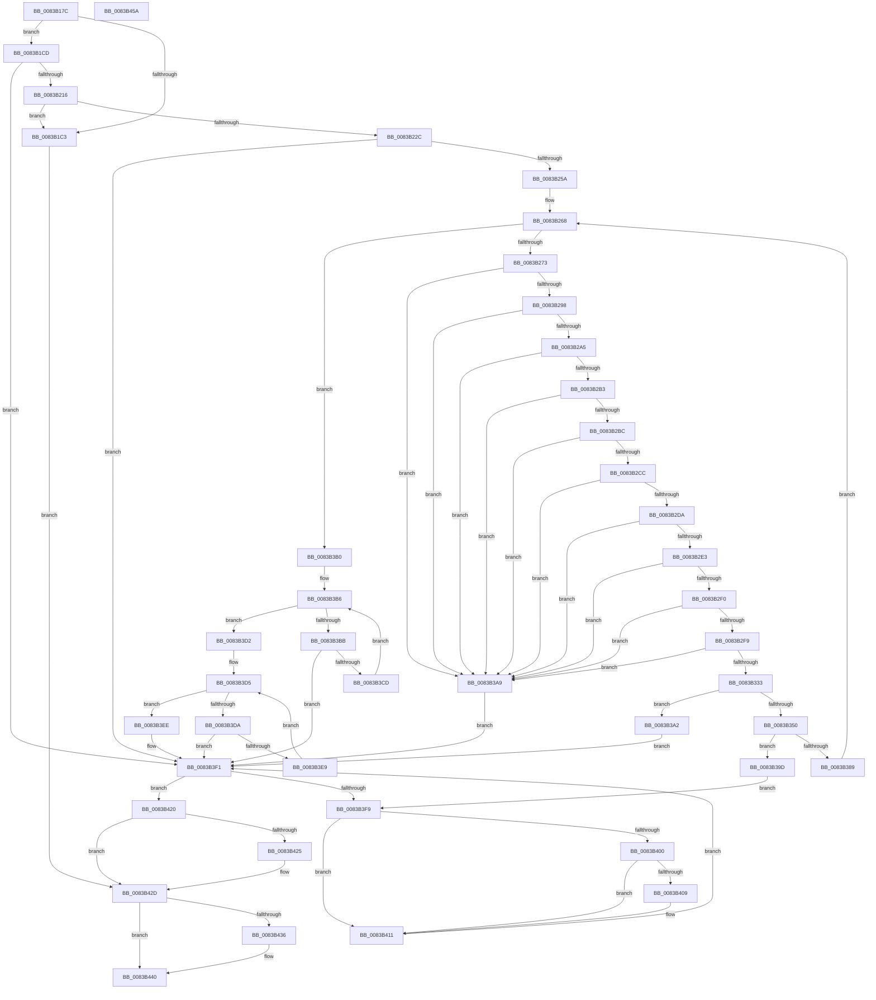

# VrpHandleIoctlCreateMultipleNamespaceNodes

- RVA: `0x0083B17C`–`0x0083B45B` (길이 `735` bytes)
- VA: `0x000000014083B17C`
- 실행 섹션: `PAGE`
- PDB 이름 있음: `예`; PDB Function 태그: `아니요`
- unwind 정보 RVA: `0x000DB154`
- 디코드: `206`개 명령, `735/735` bytes 표시
- 미해석 바이트: `0` (있으면 어셈블리에 `.byte`로 보존)

> 이 문서는 커널 이미지의 기계어와 PDB 기호를 분석해 생성했습니다. 4번과 5번은 함수 원형과 자료형을 바이너리 사용 방식에서 추정한 C 해석이며 원본 소스 복구 결과는 아닙니다.

## 1. Dependencies

- 직접 호출 지점: **14**; 고유 호출 대상: **14**
- 직접 호출자로 확인된 함수: **1**
- RIP 상대 이미지 참조: **2**

### Outgoing calls
- `0x0083B1FA` → [ObpReferenceObjectByHandleWithTag](../86/ObpReferenceObjectByHandleWithTag_function_00869650.md) (function, `0x00869650`)
- `0x0083B207` → [PsGetJobSilo](../../text/41/PsGetJobSilo_function_00418630.md) (function, `0x00418630`)
- `0x0083B223` → [PsIsThreadInSilo](../../text/41/PsIsThreadInSilo_function_0041859C.md) (function, `0x0041859C`)
- `0x0083B234` → [VRegEnabledInJob](../93/VRegEnabledInJob_function_009350B0.md) (function, `0x009350B0`)
- `0x0083B247` → [PsGetPermanentSiloContext](../../text/3E/PsGetPermanentSiloContext_function_003EE100.md) (function, `0x003EE100`)
- `0x0083B25D` → [VrpLockJobContextExclusive](../93/VrpLockJobContextExclusive_function_00935A34.md) (function, `0x00935A34`)
- `0x0083B343` → [ExAllocatePool2](../../poolcode/B8/ExAllocatePool2_function_00B820F0.md) (function, `0x00B820F0`)
- `0x0083B37E` → [VrpCreateNamespaceNode](../93/VrpCreateNamespaceNode_function_00935538.md) (function, `0x00935538`)
- `0x0083B3C2` → [VrpAddNamespaceNodeToList](../93/VrpAddNamespaceNodeToList_function_00935A94.md) (function, `0x00935A94`)
- `0x0083B3DE` → [VrpCreateNamespaceNodePlaceholderKey](../93/VrpCreateNamespaceNodePlaceholderKey_function_00935BAC.md) (function, `0x00935BAC`)
- `0x0083B40C` → [VrpDestroyNamespaceNode](../93/VrpDestroyNamespaceNode_function_00934A50.md) (function, `0x00934A50`)
- `0x0083B419` → [ExFreePoolWithTag](../../poolcode/B8/ExFreePoolWithTag_function_00B82870.md) (function, `0x00B82870`)
- `0x0083B428` → [VrpUnlockJobContextExclusive](../93/VrpUnlockJobContextExclusive_function_009354FC.md) (function, `0x009354FC`)
- `0x0083B43B` → [ObfDereferenceObjectWithTag](../../text/2F/ObfDereferenceObjectWithTag_function_002F78E0.md) (function, `0x002F78E0`)

### Direct callers
- [VrpIoctlDeviceDispatch](../93/VrpIoctlDeviceDispatch_function_00934C50.md) at `0x00934E19`

### Static image references
- `0x0083B1DC` → RVA `0x00FC6C58` (`ALMOSTRO`; read)
- `0x0083B239` → RVA `0x00EF02B8` (`.data`; read)

## 2. Other-region calls and transfers

- 다른 실행 섹션으로 향하는 call: **6**
  - `0x0083B207` → [PsGetJobSilo](../../text/41/PsGetJobSilo_function_00418630.md) (`PAGE` → `.text`)
  - `0x0083B223` → [PsIsThreadInSilo](../../text/41/PsIsThreadInSilo_function_0041859C.md) (`PAGE` → `.text`)
  - `0x0083B247` → [PsGetPermanentSiloContext](../../text/3E/PsGetPermanentSiloContext_function_003EE100.md) (`PAGE` → `.text`)
  - `0x0083B343` → [ExAllocatePool2](../../poolcode/B8/ExAllocatePool2_function_00B820F0.md) (`PAGE` → `POOLCODE`)
  - `0x0083B419` → [ExFreePoolWithTag](../../poolcode/B8/ExFreePoolWithTag_function_00B82870.md) (`PAGE` → `POOLCODE`)
  - `0x0083B43B` → [ObfDereferenceObjectWithTag](../../text/2F/ObfDereferenceObjectWithTag_function_002F78E0.md) (`PAGE` → `.text`)
- 별도 외부 분기/꼬리 이동을 확인하지 못했습니다.

## 3. Assembly (complete function range)

```asm
0083B17C  48 8B C4                        mov rax, rsp
0083B17F  48 89 58 18                     mov qword ptr [rax + 0x18], rbx
0083B183  4C 89 48 20                     mov qword ptr [rax + 0x20], r9
0083B187  89 50 10                        mov dword ptr [rax + 0x10], edx
0083B18A  48 89 48 08                     mov qword ptr [rax + 8], rcx
0083B18E  55                              push rbp
0083B18F  56                              push rsi
0083B190  57                              push rdi
0083B191  41 54                           push r12
0083B193  41 55                           push r13
0083B195  41 56                           push r14
0083B197  41 57                           push r15
0083B199  48 8B EC                        mov rbp, rsp
0083B19C  48 83 EC 70                     sub rsp, 0x70
0083B1A0  45 33 ED                        xor r13d, r13d
0083B1A3  4C 8B E1                        mov r12, rcx
0083B1A6  41 8B DD                        mov ebx, r13d
0083B1A9  4C 89 6D 68                     mov qword ptr [rbp + 0x68], r13
0083B1AD  45 8B F5                        mov r14d, r13d
0083B1B0  4C 89 6D 60                     mov qword ptr [rbp + 0x60], r13
0083B1B4  45 8B FD                        mov r15d, r13d
0083B1B7  4C 89 6D 58                     mov qword ptr [rbp + 0x58], r13
0083B1BB  41 8D 75 0C                     lea esi, [r13 + 0xc]
0083B1BF  3B D6                           cmp edx, esi
0083B1C1  73 0A                           jae 0x14083b1cd
0083B1C3  BF 0D 00 00 C0                  mov edi, 0xc000000d
0083B1C8  E9 60 02 00 00                  jmp 0x14083b42d
0083B1CD  48 8B 09                        mov rcx, qword ptr [rcx]
0083B1D0  48 8D 45 68                     lea rax, [rbp + 0x68]
0083B1D4  4C 89 6C 24 38                  mov qword ptr [rsp + 0x38], r13
0083B1D9  45 8A C8                        mov r9b, r8b
0083B1DC  4C 8B 05 75 BA 78 00            mov r8, qword ptr [rip + 0x78ba75]
0083B1E3  BA 06 00 00 00                  mov edx, 6
0083B1E8  4C 89 6C 24 30                  mov qword ptr [rsp + 0x30], r13
0083B1ED  48 89 44 24 28                  mov qword ptr [rsp + 0x28], rax
0083B1F2  C7 44 24 20 43 6D 56 52         mov dword ptr [rsp + 0x20], 0x52566d43
0083B1FA  E8 51 E4 02 00                  call 0x140869650
0083B1FF  48 8B 4D 68                     mov rcx, qword ptr [rbp + 0x68]
0083B203  48 8D 55 58                     lea rdx, [rbp + 0x58]
0083B207  E8 24 D4 BD FF                  call 0x140418630
0083B20C  8B F8                           mov edi, eax
0083B20E  85 C0                           test eax, eax
0083B210  0F 88 DB 01 00 00               js 0x14083b3f1
0083B216  65 48 8B 0C 25 88 01 00 00      mov rcx, qword ptr gs:[0x188]
0083B21F  48 8B 55 58                     mov rdx, qword ptr [rbp + 0x58]
0083B223  E8 74 D3 BD FF                  call 0x14041859c
0083B228  84 C0                           test al, al
0083B22A  75 97                           jne 0x14083b1c3
0083B22C  48 8D 4D D0                     lea rcx, [rbp - 0x30]
0083B230  4C 89 6D D0                     mov qword ptr [rbp - 0x30], r13
0083B234  E8 77 9E 0F 00                  call 0x1409350b0
0083B239  8B 15 79 50 6B 00               mov edx, dword ptr [rip + 0x6b5079]
0083B23F  4C 8D 45 60                     lea r8, [rbp + 0x60]
0083B243  48 8B 4D 58                     mov rcx, qword ptr [rbp + 0x58]
0083B247  E8 B4 2E BB FF                  call 0x1403ee100
0083B24C  4C 8B 75 60                     mov r14, qword ptr [rbp + 0x60]
0083B250  8B F8                           mov edi, eax
0083B252  85 C0                           test eax, eax
0083B254  0F 88 97 01 00 00               js 0x14083b3f1
0083B25A  49 8B CE                        mov rcx, r14
0083B25D  E8 D2 A7 0F 00                  call 0x140935a34
0083B262  41 BF 01 00 00 00               mov r15d, 1
0083B268  45 3B 6C 24 08                  cmp r13d, dword ptr [r12 + 8]
0083B26D  0F 83 3D 01 00 00               jae 0x14083b3b0
0083B273  33 FF                           xor edi, edi
0083B275  48 8D 46 0C                     lea rax, [rsi + 0xc]
0083B279  48 89 7D 60                     mov qword ptr [rbp + 0x60], rdi
0083B27D  0F 57 C0                        xorps xmm0, xmm0
0083B280  4E 8D 04 26                     lea r8, [rsi + r12]
0083B284  0F 57 C9                        xorps xmm1, xmm1
0083B287  0F 11 45 E8                     movups xmmword ptr [rbp - 0x18], xmm0
0083B28B  0F 11 4D D8                     movups xmmword ptr [rbp - 0x28], xmm1
0083B28F  48 3B F0                        cmp rsi, rax
0083B292  0F 87 11 01 00 00               ja 0x14083b3a9
0083B298  44 8B 5D 48                     mov r11d, dword ptr [rbp + 0x48]
0083B29C  4C 3B D8                        cmp r11, rax
0083B29F  0F 82 04 01 00 00               jb 0x14083b3a9
0083B2A5  41 0F B7 48 04                  movzx ecx, word ptr [r8 + 4]
0083B2AA  41 84 CF                        test r15b, cl
0083B2AD  0F 85 F6 00 00 00               jne 0x14083b3a9
0083B2B3  66 85 C9                        test cx, cx
0083B2B6  0F 84 ED 00 00 00               je 0x14083b3a9
0083B2BC  4C 8D 0C 01                     lea r9, [rcx + rax]
0083B2C0  44 8B D1                        mov r10d, ecx
0083B2C3  49 3B C1                        cmp rax, r9
0083B2C6  0F 87 DD 00 00 00               ja 0x14083b3a9
0083B2CC  41 0F B7 50 06                  movzx edx, word ptr [r8 + 6]
0083B2D1  41 84 D7                        test r15b, dl
0083B2D4  0F 85 CF 00 00 00               jne 0x14083b3a9
0083B2DA  66 85 D2                        test dx, dx
0083B2DD  0F 84 C6 00 00 00               je 0x14083b3a9
0083B2E3  49 8D 34 11                     lea rsi, [r9 + rdx]
0083B2E7  4C 3B CE                        cmp r9, rsi
0083B2EA  0F 87 B9 00 00 00               ja 0x14083b3a9
0083B2F0  4C 3B DE                        cmp r11, rsi
0083B2F3  0F 82 B0 00 00 00               jb 0x14083b3a9
0083B2F9  41 8B 78 08                     mov edi, dword ptr [r8 + 8]
0083B2FD  49 8D 40 0C                     lea rax, [r8 + 0xc]
0083B301  48 89 45 F0                     mov qword ptr [rbp - 0x10], rax
0083B305  49 D1 EA                        shr r10, 1
0083B308  66 89 4D EA                     mov word ptr [rbp - 0x16], cx
0083B30C  66 89 4D E8                     mov word ptr [rbp - 0x18], cx
0083B310  66 89 55 DA                     mov word ptr [rbp - 0x26], dx
0083B314  49 8D 42 06                     lea rax, [r10 + 6]
0083B318  66 89 55 D8                     mov word ptr [rbp - 0x28], dx
0083B31C  49 8D 04 40                     lea rax, [r8 + rax*2]
0083B320  48 89 45 E0                     mov qword ptr [rbp - 0x20], rax
0083B324  41 8B 00                        mov eax, dword ptr [r8]
0083B327  89 45 58                        mov dword ptr [rbp + 0x58], eax
0083B32A  8B C7                           mov eax, edi
0083B32C  83 E0 07                        and eax, 7
0083B32F  3B C7                           cmp eax, edi
0083B331  75 76                           jne 0x14083b3a9
0083B333  BA 10 00 00 00                  mov edx, 0x10
0083B338  B9 00 01 00 00                  mov ecx, 0x100
0083B33D  41 B8 56 52 65 67               mov r8d, 0x67655256
0083B343  E8 A8 6D 34 00                  call 0x140b820f0
0083B348  4C 8B E0                        mov r12, rax
0083B34B  48 85 C0                        test rax, rax
0083B34E  74 52                           je 0x14083b3a2
0083B350  48 83 60 08 00                  and qword ptr [rax + 8], 0
0083B355  4C 8D 4D D8                     lea r9, [rbp - 0x28]
0083B359  4C 8B 45 D0                     mov r8, qword ptr [rbp - 0x30]
0083B35D  48 8D 55 E8                     lea rdx, [rbp - 0x18]
0083B361  48 89 18                        mov qword ptr [rax], rbx
0083B364  49 8B CE                        mov rcx, r14
0083B367  48 8B D8                        mov rbx, rax
0083B36A  48 8D 45 60                     lea rax, [rbp + 0x60]
0083B36E  48 89 44 24 30                  mov qword ptr [rsp + 0x30], rax
0083B373  8B 45 58                        mov eax, dword ptr [rbp + 0x58]
0083B376  89 44 24 28                     mov dword ptr [rsp + 0x28], eax
0083B37A  89 7C 24 20                     mov dword ptr [rsp + 0x20], edi
0083B37E  E8 B5 A1 0F 00                  call 0x140935538
0083B383  8B F8                           mov edi, eax
0083B385  85 C0                           test eax, eax
0083B387  78 14                           js 0x14083b39d
0083B389  48 8B 45 60                     mov rax, qword ptr [rbp + 0x60]
0083B38D  45 03 EF                        add r13d, r15d
0083B390  4C 8B 65 40                     mov r12, qword ptr [rbp + 0x40]
0083B394  48 89 43 08                     mov qword ptr [rbx + 8], rax
0083B398  E9 CB FE FF FF                  jmp 0x14083b268
0083B39D  48 8B F3                        mov rsi, rbx
0083B3A0  EB 57                           jmp 0x14083b3f9
0083B3A2  BF 9A 00 00 C0                  mov edi, 0xc000009a
0083B3A7  EB 48                           jmp 0x14083b3f1
0083B3A9  BF 0D 00 00 C0                  mov edi, 0xc000000d
0083B3AE  EB 41                           jmp 0x14083b3f1
0083B3B0  48 8B F3                        mov rsi, rbx
0083B3B3  45 33 ED                        xor r13d, r13d
0083B3B6  48 85 F6                        test rsi, rsi
0083B3B9  74 17                           je 0x14083b3d2
0083B3BB  48 8B 56 08                     mov rdx, qword ptr [rsi + 8]
0083B3BF  49 8B CE                        mov rcx, r14
0083B3C2  E8 CD A6 0F 00                  call 0x140935a94
0083B3C7  8B F8                           mov edi, eax
0083B3C9  85 C0                           test eax, eax
0083B3CB  78 24                           js 0x14083b3f1
0083B3CD  48 8B 36                        mov rsi, qword ptr [rsi]
0083B3D0  EB E4                           jmp 0x14083b3b6
0083B3D2  48 8B F3                        mov rsi, rbx
0083B3D5  48 85 F6                        test rsi, rsi
0083B3D8  74 14                           je 0x14083b3ee
0083B3DA  48 8B 4E 08                     mov rcx, qword ptr [rsi + 8]
0083B3DE  E8 C9 A7 0F 00                  call 0x140935bac
0083B3E3  8B F8                           mov edi, eax
0083B3E5  85 C0                           test eax, eax
0083B3E7  78 08                           js 0x14083b3f1
0083B3E9  48 8B 36                        mov rsi, qword ptr [rsi]
0083B3EC  EB E7                           jmp 0x14083b3d5
0083B3EE  41 8B FD                        mov edi, r13d
0083B3F1  48 8B F3                        mov rsi, rbx
0083B3F4  48 85 DB                        test rbx, rbx
0083B3F7  74 27                           je 0x14083b420
0083B3F9  48 8B 1B                        mov rbx, qword ptr [rbx]
0083B3FC  85 FF                           test edi, edi
0083B3FE  79 11                           jns 0x14083b411
0083B400  48 8B 56 08                     mov rdx, qword ptr [rsi + 8]
0083B404  48 85 D2                        test rdx, rdx
0083B407  74 08                           je 0x14083b411
0083B409  49 8B CE                        mov rcx, r14
0083B40C  E8 3F 96 0F 00                  call 0x140934a50
0083B411  BA 56 52 65 67                  mov edx, 0x67655256
0083B416  48 8B CE                        mov rcx, rsi
0083B419  E8 52 74 34 00                  call 0x140b82870
0083B41E  EB D1                           jmp 0x14083b3f1
0083B420  45 85 FF                        test r15d, r15d
0083B423  74 08                           je 0x14083b42d
0083B425  49 8B CE                        mov rcx, r14
0083B428  E8 CF A0 0F 00                  call 0x1409354fc
0083B42D  48 8B 4D 68                     mov rcx, qword ptr [rbp + 0x68]
0083B431  48 85 C9                        test rcx, rcx
0083B434  74 0A                           je 0x14083b440
0083B436  BA 43 6D 56 52                  mov edx, 0x52566d43
0083B43B  E8 A0 C4 AB FF                  call 0x1402f78e0
0083B440  48 8B 9C 24 C0 00 00 00         mov rbx, qword ptr [rsp + 0xc0]
0083B448  8B C7                           mov eax, edi
0083B44A  48 83 C4 70                     add rsp, 0x70
0083B44E  41 5F                           pop r15
0083B450  41 5E                           pop r14
0083B452  41 5D                           pop r13
0083B454  41 5C                           pop r12
0083B456  5F                              pop rdi
0083B457  5E                              pop rsi
0083B458  5D                              pop rbp
0083B459  C3                              ret
0083B45A  CC                              int3
```

## 4. C-style interpretation (structured pseudocode)

```c
__int64 __fastcall VrpHandleIoctlCreateMultipleNamespaceNodes(__int64 a1, int a2, unsigned __int8 a3, __int64 a4, __int64 a5, __int64 a6)
{
    __int64 result;
    __int64 v_r10;
    __int64 v_r13;
    __int64 v_rdi;
    __int64 v_rsp;
    unsigned __int64 v_stack_m48;
    unsigned __int16 v_stack_m4E;
    unsigned __int64 v_stack_m50;
    unsigned __int64 v_stack_m58;
    unsigned __int16 v_stack_m5E;
    unsigned __int64 v_stack_m60;
    unsigned __int64 v_stack_m68;
    unsigned __int64 v_stack_m70;
    unsigned __int64 v_stack_m78;
    unsigned __int64 v_stack_m80;
    unsigned int v_stack_m88;
    unsigned int v_stack_p10;
    unsigned __int64 v_stack_p18;
    unsigned __int64 v_stack_p20;
    unsigned __int64 v_stack_p28;
    unsigned __int64 v_stack_p30;
    unsigned __int64 v_stack_p8;

    *(unsigned __int64 *)(v_rsp + 24) = v_rbx;
    *(unsigned __int64 *)(v_rsp + 32) = a4;
    *(unsigned int *)(v_rsp + 16) = a2;
    *(unsigned __int64 *)(v_rsp + 8) = a1;
    v_rsp = (v_rsp) - (112);
    v_r13 = 0;
    v_stack_p30 = 0;
    v_stack_p28 = 0;
    v_stack_p20 = 0;
    if (a2 >= ((unsigned int)(v_r13 + 12))) goto loc_0083B1CD;
loc_0083B1C3:
    goto loc_0083B42D;
loc_0083B1CD:
    v_stack_m70 = 0;
    v_stack_m78 = 0;
    v_stack_m80 = a6;
    v_stack_m88 = 0x52566D43ULL;
    result = ObpReferenceObjectByHandleWithTag(*(unsigned __int64 *)(a1), 6, *(unsigned __int64 *)(v_rip + 7912053), a3);
    result = PsGetJobSilo(a6, v_stack_p20, *(unsigned __int64 *)(v_rip + 7912053), a3);
    if (sign_flag) goto loc_0083B3F1;
    result = PsIsThreadInSilo(*(unsigned __int64 *)(gs_base + (0 + 392)), v_stack_p20, *(unsigned __int64 *)(v_rip + 7912053), a3);
    if ((unsigned __int8)(result) != 0) goto loc_0083B1C3;
    v_stack_m68 = 0;
    result = VRegEnabledInJob(v_stack_m68, v_stack_p20, *(unsigned __int64 *)(v_rip + 7912053), a3);
    result = PsGetPermanentSiloContext(v_stack_p20, (unsigned int)(*(unsigned int *)(v_rip + 7032953)), a5, a3);
    if (sign_flag) goto loc_0083B3F1;
    result = VrpLockJobContextExclusive(a5, (unsigned int)(*(unsigned int *)(v_rip + 7032953)), a5, a3);
loc_0083B268:
    if (0 >= (*(unsigned int *)(a1 + 8))) goto loc_0083B3B0;
    v_rdi = 0;
    v_stack_p28 = 0;
    v_stack_m50 = v_xmm0;
    v_stack_m60 = v_xmm1;
    if ((v_r13 + 12) > (v_r13 + 12 + 12)) goto loc_0083B3A9;
    if (((unsigned int)(v_stack_p10)) < (v_r13 + 12 + 12)) goto loc_0083B3A9;
    if (((1) & ((unsigned __int8)(*(unsigned __int16 *)(v_r13 + 12 + a1 * 1 + 4)))) != 0) goto loc_0083B3A9;
    if ((unsigned __int16)(*(unsigned __int16 *)(v_r13 + 12 + a1 * 1 + 4)) == 0) goto loc_0083B3A9;
    if ((v_r13 + 12 + 12) > (*(unsigned __int16 *)(v_r13 + 12 + a1 * 1 + 4) + v_r13 + 12 + 12 * 1)) goto loc_0083B3A9;
    if (((1) & ((unsigned __int8)(*(unsigned __int16 *)(v_r13 + 12 + a1 * 1 + 6)))) != 0) goto loc_0083B3A9;
    if ((unsigned __int16)(*(unsigned __int16 *)(v_r13 + 12 + a1 * 1 + 6)) == 0) goto loc_0083B3A9;
    if ((*(unsigned __int16 *)(v_r13 + 12 + a1 * 1 + 4) + v_r13 + 12 + 12 * 1) > (*(unsigned __int16 *)(v_r13 + 12 + a1 * 1 + 4) + v_r13 + 12 + 12 * 1 + *(unsigned __int16 *)(v_r13 + 12 + a1 * 1 + 6) * 1)) goto loc_0083B3A9;
    if (((unsigned int)(v_stack_p10)) < (*(unsigned __int16 *)(v_r13 + 12 + a1 * 1 + 4) + v_r13 + 12 + 12 * 1 + *(unsigned __int16 *)(v_r13 + 12 + a1 * 1 + 6) * 1)) goto loc_0083B3A9;
    v_stack_m48 = v_r13 + 12 + a1 * 1 + 12;
    v_r10 = ((unsigned int)((unsigned int)(*(unsigned __int16 *)(v_r13 + 12 + a1 * 1 + 4)))) >> (1);
    v_stack_m4E = (unsigned __int16)(*(unsigned __int16 *)(v_r13 + 12 + a1 * 1 + 4));
    v_stack_m50 = (unsigned __int16)(*(unsigned __int16 *)(v_r13 + 12 + a1 * 1 + 4));
    v_stack_m5E = (unsigned __int16)(*(unsigned __int16 *)(v_r13 + 12 + a1 * 1 + 6));
    v_stack_m60 = (unsigned __int16)(*(unsigned __int16 *)(v_r13 + 12 + a1 * 1 + 6));
    v_stack_m58 = v_r13 + 12 + a1 * 1 + v_r10 + 6 * 2;
    v_stack_p20 = (unsigned int)((unsigned int)(*(unsigned int *)(v_r13 + 12 + a1 * 1)));
    result = (unsigned int)(((unsigned int)((unsigned int)((unsigned int)(*(unsigned int *)(v_r13 + 12 + a1 * 1 + 8))))) & (7));
    if (((unsigned int)(result)) != ((unsigned int)((unsigned int)(*(unsigned int *)(v_r13 + 12 + a1 * 1 + 8))))) goto loc_0083B3A9;
    result = ExAllocatePool2(256, 16, (unsigned int)(0x67655256ULL), *(unsigned __int16 *)(v_r13 + 12 + a1 * 1 + 4) + v_r13 + 12 + 12 * 1);
    if (result == 0) goto loc_0083B3A2;
    *(unsigned __int64 *)(result) = 0;
    v_stack_m78 = a5;
    v_stack_m80 = (unsigned int)((unsigned int)(v_stack_p20));
    v_stack_m88 = (unsigned int)((unsigned int)(*(unsigned int *)(v_r13 + 12 + a1 * 1 + 8)));
    result = VrpCreateNamespaceNode(a5, v_stack_m50, v_stack_m68, v_stack_m60);
    if (sign_flag) goto loc_0083B39D;
    v_r13 = (unsigned int)((v_r13) + (1));
    *(unsigned __int64 *)(result + 8) = a5;
    goto loc_0083B268;
loc_0083B39D:
    goto loc_0083B3F9;
loc_0083B3A2:
    goto loc_0083B3F1;
loc_0083B3A9:
    goto loc_0083B3F1;
loc_0083B3B0:
    v_r13 = 0;
loc_0083B3B6:
    if (result == 0) goto loc_0083B3D2;
    result = VrpAddNamespaceNodeToList(a5, *(unsigned __int64 *)(result + 8), v_stack_m68, v_stack_m60);
    if (sign_flag) goto loc_0083B3F1;
    goto loc_0083B3B6;
loc_0083B3D2:
loc_0083B3D5:
    if (result == 0) goto loc_0083B3EE;
    result = VrpCreateNamespaceNodePlaceholderKey(*(unsigned __int64 *)(result + 8), *(unsigned __int64 *)(result + 8), v_stack_m68, v_stack_m60);
    if (sign_flag) goto loc_0083B3F1;
    goto loc_0083B3D5;
loc_0083B3EE:
loc_0083B3F1:
    if (result == 0) goto loc_0083B420;
loc_0083B3F9:
    if (!sign_flag) goto loc_0083B411;
    if (*(unsigned __int64 *)(result + 8) != 0) {
        a1 = a5;
        result = VrpDestroyNamespaceNode(a1, *(unsigned __int64 *)(result + 8), v_stack_m68, v_stack_m60);
    }
    result = ExFreePoolWithTag(result, (unsigned int)(0x67655256ULL), v_stack_m68, v_stack_m60);
    goto loc_0083B3F1;
loc_0083B420:
    if (1 != 0) {
        a1 = a5;
        result = VrpUnlockJobContextExclusive(a1, (unsigned int)(0x67655256ULL), v_stack_m68, v_stack_m60);
    }
    if (a6 != 0) {
        a2 = 0x52566D43ULL;
        result = ObfDereferenceObjectWithTag(a6, a2, v_stack_m68, v_stack_m60);
    }
    v_rsp = (v_rsp) + (112);
    return 0;
}
```

## 5. (Beta) C Style

```c
int64_t VrpHandleIoctlCreateMultipleNamespaceNodes(void *Arg1, int32_t Arg2, uint8_t Arg3, int64_t Arg4, int64_t Arg5, int64_t Arg6)
{
    uint8_t *arg1 = (uint8_t *)Arg1;

    int64_t result;
    int64_t local_r10;
    int64_t local_r13;
    int64_t local_rdi;
    int64_t local_rsp;
    uint64_t v_stack_m48;
    uint16_t v_stack_m4E;
    uint64_t v_stack_m50;
    uint64_t v_stack_m58;
    uint16_t v_stack_m5E;
    uint64_t v_stack_m60;
    uint64_t v_stack_m68;
    uint64_t v_stack_m70;
    uint64_t v_stack_m78;
    uint64_t v_stack_m80;
    uint32_t v_stack_m88;
    uint32_t v_stack_p10;
    uint64_t v_stack_p18;
    uint64_t v_stack_p20;
    uint64_t v_stack_p28;
    uint64_t v_stack_p30;
    uint64_t v_stack_p8;

    *(uint64_t *)(local_rsp + 0x18) = local_rbx;
    *(uint64_t *)(local_rsp + 0x20) = Arg4;
    *(uint32_t *)(local_rsp + 0x10) = Arg2;
    *(void **)(local_rsp + 0x8) = Arg1;
    local_rsp = (local_rsp) - (112);
    local_r13 = 0;
    v_stack_p30 = 0;
    v_stack_p28 = 0;
    v_stack_p20 = 0;
    if (Arg2 >= ((uint32_t)(local_r13 + 12))) goto loc_0083B1CD;
loc_0083B1C3:
    goto loc_0083B42D;
loc_0083B1CD:
    v_stack_m70 = 0;
    v_stack_m78 = 0;
    v_stack_m80 = Arg6;
    v_stack_m88 = 0x52566D43ULL;
    result = ObpReferenceObjectByHandleWithTag(*(uint64_t *)(arg1), 6, *(uint64_t *)(v_rip + 0x78BA75), Arg3);
    result = PsGetJobSilo(Arg6, v_stack_p20, *(uint64_t *)(v_rip + 0x78BA75), Arg3);
    if (sign_flag) goto loc_0083B3F1;
    result = PsIsThreadInSilo(*(uint64_t *)(gs_base + (0 + 0x188)), v_stack_p20, *(uint64_t *)(v_rip + 0x78BA75), Arg3);
    if ((uint8_t)(result) != 0) goto loc_0083B1C3;
    v_stack_m68 = 0;
    result = VRegEnabledInJob(v_stack_m68, v_stack_p20, *(uint64_t *)(v_rip + 0x78BA75), Arg3);
    result = PsGetPermanentSiloContext(v_stack_p20, (uint32_t)(*(uint32_t *)(v_rip + 0x6B5079)), Arg5, Arg3);
    if (sign_flag) goto loc_0083B3F1;
    result = VrpLockJobContextExclusive(Arg5, (uint32_t)(*(uint32_t *)(v_rip + 0x6B5079)), Arg5, Arg3);
loc_0083B268:
    if (0 >= (*(uint32_t *)(arg1 + 0x8))) goto loc_0083B3B0;
    local_rdi = 0;
    v_stack_p28 = 0;
    v_stack_m50 = v_xmm0;
    v_stack_m60 = v_xmm1;
    if ((local_r13 + 12) > (local_r13 + 12 + 12)) goto loc_0083B3A9;
    if (((uint32_t)(v_stack_p10)) < (local_r13 + 12 + 12)) goto loc_0083B3A9;
    if (((1) & ((uint8_t)(*(uint16_t *)(local_r13 + 0xC + arg1 * 1 + 0x4)))) != 0) goto loc_0083B3A9;
    if ((uint16_t)(*(uint16_t *)(local_r13 + 0xC + arg1 * 1 + 0x4)) == 0) goto loc_0083B3A9;
    if ((local_r13 + 12 + 12) > (*(uint16_t *)(local_r13 + 0xC + arg1 * 1 + 0x4) + local_r13 + 12 + 12 * 1)) goto loc_0083B3A9;
    if (((1) & ((uint8_t)(*(uint16_t *)(local_r13 + 0xC + arg1 * 1 + 0x6)))) != 0) goto loc_0083B3A9;
    if ((uint16_t)(*(uint16_t *)(local_r13 + 0xC + arg1 * 1 + 0x6)) == 0) goto loc_0083B3A9;
    if ((*(uint16_t *)(local_r13 + 0xC + arg1 * 1 + 0x4) + local_r13 + 12 + 12 * 1) > (*(uint16_t *)(local_r13 + 0xC + arg1 * 1 + 0x4) + local_r13 + 12 + 12 * 1 + *(uint16_t *)(local_r13 + 0xC + arg1 * 1 + 0x6) * 1)) goto loc_0083B3A9;
    if (((uint32_t)(v_stack_p10)) < (*(uint16_t *)(local_r13 + 0xC + arg1 * 1 + 0x4) + local_r13 + 12 + 12 * 1 + *(uint16_t *)(local_r13 + 0xC + arg1 * 1 + 0x6) * 1)) goto loc_0083B3A9;
    v_stack_m48 = local_r13 + 12 + Arg1 * 1 + 12;
    local_r10 = ((uint32_t)((uint32_t)(*(uint16_t *)(local_r13 + 0xC + arg1 * 1 + 0x4)))) >> (1);
    v_stack_m4E = (uint16_t)(*(uint16_t *)(local_r13 + 0xC + arg1 * 1 + 0x4));
    v_stack_m50 = (uint16_t)(*(uint16_t *)(local_r13 + 0xC + arg1 * 1 + 0x4));
    v_stack_m5E = (uint16_t)(*(uint16_t *)(local_r13 + 0xC + arg1 * 1 + 0x6));
    v_stack_m60 = (uint16_t)(*(uint16_t *)(local_r13 + 0xC + arg1 * 1 + 0x6));
    v_stack_m58 = local_r13 + 12 + Arg1 * 1 + local_r10 + 6 * 2;
    v_stack_p20 = (uint32_t)((uint32_t)(*(uint32_t *)(local_r13 + 0xC + arg1 * 1)));
    result = (uint32_t)(((uint32_t)((uint32_t)((uint32_t)(*(uint32_t *)(local_r13 + 0xC + arg1 * 1 + 0x8))))) & (7));
    if (((uint32_t)(result)) != ((uint32_t)((uint32_t)(*(uint32_t *)(local_r13 + 0xC + arg1 * 1 + 0x8))))) goto loc_0083B3A9;
    result = ExAllocatePool2(256, 16, (uint32_t)(0x67655256ULL), *(uint16_t *)(local_r13 + 0xC + arg1 * 1 + 0x4) + local_r13 + 12 + 12 * 1);
    if (result == 0) goto loc_0083B3A2;
    *(uint64_t *)(result) = 0;
    v_stack_m78 = Arg5;
    v_stack_m80 = (uint32_t)((uint32_t)(v_stack_p20));
    v_stack_m88 = (uint32_t)((uint32_t)(*(uint32_t *)(local_r13 + 0xC + arg1 * 1 + 0x8)));
    result = VrpCreateNamespaceNode(Arg5, v_stack_m50, v_stack_m68, v_stack_m60);
    if (sign_flag) goto loc_0083B39D;
    local_r13 = (uint32_t)((local_r13) + (1));
    *(uint64_t *)(result + 0x8) = Arg5;
    goto loc_0083B268;
loc_0083B39D:
    goto loc_0083B3F9;
loc_0083B3A2:
    goto loc_0083B3F1;
loc_0083B3A9:
    goto loc_0083B3F1;
loc_0083B3B0:
    local_r13 = 0;
loc_0083B3B6:
    if (result == 0) goto loc_0083B3D2;
    result = VrpAddNamespaceNodeToList(Arg5, *(uint64_t *)(result + 0x8), v_stack_m68, v_stack_m60);
    if (sign_flag) goto loc_0083B3F1;
    goto loc_0083B3B6;
loc_0083B3D2:
loc_0083B3D5:
    if (result == 0) goto loc_0083B3EE;
    result = VrpCreateNamespaceNodePlaceholderKey(*(uint64_t *)(result + 0x8), *(uint64_t *)(result + 0x8), v_stack_m68, v_stack_m60);
    if (sign_flag) goto loc_0083B3F1;
    goto loc_0083B3D5;
loc_0083B3EE:
loc_0083B3F1:
    if (result == 0) goto loc_0083B420;
loc_0083B3F9:
    if (!sign_flag) goto loc_0083B411;
    if (*(uint64_t *)(result + 0x8) != 0) {
        Arg1 = Arg5;
        result = VrpDestroyNamespaceNode(Arg1, *(uint64_t *)(result + 0x8), v_stack_m68, v_stack_m60);
    }
    result = ExFreePoolWithTag(result, (uint32_t)(0x67655256ULL), v_stack_m68, v_stack_m60);
    goto loc_0083B3F1;
loc_0083B420:
    if (1 != 0) {
        Arg1 = Arg5;
        result = VrpUnlockJobContextExclusive(Arg1, (uint32_t)(0x67655256ULL), v_stack_m68, v_stack_m60);
    }
    if (Arg6 != 0) {
        Arg2 = 0x52566D43ULL;
        result = ObfDereferenceObjectWithTag(Arg6, Arg2, v_stack_m68, v_stack_m60);
    }
    local_rsp = (local_rsp) + (112);
    return 0;
}
```

### 관측된 메모리 오프셋

구조체 형식이 확인되지 않은 접근은 인자 기준의 오프셋으로만 기록했습니다.

| 기준 인자 | 오프셋 표현 | 폭 (bit) | 접근 |
|---|---:|---:|---|
| `Arg1` | `+ 0x0` | `64` | `R` |

## 6. Execution-region graph

[열기: 2D/3D 그래프와 함수 탐색 컨트롤 패널](../../../control-panel.html?section=page&rva=0x0083B17C&view=graph)

- 2D 그래프는 위에서 아래로 흐르고, 3D 그래프는 빈 공간을 드래그해 회전합니다. Shift+드래그는 이동, 휠은 확대·축소, 함수 노드 선택은 대상 보고서 이동입니다.

### Static fallback


