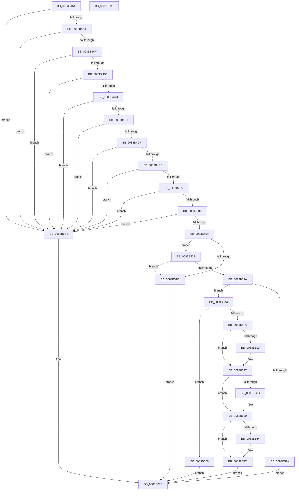

# VrpHandleIoctlLoadDifferencingHiveForHost

- RVA: `0x0083B464`–`0x0083B696` (길이 `562` bytes)
- VA: `0x000000014083B464`
- 실행 섹션: `PAGE`
- PDB 이름 있음: `예`; PDB Function 태그: `아니요`
- unwind 정보 RVA: `0x000C9008`
- 디코드: `150`개 명령, `562/562` bytes 표시
- 미해석 바이트: `0` (있으면 어셈블리에 `.byte`로 보존)

> 이 문서는 커널 이미지의 기계어와 PDB 기호를 분석해 생성했습니다. 4번과 5번은 함수 원형과 자료형을 바이너리 사용 방식에서 추정한 C 해석이며 원본 소스 복구 결과는 아닙니다.

## 1. Dependencies

- 직접 호출 지점: **10**; 고유 호출 대상: **9**
- 직접 호출자로 확인된 함수: **1**
- RIP 상대 이미지 참조: **6**

### Outgoing calls
- `0x0083B514` → [SeSinglePrivilegeCheck](../87/SeSinglePrivilegeCheck_function_00871E20.md) (function, `0x00871E20`)
- `0x0083B531` → [SeSinglePrivilegeCheck](../87/SeSinglePrivilegeCheck_function_00871E20.md) (function, `0x00871E20`)
- `0x0083B58D` → [ExAllocatePool2](../../poolcode/B8/ExAllocatePool2_function_00B820F0.md) (function, `0x00B820F0`)
- `0x0083B5B9` → [memcpy](../../text/6C/memcpy_function_006C6840.md) (function, `0x006C6840`)
- `0x0083B5EF` → [VrpLoadDifferencingHive](../93/VrpLoadDifferencingHive_function_00935F40.md) (function, `0x00935F40`)
- `0x0083B609` → [KeAbPreAcquire](../../text/21/KeAbPreAcquire_function_00210230.md) (function, `0x00210230`)
- `0x0083B622` → [ExfAcquirePushLockExclusiveEx](../../text/20/ExfAcquirePushLockExclusiveEx_function_0020FC90.md) (function, `0x0020FC90`)
- `0x0083B657` → [ExfTryToWakePushLock](../../text/26/ExfTryToWakePushLock_function_00265DD0.md) (function, `0x00265DD0`)
- `0x0083B65F` → [KeAbPostRelease](../../text/2E/KeAbPostRelease_function_002E1600.md) (function, `0x002E1600`)
- `0x0083B66B` → [ExFreePoolWithTag](../../poolcode/B8/ExFreePoolWithTag_function_00B82870.md) (function, `0x00B82870`)

### Direct callers
- [sub_00B24A66](../B2/Unknown_function_00B24A66.md) at `0x00B24B44`

### Static image references
- `0x0083B50A` → RVA `0x00FD9AC0` (`PAGEDATA`; read)
- `0x0083B527` → RVA `0x00FD9AE0` (`PAGEDATA`; read)
- `0x0083B5FA` → RVA `0x00EF0038` (`.data`; read)
- `0x0083B630` → RVA `0x00EF0030` (`.data`; read)
- `0x0083B63E` → RVA `0x00EF0030` (`.data`; write)
- `0x0083B645` → RVA `0x00EF0038` (`.data`; read/write)

## 2. Other-region calls and transfers

- 다른 실행 섹션으로 향하는 call: **7**
  - `0x0083B58D` → [ExAllocatePool2](../../poolcode/B8/ExAllocatePool2_function_00B820F0.md) (`PAGE` → `POOLCODE`)
  - `0x0083B5B9` → [memcpy](../../text/6C/memcpy_function_006C6840.md) (`PAGE` → `.text`)
  - `0x0083B609` → [KeAbPreAcquire](../../text/21/KeAbPreAcquire_function_00210230.md) (`PAGE` → `.text`)
  - `0x0083B622` → [ExfAcquirePushLockExclusiveEx](../../text/20/ExfAcquirePushLockExclusiveEx_function_0020FC90.md) (`PAGE` → `.text`)
  - `0x0083B657` → [ExfTryToWakePushLock](../../text/26/ExfTryToWakePushLock_function_00265DD0.md) (`PAGE` → `.text`)
  - `0x0083B65F` → [KeAbPostRelease](../../text/2E/KeAbPostRelease_function_002E1600.md) (`PAGE` → `.text`)
  - `0x0083B66B` → [ExFreePoolWithTag](../../poolcode/B8/ExFreePoolWithTag_function_00B82870.md) (`PAGE` → `POOLCODE`)
- 별도 외부 분기/꼬리 이동을 확인하지 못했습니다.

## 3. Assembly (complete function range)

```asm
0083B464  48 8B C4                        mov rax, rsp
0083B467  48 89 58 08                     mov qword ptr [rax + 8], rbx
0083B46B  48 89 70 10                     mov qword ptr [rax + 0x10], rsi
0083B46F  48 89 78 18                     mov qword ptr [rax + 0x18], rdi
0083B473  4C 89 70 20                     mov qword ptr [rax + 0x20], r14
0083B477  55                              push rbp
0083B478  48 8B EC                        mov rbp, rsp
0083B47B  48 83 EC 70                     sub rsp, 0x70
0083B47F  0F 57 C0                        xorps xmm0, xmm0
0083B482  0F 57 C9                        xorps xmm1, xmm1
0083B485  41 8A F0                        mov sil, r8b
0083B488  44 8B CA                        mov r9d, edx
0083B48B  48 8B F9                        mov rdi, rcx
0083B48E  0F 11 45 E0                     movups xmmword ptr [rbp - 0x20], xmm0
0083B492  0F 11 4D F0                     movups xmmword ptr [rbp - 0x10], xmm1
0083B496  0F 11 45 D0                     movups xmmword ptr [rbp - 0x30], xmm0
0083B49A  83 FA 20                        cmp edx, 0x20
0083B49D  0F 82 D1 01 00 00               jb 0x14083b674
0083B4A3  0F B7 41 08                     movzx eax, word ptr [rcx + 8]
0083B4A7  A8 01                           test al, 1
0083B4A9  0F 85 C5 01 00 00               jne 0x14083b674
0083B4AF  0F B7 49 0A                     movzx ecx, word ptr [rcx + 0xa]
0083B4B3  F6 C1 01                        test cl, 1
0083B4B6  0F 85 B8 01 00 00               jne 0x14083b674
0083B4BC  44 0F B7 47 0C                  movzx r8d, word ptr [rdi + 0xc]
0083B4C1  41 F6 C0 01                     test r8b, 1
0083B4C5  0F 85 A9 01 00 00               jne 0x14083b674
0083B4CB  33 DB                           xor ebx, ebx
0083B4CD  66 85 C0                        test ax, ax
0083B4D0  0F 84 9E 01 00 00               je 0x14083b674
0083B4D6  66 85 C9                        test cx, cx
0083B4D9  0F 84 95 01 00 00               je 0x14083b674
0083B4DF  8D 50 18                        lea edx, [rax + 0x18]
0083B4E2  83 FA 18                        cmp edx, 0x18
0083B4E5  0F 82 89 01 00 00               jb 0x14083b674
0083B4EB  03 CA                           add ecx, edx
0083B4ED  3B D1                           cmp edx, ecx
0083B4EF  0F 87 7F 01 00 00               ja 0x14083b674
0083B4F5  42 8D 14 01                     lea edx, [rcx + r8]
0083B4F9  3B CA                           cmp ecx, edx
0083B4FB  0F 87 73 01 00 00               ja 0x14083b674
0083B501  44 3B CA                        cmp r9d, edx
0083B504  0F 82 6A 01 00 00               jb 0x14083b674
0083B50A  48 8B 0D AF E5 79 00            mov rcx, qword ptr [rip + 0x79e5af]
0083B511  40 8A D6                        mov dl, sil
0083B514  E8 07 69 03 00                  call 0x140871e20
0083B519  84 C0                           test al, al
0083B51B  75 0A                           jne 0x14083b527
0083B51D  BB 61 00 00 C0                  mov ebx, 0xc0000061
0083B522  E9 52 01 00 00                  jmp 0x14083b679
0083B527  48 8B 0D B2 E5 79 00            mov rcx, qword ptr [rip + 0x79e5b2]
0083B52E  40 8A D6                        mov dl, sil
0083B531  E8 EA 68 03 00                  call 0x140871e20
0083B536  84 C0                           test al, al
0083B538  74 E3                           je 0x14083b51d
0083B53A  0F B7 57 08                     movzx edx, word ptr [rdi + 8]
0083B53E  48 8D 4F 18                     lea rcx, [rdi + 0x18]
0083B542  8B C2                           mov eax, edx
0083B544  48 89 4D D8                     mov qword ptr [rbp - 0x28], rcx
0083B548  48 D1 E8                        shr rax, 1
0083B54B  41 B8 56 52 65 67               mov r8d, 0x67655256
0083B551  66 89 55 D2                     mov word ptr [rbp - 0x2e], dx
0083B555  66 89 55 D0                     mov word ptr [rbp - 0x30], dx
0083B559  48 83 C2 0A                     add rdx, 0xa
0083B55D  48 8D 0C 41                     lea rcx, [rcx + rax*2]
0083B561  0F B7 47 0A                     movzx eax, word ptr [rdi + 0xa]
0083B565  66 89 45 F2                     mov word ptr [rbp - 0xe], ax
0083B569  66 89 45 F0                     mov word ptr [rbp - 0x10], ax
0083B56D  48 D1 E8                        shr rax, 1
0083B570  48 89 4D F8                     mov qword ptr [rbp - 8], rcx
0083B574  48 8D 04 41                     lea rax, [rcx + rax*2]
0083B578  B9 01 01 00 00                  mov ecx, 0x101
0083B57D  48 89 45 E8                     mov qword ptr [rbp - 0x18], rax
0083B581  0F B7 47 0C                     movzx eax, word ptr [rdi + 0xc]
0083B585  66 89 45 E2                     mov word ptr [rbp - 0x1e], ax
0083B589  66 89 45 E0                     mov word ptr [rbp - 0x20], ax
0083B58D  E8 5E 6B 34 00                  call 0x140b820f0
0083B592  48 8B F0                        mov rsi, rax
0083B595  48 85 C0                        test rax, rax
0083B598  75 0A                           jne 0x14083b5a4
0083B59A  BB 9A 00 00 C0                  mov ebx, 0xc000009a
0083B59F  E9 D5 00 00 00                  jmp 0x14083b679
0083B5A4  0F B7 45 D0                     movzx eax, word ptr [rbp - 0x30]
0083B5A8  48 8D 4E 0A                     lea rcx, [rsi + 0xa]
0083B5AC  66 89 46 08                     mov word ptr [rsi + 8], ax
0083B5B0  44 0F B7 45 D0                  movzx r8d, word ptr [rbp - 0x30]
0083B5B5  48 8B 55 D8                     mov rdx, qword ptr [rbp - 0x28]
0083B5B9  E8 82 B2 E8 FF                  call 0x1406c6840
0083B5BE  8B 57 04                        mov edx, dword ptr [rdi + 4]
0083B5C1  4C 8D 45 E0                     lea r8, [rbp - 0x20]
0083B5C5  48 8B 47 10                     mov rax, qword ptr [rdi + 0x10]
0083B5C9  8B CA                           mov ecx, edx
0083B5CB  44 8B 0F                        mov r9d, dword ptr [rdi]
0083B5CE  83 E2 01                        and edx, 1
0083B5D1  48 89 44 24 38                  mov qword ptr [rsp + 0x38], rax
0083B5D6  D1 E9                           shr ecx, 1
0083B5D8  83 E1 01                        and ecx, 1
0083B5DB  89 5C 24 30                     mov dword ptr [rsp + 0x30], ebx
0083B5DF  89 4C 24 28                     mov dword ptr [rsp + 0x28], ecx
0083B5E3  48 8D 4D D0                     lea rcx, [rbp - 0x30]
0083B5E7  89 54 24 20                     mov dword ptr [rsp + 0x20], edx
0083B5EB  48 8D 55 F0                     lea rdx, [rbp - 0x10]
0083B5EF  E8 4C A9 0F 00                  call 0x140935f40
0083B5F4  8B F8                           mov edi, eax
0083B5F6  85 C0                           test eax, eax
0083B5F8  78 6C                           js 0x14083b666
0083B5FA  4C 8D 35 37 4A 6B 00            lea r14, [rip + 0x6b4a37]
0083B601  45 33 C0                        xor r8d, r8d
0083B604  49 8B CE                        mov rcx, r14
0083B607  33 D2                           xor edx, edx
0083B609  E8 22 4C 9D FF                  call 0x140210230
0083B60E  F0 49 0F BA 2E 00               lock bts qword ptr [r14], 0
0083B614  48 8B F8                        mov rdi, rax
0083B617  73 0E                           jae 0x14083b627
0083B619  4D 8B C6                        mov r8, r14
0083B61C  48 8B D0                        mov rdx, rax
0083B61F  49 8B CE                        mov rcx, r14
0083B622  E8 69 46 9D FF                  call 0x14020fc90
0083B627  48 85 FF                        test rdi, rdi
0083B62A  74 04                           je 0x14083b630
0083B62C  C6 47 0A 01                     mov byte ptr [rdi + 0xa], 1
0083B630  48 8B 05 F9 49 6B 00            mov rax, qword ptr [rip + 0x6b49f9]
0083B637  48 89 06                        mov qword ptr [rsi], rax
0083B63A  48 83 C8 FF                     or rax, 0xffffffffffffffff
0083B63E  48 89 35 EB 49 6B 00            mov qword ptr [rip + 0x6b49eb], rsi
0083B645  F0 48 0F C1 05 EA 49 6B 00      lock xadd qword ptr [rip + 0x6b49ea], rax
0083B64E  24 06                           and al, 6
0083B650  3C 02                           cmp al, 2
0083B652  75 08                           jne 0x14083b65c
0083B654  49 8B CE                        mov rcx, r14
0083B657  E8 74 A7 A2 FF                  call 0x140265dd0
0083B65C  49 8B CE                        mov rcx, r14
0083B65F  E8 9C 5F AA FF                  call 0x1402e1600
0083B664  EB 13                           jmp 0x14083b679
0083B666  33 D2                           xor edx, edx
0083B668  48 8B CE                        mov rcx, rsi
0083B66B  E8 00 72 34 00                  call 0x140b82870
0083B670  8B DF                           mov ebx, edi
0083B672  EB 05                           jmp 0x14083b679
0083B674  BB 0D 00 00 C0                  mov ebx, 0xc000000d
0083B679  4C 8D 5C 24 70                  lea r11, [rsp + 0x70]
0083B67E  8B C3                           mov eax, ebx
0083B680  49 8B 5B 10                     mov rbx, qword ptr [r11 + 0x10]
0083B684  49 8B 73 18                     mov rsi, qword ptr [r11 + 0x18]
0083B688  49 8B 7B 20                     mov rdi, qword ptr [r11 + 0x20]
0083B68C  4D 8B 73 28                     mov r14, qword ptr [r11 + 0x28]
0083B690  49 8B E3                        mov rsp, r11
0083B693  5D                              pop rbp
0083B694  C3                              ret
0083B695  CC                              int3
```

## 4. C-style interpretation (structured pseudocode)

```c
__int64 __fastcall VrpHandleIoctlLoadDifferencingHiveForHost(__int64 a1, int a2, unsigned __int8 a3)
{
    __int64 result;
    __int64 v_rbx;
    __int64 v_rsp;
    unsigned __int64 v_stack_m10;
    unsigned __int16 v_stack_m16;
    unsigned __int64 v_stack_m18;
    unsigned __int64 v_stack_m20;
    unsigned __int16 v_stack_m26;
    unsigned __int64 v_stack_m28;
    unsigned __int64 v_stack_m30;
    unsigned __int16 v_stack_m36;
    unsigned __int64 v_stack_m38;
    unsigned __int64 v_stack_m40;
    unsigned int v_stack_m48;
    unsigned int v_stack_m50;
    unsigned int v_stack_m58;
    unsigned __int64 v_stack_m8;

    *(unsigned __int64 *)(v_rsp + 8) = v_rbx;
    *(unsigned __int64 *)(v_rsp + 16) = v_rsi;
    *(unsigned __int64 *)(v_rsp + 24) = v_rdi;
    *(unsigned __int64 *)(v_rsp + 32) = v_r14;
    v_rsp = (v_rsp) - (112);
    v_stack_m28 = v_xmm0;
    v_stack_m18 = v_xmm1;
    v_stack_m38 = v_xmm0;
    if (a2 < 32) goto loc_0083B674;
    if ((((unsigned __int8)(*(unsigned __int16 *)(a1 + 8))) & (1)) != 0) goto loc_0083B674;
    if ((((unsigned __int8)(*(unsigned __int16 *)(a1 + 10))) & (1)) != 0) goto loc_0083B674;
    if ((((unsigned __int8)(*(unsigned __int16 *)(a1 + 12))) & (1)) != 0) goto loc_0083B674;
    v_rbx = 0;
    if ((unsigned __int16)(*(unsigned __int16 *)(a1 + 8)) == 0) goto loc_0083B674;
    if ((unsigned __int16)(*(unsigned __int16 *)(a1 + 10)) == 0) goto loc_0083B674;
    if (((unsigned int)(*(unsigned __int16 *)(a1 + 8) + 24)) < 24) goto loc_0083B674;
    a1 = (unsigned int)((*(unsigned __int16 *)(a1 + 10)) + ((unsigned int)(*(unsigned __int16 *)(a1 + 8) + 24)));
    if (((unsigned int)(*(unsigned __int16 *)(a1 + 8) + 24)) > ((unsigned int)(a1))) goto loc_0083B674;
    if (((unsigned int)(a1)) > ((unsigned int)(a1 + *(unsigned __int16 *)(a1 + 12) * 1))) goto loc_0083B674;
    if (((unsigned int)((unsigned int)(a2))) < ((unsigned int)(a1 + *(unsigned __int16 *)(a1 + 12) * 1))) goto loc_0083B674;
    result = SeSinglePrivilegeCheck(*(unsigned __int64 *)(v_rip + 7988655), a3, *(unsigned __int16 *)(a1 + 12), (unsigned int)(a2));
    if ((unsigned __int8)(result) != 0) goto loc_0083B527;
loc_0083B51D:
    goto loc_0083B679;
loc_0083B527:
    result = SeSinglePrivilegeCheck(*(unsigned __int64 *)(v_rip + 7988658), a3, *(unsigned __int16 *)(a1 + 12), (unsigned int)(a2));
    if ((unsigned __int8)(result) == 0) goto loc_0083B51D;
    v_stack_m30 = a1 + 24;
    result = ((unsigned int)((unsigned int)(*(unsigned __int16 *)(a1 + 8)))) >> (1);
    v_stack_m36 = (unsigned __int16)(*(unsigned __int16 *)(a1 + 8));
    v_stack_m38 = (unsigned __int16)(*(unsigned __int16 *)(a1 + 8));
    a2 = (*(unsigned __int16 *)(a1 + 8)) + (10);
    v_stack_m16 = (unsigned __int16)(*(unsigned __int16 *)(a1 + 10));
    v_stack_m18 = (unsigned __int16)(*(unsigned __int16 *)(a1 + 10));
    result = (*(unsigned __int16 *)(a1 + 10)) >> (1);
    v_stack_m10 = a1 + 24 + result * 2;
    v_stack_m20 = a1 + 24 + result * 2 + result * 2;
    v_stack_m26 = (unsigned __int16)(*(unsigned __int16 *)(a1 + 12));
    v_stack_m28 = (unsigned __int16)(*(unsigned __int16 *)(a1 + 12));
    result = ExAllocatePool2(257, a2, (unsigned int)(0x67655256ULL), (unsigned int)(a2));
    if (result != 0) goto loc_0083B5A4;
    goto loc_0083B679;
loc_0083B5A4:
    *(unsigned __int16 *)(result + 8) = (unsigned __int16)(v_stack_m38);
    result = memcpy(result + 10, v_stack_m30, v_stack_m38, (unsigned int)(a2));
    a2 = (unsigned int)(((unsigned int)(*(unsigned int *)(a1 + 4))) & (1));
    v_stack_m40 = *(unsigned __int64 *)(a1 + 16);
    a1 = (unsigned int)(((unsigned int)((unsigned int)((unsigned int)(*(unsigned int *)(a1 + 4))))) >> (1));
    a1 = (unsigned int)((a1) & (1));
    v_stack_m48 = (unsigned int)((unsigned int)(0xC000009AULL));
    v_stack_m50 = (unsigned int)(a1);
    v_stack_m58 = a2;
    result = VrpLoadDifferencingHive(v_stack_m38, v_stack_m18, v_stack_m28, (unsigned int)(*(unsigned int *)(a1)));
    if (sign_flag) goto loc_0083B666;
    a3 = 0;
    a2 = 0;
    result = KeAbPreAcquire(v_rip + 7031351, a2, a3, (unsigned int)(*(unsigned int *)(a1)));
    if (!(condition_is_above_or_equal)) {
        a3 = v_rip + 7031351;
        a2 = result;
        a1 = v_rip + 7031351;
        result = ExfAcquirePushLockExclusiveEx(a1, a2, a3, (unsigned int)(*(unsigned int *)(a1)));
    }
    if (result != 0) {
        *(unsigned __int8 *)(result + 10) = 1;
    }
    *(unsigned __int64 *)(result) = *(unsigned __int64 *)(v_rip + 7031289);
    result = (*(unsigned __int64 *)(v_rip + 7031289)) | (-1);
    *(unsigned __int64 *)(v_rip + 7031275) = result;
    result = (unsigned __int8)((result) & (6));
    if (((unsigned __int8)(result)) == 2) {
        a1 = v_rip + 7031351;
        result = ExfTryToWakePushLock(a1, a2, a3, (unsigned int)(*(unsigned int *)(a1)));
    }
    result = KeAbPostRelease(v_rip + 7031351, a2, a3, (unsigned int)(*(unsigned int *)(a1)));
    goto loc_0083B679;
loc_0083B666:
    a2 = 0;
    result = ExFreePoolWithTag(result, a2, a3, (unsigned int)(*(unsigned int *)(a1)));
    goto loc_0083B679;
loc_0083B674:
loc_0083B679:
    return (unsigned int)((unsigned int)((unsigned int)(0xC000000DULL)));
}
```

## 5. (Beta) C Style

```c
int64_t VrpHandleIoctlLoadDifferencingHiveForHost(void *Arg1, int32_t Arg2, uint8_t Arg3)
{
    uint8_t *arg1 = (uint8_t *)Arg1;

    int64_t result;
    int64_t local_rbx;
    int64_t local_rsp;
    uint64_t v_stack_m10;
    uint16_t v_stack_m16;
    uint64_t v_stack_m18;
    uint64_t v_stack_m20;
    uint16_t v_stack_m26;
    uint64_t v_stack_m28;
    uint64_t v_stack_m30;
    uint16_t v_stack_m36;
    uint64_t v_stack_m38;
    uint64_t v_stack_m40;
    uint32_t v_stack_m48;
    uint32_t v_stack_m50;
    uint32_t v_stack_m58;
    uint64_t v_stack_m8;

    *(uint64_t *)(local_rsp + 0x8) = local_rbx;
    *(uint64_t *)(local_rsp + 0x10) = local_rsi;
    *(uint64_t *)(local_rsp + 0x18) = local_rdi;
    *(uint64_t *)(local_rsp + 0x20) = local_r14;
    local_rsp = (local_rsp) - (112);
    v_stack_m28 = v_xmm0;
    v_stack_m18 = v_xmm1;
    v_stack_m38 = v_xmm0;
    if (Arg2 < 32) goto loc_0083B674;
    if ((((uint8_t)(*(uint16_t *)(arg1 + 0x8))) & (1)) != 0) goto loc_0083B674;
    if ((((uint8_t)(*(uint16_t *)(arg1 + 0xA))) & (1)) != 0) goto loc_0083B674;
    if ((((uint8_t)(*(uint16_t *)(arg1 + 0xC))) & (1)) != 0) goto loc_0083B674;
    local_rbx = 0;
    if ((uint16_t)(*(uint16_t *)(arg1 + 0x8)) == 0) goto loc_0083B674;
    if ((uint16_t)(*(uint16_t *)(arg1 + 0xA)) == 0) goto loc_0083B674;
    if (((uint32_t)(*(uint16_t *)(arg1 + 0x8) + 24)) < 24) goto loc_0083B674;
    Arg1 = (uint32_t)((*(uint16_t *)(arg1 + 0xA)) + ((uint32_t)(*(uint16_t *)(arg1 + 0x8) + 24)));
    if (((uint32_t)(*(uint16_t *)(arg1 + 0x8) + 24)) > ((uint32_t)(Arg1))) goto loc_0083B674;
    if (((uint32_t)(Arg1)) > ((uint32_t)(Arg1 + *(uint16_t *)(arg1 + 0xC) * 1))) goto loc_0083B674;
    if (((uint32_t)((uint32_t)(Arg2))) < ((uint32_t)(Arg1 + *(uint16_t *)(arg1 + 0xC) * 1))) goto loc_0083B674;
    result = SeSinglePrivilegeCheck(*(uint64_t *)(v_rip + 0x79E5AF), Arg3, *(uint16_t *)(arg1 + 0xC), (uint32_t)(Arg2));
    if ((uint8_t)(result) != 0) goto loc_0083B527;
loc_0083B51D:
    goto loc_0083B679;
loc_0083B527:
    result = SeSinglePrivilegeCheck(*(uint64_t *)(v_rip + 0x79E5B2), Arg3, *(uint16_t *)(arg1 + 0xC), (uint32_t)(Arg2));
    if ((uint8_t)(result) == 0) goto loc_0083B51D;
    v_stack_m30 = Arg1 + 24;
    result = ((uint32_t)((uint32_t)(*(uint16_t *)(arg1 + 0x8)))) >> (1);
    v_stack_m36 = (uint16_t)(*(uint16_t *)(arg1 + 0x8));
    v_stack_m38 = (uint16_t)(*(uint16_t *)(arg1 + 0x8));
    Arg2 = (*(uint16_t *)(arg1 + 0x8)) + (10);
    v_stack_m16 = (uint16_t)(*(uint16_t *)(arg1 + 0xA));
    v_stack_m18 = (uint16_t)(*(uint16_t *)(arg1 + 0xA));
    result = (*(uint16_t *)(arg1 + 0xA)) >> (1);
    v_stack_m10 = Arg1 + 24 + result * 2;
    v_stack_m20 = Arg1 + 24 + result * 2 + result * 2;
    v_stack_m26 = (uint16_t)(*(uint16_t *)(arg1 + 0xC));
    v_stack_m28 = (uint16_t)(*(uint16_t *)(arg1 + 0xC));
    result = ExAllocatePool2(257, Arg2, (uint32_t)(0x67655256ULL), (uint32_t)(Arg2));
    if (result != 0) goto loc_0083B5A4;
    goto loc_0083B679;
loc_0083B5A4:
    *(uint16_t *)(result + 0x8) = (uint16_t)(v_stack_m38);
    result = memcpy(result + 10, v_stack_m30, v_stack_m38, (uint32_t)(Arg2));
    Arg2 = (uint32_t)(((uint32_t)(*(uint32_t *)(arg1 + 0x4))) & (1));
    v_stack_m40 = *(uint64_t *)(arg1 + 0x10);
    Arg1 = (uint32_t)(((uint32_t)((uint32_t)((uint32_t)(*(uint32_t *)(arg1 + 0x4))))) >> (1));
    Arg1 = (uint32_t)((Arg1) & (1));
    v_stack_m48 = (uint32_t)((uint32_t)(0xC000009AULL));
    v_stack_m50 = (uint32_t)(Arg1);
    v_stack_m58 = Arg2;
    result = VrpLoadDifferencingHive(v_stack_m38, v_stack_m18, v_stack_m28, (uint32_t)(*(uint32_t *)(arg1)));
    if (sign_flag) goto loc_0083B666;
    Arg3 = 0;
    Arg2 = 0;
    result = KeAbPreAcquire(v_rip + 7031351, Arg2, Arg3, (uint32_t)(*(uint32_t *)(arg1)));
    if (!(condition_is_above_or_equal)) {
        Arg3 = v_rip + 7031351;
        Arg2 = result;
        Arg1 = v_rip + 7031351;
        result = ExfAcquirePushLockExclusiveEx(Arg1, Arg2, Arg3, (uint32_t)(*(uint32_t *)(arg1)));
    }
    if (result != 0) {
        *(uint8_t *)(result + 0xA) = 1;
    }
    *(uint64_t *)(result) = *(uint64_t *)(v_rip + 0x6B49F9);
    result = (*(uint64_t *)(v_rip + 0x6B49F9)) | (-1);
    *(uint64_t *)(v_rip + 0x6B49EB) = result;
    result = (uint8_t)((result) & (6));
    if (((uint8_t)(result)) == 2) {
        Arg1 = v_rip + 7031351;
        result = ExfTryToWakePushLock(Arg1, Arg2, Arg3, (uint32_t)(*(uint32_t *)(arg1)));
    }
    result = KeAbPostRelease(v_rip + 7031351, Arg2, Arg3, (uint32_t)(*(uint32_t *)(arg1)));
    goto loc_0083B679;
loc_0083B666:
    Arg2 = 0;
    result = ExFreePoolWithTag(result, Arg2, Arg3, (uint32_t)(*(uint32_t *)(arg1)));
    goto loc_0083B679;
loc_0083B674:
loc_0083B679:
    return (uint32_t)((uint32_t)((uint32_t)(0xC000000DULL)));
}
```

### 관측된 메모리 오프셋

구조체 형식이 확인되지 않은 접근은 인자 기준의 오프셋으로만 기록했습니다.

| 기준 인자 | 오프셋 표현 | 폭 (bit) | 접근 |
|---|---:|---:|---|
| `Arg1` | `+ 0x0` | `32` | `R` |
| `Arg1` | `+ 0x0 + rax*2` | `64` | `R` |
| `Arg1` | `+ 0x4` | `32` | `R` |
| `Arg1` | `+ 0x8` | `16` | `R` |
| `Arg1` | `+ 0xA` | `16` | `R` |
| `Arg1` | `+ 0xC` | `16` | `R` |
| `Arg1` | `+ 0x10` | `64` | `R` |
| `Arg1` | `+ 0x18` | `64` | `R` |

## 6. Execution-region graph

[열기: 2D/3D 그래프와 함수 탐색 컨트롤 패널](../../../control-panel.html?section=page&rva=0x0083B464&view=graph)

- 2D 그래프는 위에서 아래로 흐르고, 3D 그래프는 빈 공간을 드래그해 회전합니다. Shift+드래그는 이동, 휠은 확대·축소, 함수 노드 선택은 대상 보고서 이동입니다.

### Static fallback


