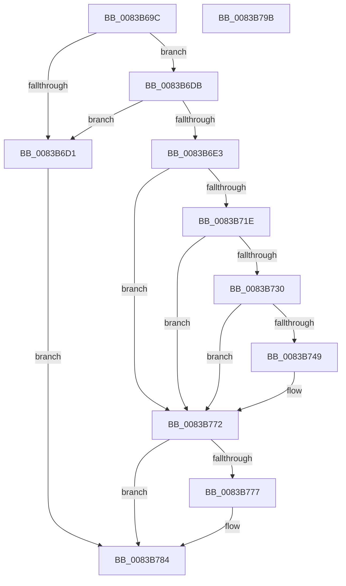

# VrpHandleIoctlModifyFlags

- RVA: `0x0083B69C`–`0x0083B79C` (길이 `256` bytes)
- VA: `0x000000014083B69C`
- 실행 섹션: `PAGE`
- PDB 이름 있음: `예`; PDB Function 태그: `아니요`
- unwind 정보 RVA: `0x000DB13C`
- 디코드: `71`개 명령, `256/256` bytes 표시
- 미해석 바이트: `0` (있으면 어셈블리에 `.byte`로 보존)

> 이 문서는 커널 이미지의 기계어와 PDB 기호를 분석해 생성했습니다. 4번과 5번은 함수 원형과 자료형을 바이너리 사용 방식에서 추정한 C 해석이며 원본 소스 복구 결과는 아닙니다.

## 1. Dependencies

- 직접 호출 지점: **6**; 고유 호출 대상: **6**
- 직접 호출자로 확인된 함수: **1**
- RIP 상대 이미지 참조: **2**

### Outgoing calls
- `0x0083B70F` → [ObpReferenceObjectByHandleWithTag](../86/ObpReferenceObjectByHandleWithTag_function_00869650.md) (function, `0x00869650`)
- `0x0083B725` → [PsGetJobSilo](../../text/41/PsGetJobSilo_function_00418630.md) (function, `0x00418630`)
- `0x0083B73E` → [PsGetPermanentSiloContext](../../text/3E/PsGetPermanentSiloContext_function_003EE100.md) (function, `0x003EE100`)
- `0x0083B750` → [VrpLockJobContextExclusive](../93/VrpLockJobContextExclusive_function_00935A34.md) (function, `0x00935A34`)
- `0x0083B769` → [VrpUnlockJobContextExclusive](../93/VrpUnlockJobContextExclusive_function_009354FC.md) (function, `0x009354FC`)
- `0x0083B77F` → [ObfDereferenceObjectWithTag](../../text/2F/ObfDereferenceObjectWithTag_function_002F78E0.md) (function, `0x002F78E0`)

### Direct callers
- [VrpIoctlDeviceDispatch](../93/VrpIoctlDeviceDispatch_function_00934C50.md) at `0x00934E2E`

### Static image references
- `0x0083B6F8` → RVA `0x00FC6C58` (`ALMOSTRO`; read)
- `0x0083B730` → RVA `0x00EF02B8` (`.data`; read)

## 2. Other-region calls and transfers

- 다른 실행 섹션으로 향하는 call: **3**
  - `0x0083B725` → [PsGetJobSilo](../../text/41/PsGetJobSilo_function_00418630.md) (`PAGE` → `.text`)
  - `0x0083B73E` → [PsGetPermanentSiloContext](../../text/3E/PsGetPermanentSiloContext_function_003EE100.md) (`PAGE` → `.text`)
  - `0x0083B77F` → [ObfDereferenceObjectWithTag](../../text/2F/ObfDereferenceObjectWithTag_function_002F78E0.md) (`PAGE` → `.text`)
- 별도 외부 분기/꼬리 이동을 확인하지 못했습니다.

## 3. Assembly (complete function range)

```asm
0083B69C  48 8B C4                        mov rax, rsp
0083B69F  48 89 58 08                     mov qword ptr [rax + 8], rbx
0083B6A3  48 89 70 10                     mov qword ptr [rax + 0x10], rsi
0083B6A7  48 89 78 18                     mov qword ptr [rax + 0x18], rdi
0083B6AB  4C 89 48 20                     mov qword ptr [rax + 0x20], r9
0083B6AF  55                              push rbp
0083B6B0  48 8B EC                        mov rbp, rsp
0083B6B3  48 83 EC 40                     sub rsp, 0x40
0083B6B7  48 83 65 28 00                  and qword ptr [rbp + 0x28], 0
0083B6BC  45 8A C8                        mov r9b, r8b
0083B6BF  48 83 65 30 00                  and qword ptr [rbp + 0x30], 0
0083B6C4  48 8B F1                        mov rsi, rcx
0083B6C7  48 83 65 38 00                  and qword ptr [rbp + 0x38], 0
0083B6CC  83 FA 10                        cmp edx, 0x10
0083B6CF  73 0A                           jae 0x14083b6db
0083B6D1  BF 0D 00 00 C0                  mov edi, 0xc000000d
0083B6D6  E9 A9 00 00 00                  jmp 0x14083b784
0083B6DB  8B 41 0C                        mov eax, dword ptr [rcx + 0xc]
0083B6DE  85 41 08                        test dword ptr [rcx + 8], eax
0083B6E1  75 EE                           jne 0x14083b6d1
0083B6E3  48 83 64 24 38 00               and qword ptr [rsp + 0x38], 0
0083B6E9  48 8D 45 28                     lea rax, [rbp + 0x28]
0083B6ED  48 83 64 24 30 00               and qword ptr [rsp + 0x30], 0
0083B6F3  BA 06 00 00 00                  mov edx, 6
0083B6F8  4C 8B 05 59 B5 78 00            mov r8, qword ptr [rip + 0x78b559]
0083B6FF  48 8B 09                        mov rcx, qword ptr [rcx]
0083B702  48 89 44 24 28                  mov qword ptr [rsp + 0x28], rax
0083B707  C7 44 24 20 43 6D 56 52         mov dword ptr [rsp + 0x20], 0x52566d43
0083B70F  E8 3C DF 02 00                  call 0x140869650
0083B714  48 8B 5D 28                     mov rbx, qword ptr [rbp + 0x28]
0083B718  8B F8                           mov edi, eax
0083B71A  85 C0                           test eax, eax
0083B71C  78 54                           js 0x14083b772
0083B71E  48 8D 55 38                     lea rdx, [rbp + 0x38]
0083B722  48 8B CB                        mov rcx, rbx
0083B725  E8 06 CF BD FF                  call 0x140418630
0083B72A  8B F8                           mov edi, eax
0083B72C  85 C0                           test eax, eax
0083B72E  78 42                           js 0x14083b772
0083B730  8B 15 82 4B 6B 00               mov edx, dword ptr [rip + 0x6b4b82]
0083B736  4C 8D 45 30                     lea r8, [rbp + 0x30]
0083B73A  48 8B 4D 38                     mov rcx, qword ptr [rbp + 0x38]
0083B73E  E8 BD 29 BB FF                  call 0x1403ee100
0083B743  8B F8                           mov edi, eax
0083B745  85 C0                           test eax, eax
0083B747  78 29                           js 0x14083b772
0083B749  48 8B 5D 30                     mov rbx, qword ptr [rbp + 0x30]
0083B74D  48 8B CB                        mov rcx, rbx
0083B750  E8 DF A2 0F 00                  call 0x140935a34
0083B755  8B 53 50                        mov edx, dword ptr [rbx + 0x50]
0083B758  8B 46 0C                        mov eax, dword ptr [rsi + 0xc]
0083B75B  0B 56 08                        or edx, dword ptr [rsi + 8]
0083B75E  F7 D0                           not eax
0083B760  48 8B 4D 30                     mov rcx, qword ptr [rbp + 0x30]
0083B764  23 D0                           and edx, eax
0083B766  89 51 50                        mov dword ptr [rcx + 0x50], edx
0083B769  E8 8E 9D 0F 00                  call 0x1409354fc
0083B76E  48 8B 5D 28                     mov rbx, qword ptr [rbp + 0x28]
0083B772  48 85 DB                        test rbx, rbx
0083B775  74 0D                           je 0x14083b784
0083B777  BA 43 6D 56 52                  mov edx, 0x52566d43
0083B77C  48 8B CB                        mov rcx, rbx
0083B77F  E8 5C C1 AB FF                  call 0x1402f78e0
0083B784  48 8B 5C 24 50                  mov rbx, qword ptr [rsp + 0x50]
0083B789  8B C7                           mov eax, edi
0083B78B  48 8B 7C 24 60                  mov rdi, qword ptr [rsp + 0x60]
0083B790  48 8B 74 24 58                  mov rsi, qword ptr [rsp + 0x58]
0083B795  48 83 C4 40                     add rsp, 0x40
0083B799  5D                              pop rbp
0083B79A  C3                              ret
0083B79B  CC                              int3
```

## 4. C-style interpretation (structured pseudocode)

```c
__int64 __fastcall VrpHandleIoctlModifyFlags(__int64 a1, int a2, unsigned __int8 a3, __int64 a4, __int64 a5, __int64 a6)
{
    __int64 result;
    __int64 v_rbx;
    __int64 v_rsp;
    unsigned __int64 v_stack_m10;
    unsigned __int64 v_stack_m18;
    unsigned __int64 v_stack_m20;
    unsigned int v_stack_m28;
    unsigned __int64 v_stack_p10;
    unsigned __int64 v_stack_p18;
    unsigned __int64 v_stack_p20;
    unsigned __int64 v_stack_p8;

    *(unsigned __int64 *)(v_rsp + 8) = v_rbx;
    *(unsigned __int64 *)(v_rsp + 16) = v_rsi;
    *(unsigned __int64 *)(v_rsp + 24) = v_rdi;
    *(unsigned __int64 *)(v_rsp + 32) = a4;
    v_rsp = (v_rsp) - (64);
    if (a2 >= 16) goto loc_0083B6DB;
loc_0083B6D1:
    goto loc_0083B784;
loc_0083B6DB:
    if (((*(unsigned int *)(a1 + 8)) & ((unsigned int)((unsigned int)(*(unsigned int *)(a1 + 12))))) != 0) goto loc_0083B6D1;
    v_stack_m20 = v_stack_p20;
    v_stack_m28 = 0x52566D43ULL;
    result = ObpReferenceObjectByHandleWithTag(*(unsigned __int64 *)(a1), 6, *(unsigned __int64 *)(v_rip + 7910745), a3);
    if (sign_flag) goto loc_0083B772;
    result = PsGetJobSilo(v_stack_p20, a6, *(unsigned __int64 *)(v_rip + 7910745), a3);
    if (sign_flag) goto loc_0083B772;
    result = PsGetPermanentSiloContext(a6, (unsigned int)(*(unsigned int *)(v_rip + 7031682)), a5, a3);
    v_rbx = v_stack_p20;
    if (!(sign_flag)) {
        v_rbx = a5;
        a1 = v_rbx;
        result = VrpLockJobContextExclusive(a1, (unsigned int)(*(unsigned int *)(v_rip + 7031682)), a5, a3);
        a2 = *(unsigned int *)(v_rbx + 80);
        result = *(unsigned int *)(a1 + 12);
        a2 = (unsigned int)((a2) | (*(unsigned int *)(a1 + 8)));
        result = (unsigned int)(~(result));
        a1 = a5;
        a2 = (unsigned int)((a2) & ((unsigned int)(result)));
        *(unsigned int *)(a1 + 80) = a2;
        result = VrpUnlockJobContextExclusive(a1, a2, a5, a3);
        v_rbx = v_stack_p20;
    }
    if (v_rbx != 0) {
        a2 = 0x52566D43ULL;
        a1 = v_rbx;
        result = ObfDereferenceObjectWithTag(a1, a2, a5, a3);
    }
    v_rsp = (v_rsp) + (64);
    return (unsigned int)((unsigned int)((unsigned int)((unsigned int)(result))));
}
```

## 5. (Beta) C Style

```c
int64_t VrpHandleIoctlModifyFlags(void *Arg1, int32_t Arg2, uint8_t Arg3, int64_t Arg4, void *Arg5, int64_t Arg6)
{
    uint8_t *arg1 = (uint8_t *)Arg1;
    uint8_t *arg5 = (uint8_t *)Arg5;

    int64_t result;
    int64_t local_rbx;
    int64_t local_rsp;
    uint64_t v_stack_m10;
    uint64_t v_stack_m18;
    uint64_t v_stack_m20;
    uint32_t v_stack_m28;
    uint64_t v_stack_p10;
    uint64_t v_stack_p18;
    uint64_t v_stack_p20;
    uint64_t v_stack_p8;

    *(uint64_t *)(local_rsp + 0x8) = local_rbx;
    *(uint64_t *)(local_rsp + 0x10) = local_rsi;
    *(uint64_t *)(local_rsp + 0x18) = local_rdi;
    *(uint64_t *)(local_rsp + 0x20) = Arg4;
    local_rsp = (local_rsp) - (64);
    if (Arg2 >= 16) goto loc_0083B6DB;
loc_0083B6D1:
    goto loc_0083B784;
loc_0083B6DB:
    if (((*(uint32_t *)(arg1 + 0x8)) & ((uint32_t)((uint32_t)(*(uint32_t *)(arg1 + 0xC))))) != 0) goto loc_0083B6D1;
    v_stack_m20 = v_stack_p20;
    v_stack_m28 = 0x52566D43ULL;
    result = ObpReferenceObjectByHandleWithTag(*(uint64_t *)(arg1), 6, *(uint64_t *)(v_rip + 0x78B559), Arg3);
    if (sign_flag) goto loc_0083B772;
    result = PsGetJobSilo(v_stack_p20, Arg6, *(uint64_t *)(v_rip + 0x78B559), Arg3);
    if (sign_flag) goto loc_0083B772;
    result = PsGetPermanentSiloContext(Arg6, (uint32_t)(*(uint32_t *)(v_rip + 0x6B4B82)), Arg5, Arg3);
    local_rbx = v_stack_p20;
    if (!(sign_flag)) {
        local_rbx = Arg5;
        Arg1 = local_rbx;
        result = VrpLockJobContextExclusive(Arg1, (uint32_t)(*(uint32_t *)(v_rip + 0x6B4B82)), Arg5, Arg3);
        Arg2 = *(uint32_t *)(local_rbx + 0x50);
        result = *(uint32_t *)(arg1 + 0xC);
        Arg2 = (uint32_t)((Arg2) | (*(uint32_t *)(arg1 + 0x8)));
        result = (uint32_t)(~(result));
        Arg1 = Arg5;
        Arg2 = (uint32_t)((Arg2) & ((uint32_t)(result)));
        *(uint32_t *)(arg1 + 0x50) = Arg2;
        result = VrpUnlockJobContextExclusive(Arg1, Arg2, Arg5, Arg3);
        local_rbx = v_stack_p20;
    }
    if (local_rbx != 0) {
        Arg2 = 0x52566D43ULL;
        Arg1 = local_rbx;
        result = ObfDereferenceObjectWithTag(Arg1, Arg2, Arg5, Arg3);
    }
    local_rsp = (local_rsp) + (64);
    return (uint32_t)((uint32_t)((uint32_t)((uint32_t)(result))));
}
```

### 관측된 메모리 오프셋

구조체 형식이 확인되지 않은 접근은 인자 기준의 오프셋으로만 기록했습니다.

| 기준 인자 | 오프셋 표현 | 폭 (bit) | 접근 |
|---|---:|---:|---|
| `Arg1` | `+ 0x0` | `64` | `R` |
| `Arg1` | `+ 0x8` | `32` | `R` |
| `Arg1` | `+ 0xC` | `32` | `R` |
| `Arg5` | `+ 0x50` | `32` | `R` |
| `Arg5` | `+ 0x50` | `32` | `W` |

## 6. Execution-region graph

[열기: 2D/3D 그래프와 함수 탐색 컨트롤 패널](../../../control-panel.html?section=page&rva=0x0083B69C&view=graph)

- 2D 그래프는 위에서 아래로 흐르고, 3D 그래프는 빈 공간을 드래그해 회전합니다. Shift+드래그는 이동, 휠은 확대·축소, 함수 노드 선택은 대상 보고서 이동입니다.

### Static fallback


