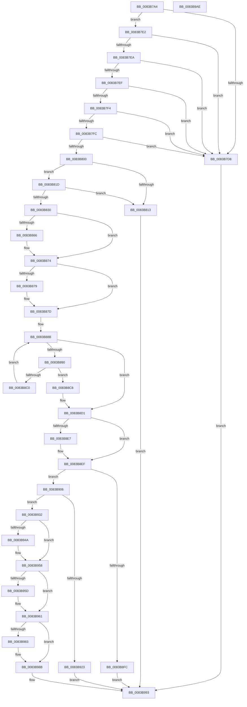

# VrpHandleIoctlUnloadDifferencingHiveForHost

- RVA: `0x0083B7A4`–`0x0083B9AF` (길이 `523` bytes)
- VA: `0x000000014083B7A4`
- 실행 섹션: `PAGE`
- PDB 이름 있음: `예`; PDB Function 태그: `아니요`
- unwind 정보 RVA: `0x00093E28`
- 디코드: `148`개 명령, `523/523` bytes 표시
- 미해석 바이트: `0` (있으면 어셈블리에 `.byte`로 보존)

> 이 문서는 커널 이미지의 기계어와 PDB 기호를 분석해 생성했습니다. 4번과 5번은 함수 원형과 자료형을 바이너리 사용 방식에서 추정한 C 해석이며 원본 소스 복구 결과는 아닙니다.

## 1. Dependencies

- 직접 호출 지점: **13**; 고유 호출 대상: **8**
- 직접 호출자로 확인된 함수: **1**
- RIP 상대 이미지 참조: **6**

### Outgoing calls
- `0x0083B80A` → [SeSinglePrivilegeCheck](../87/SeSinglePrivilegeCheck_function_00871E20.md) (function, `0x00871E20`)
- `0x0083B827` → [SeSinglePrivilegeCheck](../87/SeSinglePrivilegeCheck_function_00871E20.md) (function, `0x00871E20`)
- `0x0083B856` → [KeAbPreAcquire](../../text/21/KeAbPreAcquire_function_00210230.md) (function, `0x00210230`)
- `0x0083B86F` → [ExfAcquirePushLockExclusiveEx](../../text/20/ExfAcquirePushLockExclusiveEx_function_0020FC90.md) (function, `0x0020FC90`)
- `0x0083B8B4` → [RtlEqualUnicodeString](../93/RtlEqualUnicodeString_function_00932A20.md) (function, `0x00932A20`)
- `0x0083B8EA` → [ExfTryToWakePushLock](../../text/26/ExfTryToWakePushLock_function_00265DD0.md) (function, `0x00265DD0`)
- `0x0083B8F2` → [KeAbPostRelease](../../text/2E/KeAbPostRelease_function_002E1600.md) (function, `0x002E1600`)
- `0x0083B90B` → [VrpUnloadDifferencingHive](../93/VrpUnloadDifferencingHive_function_00936CE0.md) (function, `0x00936CE0`)
- `0x0083B928` → [ExFreePoolWithTag](../../poolcode/B8/ExFreePoolWithTag_function_00B82870.md) (function, `0x00B82870`)
- `0x0083B93A` → [KeAbPreAcquire](../../text/21/KeAbPreAcquire_function_00210230.md) (function, `0x00210230`)
- `0x0083B953` → [ExfAcquirePushLockExclusiveEx](../../text/20/ExfAcquirePushLockExclusiveEx_function_0020FC90.md) (function, `0x0020FC90`)
- `0x0083B986` → [ExfTryToWakePushLock](../../text/26/ExfTryToWakePushLock_function_00265DD0.md) (function, `0x00265DD0`)
- `0x0083B98E` → [KeAbPostRelease](../../text/2E/KeAbPostRelease_function_002E1600.md) (function, `0x002E1600`)

### Direct callers
- [sub_00B24A66](../B2/Unknown_function_00B24A66.md) at `0x00B24B2E`

### Static image references
- `0x0083B800` → RVA `0x00FD9AC0` (`PAGEDATA`; read)
- `0x0083B81D` → RVA `0x00FD9AE0` (`PAGEDATA`; read)
- `0x0083B83C` → RVA `0x00EF0038` (`.data`; read)
- `0x0083B87D` → RVA `0x00EF0030` (`.data`; read)
- `0x0083B8D8` → RVA `0x00EF0038` (`.data`; read/write)
- `0x0083B96B` → RVA `0x00EF0030` (`.data`; write)

## 2. Other-region calls and transfers

- 다른 실행 섹션으로 향하는 call: **9**
  - `0x0083B856` → [KeAbPreAcquire](../../text/21/KeAbPreAcquire_function_00210230.md) (`PAGE` → `.text`)
  - `0x0083B86F` → [ExfAcquirePushLockExclusiveEx](../../text/20/ExfAcquirePushLockExclusiveEx_function_0020FC90.md) (`PAGE` → `.text`)
  - `0x0083B8EA` → [ExfTryToWakePushLock](../../text/26/ExfTryToWakePushLock_function_00265DD0.md) (`PAGE` → `.text`)
  - `0x0083B8F2` → [KeAbPostRelease](../../text/2E/KeAbPostRelease_function_002E1600.md) (`PAGE` → `.text`)
  - `0x0083B928` → [ExFreePoolWithTag](../../poolcode/B8/ExFreePoolWithTag_function_00B82870.md) (`PAGE` → `POOLCODE`)
  - `0x0083B93A` → [KeAbPreAcquire](../../text/21/KeAbPreAcquire_function_00210230.md) (`PAGE` → `.text`)
  - `0x0083B953` → [ExfAcquirePushLockExclusiveEx](../../text/20/ExfAcquirePushLockExclusiveEx_function_0020FC90.md) (`PAGE` → `.text`)
  - `0x0083B986` → [ExfTryToWakePushLock](../../text/26/ExfTryToWakePushLock_function_00265DD0.md) (`PAGE` → `.text`)
  - `0x0083B98E` → [KeAbPostRelease](../../text/2E/KeAbPostRelease_function_002E1600.md) (`PAGE` → `.text`)
- 별도 외부 분기/꼬리 이동을 확인하지 못했습니다.

## 3. Assembly (complete function range)

```asm
0083B7A4  48 8B C4                        mov rax, rsp
0083B7A7  48 89 58 08                     mov qword ptr [rax + 8], rbx
0083B7AB  48 89 68 10                     mov qword ptr [rax + 0x10], rbp
0083B7AF  48 89 70 18                     mov qword ptr [rax + 0x18], rsi
0083B7B3  57                              push rdi
0083B7B4  41 56                           push r14
0083B7B6  41 57                           push r15
0083B7B8  48 83 EC 40                     sub rsp, 0x40
0083B7BC  45 33 F6                        xor r14d, r14d
0083B7BF  0F 57 C0                        xorps xmm0, xmm0
0083B7C2  44 89 70 DC                     mov dword ptr [rax - 0x24], r14d
0083B7C6  41 8A F8                        mov dil, r8b
0083B7C9  48 8B D9                        mov rbx, rcx
0083B7CC  41 8B F6                        mov esi, r14d
0083B7CF  0F 11 40 C8                     movups xmmword ptr [rax - 0x38], xmm0
0083B7D3  83 FA 08                        cmp edx, 8
0083B7D6  73 0A                           jae 0x14083b7e2
0083B7D8  BF 0D 00 00 C0                  mov edi, 0xc000000d
0083B7DD  E9 B1 01 00 00                  jmp 0x14083b993
0083B7E2  0F B7 41 04                     movzx eax, word ptr [rcx + 4]
0083B7E6  A8 01                           test al, 1
0083B7E8  75 EE                           jne 0x14083b7d8
0083B7EA  66 85 C0                        test ax, ax
0083B7ED  74 E9                           je 0x14083b7d8
0083B7EF  44 39 31                        cmp dword ptr [rcx], r14d
0083B7F2  75 E4                           jne 0x14083b7d8
0083B7F4  83 C0 06                        add eax, 6
0083B7F7  83 F8 06                        cmp eax, 6
0083B7FA  72 DC                           jb 0x14083b7d8
0083B7FC  3B D0                           cmp edx, eax
0083B7FE  72 D8                           jb 0x14083b7d8
0083B800  48 8B 0D B9 E2 79 00            mov rcx, qword ptr [rip + 0x79e2b9]
0083B807  40 8A D7                        mov dl, dil
0083B80A  E8 11 66 03 00                  call 0x140871e20
0083B80F  84 C0                           test al, al
0083B811  75 0A                           jne 0x14083b81d
0083B813  BF 61 00 00 C0                  mov edi, 0xc0000061
0083B818  E9 76 01 00 00                  jmp 0x14083b993
0083B81D  48 8B 0D BC E2 79 00            mov rcx, qword ptr [rip + 0x79e2bc]
0083B824  40 8A D7                        mov dl, dil
0083B827  E8 F4 65 03 00                  call 0x140871e20
0083B82C  84 C0                           test al, al
0083B82E  74 E3                           je 0x14083b813
0083B830  48 8D 43 06                     lea rax, [rbx + 6]
0083B834  45 33 C0                        xor r8d, r8d
0083B837  48 89 44 24 28                  mov qword ptr [rsp + 0x28], rax
0083B83C  4C 8D 3D F5 47 6B 00            lea r15, [rip + 0x6b47f5]
0083B843  0F B7 43 04                     movzx eax, word ptr [rbx + 4]
0083B847  33 D2                           xor edx, edx
0083B849  49 8B CF                        mov rcx, r15
0083B84C  66 89 44 24 22                  mov word ptr [rsp + 0x22], ax
0083B851  66 89 44 24 20                  mov word ptr [rsp + 0x20], ax
0083B856  E8 D5 49 9D FF                  call 0x140210230
0083B85B  F0 49 0F BA 2F 00               lock bts qword ptr [r15], 0
0083B861  48 8B D8                        mov rbx, rax
0083B864  73 0E                           jae 0x14083b874
0083B866  4D 8B C7                        mov r8, r15
0083B869  48 8B D0                        mov rdx, rax
0083B86C  49 8B CF                        mov rcx, r15
0083B86F  E8 1C 44 9D FF                  call 0x14020fc90
0083B874  48 85 DB                        test rbx, rbx
0083B877  74 04                           je 0x14083b87d
0083B879  C6 43 0A 01                     mov byte ptr [rbx + 0xa], 1
0083B87D  48 8B 1D AC 47 6B 00            mov rbx, qword ptr [rip + 0x6b47ac]
0083B884  48 8D 3D A5 47 6B 00            lea rdi, [rip + 0x6b47a5]
0083B88B  48 85 DB                        test rbx, rbx
0083B88E  74 41                           je 0x14083b8d1
0083B890  48 8D 43 0A                     lea rax, [rbx + 0xa]
0083B894  41 B0 01                        mov r8b, 1
0083B897  48 89 44 24 38                  mov qword ptr [rsp + 0x38], rax
0083B89C  48 8D 54 24 30                  lea rdx, [rsp + 0x30]
0083B8A1  0F B7 43 08                     movzx eax, word ptr [rbx + 8]
0083B8A5  48 8D 4C 24 20                  lea rcx, [rsp + 0x20]
0083B8AA  66 89 44 24 30                  mov word ptr [rsp + 0x30], ax
0083B8AF  66 89 44 24 32                  mov word ptr [rsp + 0x32], ax
0083B8B4  E8 67 71 0F 00                  call 0x140932a20
0083B8B9  48 8B 0B                        mov rcx, qword ptr [rbx]
0083B8BC  84 C0                           test al, al
0083B8BE  75 08                           jne 0x14083b8c8
0083B8C0  48 8B FB                        mov rdi, rbx
0083B8C3  48 8B D9                        mov rbx, rcx
0083B8C6  EB C3                           jmp 0x14083b88b
0083B8C8  48 89 0F                        mov qword ptr [rdi], rcx
0083B8CB  48 8B F3                        mov rsi, rbx
0083B8CE  4C 89 33                        mov qword ptr [rbx], r14
0083B8D1  48 83 CB FF                     or rbx, 0xffffffffffffffff
0083B8D5  48 8B C3                        mov rax, rbx
0083B8D8  F0 48 0F C1 05 57 47 6B 00      lock xadd qword ptr [rip + 0x6b4757], rax
0083B8E1  24 06                           and al, 6
0083B8E3  3C 02                           cmp al, 2
0083B8E5  75 08                           jne 0x14083b8ef
0083B8E7  49 8B CF                        mov rcx, r15
0083B8EA  E8 E1 A4 A2 FF                  call 0x140265dd0
0083B8EF  49 8B CF                        mov rcx, r15
0083B8F2  E8 09 5D AA FF                  call 0x1402e1600
0083B8F7  48 85 F6                        test rsi, rsi
0083B8FA  75 0A                           jne 0x14083b906
0083B8FC  BF 34 00 00 C0                  mov edi, 0xc0000034
0083B901  E9 8D 00 00 00                  jmp 0x14083b993
0083B906  48 8D 4C 24 20                  lea rcx, [rsp + 0x20]
0083B90B  E8 D0 B3 0F 00                  call 0x140936ce0
0083B910  BF 34 00 00 C0                  mov edi, 0xc0000034
0083B915  41 8B D6                        mov edx, r14d
0083B918  3B C7                           cmp eax, edi
0083B91A  0F 45 D0                        cmovne edx, eax
0083B91D  8B FA                           mov edi, edx
0083B91F  85 D2                           test edx, edx
0083B921  78 0F                           js 0x14083b932
0083B923  33 D2                           xor edx, edx
0083B925  48 8B CE                        mov rcx, rsi
0083B928  E8 43 6F 34 00                  call 0x140b82870
0083B92D  41 8B FE                        mov edi, r14d
0083B930  EB 61                           jmp 0x14083b993
0083B932  45 33 C0                        xor r8d, r8d
0083B935  33 D2                           xor edx, edx
0083B937  49 8B CF                        mov rcx, r15
0083B93A  E8 F1 48 9D FF                  call 0x140210230
0083B93F  F0 49 0F BA 2F 00               lock bts qword ptr [r15], 0
0083B945  48 8B E8                        mov rbp, rax
0083B948  73 0E                           jae 0x14083b958
0083B94A  4D 8B C7                        mov r8, r15
0083B94D  48 8B D0                        mov rdx, rax
0083B950  49 8B CF                        mov rcx, r15
0083B953  E8 38 43 9D FF                  call 0x14020fc90
0083B958  48 85 ED                        test rbp, rbp
0083B95B  74 04                           je 0x14083b961
0083B95D  C6 45 0A 01                     mov byte ptr [rbp + 0xa], 1
0083B961  48 8B 05 C8 46 6B 00            mov rax, qword ptr [rip + 0x6b46c8]
0083B968  48 89 06                        mov qword ptr [rsi], rax
0083B96B  48 89 35 BE 46 6B 00            mov qword ptr [rip + 0x6b46be], rsi
0083B972  F0 48 0F C1 1D BD 46 6B 00      lock xadd qword ptr [rip + 0x6b46bd], rbx
0083B97B  80 E3 06                        and bl, 6
0083B97E  80 FB 02                        cmp bl, 2
0083B981  75 08                           jne 0x14083b98b
0083B983  49 8B CF                        mov rcx, r15
0083B986  E8 45 A4 A2 FF                  call 0x140265dd0
0083B98B  49 8B CF                        mov rcx, r15
0083B98E  E8 6D 5C AA FF                  call 0x1402e1600
0083B993  48 8B 5C 24 60                  mov rbx, qword ptr [rsp + 0x60]
0083B998  8B C7                           mov eax, edi
0083B99A  48 8B 6C 24 68                  mov rbp, qword ptr [rsp + 0x68]
0083B99F  48 8B 74 24 70                  mov rsi, qword ptr [rsp + 0x70]
0083B9A4  48 83 C4 40                     add rsp, 0x40
0083B9A8  41 5F                           pop r15
0083B9AA  41 5E                           pop r14
0083B9AC  5F                              pop rdi
0083B9AD  C3                              ret
0083B9AE  CC                              int3
```

## 4. C-style interpretation (structured pseudocode)

```c
__int64 __fastcall VrpHandleIoctlUnloadDifferencingHiveForHost(__int64 a1, int a2, int a3)
{
    __int64 result;
    __int64 v_r14;
    __int64 v_rbx;
    __int64 v_rsp;
    unsigned __int64 v_stack_m20;
    unsigned __int16 v_stack_m26;
    unsigned __int64 v_stack_m28;
    unsigned __int64 v_stack_m30;
    unsigned __int16 v_stack_m36;
    unsigned __int16 v_stack_m38;
    unsigned __int64 v_stack_p10;
    unsigned __int64 v_stack_p18;
    unsigned __int64 v_stack_p8;

    *(unsigned __int64 *)(v_rsp + 8) = v_rbx;
    *(unsigned __int64 *)(v_rsp + 16) = v_rbp;
    *(unsigned __int64 *)(v_rsp + 24) = v_rsi;
    v_rsp = (v_rsp) - (64);
    v_r14 = 0;
    *(unsigned int *)(v_rsp - 36) = 0;
    *(unsigned __int64 *)(v_rsp - 56) = v_xmm0;
    if (a2 >= 8) goto loc_0083B7E2;
loc_0083B7D8:
    goto loc_0083B993;
loc_0083B7E2:
    if ((((unsigned __int8)(*(unsigned __int16 *)(a1 + 4))) & (1)) != 0) goto loc_0083B7D8;
    if ((unsigned __int16)(*(unsigned __int16 *)(a1 + 4)) == 0) goto loc_0083B7D8;
    if ((*(unsigned int *)(a1)) != 0) goto loc_0083B7D8;
    result = (unsigned int)((*(unsigned __int16 *)(a1 + 4)) + (6));
    if (((unsigned int)(result)) < 6) goto loc_0083B7D8;
    if (a2 < ((unsigned int)(result))) goto loc_0083B7D8;
    result = SeSinglePrivilegeCheck(*(unsigned __int64 *)(v_rip + 7987897), (unsigned __int8)((unsigned int)(0xC000000DULL)), a3, a4);
    if ((unsigned __int8)(result) != 0) goto loc_0083B81D;
loc_0083B813:
    goto loc_0083B993;
loc_0083B81D:
    result = SeSinglePrivilegeCheck(*(unsigned __int64 *)(v_rip + 7987900), (unsigned __int8)((unsigned int)(0xC0000061ULL)), a3, a4);
    if ((unsigned __int8)(result) == 0) goto loc_0083B813;
    a3 = 0;
    v_stack_m30 = a1 + 6;
    a2 = 0;
    v_stack_m36 = (unsigned __int16)(*(unsigned __int16 *)(a1 + 4));
    v_stack_m38 = (unsigned __int16)(*(unsigned __int16 *)(a1 + 4));
    result = KeAbPreAcquire(v_rip + 7030773, a2, a3, a4);
    if (!(condition_is_above_or_equal)) {
        a3 = v_rip + 7030773;
        a2 = result;
        a1 = v_rip + 7030773;
        result = ExfAcquirePushLockExclusiveEx(a1, a2, a3, a4);
    }
    if (result != 0) {
        *(unsigned __int8 *)(result + 10) = 1;
    }
loc_0083B88B:
    if (*(unsigned __int64 *)(v_rip + 7030700) == 0) goto loc_0083B8D1;
    v_stack_m20 = *(unsigned __int64 *)(v_rip + 7030700) + 10;
    v_stack_m28 = (unsigned __int16)(*(unsigned __int16 *)(*(unsigned __int64 *)(v_rip + 7030700) + 8));
    v_stack_m26 = (unsigned __int16)(*(unsigned __int16 *)(*(unsigned __int64 *)(v_rip + 7030700) + 8));
    result = RtlEqualUnicodeString(v_stack_m38, v_stack_m28, 1, a4);
    if ((unsigned __int8)(result) != 0) goto loc_0083B8C8;
    goto loc_0083B88B;
loc_0083B8C8:
    *(unsigned __int64 *)(*(unsigned __int64 *)(v_rip + 7030700)) = *(unsigned __int64 *)(*(unsigned __int64 *)(v_rip + 7030700));
    *(unsigned __int64 *)(*(unsigned __int64 *)(*(unsigned __int64 *)(v_rip + 7030700))) = 0;
loc_0083B8D1:
    v_rbx = (*(unsigned __int64 *)(*(unsigned __int64 *)(v_rip + 7030700))) | (-1);
    result = (unsigned __int8)((v_rbx) & (6));
    if (((unsigned __int8)(result)) == 2) {
        a1 = v_rip + 7030773;
        result = ExfTryToWakePushLock(a1, v_stack_m28, 1, a4);
    }
    result = KeAbPostRelease(v_rip + 7030773, v_stack_m28, 1, a4);
    if (*(unsigned __int64 *)(*(unsigned __int64 *)(v_rip + 7030700)) != 0) goto loc_0083B906;
    goto loc_0083B993;
loc_0083B906:
    result = VrpUnloadDifferencingHive(v_stack_m38, v_stack_m28, 1, a4);
    a2 = 0;
    if (((unsigned int)(result)) != ((unsigned int)((unsigned int)(0xC0000034ULL)))) { a2 = (unsigned int)(result); }
    if (sign_flag) goto loc_0083B932;
    a2 = 0;
    result = ExFreePoolWithTag(*(unsigned __int64 *)(*(unsigned __int64 *)(v_rip + 7030700)), a2, 1, a4);
    goto loc_0083B993;
loc_0083B932:
    a3 = 0;
    a2 = 0;
    result = KeAbPreAcquire(v_rip + 7030773, a2, a3, a4);
    if (!(condition_is_above_or_equal)) {
        a3 = v_rip + 7030773;
        a2 = result;
        a1 = v_rip + 7030773;
        result = ExfAcquirePushLockExclusiveEx(a1, a2, a3, a4);
    }
    if (result != 0) {
        *(unsigned __int8 *)(result + 10) = 1;
    }
    *(unsigned __int64 *)(*(unsigned __int64 *)(*(unsigned __int64 *)(v_rip + 7030700))) = *(unsigned __int64 *)(v_rip + 7030472);
    *(unsigned __int64 *)(v_rip + 7030462) = *(unsigned __int64 *)(*(unsigned __int64 *)(v_rip + 7030700));
    v_rbx = (unsigned __int8)((v_rbx) & (6));
    result = *(unsigned __int64 *)(v_rip + 7030472);
    if (((unsigned __int8)(v_rbx)) == 2) {
        a1 = v_rip + 7030773;
        result = ExfTryToWakePushLock(a1, a2, a3, a4);
    }
    result = KeAbPostRelease(v_rip + 7030773, a2, a3, a4);
loc_0083B993:
    v_rsp = (v_rsp) + (64);
    return 0;
}
```

## 5. (Beta) C Style

```c
int64_t VrpHandleIoctlUnloadDifferencingHiveForHost(void *Arg1, int32_t Arg2, int32_t Arg3)
{
    uint8_t *arg1 = (uint8_t *)Arg1;

    int64_t result;
    int64_t local_r14;
    int64_t local_rbx;
    int64_t local_rsp;
    uint64_t v_stack_m20;
    uint16_t v_stack_m26;
    uint64_t v_stack_m28;
    uint64_t v_stack_m30;
    uint16_t v_stack_m36;
    uint16_t v_stack_m38;
    uint64_t v_stack_p10;
    uint64_t v_stack_p18;
    uint64_t v_stack_p8;

    *(uint64_t *)(local_rsp + 0x8) = local_rbx;
    *(uint64_t *)(local_rsp + 0x10) = local_rbp;
    *(uint64_t *)(local_rsp + 0x18) = local_rsi;
    local_rsp = (local_rsp) - (64);
    local_r14 = 0;
    *(uint32_t *)(local_rsp - 0x24) = 0;
    *(uint64_t *)(local_rsp - 0x38) = v_xmm0;
    if (Arg2 >= 8) goto loc_0083B7E2;
loc_0083B7D8:
    goto loc_0083B993;
loc_0083B7E2:
    if ((((uint8_t)(*(uint16_t *)(arg1 + 0x4))) & (1)) != 0) goto loc_0083B7D8;
    if ((uint16_t)(*(uint16_t *)(arg1 + 0x4)) == 0) goto loc_0083B7D8;
    if ((*(uint32_t *)(arg1)) != 0) goto loc_0083B7D8;
    result = (uint32_t)((*(uint16_t *)(arg1 + 0x4)) + (6));
    if (((uint32_t)(result)) < 6) goto loc_0083B7D8;
    if (Arg2 < ((uint32_t)(result))) goto loc_0083B7D8;
    result = SeSinglePrivilegeCheck(*(uint64_t *)(v_rip + 0x79E2B9), (uint8_t)((uint32_t)(0xC000000DULL)), Arg3, a4);
    if ((uint8_t)(result) != 0) goto loc_0083B81D;
loc_0083B813:
    goto loc_0083B993;
loc_0083B81D:
    result = SeSinglePrivilegeCheck(*(uint64_t *)(v_rip + 0x79E2BC), (uint8_t)((uint32_t)(0xC0000061ULL)), Arg3, a4);
    if ((uint8_t)(result) == 0) goto loc_0083B813;
    Arg3 = 0;
    v_stack_m30 = Arg1 + 6;
    Arg2 = 0;
    v_stack_m36 = (uint16_t)(*(uint16_t *)(arg1 + 0x4));
    v_stack_m38 = (uint16_t)(*(uint16_t *)(arg1 + 0x4));
    result = KeAbPreAcquire(v_rip + 7030773, Arg2, Arg3, a4);
    if (!(condition_is_above_or_equal)) {
        Arg3 = v_rip + 7030773;
        Arg2 = result;
        Arg1 = v_rip + 7030773;
        result = ExfAcquirePushLockExclusiveEx(Arg1, Arg2, Arg3, a4);
    }
    if (result != 0) {
        *(uint8_t *)(result + 0xA) = 1;
    }
loc_0083B88B:
    if (*(uint64_t *)(v_rip + 0x6B47AC) == 0) goto loc_0083B8D1;
    v_stack_m20 = *(uint64_t *)(v_rip + 0x6B47AC) + 10;
    v_stack_m28 = (uint16_t)(*(uint16_t *)(*(uint64_t *)(v_rip + 0x6B47AC) + 0x8));
    v_stack_m26 = (uint16_t)(*(uint16_t *)(*(uint64_t *)(v_rip + 0x6B47AC) + 0x8));
    result = RtlEqualUnicodeString(v_stack_m38, v_stack_m28, 1, a4);
    if ((uint8_t)(result) != 0) goto loc_0083B8C8;
    goto loc_0083B88B;
loc_0083B8C8:
    *(uint64_t *)(*(uint64_t *)(v_rip + 0x6B47AC)) = *(uint64_t *)(*(uint64_t *)(v_rip + 0x6B47AC));
    *(uint64_t *)(*(uint64_t *)(*(uint64_t *)(v_rip + 0x6B47AC))) = 0;
loc_0083B8D1:
    local_rbx = (*(uint64_t *)(*(uint64_t *)(v_rip + 0x6B47AC))) | (-1);
    result = (uint8_t)((local_rbx) & (6));
    if (((uint8_t)(result)) == 2) {
        Arg1 = v_rip + 7030773;
        result = ExfTryToWakePushLock(Arg1, v_stack_m28, 1, a4);
    }
    result = KeAbPostRelease(v_rip + 7030773, v_stack_m28, 1, a4);
    if (*(uint64_t *)(*(uint64_t *)(v_rip + 0x6B47AC)) != 0) goto loc_0083B906;
    goto loc_0083B993;
loc_0083B906:
    result = VrpUnloadDifferencingHive(v_stack_m38, v_stack_m28, 1, a4);
    Arg2 = 0;
    if (((uint32_t)(result)) != ((uint32_t)((uint32_t)(0xC0000034ULL)))) { Arg2 = (uint32_t)(result); }
    if (sign_flag) goto loc_0083B932;
    Arg2 = 0;
    result = ExFreePoolWithTag(*(uint64_t *)(*(uint64_t *)(v_rip + 0x6B47AC)), Arg2, 1, a4);
    goto loc_0083B993;
loc_0083B932:
    Arg3 = 0;
    Arg2 = 0;
    result = KeAbPreAcquire(v_rip + 7030773, Arg2, Arg3, a4);
    if (!(condition_is_above_or_equal)) {
        Arg3 = v_rip + 7030773;
        Arg2 = result;
        Arg1 = v_rip + 7030773;
        result = ExfAcquirePushLockExclusiveEx(Arg1, Arg2, Arg3, a4);
    }
    if (result != 0) {
        *(uint8_t *)(result + 0xA) = 1;
    }
    *(uint64_t *)(*(uint64_t *)(*(uint64_t *)(v_rip + 0x6B47AC))) = *(uint64_t *)(v_rip + 0x6B46C8);
    *(uint64_t *)(v_rip + 0x6B46BE) = *(uint64_t *)(*(uint64_t *)(v_rip + 0x6B47AC));
    local_rbx = (uint8_t)((local_rbx) & (6));
    result = *(uint64_t *)(v_rip + 0x6B46C8);
    if (((uint8_t)(local_rbx)) == 2) {
        Arg1 = v_rip + 7030773;
        result = ExfTryToWakePushLock(Arg1, Arg2, Arg3, a4);
    }
    result = KeAbPostRelease(v_rip + 7030773, Arg2, Arg3, a4);
loc_0083B993:
    local_rsp = (local_rsp) + (64);
    return 0;
}
```

### 관측된 메모리 오프셋

구조체 형식이 확인되지 않은 접근은 인자 기준의 오프셋으로만 기록했습니다.

| 기준 인자 | 오프셋 표현 | 폭 (bit) | 접근 |
|---|---:|---:|---|
| `Arg1` | `+ 0x0` | `32` | `R` |
| `Arg1` | `+ 0x4` | `16` | `R` |
| `Arg1` | `+ 0x6` | `64` | `R` |

## 6. Execution-region graph

[열기: 2D/3D 그래프와 함수 탐색 컨트롤 패널](../../../control-panel.html?section=page&rva=0x0083B7A4&view=graph)

- 2D 그래프는 위에서 아래로 흐르고, 3D 그래프는 빈 공간을 드래그해 회전합니다. Shift+드래그는 이동, 휠은 확대·축소, 함수 노드 선택은 대상 보고서 이동입니다.

### Static fallback


