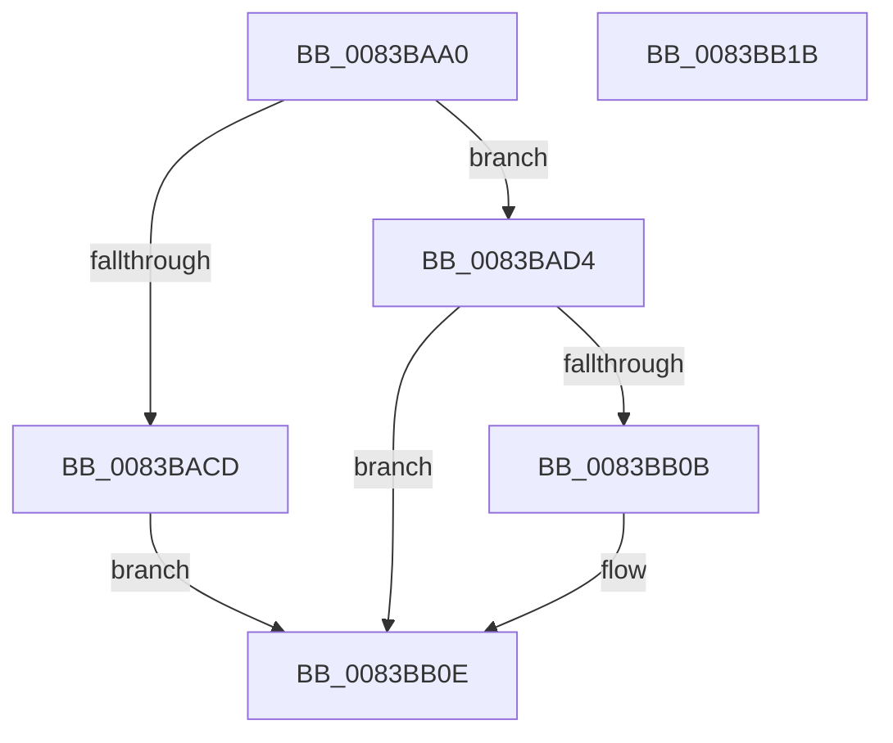

# VrpInitializeLoadedDifferencingHives

- RVA: `0x0083BAA0`–`0x0083BB1C` (길이 `124` bytes)
- VA: `0x000000014083BAA0`
- 실행 섹션: `PAGE`
- PDB 이름 있음: `예`; PDB Function 태그: `아니요`
- unwind 정보 RVA: `0x0005CAAC`
- 디코드: `32`개 명령, `124/124` bytes 표시
- 미해석 바이트: `0` (있으면 어셈블리에 `.byte`로 보존)

> 이 문서는 커널 이미지의 기계어와 PDB 기호를 분석해 생성했습니다. 4번과 5번은 함수 원형과 자료형을 바이너리 사용 방식에서 추정한 C 해석이며 원본 소스 복구 결과는 아닙니다.

## 1. Dependencies

- 직접 호출 지점: **1**; 고유 호출 대상: **1**
- 직접 호출자로 확인된 함수: **1**
- RIP 상대 이미지 참조: **5**

### Outgoing calls
- `0x0083BAC0` → [ExAllocatePool2](../../poolcode/B8/ExAllocatePool2_function_00B820F0.md) (function, `0x00B820F0`)

### Direct callers
- [VRegSetup](VRegSetup_function_0083AE90.md) at `0x0083B06B`

### Static image references
- `0x0083BAB3` → RVA `0x00EF02B0` (`.data`; write)
- `0x0083BADB` → RVA `0x00EF02A0` (`.data`; write)
- `0x0083BAE1` → RVA `0x00EF02A0` (`.data`; read)
- `0x0083BAE8` → RVA `0x00EF02A8` (`.data`; write)
- `0x0083BAF3` → RVA `0x00EF02A4` (`.data`; write)

## 2. Other-region calls and transfers

- 다른 실행 섹션으로 향하는 call: **1**
  - `0x0083BAC0` → [ExAllocatePool2](../../poolcode/B8/ExAllocatePool2_function_00B820F0.md) (`PAGE` → `POOLCODE`)
- 별도 외부 분기/꼬리 이동을 확인하지 못했습니다.

## 3. Assembly (complete function range)

```asm
0083BAA0  48 89 5C 24 08                  mov qword ptr [rsp + 8], rbx
0083BAA5  57                              push rdi
0083BAA6  48 83 EC 20                     sub rsp, 0x20
0083BAAA  B9 00 01 00 00                  mov ecx, 0x100
0083BAAF  33 DB                           xor ebx, ebx
0083BAB1  8B D1                           mov edx, ecx
0083BAB3  48 89 1D F6 47 6B 00            mov qword ptr [rip + 0x6b47f6], rbx
0083BABA  41 B8 56 52 65 67               mov r8d, 0x67655256
0083BAC0  E8 2B 66 34 00                  call 0x140b820f0
0083BAC5  48 8B F8                        mov rdi, rax
0083BAC8  48 85 C0                        test rax, rax
0083BACB  75 07                           jne 0x14083bad4
0083BACD  BB 9A 00 00 C0                  mov ebx, 0xc000009a
0083BAD2  EB 3A                           jmp 0x14083bb0e
0083BAD4  48 8D 8F 00 01 00 00            lea rcx, [rdi + 0x100]
0083BADB  89 1D BF 47 6B 00               mov dword ptr [rip + 0x6b47bf], ebx
0083BAE1  48 8D 05 B8 47 6B 00            lea rax, [rip + 0x6b47b8]
0083BAE8  48 89 3D B9 47 6B 00            mov qword ptr [rip + 0x6b47b9], rdi
0083BAEF  48 83 C8 01                     or rax, 1
0083BAF3  C7 05 A7 47 6B 00 00 04 00 00   mov dword ptr [rip + 0x6b47a7], 0x400
0083BAFD  48 3B CF                        cmp rcx, rdi
0083BB00  48 1B C9                        sbb rcx, rcx
0083BB03  48 F7 D1                        not rcx
0083BB06  83 E1 20                        and ecx, 0x20
0083BB09  76 03                           jbe 0x14083bb0e
0083BB0B  F3 48 AB                        rep stosq qword ptr [rdi], rax
0083BB0E  8B C3                           mov eax, ebx
0083BB10  48 8B 5C 24 30                  mov rbx, qword ptr [rsp + 0x30]
0083BB15  48 83 C4 20                     add rsp, 0x20
0083BB19  5F                              pop rdi
0083BB1A  C3                              ret
0083BB1B  CC                              int3
```

## 4. C-style interpretation (structured pseudocode)

```c
__int64 __fastcall VrpInitializeLoadedDifferencingHives(void)
{
    __int64 result;
    __int64 v_rbx;
    __int64 v_rsp;
    unsigned __int64 v_stack_p8;

    v_stack_p8 = v_rbx;
    v_rsp = (v_rsp) - (32);
    v_rbx = 0;
    *(unsigned __int64 *)(v_rip + 7030774) = 0;
    result = ExAllocatePool2(256, 256, (unsigned int)(0x67655256ULL), a4);
    if (result != 0) goto loc_0083BAD4;
    goto loc_0083BB0E;
loc_0083BAD4:
    *(unsigned int *)(v_rip + 7030719) = (unsigned int)((unsigned int)(0xC000009AULL));
    *(unsigned __int64 *)(v_rip + 7030713) = result;
    result = (v_rip + 7030712) | (1);
    *(unsigned int *)(v_rip + 7030695) = 0x400ULL;
    a1 = ~(result + 256);
    a1 = (unsigned int)((a1) & (32));
    if (!(condition_is_below_or_equal)) {
    }
    v_rsp = (v_rsp) + (32);
    return (unsigned int)((unsigned int)((unsigned int)(0xC000009AULL)));
}
```

## 5. (Beta) C Style

```c
void VrpInitializeLoadedDifferencingHives(void)
{
    int64_t result;
    int64_t local_rbx;
    int64_t local_rsp;
    uint64_t v_stack_p8;

    v_stack_p8 = local_rbx;
    local_rsp = (local_rsp) - (32);
    local_rbx = 0;
    *(uint64_t *)(v_rip + 0x6B47F6) = 0;
    result = ExAllocatePool2(256, 256, (uint32_t)(0x67655256ULL), a4);
    if (result != 0) goto loc_0083BAD4;
    goto loc_0083BB0E;
loc_0083BAD4:
    *(uint32_t *)(v_rip + 0x6B47BF) = (uint32_t)((uint32_t)(0xC000009AULL));
    *(uint64_t *)(v_rip + 0x6B47B9) = result;
    result = (v_rip + 7030712) | (1);
    *(uint32_t *)(v_rip + 0x6B47A7) = 0x400ULL;
    a1 = ~(result + 256);
    a1 = (uint32_t)((a1) & (32));
    if (!(condition_is_below_or_equal)) {
    }
    local_rsp = (local_rsp) + (32);
    return (uint32_t)((uint32_t)((uint32_t)(0xC000009AULL)));
}
```

## 6. Execution-region graph

[열기: 2D/3D 그래프와 함수 탐색 컨트롤 패널](../../../control-panel.html?section=page&rva=0x0083BAA0&view=graph)

- 2D 그래프는 위에서 아래로 흐르고, 3D 그래프는 빈 공간을 드래그해 회전합니다. Shift+드래그는 이동, 휠은 확대·축소, 함수 노드 선택은 대상 보고서 이동입니다.

### Static fallback


