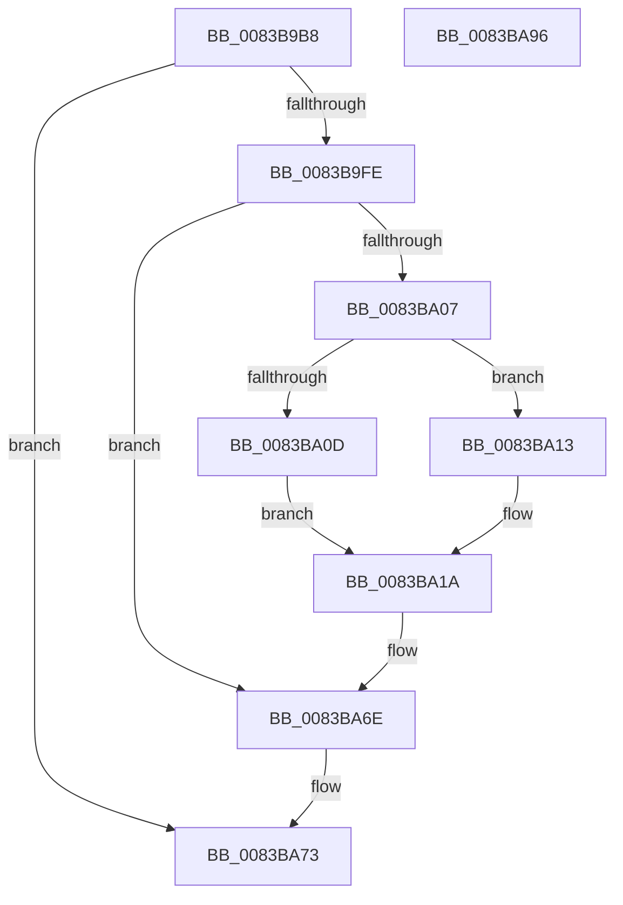

# VrpPreRenameKey

- RVA: `0x0083B9B8`–`0x0083BA97` (길이 `223` bytes)
- VA: `0x000000014083B9B8`
- 실행 섹션: `PAGE`
- PDB 이름 있음: `예`; PDB Function 태그: `아니요`
- unwind 정보 RVA: `0x000DB170`
- 디코드: `49`개 명령, `223/223` bytes 표시
- 미해석 바이트: `0` (있으면 어셈블리에 `.byte`로 보존)

> 이 문서는 커널 이미지의 기계어와 PDB 기호를 분석해 생성했습니다. 4번과 5번은 함수 원형과 자료형을 바이너리 사용 방식에서 추정한 C 해석이며 원본 소스 복구 결과는 아닙니다.

## 1. Dependencies

- 직접 호출 지점: **3**; 고유 호출 대상: **3**
- 직접 호출자로 확인된 함수: **1**
- RIP 상대 이미지 참조: **4**

### Outgoing calls
- `0x0083B9EC` → [EtwActivityIdControl](../../text/41/EtwActivityIdControl_function_0041E720.md) (function, `0x0041E720`)
- `0x0083BA69` → [tlgWriteTransfer_EtwWriteTransfer](../../text/42/tlgWriteTransfer_EtwWriteTransfer_function_004260E0.md) (function, `0x004260E0`)
- `0x0083BA80` → [_security_check_cookie](../../text/6A/_security_check_cookie_function_006AC640.md) (function, `0x006AC640`)

### Direct callers
- [VrpRegistryCallback](../86/VrpRegistryCallback_function_00867450.md) at `0x0086763B`

### Static image references
- `0x0083B9C5` → RVA `0x00E0A740` (`.data`; read)
- `0x0083B9FE` → RVA `0x00E0A630` (`.data`; read)
- `0x0083BA13` → RVA `0x00002F28` (`.rdata`; read)
- `0x0083BA36` → RVA `0x0005AB57` (`.rdata`; read)

## 2. Other-region calls and transfers

- 다른 실행 섹션으로 향하는 call: **3**
  - `0x0083B9EC` → [EtwActivityIdControl](../../text/41/EtwActivityIdControl_function_0041E720.md) (`PAGE` → `.text`)
  - `0x0083BA69` → [tlgWriteTransfer_EtwWriteTransfer](../../text/42/tlgWriteTransfer_EtwWriteTransfer_function_004260E0.md) (`PAGE` → `.text`)
  - `0x0083BA80` → [_security_check_cookie](../../text/6A/_security_check_cookie_function_006AC640.md) (`PAGE` → `.text`)
- 별도 외부 분기/꼬리 이동을 확인하지 못했습니다.

## 3. Assembly (complete function range)

```asm
0083B9B8  48 89 5C 24 08                  mov qword ptr [rsp + 8], rbx
0083B9BD  57                              push rdi
0083B9BE  48 81 EC 90 00 00 00            sub rsp, 0x90
0083B9C5  48 8B 05 74 ED 5C 00            mov rax, qword ptr [rip + 0x5ced74]
0083B9CC  48 33 C4                        xor rax, rsp
0083B9CF  48 89 84 24 80 00 00 00         mov qword ptr [rsp + 0x80], rax
0083B9D7  48 8B D9                        mov rbx, rcx
0083B9DA  48 8D 54 24 30                  lea rdx, [rsp + 0x30]
0083B9DF  0F 57 C0                        xorps xmm0, xmm0
0083B9E2  33 FF                           xor edi, edi
0083B9E4  0F 11 44 24 30                  movups xmmword ptr [rsp + 0x30], xmm0
0083B9E9  8D 4F 03                        lea ecx, [rdi + 3]
0083B9EC  E8 2F 2D BE FF                  call 0x14041e720
0083B9F1  48 8B 4B 18                     mov rcx, qword ptr [rbx + 0x18]
0083B9F5  F7 41 24 00 00 00 20            test dword ptr [rcx + 0x24], 0x20000000
0083B9FC  74 75                           je 0x14083ba73
0083B9FE  83 3D 2B EC 5C 00 05            cmp dword ptr [rip + 0x5cec2b], 5
0083BA05  76 67                           jbe 0x14083ba6e
0083BA07  48 39 79 18                     cmp qword ptr [rcx + 0x18], rdi
0083BA0B  74 06                           je 0x14083ba13
0083BA0D  48 83 C1 10                     add rcx, 0x10
0083BA11  EB 07                           jmp 0x14083ba1a
0083BA13  48 8D 0D 0E 75 7C FF            lea rcx, [rip - 0x838af2]
0083BA1A  48 8D 44 24 78                  lea rax, [rsp + 0x78]
0083BA1F  48 C7 44 24 68 02 00 00 00      mov qword ptr [rsp + 0x68], 2
0083BA28  48 89 44 24 60                  mov qword ptr [rsp + 0x60], rax
0083BA2D  4C 8D 44 24 30                  lea r8, [rsp + 0x30]
0083BA32  48 8B 41 08                     mov rax, qword ptr [rcx + 8]
0083BA36  48 8D 15 1A F1 81 FF            lea rdx, [rip - 0x7e0ee6]
0083BA3D  48 89 44 24 70                  mov qword ptr [rsp + 0x70], rax
0083BA42  45 33 C9                        xor r9d, r9d
0083BA45  0F B7 01                        movzx eax, word ptr [rcx]
0083BA48  48 8D 0D E1 EB 5C 00            lea rcx, [rip + 0x5cebe1]
0083BA4F  89 44 24 78                     mov dword ptr [rsp + 0x78], eax
0083BA53  48 8D 44 24 40                  lea rax, [rsp + 0x40]
0083BA58  48 89 44 24 28                  mov qword ptr [rsp + 0x28], rax
0083BA5D  C7 44 24 20 04 00 00 00         mov dword ptr [rsp + 0x20], 4
0083BA65  89 7C 24 7C                     mov dword ptr [rsp + 0x7c], edi
0083BA69  E8 72 A6 BE FF                  call 0x1404260e0
0083BA6E  BF 22 00 00 C0                  mov edi, 0xc0000022
0083BA73  8B C7                           mov eax, edi
0083BA75  48 8B 8C 24 80 00 00 00         mov rcx, qword ptr [rsp + 0x80]
0083BA7D  48 33 CC                        xor rcx, rsp
0083BA80  E8 BB 0B E7 FF                  call 0x1406ac640
0083BA85  48 8B 9C 24 A0 00 00 00         mov rbx, qword ptr [rsp + 0xa0]
0083BA8D  48 81 C4 90 00 00 00            add rsp, 0x90
0083BA94  5F                              pop rdi
0083BA95  C3                              ret
0083BA96  CC                              int3
```

## 4. C-style interpretation (structured pseudocode)

```c
__int64 __fastcall VrpPreRenameKey(__int64 a1, __int64 a2, __int64 a3, int a4)
{
    __int64 result;
    __int64 v_rdi;
    __int64 v_rsp;
    unsigned __int64 v_stack_m18;
    unsigned int v_stack_m1C;
    unsigned __int64 v_stack_m20;
    unsigned __int64 v_stack_m28;
    unsigned __int64 v_stack_m30;
    unsigned __int64 v_stack_m38;
    unsigned __int64 v_stack_m58;
    unsigned __int64 v_stack_m68;
    unsigned __int64 v_stack_m70;
    unsigned int v_stack_m78;
    unsigned __int64 v_stack_p8;

    v_stack_p8 = v_rbx;
    v_rsp = (v_rsp) - (144);
    result = (*(unsigned __int64 *)(v_rip + 6090100)) ^ (v_rsp);
    v_stack_m18 = result;
    v_rdi = 0;
    v_stack_m68 = v_xmm0;
    result = EtwActivityIdControl(v_rdi + 3, v_stack_m68, a3, a4);
    if (((*(unsigned int *)(*(unsigned __int64 *)(a1 + 24) + 36)) & (0x20000000ULL)) == 0) goto loc_0083BA73;
    if ((*(unsigned int *)(v_rip + 6089771)) <= 5) goto loc_0083BA6E;
    if ((*(unsigned __int64 *)(*(unsigned __int64 *)(a1 + 24) + 24)) == 0) goto loc_0083BA13;
    a1 = (*(unsigned __int64 *)(a1 + 24)) + (16);
    goto loc_0083BA1A;
loc_0083BA13:
loc_0083BA1A:
    v_stack_m30 = 2;
    v_stack_m38 = v_stack_m20;
    v_stack_m28 = *(unsigned __int64 *)(v_rip - 8620786 + 8);
    a4 = 0;
    v_stack_m20 = (unsigned int)(*(unsigned __int16 *)(v_rip - 8620786));
    v_stack_m70 = v_stack_m58;
    v_stack_m78 = 4;
    v_stack_m1C = 0;
    result = tlgWriteTransfer_EtwWriteTransfer(v_rip + 6089697, v_rip - 8261350, v_stack_m68, a4);
loc_0083BA6E:
loc_0083BA73:
    a1 = (v_stack_m18) ^ (v_rsp);
    result = _security_check_cookie(a1, v_rip - 8261350, v_stack_m68, a4);
    v_rsp = (v_rsp) + (144);
    return result;
}
```

## 5. (Beta) C Style

```c
int64_t VrpPreRenameKey(void *Arg1, int64_t Arg2, int64_t Arg3, int32_t Arg4)
{
    uint8_t *arg1 = (uint8_t *)Arg1;

    int64_t result;
    int64_t local_rdi;
    int64_t local_rsp;
    uint64_t v_stack_m18;
    uint32_t v_stack_m1C;
    uint64_t v_stack_m20;
    uint64_t v_stack_m28;
    uint64_t v_stack_m30;
    uint64_t v_stack_m38;
    uint64_t v_stack_m58;
    uint64_t v_stack_m68;
    uint64_t v_stack_m70;
    uint32_t v_stack_m78;
    uint64_t v_stack_p8;

    v_stack_p8 = local_rbx;
    local_rsp = (local_rsp) - (144);
    result = (*(uint64_t *)(v_rip + 0x5CED74)) ^ (local_rsp);
    v_stack_m18 = result;
    local_rdi = 0;
    v_stack_m68 = v_xmm0;
    result = EtwActivityIdControl(local_rdi + 3, v_stack_m68, Arg3, Arg4);
    if (((*(uint32_t *)(*(uint64_t *)(arg1 + 0x18) + 0x24)) & (0x20000000ULL)) == 0) goto loc_0083BA73;
    if ((*(uint32_t *)(v_rip + 0x5CEC2B)) <= 5) goto loc_0083BA6E;
    if ((*(uint64_t *)(*(uint64_t *)(arg1 + 0x18) + 0x18)) == 0) goto loc_0083BA13;
    Arg1 = (*(uint64_t *)(arg1 + 0x18)) + (16);
    goto loc_0083BA1A;
loc_0083BA13:
loc_0083BA1A:
    v_stack_m30 = 2;
    v_stack_m38 = v_stack_m20;
    v_stack_m28 = *(uint64_t *)(v_rip - 0x838AF2 + 0x8);
    Arg4 = 0;
    v_stack_m20 = (uint32_t)(*(uint16_t *)(v_rip - 0x838AF2));
    v_stack_m70 = v_stack_m58;
    v_stack_m78 = 4;
    v_stack_m1C = 0;
    result = tlgWriteTransfer_EtwWriteTransfer(v_rip + 6089697, v_rip - 8261350, v_stack_m68, Arg4);
loc_0083BA6E:
loc_0083BA73:
    Arg1 = (v_stack_m18) ^ (local_rsp);
    result = _security_check_cookie(Arg1, v_rip - 8261350, v_stack_m68, Arg4);
    local_rsp = (local_rsp) + (144);
    return result;
}
```

### 관측된 메모리 오프셋

구조체 형식이 확인되지 않은 접근은 인자 기준의 오프셋으로만 기록했습니다.

| 기준 인자 | 오프셋 표현 | 폭 (bit) | 접근 |
|---|---:|---:|---|
| `Arg1` | `+ 0x18` | `64` | `R` |

## 6. Execution-region graph

[열기: 2D/3D 그래프와 함수 탐색 컨트롤 패널](../../../control-panel.html?section=page&rva=0x0083B9B8&view=graph)

- 2D 그래프는 위에서 아래로 흐르고, 3D 그래프는 빈 공간을 드래그해 회전합니다. Shift+드래그는 이동, 휠은 확대·축소, 함수 노드 선택은 대상 보고서 이동입니다.

### Static fallback


