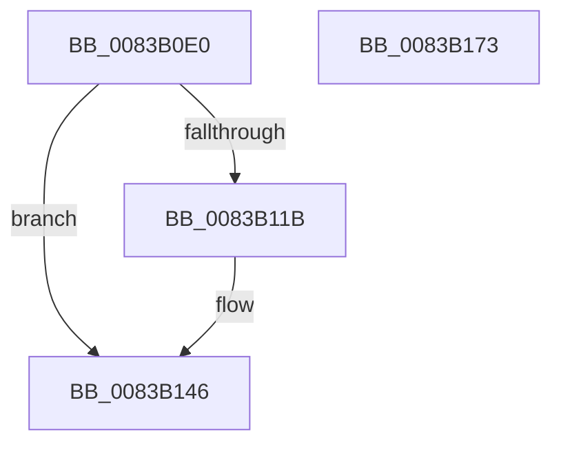

# VrpRegistryUnload

- RVA: `0x0083B0E0`–`0x0083B174` (길이 `148` bytes)
- VA: `0x000000014083B0E0`
- 실행 섹션: `PAGE`
- PDB 이름 있음: `예`; PDB Function 태그: `아니요`
- unwind 정보 RVA: `0x0006F9F8`
- 디코드: `29`개 명령, `148/148` bytes 표시
- 미해석 바이트: `0` (있으면 어셈블리에 `.byte`로 보존)

> 이 문서는 커널 이미지의 기계어와 PDB 기호를 분석해 생성했습니다. 4번과 5번은 함수 원형과 자료형을 바이너리 사용 방식에서 추정한 C 해석이며 원본 소스 복구 결과는 아닙니다.

## 1. Dependencies

- 직접 호출 지점: **5**; 고유 호출 대상: **5**
- 직접 호출자로 확인된 함수: **0**
- RIP 상대 이미지 참조: **9**

### Outgoing calls
- `0x0083B0FA` → [IoDeleteDevice](../../text/26/IoDeleteDevice_function_0026FE90.md) (function, `0x0026FE90`)
- `0x0083B10D` → [PsFreeSiloContextSlot](../77/PsFreeSiloContextSlot_function_0077F360.md) (function, `0x0077F360`)
- `0x0083B141` → [tlgWriteTransfer_EtwWriteTransfer](../../text/42/tlgWriteTransfer_EtwWriteTransfer_function_004260E0.md) (function, `0x004260E0`)
- `0x0083B15C` → [EtwUnregister](../A7/EtwUnregister_function_00A723D0.md) (function, `0x00A723D0`)
- `0x0083B169` → [_security_check_cookie](../../text/6A/_security_check_cookie_function_006AC640.md) (function, `0x006AC640`)

### Direct callers
- 이 함수 시작 RVA로 연결되는 직접 call은 확인되지 않았습니다. 간접 호출은 완전히 역산할 수 없습니다.

### Static image references
- `0x0083B0E4` → RVA `0x00E0A740` (`.data`; read)
- `0x0083B0F3` → RVA `0x00EF0028` (`.data`; read)
- `0x0083B0FF` → RVA `0x00EF02B8` (`.data`; read)
- `0x0083B105` → RVA `0x00EF0028` (`.data`; read/write)
- `0x0083B112` → RVA `0x00E0A630` (`.data`; read)
- `0x0083B128` → RVA `0x0005A813` (`.rdata`; read)
- `0x0083B146` → RVA `0x00E0A650` (`.data`; read)
- `0x0083B14D` → RVA `0x00E0A650` (`.data`; read/write)
- `0x0083B155` → RVA `0x00E0A630` (`.data`; read/write)

## 2. Other-region calls and transfers

- 다른 실행 섹션으로 향하는 call: **3**
  - `0x0083B0FA` → [IoDeleteDevice](../../text/26/IoDeleteDevice_function_0026FE90.md) (`PAGE` → `.text`)
  - `0x0083B141` → [tlgWriteTransfer_EtwWriteTransfer](../../text/42/tlgWriteTransfer_EtwWriteTransfer_function_004260E0.md) (`PAGE` → `.text`)
  - `0x0083B169` → [_security_check_cookie](../../text/6A/_security_check_cookie_function_006AC640.md) (`PAGE` → `.text`)
- 별도 외부 분기/꼬리 이동을 확인하지 못했습니다.

## 3. Assembly (complete function range)

```asm
0083B0E0  48 83 EC 68                     sub rsp, 0x68
0083B0E4  48 8B 05 55 F6 5C 00            mov rax, qword ptr [rip + 0x5cf655]
0083B0EB  48 33 C4                        xor rax, rsp
0083B0EE  48 89 44 24 50                  mov qword ptr [rsp + 0x50], rax
0083B0F3  48 8B 0D 2E 4F 6B 00            mov rcx, qword ptr [rip + 0x6b4f2e]
0083B0FA  E8 91 4D A3 FF                  call 0x14026fe90
0083B0FF  8B 0D B3 51 6B 00               mov ecx, dword ptr [rip + 0x6b51b3]
0083B105  48 83 25 1B 4F 6B 00 00         and qword ptr [rip + 0x6b4f1b], 0
0083B10D  E8 4E 42 F4 FF                  call 0x14077f360
0083B112  83 3D 17 F5 5C 00 05            cmp dword ptr [rip + 0x5cf517], 5
0083B119  76 2B                           jbe 0x14083b146
0083B11B  48 8D 44 24 30                  lea rax, [rsp + 0x30]
0083B120  45 33 C9                        xor r9d, r9d
0083B123  48 89 44 24 28                  mov qword ptr [rsp + 0x28], rax
0083B128  48 8D 15 E4 F6 81 FF            lea rdx, [rip - 0x7e091c]
0083B12F  45 33 C0                        xor r8d, r8d
0083B132  C7 44 24 20 02 00 00 00         mov dword ptr [rsp + 0x20], 2
0083B13A  48 8D 0D EF F4 5C 00            lea rcx, [rip + 0x5cf4ef]
0083B141  E8 9A AF BE FF                  call 0x1404260e0
0083B146  48 8B 0D 03 F5 5C 00            mov rcx, qword ptr [rip + 0x5cf503]
0083B14D  48 83 25 FB F4 5C 00 00         and qword ptr [rip + 0x5cf4fb], 0
0083B155  83 25 D4 F4 5C 00 00            and dword ptr [rip + 0x5cf4d4], 0
0083B15C  E8 6F 72 23 00                  call 0x140a723d0
0083B161  48 8B 4C 24 50                  mov rcx, qword ptr [rsp + 0x50]
0083B166  48 33 CC                        xor rcx, rsp
0083B169  E8 D2 14 E7 FF                  call 0x1406ac640
0083B16E  48 83 C4 68                     add rsp, 0x68
0083B172  C3                              ret
0083B173  CC                              int3
```

## 4. C-style interpretation (structured pseudocode)

```c
__int64 __fastcall VrpRegistryUnload(__int64 a1, __int64 a2, int a3, int a4)
{
    __int64 result;
    __int64 v_rsp;
    unsigned __int64 v_stack_m18;
    unsigned __int64 v_stack_m38;
    unsigned __int64 v_stack_m40;
    unsigned int v_stack_m48;

    v_rsp = (v_rsp) - (104);
    result = (*(unsigned __int64 *)(v_rip + 6092373)) ^ (v_rsp);
    v_stack_m18 = result;
    result = IoDeleteDevice(*(unsigned __int64 *)(v_rip + 7032622), a2, a3, a4);
    result = PsFreeSiloContextSlot((unsigned int)(*(unsigned int *)(v_rip + 7033267)), a2, a3, a4);
    if ((*(unsigned int *)(v_rip + 6092055)) >= = 5) {
        result = v_stack_m38;
        a4 = 0;
        v_stack_m40 = result;
        a2 = v_rip - 8259868;
        a3 = 0;
        v_stack_m48 = 2;
        a1 = v_rip + 6092015;
        result = tlgWriteTransfer_EtwWriteTransfer(a1, a2, a3, a4);
    }
    result = EtwUnregister(*(unsigned __int64 *)(v_rip + 6092035), a2, a3, a4);
    a1 = (v_stack_m18) ^ (v_rsp);
    result = _security_check_cookie(a1, a2, a3, a4);
    v_rsp = (v_rsp) + (104);
    return result;
}
```

## 5. (Beta) C Style

```c
int64_t VrpRegistryUnload(int64_t Arg1, int64_t Arg2, int32_t Arg3, int32_t Arg4)
{
    int64_t result;
    int64_t local_rsp;
    uint64_t v_stack_m18;
    uint64_t v_stack_m38;
    uint64_t v_stack_m40;
    uint32_t v_stack_m48;

    local_rsp = (local_rsp) - (104);
    result = (*(uint64_t *)(v_rip + 0x5CF655)) ^ (local_rsp);
    v_stack_m18 = result;
    result = IoDeleteDevice(*(uint64_t *)(v_rip + 0x6B4F2E), Arg2, Arg3, Arg4);
    result = PsFreeSiloContextSlot((uint32_t)(*(uint32_t *)(v_rip + 0x6B51B3)), Arg2, Arg3, Arg4);
    if ((*(uint32_t *)(v_rip + 0x5CF517)) >= = 5) {
        result = v_stack_m38;
        Arg4 = 0;
        v_stack_m40 = result;
        Arg2 = v_rip - 8259868;
        Arg3 = 0;
        v_stack_m48 = 2;
        Arg1 = v_rip + 6092015;
        result = tlgWriteTransfer_EtwWriteTransfer(Arg1, Arg2, Arg3, Arg4);
    }
    result = EtwUnregister(*(uint64_t *)(v_rip + 0x5CF503), Arg2, Arg3, Arg4);
    Arg1 = (v_stack_m18) ^ (local_rsp);
    result = _security_check_cookie(Arg1, Arg2, Arg3, Arg4);
    local_rsp = (local_rsp) + (104);
    return result;
}
```

## 6. Execution-region graph

[열기: 2D/3D 그래프와 함수 탐색 컨트롤 패널](../../../control-panel.html?section=page&rva=0x0083B0E0&view=graph)

- 2D 그래프는 위에서 아래로 흐르고, 3D 그래프는 빈 공간을 드래그해 회전합니다. Shift+드래그는 이동, 휠은 확대·축소, 함수 노드 선택은 대상 보고서 이동입니다.

### Static fallback


