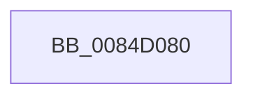

# CmCallbackGetKeyObjectIDEx

- RVA: `0x0084D080`–`0x0084D0A2` (길이 `34` bytes)
- VA: `0x000000014084D080`
- 실행 섹션: `PAGE`
- PDB 이름 있음: `예`; PDB Function 태그: `아니요`
- unwind 정보 RVA: `0x0006987C`
- 디코드: `9`개 명령, `34/34` bytes 표시
- 미해석 바이트: `0` (있으면 어셈블리에 `.byte`로 보존)

> 이 문서는 커널 이미지의 기계어와 PDB 기호를 분석해 생성했습니다. 4번과 5번은 함수 원형과 자료형을 바이너리 사용 방식에서 추정한 C 해석이며 원본 소스 복구 결과는 아닙니다.

## 1. Dependencies

- 직접 호출 지점: **0**; 고유 호출 대상: **0**
- 직접 호출자로 확인된 함수: **0**
- RIP 상대 이미지 참조: **1**

### Outgoing calls
- 직접 디코드된 call 명령이 없습니다.

### Direct callers
- 이 함수 시작 RVA로 연결되는 직접 call은 확인되지 않았습니다. 간접 호출은 완전히 역산할 수 없습니다.

### Static image references
- `0x0084D091` → RVA `0x00E0A740` (`.data`; read)

## 2. Other-region calls and transfers

- 다른 실행 섹션으로 향하는 call: **0**
- 별도 외부 분기/꼬리 이동을 확인하지 못했습니다.

## 3. Assembly (complete function range)

```asm
0084D080  4C 8B DC                        mov r11, rsp
0084D083  55                              push rbp
0084D084  41 55                           push r13
0084D086  49 8D 6B A9                     lea rbp, [r11 - 0x57]
0084D08A  48 81 EC E8 00 00 00            sub rsp, 0xe8
0084D091  48 8B 05 A8 D6 5B 00            mov rax, qword ptr [rip + 0x5bd6a8]
0084D098  48 33 C4                        xor rax, rsp
0084D09B  48 89 45 17                     mov qword ptr [rbp + 0x17], rax
0084D09F  0F 57 C9                        xorps xmm1, xmm1
```

## 4. C-style interpretation (structured pseudocode)

```c
__int64 __fastcall CmCallbackGetKeyObjectIDEx(void)
{
    __int64 result;
    __int64 v_rsp;

    v_rsp = (v_rsp) - (232);
    result = (*(unsigned __int64 *)(v_rip + 6018728)) ^ (v_rsp);
    *(unsigned __int64 *)(v_rsp - 87 + 23) = result;
    return result;
}
```

## 5. (Beta) C Style

```c
void CmCallbackGetKeyObjectIDEx(void)
{
    int64_t result;
    int64_t local_rsp;

    local_rsp = (local_rsp) - (232);
    result = (*(uint64_t *)(v_rip + 0x5BD6A8)) ^ (local_rsp);
    *(uint64_t *)(local_rsp - 0x57 + 0x17) = result;
    return result;
}
```

## 6. Execution-region graph

[열기: 2D/3D 그래프와 함수 탐색 컨트롤 패널](../../../control-panel.html?section=page&rva=0x0084D080&view=graph)

- 2D 그래프는 위에서 아래로 흐르고, 3D 그래프는 빈 공간을 드래그해 회전합니다. Shift+드래그는 이동, 휠은 확대·축소, 함수 노드 선택은 대상 보고서 이동입니다.

### Static fallback


