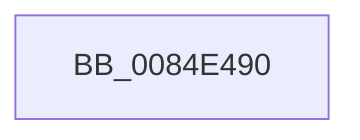

# CmEnumerateKey

- RVA: `0x0084E490`–`0x0084E4B5` (길이 `37` bytes)
- VA: `0x000000014084E490`
- 실행 섹션: `PAGE`
- PDB 이름 있음: `예`; PDB Function 태그: `예`
- unwind 정보 RVA: `0x00069C10`
- 디코드: `10`개 명령, `37/37` bytes 표시
- 미해석 바이트: `0` (있으면 어셈블리에 `.byte`로 보존)

> 이 문서는 커널 이미지의 기계어와 PDB 기호를 분석해 생성했습니다. 4번과 5번은 함수 원형과 자료형을 바이너리 사용 방식에서 추정한 C 해석이며 원본 소스 복구 결과는 아닙니다.

## 1. Dependencies

- 직접 호출 지점: **0**; 고유 호출 대상: **0**
- 직접 호출자로 확인된 함수: **1**
- RIP 상대 이미지 참조: **1**

### Outgoing calls
- 직접 디코드된 call 명령이 없습니다.

### Direct callers
- [CmEnumerateKeyCallout](CmEnumerateKeyCallout_function_0084C560.md) at `0x0084C592`

### Static image references
- `0x0084E4A0` → RVA `0x00E0A740` (`.data`; read)

## 2. Other-region calls and transfers

- 다른 실행 섹션으로 향하는 call: **0**
- 별도 외부 분기/꼬리 이동을 확인하지 못했습니다.

## 3. Assembly (complete function range)

```asm
0084E490  4C 8B DC                        mov r11, rsp
0084E493  55                              push rbp
0084E494  53                              push rbx
0084E495  49 8D 6B D8                     lea rbp, [r11 - 0x28]
0084E499  48 81 EC 18 01 00 00            sub rsp, 0x118
0084E4A0  48 8B 05 99 C2 5B 00            mov rax, qword ptr [rip + 0x5bc299]
0084E4A7  48 33 C4                        xor rax, rsp
0084E4AA  48 89 45 E0                     mov qword ptr [rbp - 0x20], rax
0084E4AE  48 8B 45 50                     mov rax, qword ptr [rbp + 0x50]
0084E4B2  0F 57 C0                        xorps xmm0, xmm0
```

## 4. C-style interpretation (structured pseudocode)

```c
__int64 __fastcall CmEnumerateKey(void)
{
    __int64 result;
    __int64 v_rsp;

    v_rsp = (v_rsp) - (280);
    result = (*(unsigned __int64 *)(v_rip + 6013593)) ^ (v_rsp);
    *(unsigned __int64 *)(v_rsp - 40 - 32) = result;
    return *(unsigned __int64 *)(v_rsp - 40 + 80);
}
```

## 5. (Beta) C Style

```c
void CmEnumerateKey(void)
{
    int64_t result;
    int64_t local_rsp;

    local_rsp = (local_rsp) - (280);
    result = (*(uint64_t *)(v_rip + 0x5BC299)) ^ (local_rsp);
    *(uint64_t *)(local_rsp - 0x28 - 0x20) = result;
    return *(uint64_t *)(local_rsp - 0x28 + 0x50);
}
```

## 6. Execution-region graph

[열기: 2D/3D 그래프와 함수 탐색 컨트롤 패널](../../../control-panel.html?section=page&rva=0x0084E490&view=graph)

- 2D 그래프는 위에서 아래로 흐르고, 3D 그래프는 빈 공간을 드래그해 회전합니다. Shift+드래그는 이동, 휠은 확대·축소, 함수 노드 선택은 대상 보고서 이동입니다.

### Static fallback


