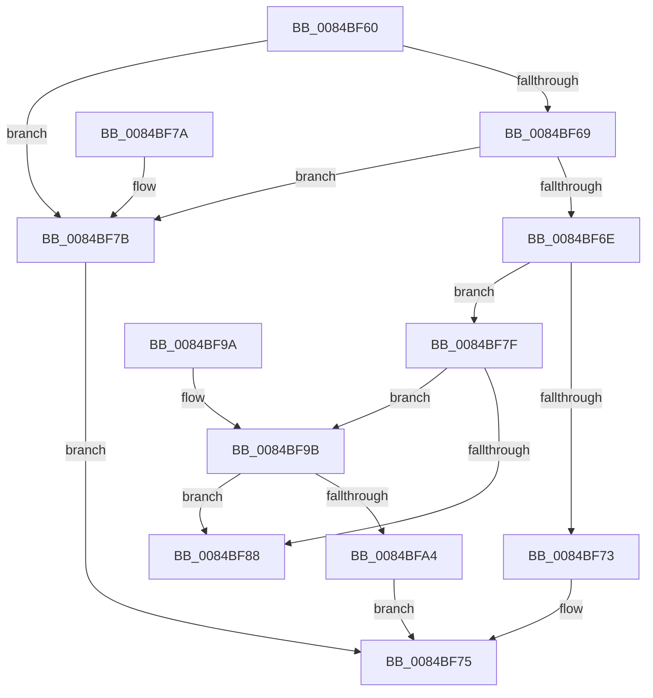

# CmEqualTrans

- RVA: `0x0084BF60`–`0x0084BFAC` (길이 `76` bytes)
- VA: `0x000000014084BF60`
- 실행 섹션: `PAGE`
- PDB 이름 있음: `예`; PDB Function 태그: `아니요`
- unwind 정보 RVA: `0x00069734`
- 디코드: `28`개 명령, `76/76` bytes 표시
- 미해석 바이트: `0` (있으면 어셈블리에 `.byte`로 보존)

> 이 문서는 커널 이미지의 기계어와 PDB 기호를 분석해 생성했습니다. 4번과 5번은 함수 원형과 자료형을 바이너리 사용 방식에서 추정한 C 해석이며 원본 소스 복구 결과는 아닙니다.

## 1. Dependencies

- 직접 호출 지점: **1**; 고유 호출 대상: **1**
- 직접 호출자로 확인된 함수: **18**
- RIP 상대 이미지 참조: **0**

### Outgoing calls
- `0x0084BF90` → [CmpTransUowIsEqual](../70/CmpTransUowIsEqual_function_007049CC.md) (function, `0x007049CC`)

### Direct callers
- [CmpLockIXLockIntent](CmpLockIXLockIntent_function_00844C08.md) at `0x00844C31`
- [CmpLockIXLockIntent](CmpLockIXLockIntent_function_00844C08.md) at `0x00844C4F`
- [CmpLockIXLockExclusive](CmpLockIXLockExclusive_function_00844CB4.md) at `0x00844CD1`
- [CmpLockIXLockExclusive](CmpLockIXLockExclusive_function_00844CB4.md) at `0x00844D1B`
- [CmDeleteKey](CmDeleteKey_function_00848E5C.md) at `0x008496F6`
- [CmGetVisibleSubkeyCount](CmGetVisibleSubkeyCount_function_00849D74.md) at `0x00849DE1`
- [sub_0084BE91](Unknown_function_0084BE91.md) at `0x0084BEC8`
- [sub_0084E27C](Unknown_function_0084E27C.md) at `0x0084E283`
- [CmpQueryKeyDataFromNode](CmpQueryKeyDataFromNode_function_0084EAE0.md) at `0x0084EF84`
- [CmpQueryKeyDataFromNode](CmpQueryKeyDataFromNode_function_0084EAE0.md) at `0x0084F06E`
- [CmpQueryKeyDataFromNode](CmpQueryKeyDataFromNode_function_0084EAE0.md) at `0x0084F0DA`
- [CmpFindSubKeyByNumberEx](CmpFindSubKeyByNumberEx_function_0084F1A0.md) at `0x0084F8D7`
- [CmpWalkOneLevel](../85/CmpWalkOneLevel_function_00852BA0.md) at `0x00853274`
- [CmpGetSymbolicLinkTarget](../85/CmpGetSymbolicLinkTarget_function_008570A0.md) at `0x008576E0`
- [CmpQueryKeyDataFromCache](../85/CmpQueryKeyDataFromCache_function_00858F70.md) at `0x0085917B`
- [CmpQueryKeyDataFromCache](../85/CmpQueryKeyDataFromCache_function_00858F70.md) at `0x0085925C`
- [CmpDoParseKey](../85/CmpDoParseKey_function_0085F750.md) at `0x0086060B`
- [CmpSecurityMethod](../87/CmpSecurityMethod_function_00870CC0.md) at `0x0087113C`
- [CmpTransMgrFreeVolatileData](../87/CmpTransMgrFreeVolatileData_function_00874BDC.md) at `0x00874C7E`
- [sub_00B16078](../B1/Unknown_function_00B16078.md) at `0x00B1608E`
- [sub_00B49904](../B4/Unknown_function_00B49904.md) at `0x00B49924`
- [CmpIsKeyDeletedForKeyBody](../../pagecmrc/BC/CmpIsKeyDeletedForKeyBody_function_00BC9480.md) at `0x00BC94F3`
- [CmpPerformKeyBodyDeletionCheck](../../pagecmrc/BC/CmpPerformKeyBodyDeletionCheck_function_00BC97D0.md) at `0x00BC9849`

### Static image references
- 디코드된 RIP-relative 메모리 참조가 없습니다.

## 2. Other-region calls and transfers

- 다른 실행 섹션으로 향하는 call: **0**
- 별도 외부 분기/꼬리 이동을 확인하지 못했습니다.

## 3. Assembly (complete function range)

```asm
0084BF60  48 83 EC 28                     sub rsp, 0x28
0084BF64  48 85 C9                        test rcx, rcx
0084BF67  74 12                           je 0x14084bf7b
0084BF69  48 85 D2                        test rdx, rdx
0084BF6C  74 0D                           je 0x14084bf7b
0084BF6E  48 3B CA                        cmp rcx, rdx
0084BF71  75 0C                           jne 0x14084bf7f
0084BF73  B0 01                           mov al, 1
0084BF75  48 83 C4 28                     add rsp, 0x28
0084BF79  C3                              ret
0084BF7A  CC                              int3
0084BF7B  32 C0                           xor al, al
0084BF7D  EB F6                           jmp 0x14084bf75
0084BF7F  48 8B 41 38                     mov rax, qword ptr [rcx + 0x38]
0084BF83  48 85 C0                        test rax, rax
0084BF86  75 13                           jne 0x14084bf9b
0084BF88  48 83 C2 58                     add rdx, 0x58
0084BF8C  48 83 C1 58                     add rcx, 0x58
0084BF90  E8 37 8A EB FF                  call 0x1407049cc
0084BF95  48 83 C4 28                     add rsp, 0x28
0084BF99  C3                              ret
0084BF9A  CC                              int3
0084BF9B  4C 8B 42 38                     mov r8, qword ptr [rdx + 0x38]
0084BF9F  4D 85 C0                        test r8, r8
0084BFA2  74 E4                           je 0x14084bf88
0084BFA4  49 3B C0                        cmp rax, r8
0084BFA7  0F 94 C0                        sete al
0084BFAA  EB C9                           jmp 0x14084bf75
```

## 4. C-style interpretation (structured pseudocode)

```c
__int64 __fastcall CmEqualTrans(__int64 a1, __int64 a2)
{
    __int64 result;
    __int64 v_rsp;

    v_rsp = (v_rsp) - (40);
    if (a1 == 0) goto loc_0084BF7B;
    if (a2 == 0) goto loc_0084BF7B;
    if (a1 != a2) goto loc_0084BF7F;
loc_0084BF75:
    v_rsp = (v_rsp) + (40);
    return 1;
loc_0084BF7B:
    result = 0;
    goto loc_0084BF75;
loc_0084BF7F:
    if (*(unsigned __int64 *)(a1 + 56) != 0) goto loc_0084BF9B;
loc_0084BF88:
    a2 = (a2) + (88);
    a1 = (a1) + (88);
    result = CmpTransUowIsEqual(a1, a2, a3, a4);
    v_rsp = (v_rsp) + (40);
    return result;
loc_0084BF9B:
    if (*(unsigned __int64 *)(a2 + 56) == 0) goto loc_0084BF88;
    result = (result == (*(unsigned __int64 *)(a2 + 56))) ? 1 : 0;
    goto loc_0084BF75;
}
```

## 5. (Beta) C Style

```c
int64_t CmEqualTrans(int64_t Arg1, int64_t Arg2)
{
    int64_t result;
    int64_t local_rsp;

    local_rsp = (local_rsp) - (40);
    if (Arg1 == 0) goto loc_0084BF7B;
    if (Arg2 == 0) goto loc_0084BF7B;
    if (Arg1 != Arg2) goto loc_0084BF7F;
loc_0084BF75:
    local_rsp = (local_rsp) + (40);
    return 1;
loc_0084BF7B:
    result = 0;
    goto loc_0084BF75;
loc_0084BF7F:
    if (*(uint64_t *)(Arg1 + 0x38) != 0) goto loc_0084BF9B;
loc_0084BF88:
    Arg2 = (Arg2) + (88);
    Arg1 = (Arg1) + (88);
    result = CmpTransUowIsEqual(Arg1, Arg2, a3, a4);
    local_rsp = (local_rsp) + (40);
    return result;
loc_0084BF9B:
    if (*(uint64_t *)(Arg2 + 0x38) == 0) goto loc_0084BF88;
    result = (result == (*(uint64_t *)(Arg2 + 0x38))) ? 1 : 0;
    goto loc_0084BF75;
}
```

## 6. Execution-region graph

[열기: 2D/3D 그래프와 함수 탐색 컨트롤 패널](../../../control-panel.html?section=page&rva=0x0084BF60&view=graph)

- 2D 그래프는 위에서 아래로 흐르고, 3D 그래프는 빈 공간을 드래그해 회전합니다. Shift+드래그는 이동, 휠은 확대·축소, 함수 노드 선택은 대상 보고서 이동입니다.

### Static fallback


