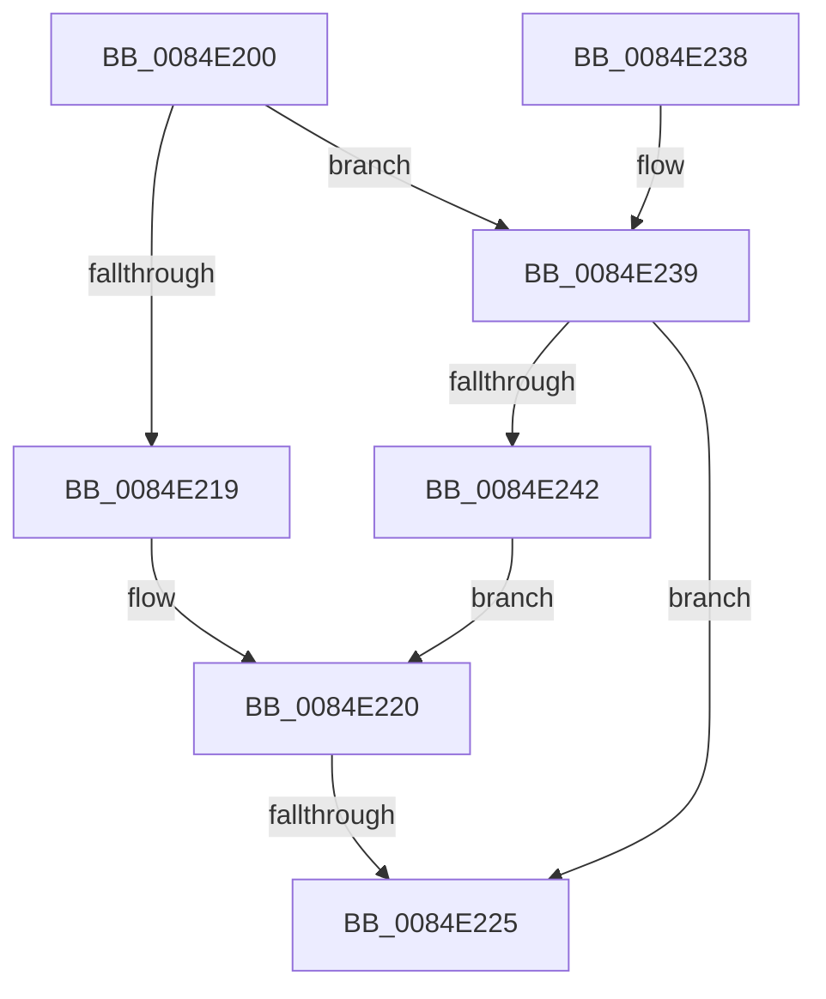

# CmGetKeyLastWriteTime

- RVA: `0x0084E200`–`0x0084E244` (길이 `68` bytes)
- VA: `0x000000014084E200`
- 실행 섹션: `PAGE`
- PDB 이름 있음: `예`; PDB Function 태그: `아니요`
- unwind 정보 RVA: `0x00069BB4`
- 디코드: `22`개 명령, `68/68` bytes 표시
- 미해석 바이트: `0` (있으면 어셈블리에 `.byte`로 보존)

> 이 문서는 커널 이미지의 기계어와 PDB 기호를 분석해 생성했습니다. 4번과 5번은 함수 원형과 자료형을 바이너리 사용 방식에서 추정한 C 해석이며 원본 소스 복구 결과는 아닙니다.

## 1. Dependencies

- 직접 호출 지점: **0**; 고유 호출 대상: **0**
- 직접 호출자로 확인된 함수: **1**
- RIP 상대 이미지 참조: **0**

### Outgoing calls
- 직접 디코드된 call 명령이 없습니다.

### Direct callers
- [CmpQueryKeyDataFromNode](CmpQueryKeyDataFromNode_function_0084EAE0.md) at `0x0084EDE4`

### Static image references
- 디코드된 RIP-relative 메모리 참조가 없습니다.

## 2. Other-region calls and transfers

- 다른 실행 섹션으로 향하는 call: **0**
- call이 아닌 외부 분기/꼬리 이동: **1**
  - `0x0084E223` → [sub_0084E244](Unknown_function_0084E244.md) (`tail-transfer`)

## 3. Assembly (complete function range)

```asm
0084E200  48 89 5C 24 18                  mov qword ptr [rsp + 0x18], rbx
0084E205  48 89 74 24 20                  mov qword ptr [rsp + 0x20], rsi
0084E20A  57                              push rdi
0084E20B  48 83 EC 20                     sub rsp, 0x20
0084E20F  33 F6                           xor esi, esi
0084E211  49 8B F8                        mov rdi, r8
0084E214  48 85 D2                        test rdx, rdx
0084E217  75 20                           jne 0x14084e239
0084E219  48 8B 99 A8 00 00 00            mov rbx, qword ptr [rcx + 0xa8]
0084E220  48 85 FF                        test rdi, rdi
0084E223  75 1F                           jne 0x14084e244
0084E225  48 8B 74 24 48                  mov rsi, qword ptr [rsp + 0x48]
0084E22A  48 8B C3                        mov rax, rbx
0084E22D  48 8B 5C 24 40                  mov rbx, qword ptr [rsp + 0x40]
0084E232  48 83 C4 20                     add rsp, 0x20
0084E236  5F                              pop rdi
0084E237  C3                              ret
0084E238  CC                              int3
0084E239  48 8B 5A 04                     mov rbx, qword ptr [rdx + 4]
0084E23D  48 85 C9                        test rcx, rcx
0084E240  74 E3                           je 0x14084e225
0084E242  EB DC                           jmp 0x14084e220
```

## 4. C-style interpretation (structured pseudocode)

```c
__int64 __fastcall CmGetKeyLastWriteTime(__int64 a1, __int64 a2, __int64 a3)
{
    __int64 v_rsi;
    __int64 v_rsp;
    unsigned __int64 v_stack_p18;
    unsigned __int64 v_stack_p20;

    v_stack_p18 = v_rbx;
    v_stack_p20 = v_rsi;
    v_rsp = (v_rsp) - (32);
    v_rsi = 0;
    if (a2 != 0) goto loc_0084E239;
loc_0084E220:
loc_0084E225:
    v_rsp = (v_rsp) + (32);
    return *(unsigned __int64 *)(a1 + 168);
loc_0084E239:
    if (a1 == 0) goto loc_0084E225;
    goto loc_0084E220;
}
```

## 5. (Beta) C Style

```c
int64_t CmGetKeyLastWriteTime(void *Arg1, int64_t Arg2, int64_t Arg3)
{
    uint8_t *arg1 = (uint8_t *)Arg1;

    int64_t local_rsi;
    int64_t local_rsp;
    uint64_t v_stack_p18;
    uint64_t v_stack_p20;

    v_stack_p18 = local_rbx;
    v_stack_p20 = local_rsi;
    local_rsp = (local_rsp) - (32);
    local_rsi = 0;
    if (Arg2 != 0) goto loc_0084E239;
loc_0084E220:
loc_0084E225:
    local_rsp = (local_rsp) + (32);
    return *(uint64_t *)(arg1 + 0xA8);
loc_0084E239:
    if (Arg1 == NULL) goto loc_0084E225;
    goto loc_0084E220;
}
```

### 관측된 메모리 오프셋

구조체 형식이 확인되지 않은 접근은 인자 기준의 오프셋으로만 기록했습니다.

| 기준 인자 | 오프셋 표현 | 폭 (bit) | 접근 |
|---|---:|---:|---|
| `Arg1` | `+ 0xA8` | `64` | `R` |

## 6. Execution-region graph

[열기: 2D/3D 그래프와 함수 탐색 컨트롤 패널](../../../control-panel.html?section=page&rva=0x0084E200&view=graph)

- 2D 그래프는 위에서 아래로 흐르고, 3D 그래프는 빈 공간을 드래그해 회전합니다. Shift+드래그는 이동, 휠은 확대·축소, 함수 노드 선택은 대상 보고서 이동입니다.

### Static fallback


