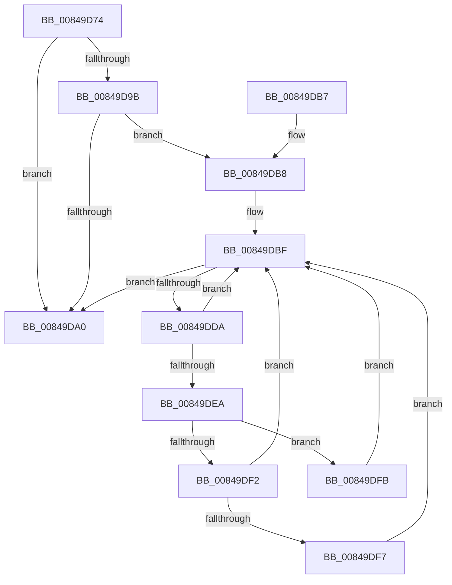

# CmGetVisibleSubkeyCount

- RVA: `0x00849D74`–`0x00849DFF` (길이 `139` bytes)
- VA: `0x0000000140849D74`
- 실행 섹션: `PAGE`
- PDB 이름 있음: `예`; PDB Function 태그: `아니요`
- unwind 정보 RVA: `0x00069474`
- 디코드: `44`개 명령, `139/139` bytes 표시
- 미해석 바이트: `0` (있으면 어셈블리에 `.byte`로 보존)

> 이 문서는 커널 이미지의 기계어와 PDB 기호를 분석해 생성했습니다. 4번과 5번은 함수 원형과 자료형을 바이너리 사용 방식에서 추정한 C 해석이며 원본 소스 복구 결과는 아닙니다.

## 1. Dependencies

- 직접 호출 지점: **2**; 고유 호출 대상: **2**
- 직접 호출자로 확인된 함수: **3**
- RIP 상대 이미지 참조: **0**

### Outgoing calls
- `0x00849DCD` → [CmListGetNextElement](../../pagecmrc/BC/CmListGetNextElement_function_00BC9940.md) (function, `0x00BC9940`)
- `0x00849DE1` → [CmEqualTrans](CmEqualTrans_function_0084BF60.md) (function, `0x0084BF60`)

### Direct callers
- [CmDeleteKey](CmDeleteKey_function_00848E5C.md) at `0x0084916E`
- [CmpQueryKeyDataFromNode](CmpQueryKeyDataFromNode_function_0084EAE0.md) at `0x0084ED1E`
- [CmpQueryKeyDataFromCache](../85/CmpQueryKeyDataFromCache_function_00858F70.md) at `0x008591E0`

### Static image references
- 디코드된 RIP-relative 메모리 참조가 없습니다.

## 2. Other-region calls and transfers

- 다른 실행 섹션으로 향하는 call: **1**
  - `0x00849DCD` → [CmListGetNextElement](../../pagecmrc/BC/CmListGetNextElement_function_00BC9940.md) (`PAGE` → `PAGECMRC`)
- 별도 외부 분기/꼬리 이동을 확인하지 못했습니다.

## 3. Assembly (complete function range)

```asm
00849D74  48 8B C4                        mov rax, rsp
00849D77  48 89 58 10                     mov qword ptr [rax + 0x10], rbx
00849D7B  48 89 68 18                     mov qword ptr [rax + 0x18], rbp
00849D7F  48 89 70 20                     mov qword ptr [rax + 0x20], rsi
00849D83  57                              push rdi
00849D84  48 83 EC 20                     sub rsp, 0x20
00849D88  8B 5A 18                        mov ebx, dword ptr [rdx + 0x18]
00849D8B  49 8B F0                        mov rsi, r8
00849D8E  03 5A 14                        add ebx, dword ptr [rdx + 0x14]
00849D91  48 83 60 08 00                  and qword ptr [rax + 8], 0
00849D96  48 85 C9                        test rcx, rcx
00849D99  74 05                           je 0x140849da0
00849D9B  4D 85 C0                        test r8, r8
00849D9E  75 18                           jne 0x140849db8
00849DA0  48 8B 6C 24 40                  mov rbp, qword ptr [rsp + 0x40]
00849DA5  8B C3                           mov eax, ebx
00849DA7  48 8B 5C 24 38                  mov rbx, qword ptr [rsp + 0x38]
00849DAC  48 8B 74 24 48                  mov rsi, qword ptr [rsp + 0x48]
00849DB1  48 83 C4 20                     add rsp, 0x20
00849DB5  5F                              pop rdi
00849DB6  C3                              ret
00849DB7  CC                              int3
00849DB8  48 8D A9 D0 00 00 00            lea rbp, [rcx + 0xd0]
00849DBF  41 B8 20 00 00 00               mov r8d, 0x20
00849DC5  48 8D 54 24 30                  lea rdx, [rsp + 0x30]
00849DCA  48 8B CD                        mov rcx, rbp
00849DCD  E8 6E FB 37 00                  call 0x140bc9940
00849DD2  48 8B F8                        mov rdi, rax
00849DD5  48 85 C0                        test rax, rax
00849DD8  74 C6                           je 0x140849da0
00849DDA  48 8B 48 38                     mov rcx, qword ptr [rax + 0x38]
00849DDE  48 8B D6                        mov rdx, rsi
00849DE1  E8 7A 21 00 00                  call 0x14084bf60
00849DE6  84 C0                           test al, al
00849DE8  74 D5                           je 0x140849dbf
00849DEA  8B 47 44                        mov eax, dword ptr [rdi + 0x44]
00849DED  83 F8 01                        cmp eax, 1
00849DF0  74 09                           je 0x140849dfb
00849DF2  83 F8 03                        cmp eax, 3
00849DF5  75 C8                           jne 0x140849dbf
00849DF7  FF CB                           dec ebx
00849DF9  EB C4                           jmp 0x140849dbf
00849DFB  FF C3                           inc ebx
00849DFD  EB C0                           jmp 0x140849dbf
```

## 4. C-style interpretation (structured pseudocode)

```c
__int64 __fastcall CmGetVisibleSubkeyCount(__int64 a1, __int64 a2, __int64 a3)
{
    __int64 result;
    __int64 v_rbx;
    __int64 v_rsp;
    unsigned __int64 v_stack_p10;
    unsigned __int64 v_stack_p18;
    unsigned __int64 v_stack_p20;
    unsigned __int64 v_stack_p30;

    *(unsigned __int64 *)(v_rsp + 16) = v_rbx;
    *(unsigned __int64 *)(v_rsp + 24) = v_rbp;
    *(unsigned __int64 *)(v_rsp + 32) = v_rsi;
    v_rsp = (v_rsp) - (32);
    v_rbx = (unsigned int)(((unsigned int)(*(unsigned int *)(a2 + 24))) + (*(unsigned int *)(a2 + 20)));
    if (a1 == 0) goto loc_00849DA0;
    if (a3 != 0) goto loc_00849DB8;
loc_00849DA0:
    v_rsp = (v_rsp) + (32);
    return (unsigned int)((unsigned int)(v_rbx));
loc_00849DB8:
loc_00849DBF:
    result = CmListGetNextElement(a1 + 208, v_stack_p30, 32, a4);
    if (result == 0) goto loc_00849DA0;
    result = CmEqualTrans(*(unsigned __int64 *)(result + 56), v_stack_p20, 32, a4);
    if ((unsigned __int8)(result) == 0) goto loc_00849DBF;
    if (((unsigned int)((unsigned int)(*(unsigned int *)(result + 68)))) == 1) goto loc_00849DFB;
    if (((unsigned int)((unsigned int)(*(unsigned int *)(result + 68)))) != 3) goto loc_00849DBF;
    v_rbx = (unsigned int)((v_stack_p10) - 1);
    goto loc_00849DBF;
loc_00849DFB:
    v_rbx = (unsigned int)((v_rbx) + 1);
    goto loc_00849DBF;
}
```

## 5. (Beta) C Style

```c
int64_t CmGetVisibleSubkeyCount(int64_t Arg1, void *Arg2, int64_t Arg3)
{
    uint8_t *arg2 = (uint8_t *)Arg2;

    int64_t result;
    int64_t local_rbx;
    int64_t local_rsp;
    uint64_t v_stack_p10;
    uint64_t v_stack_p18;
    uint64_t v_stack_p20;
    uint64_t v_stack_p30;

    *(uint64_t *)(local_rsp + 0x10) = local_rbx;
    *(uint64_t *)(local_rsp + 0x18) = local_rbp;
    *(uint64_t *)(local_rsp + 0x20) = local_rsi;
    local_rsp = (local_rsp) - (32);
    local_rbx = (uint32_t)(((uint32_t)(*(uint32_t *)(arg2 + 0x18))) + (*(uint32_t *)(arg2 + 0x14)));
    if (Arg1 == 0) goto loc_00849DA0;
    if (Arg3 != 0) goto loc_00849DB8;
loc_00849DA0:
    local_rsp = (local_rsp) + (32);
    return (uint32_t)((uint32_t)(local_rbx));
loc_00849DB8:
loc_00849DBF:
    result = CmListGetNextElement(Arg1 + 208, v_stack_p30, 32, a4);
    if (result == 0) goto loc_00849DA0;
    result = CmEqualTrans(*(uint64_t *)(result + 0x38), v_stack_p20, 32, a4);
    if ((uint8_t)(result) == 0) goto loc_00849DBF;
    if (((uint32_t)((uint32_t)(*(uint32_t *)(result + 0x44)))) == 1) goto loc_00849DFB;
    if (((uint32_t)((uint32_t)(*(uint32_t *)(result + 0x44)))) != 3) goto loc_00849DBF;
    local_rbx = (uint32_t)((v_stack_p10) - 1);
    goto loc_00849DBF;
loc_00849DFB:
    local_rbx = (uint32_t)((local_rbx) + 1);
    goto loc_00849DBF;
}
```

### 관측된 메모리 오프셋

구조체 형식이 확인되지 않은 접근은 인자 기준의 오프셋으로만 기록했습니다.

| 기준 인자 | 오프셋 표현 | 폭 (bit) | 접근 |
|---|---:|---:|---|
| `Arg2` | `+ 0x14` | `32` | `R` |
| `Arg2` | `+ 0x18` | `32` | `R` |

## 6. Execution-region graph

[열기: 2D/3D 그래프와 함수 탐색 컨트롤 패널](../../../control-panel.html?section=page&rva=0x00849D74&view=graph)

- 2D 그래프는 위에서 아래로 흐르고, 3D 그래프는 빈 공간을 드래그해 회전합니다. Shift+드래그는 이동, 휠은 확대·축소, 함수 노드 선택은 대상 보고서 이동입니다.

### Static fallback


