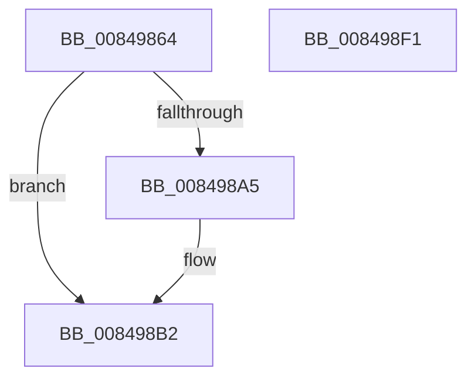

# CmKeyBodyNeedsVirtualImage

- RVA: `0x00849864`–`0x008498F2` (길이 `142` bytes)
- VA: `0x0000000140849864`
- 실행 섹션: `PAGE`
- PDB 이름 있음: `예`; PDB Function 태그: `아니요`
- unwind 정보 RVA: `0x0005C954`
- 디코드: `39`개 명령, `142/142` bytes 표시
- 미해석 바이트: `0` (있으면 어셈블리에 `.byte`로 보존)

> 이 문서는 커널 이미지의 기계어와 PDB 기호를 분석해 생성했습니다. 4번과 5번은 함수 원형과 자료형을 바이너리 사용 방식에서 추정한 C 해석이며 원본 소스 복구 결과는 아닙니다.

## 1. Dependencies

- 직접 호출 지점: **5**; 고유 호출 대상: **5**
- 직접 호출자로 확인된 함수: **5**
- RIP 상대 이미지 참조: **0**

### Outgoing calls
- `0x00849889` → [CmpLockRegistry](../../pagecmrc/BC/CmpLockRegistry_function_00BC9B34.md) (function, `0x00BC9B34`)
- `0x00849892` → [CmpLockKcbShared](../../pagecmrc/BC/CmpLockKcbShared_function_00BC9A1C.md) (function, `0x00BC9A1C`)
- `0x0084989C` → [CmpIsKeyDeletedForKeyBody](../../pagecmrc/BC/CmpIsKeyDeletedForKeyBody_function_00BC9480.md) (function, `0x00BC9480`)
- `0x008498CF` → [CmpUnlockKcb](../../pagecmrc/BC/CmpUnlockKcb_function_00BC92C0.md) (function, `0x00BC92C0`)
- `0x008498D4` → [CmpUnlockRegistry](../../pagecmrc/BC/CmpUnlockRegistry_function_00BC9A84.md) (function, `0x00BC9A84`)

### Direct callers
- [NtRenameKey](../7E/NtRenameKey_function_007E04B0.md) at `0x007E0777`
- [NtSetInformationKey](NtSetInformationKey_function_00843720.md) at `0x00843E31`
- [NtSetValueKey](NtSetValueKey_function_00844EA0.md) at `0x0084578A`
- [NtDeleteValueKey](NtDeleteValueKey_function_00848770.md) at `0x00848CBC`
- [sub_00B1664A](../B1/Unknown_function_00B1664A.md) at `0x00B1668A`

### Static image references
- 디코드된 RIP-relative 메모리 참조가 없습니다.

## 2. Other-region calls and transfers

- 다른 실행 섹션으로 향하는 call: **5**
  - `0x00849889` → [CmpLockRegistry](../../pagecmrc/BC/CmpLockRegistry_function_00BC9B34.md) (`PAGE` → `PAGECMRC`)
  - `0x00849892` → [CmpLockKcbShared](../../pagecmrc/BC/CmpLockKcbShared_function_00BC9A1C.md) (`PAGE` → `PAGECMRC`)
  - `0x0084989C` → [CmpIsKeyDeletedForKeyBody](../../pagecmrc/BC/CmpIsKeyDeletedForKeyBody_function_00BC9480.md) (`PAGE` → `PAGECMRC`)
  - `0x008498CF` → [CmpUnlockKcb](../../pagecmrc/BC/CmpUnlockKcb_function_00BC92C0.md) (`PAGE` → `PAGECMRC`)
  - `0x008498D4` → [CmpUnlockRegistry](../../pagecmrc/BC/CmpUnlockRegistry_function_00BC9A84.md) (`PAGE` → `PAGECMRC`)
- 별도 외부 분기/꼬리 이동을 확인하지 못했습니다.

## 3. Assembly (complete function range)

```asm
00849864  48 89 5C 24 08                  mov qword ptr [rsp + 8], rbx
00849869  48 89 6C 24 10                  mov qword ptr [rsp + 0x10], rbp
0084986E  48 89 74 24 18                  mov qword ptr [rsp + 0x18], rsi
00849873  57                              push rdi
00849874  48 83 EC 20                     sub rsp, 0x20
00849878  48 8B 41 08                     mov rax, qword ptr [rcx + 8]
0084987C  33 FF                           xor edi, edi
0084987E  48 8B F1                        mov rsi, rcx
00849881  40 0F B6 DF                     movzx ebx, dil
00849885  48 8B 68 20                     mov rbp, qword ptr [rax + 0x20]
00849889  E8 A6 02 38 00                  call 0x140bc9b34
0084988E  48 8B 4E 08                     mov rcx, qword ptr [rsi + 8]
00849892  E8 85 01 38 00                  call 0x140bc9a1c
00849897  33 D2                           xor edx, edx
00849899  48 8B CE                        mov rcx, rsi
0084989C  E8 DF FB 37 00                  call 0x140bc9480
008498A1  84 C0                           test al, al
008498A3  75 0D                           jne 0x1408498b2
008498A5  F6 85 10 10 00 00 10            test byte ptr [rbp + 0x1010], 0x10
008498AC  8D 47 01                        lea eax, [rdi + 1]
008498AF  0F 45 D8                        cmovne ebx, eax
008498B2  48 8B 4E 08                     mov rcx, qword ptr [rsi + 8]
008498B6  44 8B C7                        mov r8d, edi
008498B9  0F B6 D3                        movzx edx, bl
008498BC  66 39 79 42                     cmp word ptr [rcx + 0x42], di
008498C0  44 0F 44 C2                     cmove r8d, edx
008498C4  F6 46 30 10                     test byte ptr [rsi + 0x30], 0x10
008498C8  41 0F B6 D0                     movzx edx, r8b
008498CC  0F 44 FA                        cmove edi, edx
008498CF  E8 EC F9 37 00                  call 0x140bc92c0
008498D4  E8 AB 01 38 00                  call 0x140bc9a84
008498D9  48 8B 5C 24 30                  mov rbx, qword ptr [rsp + 0x30]
008498DE  40 8A C7                        mov al, dil
008498E1  48 8B 6C 24 38                  mov rbp, qword ptr [rsp + 0x38]
008498E6  48 8B 74 24 40                  mov rsi, qword ptr [rsp + 0x40]
008498EB  48 83 C4 20                     add rsp, 0x20
008498EF  5F                              pop rdi
008498F0  C3                              ret
008498F1  CC                              int3
```

## 4. C-style interpretation (structured pseudocode)

```c
__int64 __fastcall CmKeyBodyNeedsVirtualImage(__int64 a1, int a2)
{
    __int64 result;
    __int64 v_rbx;
    __int64 v_rdi;
    __int64 v_rsp;
    unsigned __int64 v_stack_p10;
    unsigned __int64 v_stack_p18;
    unsigned __int64 v_stack_p8;

    v_stack_p8 = v_rbx;
    v_stack_p10 = v_rbp;
    v_stack_p18 = v_rsi;
    v_rsp = (v_rsp) - (32);
    v_rdi = 0;
    result = CmpLockRegistry(a1, a2, a3, a4);
    result = CmpLockKcbShared(*(unsigned __int64 *)(a1 + 8), a2, a3, a4);
    a2 = 0;
    result = CmpIsKeyDeletedForKeyBody(a1, a2, a3, a4);
    v_rbx = 0;
    if ((unsigned __int8)(result) == 0) {
        result = v_rdi + 1;
        v_rbx = 0;
        if (((*(unsigned __int8 *)(*(unsigned __int64 *)(*(unsigned __int64 *)(a1 + 8) + 32) + 4112)) & (16)) != 0) { v_rbx = (unsigned int)(result); }
    }
    a3 = 0;
    if ((*(unsigned __int16 *)(*(unsigned __int64 *)(a1 + 8) + 66)) == 0) { a3 = (unsigned int)((unsigned __int8)(v_rbx)); }
    if (((*(unsigned __int8 *)(a1 + 48)) & (16)) == 0) { v_rdi = (unsigned int)((unsigned __int8)(a3)); }
    result = CmpUnlockKcb(*(unsigned __int64 *)(a1 + 8), (unsigned __int8)(a3), a3, a4);
    result = CmpUnlockRegistry(*(unsigned __int64 *)(a1 + 8), (unsigned __int8)(a3), a3, a4);
    v_rsp = (v_rsp) + (32);
    return (unsigned __int8)(v_rdi);
}
```

## 5. (Beta) C Style

```c
int64_t CmKeyBodyNeedsVirtualImage(void *Arg1, int32_t Arg2)
{
    uint8_t *arg1 = (uint8_t *)Arg1;

    int64_t result;
    int64_t local_rbx;
    int64_t local_rdi;
    int64_t local_rsp;
    uint64_t v_stack_p10;
    uint64_t v_stack_p18;
    uint64_t v_stack_p8;

    v_stack_p8 = local_rbx;
    v_stack_p10 = local_rbp;
    v_stack_p18 = local_rsi;
    local_rsp = (local_rsp) - (32);
    local_rdi = 0;
    result = CmpLockRegistry(Arg1, Arg2, a3, a4);
    result = CmpLockKcbShared(*(uint64_t *)(arg1 + 0x8), Arg2, a3, a4);
    Arg2 = 0;
    result = CmpIsKeyDeletedForKeyBody(Arg1, Arg2, a3, a4);
    local_rbx = 0;
    if ((uint8_t)(result) == 0) {
        result = local_rdi + 1;
        local_rbx = 0;
        if (((*(uint8_t *)(*(uint64_t *)(*(uint64_t *)(arg1 + 0x8) + 0x20) + 0x1010)) & (16)) != 0) { local_rbx = (uint32_t)(result); }
    }
    a3 = 0;
    if ((*(uint16_t *)(*(uint64_t *)(arg1 + 0x8) + 0x42)) == 0) { a3 = (uint32_t)((uint8_t)(local_rbx)); }
    if (((*(uint8_t *)(arg1 + 0x30)) & (16)) == 0) { local_rdi = (uint32_t)((uint8_t)(a3)); }
    result = CmpUnlockKcb(*(uint64_t *)(arg1 + 0x8), (uint8_t)(a3), a3, a4);
    result = CmpUnlockRegistry(*(uint64_t *)(arg1 + 0x8), (uint8_t)(a3), a3, a4);
    local_rsp = (local_rsp) + (32);
    return (uint8_t)(local_rdi);
}
```

### 관측된 메모리 오프셋

구조체 형식이 확인되지 않은 접근은 인자 기준의 오프셋으로만 기록했습니다.

| 기준 인자 | 오프셋 표현 | 폭 (bit) | 접근 |
|---|---:|---:|---|
| `Arg1` | `+ 0x8` | `64` | `R` |
| `Arg1` | `+ 0x30` | `8` | `R` |

## 6. Execution-region graph

[열기: 2D/3D 그래프와 함수 탐색 컨트롤 패널](../../../control-panel.html?section=page&rva=0x00849864&view=graph)

- 2D 그래프는 위에서 아래로 흐르고, 3D 그래프는 빈 공간을 드래그해 회전합니다. Shift+드래그는 이동, 휠은 확대·축소, 함수 노드 선택은 대상 보고서 이동입니다.

### Static fallback


