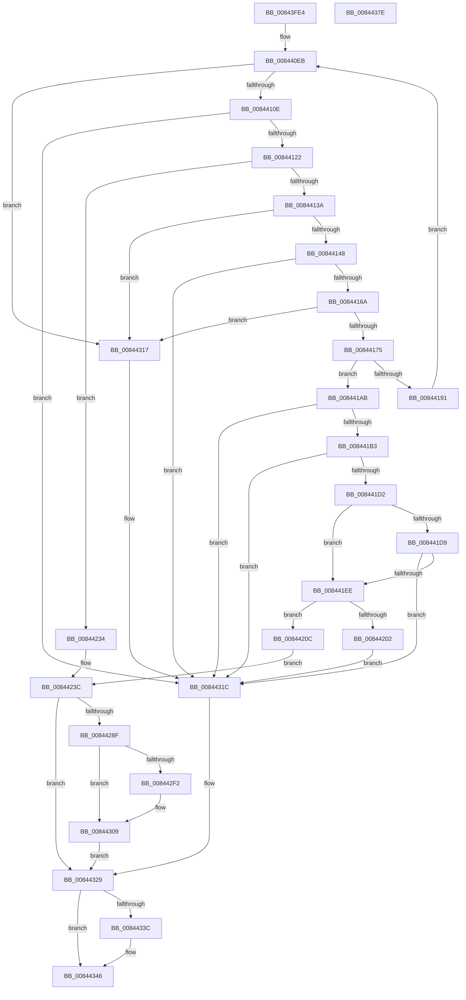

# CmKeyBodyReplicateToVirtual

- RVA: `0x00843FE4`–`0x0084437F` (길이 `923` bytes)
- VA: `0x0000000140843FE4`
- 실행 섹션: `PAGE`
- PDB 이름 있음: `예`; PDB Function 태그: `아니요`
- unwind 정보 RVA: `0x00069104`
- 디코드: `225`개 명령, `923/923` bytes 표시
- 미해석 바이트: `0` (있으면 어셈블리에 `.byte`로 보존)

> 이 문서는 커널 이미지의 기계어와 PDB 기호를 분석해 생성했습니다. 4번과 5번은 함수 원형과 자료형을 바이너리 사용 방식에서 추정한 C 해석이며 원본 소스 복구 결과는 아닙니다.

## 1. Dependencies

- 직접 호출 지점: **35**; 고유 호출 대상: **27**
- 직접 호출자로 확인된 함수: **3**
- RIP 상대 이미지 참조: **3**

### Outgoing calls
- `0x00844052` → [memset](../../text/6C/memset_function_006C6C40.md) (function, `0x006C6C40`)
- `0x00844083` → [memset](../../text/6C/memset_function_006C6C40.md) (function, `0x006C6C40`)
- `0x00844097` → [memset](../../text/6C/memset_function_006C6C40.md) (function, `0x006C6C40`)
- `0x008440B7` → [RtlInitUnicodeString](../../text/42/RtlInitUnicodeString_function_0042A780.md) (function, `0x0042A780`)
- `0x008440C3` → [CmpInitializeParseContext](../87/CmpInitializeParseContext_function_008767F0.md) (function, `0x008767F0`)
- `0x008440D2` → [CmpInitializeDelayDerefContext](../../text/42/CmpInitializeDelayDerefContext_function_0042A7F0.md) (function, `0x0042A7F0`)
- `0x008440DE` → [CmpAttachToRegistryProcess](../../pagecmrc/BC/CmpAttachToRegistryProcess_function_00BC98E0.md) (function, `0x00BC98E0`)
- `0x008440E3` → [CmpLockRegistry](../../pagecmrc/BC/CmpLockRegistry_function_00BC9B34.md) (function, `0x00BC9B34`)
- `0x008440F2` → [CmpLockKcbExclusive](../86/CmpLockKcbExclusive_function_00861EB0.md) (function, `0x00861EB0`)
- `0x00844101` → [KCBNeedsVirtualImage](../../text/42/KCBNeedsVirtualImage_function_0042E9FC.md) (function, `0x0042E9FC`)
- `0x00844113` → [CmpPerformKeyBodyDeletionCheck](../../pagecmrc/BC/CmpPerformKeyBodyDeletionCheck_function_00BC97D0.md) (function, `0x00BC97D0`)
- `0x0084412D` → [CmpReparseToVirtualPath](../7E/CmpReparseToVirtualPath_function_007EBA48.md) (function, `0x007EBA48`)
- `0x0084415B` → [CmpCheckAdminAccess](../9A/CmpCheckAdminAccess_function_009A87A0.md) (function, `0x009A87A0`)
- `0x00844183` → [CmpReplicateKeyToVirtual](../7E/CmpReplicateKeyToVirtual_function_007EBAEC.md) (function, `0x007EBAEC`)
- `0x00844194` → [CmpUnlockKcb](../../pagecmrc/BC/CmpUnlockKcb_function_00BC92C0.md) (function, `0x00BC92C0`)
- `0x00844199` → [CmpUnlockRegistry](../../pagecmrc/BC/CmpUnlockRegistry_function_00BC9A84.md) (function, `0x00BC9A84`)
- `0x008441A1` → [CmpLockRegistryExclusive](CmpLockRegistryExclusive_function_0084F9B4.md) (function, `0x0084F9B4`)
- `0x008441C3` → [CmpExamineSaclForAuditEvent](../7E/CmpExamineSaclForAuditEvent_function_007ECDB0.md) (function, `0x007ECDB0`)
- `0x008441DF` → [CmpReportAuditVirtualizationEvent](../7E/CmpReportAuditVirtualizationEvent_function_007ED758.md) (function, `0x007ED758`)
- `0x008441F9` → [CmpReparseToVirtualPath](../7E/CmpReparseToVirtualPath_function_007EBA48.md) (function, `0x007EBA48`)
- `0x0084420F` → [CmpUnlockKcb](../../pagecmrc/BC/CmpUnlockKcb_function_00BC92C0.md) (function, `0x00BC92C0`)
- `0x0084422D` → [CmpSearchKeyControlBlockTreeEx](../A6/CmpSearchKeyControlBlockTreeEx_function_00A65548.md) (function, `0x00A65548`)
- `0x00844237` → [CmpUnlockKcb](../../pagecmrc/BC/CmpUnlockKcb_function_00BC92C0.md) (function, `0x00BC92C0`)
- `0x00844243` → [CmpDrainDelayDerefContext](../../text/41/CmpDrainDelayDerefContext_function_0041B9A0.md) (function, `0x0041B9A0`)
- `0x00844248` → [CmpUnlockRegistry](../../pagecmrc/BC/CmpUnlockRegistry_function_00BC9A84.md) (function, `0x00BC9A84`)
- `0x00844280` → [SeCreateAccessStateFromSubjectContext](../A8/SeCreateAccessStateFromSubjectContext_function_00A8B12C.md) (function, `0x00A8B12C`)
- `0x008442E7` → [CmObReferenceObjectByName](../../pagecmrc/BC/CmObReferenceObjectByName_function_00BC9E94.md) (function, `0x00BC9E94`)
- `0x00844302` → [ObfDereferenceObject](../../text/2F/ObfDereferenceObject_function_002F9350.md) (function, `0x002F9350`)
- `0x00844310` → [SeDeleteAccessState](../8C/SeDeleteAccessState_function_008C5F70.md) (function, `0x008C5F70`)
- `0x0084431F` → [CmpUnlockKcb](../../pagecmrc/BC/CmpUnlockKcb_function_00BC92C0.md) (function, `0x00BC92C0`)
- `0x00844324` → [CmpUnlockRegistry](../../pagecmrc/BC/CmpUnlockRegistry_function_00BC9A84.md) (function, `0x00BC9A84`)
- `0x0084432F` → [CmpCleanupParseContext](../87/CmpCleanupParseContext_function_00876910.md) (function, `0x00876910`)
- `0x00844341` → [RtlFreeAnsiString](../9C/RtlFreeAnsiString_function_009C0800.md) (function, `0x009C0800`)
- `0x0084434D` → [CmpDetachFromRegistryProcess](../../pagecmrc/BC/CmpDetachFromRegistryProcess_function_00BC9920.md) (function, `0x00BC9920`)
- `0x0084435E` → [_security_check_cookie](../../text/6A/_security_check_cookie_function_006AC640.md) (function, `0x006AC640`)

### Direct callers
- [NtRenameKey](../7E/NtRenameKey_function_007E04B0.md) at `0x007E0837`
- [NtSetInformationKey](NtSetInformationKey_function_00843720.md) at `0x00843DB8`
- [NtSetValueKey](NtSetValueKey_function_00844EA0.md) at `0x0084572C`

### Static image references
- `0x00844003` → RVA `0x00E0A740` (`.data`; read)
- `0x00844226` → RVA `0x007EBD50` (`CmpSyncKcbCacheForHive`; read)
- `0x0084426D` → RVA `0x00FC6AC0` (`ALMOSTRO`; read)

## 2. Other-region calls and transfers

- 다른 실행 섹션으로 향하는 call: **21**
  - `0x00844052` → [memset](../../text/6C/memset_function_006C6C40.md) (`PAGE` → `.text`)
  - `0x00844083` → [memset](../../text/6C/memset_function_006C6C40.md) (`PAGE` → `.text`)
  - `0x00844097` → [memset](../../text/6C/memset_function_006C6C40.md) (`PAGE` → `.text`)
  - `0x008440B7` → [RtlInitUnicodeString](../../text/42/RtlInitUnicodeString_function_0042A780.md) (`PAGE` → `.text`)
  - `0x008440D2` → [CmpInitializeDelayDerefContext](../../text/42/CmpInitializeDelayDerefContext_function_0042A7F0.md) (`PAGE` → `.text`)
  - `0x008440DE` → [CmpAttachToRegistryProcess](../../pagecmrc/BC/CmpAttachToRegistryProcess_function_00BC98E0.md) (`PAGE` → `PAGECMRC`)
  - `0x008440E3` → [CmpLockRegistry](../../pagecmrc/BC/CmpLockRegistry_function_00BC9B34.md) (`PAGE` → `PAGECMRC`)
  - `0x00844101` → [KCBNeedsVirtualImage](../../text/42/KCBNeedsVirtualImage_function_0042E9FC.md) (`PAGE` → `.text`)
  - `0x00844113` → [CmpPerformKeyBodyDeletionCheck](../../pagecmrc/BC/CmpPerformKeyBodyDeletionCheck_function_00BC97D0.md) (`PAGE` → `PAGECMRC`)
  - `0x00844194` → [CmpUnlockKcb](../../pagecmrc/BC/CmpUnlockKcb_function_00BC92C0.md) (`PAGE` → `PAGECMRC`)
  - `0x00844199` → [CmpUnlockRegistry](../../pagecmrc/BC/CmpUnlockRegistry_function_00BC9A84.md) (`PAGE` → `PAGECMRC`)
  - `0x0084420F` → [CmpUnlockKcb](../../pagecmrc/BC/CmpUnlockKcb_function_00BC92C0.md) (`PAGE` → `PAGECMRC`)
  - `0x00844237` → [CmpUnlockKcb](../../pagecmrc/BC/CmpUnlockKcb_function_00BC92C0.md) (`PAGE` → `PAGECMRC`)
  - `0x00844243` → [CmpDrainDelayDerefContext](../../text/41/CmpDrainDelayDerefContext_function_0041B9A0.md) (`PAGE` → `.text`)
  - `0x00844248` → [CmpUnlockRegistry](../../pagecmrc/BC/CmpUnlockRegistry_function_00BC9A84.md) (`PAGE` → `PAGECMRC`)
  - `0x008442E7` → [CmObReferenceObjectByName](../../pagecmrc/BC/CmObReferenceObjectByName_function_00BC9E94.md) (`PAGE` → `PAGECMRC`)
  - `0x00844302` → [ObfDereferenceObject](../../text/2F/ObfDereferenceObject_function_002F9350.md) (`PAGE` → `.text`)
  - `0x0084431F` → [CmpUnlockKcb](../../pagecmrc/BC/CmpUnlockKcb_function_00BC92C0.md) (`PAGE` → `PAGECMRC`)
  - `0x00844324` → [CmpUnlockRegistry](../../pagecmrc/BC/CmpUnlockRegistry_function_00BC9A84.md) (`PAGE` → `PAGECMRC`)
  - `0x0084434D` → [CmpDetachFromRegistryProcess](../../pagecmrc/BC/CmpDetachFromRegistryProcess_function_00BC9920.md) (`PAGE` → `PAGECMRC`)
  - `0x0084435E` → [_security_check_cookie](../../text/6A/_security_check_cookie_function_006AC640.md) (`PAGE` → `.text`)
- 별도 외부 분기/꼬리 이동을 확인하지 못했습니다.

## 3. Assembly (complete function range)

```asm
00843FE4  48 89 5C 24 10                  mov qword ptr [rsp + 0x10], rbx
00843FE9  55                              push rbp
00843FEA  56                              push rsi
00843FEB  57                              push rdi
00843FEC  41 54                           push r12
00843FEE  41 55                           push r13
00843FF0  41 56                           push r14
00843FF2  41 57                           push r15
00843FF4  48 8D AC 24 C0 FC FF FF         lea rbp, [rsp - 0x340]
00843FFC  48 81 EC 40 04 00 00            sub rsp, 0x440
00844003  48 8B 05 36 67 5C 00            mov rax, qword ptr [rip + 0x5c6736]
0084400A  48 33 C4                        xor rax, rsp
0084400D  48 89 85 30 03 00 00            mov qword ptr [rbp + 0x330], rax
00844014  4C 8B AD A0 03 00 00            mov r13, qword ptr [rbp + 0x3a0]
0084401B  33 FF                           xor edi, edi
0084401D  45 8B F8                        mov r15d, r8d
00844020  88 54 24 42                     mov byte ptr [rsp + 0x42], dl
00844024  48 8B D9                        mov rbx, rcx
00844027  48 89 4C 24 68                  mov qword ptr [rsp + 0x68], rcx
0084402C  0F 57 C0                        xorps xmm0, xmm0
0084402F  40 88 7C 24 40                  mov byte ptr [rsp + 0x40], dil
00844034  33 D2                           xor edx, edx
00844036  48 89 7C 24 58                  mov qword ptr [rsp + 0x58], rdi
0084403B  41 B8 D0 01 00 00               mov r8d, 0x1d0
00844041  40 88 7C 24 41                  mov byte ptr [rsp + 0x41], dil
00844046  48 8D 4D B0                     lea rcx, [rbp - 0x50]
0084404A  49 8B F1                        mov rsi, r9
0084404D  0F 11 44 24 48                  movups xmmword ptr [rsp + 0x48], xmm0
00844052  E8 E9 2B E8 FF                  call 0x1406c6c40
00844057  0F 57 C0                        xorps xmm0, xmm0
0084405A  48 8D 8D B0 01 00 00            lea rcx, [rbp + 0x1b0]
00844061  33 D2                           xor edx, edx
00844063  41 B8 A0 00 00 00               mov r8d, 0xa0
00844069  0F 11 85 80 01 00 00            movups xmmword ptr [rbp + 0x180], xmm0
00844070  0F 11 85 90 01 00 00            movups xmmword ptr [rbp + 0x190], xmm0
00844077  0F 11 85 A0 01 00 00            movups xmmword ptr [rbp + 0x1a0], xmm0
0084407E  0F 11 44 24 70                  movups xmmword ptr [rsp + 0x70], xmm0
00844083  E8 B8 2B E8 FF                  call 0x1406c6c40
00844088  33 D2                           xor edx, edx
0084408A  48 8D 8D 50 02 00 00            lea rcx, [rbp + 0x250]
00844091  41 B8 E0 00 00 00               mov r8d, 0xe0
00844097  E8 A4 2B E8 FF                  call 0x1406c6c40
0084409C  33 C0                           xor eax, eax
0084409E  48 8D 4C 24 48                  lea rcx, [rsp + 0x48]
008440A3  0F 57 C0                        xorps xmm0, xmm0
008440A6  48 89 45 A0                     mov qword ptr [rbp - 0x60], rax
008440AA  33 D2                           xor edx, edx
008440AC  89 45 A8                        mov dword ptr [rbp - 0x58], eax
008440AF  0F 11 45 80                     movups xmmword ptr [rbp - 0x80], xmm0
008440B3  0F 11 45 90                     movups xmmword ptr [rbp - 0x70], xmm0
008440B7  E8 C4 66 BE FF                  call 0x14042a780
008440BC  4C 8B 33                        mov r14, qword ptr [rbx]
008440BF  48 8D 4D B0                     lea rcx, [rbp - 0x50]
008440C3  E8 28 27 03 00                  call 0x1408767f0
008440C8  48 8D 4C 24 70                  lea rcx, [rsp + 0x70]
008440CD  48 89 7C 24 60                  mov qword ptr [rsp + 0x60], rdi
008440D2  E8 19 67 BE FF                  call 0x14042a7f0
008440D7  48 8D 8D 80 01 00 00            lea rcx, [rbp + 0x180]
008440DE  E8 FD 57 38 00                  call 0x140bc98e0
008440E3  E8 4C 5A 38 00                  call 0x140bc9b34
008440E8  44 8A E7                        mov r12b, dil
008440EB  49 8B 7E 08                     mov rdi, qword ptr [r14 + 8]
008440EF  48 8B CF                        mov rcx, rdi
008440F2  E8 B9 DD 01 00                  call 0x140861eb0
008440F7  49 8B 4E 08                     mov rcx, qword ptr [r14 + 8]
008440FB  4D 8B C5                        mov r8, r13
008440FE  48 8B D6                        mov rdx, rsi
00844101  E8 F6 A8 BE FF                  call 0x14042e9fc
00844106  84 C0                           test al, al
00844108  0F 84 09 02 00 00               je 0x140844317
0084410E  33 D2                           xor edx, edx
00844110  49 8B CE                        mov rcx, r14
00844113  E8 B8 56 38 00                  call 0x140bc97d0
00844118  8B D8                           mov ebx, eax
0084411A  85 C0                           test eax, eax
0084411C  0F 88 FA 01 00 00               js 0x14084431c
00844122  4C 8D 4C 24 48                  lea r9, [rsp + 0x48]
00844127  4C 8B C6                        mov r8, rsi
0084412A  48 8B CF                        mov rcx, rdi
0084412D  E8 16 79 FA FF                  call 0x1407eba48
00844132  84 C0                           test al, al
00844134  0F 85 FA 00 00 00               jne 0x140844234
0084413A  8B 87 B8 00 00 00               mov eax, dword ptr [rdi + 0xb8]
00844140  A8 20                           test al, 0x20
00844142  0F 85 CF 01 00 00               jne 0x140844317
00844148  48 8B 57 58                     mov rdx, qword ptr [rdi + 0x58]
0084414C  4C 8D 4C 24 40                  lea r9, [rsp + 0x40]
00844151  48 83 C2 20                     add rdx, 0x20
00844155  4C 8B C6                        mov r8, rsi
00844158  41 8B CF                        mov ecx, r15d
0084415B  E8 40 46 16 00                  call 0x1409a87a0
00844160  8B D8                           mov ebx, eax
00844162  85 C0                           test eax, eax
00844164  0F 88 B2 01 00 00               js 0x14084431c
0084416A  80 7C 24 40 00                  cmp byte ptr [rsp + 0x40], 0
0084416F  0F 84 A2 01 00 00               je 0x140844317
00844175  4C 8D 4C 24 58                  lea r9, [rsp + 0x58]
0084417A  45 8A C4                        mov r8b, r12b
0084417D  48 8B D6                        mov rdx, rsi
00844180  48 8B CF                        mov rcx, rdi
00844183  E8 64 79 FA FF                  call 0x1407ebaec
00844188  8B D8                           mov ebx, eax
0084418A  3D 55 00 00 C0                  cmp eax, 0xc0000055
0084418F  75 1A                           jne 0x1408441ab
00844191  48 8B CF                        mov rcx, rdi
00844194  E8 27 51 38 00                  call 0x140bc92c0
00844199  E8 E6 58 38 00                  call 0x140bc9a84
0084419E  41 B4 01                        mov r12b, 1
008441A1  E8 0E B8 00 00                  call 0x14084f9b4
008441A6  E9 40 FF FF FF                  jmp 0x1408440eb
008441AB  85 C0                           test eax, eax
008441AD  0F 88 69 01 00 00               js 0x14084431c
008441B3  48 8B 4F 58                     mov rcx, qword ptr [rdi + 0x58]
008441B7  4C 8D 44 24 41                  lea r8, [rsp + 0x41]
008441BC  48 83 C1 20                     add rcx, 0x20
008441C0  48 8B D6                        mov rdx, rsi
008441C3  E8 E8 8B FA FF                  call 0x1407ecdb0
008441C8  8B D8                           mov ebx, eax
008441CA  85 C0                           test eax, eax
008441CC  0F 88 4A 01 00 00               js 0x14084431c
008441D2  80 7C 24 41 00                  cmp byte ptr [rsp + 0x41], 0
008441D7  74 15                           je 0x1408441ee
008441D9  48 8B D6                        mov rdx, rsi
008441DC  48 8B CF                        mov rcx, rdi
008441DF  E8 74 95 FA FF                  call 0x1407ed758
008441E4  8B D8                           mov ebx, eax
008441E6  85 C0                           test eax, eax
008441E8  0F 88 2E 01 00 00               js 0x14084431c
008441EE  4C 8D 4C 24 48                  lea r9, [rsp + 0x48]
008441F3  4C 8B C6                        mov r8, rsi
008441F6  48 8B CF                        mov rcx, rdi
008441F9  E8 4A 78 FA FF                  call 0x1407eba48
008441FE  84 C0                           test al, al
00844200  75 0A                           jne 0x14084420c
00844202  BB 9A 00 00 C0                  mov ebx, 0xc000009a
00844207  E9 10 01 00 00                  jmp 0x14084431c
0084420C  48 8B CF                        mov rcx, rdi
0084420F  E8 AC 50 38 00                  call 0x140bc92c0
00844214  48 8B 54 24 58                  mov rdx, qword ptr [rsp + 0x58]
00844219  4C 8D 44 24 70                  lea r8, [rsp + 0x70]
0084421E  45 33 C9                        xor r9d, r9d
00844221  C6 44 24 20 01                  mov byte ptr [rsp + 0x20], 1
00844226  48 8D 0D 23 7B FA FF            lea rcx, [rip - 0x584dd]
0084422D  E8 16 13 22 00                  call 0x140a65548
00844232  EB 08                           jmp 0x14084423c
00844234  48 8B CF                        mov rcx, rdi
00844237  E8 84 50 38 00                  call 0x140bc92c0
0084423C  33 D2                           xor edx, edx
0084423E  48 8D 4C 24 70                  lea rcx, [rsp + 0x70]
00844243  E8 58 77 BD FF                  call 0x14041b9a0
00844248  E8 37 58 38 00                  call 0x140bc9a84
0084424D  C7 45 B0 08 00 00 00            mov dword ptr [rbp - 0x50], 8
00844254  4C 8D 85 50 02 00 00            lea r8, [rbp + 0x250]
0084425B  49 8B 46 38                     mov rax, qword ptr [r14 + 0x38]
0084425F  48 8D 95 B0 01 00 00            lea rdx, [rbp + 0x1b0]
00844266  48 89 45 F8                     mov qword ptr [rbp - 8], rax
0084426A  45 8B CF                        mov r9d, r15d
0084426D  48 8B 05 4C 28 78 00            mov rax, qword ptr [rip + 0x78284c]
00844274  48 8B CE                        mov rcx, rsi
00844277  48 83 C0 4C                     add rax, 0x4c
0084427B  48 89 44 24 20                  mov qword ptr [rsp + 0x20], rax
00844280  E8 A7 6E 24 00                  call 0x140a8b12c
00844285  8B D8                           mov ebx, eax
00844287  85 C0                           test eax, eax
00844289  0F 88 9A 00 00 00               js 0x140844329
0084428F  48 83 65 88 00                  and qword ptr [rbp - 0x78], 0
00844294  48 8D 95 B0 01 00 00            lea rdx, [rbp + 0x1b0]
0084429B  80 7C 24 42 01                  cmp byte ptr [rsp + 0x42], 1
008442A0  B8 40 06 00 00                  mov eax, 0x640
008442A5  B9 40 02 00 00                  mov ecx, 0x240
008442AA  C7 45 80 30 00 00 00            mov dword ptr [rbp - 0x80], 0x30
008442B1  0F 45 C1                        cmovne eax, ecx
008442B4  0F 57 C0                        xorps xmm0, xmm0
008442B7  89 45 98                        mov dword ptr [rbp - 0x68], eax
008442BA  48 8D 4D 80                     lea rcx, [rbp - 0x80]
008442BE  48 8D 44 24 48                  lea rax, [rsp + 0x48]
008442C3  45 8B C7                        mov r8d, r15d
008442C6  48 89 45 90                     mov qword ptr [rbp - 0x70], rax
008442CA  48 8D 44 24 60                  lea rax, [rsp + 0x60]
008442CF  48 89 44 24 30                  mov qword ptr [rsp + 0x30], rax
008442D4  48 8D 45 B0                     lea rax, [rbp - 0x50]
008442D8  48 89 44 24 28                  mov qword ptr [rsp + 0x28], rax
008442DD  C6 44 24 20 00                  mov byte ptr [rsp + 0x20], 0
008442E2  F3 0F 7F 45 A0                  movdqu xmmword ptr [rbp - 0x60], xmm0
008442E7  E8 A8 5B 38 00                  call 0x140bc9e94
008442EC  8B D8                           mov ebx, eax
008442EE  85 C0                           test eax, eax
008442F0  78 17                           js 0x140844309
008442F2  48 8B 4C 24 68                  mov rcx, qword ptr [rsp + 0x68]
008442F7  48 8B 44 24 60                  mov rax, qword ptr [rsp + 0x60]
008442FC  48 89 01                        mov qword ptr [rcx], rax
008442FF  49 8B CE                        mov rcx, r14
00844302  E8 49 50 AB FF                  call 0x1402f9350
00844307  33 DB                           xor ebx, ebx
00844309  48 8D 8D B0 01 00 00            lea rcx, [rbp + 0x1b0]
00844310  E8 5B 1C 08 00                  call 0x1408c5f70
00844315  EB 12                           jmp 0x140844329
00844317  BB 22 00 00 C0                  mov ebx, 0xc0000022
0084431C  48 8B CF                        mov rcx, rdi
0084431F  E8 9C 4F 38 00                  call 0x140bc92c0
00844324  E8 5B 57 38 00                  call 0x140bc9a84
00844329  33 D2                           xor edx, edx
0084432B  48 8D 4D B0                     lea rcx, [rbp - 0x50]
0084432F  E8 DC 25 03 00                  call 0x140876910
00844334  48 83 7C 24 50 00               cmp qword ptr [rsp + 0x50], 0
0084433A  74 0A                           je 0x140844346
0084433C  48 8D 4C 24 48                  lea rcx, [rsp + 0x48]
00844341  E8 BA C4 17 00                  call 0x1409c0800
00844346  48 8D 8D 80 01 00 00            lea rcx, [rbp + 0x180]
0084434D  E8 CE 55 38 00                  call 0x140bc9920
00844352  8B C3                           mov eax, ebx
00844354  48 8B 8D 30 03 00 00            mov rcx, qword ptr [rbp + 0x330]
0084435B  48 33 CC                        xor rcx, rsp
0084435E  E8 DD 82 E6 FF                  call 0x1406ac640
00844363  48 8B 9C 24 88 04 00 00         mov rbx, qword ptr [rsp + 0x488]
0084436B  48 81 C4 40 04 00 00            add rsp, 0x440
00844372  41 5F                           pop r15
00844374  41 5E                           pop r14
00844376  41 5D                           pop r13
00844378  41 5C                           pop r12
0084437A  5F                              pop rdi
0084437B  5E                              pop rsi
0084437C  5D                              pop rbp
0084437D  C3                              ret
0084437E  CC                              int3
```

## 4. C-style interpretation (structured pseudocode)

```c
__int64 __fastcall CmKeyBodyReplicateToVirtual(__int64 a1, int a2, int a3, __int64 a4, __int64 a5)
{
    __int64 result;
    __int64 v_rbx;
    __int64 v_rdi;
    __int64 v_rsp;
    unsigned __int64 v_stack_m128;
    unsigned __int64 v_stack_m1C8;
    unsigned __int64 v_stack_m1D8;
    unsigned __int64 v_stack_m1E8;
    unsigned __int64 v_stack_m1F8;
    unsigned __int64 v_stack_m378;
    unsigned __int64 v_stack_m380;
    unsigned __int64 v_stack_m3C8;
    unsigned int v_stack_m3D0;
    unsigned __int64 v_stack_m3D8;
    unsigned int v_stack_m3E0;
    unsigned __int64 v_stack_m3E8;
    unsigned __int64 v_stack_m3F0;
    unsigned __int64 v_stack_m3F8;
    unsigned __int64 v_stack_m408;
    unsigned __int64 v_stack_m410;
    unsigned __int64 v_stack_m418;
    unsigned __int64 v_stack_m420;
    unsigned __int64 v_stack_m428;
    unsigned __int64 v_stack_m430;
    unsigned __int8 v_stack_m436;
    unsigned __int8 v_stack_m437;
    unsigned __int8 v_stack_m438;
    unsigned __int64 v_stack_m448;
    unsigned __int64 v_stack_m450;
    unsigned __int8 v_stack_m458;
    unsigned __int64 v_stack_m48;
    unsigned __int64 v_stack_p10;

    v_stack_p10 = v_rbx;
    v_rsp = (v_rsp) - (0x440ULL);
    result = (*(unsigned __int64 *)(v_rip + 6055734)) ^ (v_rsp);
    v_stack_m48 = result;
    v_rdi = 0;
    v_stack_m436 = (unsigned __int8)(a2);
    v_stack_m410 = a1;
    v_stack_m438 = 0;
    a2 = 0;
    v_stack_m420 = 0;
    v_stack_m437 = 0;
    v_stack_m430 = v_xmm0;
    result = memset(v_stack_m3C8, a2, 464, a4);
    a2 = 0;
    v_stack_m1F8 = v_xmm0;
    v_stack_m1E8 = v_xmm0;
    v_stack_m1D8 = v_xmm0;
    v_stack_m408 = v_xmm0;
    result = memset(v_stack_m1C8, a2, 160, a4);
    a2 = 0;
    result = memset(v_stack_m128, a2, 224, a4);
    result = 0;
    v_stack_m3D8 = 0;
    a2 = 0;
    v_stack_m3D0 = 0;
    v_stack_m3F8 = v_xmm0;
    v_stack_m3E8 = v_xmm0;
    result = RtlInitUnicodeString(v_stack_m430, a2, 224, a4);
    result = CmpInitializeParseContext(v_stack_m3C8, a2, 224, a4);
    v_stack_m418 = 0;
    result = CmpInitializeDelayDerefContext(v_stack_m408, a2, 224, a4);
    result = CmpAttachToRegistryProcess(v_stack_m1F8, a2, 224, a4);
    result = CmpLockRegistry(v_stack_m1F8, a2, 224, a4);
loc_008440EB:
    result = CmpLockKcbExclusive(*(unsigned __int64 *)(*(unsigned __int64 *)(a1) + 8), a2, 224, a4);
    result = KCBNeedsVirtualImage(*(unsigned __int64 *)(*(unsigned __int64 *)(a1) + 8), a4, a5, a4);
    if ((unsigned __int8)(result) == 0) goto loc_00844317;
    a2 = 0;
    result = CmpPerformKeyBodyDeletionCheck(*(unsigned __int64 *)(a1), a2, a5, a4);
    if (sign_flag) goto loc_0084431C;
    result = CmpReparseToVirtualPath(*(unsigned __int64 *)(*(unsigned __int64 *)(a1) + 8), a2, a4, v_stack_m430);
    if ((unsigned __int8)(result) != 0) goto loc_00844234;
    if ((((unsigned __int8)((unsigned int)(*(unsigned int *)(*(unsigned __int64 *)(*(unsigned __int64 *)(a1) + 8) + 184)))) & (32)) != 0) goto loc_00844317;
    a2 = (*(unsigned __int64 *)(*(unsigned __int64 *)(*(unsigned __int64 *)(a1) + 8) + 88)) + (32);
    result = CmpCheckAdminAccess((unsigned int)((unsigned int)((unsigned int)(a3))), a2, a4, v_stack_m438);
    if (sign_flag) goto loc_0084431C;
    if (v_stack_m438 == 0) goto loc_00844317;
    result = CmpReplicateKeyToVirtual(*(unsigned __int64 *)(*(unsigned __int64 *)(a1) + 8), a4, 0, v_stack_m420);
    if (((unsigned int)(result)) != 0xC0000055ULL) goto loc_008441AB;
    result = CmpUnlockKcb(*(unsigned __int64 *)(*(unsigned __int64 *)(a1) + 8), a4, 0, v_stack_m420);
    result = CmpUnlockRegistry(*(unsigned __int64 *)(*(unsigned __int64 *)(a1) + 8), a4, 0, v_stack_m420);
    result = CmpLockRegistryExclusive(*(unsigned __int64 *)(*(unsigned __int64 *)(a1) + 8), a4, 0, v_stack_m420);
    goto loc_008440EB;
loc_008441AB:
    if (sign_flag) goto loc_0084431C;
    a1 = (*(unsigned __int64 *)(*(unsigned __int64 *)(*(unsigned __int64 *)(a1) + 8) + 88)) + (32);
    result = CmpExamineSaclForAuditEvent(a1, a4, v_stack_m437, v_stack_m420);
    if (sign_flag) goto loc_0084431C;
    if (v_stack_m437 == 0) goto loc_008441EE;
    result = CmpReportAuditVirtualizationEvent(*(unsigned __int64 *)(*(unsigned __int64 *)(a1) + 8), a4, v_stack_m437, v_stack_m420);
    if (sign_flag) goto loc_0084431C;
loc_008441EE:
    result = CmpReparseToVirtualPath(*(unsigned __int64 *)(*(unsigned __int64 *)(a1) + 8), a4, a4, v_stack_m430);
    if ((unsigned __int8)(result) != 0) goto loc_0084420C;
    goto loc_0084431C;
loc_0084420C:
    result = CmpUnlockKcb(*(unsigned __int64 *)(*(unsigned __int64 *)(a1) + 8), a4, a4, v_stack_m430);
    a4 = 0;
    v_stack_m458 = 1;
    result = CmpSearchKeyControlBlockTreeEx(v_rip - 361693, v_stack_m420, v_stack_m408, a4);
    goto loc_0084423C;
loc_00844234:
    result = CmpUnlockKcb(*(unsigned __int64 *)(*(unsigned __int64 *)(a1) + 8), v_stack_m420, v_stack_m408, a4);
loc_0084423C:
    a2 = 0;
    result = CmpDrainDelayDerefContext(v_stack_m408, a2, v_stack_m408, a4);
    result = CmpUnlockRegistry(v_stack_m408, a2, v_stack_m408, a4);
    v_stack_m3C8 = 8;
    v_stack_m380 = *(unsigned __int64 *)(*(unsigned __int64 *)(a1) + 56);
    result = (*(unsigned __int64 *)(v_rip + 7874636)) + (76);
    v_stack_m458 = result;
    result = SeCreateAccessStateFromSubjectContext(0, v_stack_m1C8, v_stack_m128, (unsigned int)((unsigned int)((unsigned int)(a3))));
    if (sign_flag) goto loc_00844329;
    v_stack_m3F8 = 48;
    result = (unsigned int)(0x640ULL);
    if (v_stack_m436 != 1) { result = 576; }
    v_stack_m3E0 = (unsigned int)(result);
    v_stack_m3E8 = v_stack_m430;
    v_stack_m448 = v_stack_m418;
    v_stack_m450 = v_stack_m3C8;
    v_stack_m458 = 0;
    v_stack_m3D8 = v_xmm0;
    result = CmObReferenceObjectByName(v_stack_m3F8, v_stack_m1C8, (unsigned int)((unsigned int)((unsigned int)(a3))), (unsigned int)((unsigned int)((unsigned int)(a3))));
    v_rbx = (unsigned int)((unsigned int)(result));
    if (!(sign_flag)) {
        a1 = v_stack_m410;
        result = v_stack_m418;
        *(unsigned __int64 *)(a1) = result;
        a1 = *(unsigned __int64 *)(a1);
        result = ObfDereferenceObject(a1, v_stack_m1C8, (unsigned int)((unsigned int)((unsigned int)(a3))), (unsigned int)((unsigned int)((unsigned int)(a3))));
        v_rbx = 0;
    }
    result = SeDeleteAccessState(v_stack_m1C8, v_stack_m1C8, (unsigned int)((unsigned int)((unsigned int)(a3))), (unsigned int)((unsigned int)((unsigned int)(a3))));
    goto loc_00844329;
loc_00844317:
loc_0084431C:
    result = CmpUnlockKcb(*(unsigned __int64 *)(*(unsigned __int64 *)(a1) + 8), v_stack_m1C8, (unsigned int)((unsigned int)((unsigned int)(a3))), (unsigned int)((unsigned int)((unsigned int)(a3))));
    result = CmpUnlockRegistry(*(unsigned __int64 *)(*(unsigned __int64 *)(a1) + 8), v_stack_m1C8, (unsigned int)((unsigned int)((unsigned int)(a3))), (unsigned int)((unsigned int)((unsigned int)(a3))));
loc_00844329:
    a2 = 0;
    result = CmpCleanupParseContext(v_stack_m3C8, a2, (unsigned int)((unsigned int)((unsigned int)(a3))), (unsigned int)((unsigned int)((unsigned int)(a3))));
    if (v_stack_m428 != 0) {
        a1 = v_stack_m430;
        result = RtlFreeAnsiString(a1, a2, (unsigned int)((unsigned int)((unsigned int)(a3))), (unsigned int)((unsigned int)((unsigned int)(a3))));
    }
    result = CmpDetachFromRegistryProcess(v_stack_m1F8, a2, (unsigned int)((unsigned int)((unsigned int)(a3))), (unsigned int)((unsigned int)((unsigned int)(a3))));
    a1 = (v_stack_m48) ^ (v_rsp);
    result = _security_check_cookie(a1, a2, (unsigned int)((unsigned int)((unsigned int)(a3))), (unsigned int)((unsigned int)((unsigned int)(a3))));
    v_rsp = (v_rsp) + (0x440ULL);
    return result;
}
```

## 5. (Beta) C Style

```c
int64_t CmKeyBodyReplicateToVirtual(void *Arg1, int32_t Arg2, int32_t Arg3, int64_t Arg4, int64_t Arg5)
{
    uint8_t *arg1 = (uint8_t *)Arg1;

    int64_t result;
    int64_t local_rbx;
    int64_t local_rdi;
    int64_t local_rsp;
    uint64_t v_stack_m128;
    uint64_t v_stack_m1C8;
    uint64_t v_stack_m1D8;
    uint64_t v_stack_m1E8;
    uint64_t v_stack_m1F8;
    uint64_t v_stack_m378;
    uint64_t v_stack_m380;
    uint64_t v_stack_m3C8;
    uint32_t v_stack_m3D0;
    uint64_t v_stack_m3D8;
    uint32_t v_stack_m3E0;
    uint64_t v_stack_m3E8;
    uint64_t v_stack_m3F0;
    uint64_t v_stack_m3F8;
    uint64_t v_stack_m408;
    uint64_t v_stack_m410;
    uint64_t v_stack_m418;
    uint64_t v_stack_m420;
    uint64_t v_stack_m428;
    uint64_t v_stack_m430;
    uint8_t v_stack_m436;
    uint8_t v_stack_m437;
    uint8_t v_stack_m438;
    uint64_t v_stack_m448;
    uint64_t v_stack_m450;
    uint8_t v_stack_m458;
    uint64_t v_stack_m48;
    uint64_t v_stack_p10;

    v_stack_p10 = local_rbx;
    local_rsp = (local_rsp) - (0x440ULL);
    result = (*(uint64_t *)(v_rip + 0x5C6736)) ^ (local_rsp);
    v_stack_m48 = result;
    local_rdi = 0;
    v_stack_m436 = (uint8_t)(Arg2);
    v_stack_m410 = Arg1;
    v_stack_m438 = 0;
    Arg2 = 0;
    v_stack_m420 = 0;
    v_stack_m437 = 0;
    v_stack_m430 = v_xmm0;
    result = memset(v_stack_m3C8, Arg2, 464, Arg4);
    Arg2 = 0;
    v_stack_m1F8 = v_xmm0;
    v_stack_m1E8 = v_xmm0;
    v_stack_m1D8 = v_xmm0;
    v_stack_m408 = v_xmm0;
    result = memset(v_stack_m1C8, Arg2, 160, Arg4);
    Arg2 = 0;
    result = memset(v_stack_m128, Arg2, 224, Arg4);
    result = 0;
    v_stack_m3D8 = 0;
    Arg2 = 0;
    v_stack_m3D0 = 0;
    v_stack_m3F8 = v_xmm0;
    v_stack_m3E8 = v_xmm0;
    result = RtlInitUnicodeString(v_stack_m430, Arg2, 224, Arg4);
    result = CmpInitializeParseContext(v_stack_m3C8, Arg2, 224, Arg4);
    v_stack_m418 = 0;
    result = CmpInitializeDelayDerefContext(v_stack_m408, Arg2, 224, Arg4);
    result = CmpAttachToRegistryProcess(v_stack_m1F8, Arg2, 224, Arg4);
    result = CmpLockRegistry(v_stack_m1F8, Arg2, 224, Arg4);
loc_008440EB:
    result = CmpLockKcbExclusive(*(uint64_t *)(*(uint64_t *)(arg1) + 0x8), Arg2, 224, Arg4);
    result = KCBNeedsVirtualImage(*(uint64_t *)(*(uint64_t *)(arg1) + 0x8), Arg4, Arg5, Arg4);
    if ((uint8_t)(result) == 0) goto loc_00844317;
    Arg2 = 0;
    result = CmpPerformKeyBodyDeletionCheck(*(uint64_t *)(arg1), Arg2, Arg5, Arg4);
    if (sign_flag) goto loc_0084431C;
    result = CmpReparseToVirtualPath(*(uint64_t *)(*(uint64_t *)(arg1) + 0x8), Arg2, Arg4, v_stack_m430);
    if ((uint8_t)(result) != 0) goto loc_00844234;
    if ((((uint8_t)((uint32_t)(*(uint32_t *)(*(uint64_t *)(*(uint64_t *)(arg1) + 0x8) + 0xB8)))) & (32)) != 0) goto loc_00844317;
    Arg2 = (*(uint64_t *)(*(uint64_t *)(*(uint64_t *)(arg1) + 0x8) + 0x58)) + (32);
    result = CmpCheckAdminAccess((uint32_t)((uint32_t)((uint32_t)(Arg3))), Arg2, Arg4, v_stack_m438);
    if (sign_flag) goto loc_0084431C;
    if (v_stack_m438 == 0) goto loc_00844317;
    result = CmpReplicateKeyToVirtual(*(uint64_t *)(*(uint64_t *)(arg1) + 0x8), Arg4, 0, v_stack_m420);
    if (((uint32_t)(result)) != 0xC0000055ULL) goto loc_008441AB;
    result = CmpUnlockKcb(*(uint64_t *)(*(uint64_t *)(arg1) + 0x8), Arg4, 0, v_stack_m420);
    result = CmpUnlockRegistry(*(uint64_t *)(*(uint64_t *)(arg1) + 0x8), Arg4, 0, v_stack_m420);
    result = CmpLockRegistryExclusive(*(uint64_t *)(*(uint64_t *)(arg1) + 0x8), Arg4, 0, v_stack_m420);
    goto loc_008440EB;
loc_008441AB:
    if (sign_flag) goto loc_0084431C;
    Arg1 = (*(uint64_t *)(*(uint64_t *)(*(uint64_t *)(arg1) + 0x8) + 0x58)) + (32);
    result = CmpExamineSaclForAuditEvent(Arg1, Arg4, v_stack_m437, v_stack_m420);
    if (sign_flag) goto loc_0084431C;
    if (v_stack_m437 == 0) goto loc_008441EE;
    result = CmpReportAuditVirtualizationEvent(*(uint64_t *)(*(uint64_t *)(arg1) + 0x8), Arg4, v_stack_m437, v_stack_m420);
    if (sign_flag) goto loc_0084431C;
loc_008441EE:
    result = CmpReparseToVirtualPath(*(uint64_t *)(*(uint64_t *)(arg1) + 0x8), Arg4, Arg4, v_stack_m430);
    if ((uint8_t)(result) != 0) goto loc_0084420C;
    goto loc_0084431C;
loc_0084420C:
    result = CmpUnlockKcb(*(uint64_t *)(*(uint64_t *)(arg1) + 0x8), Arg4, Arg4, v_stack_m430);
    Arg4 = 0;
    v_stack_m458 = 1;
    result = CmpSearchKeyControlBlockTreeEx(v_rip - 361693, v_stack_m420, v_stack_m408, Arg4);
    goto loc_0084423C;
loc_00844234:
    result = CmpUnlockKcb(*(uint64_t *)(*(uint64_t *)(arg1) + 0x8), v_stack_m420, v_stack_m408, Arg4);
loc_0084423C:
    Arg2 = 0;
    result = CmpDrainDelayDerefContext(v_stack_m408, Arg2, v_stack_m408, Arg4);
    result = CmpUnlockRegistry(v_stack_m408, Arg2, v_stack_m408, Arg4);
    v_stack_m3C8 = 8;
    v_stack_m380 = *(uint64_t *)(*(uint64_t *)(arg1) + 0x38);
    result = (*(uint64_t *)(v_rip + 0x78284C)) + (76);
    v_stack_m458 = result;
    result = SeCreateAccessStateFromSubjectContext(0, v_stack_m1C8, v_stack_m128, (uint32_t)((uint32_t)((uint32_t)(Arg3))));
    if (sign_flag) goto loc_00844329;
    v_stack_m3F8 = 48;
    result = (uint32_t)(0x640ULL);
    if (v_stack_m436 != 1) { result = 576; }
    v_stack_m3E0 = (uint32_t)(result);
    v_stack_m3E8 = v_stack_m430;
    v_stack_m448 = v_stack_m418;
    v_stack_m450 = v_stack_m3C8;
    v_stack_m458 = 0;
    v_stack_m3D8 = v_xmm0;
    result = CmObReferenceObjectByName(v_stack_m3F8, v_stack_m1C8, (uint32_t)((uint32_t)((uint32_t)(Arg3))), (uint32_t)((uint32_t)((uint32_t)(Arg3))));
    local_rbx = (uint32_t)((uint32_t)(result));
    if (!(sign_flag)) {
        Arg1 = v_stack_m410;
        result = v_stack_m418;
        *(uint64_t *)(arg1) = result;
        Arg1 = *(uint64_t *)(arg1);
        result = ObfDereferenceObject(Arg1, v_stack_m1C8, (uint32_t)((uint32_t)((uint32_t)(Arg3))), (uint32_t)((uint32_t)((uint32_t)(Arg3))));
        local_rbx = 0;
    }
    result = SeDeleteAccessState(v_stack_m1C8, v_stack_m1C8, (uint32_t)((uint32_t)((uint32_t)(Arg3))), (uint32_t)((uint32_t)((uint32_t)(Arg3))));
    goto loc_00844329;
loc_00844317:
loc_0084431C:
    result = CmpUnlockKcb(*(uint64_t *)(*(uint64_t *)(arg1) + 0x8), v_stack_m1C8, (uint32_t)((uint32_t)((uint32_t)(Arg3))), (uint32_t)((uint32_t)((uint32_t)(Arg3))));
    result = CmpUnlockRegistry(*(uint64_t *)(*(uint64_t *)(arg1) + 0x8), v_stack_m1C8, (uint32_t)((uint32_t)((uint32_t)(Arg3))), (uint32_t)((uint32_t)((uint32_t)(Arg3))));
loc_00844329:
    Arg2 = 0;
    result = CmpCleanupParseContext(v_stack_m3C8, Arg2, (uint32_t)((uint32_t)((uint32_t)(Arg3))), (uint32_t)((uint32_t)((uint32_t)(Arg3))));
    if (v_stack_m428 != 0) {
        Arg1 = v_stack_m430;
        result = RtlFreeAnsiString(Arg1, Arg2, (uint32_t)((uint32_t)((uint32_t)(Arg3))), (uint32_t)((uint32_t)((uint32_t)(Arg3))));
    }
    result = CmpDetachFromRegistryProcess(v_stack_m1F8, Arg2, (uint32_t)((uint32_t)((uint32_t)(Arg3))), (uint32_t)((uint32_t)((uint32_t)(Arg3))));
    Arg1 = (v_stack_m48) ^ (local_rsp);
    result = _security_check_cookie(Arg1, Arg2, (uint32_t)((uint32_t)((uint32_t)(Arg3))), (uint32_t)((uint32_t)((uint32_t)(Arg3))));
    local_rsp = (local_rsp) + (0x440ULL);
    return result;
}
```

### 관측된 메모리 오프셋

구조체 형식이 확인되지 않은 접근은 인자 기준의 오프셋으로만 기록했습니다.

| 기준 인자 | 오프셋 표현 | 폭 (bit) | 접근 |
|---|---:|---:|---|
| `Arg1` | `+ 0x0` | `64` | `R` |

## 6. Execution-region graph

[열기: 2D/3D 그래프와 함수 탐색 컨트롤 패널](../../../control-panel.html?section=page&rva=0x00843FE4&view=graph)

- 2D 그래프는 위에서 아래로 흐르고, 3D 그래프는 빈 공간을 드래그해 회전합니다. Shift+드래그는 이동, 휠은 확대·축소, 함수 노드 선택은 대상 보고서 이동입니다.

### Static fallback


