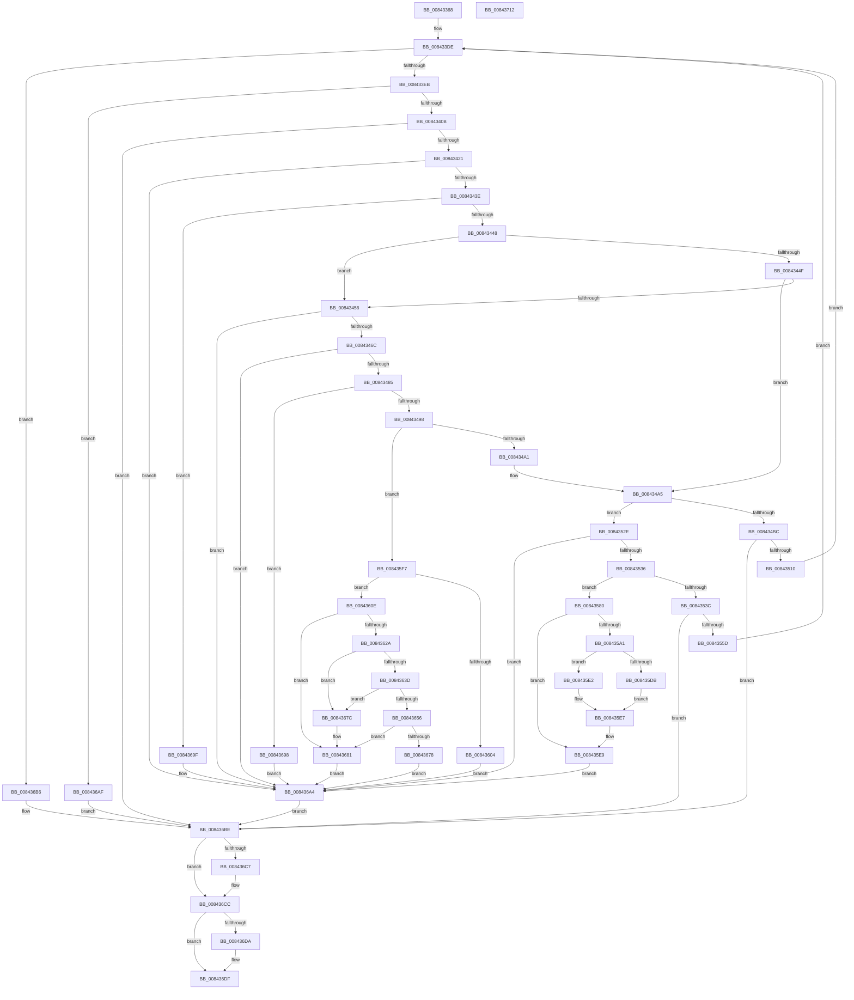

# CmSetLastWriteTimeKey

- RVA: `0x00843368`–`0x00843713` (길이 `939` bytes)
- VA: `0x0000000140843368`
- 실행 섹션: `PAGE`
- PDB 이름 있음: `예`; PDB Function 태그: `아니요`
- unwind 정보 RVA: `0x00069094`
- 디코드: `246`개 명령, `939/939` bytes 표시
- 미해석 바이트: `0` (있으면 어셈블리에 `.byte`로 보존)

> 이 문서는 커널 이미지의 기계어와 PDB 기호를 분석해 생성했습니다. 4번과 5번은 함수 원형과 자료형을 바이너리 사용 방식에서 추정한 C 해석이며 원본 소스 복구 결과는 아닙니다.

## 1. Dependencies

- 직접 호출 지점: **41**; 고유 호출 대상: **34**
- 직접 호출자로 확인된 함수: **1**
- RIP 상대 이미지 참조: **1**

### Outgoing calls
- `0x008433BB` → [HvpGetCellContextInitialize](../85/HvpGetCellContextInitialize_function_00855F10.md) (function, `0x00855F10`)
- `0x008433D9` → [CmpAttachToRegistryProcess](../../pagecmrc/BC/CmpAttachToRegistryProcess_function_00BC98E0.md) (function, `0x00BC98E0`)
- `0x008433DE` → [CmpIsShutdownRundownActive](../../pagecmrc/BC/CmpIsShutdownRundownActive_function_00BC9C20.md) (function, `0x00BC9C20`)
- `0x008433EB` → [CmpLockRegistry](../../pagecmrc/BC/CmpLockRegistry_function_00BC9B34.md) (function, `0x00BC9B34`)
- `0x00843412` → [CmpStartKcbStackForTopLayerKcb](CmpStartKcbStackForTopLayerKcb_function_00848390.md) (function, `0x00848390`)
- `0x00843425` → [CmpLockKcbStackTopExclusiveRestShared](CmpLockKcbStackTopExclusiveRestShared_function_00846B04.md) (function, `0x00846B04`)
- `0x0084342F` → [CmpPerformKeyBodyDeletionCheck](../../pagecmrc/BC/CmpPerformKeyBodyDeletionCheck_function_00BC97D0.md) (function, `0x00BC97D0`)
- `0x0084345D` → [CmpTransSearchAddTransFromKeyBody](../87/CmpTransSearchAddTransFromKeyBody_function_008736B8.md) (function, `0x008736B8`)
- `0x00843476` → [CmpPerformKeyBodyDeletionCheck](../../pagecmrc/BC/CmpPerformKeyBodyDeletionCheck_function_00BC97D0.md) (function, `0x00BC97D0`)
- `0x008434AE` → [CmpTryAcquireKcbIXLocks](../9B/CmpTryAcquireKcbIXLocks_function_009B056C.md) (function, `0x009B056C`)
- `0x008434CC` → [CmpLogTransactionAbortedWithChildName](../9A/CmpLogTransactionAbortedWithChildName_function_009AED70.md) (function, `0x009AED70`)
- `0x008434D5` → [CmpUnlockKcbStack](CmpUnlockKcbStack_function_00848460.md) (function, `0x00848460`)
- `0x008434DE` → [CmpCleanupKcbStack](../94/CmpCleanupKcbStack_function_009470A0.md) (function, `0x009470A0`)
- `0x008434F3` → [CmpUnlockRegistry](../../pagecmrc/BC/CmpUnlockRegistry_function_00BC9A84.md) (function, `0x00BC9A84`)
- `0x00843501` → [CmpAbortRollbackPacket](../AB/CmpAbortRollbackPacket_function_00ABEA80.md) (function, `0x00ABEA80`)
- `0x00843514` → [CmpRetryBackOff](../94/CmpRetryBackOff_function_0094B474.md) (function, `0x0094B474`)
- `0x0084351D` → [CmpCleanupRollbackPacket](../9B/CmpCleanupRollbackPacket_function_009B014C.md) (function, `0x009B014C`)
- `0x00843540` → [CmpUnlockKcbStack](CmpUnlockKcbStack_function_00848460.md) (function, `0x00848460`)
- `0x0084354E` → [CmpPromoteKey](CmpPromoteKey_function_00844388.md) (function, `0x00844388`)
- `0x0084355D` → [CmpUnlockRegistry](../../pagecmrc/BC/CmpUnlockRegistry_function_00BC9A84.md) (function, `0x00BC9A84`)
- `0x00843566` → [CmpCleanupKcbStack](../94/CmpCleanupKcbStack_function_009470A0.md) (function, `0x009470A0`)
- `0x00843584` → [HvLockHiveFlusherShared](HvLockHiveFlusherShared_function_0084F95C.md) (function, `0x0084F95C`)
- `0x00843596` → [HvpMarkCellDirty](../85/HvpMarkCellDirty_function_00858080.md) (function, `0x00858080`)
- `0x008435AB` → [CmpGetKeyNodeForKcb](../85/CmpGetKeyNodeForKcb_function_00856480.md) (function, `0x00856480`)
- `0x008435DB` → [HvpReleaseCellFlat](../85/HvpReleaseCellFlat_function_0085CC20.md) (function, `0x0085CC20`)
- `0x008435E2` → [HvpReleaseCellPaged](../85/HvpReleaseCellPaged_function_00855F40.md) (function, `0x00855F40`)
- `0x008435ED` → [HvUnlockHiveFlusherShared](HvUnlockHiveFlusherShared_function_00848738.md) (function, `0x00848738`)
- `0x008435F7` → [CmpAllocateUnitOfWork](CmpAllocateUnitOfWork_function_00844BB0.md) (function, `0x00844BB0`)
- `0x00843614` → [CmpTransEnlistUowInKcb](../../text/48/CmpTransEnlistUowInKcb_function_0048F094.md) (function, `0x0048F094`)
- `0x0084361F` → [CmpTransEnlistUowInCmTrans](../../text/48/CmpTransEnlistUowInCmTrans_function_0048B330.md) (function, `0x0048B330`)
- `0x00843634` → [CmpLockIXLockIntent](CmpLockIXLockIntent_function_00844C08.md) (function, `0x00844C08`)
- `0x0084364D` → [CmpLockIXLockExclusive](CmpLockIXLockExclusive_function_00844CB4.md) (function, `0x00844CB4`)
- `0x0084366D` → [CmAddLogForAction](CmAddLogForAction_function_008445AC.md) (function, `0x008445AC`)
- `0x00843684` → [CmpRundownUnitOfWork](../87/CmpRundownUnitOfWork_function_0087497C.md) (function, `0x0087497C`)
- `0x00843691` → [ExFreePoolWithTag](../../poolcode/B8/ExFreePoolWithTag_function_00B82870.md) (function, `0x00B82870`)
- `0x008436A8` → [CmpUnlockKcbStack](CmpUnlockKcbStack_function_00848460.md) (function, `0x00848460`)
- `0x008436C7` → [CmSiFreeMemory](../../text/47/CmSiFreeMemory_function_00475D80.md) (function, `0x00475D80`)
- `0x008436D0` → [CmpCleanupRollbackPacket](../9B/CmpCleanupRollbackPacket_function_009B014C.md) (function, `0x009B014C`)
- `0x008436DA` → [CmpUnlockRegistry](../../pagecmrc/BC/CmpUnlockRegistry_function_00BC9A84.md) (function, `0x00BC9A84`)
- `0x008436E3` → [CmpDetachFromRegistryProcess](../../pagecmrc/BC/CmpDetachFromRegistryProcess_function_00BC9920.md) (function, `0x00BC9920`)
- `0x008436F1` → [_security_check_cookie](../../text/6A/_security_check_cookie_function_006AC640.md) (function, `0x006AC640`)

### Direct callers
- [NtSetInformationKey](NtSetInformationKey_function_00843720.md) at `0x00843EF4`

### Static image references
- `0x00843386` → RVA `0x00E0A740` (`.data`; read)

## 2. Other-region calls and transfers

- 다른 실행 섹션으로 향하는 call: **14**
  - `0x008433D9` → [CmpAttachToRegistryProcess](../../pagecmrc/BC/CmpAttachToRegistryProcess_function_00BC98E0.md) (`PAGE` → `PAGECMRC`)
  - `0x008433DE` → [CmpIsShutdownRundownActive](../../pagecmrc/BC/CmpIsShutdownRundownActive_function_00BC9C20.md) (`PAGE` → `PAGECMRC`)
  - `0x008433EB` → [CmpLockRegistry](../../pagecmrc/BC/CmpLockRegistry_function_00BC9B34.md) (`PAGE` → `PAGECMRC`)
  - `0x0084342F` → [CmpPerformKeyBodyDeletionCheck](../../pagecmrc/BC/CmpPerformKeyBodyDeletionCheck_function_00BC97D0.md) (`PAGE` → `PAGECMRC`)
  - `0x00843476` → [CmpPerformKeyBodyDeletionCheck](../../pagecmrc/BC/CmpPerformKeyBodyDeletionCheck_function_00BC97D0.md) (`PAGE` → `PAGECMRC`)
  - `0x008434F3` → [CmpUnlockRegistry](../../pagecmrc/BC/CmpUnlockRegistry_function_00BC9A84.md) (`PAGE` → `PAGECMRC`)
  - `0x0084355D` → [CmpUnlockRegistry](../../pagecmrc/BC/CmpUnlockRegistry_function_00BC9A84.md) (`PAGE` → `PAGECMRC`)
  - `0x00843614` → [CmpTransEnlistUowInKcb](../../text/48/CmpTransEnlistUowInKcb_function_0048F094.md) (`PAGE` → `.text`)
  - `0x0084361F` → [CmpTransEnlistUowInCmTrans](../../text/48/CmpTransEnlistUowInCmTrans_function_0048B330.md) (`PAGE` → `.text`)
  - `0x00843691` → [ExFreePoolWithTag](../../poolcode/B8/ExFreePoolWithTag_function_00B82870.md) (`PAGE` → `POOLCODE`)
  - `0x008436C7` → [CmSiFreeMemory](../../text/47/CmSiFreeMemory_function_00475D80.md) (`PAGE` → `.text`)
  - `0x008436DA` → [CmpUnlockRegistry](../../pagecmrc/BC/CmpUnlockRegistry_function_00BC9A84.md) (`PAGE` → `PAGECMRC`)
  - `0x008436E3` → [CmpDetachFromRegistryProcess](../../pagecmrc/BC/CmpDetachFromRegistryProcess_function_00BC9920.md) (`PAGE` → `PAGECMRC`)
  - `0x008436F1` → [_security_check_cookie](../../text/6A/_security_check_cookie_function_006AC640.md) (`PAGE` → `.text`)
- 별도 외부 분기/꼬리 이동을 확인하지 못했습니다.

## 3. Assembly (complete function range)

```asm
00843368  48 89 5C 24 10                  mov qword ptr [rsp + 0x10], rbx
0084336D  48 89 74 24 18                  mov qword ptr [rsp + 0x18], rsi
00843372  55                              push rbp
00843373  57                              push rdi
00843374  41 54                           push r12
00843376  41 56                           push r14
00843378  41 57                           push r15
0084337A  48 8D 6C 24 C9                  lea rbp, [rsp - 0x37]
0084337F  48 81 EC B0 00 00 00            sub rsp, 0xb0
00843386  48 8B 05 B3 73 5C 00            mov rax, qword ptr [rip + 0x5c73b3]
0084338D  48 33 C4                        xor rax, rsp
00843390  48 89 45 2F                     mov qword ptr [rbp + 0x2f], rax
00843394  48 83 65 B7 00                  and qword ptr [rbp - 0x49], 0
00843399  0F 57 C0                        xorps xmm0, xmm0
0084339C  48 83 65 F7 00                  and qword ptr [rbp - 9], 0
008433A1  48 8B F1                        mov rsi, rcx
008433A4  83 65 DF 00                     and dword ptr [rbp - 0x21], 0
008433A8  48 8D 4D B7                     lea rcx, [rbp - 0x49]
008433AC  0F 11 45 FF                     movups xmmword ptr [rbp - 1], xmm0
008433B0  4C 8B E2                        mov r12, rdx
008433B3  0F 11 45 0F                     movups xmmword ptr [rbp + 0xf], xmm0
008433B7  0F 11 45 1F                     movups xmmword ptr [rbp + 0x1f], xmm0
008433BB  E8 50 2B 01 00                  call 0x140855f10
008433C0  41 83 CE FF                     or r14d, 0xffffffff
008433C4  48 8D 4D FF                     lea rcx, [rbp - 1]
008433C8  0F 11 45 BF                     movups xmmword ptr [rbp - 0x41], xmm0
008433CC  66 44 89 75 C1                  mov word ptr [rbp - 0x3f], r14w
008433D1  0F 11 45 CF                     movups xmmword ptr [rbp - 0x31], xmm0
008433D5  0F 11 45 E7                     movups xmmword ptr [rbp - 0x19], xmm0
008433D9  E8 02 65 38 00                  call 0x140bc98e0
008433DE  E8 3D 68 38 00                  call 0x140bc9c20
008433E3  84 C0                           test al, al
008433E5  0F 85 CB 02 00 00               jne 0x1408436b6
008433EB  E8 44 67 38 00                  call 0x140bc9b34
008433F0  48 8B 7E 08                     mov rdi, qword ptr [rsi + 8]
008433F4  41 B7 01                        mov r15b, 1
008433F7  48 8B 47 20                     mov rax, qword ptr [rdi + 0x20]
008433FB  F7 80 A0 00 00 00 00 00 10 00   test dword ptr [rax + 0xa0], 0x100000
00843405  0F 85 A4 02 00 00               jne 0x1408436af
0084340B  48 8B D7                        mov rdx, rdi
0084340E  48 8D 4D BF                     lea rcx, [rbp - 0x41]
00843412  E8 79 4F 00 00                  call 0x140848390
00843417  8B D8                           mov ebx, eax
00843419  85 C0                           test eax, eax
0084341B  0F 88 9D 02 00 00               js 0x1408436be
00843421  48 8D 4D BF                     lea rcx, [rbp - 0x41]
00843425  E8 DA 36 00 00                  call 0x140846b04
0084342A  33 D2                           xor edx, edx
0084342C  48 8B CE                        mov rcx, rsi
0084342F  E8 9C 63 38 00                  call 0x140bc97d0
00843434  8B D8                           mov ebx, eax
00843436  85 C0                           test eax, eax
00843438  0F 88 66 02 00 00               js 0x1408436a4
0084343E  44 38 7F 41                     cmp byte ptr [rdi + 0x41], r15b
00843442  0F 84 57 02 00 00               je 0x14084369f
00843448  48 83 7E 38 00                  cmp qword ptr [rsi + 0x38], 0
0084344D  75 07                           jne 0x140843456
0084344F  48 83 7E 40 00                  cmp qword ptr [rsi + 0x40], 0
00843454  74 4F                           je 0x1408434a5
00843456  48 8D 55 F7                     lea rdx, [rbp - 9]
0084345A  48 8B CE                        mov rcx, rsi
0084345D  E8 56 02 03 00                  call 0x1408736b8
00843462  8B D8                           mov ebx, eax
00843464  85 C0                           test eax, eax
00843466  0F 88 38 02 00 00               js 0x1408436a4
0084346C  4C 8B 75 F7                     mov r14, qword ptr [rbp - 9]
00843470  48 8B CE                        mov rcx, rsi
00843473  49 8B D6                        mov rdx, r14
00843476  E8 55 63 38 00                  call 0x140bc97d0
0084347B  8B D8                           mov ebx, eax
0084347D  85 C0                           test eax, eax
0084347F  0F 88 1F 02 00 00               js 0x1408436a4
00843485  48 8B 47 20                     mov rax, qword ptr [rdi + 0x20]
00843489  8B 88 A0 00 00 00               mov ecx, dword ptr [rax + 0xa0]
0084348F  F6 C1 02                        test cl, 2
00843492  0F 85 00 02 00 00               jne 0x140843698
00843498  4D 85 F6                        test r14, r14
0084349B  0F 85 56 01 00 00               jne 0x1408435f7
008434A1  41 83 CE FF                     or r14d, 0xffffffff
008434A5  4C 8D 4D E7                     lea r9, [rbp - 0x19]
008434A9  33 D2                           xor edx, edx
008434AB  48 8B CF                        mov rcx, rdi
008434AE  E8 B9 D0 16 00                  call 0x1409b056c
008434B3  8B D8                           mov ebx, eax
008434B5  3D 2D 02 00 C0                  cmp eax, 0xc000022d
008434BA  75 72                           jne 0x14084352e
008434BC  8B 45 E7                        mov eax, dword ptr [rbp - 0x19]
008434BF  33 D2                           xor edx, edx
008434C1  48 8B CF                        mov rcx, rdi
008434C4  89 44 24 20                     mov dword ptr [rsp + 0x20], eax
008434C8  44 8D 42 02                     lea r8d, [rdx + 2]
008434CC  E8 9F B8 16 00                  call 0x1409aed70
008434D1  48 8D 4D BF                     lea rcx, [rbp - 0x41]
008434D5  E8 86 4F 00 00                  call 0x140848460
008434DA  48 8D 4D BF                     lea rcx, [rbp - 0x41]
008434DE  E8 BD 3B 10 00                  call 0x1409470a0
008434E3  0F 57 C0                        xorps xmm0, xmm0
008434E6  0F 11 45 BF                     movups xmmword ptr [rbp - 0x41], xmm0
008434EA  66 44 89 75 C1                  mov word ptr [rbp - 0x3f], r14w
008434EF  0F 11 45 CF                     movups xmmword ptr [rbp - 0x31], xmm0
008434F3  E8 8C 65 38 00                  call 0x140bc9a84
008434F8  33 D2                           xor edx, edx
008434FA  48 8D 4D E7                     lea rcx, [rbp - 0x19]
008434FE  45 32 FF                        xor r15b, r15b
00843501  E8 7A B5 27 00                  call 0x140abea80
00843506  8B D8                           mov ebx, eax
00843508  85 C0                           test eax, eax
0084350A  0F 88 AE 01 00 00               js 0x1408436be
00843510  48 8D 4D DF                     lea rcx, [rbp - 0x21]
00843514  E8 5B 7F 10 00                  call 0x14094b474
00843519  48 8D 4D E7                     lea rcx, [rbp - 0x19]
0084351D  E8 2A CC 16 00                  call 0x1409b014c
00843522  0F 57 C0                        xorps xmm0, xmm0
00843525  0F 11 45 E7                     movups xmmword ptr [rbp - 0x19], xmm0
00843529  E9 B0 FE FF FF                  jmp 0x1408433de
0084352E  85 C0                           test eax, eax
00843530  0F 88 6E 01 00 00               js 0x1408436a4
00843536  83 7F 28 FF                     cmp dword ptr [rdi + 0x28], -1
0084353A  75 44                           jne 0x140843580
0084353C  48 8D 4D BF                     lea rcx, [rbp - 0x41]
00843540  E8 1B 4F 00 00                  call 0x140848460
00843545  45 33 C0                        xor r8d, r8d
00843548  48 8D 4D BF                     lea rcx, [rbp - 0x41]
0084354C  33 D2                           xor edx, edx
0084354E  E8 35 0E 00 00                  call 0x140844388
00843553  8B D8                           mov ebx, eax
00843555  85 C0                           test eax, eax
00843557  0F 88 61 01 00 00               js 0x1408436be
0084355D  E8 22 65 38 00                  call 0x140bc9a84
00843562  48 8D 4D BF                     lea rcx, [rbp - 0x41]
00843566  E8 35 3B 10 00                  call 0x1409470a0
0084356B  0F 57 C0                        xorps xmm0, xmm0
0084356E  0F 11 45 BF                     movups xmmword ptr [rbp - 0x41], xmm0
00843572  66 44 89 75 C1                  mov word ptr [rbp - 0x3f], r14w
00843577  0F 11 45 CF                     movups xmmword ptr [rbp - 0x31], xmm0
0084357B  E9 5E FE FF FF                  jmp 0x1408433de
00843580  48 8B 4F 20                     mov rcx, qword ptr [rdi + 0x20]
00843584  E8 D3 C3 00 00                  call 0x14084f95c
00843589  8B 57 28                        mov edx, dword ptr [rdi + 0x28]
0084358C  45 33 C9                        xor r9d, r9d
0084358F  48 8B 4F 20                     mov rcx, qword ptr [rdi + 0x20]
00843593  45 33 C0                        xor r8d, r8d
00843596  E8 E5 4A 01 00                  call 0x140858080
0084359B  8B D8                           mov ebx, eax
0084359D  85 C0                           test eax, eax
0084359F  78 48                           js 0x1408435e9
008435A1  45 8A C7                        mov r8b, r15b
008435A4  48 8D 55 B7                     lea rdx, [rbp - 0x49]
008435A8  48 8B CF                        mov rcx, rdi
008435AB  E8 D0 2E 01 00                  call 0x140856480
008435B0  49 8B 0C 24                     mov rcx, qword ptr [r12]
008435B4  48 8D 55 B7                     lea rdx, [rbp - 0x49]
008435B8  48 89 48 04                     mov qword ptr [rax + 4], rcx
008435BC  49 8B 04 24                     mov rax, qword ptr [r12]
008435C0  48 8B 4F 20                     mov rcx, qword ptr [rdi + 0x20]
008435C4  48 FF 87 30 01 00 00            inc qword ptr [rdi + 0x130]
008435CB  48 89 87 A8 00 00 00            mov qword ptr [rdi + 0xa8], rax
008435D2  44 84 B9 8C 00 00 00            test byte ptr [rcx + 0x8c], r15b
008435D9  74 07                           je 0x1408435e2
008435DB  E8 40 96 01 00                  call 0x14085cc20
008435E0  EB 05                           jmp 0x1408435e7
008435E2  E8 59 29 01 00                  call 0x140855f40
008435E7  33 DB                           xor ebx, ebx
008435E9  48 8B 4F 20                     mov rcx, qword ptr [rdi + 0x20]
008435ED  E8 46 51 00 00                  call 0x140848738
008435F2  E9 AD 00 00 00                  jmp 0x1408436a4
008435F7  E8 B4 15 00 00                  call 0x140844bb0
008435FC  48 8B F0                        mov rsi, rax
008435FF  48 85 C0                        test rax, rax
00843602  75 0A                           jne 0x14084360e
00843604  BB 9A 00 00 C0                  mov ebx, 0xc000009a
00843609  E9 96 00 00 00                  jmp 0x1408436a4
0084360E  48 8B D7                        mov rdx, rdi
00843611  48 8B CE                        mov rcx, rsi
00843614  E8 7B BA C4 FF                  call 0x14048f094
00843619  49 8B D6                        mov rdx, r14
0084361C  48 8B CE                        mov rcx, rsi
0084361F  E8 0C 7D C4 FF                  call 0x14048b330
00843624  8B D8                           mov ebx, eax
00843626  85 C0                           test eax, eax
00843628  78 57                           js 0x140843681
0084362A  48 8D 8F F8 00 00 00            lea rcx, [rdi + 0xf8]
00843631  48 8B D6                        mov rdx, rsi
00843634  E8 CF 15 00 00                  call 0x140844c08
00843639  84 C0                           test al, al
0084363B  74 3F                           je 0x14084367c
0084363D  48 8D 8F 08 01 00 00            lea rcx, [rdi + 0x108]
00843644  41 B8 01 00 00 00               mov r8d, 1
0084364A  48 8B D6                        mov rdx, rsi
0084364D  E8 62 16 00 00                  call 0x140844cb4
00843652  84 C0                           test al, al
00843654  74 26                           je 0x14084367c
00843656  C7 46 44 08 00 00 00            mov dword ptr [rsi + 0x44], 8
0084365D  BA 01 00 00 00                  mov edx, 1
00843662  49 8B 04 24                     mov rax, qword ptr [r12]
00843666  48 8B CE                        mov rcx, rsi
00843669  48 89 46 58                     mov qword ptr [rsi + 0x58], rax
0084366D  E8 3A 0F 00 00                  call 0x1408445ac
00843672  8B D8                           mov ebx, eax
00843674  85 C0                           test eax, eax
00843676  78 09                           js 0x140843681
00843678  33 DB                           xor ebx, ebx
0084367A  EB 28                           jmp 0x1408436a4
0084367C  BB 01 00 19 C0                  mov ebx, 0xc0190001
00843681  48 8B CE                        mov rcx, rsi
00843684  E8 F3 12 03 00                  call 0x14087497c
00843689  BA 43 4D 55 77                  mov edx, 0x77554d43
0084368E  48 8B CE                        mov rcx, rsi
00843691  E8 DA F1 33 00                  call 0x140b82870
00843696  EB 0C                           jmp 0x1408436a4
00843698  BB 01 00 19 C0                  mov ebx, 0xc0190001
0084369D  EB 05                           jmp 0x1408436a4
0084369F  BB 22 00 00 C0                  mov ebx, 0xc0000022
008436A4  48 8D 4D BF                     lea rcx, [rbp - 0x41]
008436A8  E8 B3 4D 00 00                  call 0x140848460
008436AD  EB 0F                           jmp 0x1408436be
008436AF  BB 22 00 00 C0                  mov ebx, 0xc0000022
008436B4  EB 08                           jmp 0x1408436be
008436B6  BB 89 01 00 C0                  mov ebx, 0xc0000189
008436BB  45 32 FF                        xor r15b, r15b
008436BE  48 8B 4D D7                     mov rcx, qword ptr [rbp - 0x29]
008436C2  48 85 C9                        test rcx, rcx
008436C5  74 05                           je 0x1408436cc
008436C7  E8 B4 26 C3 FF                  call 0x140475d80
008436CC  48 8D 4D E7                     lea rcx, [rbp - 0x19]
008436D0  E8 77 CA 16 00                  call 0x1409b014c
008436D5  45 84 FF                        test r15b, r15b
008436D8  74 05                           je 0x1408436df
008436DA  E8 A5 63 38 00                  call 0x140bc9a84
008436DF  48 8D 4D FF                     lea rcx, [rbp - 1]
008436E3  E8 38 62 38 00                  call 0x140bc9920
008436E8  8B C3                           mov eax, ebx
008436EA  48 8B 4D 2F                     mov rcx, qword ptr [rbp + 0x2f]
008436EE  48 33 CC                        xor rcx, rsp
008436F1  E8 4A 8F E6 FF                  call 0x1406ac640
008436F6  4C 8D 9C 24 B0 00 00 00         lea r11, [rsp + 0xb0]
008436FE  49 8B 5B 38                     mov rbx, qword ptr [r11 + 0x38]
00843702  49 8B 73 40                     mov rsi, qword ptr [r11 + 0x40]
00843706  49 8B E3                        mov rsp, r11
00843709  41 5F                           pop r15
0084370B  41 5E                           pop r14
0084370D  41 5C                           pop r12
0084370F  5F                              pop rdi
00843710  5D                              pop rbp
00843711  C3                              ret
00843712  CC                              int3
```

## 4. C-style interpretation (structured pseudocode)

```c
__int64 __fastcall CmSetLastWriteTimeKey(__int64 a1, __int64 a2)
{
    __int64 result;
    __int64 v_r14;
    __int64 v_r15;
    __int64 v_rbx;
    __int64 v_rsp;
    unsigned __int64 v_stack_m28;
    unsigned __int64 v_stack_m30;
    unsigned __int64 v_stack_m40;
    unsigned __int64 v_stack_m50;
    unsigned __int64 v_stack_m5F;
    unsigned __int64 v_stack_m60;
    unsigned __int64 v_stack_m68;
    unsigned __int64 v_stack_m78;
    unsigned int v_stack_m80;
    unsigned __int64 v_stack_m88;
    unsigned __int64 v_stack_m90;
    unsigned __int16 v_stack_m9E;
    unsigned __int64 v_stack_mA0;
    unsigned __int64 v_stack_mA8;
    unsigned int v_stack_mB8;
    unsigned __int64 v_stack_p10;
    unsigned __int64 v_stack_p18;

    v_stack_p10 = v_rbx;
    v_stack_p18 = v_rsi;
    v_rsp = (v_rsp) - (176);
    result = (*(unsigned __int64 *)(v_rip + 6058931)) ^ (v_rsp);
    v_stack_m30 = result;
    v_stack_m60 = v_xmm0;
    v_stack_m50 = v_xmm0;
    v_stack_m40 = v_xmm0;
    result = HvpGetCellContextInitialize(v_stack_mA8, a2, a3, a4);
    v_r14 = (unsigned int)((v_r14) | (0xFFFFFFFFULL));
    v_stack_mA0 = v_xmm0;
    v_stack_m9E = (unsigned __int16)(v_r14);
    v_stack_m90 = v_xmm0;
    v_stack_m78 = v_xmm0;
    result = CmpAttachToRegistryProcess(v_stack_m60, a2, a3, a4);
loc_008433DE:
    result = CmpIsShutdownRundownActive(v_stack_m60, a2, a3, a4);
    if ((unsigned __int8)(result) != 0) goto loc_008436B6;
    result = CmpLockRegistry(v_stack_m60, a2, a3, a4);
    if (((*(unsigned int *)(*(unsigned __int64 *)(*(unsigned __int64 *)(a1 + 8) + 32) + 160)) & (0x100000ULL)) != 0) goto loc_008436AF;
    result = CmpStartKcbStackForTopLayerKcb(v_stack_mA0, *(unsigned __int64 *)(a1 + 8), a3, a4);
    if (sign_flag) goto loc_008436BE;
    result = CmpLockKcbStackTopExclusiveRestShared(v_stack_mA0, *(unsigned __int64 *)(a1 + 8), a3, a4);
    a2 = 0;
    result = CmpPerformKeyBodyDeletionCheck(a1, a2, a3, a4);
    if (sign_flag) goto loc_008436A4;
    if ((*(unsigned __int8 *)(*(unsigned __int64 *)(a1 + 8) + 65)) == 1) goto loc_0084369F;
    if ((*(unsigned __int64 *)(a1 + 56)) != 0) goto loc_00843456;
    if ((*(unsigned __int64 *)(a1 + 64)) == 0) goto loc_008434A5;
loc_00843456:
    result = CmpTransSearchAddTransFromKeyBody(a1, v_stack_m68, a3, a4);
    if (sign_flag) goto loc_008436A4;
    result = CmpPerformKeyBodyDeletionCheck(a1, v_stack_m68, a3, a4);
    if (sign_flag) goto loc_008436A4;
    if ((((unsigned __int8)((unsigned int)(*(unsigned int *)(*(unsigned __int64 *)(*(unsigned __int64 *)(a1 + 8) + 32) + 160)))) & (2)) != 0) goto loc_00843698;
    if (v_stack_m68 != 0) goto loc_008435F7;
    v_r14 = (unsigned int)((v_stack_m68) | (0xFFFFFFFFULL));
loc_008434A5:
    a2 = 0;
    result = CmpTryAcquireKcbIXLocks(*(unsigned __int64 *)(a1 + 8), a2, a3, v_stack_m78);
    if (((unsigned int)(result)) != 0xC000022DULL) goto loc_0084352E;
    a2 = 0;
    v_stack_mB8 = (unsigned int)((unsigned int)(v_stack_m78));
    result = CmpLogTransactionAbortedWithChildName(*(unsigned __int64 *)(a1 + 8), a2, a2 + 2, v_stack_m78);
    result = CmpUnlockKcbStack(v_stack_mA0, a2, a2 + 2, v_stack_m78);
    result = CmpCleanupKcbStack(v_stack_mA0, a2, a2 + 2, v_stack_m78);
    v_stack_mA0 = v_xmm0;
    v_stack_m9E = (unsigned __int16)(v_r14);
    v_stack_m90 = v_xmm0;
    result = CmpUnlockRegistry(v_stack_mA0, a2, a2 + 2, v_stack_m78);
    a2 = 0;
    v_r15 = 0;
    result = CmpAbortRollbackPacket(v_stack_m78, a2, a2 + 2, v_stack_m78);
    if (sign_flag) goto loc_008436BE;
    result = CmpRetryBackOff(v_stack_m80, a2, a2 + 2, v_stack_m78);
    result = CmpCleanupRollbackPacket(v_stack_m78, a2, a2 + 2, v_stack_m78);
    v_stack_m78 = v_xmm0;
    goto loc_008433DE;
loc_0084352E:
    if (sign_flag) goto loc_008436A4;
    if ((*(unsigned int *)(*(unsigned __int64 *)(a1 + 8) + 40)) != -1) goto loc_00843580;
    result = CmpUnlockKcbStack(v_stack_mA0, a2, a2 + 2, v_stack_m78);
    a3 = 0;
    a2 = 0;
    result = CmpPromoteKey(v_stack_mA0, a2, a3, v_stack_m78);
    if (sign_flag) goto loc_008436BE;
    result = CmpUnlockRegistry(v_stack_mA0, a2, a3, v_stack_m78);
    result = CmpCleanupKcbStack(v_stack_mA0, a2, a3, v_stack_m78);
    v_stack_mA0 = v_xmm0;
    v_stack_m9E = (unsigned __int16)(v_r14);
    v_stack_m90 = v_xmm0;
    goto loc_008433DE;
loc_00843580:
    result = HvLockHiveFlusherShared(*(unsigned __int64 *)(*(unsigned __int64 *)(a1 + 8) + 32), a2, a3, v_stack_m78);
    a4 = 0;
    a3 = 0;
    result = HvpMarkCellDirty(*(unsigned __int64 *)(*(unsigned __int64 *)(a1 + 8) + 32), (unsigned int)(*(unsigned int *)(*(unsigned __int64 *)(a1 + 8) + 40)), a3, a4);
    if (sign_flag) goto loc_008435E9;
    result = CmpGetKeyNodeForKcb(*(unsigned __int64 *)(a1 + 8), v_stack_mA8, 0, a4);
    *(unsigned __int64 *)(result + 4) = *(unsigned __int64 *)(a2);
    *(unsigned __int64 *)(*(unsigned __int64 *)(a1 + 8) + 168) = *(unsigned __int64 *)(a2);
    if (((*(unsigned __int8 *)(*(unsigned __int64 *)(*(unsigned __int64 *)(a1 + 8) + 32) + 140)) & (0)) == 0) goto loc_008435E2;
    result = HvpReleaseCellFlat(*(unsigned __int64 *)(*(unsigned __int64 *)(a1 + 8) + 32), v_stack_mA8, 0, a4);
    goto loc_008435E7;
loc_008435E2:
    result = HvpReleaseCellPaged(*(unsigned __int64 *)(*(unsigned __int64 *)(a1 + 8) + 32), v_stack_mA8, 0, a4);
loc_008435E7:
    v_rbx = 0;
loc_008435E9:
    result = HvUnlockHiveFlusherShared(*(unsigned __int64 *)(*(unsigned __int64 *)(a1 + 8) + 32), v_stack_mA8, 0, a4);
    goto loc_008436A4;
loc_008435F7:
    result = CmpAllocateUnitOfWork(*(unsigned __int64 *)(*(unsigned __int64 *)(a1 + 8) + 32), v_stack_mA8, 0, a4);
    if (result != 0) goto loc_0084360E;
    goto loc_008436A4;
loc_0084360E:
    result = CmpTransEnlistUowInKcb(result, *(unsigned __int64 *)(a1 + 8), 0, a4);
    result = CmpTransEnlistUowInCmTrans(result, v_r14, 0, a4);
    if (sign_flag) goto loc_00843681;
    result = CmpLockIXLockIntent(*(unsigned __int64 *)(a1 + 8) + 248, result, 0, a4);
    if ((unsigned __int8)(result) == 0) goto loc_0084367C;
    result = CmpLockIXLockExclusive(*(unsigned __int64 *)(a1 + 8) + 264, result, 1, a4);
    if ((unsigned __int8)(result) == 0) goto loc_0084367C;
    *(unsigned int *)(result + 68) = 8;
    *(unsigned __int64 *)(result + 88) = *(unsigned __int64 *)(a2);
    result = CmAddLogForAction(result, 1, 1, a4);
    if (sign_flag) goto loc_00843681;
    v_rbx = 0;
    goto loc_008436A4;
loc_0084367C:
loc_00843681:
    result = CmpRundownUnitOfWork(result, 1, 1, a4);
    result = ExFreePoolWithTag(result, (unsigned int)(0x77554D43ULL), 1, a4);
    goto loc_008436A4;
loc_00843698:
    goto loc_008436A4;
loc_0084369F:
loc_008436A4:
    result = CmpUnlockKcbStack(v_stack_mA0, (unsigned int)(0x77554D43ULL), 1, a4);
    goto loc_008436BE;
loc_008436AF:
    goto loc_008436BE;
loc_008436B6:
    v_r15 = 0;
loc_008436BE:
    if (v_stack_m88 != 0) {
        result = CmSiFreeMemory(v_stack_m88, (unsigned int)(0x77554D43ULL), 1, a4);
    }
    result = CmpCleanupRollbackPacket(v_stack_m78, (unsigned int)(0x77554D43ULL), 1, a4);
    if (0 != 0) {
        result = CmpUnlockRegistry(v_stack_m78, (unsigned int)(0x77554D43ULL), 1, a4);
    }
    result = CmpDetachFromRegistryProcess(v_stack_m60, (unsigned int)(0x77554D43ULL), 1, a4);
    a1 = (v_stack_m30) ^ (v_rsp);
    result = _security_check_cookie(a1, (unsigned int)(0x77554D43ULL), 1, a4);
    return result;
}
```

## 5. (Beta) C Style

```c
int64_t CmSetLastWriteTimeKey(void *Arg1, void *Arg2)
{
    uint8_t *arg1 = (uint8_t *)Arg1;
    uint8_t *arg2 = (uint8_t *)Arg2;

    int64_t result;
    int64_t local_r14;
    int64_t local_r15;
    int64_t local_rbx;
    int64_t local_rsp;
    uint64_t v_stack_m28;
    uint64_t v_stack_m30;
    uint64_t v_stack_m40;
    uint64_t v_stack_m50;
    uint64_t v_stack_m5F;
    uint64_t v_stack_m60;
    uint64_t v_stack_m68;
    uint64_t v_stack_m78;
    uint32_t v_stack_m80;
    uint64_t v_stack_m88;
    uint64_t v_stack_m90;
    uint16_t v_stack_m9E;
    uint64_t v_stack_mA0;
    uint64_t v_stack_mA8;
    uint32_t v_stack_mB8;
    uint64_t v_stack_p10;
    uint64_t v_stack_p18;

    v_stack_p10 = local_rbx;
    v_stack_p18 = local_rsi;
    local_rsp = (local_rsp) - (176);
    result = (*(uint64_t *)(v_rip + 0x5C73B3)) ^ (local_rsp);
    v_stack_m30 = result;
    v_stack_m60 = v_xmm0;
    v_stack_m50 = v_xmm0;
    v_stack_m40 = v_xmm0;
    result = HvpGetCellContextInitialize(v_stack_mA8, Arg2, a3, a4);
    local_r14 = (uint32_t)((local_r14) | (0xFFFFFFFFULL));
    v_stack_mA0 = v_xmm0;
    v_stack_m9E = (uint16_t)(local_r14);
    v_stack_m90 = v_xmm0;
    v_stack_m78 = v_xmm0;
    result = CmpAttachToRegistryProcess(v_stack_m60, Arg2, a3, a4);
loc_008433DE:
    result = CmpIsShutdownRundownActive(v_stack_m60, Arg2, a3, a4);
    if ((uint8_t)(result) != 0) goto loc_008436B6;
    result = CmpLockRegistry(v_stack_m60, Arg2, a3, a4);
    if (((*(uint32_t *)(*(uint64_t *)(*(uint64_t *)(arg1 + 0x8) + 0x20) + 0xA0)) & (0x100000ULL)) != 0) goto loc_008436AF;
    result = CmpStartKcbStackForTopLayerKcb(v_stack_mA0, *(uint64_t *)(arg1 + 0x8), a3, a4);
    if (sign_flag) goto loc_008436BE;
    result = CmpLockKcbStackTopExclusiveRestShared(v_stack_mA0, *(uint64_t *)(arg1 + 0x8), a3, a4);
    Arg2 = 0;
    result = CmpPerformKeyBodyDeletionCheck(Arg1, Arg2, a3, a4);
    if (sign_flag) goto loc_008436A4;
    if ((*(uint8_t *)(*(uint64_t *)(arg1 + 0x8) + 0x41)) == 1) goto loc_0084369F;
    if ((*(uint64_t *)(arg1 + 0x38)) != 0) goto loc_00843456;
    if ((*(uint64_t *)(arg1 + 0x40)) == 0) goto loc_008434A5;
loc_00843456:
    result = CmpTransSearchAddTransFromKeyBody(Arg1, v_stack_m68, a3, a4);
    if (sign_flag) goto loc_008436A4;
    result = CmpPerformKeyBodyDeletionCheck(Arg1, v_stack_m68, a3, a4);
    if (sign_flag) goto loc_008436A4;
    if ((((uint8_t)((uint32_t)(*(uint32_t *)(*(uint64_t *)(*(uint64_t *)(arg1 + 0x8) + 0x20) + 0xA0)))) & (2)) != 0) goto loc_00843698;
    if (v_stack_m68 != 0) goto loc_008435F7;
    local_r14 = (uint32_t)((v_stack_m68) | (0xFFFFFFFFULL));
loc_008434A5:
    Arg2 = 0;
    result = CmpTryAcquireKcbIXLocks(*(uint64_t *)(arg1 + 0x8), Arg2, a3, v_stack_m78);
    if (((uint32_t)(result)) != 0xC000022DULL) goto loc_0084352E;
    Arg2 = 0;
    v_stack_mB8 = (uint32_t)((uint32_t)(v_stack_m78));
    result = CmpLogTransactionAbortedWithChildName(*(uint64_t *)(arg1 + 0x8), Arg2, Arg2 + 2, v_stack_m78);
    result = CmpUnlockKcbStack(v_stack_mA0, Arg2, Arg2 + 2, v_stack_m78);
    result = CmpCleanupKcbStack(v_stack_mA0, Arg2, Arg2 + 2, v_stack_m78);
    v_stack_mA0 = v_xmm0;
    v_stack_m9E = (uint16_t)(local_r14);
    v_stack_m90 = v_xmm0;
    result = CmpUnlockRegistry(v_stack_mA0, Arg2, Arg2 + 2, v_stack_m78);
    Arg2 = 0;
    local_r15 = 0;
    result = CmpAbortRollbackPacket(v_stack_m78, Arg2, Arg2 + 2, v_stack_m78);
    if (sign_flag) goto loc_008436BE;
    result = CmpRetryBackOff(v_stack_m80, Arg2, Arg2 + 2, v_stack_m78);
    result = CmpCleanupRollbackPacket(v_stack_m78, Arg2, Arg2 + 2, v_stack_m78);
    v_stack_m78 = v_xmm0;
    goto loc_008433DE;
loc_0084352E:
    if (sign_flag) goto loc_008436A4;
    if ((*(uint32_t *)(*(uint64_t *)(arg1 + 0x8) + 0x28)) != -1) goto loc_00843580;
    result = CmpUnlockKcbStack(v_stack_mA0, Arg2, Arg2 + 2, v_stack_m78);
    a3 = 0;
    Arg2 = 0;
    result = CmpPromoteKey(v_stack_mA0, Arg2, a3, v_stack_m78);
    if (sign_flag) goto loc_008436BE;
    result = CmpUnlockRegistry(v_stack_mA0, Arg2, a3, v_stack_m78);
    result = CmpCleanupKcbStack(v_stack_mA0, Arg2, a3, v_stack_m78);
    v_stack_mA0 = v_xmm0;
    v_stack_m9E = (uint16_t)(local_r14);
    v_stack_m90 = v_xmm0;
    goto loc_008433DE;
loc_00843580:
    result = HvLockHiveFlusherShared(*(uint64_t *)(*(uint64_t *)(arg1 + 0x8) + 0x20), Arg2, a3, v_stack_m78);
    a4 = 0;
    a3 = 0;
    result = HvpMarkCellDirty(*(uint64_t *)(*(uint64_t *)(arg1 + 0x8) + 0x20), (uint32_t)(*(uint32_t *)(*(uint64_t *)(arg1 + 0x8) + 0x28)), a3, a4);
    if (sign_flag) goto loc_008435E9;
    result = CmpGetKeyNodeForKcb(*(uint64_t *)(arg1 + 0x8), v_stack_mA8, 0, a4);
    *(uint64_t *)(result + 0x4) = *(uint64_t *)(arg2);
    *(uint64_t *)(*(uint64_t *)(arg1 + 0x8) + 0xA8) = *(uint64_t *)(arg2);
    if (((*(uint8_t *)(*(uint64_t *)(*(uint64_t *)(arg1 + 0x8) + 0x20) + 0x8C)) & (0)) == 0) goto loc_008435E2;
    result = HvpReleaseCellFlat(*(uint64_t *)(*(uint64_t *)(arg1 + 0x8) + 0x20), v_stack_mA8, 0, a4);
    goto loc_008435E7;
loc_008435E2:
    result = HvpReleaseCellPaged(*(uint64_t *)(*(uint64_t *)(arg1 + 0x8) + 0x20), v_stack_mA8, 0, a4);
loc_008435E7:
    local_rbx = 0;
loc_008435E9:
    result = HvUnlockHiveFlusherShared(*(uint64_t *)(*(uint64_t *)(arg1 + 0x8) + 0x20), v_stack_mA8, 0, a4);
    goto loc_008436A4;
loc_008435F7:
    result = CmpAllocateUnitOfWork(*(uint64_t *)(*(uint64_t *)(arg1 + 0x8) + 0x20), v_stack_mA8, 0, a4);
    if (result != 0) goto loc_0084360E;
    goto loc_008436A4;
loc_0084360E:
    result = CmpTransEnlistUowInKcb(result, *(uint64_t *)(arg1 + 0x8), 0, a4);
    result = CmpTransEnlistUowInCmTrans(result, local_r14, 0, a4);
    if (sign_flag) goto loc_00843681;
    result = CmpLockIXLockIntent(*(uint64_t *)(arg1 + 0x8) + 248, result, 0, a4);
    if ((uint8_t)(result) == 0) goto loc_0084367C;
    result = CmpLockIXLockExclusive(*(uint64_t *)(arg1 + 0x8) + 264, result, 1, a4);
    if ((uint8_t)(result) == 0) goto loc_0084367C;
    *(uint32_t *)(result + 0x44) = 8;
    *(uint64_t *)(result + 0x58) = *(uint64_t *)(arg2);
    result = CmAddLogForAction(result, 1, 1, a4);
    if (sign_flag) goto loc_00843681;
    local_rbx = 0;
    goto loc_008436A4;
loc_0084367C:
loc_00843681:
    result = CmpRundownUnitOfWork(result, 1, 1, a4);
    result = ExFreePoolWithTag(result, (uint32_t)(0x77554D43ULL), 1, a4);
    goto loc_008436A4;
loc_00843698:
    goto loc_008436A4;
loc_0084369F:
loc_008436A4:
    result = CmpUnlockKcbStack(v_stack_mA0, (uint32_t)(0x77554D43ULL), 1, a4);
    goto loc_008436BE;
loc_008436AF:
    goto loc_008436BE;
loc_008436B6:
    local_r15 = 0;
loc_008436BE:
    if (v_stack_m88 != 0) {
        result = CmSiFreeMemory(v_stack_m88, (uint32_t)(0x77554D43ULL), 1, a4);
    }
    result = CmpCleanupRollbackPacket(v_stack_m78, (uint32_t)(0x77554D43ULL), 1, a4);
    if (0 != 0) {
        result = CmpUnlockRegistry(v_stack_m78, (uint32_t)(0x77554D43ULL), 1, a4);
    }
    result = CmpDetachFromRegistryProcess(v_stack_m60, (uint32_t)(0x77554D43ULL), 1, a4);
    Arg1 = (v_stack_m30) ^ (local_rsp);
    result = _security_check_cookie(Arg1, (uint32_t)(0x77554D43ULL), 1, a4);
    return result;
}
```

### 관측된 메모리 오프셋

구조체 형식이 확인되지 않은 접근은 인자 기준의 오프셋으로만 기록했습니다.

| 기준 인자 | 오프셋 표현 | 폭 (bit) | 접근 |
|---|---:|---:|---|
| `Arg1` | `+ 0x8` | `64` | `R` |
| `Arg1` | `+ 0x38` | `64` | `R` |
| `Arg1` | `+ 0x40` | `64` | `R` |
| `Arg2` | `+ 0x0` | `64` | `R` |

## 6. Execution-region graph

[열기: 2D/3D 그래프와 함수 탐색 컨트롤 패널](../../../control-panel.html?section=page&rva=0x00843368&view=graph)

- 2D 그래프는 위에서 아래로 흐르고, 3D 그래프는 빈 공간을 드래그해 회전합니다. Shift+드래그는 이동, 휠은 확대·축소, 함수 노드 선택은 대상 보고서 이동입니다.

### Static fallback


