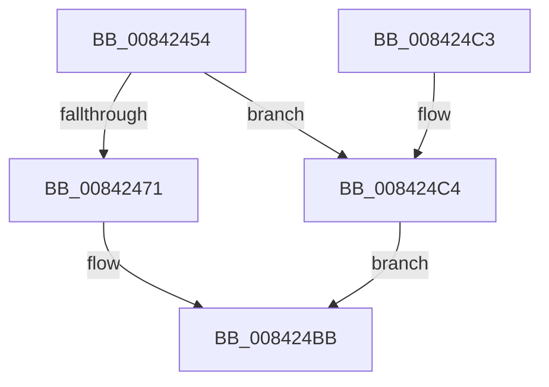

# CmTmCreateEnlistment

- RVA: `0x00842454`–`0x008424CB` (길이 `119` bytes)
- VA: `0x0000000140842454`
- 실행 섹션: `PAGE`
- PDB 이름 있음: `예`; PDB Function 태그: `아니요`
- unwind 정보 RVA: `0x00068F24`
- 디코드: `27`개 명령, `119/119` bytes 표시
- 미해석 바이트: `0` (있으면 어셈블리에 `.byte`로 보존)

> 이 문서는 커널 이미지의 기계어와 PDB 기호를 분석해 생성했습니다. 4번과 5번은 함수 원형과 자료형을 바이너리 사용 방식에서 추정한 C 해석이며 원본 소스 복구 결과는 아닙니다.

## 1. Dependencies

- 직접 호출 지점: **1**; 고유 호출 대상: **1**
- 직접 호출자로 확인된 함수: **1**
- RIP 상대 이미지 참조: **1**

### Outgoing calls
- `0x008424B6` → [TmCreateEnlistment](../../text/4F/TmCreateEnlistment_function_004FE080.md) (function, `0x004FE080`)

### Direct callers
- [CmpTransInitializeTransaction](CmpTransInitializeTransaction_function_008422C8.md) at `0x0084237A`

### Static image references
- `0x00842460` → RVA `0x00EEFC3D` (`.data`; read)

## 2. Other-region calls and transfers

- 다른 실행 섹션으로 향하는 call: **1**
  - `0x008424B6` → [TmCreateEnlistment](../../text/4F/TmCreateEnlistment_function_004FE080.md) (`PAGE` → `.text`)
- 별도 외부 분기/꼬리 이동을 확인하지 못했습니다.

## 3. Assembly (complete function range)

```asm
00842454  4C 8B DC                        mov r11, rsp
00842457  48 81 EC 88 00 00 00            sub rsp, 0x88
0084245E  33 C0                           xor eax, eax
00842460  80 3D D6 D7 6A 00 01            cmp byte ptr [rip + 0x6ad7d6], 1
00842467  89 44 24 54                     mov dword ptr [rsp + 0x54], eax
0084246B  89 44 24 6C                     mov dword ptr [rsp + 0x6c], eax
0084246F  74 53                           je 0x1408424c4
00842471  4D 89 4B B8                     mov qword ptr [r11 - 0x48], r9
00842475  0F 57 C0                        xorps xmm0, xmm0
00842478  C7 44 24 38 0E 00 00 00         mov dword ptr [rsp + 0x38], 0xe
00842480  4D 8D 4B C8                     lea r9, [r11 - 0x38]
00842484  89 44 24 30                     mov dword ptr [rsp + 0x30], eax
00842488  C7 44 24 50 30 00 00 00         mov dword ptr [rsp + 0x50], 0x30
00842490  4D 89 43 A0                     mov qword ptr [r11 - 0x60], r8
00842494  41 B8 1F 00 0F 00               mov r8d, 0xf001f
0084249A  49 89 43 D0                     mov qword ptr [r11 - 0x30], rax
0084249E  49 89 53 98                     mov qword ptr [r11 - 0x68], rdx
008424A2  33 D2                           xor edx, edx
008424A4  C7 44 24 68 00 02 00 00         mov dword ptr [rsp + 0x68], 0x200
008424AC  49 89 43 D8                     mov qword ptr [r11 - 0x28], rax
008424B0  F3 0F 7F 44 24 70               movdqu xmmword ptr [rsp + 0x70], xmm0
008424B6  E8 C5 BB CB FF                  call 0x1404fe080
008424BB  48 81 C4 88 00 00 00            add rsp, 0x88
008424C2  C3                              ret
008424C3  CC                              int3
008424C4  B8 89 01 00 C0                  mov eax, 0xc0000189
008424C9  EB F0                           jmp 0x1408424bb
```

## 4. C-style interpretation (structured pseudocode)

```c
__int64 __fastcall CmTmCreateEnlistment(__int64 a1, __int64 a2, __int64 a3, __int64 a4)
{
    __int64 result;
    __int64 v_rsp;
    unsigned __int64 v_stack_m18;
    unsigned int v_stack_m1C;
    unsigned int v_stack_m20;
    unsigned int v_stack_m34;
    unsigned int v_stack_m38;
    unsigned int v_stack_m50;
    unsigned int v_stack_m58;

    v_rsp = (v_rsp) - (136);
    result = 0;
    v_stack_m34 = 0;
    v_stack_m1C = 0;
    if ((*(unsigned __int8 *)(v_rip + 7002070)) == 1) goto loc_008424C4;
    *(unsigned __int64 *)(v_rsp - 72) = a4;
    v_stack_m50 = 14;
    v_stack_m58 = 0;
    v_stack_m38 = 48;
    *(unsigned __int64 *)(v_rsp - 96) = a3;
    *(unsigned __int64 *)(v_rsp - 48) = 0;
    *(unsigned __int64 *)(v_rsp - 104) = a2;
    a2 = 0;
    v_stack_m20 = 512;
    *(unsigned __int64 *)(v_rsp - 40) = 0;
    v_stack_m18 = v_xmm0;
    result = TmCreateEnlistment(a1, a2, (unsigned int)(0xF001FULL), v_rsp - 56);
loc_008424BB:
    v_rsp = (v_rsp) + (136);
    return result;
loc_008424C4:
    goto loc_008424BB;
}
```

## 5. (Beta) C Style

```c
int64_t CmTmCreateEnlistment(int64_t Arg1, int64_t Arg2, int64_t Arg3, int64_t Arg4)
{
    int64_t result;
    int64_t local_rsp;
    uint64_t v_stack_m18;
    uint32_t v_stack_m1C;
    uint32_t v_stack_m20;
    uint32_t v_stack_m34;
    uint32_t v_stack_m38;
    uint32_t v_stack_m50;
    uint32_t v_stack_m58;

    local_rsp = (local_rsp) - (136);
    result = 0;
    v_stack_m34 = 0;
    v_stack_m1C = 0;
    if ((*(uint8_t *)(v_rip + 0x6AD7D6)) == 1) goto loc_008424C4;
    *(uint64_t *)(local_rsp - 0x48) = Arg4;
    v_stack_m50 = 14;
    v_stack_m58 = 0;
    v_stack_m38 = 48;
    *(uint64_t *)(local_rsp - 0x60) = Arg3;
    *(uint64_t *)(local_rsp - 0x30) = 0;
    *(uint64_t *)(local_rsp - 0x68) = Arg2;
    Arg2 = 0;
    v_stack_m20 = 512;
    *(uint64_t *)(local_rsp - 0x28) = 0;
    v_stack_m18 = v_xmm0;
    result = TmCreateEnlistment(Arg1, Arg2, (uint32_t)(0xF001FULL), local_rsp - 56);
loc_008424BB:
    local_rsp = (local_rsp) + (136);
    return result;
loc_008424C4:
    goto loc_008424BB;
}
```

## 6. Execution-region graph

[열기: 2D/3D 그래프와 함수 탐색 컨트롤 패널](../../../control-panel.html?section=page&rva=0x00842454&view=graph)

- 2D 그래프는 위에서 아래로 흐르고, 3D 그래프는 빈 공간을 드래그해 회전합니다. Shift+드래그는 이동, 휠은 확대·축소, 함수 노드 선택은 대상 보고서 이동입니다.

### Static fallback


