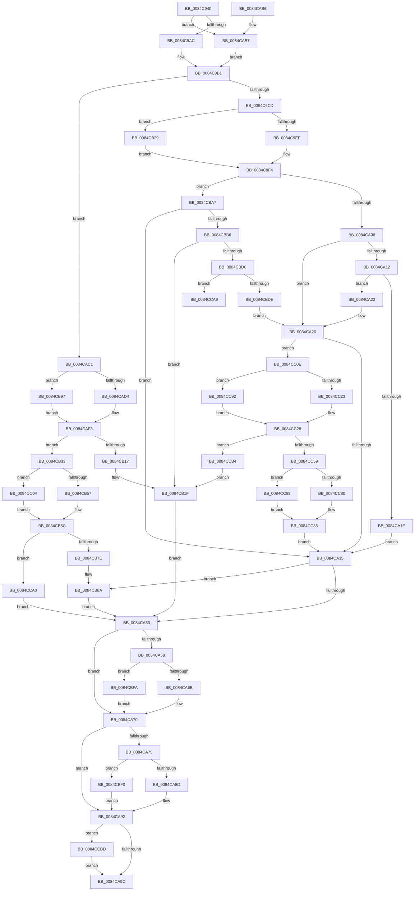

# CmpAddSubKeyEx

- RVA: `0x0084C940`–`0x0084CCCD` (길이 `909` bytes)
- VA: `0x000000014084C940`
- 실행 섹션: `PAGE`
- PDB 이름 있음: `예`; PDB Function 태그: `예`
- unwind 정보 RVA: `0x0006980C`
- 디코드: `231`개 명령, `909/909` bytes 표시
- 미해석 바이트: `0` (있으면 어셈블리에 `.byte`로 보존)

> 이 문서는 커널 이미지의 기계어와 PDB 기호를 분석해 생성했습니다. 4번과 5번은 함수 원형과 자료형을 바이너리 사용 방식에서 추정한 C 해석이며 원본 소스 복구 결과는 아닙니다.

## 1. Dependencies

- 직접 호출 지점: **22**; 고유 호출 대상: **9**
- 직접 호출자로 확인된 함수: **4**
- RIP 상대 이미지 참조: **0**

### Outgoing calls
- `0x0084C983` → [HvpGetCellContextInitialize](../85/HvpGetCellContextInitialize_function_00855F10.md) (function, `0x00855F10`)
- `0x0084C990` → [HvpGetCellContextInitialize](../85/HvpGetCellContextInitialize_function_00855F10.md) (function, `0x00855F10`)
- `0x0084C9AC` → [HvpGetCellFlat](../85/HvpGetCellFlat_function_00854C60.md) (function, `0x00854C60`)
- `0x0084C9EF` → [HvpGetCellFlat](../85/HvpGetCellFlat_function_00854C60.md) (function, `0x00854C60`)
- `0x0084CA3F` → [CmpAddSubKeyToList](CmpAddSubKeyToList_function_0084D644.md) (function, `0x0084D644`)
- `0x0084CA6B` → [HvpReleaseCellPaged](../85/HvpReleaseCellPaged_function_00855F40.md) (function, `0x00855F40`)
- `0x0084CA8D` → [HvpReleaseCellPaged](../85/HvpReleaseCellPaged_function_00855F40.md) (function, `0x00855F40`)
- `0x0084CAB7` → [HvpGetCellPaged](../85/HvpGetCellPaged_function_00854CB0.md) (function, `0x00854CB0`)
- `0x0084CB0C` → [HvAllocateCell](../85/HvAllocateCell_function_00859C94.md) (function, `0x00859C94`)
- `0x0084CB29` → [HvpGetCellPaged](../85/HvpGetCellPaged_function_00854CB0.md) (function, `0x00854CB0`)
- `0x0084CB57` → [HvpReleaseCellPaged](../85/HvpReleaseCellPaged_function_00855F40.md) (function, `0x00855F40`)
- `0x0084CB6A` → [CmpAddSubKeyToList](CmpAddSubKeyToList_function_0084D644.md) (function, `0x0084D644`)
- `0x0084CBC1` → [HvpMarkCellDirty](../85/HvpMarkCellDirty_function_00858080.md) (function, `0x00858080`)
- `0x0084CBF0` → [HvpReleaseCellFlat](../85/HvpReleaseCellFlat_function_0085CC20.md) (function, `0x0085CC20`)
- `0x0084CBFA` → [HvpReleaseCellFlat](../85/HvpReleaseCellFlat_function_0085CC20.md) (function, `0x0085CC20`)
- `0x0084CC04` → [HvpReleaseCellFlat](../85/HvpReleaseCellFlat_function_0085CC20.md) (function, `0x0085CC20`)
- `0x0084CC23` → [HvpReleaseCellPaged](../85/HvpReleaseCellPaged_function_00855F40.md) (function, `0x00855F40`)
- `0x0084CC4E` → [HvAllocateCell](../85/HvAllocateCell_function_00859C94.md) (function, `0x00859C94`)
- `0x0084CC80` → [HvpReleaseCellPaged](../85/HvpReleaseCellPaged_function_00855F40.md) (function, `0x00855F40`)
- `0x0084CC92` → [HvpReleaseCellFlat](../85/HvpReleaseCellFlat_function_0085CC20.md) (function, `0x0085CC20`)
- `0x0084CC99` → [HvpReleaseCellFlat](../85/HvpReleaseCellFlat_function_0085CC20.md) (function, `0x0085CC20`)
- `0x0084CCC3` → [HvFreeCell](../85/HvFreeCell_function_0085A72C.md) (function, `0x0085A72C`)

### Direct callers
- [CmpAddSubKey](CmpAddSubKey_function_0084BA94.md) at `0x0084BA9B`
- [CmpCopySyncTree2](../85/CmpCopySyncTree2_function_0085BF78.md) at `0x0085C1A9`
- [CmpPartialPromoteSingleKeyFromKeyNodeStacks](../94/CmpPartialPromoteSingleKeyFromKeyNodeStacks_function_00945808.md) at `0x009458E2`
- [CmpCreateChild](../94/CmpCreateChild_function_0094817C.md) at `0x009485FE`

### Static image references
- 디코드된 RIP-relative 메모리 참조가 없습니다.

## 2. Other-region calls and transfers

- 다른 실행 섹션으로 향하는 call: **0**
- call이 아닌 외부 분기/꼬리 이동: **1**
  - `0x0084CCAF` → [sub_00B1689E](../B1/Unknown_function_00B1689E.md) (`tail-transfer`)

## 3. Assembly (complete function range)

```asm
0084C940  48 89 5C 24 10                  mov qword ptr [rsp + 0x10], rbx
0084C945  44 89 44 24 18                  mov dword ptr [rsp + 0x18], r8d
0084C94A  55                              push rbp
0084C94B  56                              push rsi
0084C94C  57                              push rdi
0084C94D  41 54                           push r12
0084C94F  41 55                           push r13
0084C951  41 56                           push r14
0084C953  41 57                           push r15
0084C955  48 8B EC                        mov rbp, rsp
0084C958  48 83 EC 60                     sub rsp, 0x60
0084C95C  83 C8 FF                        or eax, 0xffffffff
0084C95F  48 8B D9                        mov rbx, rcx
0084C962  45 33 ED                        xor r13d, r13d
0084C965  89 45 D4                        mov dword ptr [rbp - 0x2c], eax
0084C968  48 8D 4D F0                     lea rcx, [rbp - 0x10]
0084C96C  4C 89 6D F0                     mov qword ptr [rbp - 0x10], r13
0084C970  4C 89 6D E0                     mov qword ptr [rbp - 0x20], r13
0084C974  44 8B E0                        mov r12d, eax
0084C977  89 45 40                        mov dword ptr [rbp + 0x40], eax
0084C97A  41 8B F9                        mov edi, r9d
0084C97D  89 45 D0                        mov dword ptr [rbp - 0x30], eax
0084C980  41 8B F0                        mov esi, r8d
0084C983  E8 88 95 00 00                  call 0x140855f10
0084C988  48 8D 4D E0                     lea rcx, [rbp - 0x20]
0084C98C  4C 89 6D E8                     mov qword ptr [rbp - 0x18], r13
0084C990  E8 7B 95 00 00                  call 0x140855f10
0084C995  41 8D 4D 01                     lea ecx, [r13 + 1]
0084C999  84 8B 8C 00 00 00               test byte ptr [rbx + 0x8c], cl
0084C99F  4C 8D 45 F0                     lea r8, [rbp - 0x10]
0084C9A3  48 8B CB                        mov rcx, rbx
0084C9A6  0F 84 0B 01 00 00               je 0x14084cab7
0084C9AC  E8 AF 82 00 00                  call 0x140854c60
0084C9B1  44 8B C6                        mov r8d, esi
0084C9B4  4C 8B F0                        mov r14, rax
0084C9B7  41 C1 E8 1F                     shr r8d, 0x1f
0084C9BB  44 89 45 D8                     mov dword ptr [rbp - 0x28], r8d
0084C9BF  45 8B F8                        mov r15d, r8d
0084C9C2  46 39 6C 80 14                  cmp dword ptr [rax + r8*4 + 0x14], r13d
0084C9C7  0F 84 F4 00 00 00               je 0x14084cac1
0084C9CD  49 8D 70 07                     lea rsi, [r8 + 7]
0084C9D1  B9 01 00 00 00                  mov ecx, 1
0084C9D6  84 8B 8C 00 00 00               test byte ptr [rbx + 0x8c], cl
0084C9DC  48 8D 34 B0                     lea rsi, [rax + rsi*4]
0084C9E0  8B 16                           mov edx, dword ptr [rsi]
0084C9E2  4C 8D 45 E0                     lea r8, [rbp - 0x20]
0084C9E6  48 8B CB                        mov rcx, rbx
0084C9E9  0F 84 3A 01 00 00               je 0x14084cb29
0084C9EF  E8 6C 82 00 00                  call 0x140854c60
0084C9F4  0F B7 08                        movzx ecx, word ptr [rax]
0084C9F7  48 8B F8                        mov rdi, rax
0084C9FA  B8 6C 66 00 00                  mov eax, 0x666c
0084C9FF  66 3B C8                        cmp cx, ax
0084CA02  0F 84 9F 01 00 00               je 0x14084cba7
0084CA08  B8 6C 69 00 00                  mov eax, 0x696c
0084CA0D  66 3B C8                        cmp cx, ax
0084CA10  74 14                           je 0x14084ca26
0084CA12  41 BD 6C 68 00 00               mov r13d, 0x686c
0084CA18  66 41 3B CD                     cmp cx, r13w
0084CA1C  74 05                           je 0x14084ca23
0084CA1E  45 33 ED                        xor r13d, r13d
0084CA21  EB 12                           jmp 0x14084ca35
0084CA23  45 33 ED                        xor r13d, r13d
0084CA26  B8 F5 03 00 00                  mov eax, 0x3f5
0084CA2B  66 39 47 02                     cmp word ptr [rdi + 2], ax
0084CA2F  0F 83 D9 01 00 00               jae 0x14084cc0e
0084CA35  44 8B 45 50                     mov r8d, dword ptr [rbp + 0x50]
0084CA39  48 8B D6                        mov rdx, rsi
0084CA3C  48 8B CB                        mov rcx, rbx
0084CA3F  E8 00 0C 00 00                  call 0x14084d644
0084CA44  8B F0                           mov esi, eax
0084CA46  B9 01 00 00 00                  mov ecx, 1
0084CA4B  85 C0                           test eax, eax
0084CA4D  0F 89 37 01 00 00               jns 0x14084cb8a
0084CA53  4D 85 F6                        test r14, r14
0084CA56  74 18                           je 0x14084ca70
0084CA58  84 8B 8C 00 00 00               test byte ptr [rbx + 0x8c], cl
0084CA5E  48 8D 55 F0                     lea rdx, [rbp - 0x10]
0084CA62  48 8B CB                        mov rcx, rbx
0084CA65  0F 85 8F 01 00 00               jne 0x14084cbfa
0084CA6B  E8 D0 94 00 00                  call 0x140855f40
0084CA70  48 85 FF                        test rdi, rdi
0084CA73  74 1D                           je 0x14084ca92
0084CA75  B9 01 00 00 00                  mov ecx, 1
0084CA7A  48 8D 55 E0                     lea rdx, [rbp - 0x20]
0084CA7E  84 8B 8C 00 00 00               test byte ptr [rbx + 0x8c], cl
0084CA84  48 8B CB                        mov rcx, rbx
0084CA87  0F 85 63 01 00 00               jne 0x14084cbf0
0084CA8D  E8 AE 94 00 00                  call 0x140855f40
0084CA92  41 83 FC FF                     cmp r12d, -1
0084CA96  0F 85 21 02 00 00               jne 0x14084ccbd
0084CA9C  48 8B 9C 24 A8 00 00 00         mov rbx, qword ptr [rsp + 0xa8]
0084CAA4  8B C6                           mov eax, esi
0084CAA6  48 83 C4 60                     add rsp, 0x60
0084CAAA  41 5F                           pop r15
0084CAAC  41 5E                           pop r14
0084CAAE  41 5D                           pop r13
0084CAB0  41 5C                           pop r12
0084CAB2  5F                              pop rdi
0084CAB3  5E                              pop rsi
0084CAB4  5D                              pop rbp
0084CAB5  C3                              ret
0084CAB6  CC                              int3
0084CAB7  E8 F4 81 00 00                  call 0x140854cb0
0084CABC  E9 F0 FE FF FF                  jmp 0x14084c9b1
0084CAC1  83 BB DC 00 00 00 05            cmp dword ptr [rbx + 0xdc], 5
0084CAC8  41 BC 01 00 00 00               mov r12d, 1
0084CACE  0F 82 C3 00 00 00               jb 0x14084cb97
0084CAD4  85 FF                           test edi, edi
0084CAD6  B8 F4 03 00 00                  mov eax, 0x3f4
0084CADB  41 8B CC                        mov ecx, r12d
0084CADE  41 BD 6C 68 00 00               mov r13d, 0x686c
0084CAE4  0F 45 CF                        cmovne ecx, edi
0084CAE7  3B C8                           cmp ecx, eax
0084CAE9  0F 42 C1                        cmovb eax, ecx
0084CAEC  8D 14 C5 04 00 00 00            lea edx, [rax*8 + 4]
0084CAF3  48 8D 45 E0                     lea rax, [rbp - 0x20]
0084CAF7  48 8B CB                        mov rcx, rbx
0084CAFA  48 89 44 24 28                  mov qword ptr [rsp + 0x28], rax
0084CAFF  4C 8D 4D 40                     lea r9, [rbp + 0x40]
0084CB03  48 8D 45 E8                     lea rax, [rbp - 0x18]
0084CB07  48 89 44 24 20                  mov qword ptr [rsp + 0x20], rax
0084CB0C  E8 83 D1 00 00                  call 0x140859c94
0084CB11  8B F0                           mov esi, eax
0084CB13  85 C0                           test eax, eax
0084CB15  79 1C                           jns 0x14084cb33
0084CB17  48 8B 7D E8                     mov rdi, qword ptr [rbp - 0x18]
0084CB1B  44 8B 65 40                     mov r12d, dword ptr [rbp + 0x40]
0084CB1F  B9 01 00 00 00                  mov ecx, 1
0084CB24  E9 2A FF FF FF                  jmp 0x14084ca53
0084CB29  E8 82 81 00 00                  call 0x140854cb0
0084CB2E  E9 C1 FE FF FF                  jmp 0x14084c9f4
0084CB33  48 8B 45 E8                     mov rax, qword ptr [rbp - 0x18]
0084CB37  48 8D 55 E0                     lea rdx, [rbp - 0x20]
0084CB3B  48 8B CB                        mov rcx, rbx
0084CB3E  66 44 89 28                     mov word ptr [rax], r13w
0084CB42  45 33 ED                        xor r13d, r13d
0084CB45  66 44 89 68 02                  mov word ptr [rax + 2], r13w
0084CB4A  44 84 A3 8C 00 00 00            test byte ptr [rbx + 0x8c], r12b
0084CB51  0F 85 AD 00 00 00               jne 0x14084cc04
0084CB57  E8 E4 93 00 00                  call 0x140855f40
0084CB5C  44 8B 45 50                     mov r8d, dword ptr [rbp + 0x50]
0084CB60  48 8D 55 40                     lea rdx, [rbp + 0x40]
0084CB64  48 8B CB                        mov rcx, rbx
0084CB67  49 8B FD                        mov rdi, r13
0084CB6A  E8 D5 0A 00 00                  call 0x14084d644
0084CB6F  8B F0                           mov esi, eax
0084CB71  B9 01 00 00 00                  mov ecx, 1
0084CB76  85 C0                           test eax, eax
0084CB78  0F 88 22 01 00 00               js 0x14084cca0
0084CB7E  8B 45 40                        mov eax, dword ptr [rbp + 0x40]
0084CB81  41 83 CC FF                     or r12d, 0xffffffff
0084CB85  43 89 44 BE 1C                  mov dword ptr [r14 + r15*4 + 0x1c], eax
0084CB8A  43 01 4C BE 14                  add dword ptr [r14 + r15*4 + 0x14], ecx
0084CB8F  41 8B F5                        mov esi, r13d
0084CB92  E9 BC FE FF FF                  jmp 0x14084ca53
0084CB97  BA 0C 00 00 00                  mov edx, 0xc
0084CB9C  41 BD 6C 66 00 00               mov r13d, 0x666c
0084CBA2  E9 4C FF FF FF                  jmp 0x14084caf3
0084CBA7  B8 FB 01 00 00                  mov eax, 0x1fb
0084CBAC  66 39 47 02                     cmp word ptr [rdi + 2], ax
0084CBB0  0F 82 7F FE FF FF               jb 0x14084ca35
0084CBB6  8B 16                           mov edx, dword ptr [rsi]
0084CBB8  45 33 C9                        xor r9d, r9d
0084CBBB  45 33 C0                        xor r8d, r8d
0084CBBE  48 8B CB                        mov rcx, rbx
0084CBC1  E8 BA B4 00 00                  call 0x140858080
0084CBC6  8B F0                           mov esi, eax
0084CBC8  85 C0                           test eax, eax
0084CBCA  0F 88 4F FF FF FF               js 0x14084cb1f
0084CBD0  41 8B D5                        mov edx, r13d
0084CBD3  66 44 3B 6F 02                  cmp r13w, word ptr [rdi + 2]
0084CBD8  0F 82 CB 00 00 00               jb 0x14084cca9
0084CBDE  49 8D 77 07                     lea rsi, [r15 + 7]
0084CBE2  66 C7 07 6C 69                  mov word ptr [rdi], 0x696c
0084CBE7  49 8D 34 B6                     lea rsi, [r14 + rsi*4]
0084CBEB  E9 36 FE FF FF                  jmp 0x14084ca26
0084CBF0  E8 2B 00 01 00                  call 0x14085cc20
0084CBF5  E9 98 FE FF FF                  jmp 0x14084ca92
0084CBFA  E8 21 00 01 00                  call 0x14085cc20
0084CBFF  E9 6C FE FF FF                  jmp 0x14084ca70
0084CC04  E8 17 00 01 00                  call 0x14085cc20
0084CC09  E9 4E FF FF FF                  jmp 0x14084cb5c
0084CC0E  BF 01 00 00 00                  mov edi, 1
0084CC13  48 8D 55 E0                     lea rdx, [rbp - 0x20]
0084CC17  48 8B CB                        mov rcx, rbx
0084CC1A  40 84 BB 8C 00 00 00            test byte ptr [rbx + 0x8c], dil
0084CC21  75 6F                           jne 0x14084cc92
0084CC23  E8 18 93 00 00                  call 0x140855f40
0084CC28  44 8B 45 D8                     mov r8d, dword ptr [rbp - 0x28]
0084CC2C  48 8D 45 E0                     lea rax, [rbp - 0x20]
0084CC30  48 89 44 24 28                  mov qword ptr [rsp + 0x28], rax
0084CC35  4C 8D 4D D0                     lea r9, [rbp - 0x30]
0084CC39  48 8D 45 E8                     lea rax, [rbp - 0x18]
0084CC3D  4C 89 6D E8                     mov qword ptr [rbp - 0x18], r13
0084CC41  BA 0C 00 00 00                  mov edx, 0xc
0084CC46  48 89 44 24 20                  mov qword ptr [rsp + 0x20], rax
0084CC4B  48 8B CB                        mov rcx, rbx
0084CC4E  E8 41 D0 00 00                  call 0x140859c94
0084CC53  8B F0                           mov esi, eax
0084CC55  85 C0                           test eax, eax
0084CC57  78 5B                           js 0x14084ccb4
0084CC59  48 8B 4D E8                     mov rcx, qword ptr [rbp - 0x18]
0084CC5D  49 8D 77 07                     lea rsi, [r15 + 7]
0084CC61  49 8D 34 B6                     lea rsi, [r14 + rsi*4]
0084CC65  48 8D 55 E0                     lea rdx, [rbp - 0x20]
0084CC69  C7 01 72 69 01 00               mov dword ptr [rcx], 0x16972
0084CC6F  8B 06                           mov eax, dword ptr [rsi]
0084CC71  89 41 04                        mov dword ptr [rcx + 4], eax
0084CC74  48 8B CB                        mov rcx, rbx
0084CC77  40 84 BB 8C 00 00 00            test byte ptr [rbx + 0x8c], dil
0084CC7E  75 19                           jne 0x14084cc99
0084CC80  E8 BB 92 00 00                  call 0x140855f40
0084CC85  8B 45 D0                        mov eax, dword ptr [rbp - 0x30]
0084CC88  49 8B FD                        mov rdi, r13
0084CC8B  89 06                           mov dword ptr [rsi], eax
0084CC8D  E9 A3 FD FF FF                  jmp 0x14084ca35
0084CC92  E8 89 FF 00 00                  call 0x14085cc20
0084CC97  EB 8F                           jmp 0x14084cc28
0084CC99  E8 82 FF 00 00                  call 0x14085cc20
0084CC9E  EB E5                           jmp 0x14084cc85
0084CCA0  44 8B 65 40                     mov r12d, dword ptr [rbp + 0x40]
0084CCA4  E9 AA FD FF FF                  jmp 0x14084ca53
0084CCA9  41 BC 01 00 00 00               mov r12d, 1
0084CCAF  E9 EA 9B 2C 00                  jmp 0x140b1689e
0084CCB4  48 8B 7D E8                     mov rdi, qword ptr [rbp - 0x18]
0084CCB8  E9 62 FE FF FF                  jmp 0x14084cb1f
0084CCBD  41 8B D4                        mov edx, r12d
0084CCC0  48 8B CB                        mov rcx, rbx
0084CCC3  E8 64 DA 00 00                  call 0x14085a72c
0084CCC8  E9 CF FD FF FF                  jmp 0x14084ca9c
```

## 4. C-style interpretation (structured pseudocode)

```c
__int64 __fastcall CmpAddSubKeyEx(__int64 a1, __int64 a2, int a3, int a4)
{
    __int64 result;
    __int64 v_r12;
    __int64 v_r13;
    __int64 v_rsp;
    unsigned __int64 v_stack_m48;
    unsigned __int64 v_stack_m50;
    unsigned __int64 v_stack_m58;
    unsigned int v_stack_m60;
    unsigned int v_stack_m64;
    unsigned int v_stack_m68;
    unsigned __int64 v_stack_p10;
    unsigned int v_stack_p18;
    unsigned __int64 v_stack_p20;
    unsigned __int64 v_stack_p28;
    unsigned int v_stack_p8;

    v_stack_p10 = v_rbx;
    v_stack_p18 = a3;
    v_rsp = (v_rsp) - (96);
    result = (unsigned int)((result) | (0xFFFFFFFFULL));
    v_r13 = 0;
    v_stack_m64 = (unsigned int)(result);
    v_stack_m48 = 0;
    v_stack_m58 = 0;
    v_stack_p8 = (unsigned int)(result);
    v_stack_m68 = (unsigned int)(result);
    result = HvpGetCellContextInitialize(v_stack_m48, a2, a3, a4);
    v_stack_m50 = 0;
    result = HvpGetCellContextInitialize(v_stack_m58, a2, a3, a4);
    if (((*(unsigned __int8 *)(a1 + 140)) & ((unsigned __int8)(v_r13 + 1))) == 0) goto loc_0084CAB7;
    result = HvpGetCellFlat(a1, a2, v_stack_m48, a4);
loc_0084C9B1:
    a3 = (unsigned int)(((unsigned int)((unsigned int)((unsigned int)(a3)))) >> (31));
    v_stack_m60 = a3;
    if ((*(unsigned int *)(result + a3 * 4 + 20)) == 0) goto loc_0084CAC1;
    if (((*(unsigned __int8 *)(a1 + 140)) & (1)) == 0) goto loc_0084CB29;
    result = HvpGetCellFlat(a1, (unsigned int)(*(unsigned int *)(result + a3 + 7 * 4)), v_stack_m58, a4);
loc_0084C9F4:
    if (((unsigned __int16)(*(unsigned __int16 *)(result))) == ((unsigned __int16)((unsigned int)(0x666CULL)))) goto loc_0084CBA7;
    if (((unsigned __int16)(*(unsigned __int16 *)(result))) == ((unsigned __int16)((unsigned int)(0x696CULL)))) goto loc_0084CA26;
    if (((unsigned __int16)(*(unsigned __int16 *)(result))) == ((unsigned __int16)((unsigned int)(0x686CULL)))) goto loc_0084CA23;
    v_r13 = 0;
    goto loc_0084CA35;
loc_0084CA23:
    v_r13 = 0;
loc_0084CA26:
    if ((*(unsigned __int16 *)(result + 2)) >= ((unsigned __int16)((unsigned int)(0x3F5ULL)))) goto loc_0084CC0E;
loc_0084CA35:
    result = CmpAddSubKeyToList(a1, result + a3 + 7 * 4, (unsigned int)(v_stack_p18), a4);
    if (!sign_flag) goto loc_0084CB8A;
loc_0084CA53:
    if (result == 0) goto loc_0084CA70;
    if (((*(unsigned __int8 *)(a1 + 140)) & (1)) != 0) goto loc_0084CBFA;
    result = HvpReleaseCellPaged(a1, v_stack_m48, (unsigned int)(v_stack_p18), a4);
loc_0084CA70:
    if (result == 0) goto loc_0084CA92;
    if (((*(unsigned __int8 *)(a1 + 140)) & (1)) != 0) goto loc_0084CBF0;
    result = HvpReleaseCellPaged(a1, v_stack_m58, (unsigned int)(v_stack_p18), a4);
loc_0084CA92:
    if (((unsigned int)((unsigned int)((unsigned int)(result)))) != -1) goto loc_0084CCBD;
loc_0084CA9C:
    v_rsp = (v_rsp) + (96);
    return (unsigned int)((unsigned int)((unsigned int)((unsigned int)(result))));
loc_0084CAB7:
    result = HvpGetCellPaged(a1, v_stack_m58, (unsigned int)(v_stack_p18), a4);
    goto loc_0084C9B1;
loc_0084CAC1:
    if ((*(unsigned int *)(v_stack_p10 + 220)) < 5) goto loc_0084CB97;
    a1 = 1;
    if ((unsigned int)(result) != 0) { a1 = (unsigned int)(result); }
    result = (unsigned int)(0x3F4ULL);
    if (((unsigned int)(a1)) < ((unsigned int)((unsigned int)(0x3F4ULL)))) { result = (unsigned int)(a1); }
loc_0084CAF3:
    v_stack_p28 = v_stack_m58;
    v_stack_p20 = v_stack_m50;
    result = HvAllocateCell(v_stack_p10, result * 8 + 4, (unsigned int)(v_stack_p18), v_stack_p8);
    if (!sign_flag) goto loc_0084CB33;
loc_0084CB1F:
    goto loc_0084CA53;
loc_0084CB29:
    result = HvpGetCellPaged(1, result * 8 + 4, (unsigned int)(v_stack_p18), v_stack_p8);
    goto loc_0084C9F4;
loc_0084CB33:
    *(unsigned __int16 *)(v_stack_m50) = (unsigned __int16)((unsigned int)(0x686CULL));
    v_r13 = 0;
    *(unsigned __int16 *)(v_stack_m50 + 2) = 0;
    if (((*(unsigned __int8 *)(v_stack_p10 + 140)) & ((unsigned __int8)((unsigned int)(v_stack_p8)))) != 0) goto loc_0084CC04;
    result = HvpReleaseCellPaged(v_stack_p10, v_stack_m58, (unsigned int)(v_stack_p18), v_stack_p8);
loc_0084CB5C:
    result = CmpAddSubKeyToList(v_stack_p10, v_stack_p8, (unsigned int)(v_stack_p18), v_stack_p8);
    if (sign_flag) goto loc_0084CCA0;
    v_r12 = (unsigned int)(((unsigned int)(v_stack_p8)) | (0xFFFFFFFFULL));
    *(unsigned int *)(result + (unsigned int)(a3) * 4 + 28) = (unsigned int)((unsigned int)(v_stack_p8));
loc_0084CB8A:
    goto loc_0084CA53;
loc_0084CB97:
    goto loc_0084CAF3;
loc_0084CBA7:
    if ((*(unsigned __int16 *)(0 + 2)) < 507) goto loc_0084CA35;
    a4 = 0;
    a3 = 0;
    result = HvpMarkCellDirty(v_stack_p10, (unsigned int)(*(unsigned int *)(0)), a3, a4);
    if (sign_flag) goto loc_0084CB1F;
    if (((unsigned __int16)((unsigned int)(0x666CULL))) < (*(unsigned __int16 *)(0 + 2))) goto loc_0084CCA9;
    *(unsigned __int16 *)(0) = 0x696CULL;
    goto loc_0084CA26;
loc_0084CBF0:
    result = HvpReleaseCellFlat(v_stack_p10, (unsigned int)((unsigned int)((unsigned int)(0x666CULL))), a3, a4);
    goto loc_0084CA92;
loc_0084CBFA:
    result = HvpReleaseCellFlat(v_stack_p10, (unsigned int)((unsigned int)((unsigned int)(0x666CULL))), a3, a4);
    goto loc_0084CA70;
loc_0084CC04:
    result = HvpReleaseCellFlat(v_stack_p10, (unsigned int)((unsigned int)((unsigned int)(0x666CULL))), a3, a4);
    goto loc_0084CB5C;
loc_0084CC0E:
    if (((*(unsigned __int8 *)(v_stack_p10 + 140)) & (1)) != 0) goto loc_0084CC92;
    result = HvpReleaseCellPaged(v_stack_p10, v_stack_m58, a3, a4);
loc_0084CC28:
    v_stack_p28 = v_stack_m58;
    v_stack_m50 = (unsigned int)(0x666CULL);
    v_stack_p20 = v_stack_m50;
    result = HvAllocateCell(v_stack_p10, 12, (unsigned int)(v_stack_m60), v_stack_m68);
    if (sign_flag) goto loc_0084CCB4;
    *(unsigned int *)(v_stack_m50) = 0x16972ULL;
    *(unsigned int *)(v_stack_m50 + 4) = (unsigned int)((unsigned int)(*(unsigned int *)(result + (unsigned int)(a3) + 7 * 4)));
    if (((*(unsigned __int8 *)(v_stack_p10 + 140)) & (1)) != 0) goto loc_0084CC99;
    result = HvpReleaseCellPaged(v_stack_p10, v_stack_m58, (unsigned int)(v_stack_m60), v_stack_m68);
loc_0084CC85:
    *(unsigned int *)(result + (unsigned int)(a3) + 7 * 4) = (unsigned int)((unsigned int)(v_stack_m68));
    goto loc_0084CA35;
loc_0084CC92:
    result = HvpReleaseCellFlat(v_stack_p10, v_stack_m58, (unsigned int)(v_stack_m60), v_stack_m68);
    goto loc_0084CC28;
loc_0084CC99:
    result = HvpReleaseCellFlat(v_stack_p10, v_stack_m58, (unsigned int)(v_stack_m60), v_stack_m68);
    goto loc_0084CC85;
loc_0084CCA0:
    goto loc_0084CA53;
loc_0084CCA9:
loc_0084CCB4:
    goto loc_0084CB1F;
loc_0084CCBD:
    result = HvFreeCell(v_stack_p10, 1, (unsigned int)(v_stack_m60), v_stack_m68);
    goto loc_0084CA9C;
}
```

## 5. (Beta) C Style

```c
int64_t CmpAddSubKeyEx(void *Arg1, int64_t Arg2, int32_t Arg3, int32_t Arg4)
{
    uint8_t *arg1 = (uint8_t *)Arg1;

    int64_t result;
    int64_t local_r12;
    int64_t local_r13;
    int64_t local_rsp;
    uint64_t v_stack_m48;
    uint64_t v_stack_m50;
    uint64_t v_stack_m58;
    uint32_t v_stack_m60;
    uint32_t v_stack_m64;
    uint32_t v_stack_m68;
    uint64_t v_stack_p10;
    uint32_t v_stack_p18;
    uint64_t v_stack_p20;
    uint64_t v_stack_p28;
    uint32_t v_stack_p8;

    v_stack_p10 = local_rbx;
    v_stack_p18 = Arg3;
    local_rsp = (local_rsp) - (96);
    result = (uint32_t)((result) | (0xFFFFFFFFULL));
    local_r13 = 0;
    v_stack_m64 = (uint32_t)(result);
    v_stack_m48 = 0;
    v_stack_m58 = 0;
    v_stack_p8 = (uint32_t)(result);
    v_stack_m68 = (uint32_t)(result);
    result = HvpGetCellContextInitialize(v_stack_m48, Arg2, Arg3, Arg4);
    v_stack_m50 = 0;
    result = HvpGetCellContextInitialize(v_stack_m58, Arg2, Arg3, Arg4);
    if (((*(uint8_t *)(arg1 + 0x8C)) & ((uint8_t)(local_r13 + 1))) == 0) goto loc_0084CAB7;
    result = HvpGetCellFlat(Arg1, Arg2, v_stack_m48, Arg4);
loc_0084C9B1:
    Arg3 = (uint32_t)(((uint32_t)((uint32_t)((uint32_t)(Arg3)))) >> (31));
    v_stack_m60 = Arg3;
    if ((*(uint32_t *)(result + Arg3 * 4 + 0x14)) == 0) goto loc_0084CAC1;
    if (((*(uint8_t *)(arg1 + 0x8C)) & (1)) == 0) goto loc_0084CB29;
    result = HvpGetCellFlat(Arg1, (uint32_t)(*(uint32_t *)(result + Arg3 + 0x7 * 4)), v_stack_m58, Arg4);
loc_0084C9F4:
    if (((uint16_t)(*(uint16_t *)(result))) == ((uint16_t)((uint32_t)(0x666CULL)))) goto loc_0084CBA7;
    if (((uint16_t)(*(uint16_t *)(result))) == ((uint16_t)((uint32_t)(0x696CULL)))) goto loc_0084CA26;
    if (((uint16_t)(*(uint16_t *)(result))) == ((uint16_t)((uint32_t)(0x686CULL)))) goto loc_0084CA23;
    local_r13 = 0;
    goto loc_0084CA35;
loc_0084CA23:
    local_r13 = 0;
loc_0084CA26:
    if ((*(uint16_t *)(result + 0x2)) >= ((uint16_t)((uint32_t)(0x3F5ULL)))) goto loc_0084CC0E;
loc_0084CA35:
    result = CmpAddSubKeyToList(Arg1, result + Arg3 + 7 * 4, (uint32_t)(v_stack_p18), Arg4);
    if (!sign_flag) goto loc_0084CB8A;
loc_0084CA53:
    if (result == 0) goto loc_0084CA70;
    if (((*(uint8_t *)(arg1 + 0x8C)) & (1)) != 0) goto loc_0084CBFA;
    result = HvpReleaseCellPaged(Arg1, v_stack_m48, (uint32_t)(v_stack_p18), Arg4);
loc_0084CA70:
    if (result == 0) goto loc_0084CA92;
    if (((*(uint8_t *)(arg1 + 0x8C)) & (1)) != 0) goto loc_0084CBF0;
    result = HvpReleaseCellPaged(Arg1, v_stack_m58, (uint32_t)(v_stack_p18), Arg4);
loc_0084CA92:
    if (((uint32_t)((uint32_t)((uint32_t)(result)))) != -1) goto loc_0084CCBD;
loc_0084CA9C:
    local_rsp = (local_rsp) + (96);
    return (uint32_t)((uint32_t)((uint32_t)((uint32_t)(result))));
loc_0084CAB7:
    result = HvpGetCellPaged(Arg1, v_stack_m58, (uint32_t)(v_stack_p18), Arg4);
    goto loc_0084C9B1;
loc_0084CAC1:
    if ((*(uint32_t *)(v_stack_p10 + 0xDC)) < 5) goto loc_0084CB97;
    Arg1 = 1;
    if ((uint32_t)(result) != 0) { Arg1 = (uint32_t)(result); }
    result = (uint32_t)(0x3F4ULL);
    if (((uint32_t)(Arg1)) < ((uint32_t)((uint32_t)(0x3F4ULL)))) { result = (uint32_t)(Arg1); }
loc_0084CAF3:
    v_stack_p28 = v_stack_m58;
    v_stack_p20 = v_stack_m50;
    result = HvAllocateCell(v_stack_p10, result * 8 + 4, (uint32_t)(v_stack_p18), v_stack_p8);
    if (!sign_flag) goto loc_0084CB33;
loc_0084CB1F:
    goto loc_0084CA53;
loc_0084CB29:
    result = HvpGetCellPaged(1, result * 8 + 4, (uint32_t)(v_stack_p18), v_stack_p8);
    goto loc_0084C9F4;
loc_0084CB33:
    *(uint16_t *)(v_stack_m50) = (uint16_t)((uint32_t)(0x686CULL));
    local_r13 = 0;
    *(uint16_t *)(v_stack_m50 + 0x2) = 0;
    if (((*(uint8_t *)(v_stack_p10 + 0x8C)) & ((uint8_t)((uint32_t)(v_stack_p8)))) != 0) goto loc_0084CC04;
    result = HvpReleaseCellPaged(v_stack_p10, v_stack_m58, (uint32_t)(v_stack_p18), v_stack_p8);
loc_0084CB5C:
    result = CmpAddSubKeyToList(v_stack_p10, v_stack_p8, (uint32_t)(v_stack_p18), v_stack_p8);
    if (sign_flag) goto loc_0084CCA0;
    local_r12 = (uint32_t)(((uint32_t)(v_stack_p8)) | (0xFFFFFFFFULL));
    *(uint32_t *)(result + (uint32_t)(Arg3) * 4 + 0x1C) = (uint32_t)((uint32_t)(v_stack_p8));
loc_0084CB8A:
    goto loc_0084CA53;
loc_0084CB97:
    goto loc_0084CAF3;
loc_0084CBA7:
    if ((*(uint16_t *)(0 + 0x2)) < 507) goto loc_0084CA35;
    Arg4 = 0;
    Arg3 = 0;
    result = HvpMarkCellDirty(v_stack_p10, (uint32_t)(*(uint32_t *)(0)), Arg3, Arg4);
    if (sign_flag) goto loc_0084CB1F;
    if (((uint16_t)((uint32_t)(0x666CULL))) < (*(uint16_t *)(0 + 0x2))) goto loc_0084CCA9;
    *(uint16_t *)(0) = 0x696CULL;
    goto loc_0084CA26;
loc_0084CBF0:
    result = HvpReleaseCellFlat(v_stack_p10, (uint32_t)((uint32_t)((uint32_t)(0x666CULL))), Arg3, Arg4);
    goto loc_0084CA92;
loc_0084CBFA:
    result = HvpReleaseCellFlat(v_stack_p10, (uint32_t)((uint32_t)((uint32_t)(0x666CULL))), Arg3, Arg4);
    goto loc_0084CA70;
loc_0084CC04:
    result = HvpReleaseCellFlat(v_stack_p10, (uint32_t)((uint32_t)((uint32_t)(0x666CULL))), Arg3, Arg4);
    goto loc_0084CB5C;
loc_0084CC0E:
    if (((*(uint8_t *)(v_stack_p10 + 0x8C)) & (1)) != 0) goto loc_0084CC92;
    result = HvpReleaseCellPaged(v_stack_p10, v_stack_m58, Arg3, Arg4);
loc_0084CC28:
    v_stack_p28 = v_stack_m58;
    v_stack_m50 = (uint32_t)(0x666CULL);
    v_stack_p20 = v_stack_m50;
    result = HvAllocateCell(v_stack_p10, 12, (uint32_t)(v_stack_m60), v_stack_m68);
    if (sign_flag) goto loc_0084CCB4;
    *(uint32_t *)(v_stack_m50) = 0x16972ULL;
    *(uint32_t *)(v_stack_m50 + 0x4) = (uint32_t)((uint32_t)(*(uint32_t *)(result + (uint32_t)(Arg3) + 0x7 * 4)));
    if (((*(uint8_t *)(v_stack_p10 + 0x8C)) & (1)) != 0) goto loc_0084CC99;
    result = HvpReleaseCellPaged(v_stack_p10, v_stack_m58, (uint32_t)(v_stack_m60), v_stack_m68);
loc_0084CC85:
    *(uint32_t *)(result + (uint32_t)(Arg3) + 0x7 * 4) = (uint32_t)((uint32_t)(v_stack_m68));
    goto loc_0084CA35;
loc_0084CC92:
    result = HvpReleaseCellFlat(v_stack_p10, v_stack_m58, (uint32_t)(v_stack_m60), v_stack_m68);
    goto loc_0084CC28;
loc_0084CC99:
    result = HvpReleaseCellFlat(v_stack_p10, v_stack_m58, (uint32_t)(v_stack_m60), v_stack_m68);
    goto loc_0084CC85;
loc_0084CCA0:
    goto loc_0084CA53;
loc_0084CCA9:
loc_0084CCB4:
    goto loc_0084CB1F;
loc_0084CCBD:
    result = HvFreeCell(v_stack_p10, 1, (uint32_t)(v_stack_m60), v_stack_m68);
    goto loc_0084CA9C;
}
```

### 관측된 메모리 오프셋

구조체 형식이 확인되지 않은 접근은 인자 기준의 오프셋으로만 기록했습니다.

| 기준 인자 | 오프셋 표현 | 폭 (bit) | 접근 |
|---|---:|---:|---|
| `Arg1` | `+ 0x8C` | `8` | `R` |
| `Arg1` | `+ 0xDC` | `32` | `R` |

## 6. Execution-region graph

[열기: 2D/3D 그래프와 함수 탐색 컨트롤 패널](../../../control-panel.html?section=page&rva=0x0084C940&view=graph)

- 2D 그래프는 위에서 아래로 흐르고, 3D 그래프는 빈 공간을 드래그해 회전합니다. Shift+드래그는 이동, 휠은 확대·축소, 함수 노드 선택은 대상 보고서 이동입니다.

### Static fallback


