# CmpAddSubKeyToList

- RVA: `0x0084D644`–`0x0084D8E1` (길이 `669` bytes)
- VA: `0x000000014084D644`
- 실행 섹션: `PAGE`
- PDB 이름 있음: `예`; PDB Function 태그: `아니요`
- unwind 정보 RVA: `0x00069AA8`
- 디코드: `173`개 명령, `669/669` bytes 표시
- 미해석 바이트: `0` (있으면 어셈블리에 `.byte`로 보존)

> 이 문서는 커널 이미지의 기계어와 PDB 기호를 분석해 생성했습니다. 4번과 5번은 함수 원형과 자료형을 바이너리 사용 방식에서 추정한 C 해석이며 원본 소스 복구 결과는 아닙니다.

## 1. Dependencies

- 직접 호출 지점: **20**; 고유 호출 대상: **11**
- 직접 호출자로 확인된 함수: **3**
- RIP 상대 이미지 참조: **2**

### Outgoing calls
- `0x0084D67F` → [HvpGetCellContextInitialize](../85/HvpGetCellContextInitialize_function_00855F10.md) (function, `0x00855F10`)
- `0x0084D688` → [HvpGetCellContextInitialize](../85/HvpGetCellContextInitialize_function_00855F10.md) (function, `0x00855F10`)
- `0x0084D6A4` → [HvpGetCellFlat](../85/HvpGetCellFlat_function_00854C60.md) (function, `0x00854C60`)
- `0x0084D6EA` → [CmpAllocate](CmpAllocate_function_0084DD40.md) (function, `0x0084DD40`)
- `0x0084D712` → [CmpCopyCompressedName](CmpCopyCompressedName_function_0084E0D0.md) (function, `0x0084E0D0`)
- `0x0084D72B` → [HvpReleaseCellPaged](../85/HvpReleaseCellPaged_function_00855F40.md) (function, `0x00855F40`)
- `0x0084D752` → [HvpGetCellFlat](../85/HvpGetCellFlat_function_00854C60.md) (function, `0x00854C60`)
- `0x0084D782` → [CmpAddToLeaf](../85/CmpAddToLeaf_function_0085BC2C.md) (function, `0x0085BC2C`)
- `0x0084D7B9` → [CmpFree](CmpFree_function_0084D8F0.md) (function, `0x0084D8F0`)
- `0x0084D7D7` → [HvpReleaseCellPaged](../85/HvpReleaseCellPaged_function_00855F40.md) (function, `0x00855F40`)
- `0x0084D807` → [HvpGetCellPaged](../85/HvpGetCellPaged_function_00854CB0.md) (function, `0x00854CB0`)
- `0x0084D811` → [HvpGetCellPaged](../85/HvpGetCellPaged_function_00854CB0.md) (function, `0x00854CB0`)
- `0x0084D828` → [HvpReleaseCellPaged](../85/HvpReleaseCellPaged_function_00855F40.md) (function, `0x00855F40`)
- `0x0084D84F` → [CmpSelectLeaf](CmpSelectLeaf_function_0084BFB4.md) (function, `0x0084BFB4`)
- `0x0084D874` → [CmpAddToLeaf](../85/CmpAddToLeaf_function_0085BC2C.md) (function, `0x0085BC2C`)
- `0x0084D88C` → [HvpReleaseCellFlat](../85/HvpReleaseCellFlat_function_0085CC20.md) (function, `0x0085CC20`)
- `0x0084D896` → [HvpReleaseCellFlat](../85/HvpReleaseCellFlat_function_0085CC20.md) (function, `0x0085CC20`)
- `0x0084D8A0` → [HvpReleaseCellFlat](../85/HvpReleaseCellFlat_function_0085CC20.md) (function, `0x0085CC20`)
- `0x0084D8C4` → [guard_dispatch_icall](../../text/6B/guard_dispatch_icall_function_006BAAD0.md) (function, `0x006BAAD0`)
- `0x0084D8D7` → [guard_dispatch_icall](../../text/6B/guard_dispatch_icall_function_006BAAD0.md) (function, `0x006BAAD0`)

### Direct callers
- [CmRenameKey](../7E/CmRenameKey_function_007E8F48.md) at `0x007E9CBD`
- [CmpAddSubKeyEx](CmpAddSubKeyEx_function_0084C940.md) at `0x0084CA3F`
- [CmpAddSubKeyEx](CmpAddSubKeyEx_function_0084C940.md) at `0x0084CB6A`
- [CmpLightWeightPrepareAddKeyUoW](../A5/CmpLightWeightPrepareAddKeyUoW_function_00A547FC.md) at `0x00A549C2`

### Static image references
- `0x0084D6C7` → RVA `0x0084DD40` (`CmpAllocate`; read)
- `0x0084D7A2` → RVA `0x0084D8F0` (`CmpFree`; read)

## 2. Other-region calls and transfers

- 다른 실행 섹션으로 향하는 call: **2**
  - `0x0084D8C4` → [guard_dispatch_icall](../../text/6B/guard_dispatch_icall_function_006BAAD0.md) (`PAGE` → `.text`)
  - `0x0084D8D7` → [guard_dispatch_icall](../../text/6B/guard_dispatch_icall_function_006BAAD0.md) (`PAGE` → `.text`)
- 별도 외부 분기/꼬리 이동을 확인하지 못했습니다.

## 3. Assembly (complete function range)

```asm
0084D644  48 89 5C 24 18                  mov qword ptr [rsp + 0x18], rbx
0084D649  48 89 54 24 10                  mov qword ptr [rsp + 0x10], rdx
0084D64E  55                              push rbp
0084D64F  56                              push rsi
0084D650  57                              push rdi
0084D651  41 54                           push r12
0084D653  41 55                           push r13
0084D655  41 56                           push r14
0084D657  41 57                           push r15
0084D659  48 8B EC                        mov rbp, rsp
0084D65C  48 83 EC 50                     sub rsp, 0x50
0084D660  48 8B D9                        mov rbx, rcx
0084D663  45 33 ED                        xor r13d, r13d
0084D666  0F 57 C0                        xorps xmm0, xmm0
0084D669  4C 89 6D E0                     mov qword ptr [rbp - 0x20], r13
0084D66D  48 8D 4D 58                     lea rcx, [rbp + 0x58]
0084D671  4C 89 6D 58                     mov qword ptr [rbp + 0x58], r13
0084D675  0F 11 45 F0                     movups xmmword ptr [rbp - 0x10], xmm0
0084D679  45 8B E0                        mov r12d, r8d
0084D67C  48 8B FA                        mov rdi, rdx
0084D67F  E8 8C 88 00 00                  call 0x140855f10
0084D684  48 8D 4D E0                     lea rcx, [rbp - 0x20]
0084D688  E8 83 88 00 00                  call 0x140855f10
0084D68D  F6 83 8C 00 00 00 01            test byte ptr [rbx + 0x8c], 1
0084D694  4C 8D 45 58                     lea r8, [rbp + 0x58]
0084D698  41 8B D4                        mov edx, r12d
0084D69B  48 8B CB                        mov rcx, rbx
0084D69E  0F 84 63 01 00 00               je 0x14084d807
0084D6A4  E8 B7 75 00 00                  call 0x140854c60
0084D6A9  F6 40 02 20                     test byte ptr [rax + 2], 0x20
0084D6AD  48 8B F0                        mov rsi, rax
0084D6B0  0F B7 48 48                     movzx ecx, word ptr [rax + 0x48]
0084D6B4  0F 84 ED 01 00 00               je 0x14084d8a7
0084D6BA  48 8B 43 18                     mov rax, qword ptr [rbx + 0x18]
0084D6BE  66 03 C9                        add cx, cx
0084D6C1  44 0F B7 F9                     movzx r15d, cx
0084D6C5  33 D2                           xor edx, edx
0084D6C7  48 8D 0D 72 06 00 00            lea rcx, [rip + 0x672]
0084D6CE  66 44 89 7D F0                  mov word ptr [rbp - 0x10], r15w
0084D6D3  48 3B C1                        cmp rax, rcx
0084D6D6  66 44 89 7D F2                  mov word ptr [rbp - 0xe], r15w
0084D6DB  41 8B CF                        mov ecx, r15d
0084D6DE  41 B8 43 4D 38 20               mov r8d, 0x20384d43
0084D6E4  0F 85 DA 01 00 00               jne 0x14084d8c4
0084D6EA  E8 51 06 00 00                  call 0x14084dd40
0084D6EF  48 89 45 F8                     mov qword ptr [rbp - 8], rax
0084D6F3  4C 8B F0                        mov r14, rax
0084D6F6  48 85 C0                        test rax, rax
0084D6F9  0F 84 DF 00 00 00               je 0x14084d7de
0084D6FF  44 0F B7 4E 48                  movzx r9d, word ptr [rsi + 0x48]
0084D704  4C 8D 46 4C                     lea r8, [rsi + 0x4c]
0084D708  41 8B D7                        mov edx, r15d
0084D70B  C6 45 40 01                     mov byte ptr [rbp + 0x40], 1
0084D70F  48 8B C8                        mov rcx, rax
0084D712  E8 B9 09 00 00                  call 0x14084e0d0
0084D717  F6 83 8C 00 00 00 01            test byte ptr [rbx + 0x8c], 1
0084D71E  48 8D 55 58                     lea rdx, [rbp + 0x58]
0084D722  48 8B CB                        mov rcx, rbx
0084D725  0F 85 6B 01 00 00               jne 0x14084d896
0084D72B  E8 10 88 00 00                  call 0x140855f40
0084D730  8B 3F                           mov edi, dword ptr [rdi]
0084D732  4C 8D 45 E0                     lea r8, [rbp - 0x20]
0084D736  45 8B EC                        mov r13d, r12d
0084D739  89 7D 58                        mov dword ptr [rbp + 0x58], edi
0084D73C  41 C1 ED 1F                     shr r13d, 0x1f
0084D740  8B D7                           mov edx, edi
0084D742  F6 83 8C 00 00 00 01            test byte ptr [rbx + 0x8c], 1
0084D749  48 8B CB                        mov rcx, rbx
0084D74C  0F 84 BF 00 00 00               je 0x14084d811
0084D752  E8 09 75 00 00                  call 0x140854c60
0084D757  48 83 65 E8 00                  and qword ptr [rbp - 0x18], 0
0084D75C  48 8B F0                        mov rsi, rax
0084D75F  B8 72 69 00 00                  mov eax, 0x6972
0084D764  48 8B CB                        mov rcx, rbx
0084D767  66 39 06                        cmp word ptr [rsi], ax
0084D76A  0F 84 AB 00 00 00               je 0x14084d81b
0084D770  48 8D 45 58                     lea rax, [rbp + 0x58]
0084D774  45 8B C4                        mov r8d, r12d
0084D777  4C 8D 4D F0                     lea r9, [rbp - 0x10]
0084D77B  48 89 44 24 20                  mov qword ptr [rsp + 0x20], rax
0084D780  8B D7                           mov edx, edi
0084D782  E8 A5 E4 00 00                  call 0x14085bc2c
0084D787  8B F8                           mov edi, eax
0084D789  85 C0                           test eax, eax
0084D78B  78 0B                           js 0x14084d798
0084D78D  48 8B 4D 48                     mov rcx, qword ptr [rbp + 0x48]
0084D791  8B 45 58                        mov eax, dword ptr [rbp + 0x58]
0084D794  33 FF                           xor edi, edi
0084D796  89 01                           mov dword ptr [rcx], eax
0084D798  80 7D 40 00                     cmp byte ptr [rbp + 0x40], 0
0084D79C  74 20                           je 0x14084d7be
0084D79E  48 8B 43 20                     mov rax, qword ptr [rbx + 0x20]
0084D7A2  48 8D 0D 47 01 00 00            lea rcx, [rip + 0x147]
0084D7A9  48 3B C1                        cmp rax, rcx
0084D7AC  41 0F B7 D7                     movzx edx, r15w
0084D7B0  49 8B CE                        mov rcx, r14
0084D7B3  0F 85 1E 01 00 00               jne 0x14084d8d7
0084D7B9  E8 32 01 00 00                  call 0x14084d8f0
0084D7BE  48 85 F6                        test rsi, rsi
0084D7C1  74 29                           je 0x14084d7ec
0084D7C3  48 8D 55 E0                     lea rdx, [rbp - 0x20]
0084D7C7  F6 83 8C 00 00 00 01            test byte ptr [rbx + 0x8c], 1
0084D7CE  48 8B CB                        mov rcx, rbx
0084D7D1  0F 85 B5 00 00 00               jne 0x14084d88c
0084D7D7  E8 64 87 00 00                  call 0x140855f40
0084D7DC  EB 0E                           jmp 0x14084d7ec
0084D7DE  BF 9A 00 00 C0                  mov edi, 0xc000009a
0084D7E3  48 85 F6                        test rsi, rsi
0084D7E6  0F 85 E2 00 00 00               jne 0x14084d8ce
0084D7EC  48 8B 9C 24 A0 00 00 00         mov rbx, qword ptr [rsp + 0xa0]
0084D7F4  8B C7                           mov eax, edi
0084D7F6  48 83 C4 50                     add rsp, 0x50
0084D7FA  41 5F                           pop r15
0084D7FC  41 5E                           pop r14
0084D7FE  41 5D                           pop r13
0084D800  41 5C                           pop r12
0084D802  5F                              pop rdi
0084D803  5E                              pop rsi
0084D804  5D                              pop rbp
0084D805  C3                              ret
0084D806  CC                              int3
0084D807  E8 A4 74 00 00                  call 0x140854cb0
0084D80C  E9 98 FE FF FF                  jmp 0x14084d6a9
0084D811  E8 9A 74 00 00                  call 0x140854cb0
0084D816  E9 3C FF FF FF                  jmp 0x14084d757
0084D81B  F6 83 8C 00 00 00 01            test byte ptr [rbx + 0x8c], 1
0084D822  48 8D 55 E0                     lea rdx, [rbp - 0x20]
0084D826  75 78                           jne 0x14084d8a0
0084D828  E8 13 87 00 00                  call 0x140855f40
0084D82D  48 8B 55 48                     mov rdx, qword ptr [rbp + 0x48]
0084D831  48 8D 45 58                     lea rax, [rbp + 0x58]
0084D835  48 89 44 24 28                  mov qword ptr [rsp + 0x28], rax
0084D83A  4C 8D 45 F0                     lea r8, [rbp - 0x10]
0084D83E  48 8D 45 E8                     lea rax, [rbp - 0x18]
0084D842  45 8B CD                        mov r9d, r13d
0084D845  48 8B CB                        mov rcx, rbx
0084D848  48 89 44 24 20                  mov qword ptr [rsp + 0x20], rax
0084D84D  33 F6                           xor esi, esi
0084D84F  E8 60 E7 FF FF                  call 0x14084bfb4
0084D854  8B F8                           mov edi, eax
0084D856  85 C0                           test eax, eax
0084D858  0F 88 3A FF FF FF               js 0x14084d798
0084D85E  8B 55 58                        mov edx, dword ptr [rbp + 0x58]
0084D861  48 8D 45 58                     lea rax, [rbp + 0x58]
0084D865  4C 8D 4D F0                     lea r9, [rbp - 0x10]
0084D869  48 89 44 24 20                  mov qword ptr [rsp + 0x20], rax
0084D86E  45 8B C4                        mov r8d, r12d
0084D871  48 8B CB                        mov rcx, rbx
0084D874  E8 B3 E3 00 00                  call 0x14085bc2c
0084D879  8B F8                           mov edi, eax
0084D87B  85 C0                           test eax, eax
0084D87D  0F 88 15 FF FF FF               js 0x14084d798
0084D883  48 8B 4D E8                     mov rcx, qword ptr [rbp - 0x18]
0084D887  E9 05 FF FF FF                  jmp 0x14084d791
0084D88C  E8 8F F3 00 00                  call 0x14085cc20
0084D891  E9 56 FF FF FF                  jmp 0x14084d7ec
0084D896  E8 85 F3 00 00                  call 0x14085cc20
0084D89B  E9 90 FE FF FF                  jmp 0x14084d730
0084D8A0  E8 7B F3 00 00                  call 0x14085cc20
0084D8A5  EB 86                           jmp 0x14084d82d
0084D8A7  4C 8D 76 4C                     lea r14, [rsi + 0x4c]
0084D8AB  44 88 6D 40                     mov byte ptr [rbp + 0x40], r13b
0084D8AF  4C 89 75 F8                     mov qword ptr [rbp - 8], r14
0084D8B3  44 0F B7 F9                     movzx r15d, cx
0084D8B7  66 89 4D F0                     mov word ptr [rbp - 0x10], cx
0084D8BB  66 89 4D F2                     mov word ptr [rbp - 0xe], cx
0084D8BF  E9 53 FE FF FF                  jmp 0x14084d717
0084D8C4  E8 07 D2 E6 FF                  call 0x1406baad0
0084D8C9  E9 21 FE FF FF                  jmp 0x14084d6ef
0084D8CE  48 8D 55 58                     lea rdx, [rbp + 0x58]
0084D8D2  E9 F0 FE FF FF                  jmp 0x14084d7c7
0084D8D7  E8 F4 D1 E6 FF                  call 0x1406baad0
0084D8DC  E9 DD FE FF FF                  jmp 0x14084d7be
```

## 4. C-style interpretation (structured pseudocode)

```c
__int64 __fastcall CmpAddSubKeyToList(__int64 a1, __int64 a2, int a3)
{
    __int64 result;
    __int64 v_r13;
    __int64 v_rdi;
    __int64 v_rsi;
    __int64 v_rsp;
    unsigned __int64 v_stack_m40;
    unsigned __int16 v_stack_m46;
    unsigned __int64 v_stack_m48;
    unsigned __int64 v_stack_m50;
    unsigned __int64 v_stack_m58;
    unsigned __int64 v_stack_m68;
    unsigned __int64 v_stack_p10;
    unsigned __int64 v_stack_p18;
    unsigned __int64 v_stack_p20;
    unsigned __int64 v_stack_p28;
    unsigned __int8 v_stack_p8;

    v_stack_p18 = v_rbx;
    v_stack_p10 = a2;
    v_rsp = (v_rsp) - (80);
    v_r13 = 0;
    v_stack_m58 = 0;
    v_stack_p20 = 0;
    v_stack_m48 = v_xmm0;
    result = HvpGetCellContextInitialize(v_stack_p20, a2, a3, a4);
    result = HvpGetCellContextInitialize(v_stack_m58, a2, a3, a4);
    if (((*(unsigned __int8 *)(a1 + 140)) & (1)) == 0) goto loc_0084D807;
    result = HvpGetCellFlat(a1, (unsigned int)((unsigned int)((unsigned int)(a3))), v_stack_p20, a4);
loc_0084D6A9:
    if (((*(unsigned __int8 *)(result + 2)) & (32)) == 0) goto loc_0084D8A7;
    a1 = (unsigned __int16)((*(unsigned __int16 *)(result + 72)) + ((unsigned __int16)(*(unsigned __int16 *)(result + 72))));
    a2 = 0;
    v_stack_m48 = (unsigned __int16)((unsigned __int16)(a1));
    v_stack_m46 = (unsigned __int16)((unsigned __int16)(a1));
    if ((*(unsigned __int64 *)(a1 + 24)) != (v_rip + 1650)) goto loc_0084D8C4;
    result = CmpAllocate((unsigned int)((unsigned int)((unsigned __int16)(a1))), a2, (unsigned int)(0x20384D43ULL), a4);
loc_0084D6EF:
    v_stack_m40 = result;
    if (result == 0) goto loc_0084D7DE;
    v_stack_p8 = 1;
    result = CmpCopyCompressedName(result, (unsigned int)((unsigned int)((unsigned __int16)(a1))), result + 76, *(unsigned __int16 *)(result + 72));
loc_0084D717:
    if (((*(unsigned __int8 *)(a1 + 140)) & (1)) != 0) goto loc_0084D896;
    result = HvpReleaseCellPaged(a1, v_stack_p20, result + 76, *(unsigned __int16 *)(result + 72));
loc_0084D730:
    v_stack_p20 = (unsigned int)((unsigned int)(*(unsigned int *)(a2)));
    v_r13 = (unsigned int)(((unsigned int)((unsigned int)((unsigned int)(a3)))) >> (31));
    if (((*(unsigned __int8 *)(a1 + 140)) & (1)) == 0) goto loc_0084D811;
    result = HvpGetCellFlat(a1, (unsigned int)((unsigned int)((unsigned int)(*(unsigned int *)(a2)))), v_stack_m58, *(unsigned __int16 *)(result + 72));
loc_0084D757:
    if ((*(unsigned __int16 *)(result)) == ((unsigned __int16)((unsigned int)(0x6972ULL)))) goto loc_0084D81B;
    v_stack_m68 = v_stack_p20;
    result = CmpAddToLeaf(a1, (unsigned int)((unsigned int)((unsigned int)(*(unsigned int *)(a2)))), (unsigned int)((unsigned int)((unsigned int)(a3))), v_stack_m48);
    if (sign_flag) goto loc_0084D798;
loc_0084D791:
    v_rdi = 0;
    *(unsigned int *)(v_stack_p10) = (unsigned int)((unsigned int)(v_stack_p20));
loc_0084D798:
    if (v_stack_p8 == 0) goto loc_0084D7BE;
    if ((*(unsigned __int64 *)(a1 + 32)) != (v_rip + 327)) goto loc_0084D8D7;
    result = CmpFree(result, (unsigned __int16)((unsigned __int16)(a1)), (unsigned int)((unsigned int)((unsigned int)(a3))), v_stack_m48);
loc_0084D7BE:
    if (result == 0) goto loc_0084D7EC;
loc_0084D7C7:
    if (((*(unsigned __int8 *)(a1 + 140)) & (1)) != 0) goto loc_0084D88C;
    result = HvpReleaseCellPaged(a1, v_stack_m58, (unsigned int)((unsigned int)((unsigned int)(a3))), v_stack_m48);
    goto loc_0084D7EC;
loc_0084D7DE:
    if (result != 0) goto loc_0084D8CE;
loc_0084D7EC:
    v_rsp = (v_rsp) + (80);
    return (unsigned int)((unsigned int)((unsigned int)(0xC000009AULL)));
loc_0084D807:
    result = HvpGetCellPaged(a1, v_stack_m58, (unsigned int)((unsigned int)((unsigned int)(a3))), v_stack_m48);
    goto loc_0084D6A9;
loc_0084D811:
    result = HvpGetCellPaged(a1, v_stack_m58, (unsigned int)((unsigned int)((unsigned int)(a3))), v_stack_m48);
    goto loc_0084D757;
loc_0084D81B:
    if (((*(unsigned __int8 *)(v_stack_p18 + 140)) & (1)) != 0) goto loc_0084D8A0;
    result = HvpReleaseCellPaged(a1, v_stack_m58, (unsigned int)((unsigned int)((unsigned int)(a3))), v_stack_m48);
loc_0084D82D:
    v_stack_p28 = v_stack_p20;
    v_stack_p20 = v_stack_m50;
    v_rsi = 0;
    result = CmpSelectLeaf(v_stack_p18, v_stack_p10, v_stack_m48, (unsigned int)((unsigned int)(v_r13)));
    if (sign_flag) goto loc_0084D798;
    v_stack_p20 = v_stack_p20;
    result = CmpAddToLeaf(v_stack_p18, (unsigned int)(v_stack_p20), (unsigned int)((unsigned int)((unsigned int)(a3))), v_stack_m48);
    if (sign_flag) goto loc_0084D798;
    goto loc_0084D791;
loc_0084D88C:
    result = HvpReleaseCellFlat(v_stack_m50, (unsigned int)(v_stack_p20), (unsigned int)((unsigned int)((unsigned int)(a3))), v_stack_m48);
    goto loc_0084D7EC;
loc_0084D896:
    result = HvpReleaseCellFlat(v_stack_m50, (unsigned int)(v_stack_p20), (unsigned int)((unsigned int)((unsigned int)(a3))), v_stack_m48);
    goto loc_0084D730;
loc_0084D8A0:
    result = HvpReleaseCellFlat(v_stack_m50, (unsigned int)(v_stack_p20), (unsigned int)((unsigned int)((unsigned int)(a3))), v_stack_m48);
    goto loc_0084D82D;
loc_0084D8A7:
    v_stack_p8 = (unsigned __int8)(v_r13);
    v_stack_m40 = v_rsi + 76;
    v_stack_m48 = (unsigned __int16)(v_stack_m50);
    v_stack_m46 = (unsigned __int16)(v_stack_m50);
    goto loc_0084D717;
loc_0084D8C4:
    result = guard_dispatch_icall(v_stack_m50, (unsigned int)(v_stack_p20), (unsigned int)((unsigned int)((unsigned int)(a3))), v_stack_m48);
    goto loc_0084D6EF;
loc_0084D8CE:
    goto loc_0084D7C7;
loc_0084D8D7:
    result = guard_dispatch_icall(v_stack_m50, v_stack_p20, (unsigned int)((unsigned int)((unsigned int)(a3))), v_stack_m48);
    goto loc_0084D7BE;
}
```

## 5. (Beta) C Style

```c
int64_t CmpAddSubKeyToList(void *Arg1, void *Arg2, int32_t Arg3)
{
    uint8_t *arg1 = (uint8_t *)Arg1;
    uint8_t *arg2 = (uint8_t *)Arg2;

    int64_t result;
    int64_t local_r13;
    int64_t local_rdi;
    int64_t local_rsi;
    int64_t local_rsp;
    uint64_t v_stack_m40;
    uint16_t v_stack_m46;
    uint64_t v_stack_m48;
    uint64_t v_stack_m50;
    uint64_t v_stack_m58;
    uint64_t v_stack_m68;
    uint64_t v_stack_p10;
    uint64_t v_stack_p18;
    uint64_t v_stack_p20;
    uint64_t v_stack_p28;
    uint8_t v_stack_p8;

    v_stack_p18 = local_rbx;
    v_stack_p10 = Arg2;
    local_rsp = (local_rsp) - (80);
    local_r13 = 0;
    v_stack_m58 = 0;
    v_stack_p20 = 0;
    v_stack_m48 = v_xmm0;
    result = HvpGetCellContextInitialize(v_stack_p20, Arg2, Arg3, a4);
    result = HvpGetCellContextInitialize(v_stack_m58, Arg2, Arg3, a4);
    if (((*(uint8_t *)(arg1 + 0x8C)) & (1)) == 0) goto loc_0084D807;
    result = HvpGetCellFlat(Arg1, (uint32_t)((uint32_t)((uint32_t)(Arg3))), v_stack_p20, a4);
loc_0084D6A9:
    if (((*(uint8_t *)(result + 0x2)) & (32)) == 0) goto loc_0084D8A7;
    Arg1 = (uint16_t)((*(uint16_t *)(result + 0x48)) + ((uint16_t)(*(uint16_t *)(result + 0x48))));
    Arg2 = 0;
    v_stack_m48 = (uint16_t)((uint16_t)(Arg1));
    v_stack_m46 = (uint16_t)((uint16_t)(Arg1));
    if ((*(uint64_t *)(arg1 + 0x18)) != (v_rip + 1650)) goto loc_0084D8C4;
    result = CmpAllocate((uint32_t)((uint32_t)((uint16_t)(Arg1))), Arg2, (uint32_t)(0x20384D43ULL), a4);
loc_0084D6EF:
    v_stack_m40 = result;
    if (result == 0) goto loc_0084D7DE;
    v_stack_p8 = 1;
    result = CmpCopyCompressedName(result, (uint32_t)((uint32_t)((uint16_t)(Arg1))), result + 76, *(uint16_t *)(result + 0x48));
loc_0084D717:
    if (((*(uint8_t *)(arg1 + 0x8C)) & (1)) != 0) goto loc_0084D896;
    result = HvpReleaseCellPaged(Arg1, v_stack_p20, result + 76, *(uint16_t *)(result + 0x48));
loc_0084D730:
    v_stack_p20 = (uint32_t)((uint32_t)(*(uint32_t *)(arg2)));
    local_r13 = (uint32_t)(((uint32_t)((uint32_t)((uint32_t)(Arg3)))) >> (31));
    if (((*(uint8_t *)(arg1 + 0x8C)) & (1)) == 0) goto loc_0084D811;
    result = HvpGetCellFlat(Arg1, (uint32_t)((uint32_t)((uint32_t)(*(uint32_t *)(arg2)))), v_stack_m58, *(uint16_t *)(result + 0x48));
loc_0084D757:
    if ((*(uint16_t *)(result)) == ((uint16_t)((uint32_t)(0x6972ULL)))) goto loc_0084D81B;
    v_stack_m68 = v_stack_p20;
    result = CmpAddToLeaf(Arg1, (uint32_t)((uint32_t)((uint32_t)(*(uint32_t *)(arg2)))), (uint32_t)((uint32_t)((uint32_t)(Arg3))), v_stack_m48);
    if (sign_flag) goto loc_0084D798;
loc_0084D791:
    local_rdi = 0;
    *(uint32_t *)(v_stack_p10) = (uint32_t)((uint32_t)(v_stack_p20));
loc_0084D798:
    if (v_stack_p8 == 0) goto loc_0084D7BE;
    if ((*(uint64_t *)(arg1 + 0x20)) != (v_rip + 327)) goto loc_0084D8D7;
    result = CmpFree(result, (uint16_t)((uint16_t)(Arg1)), (uint32_t)((uint32_t)((uint32_t)(Arg3))), v_stack_m48);
loc_0084D7BE:
    if (result == 0) goto loc_0084D7EC;
loc_0084D7C7:
    if (((*(uint8_t *)(arg1 + 0x8C)) & (1)) != 0) goto loc_0084D88C;
    result = HvpReleaseCellPaged(Arg1, v_stack_m58, (uint32_t)((uint32_t)((uint32_t)(Arg3))), v_stack_m48);
    goto loc_0084D7EC;
loc_0084D7DE:
    if (result != 0) goto loc_0084D8CE;
loc_0084D7EC:
    local_rsp = (local_rsp) + (80);
    return (uint32_t)((uint32_t)((uint32_t)(0xC000009AULL)));
loc_0084D807:
    result = HvpGetCellPaged(Arg1, v_stack_m58, (uint32_t)((uint32_t)((uint32_t)(Arg3))), v_stack_m48);
    goto loc_0084D6A9;
loc_0084D811:
    result = HvpGetCellPaged(Arg1, v_stack_m58, (uint32_t)((uint32_t)((uint32_t)(Arg3))), v_stack_m48);
    goto loc_0084D757;
loc_0084D81B:
    if (((*(uint8_t *)(v_stack_p18 + 0x8C)) & (1)) != 0) goto loc_0084D8A0;
    result = HvpReleaseCellPaged(Arg1, v_stack_m58, (uint32_t)((uint32_t)((uint32_t)(Arg3))), v_stack_m48);
loc_0084D82D:
    v_stack_p28 = v_stack_p20;
    v_stack_p20 = v_stack_m50;
    local_rsi = 0;
    result = CmpSelectLeaf(v_stack_p18, v_stack_p10, v_stack_m48, (uint32_t)((uint32_t)(local_r13)));
    if (sign_flag) goto loc_0084D798;
    v_stack_p20 = v_stack_p20;
    result = CmpAddToLeaf(v_stack_p18, (uint32_t)(v_stack_p20), (uint32_t)((uint32_t)((uint32_t)(Arg3))), v_stack_m48);
    if (sign_flag) goto loc_0084D798;
    goto loc_0084D791;
loc_0084D88C:
    result = HvpReleaseCellFlat(v_stack_m50, (uint32_t)(v_stack_p20), (uint32_t)((uint32_t)((uint32_t)(Arg3))), v_stack_m48);
    goto loc_0084D7EC;
loc_0084D896:
    result = HvpReleaseCellFlat(v_stack_m50, (uint32_t)(v_stack_p20), (uint32_t)((uint32_t)((uint32_t)(Arg3))), v_stack_m48);
    goto loc_0084D730;
loc_0084D8A0:
    result = HvpReleaseCellFlat(v_stack_m50, (uint32_t)(v_stack_p20), (uint32_t)((uint32_t)((uint32_t)(Arg3))), v_stack_m48);
    goto loc_0084D82D;
loc_0084D8A7:
    v_stack_p8 = (uint8_t)(local_r13);
    v_stack_m40 = local_rsi + 76;
    v_stack_m48 = (uint16_t)(v_stack_m50);
    v_stack_m46 = (uint16_t)(v_stack_m50);
    goto loc_0084D717;
loc_0084D8C4:
    result = guard_dispatch_icall(v_stack_m50, (uint32_t)(v_stack_p20), (uint32_t)((uint32_t)((uint32_t)(Arg3))), v_stack_m48);
    goto loc_0084D6EF;
loc_0084D8CE:
    goto loc_0084D7C7;
loc_0084D8D7:
    result = guard_dispatch_icall(v_stack_m50, v_stack_p20, (uint32_t)((uint32_t)((uint32_t)(Arg3))), v_stack_m48);
    goto loc_0084D7BE;
}
```

### 관측된 메모리 오프셋

구조체 형식이 확인되지 않은 접근은 인자 기준의 오프셋으로만 기록했습니다.

| 기준 인자 | 오프셋 표현 | 폭 (bit) | 접근 |
|---|---:|---:|---|
| `Arg1` | `+ 0x18` | `64` | `R` |
| `Arg1` | `+ 0x20` | `64` | `R` |
| `Arg1` | `+ 0x8C` | `8` | `R` |
| `Arg2` | `+ 0x0` | `32` | `R` |

## 6. Execution-region graph

[열기: 2D/3D 그래프와 함수 탐색 컨트롤 패널](../../../control-panel.html?section=page&rva=0x0084D644&view=graph)

- 2D 그래프는 위에서 아래로 흐르고, 3D 그래프는 빈 공간을 드래그해 회전합니다. Shift+드래그는 이동, 휠은 확대·축소, 함수 노드 선택은 대상 보고서 이동입니다.

### Static fallback

```mermaid
flowchart TD
  bb_0084D644[BB_0084D644]
  bb_0084D6A4[BB_0084D6A4]
  bb_0084D6A9[BB_0084D6A9]
  bb_0084D6BA[BB_0084D6BA]
  bb_0084D6EA[BB_0084D6EA]
  bb_0084D6EF[BB_0084D6EF]
  bb_0084D6FF[BB_0084D6FF]
  bb_0084D717[BB_0084D717]
  bb_0084D72B[BB_0084D72B]
  bb_0084D730[BB_0084D730]
  bb_0084D752[BB_0084D752]
  bb_0084D757[BB_0084D757]
  bb_0084D770[BB_0084D770]
  bb_0084D78D[BB_0084D78D]
  bb_0084D791[BB_0084D791]
  bb_0084D798[BB_0084D798]
  bb_0084D79E[BB_0084D79E]
  bb_0084D7B9[BB_0084D7B9]
  bb_0084D7BE[BB_0084D7BE]
  bb_0084D7C3[BB_0084D7C3]
  bb_0084D7C7[BB_0084D7C7]
  bb_0084D7D7[BB_0084D7D7]
  bb_0084D7DE[BB_0084D7DE]
  bb_0084D7EC[BB_0084D7EC]
  bb_0084D806[BB_0084D806]
  bb_0084D807[BB_0084D807]
  bb_0084D811[BB_0084D811]
  bb_0084D81B[BB_0084D81B]
  bb_0084D828[BB_0084D828]
  bb_0084D82D[BB_0084D82D]
  bb_0084D85E[BB_0084D85E]
  bb_0084D883[BB_0084D883]
  bb_0084D88C[BB_0084D88C]
  bb_0084D896[BB_0084D896]
  bb_0084D8A0[BB_0084D8A0]
  bb_0084D8A7[BB_0084D8A7]
  bb_0084D8C4[BB_0084D8C4]
  bb_0084D8CE[BB_0084D8CE]
  bb_0084D8D7[BB_0084D8D7]
  bb_0084D644 -->|branch| bb_0084D807
  bb_0084D644 -->|fallthrough| bb_0084D6A4
  bb_0084D6A4 -->|flow| bb_0084D6A9
  bb_0084D6A9 -->|branch| bb_0084D8A7
  bb_0084D6A9 -->|fallthrough| bb_0084D6BA
  bb_0084D6BA -->|branch| bb_0084D8C4
  bb_0084D6BA -->|fallthrough| bb_0084D6EA
  bb_0084D6EA -->|flow| bb_0084D6EF
  bb_0084D6EF -->|branch| bb_0084D7DE
  bb_0084D6EF -->|fallthrough| bb_0084D6FF
  bb_0084D6FF -->|flow| bb_0084D717
  bb_0084D717 -->|branch| bb_0084D896
  bb_0084D717 -->|fallthrough| bb_0084D72B
  bb_0084D72B -->|flow| bb_0084D730
  bb_0084D730 -->|branch| bb_0084D811
  bb_0084D730 -->|fallthrough| bb_0084D752
  bb_0084D752 -->|flow| bb_0084D757
  bb_0084D757 -->|branch| bb_0084D81B
  bb_0084D757 -->|fallthrough| bb_0084D770
  bb_0084D770 -->|branch| bb_0084D798
  bb_0084D770 -->|fallthrough| bb_0084D78D
  bb_0084D78D -->|flow| bb_0084D791
  bb_0084D791 -->|flow| bb_0084D798
  bb_0084D798 -->|branch| bb_0084D7BE
  bb_0084D798 -->|fallthrough| bb_0084D79E
  bb_0084D79E -->|branch| bb_0084D8D7
  bb_0084D79E -->|fallthrough| bb_0084D7B9
  bb_0084D7B9 -->|flow| bb_0084D7BE
  bb_0084D7BE -->|branch| bb_0084D7EC
  bb_0084D7BE -->|fallthrough| bb_0084D7C3
  bb_0084D7C3 -->|flow| bb_0084D7C7
  bb_0084D7C7 -->|branch| bb_0084D88C
  bb_0084D7C7 -->|fallthrough| bb_0084D7D7
  bb_0084D7D7 -->|branch| bb_0084D7EC
  bb_0084D7DE -->|branch| bb_0084D8CE
  bb_0084D7DE -->|fallthrough| bb_0084D7EC
  bb_0084D806 -->|flow| bb_0084D807
  bb_0084D807 -->|branch| bb_0084D6A9
  bb_0084D811 -->|branch| bb_0084D757
  bb_0084D81B -->|branch| bb_0084D8A0
  bb_0084D81B -->|fallthrough| bb_0084D828
  bb_0084D828 -->|flow| bb_0084D82D
  bb_0084D82D -->|branch| bb_0084D798
  bb_0084D82D -->|fallthrough| bb_0084D85E
  bb_0084D85E -->|branch| bb_0084D798
  bb_0084D85E -->|fallthrough| bb_0084D883
  bb_0084D883 -->|branch| bb_0084D791
  bb_0084D88C -->|branch| bb_0084D7EC
  bb_0084D896 -->|branch| bb_0084D730
  bb_0084D8A0 -->|branch| bb_0084D82D
  bb_0084D8A7 -->|branch| bb_0084D717
  bb_0084D8C4 -->|branch| bb_0084D6EF
  bb_0084D8CE -->|branch| bb_0084D7C7
  bb_0084D8D7 -->|branch| bb_0084D7BE
```


