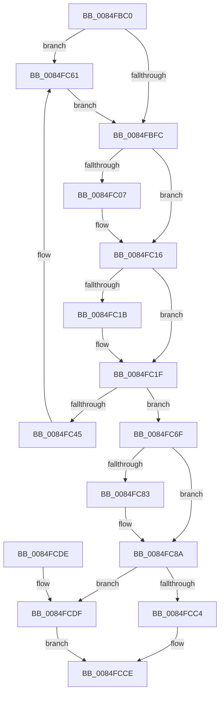

# CmpAddToDelayedClose

- RVA: `0x0084FBC0`–`0x0084FCE6` (길이 `294` bytes)
- VA: `0x000000014084FBC0`
- 실행 섹션: `PAGE`
- PDB 이름 있음: `예`; PDB Function 태그: `아니요`
- unwind 정보 RVA: `0x00069D68`
- 디코드: `69`개 명령, `294/294` bytes 표시
- 미해석 바이트: `0` (있으면 어셈블리에 `.byte`로 보존)

> 이 문서는 커널 이미지의 기계어와 PDB 기호를 분석해 생성했습니다. 4번과 5번은 함수 원형과 자료형을 바이너리 사용 방식에서 추정한 C 해석이며 원본 소스 복구 결과는 아닙니다.

## 1. Dependencies

- 직접 호출 지점: **7**; 고유 호출 대상: **6**
- 직접 호출자로 확인된 함수: **1**
- RIP 상대 이미지 참조: **11**

### Outgoing calls
- `0x0084FBDE` → [KeAbPreAcquire](../../text/21/KeAbPreAcquire_function_00210230.md) (function, `0x00210230`)
- `0x0084FC11` → [ExpAcquireFastMutexContended](../../text/45/ExpAcquireFastMutexContended_function_00450288.md) (function, `0x00450288`)
- `0x0084FC5B` → [KeBugCheckEx](../../text/4F/KeBugCheckEx_function_004FD660.md) (function, `0x004FD660`)
- `0x0084FC68` → [KiRaiseIrqlProcessIrqlFlags](../../text/4F/KiRaiseIrqlProcessIrqlFlags_function_004F56FC.md) (function, `0x004F56FC`)
- `0x0084FCC4` → [ExReleaseFastMutex](../../text/25/ExReleaseFastMutex_function_002519C0.md) (function, `0x002519C0`)
- `0x0084FCC9` → [CmpArmDelayedCloseTimer](../../text/46/CmpArmDelayedCloseTimer_function_00462DD0.md) (function, `0x00462DD0`)
- `0x0084FCDF` → [ExReleaseFastMutex](../../text/25/ExReleaseFastMutex_function_002519C0.md) (function, `0x002519C0`)

### Direct callers
- [CmpPerformCompleteKcbCacheLookup](CmpPerformCompleteKcbCacheLookup_function_0084FD20.md) at `0x00850EF3`

### Static image references
- `0x0084FBD5` → RVA `0x00EF5880` (`.data`; read)
- `0x0084FBF3` → RVA `0x00FC6D20` (`ALMOSTRO`; read)
- `0x0084FBFC` → RVA `0x00EF5880` (`.data`; read/write)
- `0x0084FC28` → RVA `0x00EF5888` (`.data`; write)
- `0x0084FC33` → RVA `0x00EF58B0` (`.data`; write)
- `0x0084FC6F` → RVA `0x00EF58E0` (`.data`; read)
- `0x0084FC9C` → RVA `0x00EF58E0` (`.data`; write)
- `0x0084FCA3` → RVA `0x00EEFC30` (`.data`; read)
- `0x0084FCAF` → RVA `0x00FDA438` (`PAGEDATA`; read/write)
- `0x0084FCB6` → RVA `0x00E0ECA8` (`.data`; read)
- `0x0084FCBC` → RVA `0x00EEFC30` (`.data`; write)

## 2. Other-region calls and transfers

- 다른 실행 섹션으로 향하는 call: **7**
  - `0x0084FBDE` → [KeAbPreAcquire](../../text/21/KeAbPreAcquire_function_00210230.md) (`PAGE` → `.text`)
  - `0x0084FC11` → [ExpAcquireFastMutexContended](../../text/45/ExpAcquireFastMutexContended_function_00450288.md) (`PAGE` → `.text`)
  - `0x0084FC5B` → [KeBugCheckEx](../../text/4F/KeBugCheckEx_function_004FD660.md) (`PAGE` → `.text`)
  - `0x0084FC68` → [KiRaiseIrqlProcessIrqlFlags](../../text/4F/KiRaiseIrqlProcessIrqlFlags_function_004F56FC.md) (`PAGE` → `.text`)
  - `0x0084FCC4` → [ExReleaseFastMutex](../../text/25/ExReleaseFastMutex_function_002519C0.md) (`PAGE` → `.text`)
  - `0x0084FCC9` → [CmpArmDelayedCloseTimer](../../text/46/CmpArmDelayedCloseTimer_function_00462DD0.md) (`PAGE` → `.text`)
  - `0x0084FCDF` → [ExReleaseFastMutex](../../text/25/ExReleaseFastMutex_function_002519C0.md) (`PAGE` → `.text`)
- 별도 외부 분기/꼬리 이동을 확인하지 못했습니다.

## 3. Assembly (complete function range)

```asm
0084FBC0  48 89 5C 24 08                  mov qword ptr [rsp + 8], rbx
0084FBC5  48 89 74 24 10                  mov qword ptr [rsp + 0x10], rsi
0084FBCA  57                              push rdi
0084FBCB  48 83 EC 30                     sub rsp, 0x30
0084FBCF  48 8B F9                        mov rdi, rcx
0084FBD2  45 33 C0                        xor r8d, r8d
0084FBD5  48 8D 0D A4 5C 6A 00            lea rcx, [rip + 0x6a5ca4]
0084FBDC  33 D2                           xor edx, edx
0084FBDE  E8 4D 06 9C FF                  call 0x140210230
0084FBE3  48 8B D8                        mov rbx, rax
0084FBE6  44 0F 20 C6                     mov rsi, cr8
0084FBEA  B8 01 00 00 00                  mov eax, 1
0084FBEF  44 0F 22 C0                     mov cr8, rax
0084FBF3  83 3D 26 71 77 00 00            cmp dword ptr [rip + 0x777126], 0
0084FBFA  75 65                           jne 0x14084fc61
0084FBFC  F0 0F BA 35 7B 5C 6A 00 00      lock btr dword ptr [rip + 0x6a5c7b], 0
0084FC05  72 0F                           jb 0x14084fc16
0084FC07  48 8B D3                        mov rdx, rbx
0084FC0A  48 8D 0D 6F 5C 6A 00            lea rcx, [rip + 0x6a5c6f]
0084FC11  E8 72 06 C0 FF                  call 0x140450288
0084FC16  48 85 DB                        test rbx, rbx
0084FC19  74 04                           je 0x14084fc1f
0084FC1B  C6 43 0A 01                     mov byte ptr [rbx + 0xa], 1
0084FC1F  65 48 8B 04 25 88 01 00 00      mov rax, qword ptr gs:[0x188]
0084FC28  48 89 05 59 5C 6A 00            mov qword ptr [rip + 0x6a5c59], rax
0084FC2F  40 0F B6 C6                     movzx eax, sil
0084FC33  89 05 77 5C 6A 00               mov dword ptr [rip + 0x6a5c77], eax
0084FC39  48 8D 87 E0 00 00 00            lea rax, [rdi + 0xe0]
0084FC40  48 39 00                        cmp qword ptr [rax], rax
0084FC43  74 2A                           je 0x14084fc6f
0084FC45  45 33 C9                        xor r9d, r9d
0084FC48  48 C7 44 24 20 00 00 00 00      mov qword ptr [rsp + 0x20], 0
0084FC51  4C 8B C7                        mov r8, rdi
0084FC54  41 8D 51 34                     lea edx, [r9 + 0x34]
0084FC58  8D 4A 1D                        lea ecx, [rdx + 0x1d]
0084FC5B  E8 00 DA CA FF                  call 0x1404fd660
0084FC60  CC                              int3
0084FC61  0F B6 D0                        movzx edx, al
0084FC64  40 0F B6 CE                     movzx ecx, sil
0084FC68  E8 8F 5A CA FF                  call 0x1404f56fc
0084FC6D  EB 8D                           jmp 0x14084fbfc
0084FC6F  48 8B 0D 6A 5C 6A 00            mov rcx, qword ptr [rip + 0x6a5c6a]
0084FC76  48 8D 15 63 5C 6A 00            lea rdx, [rip + 0x6a5c63]
0084FC7D  48 39 51 08                     cmp qword ptr [rcx + 8], rdx
0084FC81  74 07                           je 0x14084fc8a
0084FC83  B9 03 00 00 00                  mov ecx, 3
0084FC88  CD 29                           int 0x29
0084FC8A  48 89 08                        mov qword ptr [rax], rcx
0084FC8D  48 89 50 08                     mov qword ptr [rax + 8], rdx
0084FC91  48 89 41 08                     mov qword ptr [rcx + 8], rax
0084FC95  48 8D 0D E4 5B 6A 00            lea rcx, [rip + 0x6a5be4]
0084FC9C  48 89 05 3D 5C 6A 00            mov qword ptr [rip + 0x6a5c3d], rax
0084FCA3  8B 05 87 FF 69 00               mov eax, dword ptr [rip + 0x69ff87]
0084FCA9  80 4F 40 02                     or byte ptr [rdi + 0x40], 2
0084FCAD  FF C0                           inc eax
0084FCAF  48 FF 05 82 A7 78 00            inc qword ptr [rip + 0x78a782]
0084FCB6  3B 05 EC EF 5B 00               cmp eax, dword ptr [rip + 0x5befec]
0084FCBC  89 05 6E FF 69 00               mov dword ptr [rip + 0x69ff6e], eax
0084FCC2  76 1B                           jbe 0x14084fcdf
0084FCC4  E8 F7 1C A0 FF                  call 0x1402519c0
0084FCC9  E8 02 31 C1 FF                  call 0x140462dd0
0084FCCE  48 8B 5C 24 40                  mov rbx, qword ptr [rsp + 0x40]
0084FCD3  48 8B 74 24 48                  mov rsi, qword ptr [rsp + 0x48]
0084FCD8  48 83 C4 30                     add rsp, 0x30
0084FCDC  5F                              pop rdi
0084FCDD  C3                              ret
0084FCDE  CC                              int3
0084FCDF  E8 DC 1C A0 FF                  call 0x1402519c0
0084FCE4  EB E8                           jmp 0x14084fcce
```

## 4. C-style interpretation (structured pseudocode)

```c
__int64 __fastcall CmpAddToDelayedClose(__int64 a1, int a2, int a3, int a4)
{
    __int64 result;
    __int64 v_rsp;
    unsigned __int64 v_stack_m18;
    unsigned __int64 v_stack_p10;
    unsigned __int64 v_stack_p8;

    v_stack_p8 = v_rbx;
    v_stack_p10 = v_rsi;
    v_rsp = (v_rsp) - (48);
    a3 = 0;
    a2 = 0;
    result = KeAbPreAcquire(v_rip + 6970532, a2, a3, a4);
    if ((*(unsigned int *)(v_rip + 7827750)) != 0) goto loc_0084FC61;
loc_0084FBFC:
    result = 1;
    if ((*(unsigned int *)(v_rip + 7827750)) >= 0) {
        a2 = result;
        a1 = v_rip + 6970479;
        result = ExpAcquireFastMutexContended(a1, a2, a3, a4);
    }
    if (result != 0) {
        *(unsigned __int8 *)(result + 10) = 1;
    }
    *(unsigned __int64 *)(v_rip + 6970457) = *(unsigned __int64 *)(gs_base + (0 + 392));
    *(unsigned int *)(v_rip + 6970487) = (unsigned int)((unsigned __int8)(v_cr8));
    if ((*(unsigned __int64 *)(a1 + 224)) == (a1 + 224)) goto loc_0084FC6F;
    a4 = 0;
    v_stack_m18 = 0;
    result = KeBugCheckEx(a4 + 52 + 29, a4 + 52, a1, a4);
loc_0084FC61:
    result = KiRaiseIrqlProcessIrqlFlags((unsigned __int8)(v_cr8), (unsigned __int8)(result), a1, a4);
    goto loc_0084FBFC;
loc_0084FC6F:
    if ((*(unsigned __int64 *)(*(unsigned __int64 *)(v_rip + 6970474) + 8)) != (v_rip + 6970467)) {
        a1 = 3;
    }
    *(unsigned __int64 *)(result) = a1;
    *(unsigned __int64 *)(result + 8) = v_rip + 6970467;
    *(unsigned __int64 *)(a1 + 8) = result;
    *(unsigned __int64 *)(v_rip + 6970429) = result;
    result = (unsigned int)(((unsigned int)(*(unsigned int *)(v_rip + 6946695))) + 1);
    *(unsigned int *)(v_rip + 6946670) = (unsigned int)(result);
    if (((unsigned int)(result)) <= (*(unsigned int *)(v_rip + 6025196))) goto loc_0084FCDF;
    result = ExReleaseFastMutex(v_rip + 6970340, v_rip + 6970467, a1, a4);
    result = CmpArmDelayedCloseTimer(v_rip + 6970340, v_rip + 6970467, a1, a4);
loc_0084FCCE:
    v_rsp = (v_rsp) + (48);
    return result;
loc_0084FCDF:
    result = ExReleaseFastMutex(v_rip + 6970340, v_rip + 6970467, a1, a4);
    goto loc_0084FCCE;
}
```

## 5. (Beta) C Style

```c
int64_t CmpAddToDelayedClose(void *Arg1, int32_t Arg2, int32_t Arg3, int32_t Arg4)
{
    uint8_t *arg1 = (uint8_t *)Arg1;

    int64_t result;
    int64_t local_rsp;
    uint64_t v_stack_m18;
    uint64_t v_stack_p10;
    uint64_t v_stack_p8;

    v_stack_p8 = local_rbx;
    v_stack_p10 = local_rsi;
    local_rsp = (local_rsp) - (48);
    Arg3 = 0;
    Arg2 = 0;
    result = KeAbPreAcquire(v_rip + 6970532, Arg2, Arg3, Arg4);
    if ((*(uint32_t *)(v_rip + 0x777126)) != 0) goto loc_0084FC61;
loc_0084FBFC:
    result = 1;
    if ((*(uint32_t *)(v_rip + 0x777126)) >= 0) {
        Arg2 = result;
        Arg1 = v_rip + 6970479;
        result = ExpAcquireFastMutexContended(Arg1, Arg2, Arg3, Arg4);
    }
    if (result != 0) {
        *(uint8_t *)(result + 0xA) = 1;
    }
    *(uint64_t *)(v_rip + 0x6A5C59) = *(uint64_t *)(gs_base + (0 + 0x188));
    *(uint32_t *)(v_rip + 0x6A5C77) = (uint32_t)((uint8_t)(v_cr8));
    if ((*(uint64_t *)(arg1 + 0xE0)) == (Arg1 + 224)) goto loc_0084FC6F;
    Arg4 = 0;
    v_stack_m18 = 0;
    result = KeBugCheckEx(Arg4 + 52 + 29, Arg4 + 52, Arg1, Arg4);
loc_0084FC61:
    result = KiRaiseIrqlProcessIrqlFlags((uint8_t)(v_cr8), (uint8_t)(result), Arg1, Arg4);
    goto loc_0084FBFC;
loc_0084FC6F:
    if ((*(uint64_t *)(*(uint64_t *)(v_rip + 0x6A5C6A) + 0x8)) != (v_rip + 6970467)) {
        Arg1 = 3;
    }
    *(void **)(result) = Arg1;
    *(uint64_t *)(result + 0x8) = v_rip + 6970467;
    *(uint64_t *)(arg1 + 0x8) = result;
    *(uint64_t *)(v_rip + 0x6A5C3D) = result;
    result = (uint32_t)(((uint32_t)(*(uint32_t *)(v_rip + 0x69FF87))) + 1);
    *(uint32_t *)(v_rip + 0x69FF6E) = (uint32_t)(result);
    if (((uint32_t)(result)) <= (*(uint32_t *)(v_rip + 0x5BEFEC))) goto loc_0084FCDF;
    result = ExReleaseFastMutex(v_rip + 6970340, v_rip + 6970467, Arg1, Arg4);
    result = CmpArmDelayedCloseTimer(v_rip + 6970340, v_rip + 6970467, Arg1, Arg4);
loc_0084FCCE:
    local_rsp = (local_rsp) + (48);
    return result;
loc_0084FCDF:
    result = ExReleaseFastMutex(v_rip + 6970340, v_rip + 6970467, Arg1, Arg4);
    goto loc_0084FCCE;
}
```

### 관측된 메모리 오프셋

구조체 형식이 확인되지 않은 접근은 인자 기준의 오프셋으로만 기록했습니다.

| 기준 인자 | 오프셋 표현 | 폭 (bit) | 접근 |
|---|---:|---:|---|
| `Arg1` | `+ 0x0` | `64` | `R` |
| `Arg1` | `+ 0x0` | `64` | `W` |
| `Arg1` | `+ 0x8` | `64` | `W` |
| `Arg1` | `+ 0x40` | `8` | `R/W` |
| `Arg1` | `+ 0xE0` | `64` | `R` |

## 6. Execution-region graph

[열기: 2D/3D 그래프와 함수 탐색 컨트롤 패널](../../../control-panel.html?section=page&rva=0x0084FBC0&view=graph)

- 2D 그래프는 위에서 아래로 흐르고, 3D 그래프는 빈 공간을 드래그해 회전합니다. Shift+드래그는 이동, 휠은 확대·축소, 함수 노드 선택은 대상 보고서 이동입니다.

### Static fallback


