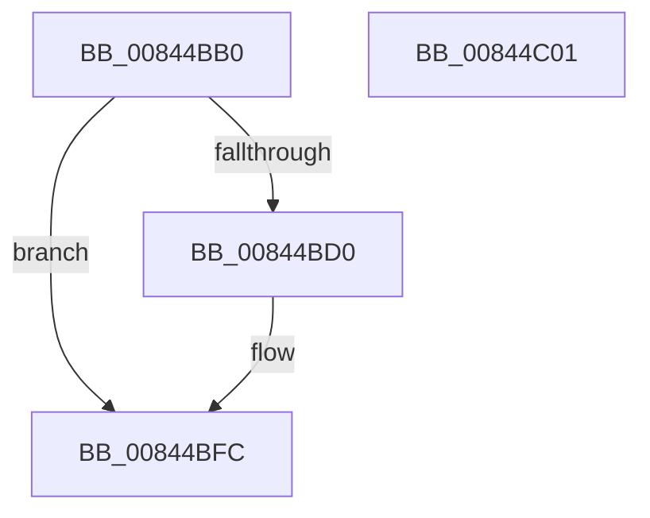

# CmpAllocateUnitOfWork

- RVA: `0x00844BB0`–`0x00844C02` (길이 `82` bytes)
- VA: `0x0000000140844BB0`
- 실행 섹션: `PAGE`
- PDB 이름 있음: `예`; PDB Function 태그: `아니요`
- unwind 정보 RVA: `0x0005C788`
- 디코드: `22`개 명령, `82/82` bytes 표시
- 미해석 바이트: `0` (있으면 어셈블리에 `.byte`로 보존)

> 이 문서는 커널 이미지의 기계어와 PDB 기호를 분석해 생성했습니다. 4번과 5번은 함수 원형과 자료형을 바이너리 사용 방식에서 추정한 C 해석이며 원본 소스 복구 결과는 아닙니다.

## 1. Dependencies

- 직접 호출 지점: **1**; 고유 호출 대상: **1**
- 직접 호출자로 확인된 함수: **9**
- RIP 상대 이미지 참조: **0**

### Outgoing calls
- `0x00844BC4` → [ExAllocatePool2](../../poolcode/B8/ExAllocatePool2_function_00B820F0.md) (function, `0x00B820F0`)

### Direct callers
- [CmSetLastWriteTimeKey](CmSetLastWriteTimeKey_function_00843368.md) at `0x008435F7`
- [CmSetValueKey](CmSetValueKey_function_008457C0.md) at `0x008460DD`
- [CmDeleteValueKey](CmDeleteValueKey_function_008476E8.md) at `0x00847E01`
- [CmDeleteKey](CmDeleteKey_function_00848E5C.md) at `0x0084948F`
- [CmDeleteKey](CmDeleteKey_function_00848E5C.md) at `0x008494A0`
- [CmpCreateChild](../94/CmpCreateChild_function_0094817C.md) at `0x00948B8F`
- [CmpUndoDeleteKeyForTrans](../94/CmpUndoDeleteKeyForTrans_function_0094A728.md) at `0x0094A868`
- [CmpUndoDeleteKeyForTrans](../94/CmpUndoDeleteKeyForTrans_function_0094A728.md) at `0x0094A90F`
- [CmSetKeyFlags](../9A/CmSetKeyFlags_function_009AEEA4.md) at `0x009AF26C`
- [sub_00B258D8](../B2/Unknown_function_00B258D8.md) at `0x00B259BC`
- [sub_00B25E36](../B2/Unknown_function_00B25E36.md) at `0x00B25E85`

### Static image references
- 디코드된 RIP-relative 메모리 참조가 없습니다.

## 2. Other-region calls and transfers

- 다른 실행 섹션으로 향하는 call: **1**
  - `0x00844BC4` → [ExAllocatePool2](../../poolcode/B8/ExAllocatePool2_function_00B820F0.md) (`PAGE` → `POOLCODE`)
- 별도 외부 분기/꼬리 이동을 확인하지 못했습니다.

## 3. Assembly (complete function range)

```asm
00844BB0  48 83 EC 28                     sub rsp, 0x28
00844BB4  BA 78 00 00 00                  mov edx, 0x78
00844BB9  B9 00 01 00 00                  mov ecx, 0x100
00844BBE  41 B8 43 4D 55 77               mov r8d, 0x77554d43
00844BC4  E8 27 D5 33 00                  call 0x140b820f0
00844BC9  33 D2                           xor edx, edx
00844BCB  48 85 C0                        test rax, rax
00844BCE  74 2C                           je 0x140844bfc
00844BD0  48 89 40 08                     mov qword ptr [rax + 8], rax
00844BD4  48 8D 48 20                     lea rcx, [rax + 0x20]
00844BD8  48 89 00                        mov qword ptr [rax], rax
00844BDB  48 89 49 08                     mov qword ptr [rcx + 8], rcx
00844BDF  48 89 09                        mov qword ptr [rcx], rcx
00844BE2  48 89 50 10                     mov qword ptr [rax + 0x10], rdx
00844BE6  48 89 50 18                     mov qword ptr [rax + 0x18], rdx
00844BEA  48 89 50 30                     mov qword ptr [rax + 0x30], rdx
00844BEE  48 89 50 38                     mov qword ptr [rax + 0x38], rdx
00844BF2  89 50 40                        mov dword ptr [rax + 0x40], edx
00844BF5  C7 40 44 10 00 00 00            mov dword ptr [rax + 0x44], 0x10
00844BFC  48 83 C4 28                     add rsp, 0x28
00844C00  C3                              ret
00844C01  CC                              int3
```

## 4. C-style interpretation (structured pseudocode)

```c
__int64 __fastcall CmpAllocateUnitOfWork(void)
{
    __int64 result;
    __int64 v_rsp;

    v_rsp = (v_rsp) - (40);
    result = ExAllocatePool2(256, 120, (unsigned int)(0x77554D43ULL), a4);
    a2 = 0;
    if (result != 0) {
        *(unsigned __int64 *)(result + 8) = result;
        a1 = result + 32;
        *(unsigned __int64 *)(result) = result;
        *(unsigned __int64 *)(a1 + 8) = a1;
        *(unsigned __int64 *)(a1) = a1;
        *(unsigned __int64 *)(result + 16) = 0;
        *(unsigned __int64 *)(result + 24) = 0;
        *(unsigned __int64 *)(result + 48) = 0;
        *(unsigned __int64 *)(result + 56) = 0;
        *(unsigned int *)(result + 64) = 0;
        *(unsigned int *)(result + 68) = 16;
    }
    v_rsp = (v_rsp) + (40);
    return result;
}
```

## 5. (Beta) C Style

```c
void CmpAllocateUnitOfWork(void)
{
    int64_t result;
    int64_t local_rsp;

    local_rsp = (local_rsp) - (40);
    result = ExAllocatePool2(256, 120, (uint32_t)(0x77554D43ULL), a4);
    a2 = 0;
    if (result != 0) {
        *(uint64_t *)(result + 0x8) = result;
        a1 = result + 32;
        *(uint64_t *)(result) = result;
        *(uint64_t *)(a1 + 0x8) = a1;
        *(uint64_t *)(a1) = a1;
        *(uint64_t *)(result + 0x10) = 0;
        *(uint64_t *)(result + 0x18) = 0;
        *(uint64_t *)(result + 0x30) = 0;
        *(uint64_t *)(result + 0x38) = 0;
        *(uint32_t *)(result + 0x40) = 0;
        *(uint32_t *)(result + 0x44) = 16;
    }
    local_rsp = (local_rsp) + (40);
    return result;
}
```

## 6. Execution-region graph

[열기: 2D/3D 그래프와 함수 탐색 컨트롤 패널](../../../control-panel.html?section=page&rva=0x00844BB0&view=graph)

- 2D 그래프는 위에서 아래로 흐르고, 3D 그래프는 빈 공간을 드래그해 회전합니다. Shift+드래그는 이동, 휠은 확대·축소, 함수 노드 선택은 대상 보고서 이동입니다.

### Static fallback


