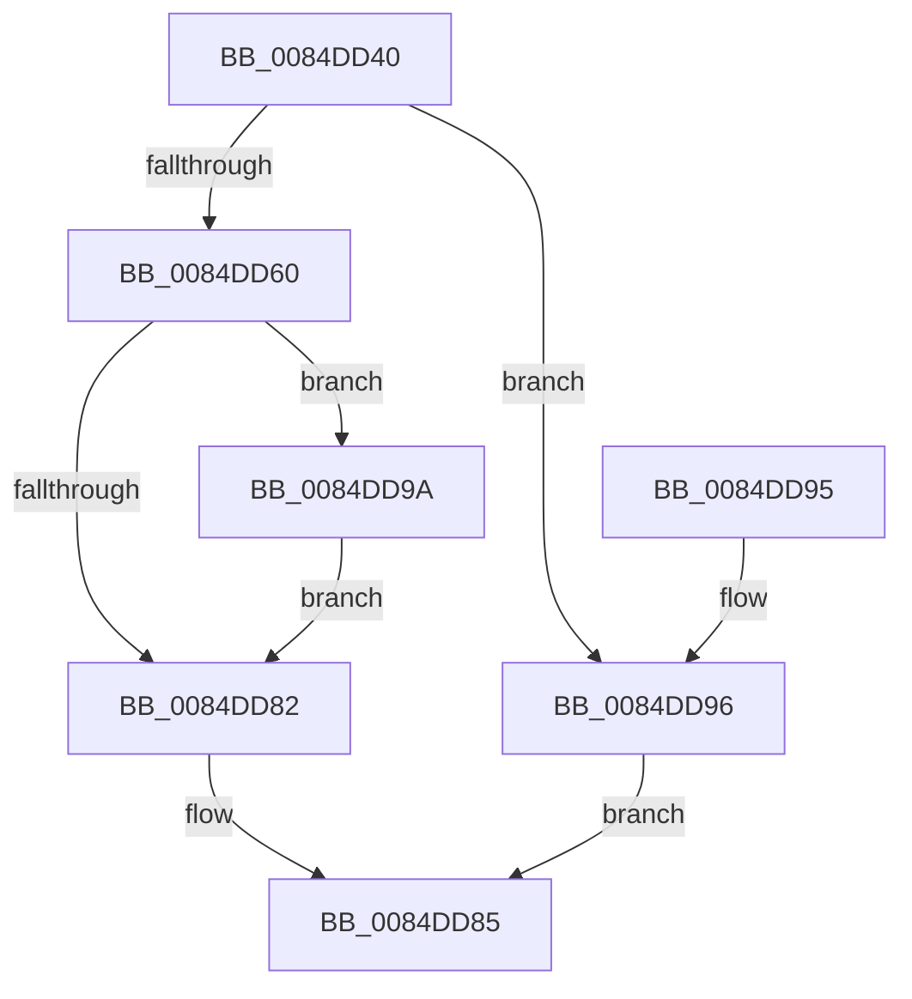

# CmpAllocate

- RVA: `0x0084DD40`–`0x0084DDA3` (길이 `99` bytes)
- VA: `0x000000014084DD40`
- 실행 섹션: `PAGE`
- PDB 이름 있음: `예`; PDB Function 태그: `아니요`
- unwind 정보 RVA: `0x00069B08`
- 디코드: `32`개 명령, `99/99` bytes 표시
- 미해석 바이트: `0` (있으면 어셈블리에 `.byte`로 보존)

> 이 문서는 커널 이미지의 기계어와 PDB 기호를 분석해 생성했습니다. 4번과 5번은 함수 원형과 자료형을 바이너리 사용 방식에서 추정한 C 해석이며 원본 소스 복구 결과는 아닙니다.

## 1. Dependencies

- 직접 호출 지점: **3**; 고유 호출 대상: **3**
- 직접 호출자로 확인된 함수: **4**
- RIP 상대 이미지 참조: **0**

### Outgoing calls
- `0x0084DD57` → [CmpClaimGlobalQuota](CmpClaimGlobalQuota_function_0084DDAC.md) (function, `0x0084DDAC`)
- `0x0084DD75` → [ExAllocatePool2](../../poolcode/B8/ExAllocatePool2_function_00B820F0.md) (function, `0x00B820F0`)
- `0x0084DD9C` → [CmpReleaseGlobalQuota](CmpReleaseGlobalQuota_function_0084DB40.md) (function, `0x0084DB40`)

### Direct callers
- [CmpCreateEmptyHiveClone](../7E/CmpCreateEmptyHiveClone_function_007EE2E0.md) at `0x007EE343`
- [CmpAddSubKeyToList](CmpAddSubKeyToList_function_0084D644.md) at `0x0084D6EA`
- [HvpAdjustBitmap](HvpAdjustBitmap_function_0084DBFC.md) at `0x0084DC7C`
- [CmpCreateHive](../87/CmpCreateHive_function_00879DF0.md) at `0x00879F89`

### Static image references
- 디코드된 RIP-relative 메모리 참조가 없습니다.

## 2. Other-region calls and transfers

- 다른 실행 섹션으로 향하는 call: **1**
  - `0x0084DD75` → [ExAllocatePool2](../../poolcode/B8/ExAllocatePool2_function_00B820F0.md) (`PAGE` → `POOLCODE`)
- 별도 외부 분기/꼬리 이동을 확인하지 못했습니다.

## 3. Assembly (complete function range)

```asm
0084DD40  48 89 5C 24 08                  mov qword ptr [rsp + 8], rbx
0084DD45  48 89 74 24 10                  mov qword ptr [rsp + 0x10], rsi
0084DD4A  57                              push rdi
0084DD4B  48 83 EC 20                     sub rsp, 0x20
0084DD4F  41 8B F0                        mov esi, r8d
0084DD52  8B D9                           mov ebx, ecx
0084DD54  40 8A FA                        mov dil, dl
0084DD57  E8 50 00 00 00                  call 0x14084ddac
0084DD5C  84 C0                           test al, al
0084DD5E  74 36                           je 0x14084dd96
0084DD60  40 F6 DF                        neg dil
0084DD63  8B D3                           mov edx, ebx
0084DD65  44 8B C6                        mov r8d, esi
0084DD68  48 1B C9                        sbb rcx, rcx
0084DD6B  83 E1 08                        and ecx, 8
0084DD6E  48 81 C1 00 01 00 00            add rcx, 0x100
0084DD75  E8 76 43 33 00                  call 0x140b820f0
0084DD7A  48 8B F8                        mov rdi, rax
0084DD7D  48 85 C0                        test rax, rax
0084DD80  74 18                           je 0x14084dd9a
0084DD82  48 8B C7                        mov rax, rdi
0084DD85  48 8B 5C 24 30                  mov rbx, qword ptr [rsp + 0x30]
0084DD8A  48 8B 74 24 38                  mov rsi, qword ptr [rsp + 0x38]
0084DD8F  48 83 C4 20                     add rsp, 0x20
0084DD93  5F                              pop rdi
0084DD94  C3                              ret
0084DD95  CC                              int3
0084DD96  33 C0                           xor eax, eax
0084DD98  EB EB                           jmp 0x14084dd85
0084DD9A  8B CB                           mov ecx, ebx
0084DD9C  E8 9F FD FF FF                  call 0x14084db40
0084DDA1  EB DF                           jmp 0x14084dd82
```

## 4. C-style interpretation (structured pseudocode)

```c
__int64 __fastcall CmpAllocate(__int64 a1, unsigned __int8 a2, int a3)
{
    __int64 result;
    __int64 v_rdi;
    __int64 v_rsp;
    unsigned __int64 v_stack_p10;
    unsigned __int64 v_stack_p8;

    v_stack_p8 = v_rbx;
    v_stack_p10 = v_rsi;
    v_rsp = (v_rsp) - (32);
    result = CmpClaimGlobalQuota(a1, a2, a3, a4);
    if ((unsigned __int8)(result) == 0) goto loc_0084DD96;
    v_rdi = (unsigned __int8)(-(a2));
    a1 = (unsigned int)((a1) & (8));
    a1 = (a1) + (256);
    result = ExAllocatePool2(a1, (unsigned int)((unsigned int)((unsigned int)((unsigned int)(a1)))), (unsigned int)((unsigned int)((unsigned int)(a3))), a4);
    if (result == 0) goto loc_0084DD9A;
loc_0084DD82:
loc_0084DD85:
    v_rsp = (v_rsp) + (32);
    return result;
loc_0084DD96:
    result = 0;
    goto loc_0084DD85;
loc_0084DD9A:
    result = CmpReleaseGlobalQuota((unsigned int)((unsigned int)(v_stack_p8)), (unsigned int)((unsigned int)((unsigned int)((unsigned int)(a1)))), (unsigned int)((unsigned int)((unsigned int)(a3))), a4);
    goto loc_0084DD82;
}
```

## 5. (Beta) C Style

```c
int64_t CmpAllocate(int64_t Arg1, uint8_t Arg2, int32_t Arg3)
{
    int64_t result;
    int64_t local_rdi;
    int64_t local_rsp;
    uint64_t v_stack_p10;
    uint64_t v_stack_p8;

    v_stack_p8 = local_rbx;
    v_stack_p10 = local_rsi;
    local_rsp = (local_rsp) - (32);
    result = CmpClaimGlobalQuota(Arg1, Arg2, Arg3, a4);
    if ((uint8_t)(result) == 0) goto loc_0084DD96;
    local_rdi = (uint8_t)(-(Arg2));
    Arg1 = (uint32_t)((Arg1) & (8));
    Arg1 = (Arg1) + (256);
    result = ExAllocatePool2(Arg1, (uint32_t)((uint32_t)((uint32_t)((uint32_t)(Arg1)))), (uint32_t)((uint32_t)((uint32_t)(Arg3))), a4);
    if (result == 0) goto loc_0084DD9A;
loc_0084DD82:
loc_0084DD85:
    local_rsp = (local_rsp) + (32);
    return result;
loc_0084DD96:
    result = 0;
    goto loc_0084DD85;
loc_0084DD9A:
    result = CmpReleaseGlobalQuota((uint32_t)((uint32_t)(v_stack_p8)), (uint32_t)((uint32_t)((uint32_t)((uint32_t)(Arg1)))), (uint32_t)((uint32_t)((uint32_t)(Arg3))), a4);
    goto loc_0084DD82;
}
```

## 6. Execution-region graph

[열기: 2D/3D 그래프와 함수 탐색 컨트롤 패널](../../../control-panel.html?section=page&rva=0x0084DD40&view=graph)

- 2D 그래프는 위에서 아래로 흐르고, 3D 그래프는 빈 공간을 드래그해 회전합니다. Shift+드래그는 이동, 휠은 확대·축소, 함수 노드 선택은 대상 보고서 이동입니다.

### Static fallback


