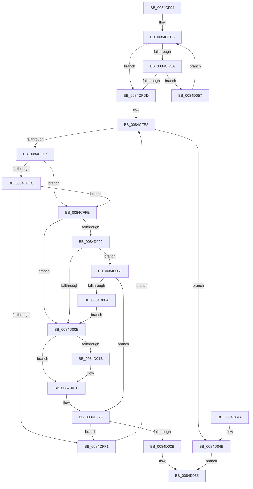

# CmpBlockHiveWrites

- RVA: `0x0084CF94`–`0x0084D06C` (길이 `216` bytes)
- VA: `0x000000014084CF94`
- 실행 섹션: `PAGE`
- PDB 이름 있음: `예`; PDB Function 태그: `아니요`
- unwind 정보 RVA: `0x00069864`
- 디코드: `65`개 명령, `216/216` bytes 표시
- 미해석 바이트: `0` (있으면 어셈블리에 `.byte`로 보존)

> 이 문서는 커널 이미지의 기계어와 PDB 기호를 분석해 생성했습니다. 4번과 5번은 함수 원형과 자료형을 바이너리 사용 방식에서 추정한 C 해석이며 원본 소스 복구 결과는 아닙니다.

## 1. Dependencies

- 직접 호출 지점: **7**; 고유 호출 대상: **6**
- 직접 호출자로 확인된 함수: **2**
- RIP 상대 이미지 참조: **2**

### Outgoing calls
- `0x0084CFB2` → [CmpLockHiveListShared](CmpLockHiveListShared_function_0084E3C8.md) (function, `0x0084E3C8`)
- `0x0084CFD4` → [CmpReferenceHive](CmpReferenceHive_function_0084FCF0.md) (function, `0x0084FCF0`)
- `0x0084CFDD` → [CmpUnlockHiveList](CmpUnlockHiveList_function_0084E424.md) (function, `0x0084E424`)
- `0x0084CFF4` → [CmpGetNextHive](CmpGetNextHive_function_0084E330.md) (function, `0x0084E330`)
- `0x0084D011` → [CmpReferenceHive](CmpReferenceHive_function_0084FCF0.md) (function, `0x0084FCF0`)
- `0x0084D021` → [HvLockHiveFlusherExclusive](../../pagecmrc/BC/HvLockHiveFlusherExclusive_function_00BC9C50.md) (function, `0x00BC9C50`)
- `0x0084D02E` → [CmpDereferenceHive](../86/CmpDereferenceHive_function_008632B0.md) (function, `0x008632B0`)

### Direct callers
- [sub_00B169F2](../B1/Unknown_function_00B169F2.md) at `0x00B16A78`
- [sub_00B4160E](../B4/Unknown_function_00B4160E.md) at `0x00B41621`

### Static image references
- `0x0084CFB7` → RVA `0x00FD9D18` (`PAGEDATA`; read)
- `0x0084D061` → RVA `0x00FD9A90` (`PAGEDATA`; read)

## 2. Other-region calls and transfers

- 다른 실행 섹션으로 향하는 call: **1**
  - `0x0084D021` → [HvLockHiveFlusherExclusive](../../pagecmrc/BC/HvLockHiveFlusherExclusive_function_00BC9C50.md) (`PAGE` → `PAGECMRC`)
- 별도 외부 분기/꼬리 이동을 확인하지 못했습니다.

## 3. Assembly (complete function range)

```asm
0084CF94  48 89 5C 24 08                  mov qword ptr [rsp + 8], rbx
0084CF99  48 89 6C 24 10                  mov qword ptr [rsp + 0x10], rbp
0084CF9E  48 89 74 24 18                  mov qword ptr [rsp + 0x18], rsi
0084CFA3  57                              push rdi
0084CFA4  48 83 EC 20                     sub rsp, 0x20
0084CFA8  33 DB                           xor ebx, ebx
0084CFAA  49 8B F0                        mov rsi, r8
0084CFAD  8B EA                           mov ebp, edx
0084CFAF  48 8B F9                        mov rdi, rcx
0084CFB2  E8 11 14 00 00                  call 0x14084e3c8
0084CFB7  4C 8B 0D 5A CD 78 00            mov r9, qword ptr [rip + 0x78cd5a]
0084CFBE  4C 8D 05 53 CD 78 00            lea r8, [rip + 0x78cd53]
0084CFC5  4D 3B C8                        cmp r9, r8
0084CFC8  74 13                           je 0x14084cfdd
0084CFCA  49 8D 99 B8 F9 FF FF            lea rbx, [r9 - 0x648]
0084CFD1  48 8B CB                        mov rcx, rbx
0084CFD4  E8 17 2D 00 00                  call 0x14084fcf0
0084CFD9  84 C0                           test al, al
0084CFDB  74 7A                           je 0x14084d057
0084CFDD  E8 42 14 00 00                  call 0x14084e424
0084CFE2  48 85 DB                        test rbx, rbx
0084CFE5  74 64                           je 0x14084d04b
0084CFE7  48 3B FB                        cmp rdi, rbx
0084CFEA  74 12                           je 0x14084cffe
0084CFEC  48 85 FF                        test rdi, rdi
0084CFEF  74 0D                           je 0x14084cffe
0084CFF1  48 8B CB                        mov rcx, rbx
0084CFF4  E8 37 13 00 00                  call 0x14084e330
0084CFF9  48 8B D8                        mov rbx, rax
0084CFFC  EB E4                           jmp 0x14084cfe2
0084CFFE  85 ED                           test ebp, ebp
0084D000  74 0C                           je 0x14084d00e
0084D002  8B 83 10 10 00 00               mov eax, dword ptr [rbx + 0x1010]
0084D008  23 C5                           and eax, ebp
0084D00A  3B C5                           cmp eax, ebp
0084D00C  75 53                           jne 0x14084d061
0084D00E  48 8B CB                        mov rcx, rbx
0084D011  E8 DA 2C 00 00                  call 0x14084fcf0
0084D016  48 85 F6                        test rsi, rsi
0084D019  74 03                           je 0x14084d01e
0084D01B  48 89 1E                        mov qword ptr [rsi], rbx
0084D01E  48 8B CB                        mov rcx, rbx
0084D021  E8 2A CC 37 00                  call 0x140bc9c50
0084D026  48 3B FB                        cmp rdi, rbx
0084D029  75 C6                           jne 0x14084cff1
0084D02B  48 8B CB                        mov rcx, rbx
0084D02E  E8 7D 62 01 00                  call 0x1408632b0
0084D033  33 C0                           xor eax, eax
0084D035  48 8B 5C 24 30                  mov rbx, qword ptr [rsp + 0x30]
0084D03A  48 8B 6C 24 38                  mov rbp, qword ptr [rsp + 0x38]
0084D03F  48 8B 74 24 40                  mov rsi, qword ptr [rsp + 0x40]
0084D044  48 83 C4 20                     add rsp, 0x20
0084D048  5F                              pop rdi
0084D049  C3                              ret
0084D04A  CC                              int3
0084D04B  48 F7 DF                        neg rdi
0084D04E  1B C0                           sbb eax, eax
0084D050  25 34 00 00 C0                  and eax, 0xc0000034
0084D055  EB DE                           jmp 0x14084d035
0084D057  4D 8B 09                        mov r9, qword ptr [r9]
0084D05A  33 DB                           xor ebx, ebx
0084D05C  E9 64 FF FF FF                  jmp 0x14084cfc5
0084D061  48 3B 1D 28 CA 78 00            cmp rbx, qword ptr [rip + 0x78ca28]
0084D068  75 BC                           jne 0x14084d026
0084D06A  EB A2                           jmp 0x14084d00e
```

## 4. C-style interpretation (structured pseudocode)

```c
__int64 __fastcall CmpBlockHiveWrites(__int64 a1, int a2, __int64 a3)
{
    __int64 result;
    __int64 v_rbx;
    __int64 v_rdi;
    __int64 v_rsp;
    unsigned __int64 v_stack_p10;
    unsigned __int64 v_stack_p18;
    unsigned __int64 v_stack_p8;

    v_stack_p8 = v_rbx;
    v_stack_p10 = v_rbp;
    v_stack_p18 = v_rsi;
    v_rsp = (v_rsp) - (32);
    v_rbx = 0;
    result = CmpLockHiveListShared(a1, a2, a3, a4);
loc_0084CFC5:
    if ((*(unsigned __int64 *)(v_rip + 7916890)) == (v_rip + 7916883)) goto loc_0084CFDD;
    result = CmpReferenceHive(*(unsigned __int64 *)(v_rip + 7916890) - 1608, a2, v_rip + 7916883, *(unsigned __int64 *)(v_rip + 7916890));
    if ((unsigned __int8)(result) == 0) goto loc_0084D057;
loc_0084CFDD:
    result = CmpUnlockHiveList(*(unsigned __int64 *)(v_rip + 7916890) - 1608, a2, v_rip + 7916883, *(unsigned __int64 *)(v_rip + 7916890));
loc_0084CFE2:
    if (*(unsigned __int64 *)(v_rip + 7916890) - 1608 == 0) goto loc_0084D04B;
    if (a1 == (*(unsigned __int64 *)(v_rip + 7916890) - 1608)) goto loc_0084CFFE;
    if (a1 == 0) goto loc_0084CFFE;
loc_0084CFF1:
    result = CmpGetNextHive(*(unsigned __int64 *)(v_rip + 7916890) - 1608, a2, v_rip + 7916883, *(unsigned __int64 *)(v_rip + 7916890));
    goto loc_0084CFE2;
loc_0084CFFE:
    if ((unsigned int)((unsigned int)(a2)) == 0) goto loc_0084D00E;
    result = (unsigned int)(((unsigned int)(*(unsigned int *)(result + 4112))) & ((unsigned int)((unsigned int)(a2))));
    if (((unsigned int)(result)) != ((unsigned int)((unsigned int)(a2)))) goto loc_0084D061;
loc_0084D00E:
    result = CmpReferenceHive(result, a2, v_rip + 7916883, *(unsigned __int64 *)(v_rip + 7916890));
    if (a3 != 0) {
        *(unsigned __int64 *)(a3) = result;
    }
    result = HvLockHiveFlusherExclusive(result, a2, v_rip + 7916883, *(unsigned __int64 *)(v_rip + 7916890));
loc_0084D026:
    if (a1 != result) goto loc_0084CFF1;
    result = CmpDereferenceHive(result, a2, v_rip + 7916883, *(unsigned __int64 *)(v_rip + 7916890));
    result = 0;
loc_0084D035:
    v_rsp = (v_rsp) + (32);
    return result;
loc_0084D04B:
    v_rdi = -(a1);
    result = (unsigned int)((result) & (0xC0000034ULL));
    goto loc_0084D035;
loc_0084D057:
    v_rbx = 0;
    goto loc_0084CFC5;
loc_0084D061:
    if (0 != (*(unsigned __int64 *)(v_rip + 7916072))) goto loc_0084D026;
    goto loc_0084D00E;
}
```

## 5. (Beta) C Style

```c
int64_t CmpBlockHiveWrites(int64_t Arg1, int32_t Arg2, int64_t Arg3)
{
    int64_t result;
    int64_t local_rbx;
    int64_t local_rdi;
    int64_t local_rsp;
    uint64_t v_stack_p10;
    uint64_t v_stack_p18;
    uint64_t v_stack_p8;

    v_stack_p8 = local_rbx;
    v_stack_p10 = local_rbp;
    v_stack_p18 = local_rsi;
    local_rsp = (local_rsp) - (32);
    local_rbx = 0;
    result = CmpLockHiveListShared(Arg1, Arg2, Arg3, a4);
loc_0084CFC5:
    if ((*(uint64_t *)(v_rip + 0x78CD5A)) == (v_rip + 7916883)) goto loc_0084CFDD;
    result = CmpReferenceHive(*(uint64_t *)(v_rip + 0x78CD5A) - 1608, Arg2, v_rip + 7916883, *(uint64_t *)(v_rip + 0x78CD5A));
    if ((uint8_t)(result) == 0) goto loc_0084D057;
loc_0084CFDD:
    result = CmpUnlockHiveList(*(uint64_t *)(v_rip + 0x78CD5A) - 1608, Arg2, v_rip + 7916883, *(uint64_t *)(v_rip + 0x78CD5A));
loc_0084CFE2:
    if (*(uint64_t *)(v_rip + 0x78CD5A) - 1608 == 0) goto loc_0084D04B;
    if (Arg1 == (*(uint64_t *)(v_rip + 0x78CD5A) - 1608)) goto loc_0084CFFE;
    if (Arg1 == 0) goto loc_0084CFFE;
loc_0084CFF1:
    result = CmpGetNextHive(*(uint64_t *)(v_rip + 0x78CD5A) - 1608, Arg2, v_rip + 7916883, *(uint64_t *)(v_rip + 0x78CD5A));
    goto loc_0084CFE2;
loc_0084CFFE:
    if ((uint32_t)((uint32_t)(Arg2)) == 0) goto loc_0084D00E;
    result = (uint32_t)(((uint32_t)(*(uint32_t *)(result + 0x1010))) & ((uint32_t)((uint32_t)(Arg2))));
    if (((uint32_t)(result)) != ((uint32_t)((uint32_t)(Arg2)))) goto loc_0084D061;
loc_0084D00E:
    result = CmpReferenceHive(result, Arg2, v_rip + 7916883, *(uint64_t *)(v_rip + 0x78CD5A));
    if (Arg3 != 0) {
        *(uint64_t *)(Arg3) = result;
    }
    result = HvLockHiveFlusherExclusive(result, Arg2, v_rip + 7916883, *(uint64_t *)(v_rip + 0x78CD5A));
loc_0084D026:
    if (Arg1 != result) goto loc_0084CFF1;
    result = CmpDereferenceHive(result, Arg2, v_rip + 7916883, *(uint64_t *)(v_rip + 0x78CD5A));
    result = 0;
loc_0084D035:
    local_rsp = (local_rsp) + (32);
    return result;
loc_0084D04B:
    local_rdi = -(Arg1);
    result = (uint32_t)((result) & (0xC0000034ULL));
    goto loc_0084D035;
loc_0084D057:
    local_rbx = 0;
    goto loc_0084CFC5;
loc_0084D061:
    if (0 != (*(uint64_t *)(v_rip + 0x78CA28))) goto loc_0084D026;
    goto loc_0084D00E;
}
```

## 6. Execution-region graph

[열기: 2D/3D 그래프와 함수 탐색 컨트롤 패널](../../../control-panel.html?section=page&rva=0x0084CF94&view=graph)

- 2D 그래프는 위에서 아래로 흐르고, 3D 그래프는 빈 공간을 드래그해 회전합니다. Shift+드래그는 이동, 휠은 확대·축소, 함수 노드 선택은 대상 보고서 이동입니다.

### Static fallback


