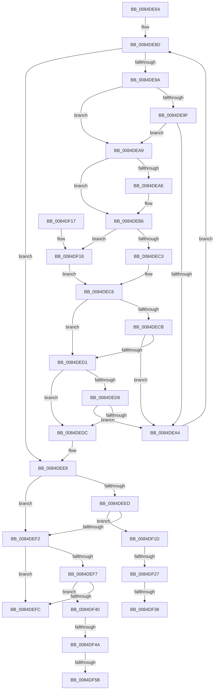

# CmpBlockTwoHiveWrites

- RVA: `0x0084DE64`–`0x0084DF63` (길이 `255` bytes)
- VA: `0x000000014084DE64`
- 실행 섹션: `PAGE`
- PDB 이름 있음: `예`; PDB Function 태그: `예`
- unwind 정보 RVA: `0x00069B38`
- 디코드: `78`개 명령, `255/255` bytes 표시
- 미해석 바이트: `0` (있으면 어셈블리에 `.byte`로 보존)

> 이 문서는 커널 이미지의 기계어와 PDB 기호를 분석해 생성했습니다. 4번과 5번은 함수 원형과 자료형을 바이너리 사용 방식에서 추정한 C 해석이며 원본 소스 복구 결과는 아닙니다.

## 1. Dependencies

- 직접 호출 지점: **6**; 고유 호출 대상: **5**
- 직접 호출자로 확인된 함수: **3**
- RIP 상대 이미지 참조: **0**

### Outgoing calls
- `0x0084DE8D` → [CmpGetNextActiveHive](CmpGetNextActiveHive_function_0084E2A0.md) (function, `0x0084E2A0`)
- `0x0084DEB1` → [CmpReferenceHive](CmpReferenceHive_function_0084FCF0.md) (function, `0x0084FCF0`)
- `0x0084DEB9` → [HvLockHiveFlusherExclusive](../../pagecmrc/BC/HvLockHiveFlusherExclusive_function_00BC9C50.md) (function, `0x00BC9C50`)
- `0x0084DEE3` → [ExReleaseRundownProtection](../../text/34/ExReleaseRundownProtection_function_00349E80.md) (function, `0x00349E80`)
- `0x0084DF2A` → [HvUnlockHiveFlusherExclusive](../../pagecmrc/BC/HvUnlockHiveFlusherExclusive_function_00BC9C34.md) (function, `0x00BC9C34`)
- `0x0084DF4D` → [HvUnlockHiveFlusherExclusive](../../pagecmrc/BC/HvUnlockHiveFlusherExclusive_function_00BC9C34.md) (function, `0x00BC9C34`)

### Direct callers
- [CmSaveMergedKeys](../7D/CmSaveMergedKeys_function_007DE040.md) at `0x007DE1BB`
- [CmpVirtualPathPresent](../7E/CmpVirtualPathPresent_function_007EBDB4.md) at `0x007EBE06`
- [CmpVirtualBranchIsReplicated](CmpVirtualBranchIsReplicated_function_0084A3E0.md) at `0x0084A472`

### Static image references
- 디코드된 RIP-relative 메모리 참조가 없습니다.

## 2. Other-region calls and transfers

- 다른 실행 섹션으로 향하는 call: **4**
  - `0x0084DEB9` → [HvLockHiveFlusherExclusive](../../pagecmrc/BC/HvLockHiveFlusherExclusive_function_00BC9C50.md) (`PAGE` → `PAGECMRC`)
  - `0x0084DEE3` → [ExReleaseRundownProtection](../../text/34/ExReleaseRundownProtection_function_00349E80.md) (`PAGE` → `.text`)
  - `0x0084DF2A` → [HvUnlockHiveFlusherExclusive](../../pagecmrc/BC/HvUnlockHiveFlusherExclusive_function_00BC9C34.md) (`PAGE` → `PAGECMRC`)
  - `0x0084DF4D` → [HvUnlockHiveFlusherExclusive](../../pagecmrc/BC/HvUnlockHiveFlusherExclusive_function_00BC9C34.md) (`PAGE` → `PAGECMRC`)
- call이 아닌 외부 분기/꼬리 이동: **6**
  - `0x0084DF21` → [sub_00B16988 + 0x5](../B1/Unknown_function_00B16988.md) (`tail-transfer`)
  - `0x0084DF32` → [sub_00B16988 + 0x5](../B1/Unknown_function_00B16988.md) (`tail-transfer`)
  - `0x0084DF3B` → [sub_00B16988](../B1/Unknown_function_00B16988.md) (`tail-transfer`)
  - `0x0084DF44` → [sub_00B16988 + 0x5](../B1/Unknown_function_00B16988.md) (`tail-transfer`)
  - `0x0084DF55` → [sub_00B16988 + 0x5](../B1/Unknown_function_00B16988.md) (`tail-transfer`)
  - `0x0084DF5E` → [sub_00B16988](../B1/Unknown_function_00B16988.md) (`tail-transfer`)

## 3. Assembly (complete function range)

```asm
0084DE64  48 89 5C 24 08                  mov qword ptr [rsp + 8], rbx
0084DE69  48 89 6C 24 10                  mov qword ptr [rsp + 0x10], rbp
0084DE6E  48 89 74 24 18                  mov qword ptr [rsp + 0x18], rsi
0084DE73  57                              push rdi
0084DE74  41 56                           push r14
0084DE76  41 57                           push r15
0084DE78  48 83 EC 20                     sub rsp, 0x20
0084DE7C  45 32 F6                        xor r14b, r14b
0084DE7F  40 32 ED                        xor bpl, bpl
0084DE82  48 8B F9                        mov rdi, rcx
0084DE85  45 8A F8                        mov r15b, r8b
0084DE88  33 C9                           xor ecx, ecx
0084DE8A  48 8B F2                        mov rsi, rdx
0084DE8D  E8 0E 04 00 00                  call 0x14084e2a0
0084DE92  48 8B D8                        mov rbx, rax
0084DE95  48 85 C0                        test rax, rax
0084DE98  74 4E                           je 0x14084dee8
0084DE9A  48 3B F8                        cmp rdi, rax
0084DE9D  74 0A                           je 0x14084dea9
0084DE9F  48 3B F0                        cmp rsi, rax
0084DEA2  74 05                           je 0x14084dea9
0084DEA4  48 8B CB                        mov rcx, rbx
0084DEA7  EB E4                           jmp 0x14084de8d
0084DEA9  45 84 FF                        test r15b, r15b
0084DEAC  74 08                           je 0x14084deb6
0084DEAE  48 8B CB                        mov rcx, rbx
0084DEB1  E8 3A 1E 00 00                  call 0x14084fcf0
0084DEB6  48 8B CB                        mov rcx, rbx
0084DEB9  E8 92 BD 37 00                  call 0x140bc9c50
0084DEBE  48 3B FB                        cmp rdi, rbx
0084DEC1  74 55                           je 0x14084df18
0084DEC3  40 B5 01                        mov bpl, 1
0084DEC6  48 85 FF                        test rdi, rdi
0084DEC9  74 06                           je 0x14084ded1
0084DECB  41 80 FE 01                     cmp r14b, 1
0084DECF  75 D3                           jne 0x14084dea4
0084DED1  48 85 F6                        test rsi, rsi
0084DED4  74 06                           je 0x14084dedc
0084DED6  40 80 FD 01                     cmp bpl, 1
0084DEDA  75 C8                           jne 0x14084dea4
0084DEDC  48 8D 8B 68 06 00 00            lea rcx, [rbx + 0x668]
0084DEE3  E8 98 BF AF FF                  call 0x140349e80
0084DEE8  48 85 FF                        test rdi, rdi
0084DEEB  74 05                           je 0x14084def2
0084DEED  45 84 F6                        test r14b, r14b
0084DEF0  74 2B                           je 0x14084df1d
0084DEF2  48 85 F6                        test rsi, rsi
0084DEF5  74 05                           je 0x14084defc
0084DEF7  40 84 ED                        test bpl, bpl
0084DEFA  74 44                           je 0x14084df40
0084DEFC  33 C0                           xor eax, eax
0084DEFE  48 8B 5C 24 40                  mov rbx, qword ptr [rsp + 0x40]
0084DF03  48 8B 6C 24 48                  mov rbp, qword ptr [rsp + 0x48]
0084DF08  48 8B 74 24 50                  mov rsi, qword ptr [rsp + 0x50]
0084DF0D  48 83 C4 20                     add rsp, 0x20
0084DF11  41 5F                           pop r15
0084DF13  41 5E                           pop r14
0084DF15  5F                              pop rdi
0084DF16  C3                              ret
0084DF17  CC                              int3
0084DF18  41 B6 01                        mov r14b, 1
0084DF1B  EB A9                           jmp 0x14084dec6
0084DF1D  40 80 FD 01                     cmp bpl, 1
0084DF21  0F 85 66 8A 2C 00               jne 0x140b1698d
0084DF27  48 8B CE                        mov rcx, rsi
0084DF2A  E8 05 BD 37 00                  call 0x140bc9c34
0084DF2F  45 84 FF                        test r15b, r15b
0084DF32  0F 84 55 8A 2C 00               je 0x140b1698d
0084DF38  48 8B CE                        mov rcx, rsi
0084DF3B  E9 48 8A 2C 00                  jmp 0x140b16988
0084DF40  41 80 FE 01                     cmp r14b, 1
0084DF44  0F 85 43 8A 2C 00               jne 0x140b1698d
0084DF4A  48 8B CF                        mov rcx, rdi
0084DF4D  E8 E2 BC 37 00                  call 0x140bc9c34
0084DF52  45 84 FF                        test r15b, r15b
0084DF55  0F 84 32 8A 2C 00               je 0x140b1698d
0084DF5B  48 8B CF                        mov rcx, rdi
0084DF5E  E9 25 8A 2C 00                  jmp 0x140b16988
```

## 4. C-style interpretation (structured pseudocode)

```c
__int64 __fastcall CmpBlockTwoHiveWrites(__int64 a1, __int64 a2, unsigned __int8 a3)
{
    __int64 result;
    __int64 v_r14;
    __int64 v_rbp;
    __int64 v_rsp;
    unsigned __int64 v_stack_p10;
    unsigned __int64 v_stack_p18;
    unsigned __int64 v_stack_p8;

    v_stack_p8 = v_rbx;
    v_stack_p10 = v_rbp;
    v_stack_p18 = v_rsi;
    v_rsp = (v_rsp) - (32);
    v_r14 = 0;
    v_rbp = 0;
    a1 = 0;
loc_0084DE8D:
    result = CmpGetNextActiveHive(a1, a2, a3, a4);
    if (result == 0) goto loc_0084DEE8;
    if (0 == result) goto loc_0084DEA9;
    if (a2 == result) goto loc_0084DEA9;
loc_0084DEA4:
    goto loc_0084DE8D;
loc_0084DEA9:
    if (a3 != 0) {
        a1 = result;
        result = CmpReferenceHive(a1, a2, a3, a4);
    }
    result = HvLockHiveFlusherExclusive(result, a2, a3, a4);
    if (a1 == result) goto loc_0084DF18;
loc_0084DEC6:
    if (a1 == 0) goto loc_0084DED1;
    if (0 != 1) goto loc_0084DEA4;
loc_0084DED1:
    if (a2 == 0) goto loc_0084DEDC;
    if (1 != 1) goto loc_0084DEA4;
loc_0084DEDC:
    result = ExReleaseRundownProtection(result + 1640, a2, a3, a4);
loc_0084DEE8:
    if (a1 == 0) goto loc_0084DEF2;
    if (0 == 0) goto loc_0084DF1D;
loc_0084DEF2:
    if (a2 == 0) goto loc_0084DEFC;
    if (1 == 0) goto loc_0084DF40;
loc_0084DEFC:
    result = 0;
    v_rsp = (v_rsp) + (32);
    return result;
loc_0084DF18:
    goto loc_0084DEC6;
loc_0084DF1D:
    result = HvUnlockHiveFlusherExclusive(v_stack_p18, a2, a3, a4);
loc_0084DF40:
    result = HvUnlockHiveFlusherExclusive(a1, a2, a3, a4);
}
```

## 5. (Beta) C Style

```c
int64_t CmpBlockTwoHiveWrites(int64_t Arg1, int64_t Arg2, uint8_t Arg3)
{
    int64_t result;
    int64_t local_r14;
    int64_t local_rbp;
    int64_t local_rsp;
    uint64_t v_stack_p10;
    uint64_t v_stack_p18;
    uint64_t v_stack_p8;

    v_stack_p8 = local_rbx;
    v_stack_p10 = local_rbp;
    v_stack_p18 = local_rsi;
    local_rsp = (local_rsp) - (32);
    local_r14 = 0;
    local_rbp = 0;
    Arg1 = 0;
loc_0084DE8D:
    result = CmpGetNextActiveHive(Arg1, Arg2, Arg3, a4);
    if (result == 0) goto loc_0084DEE8;
    if (0 == result) goto loc_0084DEA9;
    if (Arg2 == result) goto loc_0084DEA9;
loc_0084DEA4:
    goto loc_0084DE8D;
loc_0084DEA9:
    if (Arg3 != 0) {
        Arg1 = result;
        result = CmpReferenceHive(Arg1, Arg2, Arg3, a4);
    }
    result = HvLockHiveFlusherExclusive(result, Arg2, Arg3, a4);
    if (Arg1 == result) goto loc_0084DF18;
loc_0084DEC6:
    if (Arg1 == 0) goto loc_0084DED1;
    if (0 != 1) goto loc_0084DEA4;
loc_0084DED1:
    if (Arg2 == 0) goto loc_0084DEDC;
    if (1 != 1) goto loc_0084DEA4;
loc_0084DEDC:
    result = ExReleaseRundownProtection(result + 1640, Arg2, Arg3, a4);
loc_0084DEE8:
    if (Arg1 == 0) goto loc_0084DEF2;
    if (0 == 0) goto loc_0084DF1D;
loc_0084DEF2:
    if (Arg2 == 0) goto loc_0084DEFC;
    if (1 == 0) goto loc_0084DF40;
loc_0084DEFC:
    result = 0;
    local_rsp = (local_rsp) + (32);
    return result;
loc_0084DF18:
    goto loc_0084DEC6;
loc_0084DF1D:
    result = HvUnlockHiveFlusherExclusive(v_stack_p18, Arg2, Arg3, a4);
loc_0084DF40:
    result = HvUnlockHiveFlusherExclusive(Arg1, Arg2, Arg3, a4);
}
```

## 6. Execution-region graph

[열기: 2D/3D 그래프와 함수 탐색 컨트롤 패널](../../../control-panel.html?section=page&rva=0x0084DE64&view=graph)

- 2D 그래프는 위에서 아래로 흐르고, 3D 그래프는 빈 공간을 드래그해 회전합니다. Shift+드래그는 이동, 휠은 확대·축소, 함수 노드 선택은 대상 보고서 이동입니다.

### Static fallback


