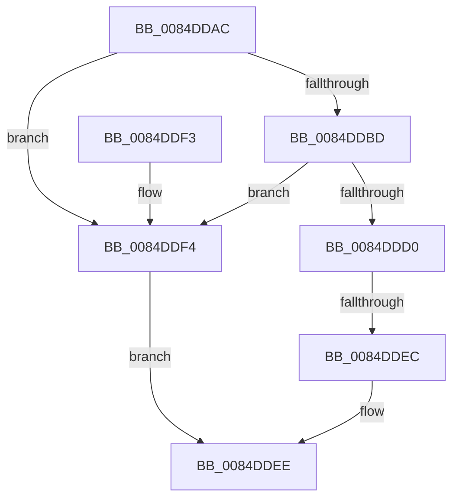

# CmpClaimGlobalQuota

- RVA: `0x0084DDAC`–`0x0084DDF8` (길이 `76` bytes)
- VA: `0x000000014084DDAC`
- 실행 섹션: `PAGE`
- PDB 이름 있음: `예`; PDB Function 태그: `예`
- unwind 정보 RVA: `0x00069B1C`
- 디코드: `19`개 명령, `76/76` bytes 표시
- 미해석 바이트: `0` (있으면 어셈블리에 `.byte`로 보존)

> 이 문서는 커널 이미지의 기계어와 PDB 기호를 분석해 생성했습니다. 4번과 5번은 함수 원형과 자료형을 바이너리 사용 방식에서 추정한 C 해석이며 원본 소스 복구 결과는 아닙니다.

## 1. Dependencies

- 직접 호출 지점: **1**; 고유 호출 대상: **1**
- 직접 호출자로 확인된 함수: **6**
- RIP 상대 이미지 참조: **4**

### Outgoing calls
- `0x0084DDB3` → [CmpUpdateGlobalQuotaAllowed](CmpUpdateGlobalQuotaAllowed_function_0084DE00.md) (function, `0x0084DE00`)

### Direct callers
- [CmpAllocateForNonPagedHive](../../text/4D/CmpAllocateForNonPagedHive_function_004D92F0.md) at `0x004D9307`
- [HvpBuildMapForMemoryBackedHive](../7F/HvpBuildMapForMemoryBackedHive_function_007F3B4C.md) at `0x007F3C73`
- [CmpAllocate](CmpAllocate_function_0084DD40.md) at `0x0084DD57`
- [HvpAllocateNonPagedBin](../9B/HvpAllocateNonPagedBin_function_009B7904.md) at `0x009B7924`
- [HvpMapHiveImageFromViewMap](../9B/HvpMapHiveImageFromViewMap_function_009B97F4.md) at `0x009B980E`
- [HvpAddBin](../AF/HvpAddBin_function_00AF7D48.md) at `0x00AF8095`
- [HvpAddBin](../AF/HvpAddBin_function_00AF7D48.md) at `0x00AF82E5`

### Static image references
- `0x0084DDBD` → RVA `0x00FD81C0` (`PAGEDATA`; read)
- `0x0084DDC4` → RVA `0x00FD9C80` (`PAGEDATA`; read)
- `0x0084DDD0` → RVA `0x00FD9C80` (`PAGEDATA`; read/write)
- `0x0084DDD8` → RVA `0x00FD81C8` (`PAGEDATA`; read)

## 2. Other-region calls and transfers

- 다른 실행 섹션으로 향하는 call: **0**
- call이 아닌 외부 분기/꼬리 이동: **1**
  - `0x0084DDE6` → [sub_00B168E2](../B1/Unknown_function_00B168E2.md) (`tail-transfer`)

## 3. Assembly (complete function range)

```asm
0084DDAC  48 83 EC 28                     sub rsp, 0x28
0084DDB0  44 8B C1                        mov r8d, ecx
0084DDB3  E8 48 00 00 00                  call 0x14084de00
0084DDB8  45 85 C0                        test r8d, r8d
0084DDBB  74 37                           je 0x14084ddf4
0084DDBD  48 8B 15 FC A3 78 00            mov rdx, qword ptr [rip + 0x78a3fc]
0084DDC4  48 2B 15 B5 BE 78 00            sub rdx, qword ptr [rip + 0x78beb5]
0084DDCB  4C 3B C2                        cmp r8, rdx
0084DDCE  7D 24                           jge 0x14084ddf4
0084DDD0  F0 44 01 05 A8 BE 78 00         lock add dword ptr [rip + 0x78bea8], r8d
0084DDD8  48 8B 05 E9 A3 78 00            mov rax, qword ptr [rip + 0x78a3e9]
0084DDDF  48 39 05 9A BE 78 00            cmp qword ptr [rip + 0x78be9a], rax
0084DDE6  0F 87 F6 8A 2C 00               ja 0x140b168e2
0084DDEC  B0 01                           mov al, 1
0084DDEE  48 83 C4 28                     add rsp, 0x28
0084DDF2  C3                              ret
0084DDF3  CC                              int3
0084DDF4  32 C0                           xor al, al
0084DDF6  EB F6                           jmp 0x14084ddee
```

## 4. C-style interpretation (structured pseudocode)

```c
__int64 __fastcall CmpClaimGlobalQuota(int a1)
{
    __int64 result;
    __int64 v_rsp;

    v_rsp = (v_rsp) - (40);
    result = CmpUpdateGlobalQuotaAllowed(a1, a2, (unsigned int)(a1), a4);
    if ((unsigned int)((unsigned int)(a1)) == 0) goto loc_0084DDF4;
    a2 = (*(unsigned __int64 *)(v_rip + 7906300)) - (*(unsigned __int64 *)(v_rip + 7913141));
    if (((unsigned int)(a1)) >= a2) goto loc_0084DDF4;
loc_0084DDEE:
    v_rsp = (v_rsp) + (40);
    return 1;
loc_0084DDF4:
    result = 0;
    goto loc_0084DDEE;
}
```

## 5. (Beta) C Style

```c
int64_t CmpClaimGlobalQuota(int32_t Arg1)
{
    int64_t result;
    int64_t local_rsp;

    local_rsp = (local_rsp) - (40);
    result = CmpUpdateGlobalQuotaAllowed(Arg1, a2, (uint32_t)(Arg1), a4);
    if ((uint32_t)((uint32_t)(Arg1)) == 0) goto loc_0084DDF4;
    a2 = (*(uint64_t *)(v_rip + 0x78A3FC)) - (*(uint64_t *)(v_rip + 0x78BEB5));
    if (((uint32_t)(Arg1)) >= a2) goto loc_0084DDF4;
loc_0084DDEE:
    local_rsp = (local_rsp) + (40);
    return 1;
loc_0084DDF4:
    result = 0;
    goto loc_0084DDEE;
}
```

## 6. Execution-region graph

[열기: 2D/3D 그래프와 함수 탐색 컨트롤 패널](../../../control-panel.html?section=page&rva=0x0084DDAC&view=graph)

- 2D 그래프는 위에서 아래로 흐르고, 3D 그래프는 빈 공간을 드래그해 회전합니다. Shift+드래그는 이동, 휠은 확대·축소, 함수 노드 선택은 대상 보고서 이동입니다.

### Static fallback


