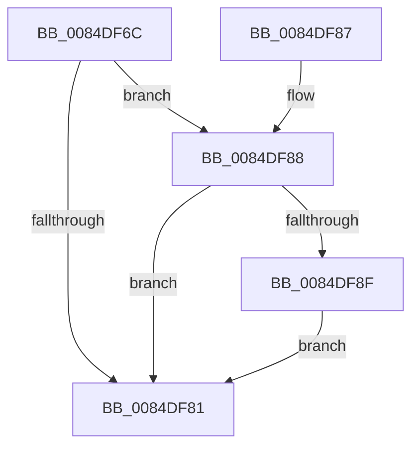

# CmpCleanUpKcbCachedSymlink

- RVA: `0x0084DF6C`–`0x0084DFA8` (길이 `60` bytes)
- VA: `0x000000014084DF6C`
- 실행 섹션: `PAGE`
- PDB 이름 있음: `예`; PDB Function 태그: `아니요`
- unwind 정보 RVA: `0x00069370`
- 디코드: `18`개 명령, `60/60` bytes 표시
- 미해석 바이트: `0` (있으면 어셈블리에 `.byte`로 보존)

> 이 문서는 커널 이미지의 기계어와 PDB 기호를 분석해 생성했습니다. 4번과 5번은 함수 원형과 자료형을 바이너리 사용 방식에서 추정한 C 해석이며 원본 소스 복구 결과는 아닙니다.

## 1. Dependencies

- 직접 호출 지점: **1**; 고유 호출 대상: **1**
- 직접 호출자로 확인된 함수: **6**
- RIP 상대 이미지 참조: **0**

### Outgoing calls
- `0x0084DF93` → [CmpDelayDerefKeyControlBlock](CmpDelayDerefKeyControlBlock_function_0084FA50.md) (function, `0x0084FA50`)

### Direct callers
- [CmRestoreKey](../7D/CmRestoreKey_function_007DCF04.md) at `0x007DD913`
- [CmpRebuildKcbCacheFromNode](CmpRebuildKcbCacheFromNode_function_0084C5A8.md) at `0x0084C5EE`
- [sub_00857E06](../85/Unknown_function_00857E06.md) at `0x00857E40`
- [CmpMarkKeyUnbacked](../9B/CmpMarkKeyUnbacked_function_009B3C4C.md) at `0x009B3C83`
- [CmpLightWeightCommitDeleteValueKeyUoW](../A3/CmpLightWeightCommitDeleteValueKeyUoW_function_00A39E54.md) at `0x00A39F57`
- [CmpLightWeightCommitSetValueKeyUoW](../A3/CmpLightWeightCommitSetValueKeyUoW_function_00A39FA0.md) at `0x00A3A08B`

### Static image references
- 디코드된 RIP-relative 메모리 참조가 없습니다.

## 2. Other-region calls and transfers

- 다른 실행 섹션으로 향하는 call: **0**
- 별도 외부 분기/꼬리 이동을 확인하지 못했습니다.

## 3. Assembly (complete function range)

```asm
0084DF6C  40 53                           push rbx
0084DF6E  48 83 EC 20                     sub rsp, 0x20
0084DF72  F7 81 B8 00 00 00 00 00 40 00   test dword ptr [rcx + 0xb8], 0x400000
0084DF7C  48 8B D9                        mov rbx, rcx
0084DF7F  74 07                           je 0x14084df88
0084DF81  48 83 C4 20                     add rsp, 0x20
0084DF85  5B                              pop rbx
0084DF86  C3                              ret
0084DF87  CC                              int3
0084DF88  8B 41 08                        mov eax, dword ptr [rcx + 8]
0084DF8B  A8 08                           test al, 8
0084DF8D  74 F2                           je 0x14084df81
0084DF8F  48 8B 49 68                     mov rcx, qword ptr [rcx + 0x68]
0084DF93  E8 B8 1A 00 00                  call 0x14084fa50
0084DF98  48 83 63 68 00                  and qword ptr [rbx + 0x68], 0
0084DF9D  B8 F7 FF 00 00                  mov eax, 0xfff7
0084DFA2  66 21 43 08                     and word ptr [rbx + 8], ax
0084DFA6  EB D9                           jmp 0x14084df81
```

## 4. C-style interpretation (structured pseudocode)

```c
__int64 __fastcall CmpCleanUpKcbCachedSymlink(__int64 a1)
{
    __int64 result;
    __int64 v_rsp;

    v_rsp = (v_rsp) - (32);
    if (((*(unsigned int *)(a1 + 184)) & (0x400000ULL)) == 0) goto loc_0084DF88;
loc_0084DF81:
    v_rsp = (v_rsp) + (32);
    return result;
loc_0084DF88:
    if ((((unsigned __int8)((unsigned int)(*(unsigned int *)(a1 + 8)))) & (8)) == 0) goto loc_0084DF81;
    result = CmpDelayDerefKeyControlBlock(*(unsigned __int64 *)(a1 + 104), a2, a3, a4);
    goto loc_0084DF81;
}
```

## 5. (Beta) C Style

```c
int64_t CmpCleanUpKcbCachedSymlink(void *Arg1)
{
    uint8_t *arg1 = (uint8_t *)Arg1;

    int64_t result;
    int64_t local_rsp;

    local_rsp = (local_rsp) - (32);
    if (((*(uint32_t *)(arg1 + 0xB8)) & (0x400000ULL)) == 0) goto loc_0084DF88;
loc_0084DF81:
    local_rsp = (local_rsp) + (32);
    return result;
loc_0084DF88:
    if ((((uint8_t)((uint32_t)(*(uint32_t *)(arg1 + 0x8)))) & (8)) == 0) goto loc_0084DF81;
    result = CmpDelayDerefKeyControlBlock(*(uint64_t *)(arg1 + 0x68), a2, a3, a4);
    goto loc_0084DF81;
}
```

### 관측된 메모리 오프셋

구조체 형식이 확인되지 않은 접근은 인자 기준의 오프셋으로만 기록했습니다.

| 기준 인자 | 오프셋 표현 | 폭 (bit) | 접근 |
|---|---:|---:|---|
| `Arg1` | `+ 0x8` | `16` | `R/W` |
| `Arg1` | `+ 0x8` | `32` | `R` |
| `Arg1` | `+ 0x68` | `64` | `R` |
| `Arg1` | `+ 0x68` | `64` | `R/W` |
| `Arg1` | `+ 0xB8` | `32` | `R` |

## 6. Execution-region graph

[열기: 2D/3D 그래프와 함수 탐색 컨트롤 패널](../../../control-panel.html?section=page&rva=0x0084DF6C&view=graph)

- 2D 그래프는 위에서 아래로 흐르고, 3D 그래프는 빈 공간을 드래그해 회전합니다. Shift+드래그는 이동, 휠은 확대·축소, 함수 노드 선택은 대상 보고서 이동입니다.

### Static fallback


