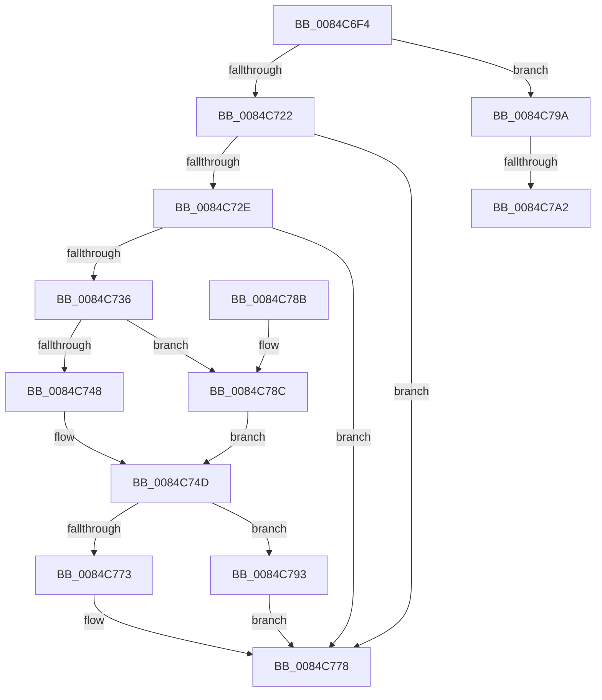

# CmpCleanUpSubKeyInfo

- RVA: `0x0084C6F4`–`0x0084C7B6` (길이 `194` bytes)
- VA: `0x000000014084C6F4`
- 실행 섹션: `PAGE`
- PDB 이름 있음: `예`; PDB Function 태그: `예`
- unwind 정보 RVA: `0x000697C8`
- 디코드: `58`개 명령, `194/194` bytes 표시
- 미해석 바이트: `0` (있으면 어셈블리에 `.byte`로 보존)

> 이 문서는 커널 이미지의 기계어와 PDB 기호를 분석해 생성했습니다. 4번과 5번은 함수 원형과 자료형을 바이너리 사용 방식에서 추정한 C 해석이며 원본 소스 복구 결과는 아닙니다.

## 1. Dependencies

- 직접 호출 지점: **5**; 고유 호출 대상: **5**
- 직접 호출자로 확인된 함수: **10**
- RIP 상대 이미지 참조: **0**

### Outgoing calls
- `0x0084C748` → [HvpGetCellFlat](../85/HvpGetCellFlat_function_00854C60.md) (function, `0x00854C60`)
- `0x0084C773` → [HvpReleaseCellPaged](../85/HvpReleaseCellPaged_function_00855F40.md) (function, `0x00855F40`)
- `0x0084C78C` → [HvpGetCellPaged](../85/HvpGetCellPaged_function_00854CB0.md) (function, `0x00854CB0`)
- `0x0084C793` → [HvpReleaseCellFlat](../85/HvpReleaseCellFlat_function_0085CC20.md) (function, `0x0085CC20`)
- `0x0084C7AB` → [ExFreePoolWithTag](../../poolcode/B8/ExFreePoolWithTag_function_00B82870.md) (function, `0x00B82870`)

### Direct callers
- [CmpCreateTombstone](../../text/66/CmpCreateTombstone_function_0066AF50.md) at `0x0066B1C9`
- [CmRestoreKey](../7D/CmRestoreKey_function_007DCF04.md) at `0x007DD98E`
- [CmRenameKey](../7E/CmRenameKey_function_007E8F48.md) at `0x007E9D54`
- [CmDeleteKey](CmDeleteKey_function_00848E5C.md) at `0x00849264`
- [CmpRebuildKcbCacheFromNode](CmpRebuildKcbCacheFromNode_function_0084C5A8.md) at `0x0084C5D2`
- [CmpCreateChild](../94/CmpCreateChild_function_0094817C.md) at `0x00948780`
- [CmpCompleteUnloadKey](../9B/CmpCompleteUnloadKey_function_009B32FC.md) at `0x009B33FC`
- [CmpLightWeightCommitDeleteKeyUoW](../A5/CmpLightWeightCommitDeleteKeyUoW_function_00A54610.md) at `0x00A54693`
- [CmpInvalidateSubtreeWorker](../AA/CmpInvalidateSubtreeWorker_function_00AA3970.md) at `0x00AA39A5`
- [sub_00B16440](../B1/Unknown_function_00B16440.md) at `0x00B1655A`

### Static image references
- 디코드된 RIP-relative 메모리 참조가 없습니다.

## 2. Other-region calls and transfers

- 다른 실행 섹션으로 향하는 call: **1**
  - `0x0084C7AB` → [ExFreePoolWithTag](../../poolcode/B8/ExFreePoolWithTag_function_00B82870.md) (`PAGE` → `POOLCODE`)
- call이 아닌 외부 분기/꼬리 이동: **2**
  - `0x0084C79C` → [sub_00B1688C](../B1/Unknown_function_00B1688C.md) (`tail-transfer`)
  - `0x0084C7B1` → [sub_00B1688C](../B1/Unknown_function_00B1688C.md) (`tail-transfer`)

## 3. Assembly (complete function range)

```asm
0084C6F4  48 8B C4                        mov rax, rsp
0084C6F7  48 89 58 10                     mov qword ptr [rax + 0x10], rbx
0084C6FB  48 89 68 18                     mov qword ptr [rax + 0x18], rbp
0084C6FF  56                              push rsi
0084C700  57                              push rdi
0084C701  41 57                           push r15
0084C703  48 83 EC 20                     sub rsp, 0x20
0084C707  83 48 08 FF                     or dword ptr [rax + 8], 0xffffffff
0084C70B  48 8D 79 08                     lea rdi, [rcx + 8]
0084C70F  45 33 FF                        xor r15d, r15d
0084C712  40 8A EA                        mov bpl, dl
0084C715  44 89 78 0C                     mov dword ptr [rax + 0xc], r15d
0084C719  48 8B D9                        mov rbx, rcx
0084C71C  8B 07                           mov eax, dword ptr [rdi]
0084C71E  A8 07                           test al, 7
0084C720  75 78                           jne 0x14084c79a
0084C722  48 8B F7                        mov rsi, rdi
0084C725  66 83 0F 40                     or word ptr [rdi], 0x40
0084C729  40 84 ED                        test bpl, bpl
0084C72C  74 4A                           je 0x14084c778
0084C72E  8B 53 28                        mov edx, dword ptr [rbx + 0x28]
0084C731  83 FA FF                        cmp edx, -1
0084C734  74 42                           je 0x14084c778
0084C736  48 8B 4B 20                     mov rcx, qword ptr [rbx + 0x20]
0084C73A  4C 8D 44 24 40                  lea r8, [rsp + 0x40]
0084C73F  F6 81 8C 00 00 00 01            test byte ptr [rcx + 0x8c], 1
0084C746  74 44                           je 0x14084c78c
0084C748  E8 13 85 00 00                  call 0x140854c60
0084C74D  48 8B C8                        mov rcx, rax
0084C750  48 8D 54 24 40                  lea rdx, [rsp + 0x40]
0084C755  B8 BF FF 00 00                  mov eax, 0xffbf
0084C75A  66 21 06                        and word ptr [rsi], ax
0084C75D  8B 41 18                        mov eax, dword ptr [rcx + 0x18]
0084C760  03 41 14                        add eax, dword ptr [rcx + 0x14]
0084C763  48 8B 4B 20                     mov rcx, qword ptr [rbx + 0x20]
0084C767  89 43 70                        mov dword ptr [rbx + 0x70], eax
0084C76A  F6 81 8C 00 00 00 01            test byte ptr [rcx + 0x8c], 1
0084C771  75 20                           jne 0x14084c793
0084C773  E8 C8 97 00 00                  call 0x140855f40
0084C778  48 8B 5C 24 48                  mov rbx, qword ptr [rsp + 0x48]
0084C77D  48 8B 6C 24 50                  mov rbp, qword ptr [rsp + 0x50]
0084C782  48 83 C4 20                     add rsp, 0x20
0084C786  41 5F                           pop r15
0084C788  5F                              pop rdi
0084C789  5E                              pop rsi
0084C78A  C3                              ret
0084C78B  CC                              int3
0084C78C  E8 1F 85 00 00                  call 0x140854cb0
0084C791  EB BA                           jmp 0x14084c74d
0084C793  E8 88 04 01 00                  call 0x14085cc20
0084C798  EB DE                           jmp 0x14084c778
0084C79A  A8 04                           test al, 4
0084C79C  0F 84 EA A0 2C 00               je 0x140b1688c
0084C7A2  48 8B 49 70                     mov rcx, qword ptr [rcx + 0x70]
0084C7A6  BA 43 4D 49 6E                  mov edx, 0x6e494d43
0084C7AB  E8 C0 60 33 00                  call 0x140b82870
0084C7B0  90                              nop
0084C7B1  E9 D6 A0 2C 00                  jmp 0x140b1688c
```

## 4. C-style interpretation (structured pseudocode)

```c
__int64 __fastcall CmpCleanUpSubKeyInfo(__int64 a1, unsigned __int8 a2)
{
    __int64 result;
    __int64 v_r15;
    __int64 v_rsp;
    unsigned __int64 v_stack_p10;
    unsigned __int64 v_stack_p18;
    unsigned __int64 v_stack_p8;

    *(unsigned __int64 *)(v_rsp + 16) = v_rbx;
    *(unsigned __int64 *)(v_rsp + 24) = v_rbp;
    v_rsp = (v_rsp) - (32);
    v_r15 = 0;
    *(unsigned int *)(v_rsp + 12) = 0;
    if ((((unsigned __int8)((unsigned int)(*(unsigned int *)(a1 + 8)))) & (7)) != 0) goto loc_0084C79A;
    if (a2 == 0) goto loc_0084C778;
    if (((unsigned int)((unsigned int)(*(unsigned int *)(a1 + 40)))) == -1) goto loc_0084C778;
    if (((*(unsigned __int8 *)(*(unsigned __int64 *)(a1 + 32) + 140)) & (1)) == 0) goto loc_0084C78C;
    result = HvpGetCellFlat(*(unsigned __int64 *)(a1 + 32), (unsigned int)(*(unsigned int *)(a1 + 40)), v_stack_p8, a4);
loc_0084C74D:
    result = (unsigned int)(((unsigned int)(*(unsigned int *)(result + 24))) + (*(unsigned int *)(result + 20)));
    *(unsigned int *)(a1 + 112) = (unsigned int)(result);
    if (((*(unsigned __int8 *)(*(unsigned __int64 *)(a1 + 32) + 140)) & (1)) != 0) goto loc_0084C793;
    result = HvpReleaseCellPaged(*(unsigned __int64 *)(a1 + 32), v_stack_p8, v_stack_p8, a4);
loc_0084C778:
    v_rsp = (v_rsp) + (32);
    return result;
loc_0084C78C:
    result = HvpGetCellPaged(*(unsigned __int64 *)(a1 + 32), v_stack_p8, v_stack_p8, a4);
    goto loc_0084C74D;
loc_0084C793:
    result = HvpReleaseCellFlat(*(unsigned __int64 *)(a1 + 32), v_stack_p8, v_stack_p8, a4);
    goto loc_0084C778;
loc_0084C79A:
    result = ExFreePoolWithTag(*(unsigned __int64 *)(*(unsigned __int64 *)(a1 + 32) + 112), (unsigned int)(0x6E494D43ULL), v_stack_p8, a4);
}
```

## 5. (Beta) C Style

```c
int64_t CmpCleanUpSubKeyInfo(void *Arg1, uint8_t Arg2)
{
    uint8_t *arg1 = (uint8_t *)Arg1;

    int64_t result;
    int64_t local_r15;
    int64_t local_rsp;
    uint64_t v_stack_p10;
    uint64_t v_stack_p18;
    uint64_t v_stack_p8;

    *(uint64_t *)(local_rsp + 0x10) = local_rbx;
    *(uint64_t *)(local_rsp + 0x18) = local_rbp;
    local_rsp = (local_rsp) - (32);
    local_r15 = 0;
    *(uint32_t *)(local_rsp + 0xC) = 0;
    if ((((uint8_t)((uint32_t)(*(uint32_t *)(arg1 + 0x8)))) & (7)) != 0) goto loc_0084C79A;
    if (Arg2 == 0) goto loc_0084C778;
    if (((uint32_t)((uint32_t)(*(uint32_t *)(arg1 + 0x28)))) == -1) goto loc_0084C778;
    if (((*(uint8_t *)(*(uint64_t *)(arg1 + 0x20) + 0x8C)) & (1)) == 0) goto loc_0084C78C;
    result = HvpGetCellFlat(*(uint64_t *)(arg1 + 0x20), (uint32_t)(*(uint32_t *)(arg1 + 0x28)), v_stack_p8, a4);
loc_0084C74D:
    result = (uint32_t)(((uint32_t)(*(uint32_t *)(result + 0x18))) + (*(uint32_t *)(result + 0x14)));
    *(uint32_t *)(arg1 + 0x70) = (uint32_t)(result);
    if (((*(uint8_t *)(*(uint64_t *)(arg1 + 0x20) + 0x8C)) & (1)) != 0) goto loc_0084C793;
    result = HvpReleaseCellPaged(*(uint64_t *)(arg1 + 0x20), v_stack_p8, v_stack_p8, a4);
loc_0084C778:
    local_rsp = (local_rsp) + (32);
    return result;
loc_0084C78C:
    result = HvpGetCellPaged(*(uint64_t *)(arg1 + 0x20), v_stack_p8, v_stack_p8, a4);
    goto loc_0084C74D;
loc_0084C793:
    result = HvpReleaseCellFlat(*(uint64_t *)(arg1 + 0x20), v_stack_p8, v_stack_p8, a4);
    goto loc_0084C778;
loc_0084C79A:
    result = ExFreePoolWithTag(*(uint64_t *)(*(uint64_t *)(arg1 + 0x20) + 0x70), (uint32_t)(0x6E494D43ULL), v_stack_p8, a4);
}
```

### 관측된 메모리 오프셋

구조체 형식이 확인되지 않은 접근은 인자 기준의 오프셋으로만 기록했습니다.

| 기준 인자 | 오프셋 표현 | 폭 (bit) | 접근 |
|---|---:|---:|---|
| `Arg1` | `+ 0x0` | `16` | `R/W` |
| `Arg1` | `+ 0x0` | `32` | `R` |
| `Arg1` | `+ 0x8` | `64` | `R` |
| `Arg1` | `+ 0x20` | `64` | `R` |
| `Arg1` | `+ 0x28` | `32` | `R` |
| `Arg1` | `+ 0x70` | `32` | `W` |
| `Arg1` | `+ 0x70` | `64` | `R` |

## 6. Execution-region graph

[열기: 2D/3D 그래프와 함수 탐색 컨트롤 패널](../../../control-panel.html?section=page&rva=0x0084C6F4&view=graph)

- 2D 그래프는 위에서 아래로 흐르고, 3D 그래프는 빈 공간을 드래그해 회전합니다. Shift+드래그는 이동, 휠은 확대·축소, 함수 노드 선택은 대상 보고서 이동입니다.

### Static fallback


