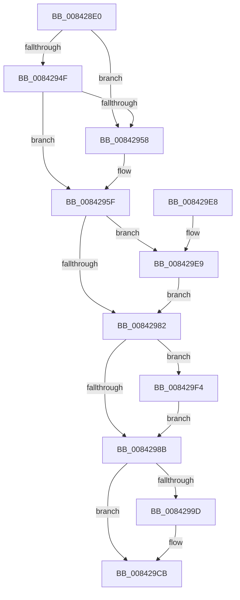

# CmpCleanupTransactionState

- RVA: `0x008428E0`–`0x008429FB` (길이 `283` bytes)
- VA: `0x00000001408428E0`
- 실행 섹션: `PAGE`
- PDB 이름 있음: `예`; PDB Function 태그: `아니요`
- unwind 정보 RVA: `0x00068FA4`
- 디코드: `75`개 명령, `283/283` bytes 표시
- 미해석 바이트: `0` (있으면 어셈블리에 `.byte`로 보존)

> 이 문서는 커널 이미지의 기계어와 PDB 기호를 분석해 생성했습니다. 4번과 5번은 함수 원형과 자료형을 바이너리 사용 방식에서 추정한 C 해석이며 원본 소스 복구 결과는 아닙니다.

## 1. Dependencies

- 직접 호출 지점: **18**; 고유 호출 대상: **16**
- 직접 호출자로 확인된 함수: **4**
- RIP 상대 이미지 참조: **2**

### Outgoing calls
- `0x0084291E` → [CmpAttachToRegistryProcess](../../pagecmrc/BC/CmpAttachToRegistryProcess_function_00BC98E0.md) (function, `0x00BC98E0`)
- `0x00842923` → [CmpLockRegistryExclusive](CmpLockRegistryExclusive_function_0084F9B4.md) (function, `0x0084F9B4`)
- `0x0084292D` → [CmpTransMgrFreeVolatileData](../87/CmpTransMgrFreeVolatileData_function_00874BDC.md) (function, `0x00874BDC`)
- `0x00842932` → [CmpUnlockRegistry](../../pagecmrc/BC/CmpUnlockRegistry_function_00BC9A84.md) (function, `0x00BC9A84`)
- `0x0084293C` → [CmpDetachFromRegistryProcess](../../pagecmrc/BC/CmpDetachFromRegistryProcess_function_00BC9920.md) (function, `0x00BC9920`)
- `0x00842941` → [LOCK_TRANSACTION_LIST](../87/LOCK_TRANSACTION_LIST_function_00874AD4.md) (function, `0x00874AD4`)
- `0x0084296D` → [ExReleaseFastMutexUnsafe](../../text/25/ExReleaseFastMutexUnsafe_function_002503A0.md) (function, `0x002503A0`)
- `0x00842972` → [KeLeaveCriticalRegion](../../text/25/KeLeaveCriticalRegion_function_0025D8B0.md) (function, `0x0025D8B0`)
- `0x00842993` → [ExFreePoolWithTag](../../poolcode/B8/ExFreePoolWithTag_function_00B82870.md) (function, `0x00B82870`)
- `0x0084299D` → [CmpLockRegistry](../../pagecmrc/BC/CmpLockRegistry_function_00BC9B34.md) (function, `0x00BC9B34`)
- `0x008429A5` → [LockRMLog](LockRMLog_function_00842B88.md) (function, `0x00842B88`)
- `0x008429B0` → [CmpLogCheckpoint](CmpLogCheckpoint_function_00842F04.md) (function, `0x00842F04`)
- `0x008429BC` → [ExReleaseResourceLite](../../text/25/ExReleaseResourceLite_function_0025FA10.md) (function, `0x0025FA10`)
- `0x008429C1` → [KeLeaveCriticalRegion](../../text/25/KeLeaveCriticalRegion_function_0025D8B0.md) (function, `0x0025D8B0`)
- `0x008429C6` → [CmpUnlockRegistry](../../pagecmrc/BC/CmpUnlockRegistry_function_00BC9A84.md) (function, `0x00BC9A84`)
- `0x008429D3` → [_security_check_cookie](../../text/6A/_security_check_cookie_function_006AC640.md) (function, `0x006AC640`)
- `0x008429ED` → [CmpTransDereferenceTransaction](../87/CmpTransDereferenceTransaction_function_00873608.md) (function, `0x00873608`)
- `0x008429F4` → [ObDereferenceObjectDeferDelete](../../text/3F/ObDereferenceObjectDeferDelete_function_003FCE40.md) (function, `0x003FCE40`)

### Direct callers
- [CmObliterateRMTxArray](../7E/CmObliterateRMTxArray_function_007EDF3C.md) at `0x007EE009`
- [CmpLazyCommitWorker](../7E/CmpLazyCommitWorker_function_007EE030.md) at `0x007EE0EE`
- [CmpRunDownCmRM](../9B/CmpRunDownCmRM_function_009B062C.md) at `0x009B079C`
- [CmKtmNotification](../9B/CmKtmNotification_function_009B1950.md) at `0x009B1BF8`

### Static image references
- `0x008428EC` → RVA `0x00E0A740` (`.data`; read)
- `0x00842966` → RVA `0x00EF5820` (`.data`; read)

## 2. Other-region calls and transfers

- 다른 실행 섹션으로 향하는 call: **12**
  - `0x0084291E` → [CmpAttachToRegistryProcess](../../pagecmrc/BC/CmpAttachToRegistryProcess_function_00BC98E0.md) (`PAGE` → `PAGECMRC`)
  - `0x00842932` → [CmpUnlockRegistry](../../pagecmrc/BC/CmpUnlockRegistry_function_00BC9A84.md) (`PAGE` → `PAGECMRC`)
  - `0x0084293C` → [CmpDetachFromRegistryProcess](../../pagecmrc/BC/CmpDetachFromRegistryProcess_function_00BC9920.md) (`PAGE` → `PAGECMRC`)
  - `0x0084296D` → [ExReleaseFastMutexUnsafe](../../text/25/ExReleaseFastMutexUnsafe_function_002503A0.md) (`PAGE` → `.text`)
  - `0x00842972` → [KeLeaveCriticalRegion](../../text/25/KeLeaveCriticalRegion_function_0025D8B0.md) (`PAGE` → `.text`)
  - `0x00842993` → [ExFreePoolWithTag](../../poolcode/B8/ExFreePoolWithTag_function_00B82870.md) (`PAGE` → `POOLCODE`)
  - `0x0084299D` → [CmpLockRegistry](../../pagecmrc/BC/CmpLockRegistry_function_00BC9B34.md) (`PAGE` → `PAGECMRC`)
  - `0x008429BC` → [ExReleaseResourceLite](../../text/25/ExReleaseResourceLite_function_0025FA10.md) (`PAGE` → `.text`)
  - `0x008429C1` → [KeLeaveCriticalRegion](../../text/25/KeLeaveCriticalRegion_function_0025D8B0.md) (`PAGE` → `.text`)
  - `0x008429C6` → [CmpUnlockRegistry](../../pagecmrc/BC/CmpUnlockRegistry_function_00BC9A84.md) (`PAGE` → `PAGECMRC`)
  - `0x008429D3` → [_security_check_cookie](../../text/6A/_security_check_cookie_function_006AC640.md) (`PAGE` → `.text`)
  - `0x008429F4` → [ObDereferenceObjectDeferDelete](../../text/3F/ObDereferenceObjectDeferDelete_function_003FCE40.md) (`PAGE` → `.text`)
- 별도 외부 분기/꼬리 이동을 확인하지 못했습니다.

## 3. Assembly (complete function range)

```asm
008428E0  48 89 5C 24 18                  mov qword ptr [rsp + 0x18], rbx
008428E5  55                              push rbp
008428E6  56                              push rsi
008428E7  57                              push rdi
008428E8  48 83 EC 60                     sub rsp, 0x60
008428EC  48 8B 05 4D 7E 5C 00            mov rax, qword ptr [rip + 0x5c7e4d]
008428F3  48 33 C4                        xor rax, rsp
008428F6  48 89 44 24 50                  mov qword ptr [rsp + 0x50], rax
008428FB  0F 57 C0                        xorps xmm0, xmm0
008428FE  48 8B F1                        mov rsi, rcx
00842901  48 8D 4C 24 20                  lea rcx, [rsp + 0x20]
00842906  41 8A E9                        mov bpl, r9b
00842909  0F 11 44 24 20                  movups xmmword ptr [rsp + 0x20], xmm0
0084290E  41 8B D8                        mov ebx, r8d
00842911  48 8B FA                        mov rdi, rdx
00842914  0F 11 44 24 30                  movups xmmword ptr [rsp + 0x30], xmm0
00842919  0F 11 44 24 40                  movups xmmword ptr [rsp + 0x40], xmm0
0084291E  E8 BD 6F 38 00                  call 0x140bc98e0
00842923  E8 8C D0 00 00                  call 0x14084f9b4
00842928  8B D3                           mov edx, ebx
0084292A  48 8B CF                        mov rcx, rdi
0084292D  E8 AA 22 03 00                  call 0x140874bdc
00842932  E8 4D 71 38 00                  call 0x140bc9a84
00842937  48 8D 4C 24 20                  lea rcx, [rsp + 0x20]
0084293C  E8 DF 6F 38 00                  call 0x140bc9920
00842941  E8 8E 21 03 00                  call 0x140874ad4
00842946  48 8B 0F                        mov rcx, qword ptr [rdi]
00842949  48 39 79 08                     cmp qword ptr [rcx + 8], rdi
0084294D  75 09                           jne 0x140842958
0084294F  48 8B 47 08                     mov rax, qword ptr [rdi + 8]
00842953  48 39 38                        cmp qword ptr [rax], rdi
00842956  74 07                           je 0x14084295f
00842958  B9 03 00 00 00                  mov ecx, 3
0084295D  CD 29                           int 0x29
0084295F  48 89 08                        mov qword ptr [rax], rcx
00842962  48 89 41 08                     mov qword ptr [rcx + 8], rax
00842966  48 8D 0D B3 2E 6B 00            lea rcx, [rip + 0x6b2eb3]
0084296D  E8 2E DA A0 FF                  call 0x1402503a0
00842972  E8 39 AF A1 FF                  call 0x14025d8b0
00842977  83 4F 30 10                     or dword ptr [rdi + 0x30], 0x10
0084297B  48 83 7F 38 00                  cmp qword ptr [rdi + 0x38], 0
00842980  75 67                           jne 0x1408429e9
00842982  48 8B 4F 48                     mov rcx, qword ptr [rdi + 0x48]
00842986  48 85 C9                        test rcx, rcx
00842989  75 69                           jne 0x1408429f4
0084298B  BA 43 4D 54 72                  mov edx, 0x72544d43
00842990  48 8B CF                        mov rcx, rdi
00842993  E8 D8 FE 33 00                  call 0x140b82870
00842998  40 84 ED                        test bpl, bpl
0084299B  74 2E                           je 0x1408429cb
0084299D  E8 92 71 38 00                  call 0x140bc9b34
008429A2  48 8B CE                        mov rcx, rsi
008429A5  E8 DE 01 00 00                  call 0x140842b88
008429AA  41 B0 01                        mov r8b, 1
008429AD  48 8B CE                        mov rcx, rsi
008429B0  E8 4F 05 00 00                  call 0x140842f04
008429B5  48 8B 8E 80 00 00 00            mov rcx, qword ptr [rsi + 0x80]
008429BC  E8 4F D0 A1 FF                  call 0x14025fa10
008429C1  E8 EA AE A1 FF                  call 0x14025d8b0
008429C6  E8 B9 70 38 00                  call 0x140bc9a84
008429CB  48 8B 4C 24 50                  mov rcx, qword ptr [rsp + 0x50]
008429D0  48 33 CC                        xor rcx, rsp
008429D3  E8 68 9C E6 FF                  call 0x1406ac640
008429D8  48 8B 9C 24 90 00 00 00         mov rbx, qword ptr [rsp + 0x90]
008429E0  48 83 C4 60                     add rsp, 0x60
008429E4  5F                              pop rdi
008429E5  5E                              pop rsi
008429E6  5D                              pop rbp
008429E7  C3                              ret
008429E8  CC                              int3
008429E9  48 8B 4F 38                     mov rcx, qword ptr [rdi + 0x38]
008429ED  E8 16 0C 03 00                  call 0x140873608
008429F2  EB 8E                           jmp 0x140842982
008429F4  E8 47 A4 BB FF                  call 0x1403fce40
008429F9  EB 90                           jmp 0x14084298b
```

## 4. C-style interpretation (structured pseudocode)

```c
__int64 __fastcall CmpCleanupTransactionState(__int64 a1, __int64 a2, int a3, unsigned __int8 a4)
{
    __int64 result;
    __int64 v_rsp;
    unsigned __int64 v_stack_m28;
    unsigned __int64 v_stack_m38;
    unsigned __int64 v_stack_m48;
    unsigned __int64 v_stack_m58;
    unsigned __int64 v_stack_p18;

    v_stack_p18 = v_rbx;
    v_rsp = (v_rsp) - (96);
    result = (*(unsigned __int64 *)(v_rip + 6061645)) ^ (v_rsp);
    v_stack_m28 = result;
    v_stack_m58 = v_xmm0;
    v_stack_m48 = v_xmm0;
    v_stack_m38 = v_xmm0;
    result = CmpAttachToRegistryProcess(v_stack_m58, a2, a3, a4);
    result = CmpLockRegistryExclusive(v_stack_m58, a2, a3, a4);
    result = CmpTransMgrFreeVolatileData(a2, (unsigned int)((unsigned int)((unsigned int)(a3))), a3, a4);
    result = CmpUnlockRegistry(a2, (unsigned int)((unsigned int)((unsigned int)(a3))), a3, a4);
    result = CmpDetachFromRegistryProcess(v_stack_m58, (unsigned int)((unsigned int)((unsigned int)(a3))), a3, a4);
    result = LOCK_TRANSACTION_LIST(v_stack_m58, (unsigned int)((unsigned int)((unsigned int)(a3))), a3, a4);
    if ((*(unsigned __int64 *)(*(unsigned __int64 *)(a2) + 8)) != a2) goto loc_00842958;
    if ((*(unsigned __int64 *)(*(unsigned __int64 *)(a2 + 8))) != a2) {
        a1 = 3;
    }
    *(unsigned __int64 *)(*(unsigned __int64 *)(a2 + 8)) = a1;
    *(unsigned __int64 *)(a1 + 8) = *(unsigned __int64 *)(a2 + 8);
    result = ExReleaseFastMutexUnsafe(v_rip + 7024307, (unsigned int)((unsigned int)((unsigned int)(a3))), a3, a4);
    result = KeLeaveCriticalRegion(v_rip + 7024307, (unsigned int)((unsigned int)((unsigned int)(a3))), a3, a4);
    if ((*(unsigned __int64 *)(a2 + 56)) != 0) goto loc_008429E9;
loc_00842982:
    if (*(unsigned __int64 *)(a2 + 72) != 0) goto loc_008429F4;
loc_0084298B:
    result = ExFreePoolWithTag(a2, (unsigned int)(0x72544D43ULL), a3, a4);
    if (a4 != 0) {
        result = CmpLockRegistry(a2, (unsigned int)(0x72544D43ULL), a3, a4);
        a1 = a1;
        result = LockRMLog(a1, (unsigned int)(0x72544D43ULL), a3, a4);
        a3 = 1;
        a1 = a1;
        result = CmpLogCheckpoint(a1, (unsigned int)(0x72544D43ULL), a3, a4);
        a1 = *(unsigned __int64 *)(a1 + 128);
        result = ExReleaseResourceLite(a1, (unsigned int)(0x72544D43ULL), a3, a4);
        result = KeLeaveCriticalRegion(a1, (unsigned int)(0x72544D43ULL), a3, a4);
        result = CmpUnlockRegistry(a1, (unsigned int)(0x72544D43ULL), a3, a4);
    }
    a1 = (v_stack_m28) ^ (v_rsp);
    result = _security_check_cookie(a1, (unsigned int)(0x72544D43ULL), a3, a4);
    v_rsp = (v_rsp) + (96);
    return result;
loc_008429E9:
    result = CmpTransDereferenceTransaction(*(unsigned __int64 *)(a2 + 56), (unsigned int)(0x72544D43ULL), a3, a4);
    goto loc_00842982;
loc_008429F4:
    result = ObDereferenceObjectDeferDelete(*(unsigned __int64 *)(a2 + 56), (unsigned int)(0x72544D43ULL), a3, a4);
    goto loc_0084298B;
}
```

## 5. (Beta) C Style

```c
int64_t CmpCleanupTransactionState(void *Arg1, void *Arg2, int32_t Arg3, uint8_t Arg4)
{
    uint8_t *arg1 = (uint8_t *)Arg1;
    uint8_t *arg2 = (uint8_t *)Arg2;

    int64_t result;
    int64_t local_rsp;
    uint64_t v_stack_m28;
    uint64_t v_stack_m38;
    uint64_t v_stack_m48;
    uint64_t v_stack_m58;
    uint64_t v_stack_p18;

    v_stack_p18 = local_rbx;
    local_rsp = (local_rsp) - (96);
    result = (*(uint64_t *)(v_rip + 0x5C7E4D)) ^ (local_rsp);
    v_stack_m28 = result;
    v_stack_m58 = v_xmm0;
    v_stack_m48 = v_xmm0;
    v_stack_m38 = v_xmm0;
    result = CmpAttachToRegistryProcess(v_stack_m58, Arg2, Arg3, Arg4);
    result = CmpLockRegistryExclusive(v_stack_m58, Arg2, Arg3, Arg4);
    result = CmpTransMgrFreeVolatileData(Arg2, (uint32_t)((uint32_t)((uint32_t)(Arg3))), Arg3, Arg4);
    result = CmpUnlockRegistry(Arg2, (uint32_t)((uint32_t)((uint32_t)(Arg3))), Arg3, Arg4);
    result = CmpDetachFromRegistryProcess(v_stack_m58, (uint32_t)((uint32_t)((uint32_t)(Arg3))), Arg3, Arg4);
    result = LOCK_TRANSACTION_LIST(v_stack_m58, (uint32_t)((uint32_t)((uint32_t)(Arg3))), Arg3, Arg4);
    if ((*(uint64_t *)(*(uint64_t *)(arg2) + 0x8)) != Arg2) goto loc_00842958;
    if ((*(uint64_t *)(*(uint64_t *)(arg2 + 0x8))) != Arg2) {
        Arg1 = 3;
    }
    *(void **)(*(uint64_t *)(arg2 + 0x8)) = Arg1;
    *(uint64_t *)(arg1 + 0x8) = *(uint64_t *)(arg2 + 0x8);
    result = ExReleaseFastMutexUnsafe(v_rip + 7024307, (uint32_t)((uint32_t)((uint32_t)(Arg3))), Arg3, Arg4);
    result = KeLeaveCriticalRegion(v_rip + 7024307, (uint32_t)((uint32_t)((uint32_t)(Arg3))), Arg3, Arg4);
    if ((*(uint64_t *)(arg2 + 0x38)) != 0) goto loc_008429E9;
loc_00842982:
    if (*(uint64_t *)(arg2 + 0x48) != 0) goto loc_008429F4;
loc_0084298B:
    result = ExFreePoolWithTag(Arg2, (uint32_t)(0x72544D43ULL), Arg3, Arg4);
    if (Arg4 != 0) {
        result = CmpLockRegistry(Arg2, (uint32_t)(0x72544D43ULL), Arg3, Arg4);
        Arg1 = Arg1;
        result = LockRMLog(Arg1, (uint32_t)(0x72544D43ULL), Arg3, Arg4);
        Arg3 = 1;
        Arg1 = Arg1;
        result = CmpLogCheckpoint(Arg1, (uint32_t)(0x72544D43ULL), Arg3, Arg4);
        Arg1 = *(uint64_t *)(arg1 + 0x80);
        result = ExReleaseResourceLite(Arg1, (uint32_t)(0x72544D43ULL), Arg3, Arg4);
        result = KeLeaveCriticalRegion(Arg1, (uint32_t)(0x72544D43ULL), Arg3, Arg4);
        result = CmpUnlockRegistry(Arg1, (uint32_t)(0x72544D43ULL), Arg3, Arg4);
    }
    Arg1 = (v_stack_m28) ^ (local_rsp);
    result = _security_check_cookie(Arg1, (uint32_t)(0x72544D43ULL), Arg3, Arg4);
    local_rsp = (local_rsp) + (96);
    return result;
loc_008429E9:
    result = CmpTransDereferenceTransaction(*(uint64_t *)(arg2 + 0x38), (uint32_t)(0x72544D43ULL), Arg3, Arg4);
    goto loc_00842982;
loc_008429F4:
    result = ObDereferenceObjectDeferDelete(*(uint64_t *)(arg2 + 0x38), (uint32_t)(0x72544D43ULL), Arg3, Arg4);
    goto loc_0084298B;
}
```

### 관측된 메모리 오프셋

구조체 형식이 확인되지 않은 접근은 인자 기준의 오프셋으로만 기록했습니다.

| 기준 인자 | 오프셋 표현 | 폭 (bit) | 접근 |
|---|---:|---:|---|
| `Arg1` | `+ 0x80` | `64` | `R` |
| `Arg2` | `+ 0x0` | `64` | `R` |
| `Arg2` | `+ 0x8` | `64` | `R` |
| `Arg2` | `+ 0x30` | `32` | `R/W` |
| `Arg2` | `+ 0x38` | `64` | `R` |
| `Arg2` | `+ 0x48` | `64` | `R` |

## 6. Execution-region graph

[열기: 2D/3D 그래프와 함수 탐색 컨트롤 패널](../../../control-panel.html?section=page&rva=0x008428E0&view=graph)

- 2D 그래프는 위에서 아래로 흐르고, 3D 그래프는 빈 공간을 드래그해 회전합니다. Shift+드래그는 이동, 휠은 확대·축소, 함수 노드 선택은 대상 보고서 이동입니다.

### Static fallback


