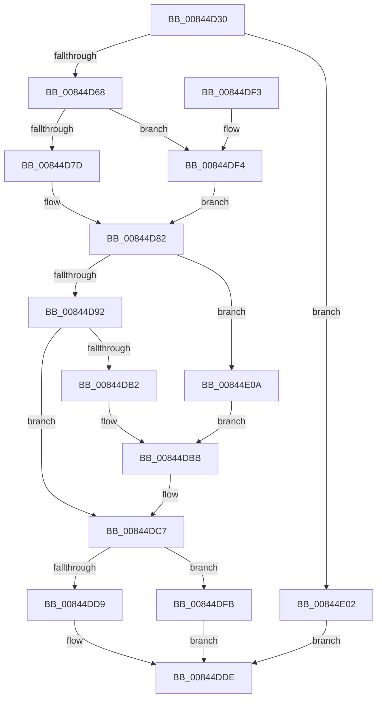

# CmpCloneKCBValueListForTrans

- RVA: `0x00844D30`–`0x00844E16` (길이 `230` bytes)
- VA: `0x0000000140844D30`
- 실행 섹션: `PAGE`
- PDB 이름 있음: `예`; PDB Function 태그: `아니요`
- unwind 정보 RVA: `0x000691B4`
- 디코드: `63`개 명령, `230/230` bytes 표시
- 미해석 바이트: `0` (있으면 어셈블리에 `.byte`로 보존)

> 이 문서는 커널 이미지의 기계어와 PDB 기호를 분석해 생성했습니다. 4번과 5번은 함수 원형과 자료형을 바이너리 사용 방식에서 추정한 C 해석이며 원본 소스 복구 결과는 아닙니다.

## 1. Dependencies

- 직접 호출 지점: **6**; 고유 호출 대상: **6**
- 직접 호출자로 확인된 함수: **2**
- RIP 상대 이미지 참조: **0**

### Outgoing calls
- `0x00844D55` → [HvpGetCellContextInitialize](../85/HvpGetCellContextInitialize_function_00855F10.md) (function, `0x00855F10`)
- `0x00844D7D` → [HvpGetCellFlat](../85/HvpGetCellFlat_function_00854C60.md) (function, `0x00854C60`)
- `0x00844DA7` → [HvDuplicateCell](HvDuplicateCell_function_00843238.md) (function, `0x00843238`)
- `0x00844DD9` → [HvpReleaseCellPaged](../85/HvpReleaseCellPaged_function_00855F40.md) (function, `0x00855F40`)
- `0x00844DF4` → [HvpGetCellPaged](../85/HvpGetCellPaged_function_00854CB0.md) (function, `0x00854CB0`)
- `0x00844DFB` → [HvpReleaseCellFlat](../85/HvpReleaseCellFlat_function_0085CC20.md) (function, `0x0085CC20`)

### Direct callers
- [CmSetValueKey](CmSetValueKey_function_008457C0.md) at `0x00846166`
- [CmDeleteValueKey](CmDeleteValueKey_function_008476E8.md) at `0x00847E82`

### Static image references
- 디코드된 RIP-relative 메모리 참조가 없습니다.

## 2. Other-region calls and transfers

- 다른 실행 섹션으로 향하는 call: **0**
- 별도 외부 분기/꼬리 이동을 확인하지 못했습니다.

## 3. Assembly (complete function range)

```asm
00844D30  48 8B C4                        mov rax, rsp
00844D33  48 89 58 10                     mov qword ptr [rax + 0x10], rbx
00844D37  48 89 68 18                     mov qword ptr [rax + 0x18], rbp
00844D3B  56                              push rsi
00844D3C  57                              push rdi
00844D3D  41 56                           push r14
00844D3F  48 83 EC 30                     sub rsp, 0x30
00844D43  48 83 60 08 00                  and qword ptr [rax + 8], 0
00844D48  48 8B D9                        mov rbx, rcx
00844D4B  48 8D 48 08                     lea rcx, [rax + 8]
00844D4F  49 8B F0                        mov rsi, r8
00844D52  4C 8B F2                        mov r14, rdx
00844D55  E8 B6 11 01 00                  call 0x140855f10
00844D5A  48 83 BB 20 01 00 00 00         cmp qword ptr [rbx + 0x120], 0
00844D62  0F 85 9A 00 00 00               jne 0x140844e02
00844D68  48 8B 4B 20                     mov rcx, qword ptr [rbx + 0x20]
00844D6C  4C 8D 44 24 50                  lea r8, [rsp + 0x50]
00844D71  8B 53 28                        mov edx, dword ptr [rbx + 0x28]
00844D74  F6 81 8C 00 00 00 01            test byte ptr [rcx + 0x8c], 1
00844D7B  74 77                           je 0x140844df4
00844D7D  E8 DE FE 00 00                  call 0x140854c60
00844D82  48 8B E8                        mov rbp, rax
00844D85  48 8D 83 1C 01 00 00            lea rax, [rbx + 0x11c]
00844D8C  83 7D 24 00                     cmp dword ptr [rbp + 0x24], 0
00844D90  74 78                           je 0x140844e0a
00844D92  8B 55 28                        mov edx, dword ptr [rbp + 0x28]
00844D95  41 B1 01                        mov r9b, 1
00844D98  48 8B 4B 20                     mov rcx, qword ptr [rbx + 0x20]
00844D9C  41 B8 01 00 00 00               mov r8d, 1
00844DA2  48 89 44 24 20                  mov qword ptr [rsp + 0x20], rax
00844DA7  E8 8C E4 FF FF                  call 0x140843238
00844DAC  8B F8                           mov edi, eax
00844DAE  85 C0                           test eax, eax
00844DB0  78 15                           js 0x140844dc7
00844DB2  8B 45 24                        mov eax, dword ptr [rbp + 0x24]
00844DB5  89 83 18 01 00 00               mov dword ptr [rbx + 0x118], eax
00844DBB  33 FF                           xor edi, edi
00844DBD  C6 06 01                        mov byte ptr [rsi], 1
00844DC0  4C 89 B3 20 01 00 00            mov qword ptr [rbx + 0x120], r14
00844DC7  48 8B 4B 20                     mov rcx, qword ptr [rbx + 0x20]
00844DCB  48 8D 54 24 50                  lea rdx, [rsp + 0x50]
00844DD0  F6 81 8C 00 00 00 01            test byte ptr [rcx + 0x8c], 1
00844DD7  75 22                           jne 0x140844dfb
00844DD9  E8 62 11 01 00                  call 0x140855f40
00844DDE  48 8B 5C 24 58                  mov rbx, qword ptr [rsp + 0x58]
00844DE3  8B C7                           mov eax, edi
00844DE5  48 8B 6C 24 60                  mov rbp, qword ptr [rsp + 0x60]
00844DEA  48 83 C4 30                     add rsp, 0x30
00844DEE  41 5E                           pop r14
00844DF0  5F                              pop rdi
00844DF1  5E                              pop rsi
00844DF2  C3                              ret
00844DF3  CC                              int3
00844DF4  E8 B7 FE 00 00                  call 0x140854cb0
00844DF9  EB 87                           jmp 0x140844d82
00844DFB  E8 20 7E 01 00                  call 0x14085cc20
00844E00  EB DC                           jmp 0x140844dde
00844E02  41 C6 00 00                     mov byte ptr [r8], 0
00844E06  33 FF                           xor edi, edi
00844E08  EB D4                           jmp 0x140844dde
00844E0A  83 A3 18 01 00 00 00            and dword ptr [rbx + 0x118], 0
00844E11  83 08 FF                        or dword ptr [rax], 0xffffffff
00844E14  EB A5                           jmp 0x140844dbb
```

## 4. C-style interpretation (structured pseudocode)

```c
__int64 __fastcall CmpCloneKCBValueListForTrans(__int64 a1, __int64 a2, __int64 a3)
{
    __int64 result;
    __int64 v_rdi;
    __int64 v_rsp;
    unsigned __int64 v_stack_m28;
    unsigned __int64 v_stack_p10;
    unsigned __int64 v_stack_p18;
    unsigned __int64 v_stack_p8;

    *(unsigned __int64 *)(v_rsp + 16) = v_rbx;
    *(unsigned __int64 *)(v_rsp + 24) = v_rbp;
    v_rsp = (v_rsp) - (48);
    result = HvpGetCellContextInitialize(v_rsp + 8, a2, a3, a4);
    if ((*(unsigned __int64 *)(a1 + 288)) != 0) goto loc_00844E02;
    if (((*(unsigned __int8 *)(*(unsigned __int64 *)(a1 + 32) + 140)) & (1)) == 0) goto loc_00844DF4;
    result = HvpGetCellFlat(*(unsigned __int64 *)(a1 + 32), (unsigned int)(*(unsigned int *)(a1 + 40)), v_stack_p8, a4);
loc_00844D82:
    if ((*(unsigned int *)(result + 36)) == 0) goto loc_00844E0A;
    v_stack_m28 = a1 + 284;
    result = HvDuplicateCell(*(unsigned __int64 *)(a1 + 32), (unsigned int)(*(unsigned int *)(result + 40)), 1, 1);
    if (sign_flag) goto loc_00844DC7;
    *(unsigned int *)(a1 + 280) = (unsigned int)((unsigned int)(*(unsigned int *)(result + 36)));
loc_00844DBB:
    v_rdi = 0;
    *(unsigned __int8 *)(a3) = 1;
    *(unsigned __int64 *)(a1 + 288) = a2;
loc_00844DC7:
    if (((*(unsigned __int8 *)(*(unsigned __int64 *)(a1 + 32) + 140)) & (1)) != 0) goto loc_00844DFB;
    result = HvpReleaseCellPaged(*(unsigned __int64 *)(a1 + 32), v_stack_p8, 1, 1);
loc_00844DDE:
    v_rsp = (v_rsp) + (48);
    return 0;
loc_00844DF4:
    result = HvpGetCellPaged(*(unsigned __int64 *)(a1 + 32), v_stack_p8, 1, 1);
    goto loc_00844D82;
loc_00844DFB:
    result = HvpReleaseCellFlat(*(unsigned __int64 *)(a1 + 32), v_stack_p8, 1, 1);
    goto loc_00844DDE;
loc_00844E02:
    *(unsigned __int8 *)(1) = 0;
    v_rdi = 0;
    goto loc_00844DDE;
loc_00844E0A:
    goto loc_00844DBB;
}
```

## 5. (Beta) C Style

```c
int64_t CmpCloneKCBValueListForTrans(void *Arg1, int64_t Arg2, void *Arg3)
{
    uint8_t *arg1 = (uint8_t *)Arg1;
    uint8_t *arg3 = (uint8_t *)Arg3;

    int64_t result;
    int64_t local_rdi;
    int64_t local_rsp;
    uint64_t v_stack_m28;
    uint64_t v_stack_p10;
    uint64_t v_stack_p18;
    uint64_t v_stack_p8;

    *(uint64_t *)(local_rsp + 0x10) = local_rbx;
    *(uint64_t *)(local_rsp + 0x18) = local_rbp;
    local_rsp = (local_rsp) - (48);
    result = HvpGetCellContextInitialize(local_rsp + 8, Arg2, Arg3, a4);
    if ((*(uint64_t *)(arg1 + 0x120)) != 0) goto loc_00844E02;
    if (((*(uint8_t *)(*(uint64_t *)(arg1 + 0x20) + 0x8C)) & (1)) == 0) goto loc_00844DF4;
    result = HvpGetCellFlat(*(uint64_t *)(arg1 + 0x20), (uint32_t)(*(uint32_t *)(arg1 + 0x28)), v_stack_p8, a4);
loc_00844D82:
    if ((*(uint32_t *)(result + 0x24)) == 0) goto loc_00844E0A;
    v_stack_m28 = Arg1 + 284;
    result = HvDuplicateCell(*(uint64_t *)(arg1 + 0x20), (uint32_t)(*(uint32_t *)(result + 0x28)), 1, 1);
    if (sign_flag) goto loc_00844DC7;
    *(uint32_t *)(arg1 + 0x118) = (uint32_t)((uint32_t)(*(uint32_t *)(result + 0x24)));
loc_00844DBB:
    local_rdi = 0;
    *(uint8_t *)(arg3) = 1;
    *(uint64_t *)(arg1 + 0x120) = Arg2;
loc_00844DC7:
    if (((*(uint8_t *)(*(uint64_t *)(arg1 + 0x20) + 0x8C)) & (1)) != 0) goto loc_00844DFB;
    result = HvpReleaseCellPaged(*(uint64_t *)(arg1 + 0x20), v_stack_p8, 1, 1);
loc_00844DDE:
    local_rsp = (local_rsp) + (48);
    return 0;
loc_00844DF4:
    result = HvpGetCellPaged(*(uint64_t *)(arg1 + 0x20), v_stack_p8, 1, 1);
    goto loc_00844D82;
loc_00844DFB:
    result = HvpReleaseCellFlat(*(uint64_t *)(arg1 + 0x20), v_stack_p8, 1, 1);
    goto loc_00844DDE;
loc_00844E02:
    *(uint8_t *)(1) = 0;
    local_rdi = 0;
    goto loc_00844DDE;
loc_00844E0A:
    goto loc_00844DBB;
}
```

### 관측된 메모리 오프셋

구조체 형식이 확인되지 않은 접근은 인자 기준의 오프셋으로만 기록했습니다.

| 기준 인자 | 오프셋 표현 | 폭 (bit) | 접근 |
|---|---:|---:|---|
| `Arg1` | `+ 0x0` | `32` | `R/W` |
| `Arg1` | `+ 0x20` | `64` | `R` |
| `Arg1` | `+ 0x28` | `32` | `R` |
| `Arg1` | `+ 0x118` | `32` | `R/W` |
| `Arg1` | `+ 0x118` | `32` | `W` |
| `Arg1` | `+ 0x11C` | `64` | `R` |
| `Arg1` | `+ 0x120` | `64` | `R` |
| `Arg1` | `+ 0x120` | `64` | `W` |
| `Arg3` | `+ 0x0` | `8` | `W` |

## 6. Execution-region graph

[열기: 2D/3D 그래프와 함수 탐색 컨트롤 패널](../../../control-panel.html?section=page&rva=0x00844D30&view=graph)

- 2D 그래프는 위에서 아래로 흐르고, 3D 그래프는 빈 공간을 드래그해 회전합니다. Shift+드래그는 이동, 휠은 확대·축소, 함수 노드 선택은 대상 보고서 이동입니다.

### Static fallback


