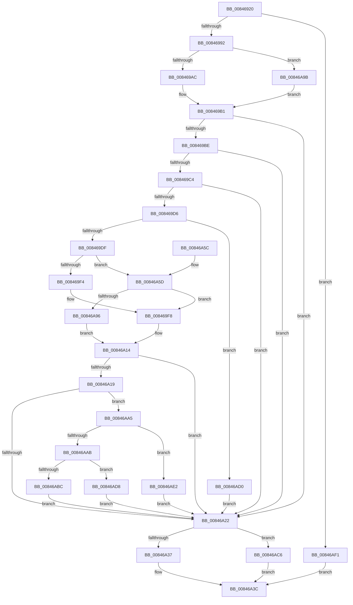

# CmpCompareNewValueDataAgainstKCBCache

- RVA: `0x00846920`–`0x00846AFB` (길이 `475` bytes)
- VA: `0x0000000140846920`
- 실행 섹션: `PAGE`
- PDB 이름 있음: `예`; PDB Function 태그: `아니요`
- unwind 정보 RVA: `0x00069244`
- 디코드: `130`개 명령, `475/475` bytes 표시
- 미해석 바이트: `0` (있으면 어셈블리에 `.byte`로 보존)

> 이 문서는 커널 이미지의 기계어와 PDB 기호를 분석해 생성했습니다. 4번과 5번은 함수 원형과 자료형을 바이너리 사용 방식에서 추정한 C 해석이며 원본 소스 복구 결과는 아닙니다.

## 1. Dependencies

- 직접 호출 지점: **10**; 고유 호출 대상: **8**
- 직접 호출자로 확인된 함수: **1**
- RIP 상대 이미지 참조: **0**

### Outgoing calls
- `0x00846985` → [CmpFindNameInListWithStatus](CmpFindNameInListWithStatus_function_00846B80.md) (function, `0x00846B80`)
- `0x008469AC` → [HvpGetCellFlat](../85/HvpGetCellFlat_function_00854C60.md) (function, `0x00854C60`)
- `0x00846A06` → [RtlCompareMemory](../../text/6B/RtlCompareMemory_function_006BA670.md) (function, `0x006BA670`)
- `0x00846A37` → [HvpReleaseCellPaged](../85/HvpReleaseCellPaged_function_00855F40.md) (function, `0x00855F40`)
- `0x00846A85` → [CmpGetValueData](../85/CmpGetValueData_function_00856DB0.md) (function, `0x00856DB0`)
- `0x00846A9B` → [HvpGetCellPaged](../85/HvpGetCellPaged_function_00854CB0.md) (function, `0x00854CB0`)
- `0x00846ABC` → [HvpReleaseCellPaged](../85/HvpReleaseCellPaged_function_00855F40.md) (function, `0x00855F40`)
- `0x00846AC6` → [HvpReleaseCellFlat](../85/HvpReleaseCellFlat_function_0085CC20.md) (function, `0x0085CC20`)
- `0x00846AD8` → [HvpReleaseCellFlat](../85/HvpReleaseCellFlat_function_0085CC20.md) (function, `0x0085CC20`)
- `0x00846AE7` → [ExFreePoolWithTag](../../poolcode/B8/ExFreePoolWithTag_function_00B82870.md) (function, `0x00B82870`)

### Direct callers
- [CmSetValueKey](CmSetValueKey_function_008457C0.md) at `0x00845BE5`

### Static image references
- 디코드된 RIP-relative 메모리 참조가 없습니다.

## 2. Other-region calls and transfers

- 다른 실행 섹션으로 향하는 call: **2**
  - `0x00846A06` → [RtlCompareMemory](../../text/6B/RtlCompareMemory_function_006BA670.md) (`PAGE` → `.text`)
  - `0x00846AE7` → [ExFreePoolWithTag](../../poolcode/B8/ExFreePoolWithTag_function_00B82870.md) (`PAGE` → `POOLCODE`)
- 별도 외부 분기/꼬리 이동을 확인하지 못했습니다.

## 3. Assembly (complete function range)

```asm
00846920  4C 8B DC                        mov r11, rsp
00846923  49 89 5B 10                     mov qword ptr [r11 + 0x10], rbx
00846927  49 89 73 18                     mov qword ptr [r11 + 0x18], rsi
0084692B  49 89 7B 20                     mov qword ptr [r11 + 0x20], rdi
0084692F  55                              push rbp
00846930  41 54                           push r12
00846932  41 55                           push r13
00846934  41 56                           push r14
00846936  41 57                           push r15
00846938  48 8B EC                        mov rbp, rsp
0084693B  48 83 EC 60                     sub rsp, 0x60
0084693F  45 33 ED                        xor r13d, r13d
00846942  48 8D 45 E0                     lea rax, [rbp - 0x20]
00846946  48 8B F1                        mov rsi, rcx
00846949  49 89 43 A0                     mov qword ptr [r11 - 0x60], rax
0084694D  83 C9 FF                        or ecx, 0xffffffff
00846950  44 88 6D 30                     mov byte ptr [rbp + 0x30], r13b
00846954  45 8B F0                        mov r14d, r8d
00846957  89 4D F0                        mov dword ptr [rbp - 0x10], ecx
0084695A  4D 8B E1                        mov r12, r9
0084695D  89 4D E8                        mov dword ptr [rbp - 0x18], ecx
00846960  48 8B 4E 20                     mov rcx, qword ptr [rsi + 0x20]
00846964  4C 8B C2                        mov r8, rdx
00846967  48 8D 56 60                     lea rdx, [rsi + 0x60]
0084696B  44 89 6D F4                     mov dword ptr [rbp - 0xc], r13d
0084696F  45 33 C9                        xor r9d, r9d
00846972  4C 89 6D F8                     mov qword ptr [rbp - 8], r13
00846976  45 8A FD                        mov r15b, r13b
00846979  44 89 6D E0                     mov dword ptr [rbp - 0x20], r13d
0084697D  44 89 6D EC                     mov dword ptr [rbp - 0x14], r13d
00846981  4D 89 6B 98                     mov qword ptr [r11 - 0x68], r13
00846985  E8 F6 01 00 00                  call 0x140846b80
0084698A  85 C0                           test eax, eax
0084698C  0F 88 5F 01 00 00               js 0x140846af1
00846992  48 8B 4E 20                     mov rcx, qword ptr [rsi + 0x20]
00846996  4C 8D 45 E8                     lea r8, [rbp - 0x18]
0084699A  8B 7D E0                        mov edi, dword ptr [rbp - 0x20]
0084699D  8B D7                           mov edx, edi
0084699F  F6 81 8C 00 00 00 01            test byte ptr [rcx + 0x8c], 1
008469A6  0F 84 EF 00 00 00               je 0x140846a9b
008469AC  E8 AF E2 00 00                  call 0x140854c60
008469B1  BB 02 00 00 00                  mov ebx, 2
008469B6  4C 8B C0                        mov r8, rax
008469B9  84 58 10                        test byte ptr [rax + 0x10], bl
008469BC  75 64                           jne 0x140846a22
008469BE  44 3B 70 0C                     cmp r14d, dword ptr [rax + 0xc]
008469C2  75 5E                           jne 0x140846a22
008469C4  8B 48 04                        mov ecx, dword ptr [rax + 4]
008469C7  8B C1                           mov eax, ecx
008469C9  44 8B 75 50                     mov r14d, dword ptr [rbp + 0x50]
008469CD  0F BA F0 1F                     btr eax, 0x1f
008469D1  44 3B F0                        cmp r14d, eax
008469D4  75 4C                           jne 0x140846a22
008469D6  45 85 F6                        test r14d, r14d
008469D9  0F 84 F1 00 00 00               je 0x140846ad0
008469DF  BA 00 00 00 80                  mov edx, 0x80000000
008469E4  8D 81 00 00 00 80               lea eax, [rcx - 0x80000000]
008469EA  3B CA                           cmp ecx, edx
008469EC  0F 42 C1                        cmovb eax, ecx
008469EF  89 45 E0                        mov dword ptr [rbp - 0x20], eax
008469F2  72 69                           jb 0x140846a5d
008469F4  49 8D 78 08                     lea rdi, [r8 + 8]
008469F8  45 8B C6                        mov r8d, r14d
008469FB  49 8B D4                        mov rdx, r12
008469FE  41 0F BA F0 1F                  btr r8d, 0x1f
00846A03  48 8B CF                        mov rcx, rdi
00846A06  E8 65 3C E7 FF                  call 0x1406ba670
00846A0B  41 2B C6                        sub eax, r14d
00846A0E  F7 D8                           neg eax
00846A10  1B C0                           sbb eax, eax
00846A12  23 D8                           and ebx, eax
00846A14  48 85 FF                        test rdi, rdi
00846A17  74 09                           je 0x140846a22
00846A19  45 84 FF                        test r15b, r15b
00846A1C  0F 85 83 00 00 00               jne 0x140846aa5
00846A22  48 8B 4E 20                     mov rcx, qword ptr [rsi + 0x20]
00846A26  48 8D 55 E8                     lea rdx, [rbp - 0x18]
00846A2A  F6 81 8C 00 00 00 01            test byte ptr [rcx + 0x8c], 1
00846A31  0F 85 8F 00 00 00               jne 0x140846ac6
00846A37  E8 04 F5 00 00                  call 0x140855f40
00846A3C  4C 8D 5C 24 60                  lea r11, [rsp + 0x60]
00846A41  8B C3                           mov eax, ebx
00846A43  49 8B 5B 38                     mov rbx, qword ptr [r11 + 0x38]
00846A47  49 8B 73 40                     mov rsi, qword ptr [r11 + 0x40]
00846A4B  49 8B 7B 48                     mov rdi, qword ptr [r11 + 0x48]
00846A4F  49 8B E3                        mov rsp, r11
00846A52  41 5F                           pop r15
00846A54  41 5E                           pop r14
00846A56  41 5D                           pop r13
00846A58  41 5C                           pop r12
00846A5A  5D                              pop rbp
00846A5B  C3                              ret
00846A5C  CC                              int3
00846A5D  48 8B 4E 20                     mov rcx, qword ptr [rsi + 0x20]
00846A61  48 8D 45 F0                     lea rax, [rbp - 0x10]
00846A65  48 89 44 24 30                  mov qword ptr [rsp + 0x30], rax
00846A6A  4C 8D 4D E0                     lea r9, [rbp - 0x20]
00846A6E  48 8D 45 30                     lea rax, [rbp + 0x30]
00846A72  8B D7                           mov edx, edi
00846A74  48 89 44 24 28                  mov qword ptr [rsp + 0x28], rax
00846A79  41 B7 01                        mov r15b, 1
00846A7C  48 8D 45 F8                     lea rax, [rbp - 8]
00846A80  48 89 44 24 20                  mov qword ptr [rsp + 0x20], rax
00846A85  E8 26 03 01 00                  call 0x140856db0
00846A8A  48 8B 7D F8                     mov rdi, qword ptr [rbp - 8]
00846A8E  84 C0                           test al, al
00846A90  0F 85 62 FF FF FF               jne 0x1408469f8
00846A96  E9 79 FF FF FF                  jmp 0x140846a14
00846A9B  E8 10 E2 00 00                  call 0x140854cb0
00846AA0  E9 0C FF FF FF                  jmp 0x1408469b1
00846AA5  80 7D 30 01                     cmp byte ptr [rbp + 0x30], 1
00846AA9  74 37                           je 0x140846ae2
00846AAB  48 8B 4E 20                     mov rcx, qword ptr [rsi + 0x20]
00846AAF  48 8D 55 F0                     lea rdx, [rbp - 0x10]
00846AB3  F6 81 8C 00 00 00 01            test byte ptr [rcx + 0x8c], 1
00846ABA  75 1C                           jne 0x140846ad8
00846ABC  E8 7F F4 00 00                  call 0x140855f40
00846AC1  E9 5C FF FF FF                  jmp 0x140846a22
00846AC6  E8 55 61 01 00                  call 0x14085cc20
00846ACB  E9 6C FF FF FF                  jmp 0x140846a3c
00846AD0  41 8B DD                        mov ebx, r13d
00846AD3  E9 4A FF FF FF                  jmp 0x140846a22
00846AD8  E8 43 61 01 00                  call 0x14085cc20
00846ADD  E9 40 FF FF FF                  jmp 0x140846a22
00846AE2  33 D2                           xor edx, edx
00846AE4  48 8B CF                        mov rcx, rdi
00846AE7  E8 84 BD 33 00                  call 0x140b82870
00846AEC  E9 31 FF FF FF                  jmp 0x140846a22
00846AF1  BB 02 00 00 00                  mov ebx, 2
00846AF6  E9 41 FF FF FF                  jmp 0x140846a3c
```

## 4. C-style interpretation (structured pseudocode)

```c
__int64 __fastcall CmpCompareNewValueDataAgainstKCBCache(__int64 a1, __int64 a2, int a3, __int64 a4, unsigned int a5)
{
    __int64 result;
    __int64 v_r13;
    __int64 v_rbx;
    __int64 v_rsp;
    unsigned __int64 v_stack_m28;
    unsigned __int64 v_stack_m30;
    unsigned int v_stack_m34;
    unsigned int v_stack_m38;
    unsigned int v_stack_m3C;
    unsigned int v_stack_m40;
    unsigned __int64 v_stack_m48;
    unsigned __int8 v_stack_p8;

    *(unsigned __int64 *)(v_rsp + 16) = v_rbx;
    *(unsigned __int64 *)(v_rsp + 24) = v_rsi;
    *(unsigned __int64 *)(v_rsp + 32) = v_rdi;
    v_rsp = (v_rsp) - (96);
    v_r13 = 0;
    *(unsigned __int64 *)(v_rsp - 96) = v_stack_m48;
    a1 = (unsigned int)((a1) | (0xFFFFFFFFULL));
    v_stack_p8 = 0;
    v_stack_m38 = (unsigned int)(a1);
    v_stack_m40 = (unsigned int)(a1);
    v_stack_m34 = 0;
    a4 = 0;
    v_stack_m30 = 0;
    v_stack_m48 = 0;
    v_stack_m3C = 0;
    *(unsigned __int64 *)(v_rsp - 104) = 0;
    result = CmpFindNameInListWithStatus(*(unsigned __int64 *)(a1 + 32), a1 + 96, a2, a4);
    if (sign_flag) goto loc_00846AF1;
    if (((*(unsigned __int8 *)(*(unsigned __int64 *)(a1 + 32) + 140)) & (1)) == 0) goto loc_00846A9B;
    result = HvpGetCellFlat(*(unsigned __int64 *)(a1 + 32), (unsigned int)((unsigned int)((unsigned int)(v_stack_m48))), v_stack_m40, a4);
loc_008469B1:
    if (((*(unsigned __int8 *)(result + 16)) & (2)) != 0) goto loc_00846A22;
    if (((unsigned int)((unsigned int)(a3))) != (*(unsigned int *)(result + 12))) goto loc_00846A22;
    if (((unsigned int)((unsigned int)(a5))) != ((unsigned int)((unsigned int)((unsigned int)((unsigned int)(*(unsigned int *)(result + 4))))))) goto loc_00846A22;
    if ((unsigned int)((unsigned int)(a5)) == 0) goto loc_00846AD0;
    result = (unsigned int)(*(unsigned int *)(result + 4)) - 2147483648;
    if (((unsigned int)((unsigned int)(*(unsigned int *)(result + 4)))) < ((unsigned int)((unsigned int)(0x80000000ULL)))) { result = (unsigned int)((unsigned int)(*(unsigned int *)(result + 4))); }
    v_stack_m48 = (unsigned int)(result);
    if (((unsigned int)((unsigned int)(*(unsigned int *)(result + 4)))) < ((unsigned int)((unsigned int)(0x80000000ULL)))) goto loc_00846A5D;
loc_008469F8:
    result = RtlCompareMemory(result + 8, 0, (unsigned int)((unsigned int)((unsigned int)(a5))), a4);
    result = (unsigned int)((result) - ((unsigned int)((unsigned int)(a5))));
    result = (unsigned int)(-(result));
    v_rbx = (unsigned int)((2) & ((unsigned int)(result)));
loc_00846A14:
    if (result + 8 == 0) goto loc_00846A22;
    if (0 != 0) goto loc_00846AA5;
loc_00846A22:
    if (((*(unsigned __int8 *)(*(unsigned __int64 *)(a1 + 32) + 140)) & (1)) != 0) goto loc_00846AC6;
    result = HvpReleaseCellPaged(*(unsigned __int64 *)(a1 + 32), v_stack_m40, (unsigned int)((unsigned int)((unsigned int)(a5))), a4);
loc_00846A3C:
    return (unsigned int)((unsigned int)(v_rbx));
loc_00846A5D:
    v_stack_m30 = v_stack_m38;
    v_stack_m38 = v_stack_p8;
    v_stack_m40 = v_stack_m30;
    result = CmpGetValueData(*(unsigned __int64 *)(*(unsigned __int64 *)(v_stack_m28 + 64) + 32), (unsigned int)((unsigned int)(*(unsigned __int64 *)(v_stack_m28 + 72))), (unsigned int)((unsigned int)((unsigned int)(a5))), v_stack_m48);
    if ((unsigned __int8)(result) != 0) goto loc_008469F8;
    goto loc_00846A14;
loc_00846A9B:
    result = HvpGetCellPaged(*(unsigned __int64 *)(*(unsigned __int64 *)(v_stack_m28 + 64) + 32), (unsigned int)((unsigned int)(*(unsigned __int64 *)(v_stack_m28 + 72))), (unsigned int)((unsigned int)((unsigned int)(a5))), v_stack_m48);
    goto loc_008469B1;
loc_00846AA5:
    if (v_stack_p8 == 1) goto loc_00846AE2;
    if (((*(unsigned __int8 *)(*(unsigned __int64 *)(*(unsigned __int64 *)(v_stack_m28 + 64) + 32) + 140)) & (1)) != 0) goto loc_00846AD8;
    result = HvpReleaseCellPaged(*(unsigned __int64 *)(*(unsigned __int64 *)(v_stack_m28 + 64) + 32), v_stack_m38, (unsigned int)((unsigned int)((unsigned int)(a5))), v_stack_m48);
    goto loc_00846A22;
loc_00846AC6:
    result = HvpReleaseCellFlat(*(unsigned __int64 *)(*(unsigned __int64 *)(v_stack_m28 + 64) + 32), v_stack_m38, (unsigned int)((unsigned int)((unsigned int)(a5))), v_stack_m48);
    goto loc_00846A3C;
loc_00846AD0:
    goto loc_00846A22;
loc_00846AD8:
    result = HvpReleaseCellFlat(*(unsigned __int64 *)(*(unsigned __int64 *)(v_stack_m28 + 64) + 32), v_stack_m38, (unsigned int)((unsigned int)((unsigned int)(a5))), v_stack_m48);
    goto loc_00846A22;
loc_00846AE2:
    a2 = 0;
    result = ExFreePoolWithTag(v_stack_m30, a2, (unsigned int)((unsigned int)((unsigned int)(a5))), v_stack_m48);
    goto loc_00846A22;
loc_00846AF1:
    goto loc_00846A3C;
}
```

## 5. (Beta) C Style

```c
int64_t CmpCompareNewValueDataAgainstKCBCache(void *Arg1, int64_t Arg2, int32_t Arg3, int64_t Arg4, uint32_t Arg5)
{
    uint8_t *arg1 = (uint8_t *)Arg1;

    int64_t result;
    int64_t local_r13;
    int64_t local_rbx;
    int64_t local_rsp;
    uint64_t v_stack_m28;
    uint64_t v_stack_m30;
    uint32_t v_stack_m34;
    uint32_t v_stack_m38;
    uint32_t v_stack_m3C;
    uint32_t v_stack_m40;
    uint64_t v_stack_m48;
    uint8_t v_stack_p8;

    *(uint64_t *)(local_rsp + 0x10) = local_rbx;
    *(uint64_t *)(local_rsp + 0x18) = local_rsi;
    *(uint64_t *)(local_rsp + 0x20) = local_rdi;
    local_rsp = (local_rsp) - (96);
    local_r13 = 0;
    *(uint64_t *)(local_rsp - 0x60) = v_stack_m48;
    Arg1 = (uint32_t)((Arg1) | (0xFFFFFFFFULL));
    v_stack_p8 = 0;
    v_stack_m38 = (uint32_t)(Arg1);
    v_stack_m40 = (uint32_t)(Arg1);
    v_stack_m34 = 0;
    Arg4 = 0;
    v_stack_m30 = 0;
    v_stack_m48 = 0;
    v_stack_m3C = 0;
    *(uint64_t *)(local_rsp - 0x68) = 0;
    result = CmpFindNameInListWithStatus(*(uint64_t *)(arg1 + 0x20), Arg1 + 96, Arg2, Arg4);
    if (sign_flag) goto loc_00846AF1;
    if (((*(uint8_t *)(*(uint64_t *)(arg1 + 0x20) + 0x8C)) & (1)) == 0) goto loc_00846A9B;
    result = HvpGetCellFlat(*(uint64_t *)(arg1 + 0x20), (uint32_t)((uint32_t)((uint32_t)(v_stack_m48))), v_stack_m40, Arg4);
loc_008469B1:
    if (((*(uint8_t *)(result + 0x10)) & (2)) != 0) goto loc_00846A22;
    if (((uint32_t)((uint32_t)(Arg3))) != (*(uint32_t *)(result + 0xC))) goto loc_00846A22;
    if (((uint32_t)((uint32_t)(Arg5))) != ((uint32_t)((uint32_t)((uint32_t)((uint32_t)(*(uint32_t *)(result + 0x4))))))) goto loc_00846A22;
    if ((uint32_t)((uint32_t)(Arg5)) == 0) goto loc_00846AD0;
    result = (uint32_t)(*(uint32_t *)(result + 0x4)) - 2147483648;
    if (((uint32_t)((uint32_t)(*(uint32_t *)(result + 0x4)))) < ((uint32_t)((uint32_t)(0x80000000ULL)))) { result = (uint32_t)((uint32_t)(*(uint32_t *)(result + 0x4))); }
    v_stack_m48 = (uint32_t)(result);
    if (((uint32_t)((uint32_t)(*(uint32_t *)(result + 0x4)))) < ((uint32_t)((uint32_t)(0x80000000ULL)))) goto loc_00846A5D;
loc_008469F8:
    result = RtlCompareMemory(result + 8, 0, (uint32_t)((uint32_t)((uint32_t)(Arg5))), Arg4);
    result = (uint32_t)((result) - ((uint32_t)((uint32_t)(Arg5))));
    result = (uint32_t)(-(result));
    local_rbx = (uint32_t)((2) & ((uint32_t)(result)));
loc_00846A14:
    if (result + 8 == 0) goto loc_00846A22;
    if (0 != 0) goto loc_00846AA5;
loc_00846A22:
    if (((*(uint8_t *)(*(uint64_t *)(arg1 + 0x20) + 0x8C)) & (1)) != 0) goto loc_00846AC6;
    result = HvpReleaseCellPaged(*(uint64_t *)(arg1 + 0x20), v_stack_m40, (uint32_t)((uint32_t)((uint32_t)(Arg5))), Arg4);
loc_00846A3C:
    return (uint32_t)((uint32_t)(local_rbx));
loc_00846A5D:
    v_stack_m30 = v_stack_m38;
    v_stack_m38 = v_stack_p8;
    v_stack_m40 = v_stack_m30;
    result = CmpGetValueData(*(uint64_t *)(*(uint64_t *)(v_stack_m28 + 0x40) + 0x20), (uint32_t)((uint32_t)(*(uint64_t *)(v_stack_m28 + 0x48))), (uint32_t)((uint32_t)((uint32_t)(Arg5))), v_stack_m48);
    if ((uint8_t)(result) != 0) goto loc_008469F8;
    goto loc_00846A14;
loc_00846A9B:
    result = HvpGetCellPaged(*(uint64_t *)(*(uint64_t *)(v_stack_m28 + 0x40) + 0x20), (uint32_t)((uint32_t)(*(uint64_t *)(v_stack_m28 + 0x48))), (uint32_t)((uint32_t)((uint32_t)(Arg5))), v_stack_m48);
    goto loc_008469B1;
loc_00846AA5:
    if (v_stack_p8 == 1) goto loc_00846AE2;
    if (((*(uint8_t *)(*(uint64_t *)(*(uint64_t *)(v_stack_m28 + 0x40) + 0x20) + 0x8C)) & (1)) != 0) goto loc_00846AD8;
    result = HvpReleaseCellPaged(*(uint64_t *)(*(uint64_t *)(v_stack_m28 + 0x40) + 0x20), v_stack_m38, (uint32_t)((uint32_t)((uint32_t)(Arg5))), v_stack_m48);
    goto loc_00846A22;
loc_00846AC6:
    result = HvpReleaseCellFlat(*(uint64_t *)(*(uint64_t *)(v_stack_m28 + 0x40) + 0x20), v_stack_m38, (uint32_t)((uint32_t)((uint32_t)(Arg5))), v_stack_m48);
    goto loc_00846A3C;
loc_00846AD0:
    goto loc_00846A22;
loc_00846AD8:
    result = HvpReleaseCellFlat(*(uint64_t *)(*(uint64_t *)(v_stack_m28 + 0x40) + 0x20), v_stack_m38, (uint32_t)((uint32_t)((uint32_t)(Arg5))), v_stack_m48);
    goto loc_00846A22;
loc_00846AE2:
    Arg2 = 0;
    result = ExFreePoolWithTag(v_stack_m30, Arg2, (uint32_t)((uint32_t)((uint32_t)(Arg5))), v_stack_m48);
    goto loc_00846A22;
loc_00846AF1:
    goto loc_00846A3C;
}
```

### 관측된 메모리 오프셋

구조체 형식이 확인되지 않은 접근은 인자 기준의 오프셋으로만 기록했습니다.

| 기준 인자 | 오프셋 표현 | 폭 (bit) | 접근 |
|---|---:|---:|---|
| `Arg1` | `+ 0x20` | `64` | `R` |
| `Arg1` | `+ 0x60` | `64` | `R` |

## 6. Execution-region graph

[열기: 2D/3D 그래프와 함수 탐색 컨트롤 패널](../../../control-panel.html?section=page&rva=0x00846920&view=graph)

- 2D 그래프는 위에서 아래로 흐르고, 3D 그래프는 빈 공간을 드래그해 회전합니다. Shift+드래그는 이동, 휠은 확대·축소, 함수 노드 선택은 대상 보고서 이동입니다.

### Static fallback


