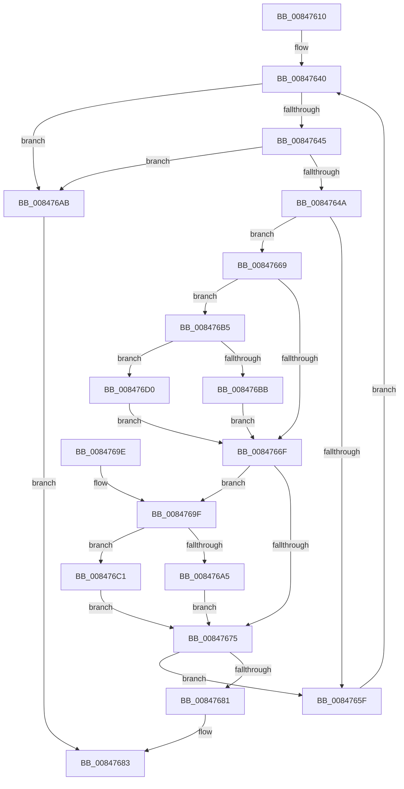

# CmpCompareTwoCompressedNames

- RVA: `0x00847610`–`0x008476DF` (길이 `207` bytes)
- VA: `0x0000000140847610`
- 실행 섹션: `PAGE`
- PDB 이름 있음: `예`; PDB Function 태그: `아니요`
- unwind 정보 RVA: `0x000692D8`
- 디코드: `69`개 명령, `207/207` bytes 표시
- 미해석 바이트: `0` (있으면 어셈블리에 `.byte`로 보존)

> 이 문서는 커널 이미지의 기계어와 PDB 기호를 분석해 생성했습니다. 4번과 5번은 함수 원형과 자료형을 바이너리 사용 방식에서 추정한 C 해석이며 원본 소스 복구 결과는 아닙니다.

## 1. Dependencies

- 직접 호출 지점: **2**; 고유 호출 대상: **1**
- 직접 호출자로 확인된 함수: **9**
- RIP 상대 이미지 참조: **0**

### Outgoing calls
- `0x008476C5` → [RtlUpcaseUnicodeChar](../85/RtlUpcaseUnicodeChar_function_0085F0F0.md) (function, `0x0085F0F0`)
- `0x008476D4` → [RtlUpcaseUnicodeChar](../85/RtlUpcaseUnicodeChar_function_0085F0F0.md) (function, `0x0085F0F0`)

### Direct callers
- [CmpFindNameInListWithStatus](CmpFindNameInListWithStatus_function_00846B80.md) at `0x00846DD0`
- [sub_0085416A](../85/Unknown_function_0085416A.md) at `0x0085472E`
- [sub_0085416A](../85/Unknown_function_0085416A.md) at `0x0085474A`
- [sub_0085416A](../85/Unknown_function_0085416A.md) at `0x00854803`
- [sub_0085416A](../85/Unknown_function_0085416A.md) at `0x0085481E`
- [sub_0085416A](../85/Unknown_function_0085416A.md) at `0x0085483A`
- [sub_00854FDC](../85/Unknown_function_00854FDC.md) at `0x00854FEB`
- [sub_00856195](../85/Unknown_function_00856195.md) at `0x008561C7`
- [CmpCompareInIndex](../85/CmpCompareInIndex_function_0085CC40.md) at `0x0085D11F`
- [CmpCompareInIndex](../85/CmpCompareInIndex_function_0085CC40.md) at `0x0085D137`
- [CmpFindSubKeyInRoot](../85/CmpFindSubKeyInRoot_function_0085D890.md) at `0x0085E132`
- [CmpFindSubKeyInRoot](../85/CmpFindSubKeyInRoot_function_0085D890.md) at `0x0085E14D`
- [CmpCompareKeysByName](../94/CmpCompareKeysByName_function_00944950.md) at `0x009449B4`
- [CmpSortedValueEnumStackValueCompareFunction](../A3/CmpSortedValueEnumStackValueCompareFunction_function_00A30F30.md) at `0x00A30F9C`
- [CmpFindKcbInHashEntryByCompressedName](../AB/CmpFindKcbInHashEntryByCompressedName_function_00ABC800.md) at `0x00ABC88A`

### Static image references
- 디코드된 RIP-relative 메모리 참조가 없습니다.

## 2. Other-region calls and transfers

- 다른 실행 섹션으로 향하는 call: **0**
- 별도 외부 분기/꼬리 이동을 확인하지 못했습니다.

## 3. Assembly (complete function range)

```asm
00847610  48 89 5C 24 18                  mov qword ptr [rsp + 0x18], rbx
00847615  55                              push rbp
00847616  56                              push rsi
00847617  57                              push rdi
00847618  41 54                           push r12
0084761A  41 55                           push r13
0084761C  48 83 EC 20                     sub rsp, 0x20
00847620  41 BD E0 FF 00 00               mov r13d, 0xffe0
00847626  4C 89 74 24 50                  mov qword ptr [rsp + 0x50], r14
0084762B  41 8B F9                        mov edi, r9d
0084762E  4C 89 7C 24 58                  mov qword ptr [rsp + 0x58], r15
00847633  49 8B E8                        mov rbp, r8
00847636  8B DA                           mov ebx, edx
00847638  48 8B F1                        mov rsi, rcx
0084763B  45 8D 65 1F                     lea r12d, [r13 + 0x1f]
0084763F  90                              nop
00847640  66 85 DB                        test bx, bx
00847643  74 66                           je 0x1408476ab
00847645  66 85 FF                        test di, di
00847648  74 61                           je 0x1408476ab
0084764A  44 0F B6 36                     movzx r14d, byte ptr [rsi]
0084764E  48 FF C6                        inc rsi
00847651  44 0F B6 7D 00                  movzx r15d, byte ptr [rbp]
00847656  48 FF C5                        inc rbp
00847659  66 45 3B F7                     cmp r14w, r15w
0084765D  75 0A                           jne 0x140847669
0084765F  66 41 03 DC                     add bx, r12w
00847663  66 41 03 FC                     add di, r12w
00847667  EB D7                           jmp 0x140847640
00847669  41 83 FE 61                     cmp r14d, 0x61
0084766D  73 46                           jae 0x1408476b5
0084766F  41 83 FF 61                     cmp r15d, 0x61
00847673  73 2A                           jae 0x14084769f
00847675  41 0F B7 C7                     movzx eax, r15w
00847679  41 0F B7 CE                     movzx ecx, r14w
0084767D  2B C8                           sub ecx, eax
0084767F  74 DE                           je 0x14084765f
00847681  8B C1                           mov eax, ecx
00847683  4C 8B 7C 24 58                  mov r15, qword ptr [rsp + 0x58]
00847688  4C 8B 74 24 50                  mov r14, qword ptr [rsp + 0x50]
0084768D  48 8B 5C 24 60                  mov rbx, qword ptr [rsp + 0x60]
00847692  48 83 C4 20                     add rsp, 0x20
00847696  41 5D                           pop r13
00847698  41 5C                           pop r12
0084769A  5F                              pop rdi
0084769B  5E                              pop rsi
0084769C  5D                              pop rbp
0084769D  C3                              ret
0084769E  CC                              int3
0084769F  41 83 FF 7A                     cmp r15d, 0x7a
008476A3  77 1C                           ja 0x1408476c1
008476A5  66 45 03 FD                     add r15w, r13w
008476A9  EB CA                           jmp 0x140847675
008476AB  0F B7 CF                        movzx ecx, di
008476AE  0F B7 C3                        movzx eax, bx
008476B1  2B C1                           sub eax, ecx
008476B3  EB CE                           jmp 0x140847683
008476B5  41 83 FE 7A                     cmp r14d, 0x7a
008476B9  77 15                           ja 0x1408476d0
008476BB  66 45 03 F5                     add r14w, r13w
008476BF  EB AE                           jmp 0x14084766f
008476C1  41 0F B7 CF                     movzx ecx, r15w
008476C5  E8 26 7A 01 00                  call 0x14085f0f0
008476CA  44 0F B7 F8                     movzx r15d, ax
008476CE  EB A5                           jmp 0x140847675
008476D0  41 0F B7 CE                     movzx ecx, r14w
008476D4  E8 17 7A 01 00                  call 0x14085f0f0
008476D9  44 0F B7 F0                     movzx r14d, ax
008476DD  EB 90                           jmp 0x14084766f
```

## 4. C-style interpretation (structured pseudocode)

```c
__int64 __fastcall CmpCompareTwoCompressedNames(__int64 a1, int a2, __int64 a3, int a4)
{
    __int64 result;
    __int64 v_r14;
    __int64 v_r15;
    __int64 v_rbp;
    __int64 v_rbx;
    __int64 v_rdi;
    __int64 v_rsi;
    __int64 v_rsp;
    unsigned __int64 v_stack_p10;
    unsigned __int64 v_stack_p18;
    unsigned __int64 v_stack_p8;

    v_stack_p18 = v_rbx;
    v_rsp = (v_rsp) - (32);
    v_stack_p8 = v_r14;
    v_stack_p10 = v_r15;
loc_00847640:
    if ((unsigned __int16)((unsigned int)(a2)) == 0) goto loc_008476AB;
    if ((unsigned __int16)((unsigned int)(a4)) == 0) goto loc_008476AB;
    v_rsi = (a1) + 1;
    v_rbp = (a3) + 1;
    if (((unsigned __int16)(*(unsigned __int8 *)(a1))) != ((unsigned __int16)(*(unsigned __int8 *)(a3)))) goto loc_00847669;
loc_0084765F:
    v_rbx = (unsigned __int16)(((unsigned int)(a2)) + ((unsigned __int16)((unsigned int)(0xFFE0ULL) + 31)));
    v_rdi = (unsigned __int16)(((unsigned int)(a4)) + ((unsigned __int16)((unsigned int)(0xFFE0ULL) + 31)));
    goto loc_00847640;
loc_00847669:
    if (((unsigned int)(*(unsigned __int8 *)(a1))) >= 97) goto loc_008476B5;
loc_0084766F:
    if (((unsigned int)(*(unsigned __int8 *)(a3))) >= 97) goto loc_0084769F;
loc_00847675:
    a1 = (unsigned int)(((unsigned __int16)(*(unsigned __int8 *)(a1))) - ((unsigned int)((unsigned __int16)(*(unsigned __int8 *)(a3)))));
    if (condition_is_equal) goto loc_0084765F;
loc_00847683:
    v_rsp = (v_rsp) + (32);
    return (unsigned int)((unsigned int)(a1));
loc_0084769F:
    if (((unsigned int)(v_stack_p10)) > 122) goto loc_008476C1;
    v_r15 = (unsigned __int16)((v_stack_p10) + ((unsigned __int16)((unsigned int)(0xFFE0ULL))));
    goto loc_00847675;
loc_008476AB:
    result = (unsigned int)(((unsigned __int16)(v_stack_p18)) - ((unsigned int)((unsigned __int16)(v_rdi))));
    goto loc_00847683;
loc_008476B5:
    if (((unsigned int)(v_stack_p8)) > 122) goto loc_008476D0;
    v_r14 = (unsigned __int16)((v_stack_p8) + ((unsigned __int16)((unsigned int)(0xFFE0ULL))));
    goto loc_0084766F;
loc_008476C1:
    result = RtlUpcaseUnicodeChar((unsigned __int16)(v_r15), a2, a3, a4);
    goto loc_00847675;
loc_008476D0:
    result = RtlUpcaseUnicodeChar((unsigned __int16)(v_r14), a2, a3, a4);
    goto loc_0084766F;
}
```

## 5. (Beta) C Style

```c
int64_t CmpCompareTwoCompressedNames(int64_t Arg1, int32_t Arg2, int64_t Arg3, int32_t Arg4)
{
    int64_t result;
    int64_t local_r14;
    int64_t local_r15;
    int64_t local_rbp;
    int64_t local_rbx;
    int64_t local_rdi;
    int64_t local_rsi;
    int64_t local_rsp;
    uint64_t v_stack_p10;
    uint64_t v_stack_p18;
    uint64_t v_stack_p8;

    v_stack_p18 = local_rbx;
    local_rsp = (local_rsp) - (32);
    v_stack_p8 = local_r14;
    v_stack_p10 = local_r15;
loc_00847640:
    if ((uint16_t)((uint32_t)(Arg2)) == 0) goto loc_008476AB;
    if ((uint16_t)((uint32_t)(Arg4)) == 0) goto loc_008476AB;
    local_rsi = (Arg1) + 1;
    local_rbp = (Arg3) + 1;
    if (((uint16_t)(*(uint8_t *)(Arg1))) != ((uint16_t)(*(uint8_t *)(Arg3)))) goto loc_00847669;
loc_0084765F:
    local_rbx = (uint16_t)(((uint32_t)(Arg2)) + ((uint16_t)((uint32_t)(0xFFE0ULL) + 31)));
    local_rdi = (uint16_t)(((uint32_t)(Arg4)) + ((uint16_t)((uint32_t)(0xFFE0ULL) + 31)));
    goto loc_00847640;
loc_00847669:
    if (((uint32_t)(*(uint8_t *)(Arg1))) >= 97) goto loc_008476B5;
loc_0084766F:
    if (((uint32_t)(*(uint8_t *)(Arg3))) >= 97) goto loc_0084769F;
loc_00847675:
    Arg1 = (uint32_t)(((uint16_t)(*(uint8_t *)(Arg1))) - ((uint32_t)((uint16_t)(*(uint8_t *)(Arg3)))));
    if (condition_is_equal) goto loc_0084765F;
loc_00847683:
    local_rsp = (local_rsp) + (32);
    return (uint32_t)((uint32_t)(Arg1));
loc_0084769F:
    if (((uint32_t)(v_stack_p10)) > 122) goto loc_008476C1;
    local_r15 = (uint16_t)((v_stack_p10) + ((uint16_t)((uint32_t)(0xFFE0ULL))));
    goto loc_00847675;
loc_008476AB:
    result = (uint32_t)(((uint16_t)(v_stack_p18)) - ((uint32_t)((uint16_t)(local_rdi))));
    goto loc_00847683;
loc_008476B5:
    if (((uint32_t)(v_stack_p8)) > 122) goto loc_008476D0;
    local_r14 = (uint16_t)((v_stack_p8) + ((uint16_t)((uint32_t)(0xFFE0ULL))));
    goto loc_0084766F;
loc_008476C1:
    result = RtlUpcaseUnicodeChar((uint16_t)(local_r15), Arg2, Arg3, Arg4);
    goto loc_00847675;
loc_008476D0:
    result = RtlUpcaseUnicodeChar((uint16_t)(local_r14), Arg2, Arg3, Arg4);
    goto loc_0084766F;
}
```

## 6. Execution-region graph

[열기: 2D/3D 그래프와 함수 탐색 컨트롤 패널](../../../control-panel.html?section=page&rva=0x00847610&view=graph)

- 2D 그래프는 위에서 아래로 흐르고, 3D 그래프는 빈 공간을 드래그해 회전합니다. Shift+드래그는 이동, 휠은 확대·축소, 함수 노드 선택은 대상 보고서 이동입니다.

### Static fallback


