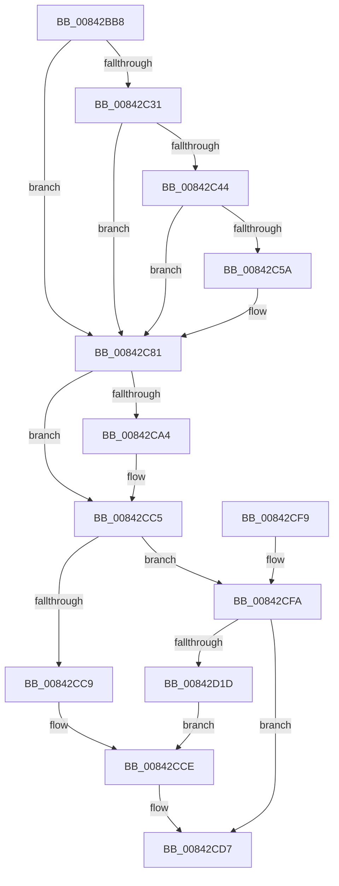

# CmpComputeLogFillLevel

- RVA: `0x00842BB8`–`0x00842D29` (길이 `369` bytes)
- VA: `0x0000000140842BB8`
- 실행 섹션: `PAGE`
- PDB 이름 있음: `예`; PDB Function 태그: `아니요`
- unwind 정보 RVA: `0x00069000`
- 디코드: `105`개 명령, `369/369` bytes 표시
- 미해석 바이트: `0` (있으면 어셈블리에 `.byte`로 보존)

> 이 문서는 커널 이미지의 기계어와 PDB 기호를 분석해 생성했습니다. 4번과 5번은 함수 원형과 자료형을 바이너리 사용 방식에서 추정한 C 해석이며 원본 소스 복구 결과는 아닙니다.

## 1. Dependencies

- 직접 호출 지점: **10**; 고유 호출 대상: **8**
- 직접 호출자로 확인된 함수: **1**
- RIP 상대 이미지 참조: **5**

### Outgoing calls
- `0x00842BFA` → [memset](../../text/6C/memset_function_006C6C40.md) (function, `0x006C6C40`)
- `0x00842C21` → `ext-ms-win-fs-clfs-l1-1-0.dll!ClfsLsnInvalid` (import, 간접 대상; import `ext-ms-win-fs-clfs-l1-1-0.dll!ClfsLsnInvalid`)
- `0x00842C34` → `ext-ms-win-fs-clfs-l1-1-0.dll!ClfsLsnInvalid` (import, 간접 대상; import `ext-ms-win-fs-clfs-l1-1-0.dll!ClfsLsnInvalid`)
- `0x00842C4A` → `ext-ms-win-fs-clfs-l1-1-0.dll!ClfsLsnEqual` (import, 간접 대상; import `ext-ms-win-fs-clfs-l1-1-0.dll!ClfsLsnEqual`)
- `0x00842C73` → `ext-ms-win-fs-clfs-l1-1-0.dll!ClfsLsnDifference` (import, 간접 대상; import `ext-ms-win-fs-clfs-l1-1-0.dll!ClfsLsnDifference`)
- `0x00842C97` → [ExAllocatePool2](../../poolcode/B8/ExAllocatePool2_function_00B820F0.md) (function, `0x00B820F0`)
- `0x00842CAF` → `ext-ms-win-fs-clfs-l1-1-0.dll!ClfsGetLogFileInformation` (import, 간접 대상; import `ext-ms-win-fs-clfs-l1-1-0.dll!ClfsGetLogFileInformation`)
- `0x00842CC0` → [ExFreePoolWithTag](../../poolcode/B8/ExFreePoolWithTag_function_00B82870.md) (function, `0x00B82870`)
- `0x00842CE0` → [_security_check_cookie](../../text/6A/_security_check_cookie_function_006AC640.md) (function, `0x006AC640`)
- `0x00842D0B` → `ext-ms-win-fs-clfs-l1-1-0.dll!ClfsGetLogFileInformation` (import, 간접 대상; import `ext-ms-win-fs-clfs-l1-1-0.dll!ClfsGetLogFileInformation`)

### Direct callers
- [CmpTransWriteLog](CmpTransWriteLog_function_00842A7C.md) at `0x00842B03`

### Static image references
- `0x00842BD1` → RVA `0x00E0A740` (`.data`; read)
- `0x00842C21` → RVA `0x00151200` (`ext-ms-win-fs-clfs-l1-1-0.dll!ClfsLsnInvalid (IAT)`; read)
- `0x00842C4A` → RVA `0x001511F8` (`ext-ms-win-fs-clfs-l1-1-0.dll!ClfsLsnEqual (IAT)`; read)
- `0x00842C73` → RVA `0x00151230` (`ext-ms-win-fs-clfs-l1-1-0.dll!ClfsLsnDifference (IAT)`; read)
- `0x00842CAF` → RVA `0x00151240` (`ext-ms-win-fs-clfs-l1-1-0.dll!ClfsGetLogFileInformation (IAT)`; read)

## 2. Other-region calls and transfers

- 다른 실행 섹션으로 향하는 call: **4**
  - `0x00842BFA` → [memset](../../text/6C/memset_function_006C6C40.md) (`PAGE` → `.text`)
  - `0x00842C97` → [ExAllocatePool2](../../poolcode/B8/ExAllocatePool2_function_00B820F0.md) (`PAGE` → `POOLCODE`)
  - `0x00842CC0` → [ExFreePoolWithTag](../../poolcode/B8/ExFreePoolWithTag_function_00B82870.md) (`PAGE` → `POOLCODE`)
  - `0x00842CE0` → [_security_check_cookie](../../text/6A/_security_check_cookie_function_006AC640.md) (`PAGE` → `.text`)
- 별도 외부 분기/꼬리 이동을 확인하지 못했습니다.

## 3. Assembly (complete function range)

```asm
00842BB8  40 55                           push rbp
00842BBA  53                              push rbx
00842BBB  56                              push rsi
00842BBC  57                              push rdi
00842BBD  41 54                           push r12
00842BBF  41 55                           push r13
00842BC1  41 56                           push r14
00842BC3  41 57                           push r15
00842BC5  48 8D 6C 24 F1                  lea rbp, [rsp - 0xf]
00842BCA  48 81 EC D8 00 00 00            sub rsp, 0xd8
00842BD1  48 8B 05 68 7B 5C 00            mov rax, qword ptr [rip + 0x5c7b68]
00842BD8  48 33 C4                        xor rax, rsp
00842BDB  48 89 45 F7                     mov qword ptr [rbp - 9], rax
00842BDF  4C 8B 65 7F                     mov r12, qword ptr [rbp + 0x7f]
00842BE3  48 8B F2                        mov rsi, rdx
00842BE6  33 D2                           xor edx, edx
00842BE8  49 8B F8                        mov rdi, r8
00842BEB  4C 8B F1                        mov r14, rcx
00842BEE  45 8B F9                        mov r15d, r9d
00842BF1  48 8D 4C 24 40                  lea rcx, [rsp + 0x40]
00842BF6  44 8D 42 78                     lea r8d, [rdx + 0x78]
00842BFA  E8 41 40 E8 FF                  call 0x1406c6c40
00842BFF  48 83 64 24 38 00               and qword ptr [rsp + 0x38], 0
00842C05  41 8B CF                        mov ecx, r15d
00842C08  0F AF 4D 77                     imul ecx, dword ptr [rbp + 0x77]
00842C0C  B8 1F 85 EB 51                  mov eax, 0x51eb851f
00842C11  BB 2D 02 00 C0                  mov ebx, 0xc000022d
00842C16  F7 E1                           mul ecx
00842C18  48 8B CE                        mov rcx, rsi
00842C1B  C1 EA 05                        shr edx, 5
00842C1E  44 8B EA                        mov r13d, edx
00842C21  48 FF 15 D8 E5 90 FF            call qword ptr [rip - 0x6f1a28]
00842C28  0F 1F 44 00 00                  nop dword ptr [rax + rax]
00842C2D  84 C0                           test al, al
00842C2F  75 50                           jne 0x140842c81
00842C31  48 8B CF                        mov rcx, rdi
00842C34  48 FF 15 C5 E5 90 FF            call qword ptr [rip - 0x6f1a3b]
00842C3B  0F 1F 44 00 00                  nop dword ptr [rax + rax]
00842C40  84 C0                           test al, al
00842C42  75 3D                           jne 0x140842c81
00842C44  48 8B D7                        mov rdx, rdi
00842C47  48 8B CE                        mov rcx, rsi
00842C4A  48 FF 15 A7 E5 90 FF            call qword ptr [rip - 0x6f1a59]
00842C51  0F 1F 44 00 00                  nop dword ptr [rax + rax]
00842C56  84 C0                           test al, al
00842C58  75 27                           jne 0x140842c81
00842C5A  48 8D 44 24 38                  lea rax, [rsp + 0x38]
00842C5F  41 B9 00 10 00 00               mov r9d, 0x1000
00842C65  45 8B C7                        mov r8d, r15d
00842C68  48 89 44 24 20                  mov qword ptr [rsp + 0x20], rax
00842C6D  48 8B D7                        mov rdx, rdi
00842C70  48 8B CE                        mov rcx, rsi
00842C73  48 FF 15 B6 E5 90 FF            call qword ptr [rip - 0x6f1a4a]
00842C7A  0F 1F 44 00 00                  nop dword ptr [rax + rax]
00842C7F  8B D8                           mov ebx, eax
00842C81  BE 78 00 00 00                  mov esi, 0x78
00842C86  41 B8 43 4D 20 20               mov r8d, 0x20204d43
00842C8C  8B D6                           mov edx, esi
00842C8E  89 74 24 30                     mov dword ptr [rsp + 0x30], esi
00842C92  B9 00 01 00 00                  mov ecx, 0x100
00842C97  E8 54 F4 33 00                  call 0x140b820f0
00842C9C  48 8B F8                        mov rdi, rax
00842C9F  48 85 C0                        test rax, rax
00842CA2  74 21                           je 0x140842cc5
00842CA4  4C 8D 44 24 30                  lea r8, [rsp + 0x30]
00842CA9  48 8B D0                        mov rdx, rax
00842CAC  49 8B CE                        mov rcx, r14
00842CAF  48 FF 15 8A E5 90 FF            call qword ptr [rip - 0x6f1a76]
00842CB6  0F 1F 44 00 00                  nop dword ptr [rax + rax]
00842CBB  33 D2                           xor edx, edx
00842CBD  48 8B CF                        mov rcx, rdi
00842CC0  E8 AB FB 33 00                  call 0x140b82870
00842CC5  85 DB                           test ebx, ebx
00842CC7  78 31                           js 0x140842cfa
00842CC9  48 8B 44 24 38                  mov rax, qword ptr [rsp + 0x38]
00842CCE  33 D2                           xor edx, edx
00842CD0  49 F7 F5                        div r13
00842CD3  41 89 04 24                     mov dword ptr [r12], eax
00842CD7  8B C3                           mov eax, ebx
00842CD9  48 8B 4D F7                     mov rcx, qword ptr [rbp - 9]
00842CDD  48 33 CC                        xor rcx, rsp
00842CE0  E8 5B 99 E6 FF                  call 0x1406ac640
00842CE5  48 81 C4 D8 00 00 00            add rsp, 0xd8
00842CEC  41 5F                           pop r15
00842CEE  41 5E                           pop r14
00842CF0  41 5D                           pop r13
00842CF2  41 5C                           pop r12
00842CF4  5F                              pop rdi
00842CF5  5E                              pop rsi
00842CF6  5B                              pop rbx
00842CF7  5D                              pop rbp
00842CF8  C3                              ret
00842CF9  CC                              int3
00842CFA  4C 8D 44 24 34                  lea r8, [rsp + 0x34]
00842CFF  89 74 24 34                     mov dword ptr [rsp + 0x34], esi
00842D03  48 8D 54 24 40                  lea rdx, [rsp + 0x40]
00842D08  49 8B CE                        mov rcx, r14
00842D0B  48 FF 15 2E E5 90 FF            call qword ptr [rip - 0x6f1ad2]
00842D12  0F 1F 44 00 00                  nop dword ptr [rax + rax]
00842D17  8B D8                           mov ebx, eax
00842D19  85 C0                           test eax, eax
00842D1B  78 BA                           js 0x140842cd7
00842D1D  48 8B 44 24 40                  mov rax, qword ptr [rsp + 0x40]
00842D22  48 2B 44 24 48                  sub rax, qword ptr [rsp + 0x48]
00842D27  EB A5                           jmp 0x140842cce
```

## 4. C-style interpretation (structured pseudocode)

```c
__int64 __fastcall CmpComputeLogFillLevel(__int64 a1, __int64 a2, __int64 a3, int a4, unsigned int a5, __int64 a6)
{
    __int64 result;
    __int64 v_rbx;
    __int64 v_rsp;
    unsigned __int64 v_stack_m4F;
    unsigned __int64 v_stack_m58;
    unsigned __int64 v_stack_mD8;
    unsigned __int64 v_stack_mE0;
    unsigned int v_stack_mE8;
    unsigned __int64 v_stack_mF8;
    unsigned __int64 v_stack_p34;
    unsigned __int64 v_stack_p40;
    unsigned __int64 v_stack_p48;

    v_rsp = (v_rsp) - (216);
    result = (*(unsigned __int64 *)(v_rip + 6060904)) ^ (v_rsp);
    v_stack_m58 = result;
    a2 = 0;
    result = memset(v_stack_mD8, a2, a2 + 120, a4);
    a1 = (unsigned int)(((unsigned int)((unsigned int)((unsigned int)(a4)))) * (a5));
    a2 = (unsigned int)((a2) >> (5));
    result = ext_ms_win_fs_clfs_l1_1_0_dll_ClfsLsnInvalid(0, a2, a2 + 120, a4);
    if ((unsigned __int8)(result) != 0) goto loc_00842C81;
    result = ext_ms_win_fs_clfs_l1_1_0_dll_ClfsLsnInvalid(a3, a2, a2 + 120, a4);
    if ((unsigned __int8)(result) != 0) goto loc_00842C81;
    result = ext_ms_win_fs_clfs_l1_1_0_dll_ClfsLsnEqual(a2, a3, a2 + 120, a4);
    v_rbx = (unsigned int)(0xC000022DULL);
    if ((unsigned __int8)(result) == 0) {
        result = v_stack_mE0;
        a4 = 0x1000ULL;
        a3 = (unsigned int)((unsigned int)(a4));
        v_stack_mF8 = result;
        a2 = a3;
        a1 = a2;
        result = ext_ms_win_fs_clfs_l1_1_0_dll_ClfsLsnDifference(a1, a2, a3, a4);
        v_rbx = (unsigned int)(result);
    }
    v_stack_mE8 = 120;
    result = ExAllocatePool2(256, 120, (unsigned int)(0x20204D43ULL), a4);
    if (result != 0) {
        a3 = v_stack_mE8;
        a2 = result;
        a1 = a1;
        result = ext_ms_win_fs_clfs_l1_1_0_dll_ClfsGetLogFileInformation(a1, a2, a3, a4);
        a2 = 0;
        a1 = result;
        result = ExFreePoolWithTag(a1, a2, a3, a4);
    }
    if (sign_flag) goto loc_00842CFA;
loc_00842CCE:
    a2 = 0;
    *(unsigned int *)(a6) = (unsigned int)(v_stack_mE0);
loc_00842CD7:
    a1 = (v_stack_m58) ^ (v_rsp);
    result = _security_check_cookie(a1, a2, a3, a4);
    v_rsp = (v_rsp) + (216);
    return result;
loc_00842CFA:
    v_stack_p34 = 120;
    result = ext_ms_win_fs_clfs_l1_1_0_dll_ClfsGetLogFileInformation(a1, v_stack_p40, v_stack_p34, a4);
    if (sign_flag) goto loc_00842CD7;
    result = (v_stack_p40) - (v_stack_p48);
    goto loc_00842CCE;
}
```

## 5. (Beta) C Style

```c
int64_t CmpComputeLogFillLevel(int64_t Arg1, int64_t Arg2, int64_t Arg3, int32_t Arg4, uint32_t Arg5, void *Arg6)
{
    uint8_t *arg6 = (uint8_t *)Arg6;

    int64_t result;
    int64_t local_rbx;
    int64_t local_rsp;
    uint64_t v_stack_m4F;
    uint64_t v_stack_m58;
    uint64_t v_stack_mD8;
    uint64_t v_stack_mE0;
    uint32_t v_stack_mE8;
    uint64_t v_stack_mF8;
    uint64_t v_stack_p34;
    uint64_t v_stack_p40;
    uint64_t v_stack_p48;

    local_rsp = (local_rsp) - (216);
    result = (*(uint64_t *)(v_rip + 0x5C7B68)) ^ (local_rsp);
    v_stack_m58 = result;
    Arg2 = 0;
    result = memset(v_stack_mD8, Arg2, Arg2 + 120, Arg4);
    Arg1 = (uint32_t)(((uint32_t)((uint32_t)((uint32_t)(Arg4)))) * (Arg5));
    Arg2 = (uint32_t)((Arg2) >> (5));
    result = kernel_indirect_call(0, Arg2, Arg2 + 120, Arg4);
    if ((uint8_t)(result) != 0) goto loc_00842C81;
    result = kernel_indirect_call(Arg3, Arg2, Arg2 + 120, Arg4);
    if ((uint8_t)(result) != 0) goto loc_00842C81;
    result = kernel_indirect_call(Arg2, Arg3, Arg2 + 120, Arg4);
    local_rbx = (uint32_t)(0xC000022DULL);
    if ((uint8_t)(result) == 0) {
        result = v_stack_mE0;
        Arg4 = 0x1000ULL;
        Arg3 = (uint32_t)((uint32_t)(Arg4));
        v_stack_mF8 = result;
        Arg2 = Arg3;
        Arg1 = Arg2;
        result = kernel_indirect_call(Arg1, Arg2, Arg3, Arg4);
        local_rbx = (uint32_t)(result);
    }
    v_stack_mE8 = 120;
    result = ExAllocatePool2(256, 120, (uint32_t)(0x20204D43ULL), Arg4);
    if (result != 0) {
        Arg3 = v_stack_mE8;
        Arg2 = result;
        Arg1 = Arg1;
        result = kernel_indirect_call(Arg1, Arg2, Arg3, Arg4);
        Arg2 = 0;
        Arg1 = result;
        result = ExFreePoolWithTag(Arg1, Arg2, Arg3, Arg4);
    }
    if (sign_flag) goto loc_00842CFA;
loc_00842CCE:
    Arg2 = 0;
    *(uint32_t *)(arg6) = (uint32_t)(v_stack_mE0);
loc_00842CD7:
    Arg1 = (v_stack_m58) ^ (local_rsp);
    result = _security_check_cookie(Arg1, Arg2, Arg3, Arg4);
    local_rsp = (local_rsp) + (216);
    return result;
loc_00842CFA:
    v_stack_p34 = 120;
    result = kernel_indirect_call(Arg1, v_stack_p40, v_stack_p34, Arg4);
    if (sign_flag) goto loc_00842CD7;
    result = (v_stack_p40) - (v_stack_p48);
    goto loc_00842CCE;
}
```

### 관측된 메모리 오프셋

구조체 형식이 확인되지 않은 접근은 인자 기준의 오프셋으로만 기록했습니다.

| 기준 인자 | 오프셋 표현 | 폭 (bit) | 접근 |
|---|---:|---:|---|
| `Arg6` | `+ 0x0` | `32` | `W` |

## 6. Execution-region graph

[열기: 2D/3D 그래프와 함수 탐색 컨트롤 패널](../../../control-panel.html?section=page&rva=0x00842BB8&view=graph)

- 2D 그래프는 위에서 아래로 흐르고, 3D 그래프는 빈 공간을 드래그해 회전합니다. Shift+드래그는 이동, 휠은 확대·축소, 함수 노드 선택은 대상 보고서 이동입니다.

### Static fallback


