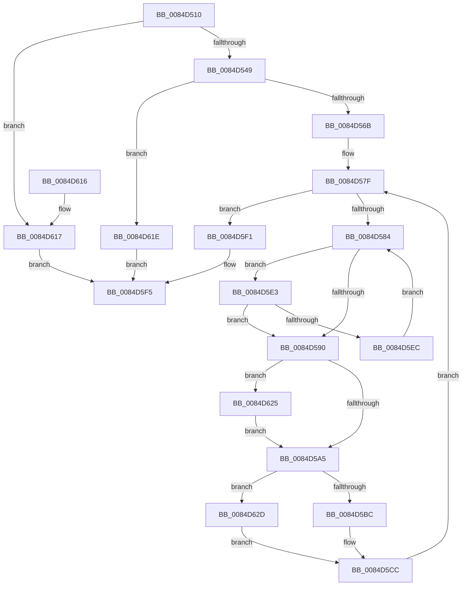

# CmpConstructNameFromKcbNameBlocks

- RVA: `0x0084D510`–`0x0084D63E` (길이 `302` bytes)
- VA: `0x000000014084D510`
- 실행 섹션: `PAGE`
- PDB 이름 있음: `예`; PDB Function 태그: `아니요`
- unwind 정보 RVA: `0x00069A88`
- 디코드: `83`개 명령, `302/302` bytes 표시
- 미해석 바이트: `0` (있으면 어셈블리에 `.byte`로 보존)

> 이 문서는 커널 이미지의 기계어와 PDB 기호를 분석해 생성했습니다. 4번과 5번은 함수 원형과 자료형을 바이너리 사용 방식에서 추정한 C 해석이며 원본 소스 복구 결과는 아닙니다.

## 1. Dependencies

- 직접 호출 지점: **4**; 고유 호출 대상: **4**
- 직접 호출자로 확인된 함수: **5**
- RIP 상대 이미지 참조: **0**

### Outgoing calls
- `0x0084D533` → [CmpKeyFullNameLength](../94/CmpKeyFullNameLength_function_0094B040.md) (function, `0x0094B040`)
- `0x0084D558` → [CmpAllocatePool](../../text/3C/CmpAllocatePool_function_003CD504.md) (function, `0x003CD504`)
- `0x0084D5C7` → [CmpCopyCompressedName](CmpCopyCompressedName_function_0084E0D0.md) (function, `0x0084E0D0`)
- `0x0084D637` → [memcpy](../../text/6C/memcpy_function_006C6840.md) (function, `0x006C6840`)

### Direct callers
- [sub_0084D3A1](Unknown_function_0084D3A1.md) at `0x0084D3A8`
- [CmpConstructNameWithStatus](../85/CmpConstructNameWithStatus_function_008562A0.md) at `0x008563D2`
- [CmpConstructName](../85/CmpConstructName_function_00856BE0.md) at `0x00856D07`
- [CmpLogTransactionAbortedWithChildName](../9A/CmpLogTransactionAbortedWithChildName_function_009AED70.md) at `0x009AEDE2`
- [sub_00B160F4](../B1/Unknown_function_00B160F4.md) at `0x00B16162`

### Static image references
- 디코드된 RIP-relative 메모리 참조가 없습니다.

## 2. Other-region calls and transfers

- 다른 실행 섹션으로 향하는 call: **2**
  - `0x0084D558` → [CmpAllocatePool](../../text/3C/CmpAllocatePool_function_003CD504.md) (`PAGE` → `.text`)
  - `0x0084D637` → [memcpy](../../text/6C/memcpy_function_006C6840.md) (`PAGE` → `.text`)
- 별도 외부 분기/꼬리 이동을 확인하지 못했습니다.

## 3. Assembly (complete function range)

```asm
0084D510  48 8B C4                        mov rax, rsp
0084D513  48 89 58 08                     mov qword ptr [rax + 8], rbx
0084D517  48 89 68 10                     mov qword ptr [rax + 0x10], rbp
0084D51B  48 89 70 18                     mov qword ptr [rax + 0x18], rsi
0084D51F  48 89 78 20                     mov qword ptr [rax + 0x20], rdi
0084D523  41 54                           push r12
0084D525  41 56                           push r14
0084D527  41 57                           push r15
0084D529  48 83 EC 20                     sub rsp, 0x20
0084D52D  48 8B EA                        mov rbp, rdx
0084D530  48 8B F1                        mov rsi, rcx
0084D533  E8 08 DB 0F 00                  call 0x14094b040
0084D538  41 BC FF FF 00 00               mov r12d, 0xffff
0084D53E  8B F8                           mov edi, eax
0084D540  41 3B C4                        cmp eax, r12d
0084D543  0F 87 CE 00 00 00               ja 0x14084d617
0084D549  48 8D 57 10                     lea rdx, [rdi + 0x10]
0084D54D  B9 00 01 00 00                  mov ecx, 0x100
0084D552  41 B8 43 4D 4E 62               mov r8d, 0x624e4d43
0084D558  E8 A7 FF B7 FF                  call 0x1403cd504
0084D55D  33 DB                           xor ebx, ebx
0084D55F  4C 8B F0                        mov r14, rax
0084D562  48 85 C0                        test rax, rax
0084D565  0F 84 B3 00 00 00               je 0x14084d61e
0084D56B  48 83 C0 10                     add rax, 0x10
0084D56F  66 41 89 3E                     mov word ptr [r14], di
0084D573  66 41 89 7E 02                  mov word ptr [r14 + 2], di
0084D578  49 89 46 08                     mov qword ptr [r14 + 8], rax
0084D57C  66 D1 EF                        shr di, 1
0084D57F  48 85 F6                        test rsi, rsi
0084D582  74 6D                           je 0x14084d5f1
0084D584  F7 86 B8 00 00 00 00 00 04 00   test dword ptr [rsi + 0xb8], 0x40000
0084D58E  75 53                           jne 0x14084d5e3
0084D590  48 8B 46 50                     mov rax, qword ptr [rsi + 0x50]
0084D594  44 8B 00                        mov r8d, dword ptr [rax]
0084D597  0F B7 50 18                     movzx edx, word ptr [rax + 0x18]
0084D59B  41 83 E0 01                     and r8d, 1
0084D59F  0F 84 80 00 00 00               je 0x14084d625
0084D5A5  66 2B FA                        sub di, dx
0084D5A8  4C 8D 50 1A                     lea r10, [rax + 0x1a]
0084D5AC  49 8B 46 08                     mov rax, qword ptr [r14 + 8]
0084D5B0  0F B7 CF                        movzx ecx, di
0084D5B3  48 8D 0C 48                     lea rcx, [rax + rcx*2]
0084D5B7  45 85 C0                        test r8d, r8d
0084D5BA  74 71                           je 0x14084d62d
0084D5BC  44 0F B7 CA                     movzx r9d, dx
0084D5C0  4D 8B C2                        mov r8, r10
0084D5C3  43 8D 14 09                     lea edx, [r9 + r9]
0084D5C7  E8 04 0B 00 00                  call 0x14084e0d0
0084D5CC  49 8B 4E 08                     mov rcx, qword ptr [r14 + 8]
0084D5D0  66 41 03 FC                     add di, r12w
0084D5D4  0F B7 D7                        movzx edx, di
0084D5D7  66 C7 04 51 5C 00               mov word ptr [rcx + rdx*2], 0x5c
0084D5DD  48 8B 76 48                     mov rsi, qword ptr [rsi + 0x48]
0084D5E1  EB 9C                           jmp 0x14084d57f
0084D5E3  48 8B 46 48                     mov rax, qword ptr [rsi + 0x48]
0084D5E7  48 85 C0                        test rax, rax
0084D5EA  74 A4                           je 0x14084d590
0084D5EC  48 8B F0                        mov rsi, rax
0084D5EF  EB 93                           jmp 0x14084d584
0084D5F1  4C 89 75 00                     mov qword ptr [rbp], r14
0084D5F5  48 8B 6C 24 48                  mov rbp, qword ptr [rsp + 0x48]
0084D5FA  8B C3                           mov eax, ebx
0084D5FC  48 8B 5C 24 40                  mov rbx, qword ptr [rsp + 0x40]
0084D601  48 8B 74 24 50                  mov rsi, qword ptr [rsp + 0x50]
0084D606  48 8B 7C 24 58                  mov rdi, qword ptr [rsp + 0x58]
0084D60B  48 83 C4 20                     add rsp, 0x20
0084D60F  41 5F                           pop r15
0084D611  41 5E                           pop r14
0084D613  41 5C                           pop r12
0084D615  C3                              ret
0084D616  CC                              int3
0084D617  BB 0D 00 00 C0                  mov ebx, 0xc000000d
0084D61C  EB D7                           jmp 0x14084d5f5
0084D61E  BB 9A 00 00 C0                  mov ebx, 0xc000009a
0084D623  EB D0                           jmp 0x14084d5f5
0084D625  66 D1 EA                        shr dx, 1
0084D628  E9 78 FF FF FF                  jmp 0x14084d5a5
0084D62D  44 0F B7 C2                     movzx r8d, dx
0084D631  49 8B D2                        mov rdx, r10
0084D634  4D 03 C0                        add r8, r8
0084D637  E8 04 92 E7 FF                  call 0x1406c6840
0084D63C  EB 8E                           jmp 0x14084d5cc
```

## 4. C-style interpretation (structured pseudocode)

```c
__int64 __fastcall CmpConstructNameFromKcbNameBlocks(__int64 a1, __int64 a2)
{
    __int64 result;
    __int64 v_rbx;
    __int64 v_rdi;
    __int64 v_rsp;
    unsigned __int64 v_stack_p10;
    unsigned __int64 v_stack_p18;
    unsigned __int64 v_stack_p20;
    unsigned __int64 v_stack_p8;

    *(unsigned __int64 *)(v_rsp + 8) = v_rbx;
    *(unsigned __int64 *)(v_rsp + 16) = v_rbp;
    *(unsigned __int64 *)(v_rsp + 24) = v_rsi;
    *(unsigned __int64 *)(v_rsp + 32) = v_rdi;
    v_rsp = (v_rsp) - (32);
    result = CmpKeyFullNameLength(a1, a2, a3, a4);
    if (((unsigned int)(result)) > ((unsigned int)((unsigned int)(0xFFFFULL)))) goto loc_0084D617;
    result = CmpAllocatePool(256, (unsigned int)((unsigned int)(result)) + 16, (unsigned int)(0x624E4D43ULL), a4);
    v_rbx = 0;
    if (result == 0) goto loc_0084D61E;
    result = (result) + (16);
    *(unsigned __int16 *)(result) = (unsigned __int16)((unsigned int)((unsigned int)(result)));
    *(unsigned __int16 *)(result + 2) = (unsigned __int16)((unsigned int)((unsigned int)(result)));
    *(unsigned __int64 *)(result + 8) = result;
    v_rdi = (unsigned __int16)(((unsigned int)((unsigned int)(result))) >> (1));
loc_0084D57F:
    if (a1 == 0) goto loc_0084D5F1;
loc_0084D584:
    if (((*(unsigned int *)(a1 + 184)) & (0x40000ULL)) != 0) goto loc_0084D5E3;
loc_0084D590:
    a3 = (unsigned int)(((unsigned int)(*(unsigned int *)(*(unsigned __int64 *)(a1 + 80)))) & (1));
    if (condition_is_equal) goto loc_0084D625;
loc_0084D5A5:
    v_rdi = (unsigned __int16)((v_rdi) - ((unsigned __int16)(*(unsigned __int16 *)(*(unsigned __int64 *)(a1 + 80) + 24))));
    if ((unsigned int)(a3) == 0) goto loc_0084D62D;
    result = CmpCopyCompressedName(*(unsigned __int64 *)(result + 8) + (unsigned __int16)(v_rdi) * 2, (unsigned __int16)(*(unsigned __int16 *)(*(unsigned __int64 *)(a1 + 80) + 24)) + (unsigned __int16)(*(unsigned __int16 *)(*(unsigned __int64 *)(a1 + 80) + 24)) * 1, *(unsigned __int64 *)(a1 + 80) + 26, (unsigned __int16)(*(unsigned __int16 *)(*(unsigned __int64 *)(a1 + 80) + 24)));
loc_0084D5CC:
    v_rdi = (unsigned __int16)((v_rdi) + ((unsigned __int16)((unsigned int)(0xFFFFULL))));
    *(unsigned __int16 *)(*(unsigned __int64 *)(result + 8) + (unsigned __int16)(v_rdi) * 2) = 92;
    goto loc_0084D57F;
loc_0084D5E3:
    if (*(unsigned __int64 *)(*(unsigned __int64 *)(a1 + 72) + 72) == 0) goto loc_0084D590;
    goto loc_0084D584;
loc_0084D5F1:
    *(unsigned __int64 *)(a2) = result;
loc_0084D5F5:
    v_rsp = (v_rsp) + (32);
    return 0;
loc_0084D617:
    goto loc_0084D5F5;
loc_0084D61E:
    goto loc_0084D5F5;
loc_0084D625:
    a2 = (unsigned __int16)(((unsigned __int16)(v_rdi)) >> (1));
    goto loc_0084D5A5;
loc_0084D62D:
    a3 = ((unsigned __int16)(a2)) + ((unsigned __int16)(a2));
    result = memcpy(*(unsigned __int64 *)(result + 8), *(unsigned __int64 *)(a1 + 80) + 26, a3, (unsigned __int16)(*(unsigned __int16 *)(*(unsigned __int64 *)(a1 + 80) + 24)));
    goto loc_0084D5CC;
}
```

## 5. (Beta) C Style

```c
int64_t CmpConstructNameFromKcbNameBlocks(int64_t Arg1, void *Arg2)
{
    uint8_t *arg2 = (uint8_t *)Arg2;

    int64_t result;
    int64_t local_rbx;
    int64_t local_rdi;
    int64_t local_rsp;
    uint64_t v_stack_p10;
    uint64_t v_stack_p18;
    uint64_t v_stack_p20;
    uint64_t v_stack_p8;

    *(uint64_t *)(local_rsp + 0x8) = local_rbx;
    *(uint64_t *)(local_rsp + 0x10) = local_rbp;
    *(uint64_t *)(local_rsp + 0x18) = local_rsi;
    *(uint64_t *)(local_rsp + 0x20) = local_rdi;
    local_rsp = (local_rsp) - (32);
    result = CmpKeyFullNameLength(Arg1, Arg2, a3, a4);
    if (((uint32_t)(result)) > ((uint32_t)((uint32_t)(0xFFFFULL)))) goto loc_0084D617;
    result = CmpAllocatePool(256, (uint32_t)((uint32_t)(result)) + 16, (uint32_t)(0x624E4D43ULL), a4);
    local_rbx = 0;
    if (result == 0) goto loc_0084D61E;
    result = (result) + (16);
    *(uint16_t *)(result) = (uint16_t)((uint32_t)((uint32_t)(result)));
    *(uint16_t *)(result + 0x2) = (uint16_t)((uint32_t)((uint32_t)(result)));
    *(uint64_t *)(result + 0x8) = result;
    local_rdi = (uint16_t)(((uint32_t)((uint32_t)(result))) >> (1));
loc_0084D57F:
    if (Arg1 == 0) goto loc_0084D5F1;
loc_0084D584:
    if (((*(uint32_t *)(Arg1 + 0xB8)) & (0x40000ULL)) != 0) goto loc_0084D5E3;
loc_0084D590:
    a3 = (uint32_t)(((uint32_t)(*(uint32_t *)(*(uint64_t *)(Arg1 + 0x50)))) & (1));
    if (condition_is_equal) goto loc_0084D625;
loc_0084D5A5:
    local_rdi = (uint16_t)((local_rdi) - ((uint16_t)(*(uint16_t *)(*(uint64_t *)(Arg1 + 0x50) + 0x18))));
    if ((uint32_t)(a3) == 0) goto loc_0084D62D;
    result = CmpCopyCompressedName(*(uint64_t *)(result + 0x8) + (uint16_t)(local_rdi) * 2, (uint16_t)(*(uint16_t *)(*(uint64_t *)(Arg1 + 0x50) + 0x18)) + (uint16_t)(*(uint16_t *)(*(uint64_t *)(Arg1 + 0x50) + 0x18)) * 1, *(uint64_t *)(Arg1 + 0x50) + 26, (uint16_t)(*(uint16_t *)(*(uint64_t *)(Arg1 + 0x50) + 0x18)));
loc_0084D5CC:
    local_rdi = (uint16_t)((local_rdi) + ((uint16_t)((uint32_t)(0xFFFFULL))));
    *(uint16_t *)(*(uint64_t *)(result + 0x8) + (uint16_t)(local_rdi) * 2) = 92;
    goto loc_0084D57F;
loc_0084D5E3:
    if (*(uint64_t *)(*(uint64_t *)(Arg1 + 0x48) + 0x48) == 0) goto loc_0084D590;
    goto loc_0084D584;
loc_0084D5F1:
    *(uint64_t *)(arg2) = result;
loc_0084D5F5:
    local_rsp = (local_rsp) + (32);
    return 0;
loc_0084D617:
    goto loc_0084D5F5;
loc_0084D61E:
    goto loc_0084D5F5;
loc_0084D625:
    Arg2 = (uint16_t)(((uint16_t)(local_rdi)) >> (1));
    goto loc_0084D5A5;
loc_0084D62D:
    a3 = ((uint16_t)(Arg2)) + ((uint16_t)(Arg2));
    result = memcpy(*(uint64_t *)(result + 0x8), *(uint64_t *)(Arg1 + 0x50) + 26, a3, (uint16_t)(*(uint16_t *)(*(uint64_t *)(Arg1 + 0x50) + 0x18)));
    goto loc_0084D5CC;
}
```

### 관측된 메모리 오프셋

구조체 형식이 확인되지 않은 접근은 인자 기준의 오프셋으로만 기록했습니다.

| 기준 인자 | 오프셋 표현 | 폭 (bit) | 접근 |
|---|---:|---:|---|
| `Arg2` | `+ 0x0` | `64` | `W` |

## 6. Execution-region graph

[열기: 2D/3D 그래프와 함수 탐색 컨트롤 패널](../../../control-panel.html?section=page&rva=0x0084D510&view=graph)

- 2D 그래프는 위에서 아래로 흐르고, 3D 그래프는 빈 공간을 드래그해 회전합니다. Shift+드래그는 이동, 휠은 확대·축소, 함수 노드 선택은 대상 보고서 이동입니다.

### Static fallback


