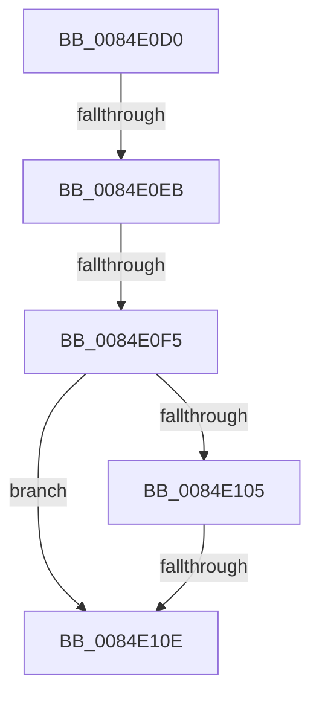

# CmpCopyCompressedName

- RVA: `0x0084E0D0`–`0x0084E118` (길이 `72` bytes)
- VA: `0x000000014084E0D0`
- 실행 섹션: `PAGE`
- PDB 이름 있음: `예`; PDB Function 태그: `아니요`
- unwind 정보 RVA: `0x00069B80`
- 디코드: `19`개 명령, `72/72` bytes 표시
- 미해석 바이트: `0` (있으면 어셈블리에 `.byte`로 보존)

> 이 문서는 커널 이미지의 기계어와 PDB 기호를 분석해 생성했습니다. 4번과 5번은 함수 원형과 자료형을 바이너리 사용 방식에서 추정한 C 해석이며 원본 소스 복구 결과는 아닙니다.

## 1. Dependencies

- 직접 호출 지점: **0**; 고유 호출 대상: **0**
- 직접 호출자로 확인된 함수: **13**
- RIP 상대 이미지 참조: **0**

### Outgoing calls
- 직접 디코드된 call 명령이 없습니다.

### Direct callers
- [CmpLoadHiveVolatile](../7D/CmpLoadHiveVolatile_function_007DE5F0.md) at `0x007DE93B`
- [CmAddLogForAction](CmAddLogForAction_function_008445AC.md) at `0x00844802`
- [CmpMarkIndexDirty](CmpMarkIndexDirty_function_0084C30C.md) at `0x0084C3B2`
- [CmpConstructNameFromKcbNameBlocks](CmpConstructNameFromKcbNameBlocks_function_0084D510.md) at `0x0084D5C7`
- [CmpAddSubKeyToList](CmpAddSubKeyToList_function_0084D644.md) at `0x0084D712`
- [CmpPopulateKeyNodeInformation](CmpPopulateKeyNodeInformation_function_0084DFB0.md) at `0x0084E04A`
- [CmpQueryKeyDataFromNode](CmpQueryKeyDataFromNode_function_0084EAE0.md) at `0x0084EE9C`
- [sub_00855CD6](../85/Unknown_function_00855CD6.md) at `0x00855D1B`
- [CmpQueryKeyValueData](../85/CmpQueryKeyValueData_function_00856650.md) at `0x00856A5F`
- [CmpInitializeValueNameString](../A0/CmpInitializeValueNameString_function_00A0F644.md) at `0x00A0F68C`
- [CmpInitializeKeyNameString](../A8/CmpInitializeKeyNameString_function_00A8B734.md) at `0x00A8B774`
- [CmSelectQualifiedInstallLanguage](../../init/C5/CmSelectQualifiedInstallLanguage_function_00C58F58.md) at `0x00C5936C`
- [CmpGetNodeName](../../init/C5/CmpGetNodeName_function_00C5C95C.md) at `0x00C5C9C5`

### Static image references
- 디코드된 RIP-relative 메모리 참조가 없습니다.

## 2. Other-region calls and transfers

- 다른 실행 섹션으로 향하는 call: **0**
- call이 아닌 외부 분기/꼬리 이동: **4**
  - `0x0084E0E5` → [sub_0084E1A4 + 0x48](Unknown_function_0084E1A4.md) (`tail-transfer`)
  - `0x0084E0EF` → [sub_0084E1A4 + 0x25](Unknown_function_0084E1A4.md) (`tail-transfer`)
  - `0x0084E108` → [sub_0084E1A4 + 0x25](Unknown_function_0084E1A4.md) (`tail-transfer`)
  - `0x0084E112` → [sub_0084E1A4](Unknown_function_0084E1A4.md) (`tail-transfer`)

## 3. Assembly (complete function range)

```asm
0084E0D0  48 83 EC 08                     sub rsp, 8
0084E0D4  D1 EA                           shr edx, 1
0084E0D6  4C 8B D1                        mov r10, rcx
0084E0D9  41 3B D1                        cmp edx, r9d
0084E0DC  44 0F 42 CA                     cmovb r9d, edx
0084E0E0  33 C0                           xor eax, eax
0084E0E2  45 85 C9                        test r9d, r9d
0084E0E5  0F 84 01 01 00 00               je 0x14084e1ec
0084E0EB  41 83 F9 04                     cmp r9d, 4
0084E0EF  0F 82 D4 00 00 00               jb 0x14084e1c9
0084E0F5  41 8D 49 FF                     lea ecx, [r9 - 1]
0084E0F9  4D 8D 1C 4A                     lea r11, [r10 + rcx*2]
0084E0FD  49 03 C8                        add rcx, r8
0084E100  4C 3B D1                        cmp r10, rcx
0084E103  77 09                           ja 0x14084e10e
0084E105  4D 3B D8                        cmp r11, r8
0084E108  0F 83 BB 00 00 00               jae 0x14084e1c9
0084E10E  41 83 F9 20                     cmp r9d, 0x20
0084E112  0F 82 8C 00 00 00               jb 0x14084e1a4
```

## 4. C-style interpretation (structured pseudocode)

```c
__int64 __fastcall CmpCopyCompressedName(__int64 a1, int a2, __int64 a3, int a4)
{
    __int64 result;
    __int64 v_rsp;

    v_rsp = (v_rsp) - (8);
    a2 = (unsigned int)((a2) >> (1));
    if (a2 < a4) { a4 = a2; }
    result = 0;
    a1 = (a4 - 1) + (a3);
    if (a1 > a1) goto loc_0084E10E;
loc_0084E10E:
}
```

## 5. (Beta) C Style

```c
int64_t CmpCopyCompressedName(void *Arg1, int32_t Arg2, int64_t Arg3, int32_t Arg4)
{
    uint8_t *arg1 = (uint8_t *)Arg1;

    int64_t result;
    int64_t local_rsp;

    local_rsp = (local_rsp) - (8);
    Arg2 = (uint32_t)((Arg2) >> (1));
    if (Arg2 < Arg4) { Arg4 = Arg2; }
    result = 0;
    Arg1 = (Arg4 - 1) + (Arg3);
    if (Arg1 > Arg1) goto loc_0084E10E;
loc_0084E10E:
}
```

### 관측된 메모리 오프셋

구조체 형식이 확인되지 않은 접근은 인자 기준의 오프셋으로만 기록했습니다.

| 기준 인자 | 오프셋 표현 | 폭 (bit) | 접근 |
|---|---:|---:|---|
| `Arg1` | `+ 0x0 + rcx*2` | `64` | `R` |

## 6. Execution-region graph

[열기: 2D/3D 그래프와 함수 탐색 컨트롤 패널](../../../control-panel.html?section=page&rva=0x0084E0D0&view=graph)

- 2D 그래프는 위에서 아래로 흐르고, 3D 그래프는 빈 공간을 드래그해 회전합니다. Shift+드래그는 이동, 휠은 확대·축소, 함수 노드 선택은 대상 보고서 이동입니다.

### Static fallback


