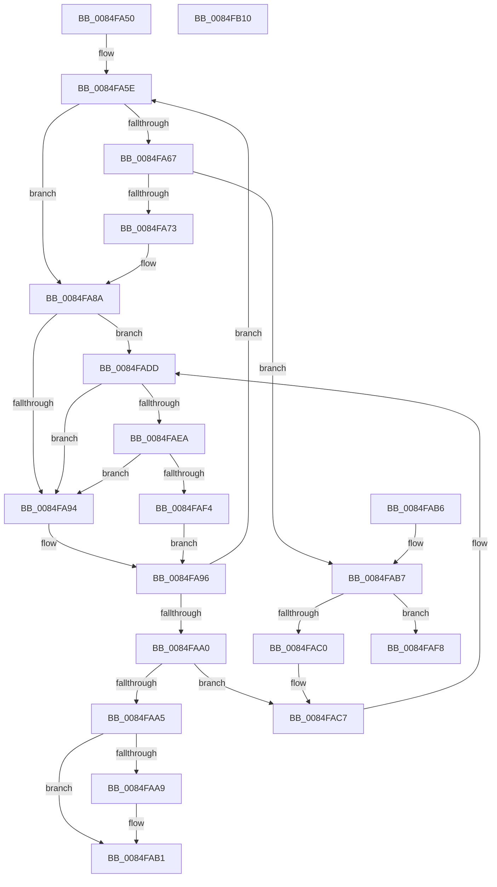

# CmpDelayDerefKeyControlBlock

- RVA: `0x0084FA50`–`0x0084FB11` (길이 `193` bytes)
- VA: `0x000000014084FA50`
- 실행 섹션: `PAGE`
- PDB 이름 있음: `예`; PDB Function 태그: `아니요`
- unwind 정보 RVA: `0x00069D4C`
- 디코드: `59`개 명령, `193/193` bytes 표시
- 미해석 바이트: `0` (있으면 어셈블리에 `.byte`로 보존)

> 이 문서는 커널 이미지의 기계어와 PDB 기호를 분석해 생성했습니다. 4번과 5번은 함수 원형과 자료형을 바이너리 사용 방식에서 추정한 C 해석이며 원본 소스 복구 결과는 아닙니다.

## 1. Dependencies

- 직접 호출 지점: **3**; 고유 호출 대상: **2**
- 직접 호출자로 확인된 함수: **12**
- RIP 상대 이미지 참조: **0**

### Outgoing calls
- `0x0084FA84` → [KeBugCheckEx](../../text/4F/KeBugCheckEx_function_004FD660.md) (function, `0x004FD660`)
- `0x0084FAAC` → [CmpDoQueueLateUnloadWorker](CmpDoQueueLateUnloadWorker_function_0084FB18.md) (function, `0x0084FB18`)
- `0x0084FAD7` → [KeBugCheckEx](../../text/4F/KeBugCheckEx_function_004FD660.md) (function, `0x004FD660`)

### Direct callers
- [CmSetValueKey](CmSetValueKey_function_008457C0.md) at `0x00846482`
- [CmDeleteValueKey](CmDeleteValueKey_function_008476E8.md) at `0x00848023`
- [CmpCleanUpKcbCachedSymlink](CmpCleanUpKcbCachedSymlink_function_0084DF6C.md) at `0x0084DF93`
- [sub_00851A5C](../85/Unknown_function_00851A5C.md) at `0x00851B5F`
- [CmpDoParseKey](../85/CmpDoParseKey_function_0085F750.md) at `0x00861022`
- [sub_008621C0](../86/Unknown_function_008621C0.md) at `0x0086220A`
- [sub_0086303A](../86/Unknown_function_0086303A.md) at `0x00863098`
- [CmpRemoveLayerLinkForDiscardedKcb](../9B/CmpRemoveLayerLinkForDiscardedKcb_function_009B3BE0.md) at `0x009B3C15`
- [CmpCommitDiscardAndReplaceKcbAndUnbackedHigherLayers](../A5/CmpCommitDiscardAndReplaceKcbAndUnbackedHigherLayers_function_00A55070.md) at `0x00A55111`
- [CmpCommitDiscardAndReplaceKcbAndUnbackedHigherLayers](../A5/CmpCommitDiscardAndReplaceKcbAndUnbackedHigherLayers_function_00A55070.md) at `0x00A551A4`
- [CmpCommitDiscardAndReplaceKcbAndUnbackedHigherLayers](../A5/CmpCommitDiscardAndReplaceKcbAndUnbackedHigherLayers_function_00A55070.md) at `0x00A551BD`
- [CmpEnumerateAllHigherLayerKcbs](../A5/CmpEnumerateAllHigherLayerKcbs_function_00A55234.md) at `0x00A55325`
- [CmpEnumerateAllHigherLayerKcbs](../A5/CmpEnumerateAllHigherLayerKcbs_function_00A55234.md) at `0x00A553C5`
- [CmpEnumerateAllHigherLayerKcbs](../A5/CmpEnumerateAllHigherLayerKcbs_function_00A55234.md) at `0x00A553DE`
- [CmpKeyEnumStackFreeResumeContext](../A6/CmpKeyEnumStackFreeResumeContext_function_00A6DDD8.md) at `0x00A6DE6C`
- [CmpFindSubKeyByNumberFromMergedView](../AB/CmpFindSubKeyByNumberFromMergedView_function_00AB8284.md) at `0x00AB8341`
- [CmpFindSubKeyByNumberFromMergedView](../AB/CmpFindSubKeyByNumberFromMergedView_function_00AB8284.md) at `0x00AB835C`
- [CmpFindSubKeyByNumberFromMergedView](../AB/CmpFindSubKeyByNumberFromMergedView_function_00AB8284.md) at `0x00AB8569`
- [CmpFindSubKeyByNumberFromMergedView](../AB/CmpFindSubKeyByNumberFromMergedView_function_00AB8284.md) at `0x00AB857D`

### Static image references
- 디코드된 RIP-relative 메모리 참조가 없습니다.

## 2. Other-region calls and transfers

- 다른 실행 섹션으로 향하는 call: **2**
  - `0x0084FA84` → [KeBugCheckEx](../../text/4F/KeBugCheckEx_function_004FD660.md) (`PAGE` → `.text`)
  - `0x0084FAD7` → [KeBugCheckEx](../../text/4F/KeBugCheckEx_function_004FD660.md) (`PAGE` → `.text`)
- 별도 외부 분기/꼬리 이동을 확인하지 못했습니다.

## 3. Assembly (complete function range)

```asm
0084FA50  48 83 EC 38                     sub rsp, 0x38
0084FA54  4C 8B 51 20                     mov r10, qword ptr [rcx + 0x20]
0084FA58  4C 8B C1                        mov r8, rcx
0084FA5B  48 8B 01                        mov rax, qword ptr [rcx]
0084FA5E  4C 8B C8                        mov r9, rax
0084FA61  48 83 F8 01                     cmp rax, 1
0084FA65  77 23                           ja 0x14084fa8a
0084FA67  49 8D 80 E0 00 00 00            lea rax, [r8 + 0xe0]
0084FA6E  48 39 00                        cmp qword ptr [rax], rax
0084FA71  74 44                           je 0x14084fab7
0084FA73  33 C0                           xor eax, eax
0084FA75  48 89 44 24 20                  mov qword ptr [rsp + 0x20], rax
0084FA7A  8D 50 34                        lea edx, [rax + 0x34]
0084FA7D  8D 48 51                        lea ecx, [rax + 0x51]
0084FA80  44 8D 48 01                     lea r9d, [rax + 1]
0084FA84  E8 D7 DB CA FF                  call 0x1404fd660
0084FA89  CC                              int3
0084FA8A  4C 8D 58 FF                     lea r11, [rax - 1]
0084FA8E  49 83 FB 02                     cmp r11, 2
0084FA92  74 49                           je 0x14084fadd
0084FA94  32 C9                           xor cl, cl
0084FA96  F0 4D 0F B1 18                  lock cmpxchg qword ptr [r8], r11
0084FA9B  49 3B C1                        cmp rax, r9
0084FA9E  75 BE                           jne 0x14084fa5e
0084FAA0  49 3B C3                        cmp rax, r11
0084FAA3  72 22                           jb 0x14084fac7
0084FAA5  84 C9                           test cl, cl
0084FAA7  74 08                           je 0x14084fab1
0084FAA9  49 8B CA                        mov rcx, r10
0084FAAC  E8 67 00 00 00                  call 0x14084fb18
0084FAB1  48 83 C4 38                     add rsp, 0x38
0084FAB5  C3                              ret
0084FAB6  CC                              int3
0084FAB7  48 8B 4A 08                     mov rcx, qword ptr [rdx + 8]
0084FABB  48 39 11                        cmp qword ptr [rcx], rdx
0084FABE  74 38                           je 0x14084faf8
0084FAC0  B9 03 00 00 00                  mov ecx, 3
0084FAC5  CD 29                           int 0x29
0084FAC7  33 C0                           xor eax, eax
0084FAC9  45 33 C9                        xor r9d, r9d
0084FACC  48 89 44 24 20                  mov qword ptr [rsp + 0x20], rax
0084FAD1  8D 50 25                        lea edx, [rax + 0x25]
0084FAD4  8D 48 51                        lea ecx, [rax + 0x51]
0084FAD7  E8 84 DB CA FF                  call 0x1404fd660
0084FADC  CC                              int3
0084FADD  41 F7 80 B8 00 00 00 00 00 04 00  test dword ptr [r8 + 0xb8], 0x40000
0084FAE8  74 AA                           je 0x14084fa94
0084FAEA  41 80 BA 80 0B 00 00 01         cmp byte ptr [r10 + 0xb80], 1
0084FAF2  75 A0                           jne 0x14084fa94
0084FAF4  B1 01                           mov cl, 1
0084FAF6  EB 9E                           jmp 0x14084fa96
0084FAF8  48 89 10                        mov qword ptr [rax], rdx
0084FAFB  48 89 48 08                     mov qword ptr [rax + 8], rcx
0084FAFF  48 89 01                        mov qword ptr [rcx], rax
0084FB02  48 89 42 08                     mov qword ptr [rdx + 8], rax
0084FB06  41 80 48 40 01                  or byte ptr [r8 + 0x40], 1
0084FB0B  48 83 C4 38                     add rsp, 0x38
0084FB0F  C3                              ret
0084FB10  CC                              int3
```

## 4. C-style interpretation (structured pseudocode)

```c
__int64 __fastcall CmpDelayDerefKeyControlBlock(__int64 a1)
{
    __int64 result;
    __int64 v_rsp;
    unsigned __int64 v_stack_m18;
    unsigned __int64 v_stack_p20;

    v_rsp = (v_rsp) - (56);
loc_0084FA5E:
    if ((*(unsigned __int64 *)(a1)) > 1) goto loc_0084FA8A;
    if ((*(unsigned __int64 *)(a1 + 224)) == (a1 + 224)) goto loc_0084FAB7;
    result = 0;
    v_stack_m18 = 0;
    result = KeBugCheckEx(result + 81, result + 52, a1, result + 1);
loc_0084FA8A:
    if ((result - 1) == 2) goto loc_0084FADD;
loc_0084FA94:
    a1 = 0;
loc_0084FA96:
    if (result != (result + 1)) goto loc_0084FA5E;
    if (result < (result - 1)) goto loc_0084FAC7;
    if (0 != 0) {
        a1 = *(unsigned __int64 *)(a1 + 32);
        result = CmpDoQueueLateUnloadWorker(a1, result + 52, a1, result + 1);
    }
    v_rsp = (v_rsp) + (56);
    return result;
loc_0084FAB7:
    if ((*(unsigned __int64 *)(*(unsigned __int64 *)(result + 52 + 8))) == (result + 52)) goto loc_0084FAF8;
loc_0084FAC7:
    result = 0;
    a4 = 0;
    v_stack_p20 = 0;
    result = KeBugCheckEx(result + 81, result + 37, a1, a4);
loc_0084FADD:
    if (((*(unsigned int *)(a1 + 184)) & (0x40000ULL)) == 0) goto loc_0084FA94;
    if ((*(unsigned __int8 *)(*(unsigned __int64 *)(a1 + 32) + 2944)) != 1) goto loc_0084FA94;
    goto loc_0084FA96;
loc_0084FAF8:
    *(unsigned __int64 *)(result) = result + 37;
    *(unsigned __int64 *)(result + 8) = 1;
    *(unsigned __int64 *)(1) = result;
    *(unsigned __int64 *)(result + 37 + 8) = result;
    v_rsp = (v_rsp) + (56);
    return result;
}
```

## 5. (Beta) C Style

```c
int64_t CmpDelayDerefKeyControlBlock(void *Arg1)
{
    uint8_t *arg1 = (uint8_t *)Arg1;

    int64_t result;
    int64_t local_rsp;
    uint64_t v_stack_m18;
    uint64_t v_stack_p20;

    local_rsp = (local_rsp) - (56);
loc_0084FA5E:
    if ((*(uint64_t *)(arg1)) > 1) goto loc_0084FA8A;
    if ((*(uint64_t *)(arg1 + 0xE0)) == (Arg1 + 224)) goto loc_0084FAB7;
    result = 0;
    v_stack_m18 = 0;
    result = KeBugCheckEx(result + 81, result + 52, Arg1, result + 1);
loc_0084FA8A:
    if ((result - 1) == 2) goto loc_0084FADD;
loc_0084FA94:
    Arg1 = 0;
loc_0084FA96:
    if (result != (result + 1)) goto loc_0084FA5E;
    if (result < (result - 1)) goto loc_0084FAC7;
    if (0 != 0) {
        Arg1 = *(uint64_t *)(arg1 + 0x20);
        result = CmpDoQueueLateUnloadWorker(Arg1, result + 52, Arg1, result + 1);
    }
    local_rsp = (local_rsp) + (56);
    return result;
loc_0084FAB7:
    if ((*(uint64_t *)(*(uint64_t *)(result + 0x34 + 0x8))) == (result + 52)) goto loc_0084FAF8;
loc_0084FAC7:
    result = 0;
    a4 = 0;
    v_stack_p20 = 0;
    result = KeBugCheckEx(result + 81, result + 37, Arg1, a4);
loc_0084FADD:
    if (((*(uint32_t *)(arg1 + 0xB8)) & (0x40000ULL)) == 0) goto loc_0084FA94;
    if ((*(uint8_t *)(*(uint64_t *)(arg1 + 0x20) + 0xB80)) != 1) goto loc_0084FA94;
    goto loc_0084FA96;
loc_0084FAF8:
    *(uint64_t *)(result) = result + 37;
    *(uint64_t *)(result + 0x8) = 1;
    *(uint64_t *)(1) = result;
    *(uint64_t *)(result + 0x25 + 0x8) = result;
    local_rsp = (local_rsp) + (56);
    return result;
}
```

### 관측된 메모리 오프셋

구조체 형식이 확인되지 않은 접근은 인자 기준의 오프셋으로만 기록했습니다.

| 기준 인자 | 오프셋 표현 | 폭 (bit) | 접근 |
|---|---:|---:|---|
| `Arg1` | `+ 0x0` | `64` | `R` |
| `Arg1` | `+ 0x20` | `64` | `R` |

## 6. Execution-region graph

[열기: 2D/3D 그래프와 함수 탐색 컨트롤 패널](../../../control-panel.html?section=page&rva=0x0084FA50&view=graph)

- 2D 그래프는 위에서 아래로 흐르고, 3D 그래프는 빈 공간을 드래그해 회전합니다. Shift+드래그는 이동, 휠은 확대·축소, 함수 노드 선택은 대상 보고서 이동입니다.

### Static fallback


