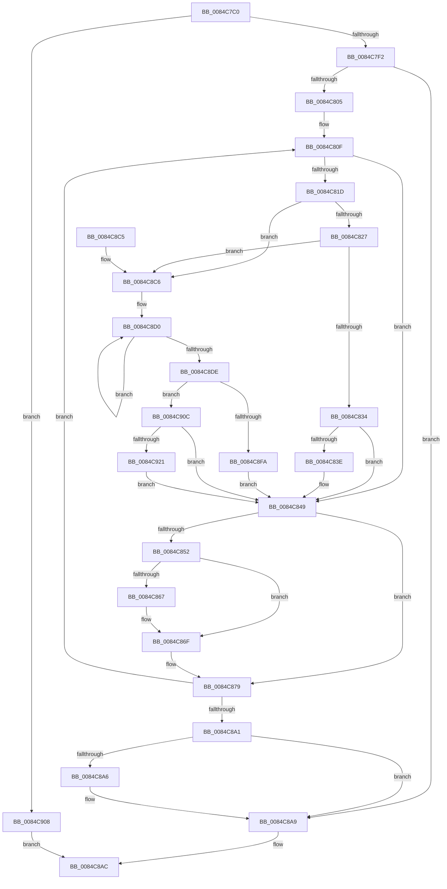

# CmpDoFlushNextHive

- RVA: `0x0084C7C0`–`0x0084C939` (길이 `377` bytes)
- VA: `0x000000014084C7C0`
- 실행 섹션: `PAGE`
- PDB 이름 있음: `예`; PDB Function 태그: `아니요`
- unwind 정보 RVA: `0x000697F0`
- 디코드: `94`개 명령, `377/377` bytes 표시
- 미해석 바이트: `0` (있으면 어셈블리에 `.byte`로 보존)

> 이 문서는 커널 이미지의 기계어와 PDB 기호를 분석해 생성했습니다. 4번과 5번은 함수 원형과 자료형을 바이너리 사용 방식에서 추정한 C 해석이며 원본 소스 복구 결과는 아닙니다.

## 1. Dependencies

- 직접 호출 지점: **9**; 고유 호출 대상: **7**
- 직접 호출자로 확인된 함수: **0**
- RIP 상대 이미지 참조: **3**

### Outgoing calls
- `0x0084C7F4` → [CmpGetNextActiveHive](CmpGetNextActiveHive_function_0084E2A0.md) (function, `0x0084E2A0`)
- `0x0084C844` → [CmpFlushHive](../9B/CmpFlushHive_function_009B3DC0.md) (function, `0x009B3DC0`)
- `0x0084C852` → [LOCK_HIVE_LOAD](../9B/LOCK_HIVE_LOAD_function_009B2300.md) (function, `0x009B2300`)
- `0x0084C859` → [CmpLockRegistryFreezeAware](../9B/CmpLockRegistryFreezeAware_function_009B4AE4.md) (function, `0x009B4AE4`)
- `0x0084C86A` → [CmpDoQueueLateUnloadWorker](CmpDoQueueLateUnloadWorker_function_0084FB18.md) (function, `0x0084FB18`)
- `0x0084C86F` → [CmpUnlockRegistry](../../pagecmrc/BC/CmpUnlockRegistry_function_00BC9A84.md) (function, `0x00BC9A84`)
- `0x0084C874` → [UNLOCK_HIVE_LOAD](../9B/UNLOCK_HIVE_LOAD_function_009B2EBC.md) (function, `0x009B2EBC`)
- `0x0084C886` → [CmpGetNextActiveHive](CmpGetNextActiveHive_function_0084E2A0.md) (function, `0x0084E2A0`)
- `0x0084C914` → [CmpFlushHive](../9B/CmpFlushHive_function_009B3DC0.md) (function, `0x009B3DC0`)

### Direct callers
- 이 함수 시작 RVA로 연결되는 직접 call은 확인되지 않았습니다. 간접 호출은 완전히 역산할 수 없습니다.

### Static image references
- `0x0084C7DF` → RVA `0x00FD8001` (`PAGEDATA`; read)
- `0x0084C8DE` → RVA `0x00E037C0` (`.data`; read)
- `0x0084C927` → RVA `0x00E037CC` (`.data`; read)

## 2. Other-region calls and transfers

- 다른 실행 섹션으로 향하는 call: **1**
  - `0x0084C86F` → [CmpUnlockRegistry](../../pagecmrc/BC/CmpUnlockRegistry_function_00BC9A84.md) (`PAGE` → `PAGECMRC`)
- 별도 외부 분기/꼬리 이동을 확인하지 못했습니다.

## 3. Assembly (complete function range)

```asm
0084C7C0  48 89 5C 24 08                  mov qword ptr [rsp + 8], rbx
0084C7C5  48 89 6C 24 10                  mov qword ptr [rsp + 0x10], rbp
0084C7CA  48 89 74 24 18                  mov qword ptr [rsp + 0x18], rsi
0084C7CF  57                              push rdi
0084C7D0  41 56                           push r14
0084C7D2  41 57                           push r15
0084C7D4  48 83 EC 20                     sub rsp, 0x20
0084C7D8  48 83 CD FF                     or rbp, 0xffffffffffffffff
0084C7DC  40 32 F6                        xor sil, sil
0084C7DF  40 38 35 1B B8 78 00            cmp byte ptr [rip + 0x78b81b], sil
0084C7E6  4C 8B F2                        mov r14, rdx
0084C7E9  4C 8B F9                        mov r15, rcx
0084C7EC  0F 85 16 01 00 00               jne 0x14084c908
0084C7F2  33 C9                           xor ecx, ecx
0084C7F4  E8 A7 1A 00 00                  call 0x14084e2a0
0084C7F9  48 8B D8                        mov rbx, rax
0084C7FC  48 85 C0                        test rax, rax
0084C7FF  0F 84 A4 00 00 00               je 0x14084c8a9
0084C805  49 B9 B0 03 00 00 80 F7 FF FF   movabs r9, 0xfffff780000003b0
0084C80F  8B 83 A0 00 00 00               mov eax, dword ptr [rbx + 0xa0]
0084C815  48 83 CF FF                     or rdi, 0xffffffffffffffff
0084C819  A8 03                           test al, 3
0084C81B  75 2C                           jne 0x14084c849
0084C81D  83 7B 68 00                     cmp dword ptr [rbx + 0x68], 0
0084C821  0F 87 9F 00 00 00               ja 0x14084c8c6
0084C827  80 BB C3 00 00 00 00            cmp byte ptr [rbx + 0xc3], 0
0084C82E  0F 85 92 00 00 00               jne 0x14084c8c6
0084C834  8B 83 80 10 00 00               mov eax, dword ptr [rbx + 0x1080]
0084C83A  A8 01                           test al, 1
0084C83C  75 0B                           jne 0x14084c849
0084C83E  8D 57 23                        lea edx, [rdi + 0x23]
0084C841  48 8B CB                        mov rcx, rbx
0084C844  E8 77 75 16 00                  call 0x1409b3dc0
0084C849  80 BB 80 0B 00 00 01            cmp byte ptr [rbx + 0xb80], 1
0084C850  75 27                           jne 0x14084c879
0084C852  E8 A9 5A 16 00                  call 0x1409b2300
0084C857  33 C9                           xor ecx, ecx
0084C859  E8 86 82 16 00                  call 0x1409b4ae4
0084C85E  80 BB 80 0B 00 00 01            cmp byte ptr [rbx + 0xb80], 1
0084C865  75 08                           jne 0x14084c86f
0084C867  48 8B CB                        mov rcx, rbx
0084C86A  E8 A9 32 00 00                  call 0x14084fb18
0084C86F  E8 10 D2 37 00                  call 0x140bc9a84
0084C874  E8 43 66 16 00                  call 0x1409b2ebc
0084C879  48 3B FD                        cmp rdi, rbp
0084C87C  48 8B CB                        mov rcx, rbx
0084C87F  48 0F 43 FD                     cmovae rdi, rbp
0084C883  48 8B EF                        mov rbp, rdi
0084C886  E8 15 1A 00 00                  call 0x14084e2a0
0084C88B  48 8B D8                        mov rbx, rax
0084C88E  49 B9 B0 03 00 00 80 F7 FF FF   movabs r9, 0xfffff780000003b0
0084C898  48 85 C0                        test rax, rax
0084C89B  0F 85 6E FF FF FF               jne 0x14084c80f
0084C8A1  40 84 F6                        test sil, sil
0084C8A4  74 03                           je 0x14084c8a9
0084C8A6  49 89 3E                        mov qword ptr [r14], rdi
0084C8A9  40 8A C6                        mov al, sil
0084C8AC  48 8B 5C 24 40                  mov rbx, qword ptr [rsp + 0x40]
0084C8B1  48 8B 6C 24 48                  mov rbp, qword ptr [rsp + 0x48]
0084C8B6  48 8B 74 24 50                  mov rsi, qword ptr [rsp + 0x50]
0084C8BB  48 83 C4 20                     add rsp, 0x20
0084C8BF  41 5F                           pop r15
0084C8C1  41 5E                           pop r14
0084C8C3  5F                              pop rdi
0084C8C4  C3                              ret
0084C8C5  CC                              int3
0084C8C6  49 B8 08 00 00 00 80 F7 FF FF   movabs r8, 0xfffff78000000008
0084C8D0  49 8B 09                        mov rcx, qword ptr [r9]
0084C8D3  49 8B 10                        mov rdx, qword ptr [r8]
0084C8D6  49 8B 01                        mov rax, qword ptr [r9]
0084C8D9  48 3B C8                        cmp rcx, rax
0084C8DC  75 F2                           jne 0x14084c8d0
0084C8DE  8B 05 DC 6E 5B 00               mov eax, dword ptr [rip + 0x5b6edc]
0084C8E4  48 2B D1                        sub rdx, rcx
0084C8E7  48 69 C8 80 96 98 00            imul rcx, rax, 0x989680
0084C8EE  48 03 8B 28 10 00 00            add rcx, qword ptr [rbx + 0x1028]
0084C8F5  48 3B D1                        cmp rdx, rcx
0084C8F8  73 12                           jae 0x14084c90c
0084C8FA  48 8B F9                        mov rdi, rcx
0084C8FD  40 B6 01                        mov sil, 1
0084C900  48 2B FA                        sub rdi, rdx
0084C903  E9 41 FF FF FF                  jmp 0x14084c849
0084C908  32 C0                           xor al, al
0084C90A  EB A0                           jmp 0x14084c8ac
0084C90C  BA 12 00 00 00                  mov edx, 0x12
0084C911  48 8B CB                        mov rcx, rbx
0084C914  E8 A7 74 16 00                  call 0x1409b3dc0
0084C919  85 C0                           test eax, eax
0084C91B  0F 89 28 FF FF FF               jns 0x14084c849
0084C921  40 B6 01                        mov sil, 1
0084C924  41 88 37                        mov byte ptr [r15], sil
0084C927  8B 05 9F 6E 5B 00               mov eax, dword ptr [rip + 0x5b6e9f]
0084C92D  48 69 F8 80 96 98 00            imul rdi, rax, 0x989680
0084C934  E9 10 FF FF FF                  jmp 0x14084c849
```

## 4. C-style interpretation (structured pseudocode)

```c
__int64 __fastcall CmpDoFlushNextHive(__int64 a1, __int64 a2)
{
    __int64 result;
    __int64 v_rbp;
    __int64 v_rdi;
    __int64 v_rsi;
    __int64 v_rsp;
    unsigned __int64 v_stack_p10;
    unsigned __int64 v_stack_p18;
    unsigned __int64 v_stack_p8;

    v_stack_p8 = v_rbx;
    v_stack_p10 = v_rbp;
    v_stack_p18 = v_rsi;
    v_rsp = (v_rsp) - (32);
    v_rbp = (v_rbp) | (-1);
    v_rsi = 0;
    if ((*(unsigned __int8 *)(v_rip + 7911451)) != 0) goto loc_0084C908;
    a1 = 0;
    result = CmpGetNextActiveHive(a1, a2, a3, a4);
    if (result == 0) goto loc_0084C8A9;
loc_0084C80F:
    v_rdi = (v_rdi) | (-1);
    if ((((unsigned __int8)((unsigned int)(*(unsigned int *)(result + 160)))) & (3)) != 0) goto loc_0084C849;
    if ((*(unsigned int *)(result + 104)) > 0) goto loc_0084C8C6;
    if ((*(unsigned __int8 *)(result + 195)) != 0) goto loc_0084C8C6;
    result = (unsigned int)(*(unsigned int *)(result + 4224));
    if ((((unsigned __int8)((unsigned int)(*(unsigned int *)(result + 4224)))) & (1)) == 0) {
        a2 = v_rdi + 35;
        a1 = result;
        result = CmpFlushHive(a1, a2, a3, a4);
    }
    if ((*(unsigned __int8 *)(result + 2944)) != 1) goto loc_0084C879;
    result = LOCK_HIVE_LOAD(a1, a2, a3, a4);
    a1 = 0;
    result = CmpLockRegistryFreezeAware(a1, a2, a3, a4);
    if ((*(unsigned __int8 *)(result + 2944)) == 1) {
        a1 = result;
        result = CmpDoQueueLateUnloadWorker(a1, a2, a3, a4);
    }
    result = CmpUnlockRegistry(a1, a2, a3, a4);
    result = UNLOCK_HIVE_LOAD(a1, a2, a3, a4);
loc_0084C879:
    if (v_rdi >= v_rbp) { v_rdi = v_rbp; }
    result = CmpGetNextActiveHive(result, a2, a3, a4);
    if (result != 0) goto loc_0084C80F;
    if (0 != 0) {
        *(unsigned __int64 *)(a2) = v_rdi;
    }
loc_0084C8AC:
    v_rsp = (v_rsp) + (32);
    return 0;
loc_0084C8C6:
loc_0084C8D0:
    if ((*(unsigned __int64 *)(a4)) != (*(unsigned __int64 *)(a4))) goto loc_0084C8D0;
    a2 = (*(unsigned __int64 *)(a3)) - (*(unsigned __int64 *)(a4));
    a1 = (*(unsigned __int64 *)(a4)) * ((unsigned int)(*(unsigned int *)(v_rip + 5992156)));
    a1 = (a1) + (*(unsigned __int64 *)(v_stack_p8 + 4136));
    if (a2 >= a1) goto loc_0084C90C;
    v_rdi = (a1) - (a2);
    goto loc_0084C849;
loc_0084C908:
    result = 0;
    goto loc_0084C8AC;
loc_0084C90C:
    result = CmpFlushHive(v_stack_p8, 18, a3, a4);
    if (!sign_flag) goto loc_0084C849;
    *(unsigned __int8 *)(a1) = 1;
    v_rdi = (v_rdi) * ((unsigned int)(*(unsigned int *)(v_rip + 5992095)));
    goto loc_0084C849;
}
```

## 5. (Beta) C Style

```c
int64_t CmpDoFlushNextHive(void *Arg1, void *Arg2)
{
    uint8_t *arg1 = (uint8_t *)Arg1;
    uint8_t *arg2 = (uint8_t *)Arg2;

    int64_t result;
    int64_t local_rbp;
    int64_t local_rdi;
    int64_t local_rsi;
    int64_t local_rsp;
    uint64_t v_stack_p10;
    uint64_t v_stack_p18;
    uint64_t v_stack_p8;

    v_stack_p8 = local_rbx;
    v_stack_p10 = local_rbp;
    v_stack_p18 = local_rsi;
    local_rsp = (local_rsp) - (32);
    local_rbp = (local_rbp) | (-1);
    local_rsi = 0;
    if ((*(uint8_t *)(v_rip + 0x78B81B)) != 0) goto loc_0084C908;
    Arg1 = 0;
    result = CmpGetNextActiveHive(Arg1, Arg2, a3, a4);
    if (result == 0) goto loc_0084C8A9;
loc_0084C80F:
    local_rdi = (local_rdi) | (-1);
    if ((((uint8_t)((uint32_t)(*(uint32_t *)(result + 0xA0)))) & (3)) != 0) goto loc_0084C849;
    if ((*(uint32_t *)(result + 0x68)) > 0) goto loc_0084C8C6;
    if ((*(uint8_t *)(result + 0xC3)) != 0) goto loc_0084C8C6;
    result = (uint32_t)(*(uint32_t *)(result + 0x1080));
    if ((((uint8_t)((uint32_t)(*(uint32_t *)(result + 0x1080)))) & (1)) == 0) {
        Arg2 = local_rdi + 35;
        Arg1 = result;
        result = CmpFlushHive(Arg1, Arg2, a3, a4);
    }
    if ((*(uint8_t *)(result + 0xB80)) != 1) goto loc_0084C879;
    result = LOCK_HIVE_LOAD(Arg1, Arg2, a3, a4);
    Arg1 = 0;
    result = CmpLockRegistryFreezeAware(Arg1, Arg2, a3, a4);
    if ((*(uint8_t *)(result + 0xB80)) == 1) {
        Arg1 = result;
        result = CmpDoQueueLateUnloadWorker(Arg1, Arg2, a3, a4);
    }
    result = CmpUnlockRegistry(Arg1, Arg2, a3, a4);
    result = UNLOCK_HIVE_LOAD(Arg1, Arg2, a3, a4);
loc_0084C879:
    if (local_rdi >= local_rbp) { local_rdi = local_rbp; }
    result = CmpGetNextActiveHive(result, Arg2, a3, a4);
    if (result != 0) goto loc_0084C80F;
    if (0 != 0) {
        *(uint64_t *)(arg2) = local_rdi;
    }
loc_0084C8AC:
    local_rsp = (local_rsp) + (32);
    return 0;
loc_0084C8C6:
loc_0084C8D0:
    if ((*(uint64_t *)(a4)) != (*(uint64_t *)(a4))) goto loc_0084C8D0;
    Arg2 = (*(uint64_t *)(a3)) - (*(uint64_t *)(a4));
    Arg1 = (*(uint64_t *)(a4)) * ((uint32_t)(*(uint32_t *)(v_rip + 0x5B6EDC)));
    Arg1 = (Arg1) + (*(uint64_t *)(v_stack_p8 + 0x1028));
    if (Arg2 >= Arg1) goto loc_0084C90C;
    local_rdi = (Arg1) - (Arg2);
    goto loc_0084C849;
loc_0084C908:
    result = 0;
    goto loc_0084C8AC;
loc_0084C90C:
    result = CmpFlushHive(v_stack_p8, 18, a3, a4);
    if (!sign_flag) goto loc_0084C849;
    *(uint8_t *)(arg1) = 1;
    local_rdi = (local_rdi) * ((uint32_t)(*(uint32_t *)(v_rip + 0x5B6E9F)));
    goto loc_0084C849;
}
```

### 관측된 메모리 오프셋

구조체 형식이 확인되지 않은 접근은 인자 기준의 오프셋으로만 기록했습니다.

| 기준 인자 | 오프셋 표현 | 폭 (bit) | 접근 |
|---|---:|---:|---|
| `Arg1` | `+ 0x0` | `8` | `W` |
| `Arg2` | `+ 0x0` | `64` | `W` |

## 6. Execution-region graph

[열기: 2D/3D 그래프와 함수 탐색 컨트롤 패널](../../../control-panel.html?section=page&rva=0x0084C7C0&view=graph)

- 2D 그래프는 위에서 아래로 흐르고, 3D 그래프는 빈 공간을 드래그해 회전합니다. Shift+드래그는 이동, 휠은 확대·축소, 함수 노드 선택은 대상 보고서 이동입니다.

### Static fallback


