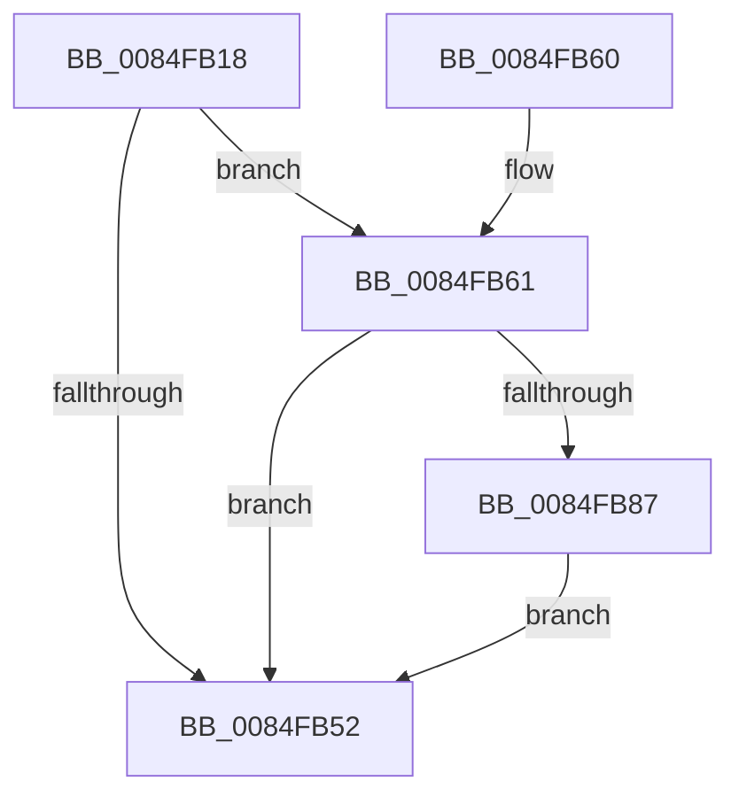

# CmpDoQueueLateUnloadWorker

- RVA: `0x0084FB18`–`0x0084FBB9` (길이 `161` bytes)
- VA: `0x000000014084FB18`
- 실행 섹션: `PAGE`
- PDB 이름 있음: `예`; PDB Function 태그: `아니요`
- unwind 정보 RVA: `0x00069D5C`
- 디코드: `35`개 명령, `161/161` bytes 표시
- 미해석 바이트: `0` (있으면 어셈블리에 `.byte`로 보존)

> 이 문서는 커널 이미지의 기계어와 PDB 기호를 분석해 생성했습니다. 4번과 5번은 함수 원형과 자료형을 바이너리 사용 방식에서 추정한 C 해석이며 원본 소스 복구 결과는 아닙니다.

## 1. Dependencies

- 직접 호출 지점: **4**; 고유 호출 대상: **4**
- 직접 호출자로 확인된 함수: **10**
- RIP 상대 이미지 참조: **0**

### Outgoing calls
- `0x0084FB21` → [CmLockHive](../85/CmLockHive_function_008512B4.md) (function, `0x008512B4`)
- `0x0084FB55` → [CmUnlockHive](../85/CmUnlockHive_function_00851D6C.md) (function, `0x00851D6C`)
- `0x0084FBA3` → [CmpReferenceHive](CmpReferenceHive_function_0084FCF0.md) (function, `0x0084FCF0`)
- `0x0084FBB2` → [ExQueueWorkItem](../../text/2F/ExQueueWorkItem_function_002F9520.md) (function, `0x002F9520`)

### Direct callers
- [CmpDoFlushNextHive](CmpDoFlushNextHive_function_0084C7C0.md) at `0x0084C86A`
- [CmpFindSubKeyByNumberEx](CmpFindSubKeyByNumberEx_function_0084F1A0.md) at `0x0084F35E`
- [CmpFindSubKeyByNumberEx](CmpFindSubKeyByNumberEx_function_0084F1A0.md) at `0x0084F73B`
- [CmpDelayDerefKeyControlBlock](CmpDelayDerefKeyControlBlock_function_0084FA50.md) at `0x0084FAAC`
- [CmpPerformCompleteKcbCacheLookup](CmpPerformCompleteKcbCacheLookup_function_0084FD20.md) at `0x008511B1`
- [CmpPerformCompleteKcbCacheLookup](CmpPerformCompleteKcbCacheLookup_function_0084FD20.md) at `0x0085123E`
- [sub_008515D5](../85/Unknown_function_008515D5.md) at `0x008517D3`
- [sub_008515D5](../85/Unknown_function_008515D5.md) at `0x00851849`
- [sub_00851B91](../85/Unknown_function_00851B91.md) at `0x00851D3B`
- [sub_008620F8](../86/Unknown_function_008620F8.md) at `0x0086212A`
- [sub_008620F8](../86/Unknown_function_008620F8.md) at `0x00862196`
- [sub_00862E81](../86/Unknown_function_00862E81.md) at `0x00862EB3`
- [sub_00862E81](../86/Unknown_function_00862E81.md) at `0x00862F23`
- [sub_0086322A](../86/Unknown_function_0086322A.md) at `0x00863247`
- [CmReleaseLoadKeyContext](../87/CmReleaseLoadKeyContext_function_00877C88.md) at `0x00877CD5`

### Static image references
- 디코드된 RIP-relative 메모리 참조가 없습니다.

## 2. Other-region calls and transfers

- 다른 실행 섹션으로 향하는 call: **1**
  - `0x0084FBB2` → [ExQueueWorkItem](../../text/2F/ExQueueWorkItem_function_002F9520.md) (`PAGE` → `.text`)
- 별도 외부 분기/꼬리 이동을 확인하지 못했습니다.

## 3. Assembly (complete function range)

```asm
0084FB18  40 53                           push rbx
0084FB1A  48 83 EC 20                     sub rsp, 0x20
0084FB1E  48 8B D9                        mov rbx, rcx
0084FB21  E8 8E 17 00 00                  call 0x1408512b4
0084FB26  41 B8 01 00 00 00               mov r8d, 1
0084FB2C  41 8B C0                        mov eax, r8d
0084FB2F  F0 0F C1 83 8C 10 00 00         lock xadd dword ptr [rbx + 0x108c], eax
0084FB37  83 E0 7F                        and eax, 0x7f
0084FB3A  C7 84 83 90 10 00 00 13 00 00 00  mov dword ptr [rbx + rax*4 + 0x1090], 0x13
0084FB45  48 8B 83 78 0B 00 00            mov rax, qword ptr [rbx + 0xb78]
0084FB4C  48 83 38 02                     cmp qword ptr [rax], 2
0084FB50  74 0F                           je 0x14084fb61
0084FB52  48 8B CB                        mov rcx, rbx
0084FB55  E8 12 22 00 00                  call 0x140851d6c
0084FB5A  48 83 C4 20                     add rsp, 0x20
0084FB5E  5B                              pop rbx
0084FB5F  C3                              ret
0084FB60  CC                              int3
0084FB61  41 8B C0                        mov eax, r8d
0084FB64  F0 0F C1 83 8C 10 00 00         lock xadd dword ptr [rbx + 0x108c], eax
0084FB6C  83 E0 7F                        and eax, 0x7f
0084FB6F  C7 84 83 90 10 00 00 14 00 00 00  mov dword ptr [rbx + rax*4 + 0x1090], 0x14
0084FB7A  33 C0                           xor eax, eax
0084FB7C  F0 44 0F B1 83 C0 12 00 00      lock cmpxchg dword ptr [rbx + 0x12c0], r8d
0084FB85  75 CB                           jne 0x14084fb52
0084FB87  41 8B C0                        mov eax, r8d
0084FB8A  F0 0F C1 83 8C 10 00 00         lock xadd dword ptr [rbx + 0x108c], eax
0084FB92  83 E0 7F                        and eax, 0x7f
0084FB95  48 8B CB                        mov rcx, rbx
0084FB98  C7 84 83 90 10 00 00 15 00 00 00  mov dword ptr [rbx + rax*4 + 0x1090], 0x15
0084FBA3  E8 48 01 00 00                  call 0x14084fcf0
0084FBA8  48 8B 8B D0 12 00 00            mov rcx, qword ptr [rbx + 0x12d0]
0084FBAF  41 8B D0                        mov edx, r8d
0084FBB2  E8 69 99 AA FF                  call 0x1402f9520
0084FBB7  EB 99                           jmp 0x14084fb52
```

## 4. C-style interpretation (structured pseudocode)

```c
__int64 __fastcall CmpDoQueueLateUnloadWorker(__int64 a1)
{
    __int64 result;
    __int64 v_rsp;

    v_rsp = (v_rsp) - (32);
    result = CmLockHive(a1, a2, a3, a4);
    result = (unsigned int)((1) & (127));
    *(unsigned int *)(a1 + result * 4 + 4240) = 19;
    if ((*(unsigned __int64 *)(*(unsigned __int64 *)(a1 + 2936))) == 2) goto loc_0084FB61;
loc_0084FB52:
    result = CmUnlockHive(a1, a2, 1, a4);
    v_rsp = (v_rsp) + (32);
    return result;
loc_0084FB61:
    result = (unsigned int)((1) & (127));
    *(unsigned int *)(a1 + result * 4 + 4240) = 20;
    result = 0;
    if (condition_is_not_equal) goto loc_0084FB52;
    result = (unsigned int)((1) & (127));
    *(unsigned int *)(a1 + result * 4 + 4240) = 21;
    result = CmpReferenceHive(a1, a2, 1, a4);
    result = ExQueueWorkItem(*(unsigned __int64 *)(a1 + 4816), 1, 1, a4);
    goto loc_0084FB52;
}
```

## 5. (Beta) C Style

```c
int64_t CmpDoQueueLateUnloadWorker(void *Arg1)
{
    uint8_t *arg1 = (uint8_t *)Arg1;

    int64_t result;
    int64_t local_rsp;

    local_rsp = (local_rsp) - (32);
    result = CmLockHive(Arg1, a2, a3, a4);
    result = (uint32_t)((1) & (127));
    *(uint32_t *)(arg1 + result * 4 + 0x1090) = 19;
    if ((*(uint64_t *)(*(uint64_t *)(arg1 + 0xB78))) == 2) goto loc_0084FB61;
loc_0084FB52:
    result = CmUnlockHive(Arg1, a2, 1, a4);
    local_rsp = (local_rsp) + (32);
    return result;
loc_0084FB61:
    result = (uint32_t)((1) & (127));
    *(uint32_t *)(arg1 + result * 4 + 0x1090) = 20;
    result = 0;
    if (condition_is_not_equal) goto loc_0084FB52;
    result = (uint32_t)((1) & (127));
    *(uint32_t *)(arg1 + result * 4 + 0x1090) = 21;
    result = CmpReferenceHive(Arg1, a2, 1, a4);
    result = ExQueueWorkItem(*(uint64_t *)(arg1 + 0x12D0), 1, 1, a4);
    goto loc_0084FB52;
}
```

### 관측된 메모리 오프셋

구조체 형식이 확인되지 않은 접근은 인자 기준의 오프셋으로만 기록했습니다.

| 기준 인자 | 오프셋 표현 | 폭 (bit) | 접근 |
|---|---:|---:|---|
| `Arg1` | `+ 0xB78` | `64` | `R` |
| `Arg1` | `+ 0x108C` | `32` | `R/W` |
| `Arg1` | `+ 0x1090 + rax*4` | `32` | `W` |
| `Arg1` | `+ 0x12C0` | `32` | `R` |
| `Arg1` | `+ 0x12D0` | `64` | `R` |

## 6. Execution-region graph

[열기: 2D/3D 그래프와 함수 탐색 컨트롤 패널](../../../control-panel.html?section=page&rva=0x0084FB18&view=graph)

- 2D 그래프는 위에서 아래로 흐르고, 3D 그래프는 빈 공간을 드래그해 회전합니다. Shift+드래그는 이동, 휠은 확대·축소, 함수 노드 선택은 대상 보고서 이동입니다.

### Static fallback


