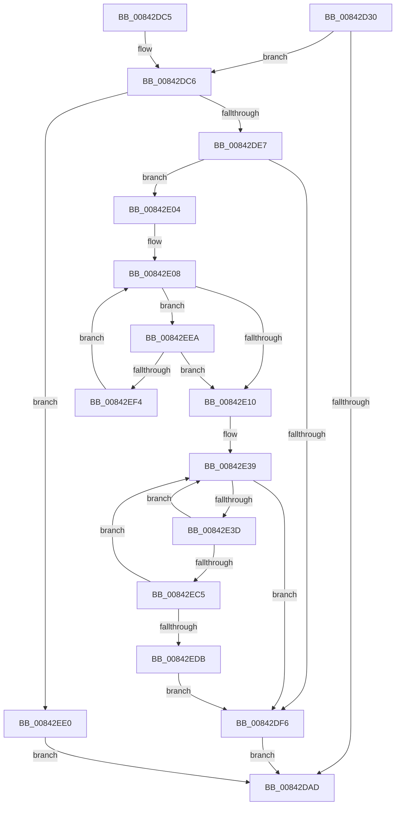

# CmpDoTransWriteLogRecord

- RVA: `0x00842D30`–`0x00842EFE` (길이 `462` bytes)
- VA: `0x0000000140842D30`
- 실행 섹션: `PAGE`
- PDB 이름 있음: `예`; PDB Function 태그: `아니요`
- unwind 정보 RVA: `0x00069024`
- 디코드: `121`개 명령, `462/462` bytes 표시
- 미해석 바이트: `0` (있으면 어셈블리에 `.byte`로 보존)

> 이 문서는 커널 이미지의 기계어와 PDB 기호를 분석해 생성했습니다. 4번과 5번은 함수 원형과 자료형을 바이너리 사용 방식에서 추정한 C 해석이며 원본 소스 복구 결과는 아닙니다.

## 1. Dependencies

- 직접 호출 지점: **5**; 고유 호출 대상: **4**
- 직접 호출자로 확인된 함수: **1**
- RIP 상대 이미지 참조: **2**

### Outgoing calls
- `0x00842D98` → `ext-ms-win-fs-clfs-l1-1-0.dll!ClfsReserveAndAppendLog` (import, 간접 대상; import `ext-ms-win-fs-clfs-l1-1-0.dll!ClfsReserveAndAppendLog`)
- `0x00842DD6` → [ExAllocatePool2](../../poolcode/B8/ExAllocatePool2_function_00B820F0.md) (function, `0x00B820F0`)
- `0x00842DFB` → [ExFreePoolWithTag](../../poolcode/B8/ExFreePoolWithTag_function_00B82870.md) (function, `0x00B82870`)
- `0x00842E4A` → [memcpy](../../text/6C/memcpy_function_006C6840.md) (function, `0x006C6840`)
- `0x00842EAF` → `ext-ms-win-fs-clfs-l1-1-0.dll!ClfsReserveAndAppendLog` (import, 간접 대상; import `ext-ms-win-fs-clfs-l1-1-0.dll!ClfsReserveAndAppendLog`)

### Direct callers
- [CmpTransWriteLog](CmpTransWriteLog_function_00842A7C.md) at `0x00842AD2`

### Static image references
- `0x00842D4E` → RVA `0x00010880` (`.rdata`; read)
- `0x00842D98` → RVA `0x00151278` (`ext-ms-win-fs-clfs-l1-1-0.dll!ClfsReserveAndAppendLog (IAT)`; read)

## 2. Other-region calls and transfers

- 다른 실행 섹션으로 향하는 call: **3**
  - `0x00842DD6` → [ExAllocatePool2](../../poolcode/B8/ExAllocatePool2_function_00B820F0.md) (`PAGE` → `POOLCODE`)
  - `0x00842DFB` → [ExFreePoolWithTag](../../poolcode/B8/ExFreePoolWithTag_function_00B82870.md) (`PAGE` → `POOLCODE`)
  - `0x00842E4A` → [memcpy](../../text/6C/memcpy_function_006C6840.md) (`PAGE` → `.text`)
- 별도 외부 분기/꼬리 이동을 확인하지 못했습니다.

## 3. Assembly (complete function range)

```asm
00842D30  4C 8B DC                        mov r11, rsp
00842D33  49 89 5B 18                     mov qword ptr [r11 + 0x18], rbx
00842D37  45 89 4B 20                     mov dword ptr [r11 + 0x20], r9d
00842D3B  49 89 4B 08                     mov qword ptr [r11 + 8], rcx
00842D3F  55                              push rbp
00842D40  56                              push rsi
00842D41  57                              push rdi
00842D42  41 54                           push r12
00842D44  41 55                           push r13
00842D46  41 56                           push r14
00842D48  41 57                           push r15
00842D4A  48 83 EC 60                     sub rsp, 0x60
00842D4E  48 8B 05 2B DB 7C FF            mov rax, qword ptr [rip - 0x8324d5]
00842D55  4C 8B F2                        mov r14, rdx
00842D58  48 8B 49 60                     mov rcx, qword ptr [rcx + 0x60]
00842D5C  49 89 43 10                     mov qword ptr [r11 + 0x10], rax
00842D60  48 8B 84 24 C0 00 00 00         mov rax, qword ptr [rsp + 0xc0]
00842D68  49 89 43 A8                     mov qword ptr [r11 - 0x58], rax
00842D6C  49 8D 43 10                     lea rax, [r11 + 0x10]
00842D70  45 89 4B A0                     mov dword ptr [r11 - 0x60], r9d
00842D74  4D 8D 4B 10                     lea r9, [r11 + 0x10]
00842D78  49 83 63 98 00                  and qword ptr [r11 - 0x68], 0
00842D7D  83 64 24 28 00                  and dword ptr [rsp + 0x28], 0
00842D82  49 89 53 B8                     mov qword ptr [r11 - 0x48], rdx
00842D86  49 8D 53 B8                     lea rdx, [r11 - 0x48]
00842D8A  45 89 43 C0                     mov dword ptr [r11 - 0x40], r8d
00842D8E  41 B8 01 00 00 00               mov r8d, 1
00842D94  49 89 43 88                     mov qword ptr [r11 - 0x78], rax
00842D98  48 FF 15 D9 E4 90 FF            call qword ptr [rip - 0x6f1b27]
00842D9F  0F 1F 44 00 00                  nop dword ptr [rax + rax]
00842DA4  8B F0                           mov esi, eax
00842DA6  3D 23 00 00 C0                  cmp eax, 0xc0000023
00842DAB  74 19                           je 0x140842dc6
00842DAD  48 8B 9C 24 B0 00 00 00         mov rbx, qword ptr [rsp + 0xb0]
00842DB5  48 83 C4 60                     add rsp, 0x60
00842DB9  41 5F                           pop r15
00842DBB  41 5E                           pop r14
00842DBD  41 5D                           pop r13
00842DBF  41 5C                           pop r12
00842DC1  5F                              pop rdi
00842DC2  5E                              pop rsi
00842DC3  5D                              pop rbp
00842DC4  C3                              ret
00842DC5  CC                              int3
00842DC6  BA 00 0C 00 00                  mov edx, 0xc00
00842DCB  B9 00 01 00 00                  mov ecx, 0x100
00842DD0  41 B8 43 4D 20 20               mov r8d, 0x20204d43
00842DD6  E8 15 F3 33 00                  call 0x140b820f0
00842DDB  48 8B D8                        mov rbx, rax
00842DDE  48 85 C0                        test rax, rax
00842DE1  0F 84 F9 00 00 00               je 0x140842ee0
00842DE7  41 8B 6E 04                     mov ebp, dword ptr [r14 + 4]
00842DEB  BF C0 0B 00 00                  mov edi, 0xbc0
00842DF0  8B C5                           mov eax, ebp
00842DF2  3B EF                           cmp ebp, edi
00842DF4  73 0E                           jae 0x140842e04
00842DF6  33 D2                           xor edx, edx
00842DF8  48 8B CB                        mov rcx, rbx
00842DFB  E8 70 FA 33 00                  call 0x140b82870
00842E00  8B C6                           mov eax, esi
00842E02  EB A9                           jmp 0x140842dad
00842E04  33 F6                           xor esi, esi
00842E06  33 C9                           xor ecx, ecx
00842E08  85 C0                           test eax, eax
00842E0A  0F 85 DA 00 00 00               jne 0x140842eea
00842E10  41 0F 10 06                     movups xmm0, xmmword ptr [r14]
00842E14  0F 11 03                        movups xmmword ptr [rbx], xmm0
00842E17  41 0F 10 4E 10                  movups xmm1, xmmword ptr [r14 + 0x10]
00842E1C  0F 11 4B 10                     movups xmmword ptr [rbx + 0x10], xmm1
00842E20  41 0F 10 46 20                  movups xmm0, xmmword ptr [r14 + 0x20]
00842E25  89 4B 30                        mov dword ptr [rbx + 0x30], ecx
00842E28  0F 11 43 20                     movups xmmword ptr [rbx + 0x20], xmm0
00842E2C  0F BA 6B 0C 1F                  bts dword ptr [rbx + 0xc], 0x1f
00842E31  45 33 E4                        xor r12d, r12d
00842E34  48 89 5C 24 50                  mov qword ptr [rsp + 0x50], rbx
00842E39  85 F6                           test esi, esi
00842E3B  78 B9                           js 0x140842df6
00842E3D  44 8B C7                        mov r8d, edi
00842E40  48 8D 4B 40                     lea rcx, [rbx + 0x40]
00842E44  49 8B D6                        mov rdx, r14
00842E47  44 8B FF                        mov r15d, edi
00842E4A  E8 F1 39 E8 FF                  call 0x1406c6840
00842E4F  44 89 63 34                     mov dword ptr [rbx + 0x34], r12d
00842E53  8D 47 40                        lea eax, [rdi + 0x40]
00842E56  89 7B 38                        mov dword ptr [rbx + 0x38], edi
00842E59  4C 8D 8C 24 A8 00 00 00         lea r9, [rsp + 0xa8]
00842E61  89 44 24 58                     mov dword ptr [rsp + 0x58], eax
00842E65  48 8D 54 24 50                  lea rdx, [rsp + 0x50]
00842E6A  48 8B 84 24 C0 00 00 00         mov rax, qword ptr [rsp + 0xc0]
00842E72  41 B8 01 00 00 00               mov r8d, 1
00842E78  48 89 44 24 40                  mov qword ptr [rsp + 0x40], rax
00842E7D  41 FF C4                        inc r12d
00842E80  8B 84 24 B8 00 00 00            mov eax, dword ptr [rsp + 0xb8]
00842E87  89 44 24 38                     mov dword ptr [rsp + 0x38], eax
00842E8B  48 8D 84 24 A8 00 00 00         lea rax, [rsp + 0xa8]
00842E93  48 83 64 24 30 00               and qword ptr [rsp + 0x30], 0
00842E99  83 64 24 28 00                  and dword ptr [rsp + 0x28], 0
00842E9E  48 89 44 24 20                  mov qword ptr [rsp + 0x20], rax
00842EA3  48 8B 84 24 A0 00 00 00         mov rax, qword ptr [rsp + 0xa0]
00842EAB  48 8B 48 60                     mov rcx, qword ptr [rax + 0x60]
00842EAF  48 FF 15 C2 E3 90 FF            call qword ptr [rip - 0x6f1c3e]
00842EB6  0F 1F 44 00 00                  nop dword ptr [rax + rax]
00842EBB  8B F0                           mov esi, eax
00842EBD  85 C0                           test eax, eax
00842EBF  0F 88 74 FF FF FF               js 0x140842e39
00842EC5  2B EF                           sub ebp, edi
00842EC7  4D 03 F7                        add r14, r15
00842ECA  3B EF                           cmp ebp, edi
00842ECC  8B C5                           mov eax, ebp
00842ECE  0F 43 C7                        cmovae eax, edi
00842ED1  8B F8                           mov edi, eax
00842ED3  85 ED                           test ebp, ebp
00842ED5  0F 85 5E FF FF FF               jne 0x140842e39
00842EDB  E9 16 FF FF FF                  jmp 0x140842df6
00842EE0  B8 9A 00 00 C0                  mov eax, 0xc000009a
00842EE5  E9 C3 FE FF FF                  jmp 0x140842dad
00842EEA  FF C1                           inc ecx
00842EEC  3B C7                           cmp eax, edi
00842EEE  0F 82 1C FF FF FF               jb 0x140842e10
00842EF4  05 40 F4 FF FF                  add eax, 0xfffff440
00842EF9  E9 0A FF FF FF                  jmp 0x140842e08
```

## 4. C-style interpretation (structured pseudocode)

```c
__int64 __fastcall CmpDoTransWriteLogRecord(__int64 a1, __int64 a2, int a3, int a4, __int64 a5)
{
    __int64 result;
    __int64 v_r12;
    __int64 v_r14;
    __int64 v_rbp;
    __int64 v_rsi;
    __int64 v_rsp;
    unsigned int v_stack_m70;
    unsigned __int64 v_stack_p18;
    unsigned __int64 v_stack_p20;
    unsigned int v_stack_p28;
    unsigned __int64 v_stack_p30;
    unsigned int v_stack_p38;
    unsigned __int64 v_stack_p40;
    unsigned __int64 v_stack_p50;
    unsigned int v_stack_p58;
    unsigned __int64 v_stack_pA0;
    unsigned __int64 v_stack_pA8;
    unsigned int v_stack_pB8;

    *(unsigned __int64 *)(v_rsp + 24) = v_rbx;
    *(unsigned int *)(v_rsp + 32) = a4;
    *(unsigned __int64 *)(v_rsp + 8) = a1;
    v_rsp = (v_rsp) - (96);
    *(unsigned __int64 *)(v_rsp + 16) = *(unsigned __int64 *)(v_rip - 8594645);
    *(unsigned __int64 *)(v_rsp - 88) = a5;
    *(unsigned int *)(v_rsp - 96) = a4;
    *(unsigned __int64 *)(v_rsp - 72) = a2;
    *(unsigned int *)(v_rsp - 64) = a3;
    *(unsigned __int64 *)(v_rsp - 120) = v_rsp + 16;
    result = ext_ms_win_fs_clfs_l1_1_0_dll_ClfsReserveAndAppendLog(*(unsigned __int64 *)(a1 + 96), v_rsp - 72, 1, v_rsp + 16);
    if (((unsigned int)(result)) == 0xC0000023ULL) goto loc_00842DC6;
loc_00842DAD:
    v_rsp = (v_rsp) + (96);
    return result;
loc_00842DC6:
    result = ExAllocatePool2(256, (unsigned int)(0xC00ULL), (unsigned int)(0x20204D43ULL), v_rsp + 16);
    if (result == 0) goto loc_00842EE0;
    if (((unsigned int)((unsigned int)(*(unsigned int *)(a2 + 4)))) >= ((unsigned int)((unsigned int)(0xBC0ULL)))) goto loc_00842E04;
loc_00842DF6:
    a2 = 0;
    result = ExFreePoolWithTag(result, a2, (unsigned int)(0x20204D43ULL), v_rsp + 16);
    goto loc_00842DAD;
loc_00842E04:
    v_rsi = 0;
    a1 = 0;
loc_00842E08:
    if ((unsigned int)((unsigned int)((unsigned int)((unsigned int)((unsigned int)(result))))) != 0) goto loc_00842EEA;
loc_00842E10:
    *(unsigned __int64 *)(result) = v_xmm0;
    *(unsigned __int64 *)(result + 16) = v_xmm1;
    *(unsigned int *)(result + 48) = 0;
    *(unsigned __int64 *)(result + 32) = v_xmm0;
    v_r12 = 0;
    v_stack_p50 = result;
loc_00842E39:
    if (sign_flag) goto loc_00842DF6;
    result = memcpy(result + 64, 0, (unsigned int)((unsigned int)((unsigned int)(0xBC0ULL))), v_rsp + 16);
    *(unsigned int *)(result + 52) = 0;
    *(unsigned int *)(result + 56) = (unsigned int)((unsigned int)(0xBC0ULL));
    v_stack_p58 = (unsigned int)((unsigned int)(0xBC0ULL) + 64);
    v_stack_p40 = a5;
    v_r12 = (unsigned int)((v_r12) + 1);
    v_stack_p38 = (unsigned int)((unsigned int)(v_stack_pB8));
    v_stack_p20 = v_stack_pA8;
    result = ext_ms_win_fs_clfs_l1_1_0_dll_ClfsReserveAndAppendLog(*(unsigned __int64 *)(v_stack_pA0 + 96), v_stack_p50, 1, v_stack_pA8);
    if (sign_flag) goto loc_00842E39;
    v_rbp = (unsigned int)(((unsigned int)(*(unsigned int *)(a2 + 4))) - ((unsigned int)((unsigned int)(0xBC0ULL))));
    v_r14 = (a2) + ((unsigned int)((unsigned int)((unsigned int)(0xBC0ULL))));
    result = (unsigned int)((unsigned int)(v_rbp));
    if (((unsigned int)(v_rbp)) >= ((unsigned int)((unsigned int)(0xBC0ULL)))) { result = (unsigned int)((unsigned int)(0xBC0ULL)); }
    if ((unsigned int)(v_rbp) != 0) goto loc_00842E39;
    goto loc_00842DF6;
loc_00842EE0:
    goto loc_00842DAD;
loc_00842EEA:
    a1 = (unsigned int)((*(unsigned __int64 *)(v_stack_pA0 + 96)) + 1);
    if (((unsigned int)((unsigned int)(0xC000009AULL))) < ((unsigned int)((unsigned int)((unsigned int)(result))))) goto loc_00842E10;
    result = (unsigned int)(((unsigned int)(0xC000009AULL)) + (0xFFFFF440ULL));
    goto loc_00842E08;
}
```

## 5. (Beta) C Style

```c
int64_t CmpDoTransWriteLogRecord(void *Arg1, void *Arg2, int32_t Arg3, int32_t Arg4, int64_t Arg5)
{
    uint8_t *arg1 = (uint8_t *)Arg1;
    uint8_t *arg2 = (uint8_t *)Arg2;

    int64_t result;
    int64_t local_r12;
    int64_t local_r14;
    int64_t local_rbp;
    int64_t local_rsi;
    int64_t local_rsp;
    uint32_t v_stack_m70;
    uint64_t v_stack_p18;
    uint64_t v_stack_p20;
    uint32_t v_stack_p28;
    uint64_t v_stack_p30;
    uint32_t v_stack_p38;
    uint64_t v_stack_p40;
    uint64_t v_stack_p50;
    uint32_t v_stack_p58;
    uint64_t v_stack_pA0;
    uint64_t v_stack_pA8;
    uint32_t v_stack_pB8;

    *(uint64_t *)(local_rsp + 0x18) = local_rbx;
    *(uint32_t *)(local_rsp + 0x20) = Arg4;
    *(void **)(local_rsp + 0x8) = Arg1;
    local_rsp = (local_rsp) - (96);
    *(uint64_t *)(local_rsp + 0x10) = *(uint64_t *)(v_rip - 0x8324D5);
    *(uint64_t *)(local_rsp - 0x58) = Arg5;
    *(uint32_t *)(local_rsp - 0x60) = Arg4;
    *(void **)(local_rsp - 0x48) = Arg2;
    *(uint32_t *)(local_rsp - 0x40) = Arg3;
    *(uint64_t *)(local_rsp - 0x78) = local_rsp + 16;
    result = kernel_indirect_call(*(uint64_t *)(arg1 + 0x60), local_rsp - 72, 1, local_rsp + 16);
    if (((uint32_t)(result)) == 0xC0000023ULL) goto loc_00842DC6;
loc_00842DAD:
    local_rsp = (local_rsp) + (96);
    return result;
loc_00842DC6:
    result = ExAllocatePool2(256, (uint32_t)(0xC00ULL), (uint32_t)(0x20204D43ULL), local_rsp + 16);
    if (result == 0) goto loc_00842EE0;
    if (((uint32_t)((uint32_t)(*(uint32_t *)(arg2 + 0x4)))) >= ((uint32_t)((uint32_t)(0xBC0ULL)))) goto loc_00842E04;
loc_00842DF6:
    Arg2 = 0;
    result = ExFreePoolWithTag(result, Arg2, (uint32_t)(0x20204D43ULL), local_rsp + 16);
    goto loc_00842DAD;
loc_00842E04:
    local_rsi = 0;
    Arg1 = 0;
loc_00842E08:
    if ((uint32_t)((uint32_t)((uint32_t)((uint32_t)((uint32_t)(result))))) != 0) goto loc_00842EEA;
loc_00842E10:
    *(uint64_t *)(result) = v_xmm0;
    *(uint64_t *)(result + 0x10) = v_xmm1;
    *(uint32_t *)(result + 0x30) = 0;
    *(uint64_t *)(result + 0x20) = v_xmm0;
    local_r12 = 0;
    v_stack_p50 = result;
loc_00842E39:
    if (sign_flag) goto loc_00842DF6;
    result = memcpy(result + 64, 0, (uint32_t)((uint32_t)((uint32_t)(0xBC0ULL))), local_rsp + 16);
    *(uint32_t *)(result + 0x34) = 0;
    *(uint32_t *)(result + 0x38) = (uint32_t)((uint32_t)(0xBC0ULL));
    v_stack_p58 = (uint32_t)((uint32_t)(0xBC0ULL) + 64);
    v_stack_p40 = Arg5;
    local_r12 = (uint32_t)((local_r12) + 1);
    v_stack_p38 = (uint32_t)((uint32_t)(v_stack_pB8));
    v_stack_p20 = v_stack_pA8;
    result = kernel_indirect_call(*(uint64_t *)(v_stack_pA0 + 0x60), v_stack_p50, 1, v_stack_pA8);
    if (sign_flag) goto loc_00842E39;
    local_rbp = (uint32_t)(((uint32_t)(*(uint32_t *)(arg2 + 0x4))) - ((uint32_t)((uint32_t)(0xBC0ULL))));
    local_r14 = (Arg2) + ((uint32_t)((uint32_t)((uint32_t)(0xBC0ULL))));
    result = (uint32_t)((uint32_t)(local_rbp));
    if (((uint32_t)(local_rbp)) >= ((uint32_t)((uint32_t)(0xBC0ULL)))) { result = (uint32_t)((uint32_t)(0xBC0ULL)); }
    if ((uint32_t)(local_rbp) != 0) goto loc_00842E39;
    goto loc_00842DF6;
loc_00842EE0:
    goto loc_00842DAD;
loc_00842EEA:
    Arg1 = (uint32_t)((*(uint64_t *)(v_stack_pA0 + 0x60)) + 1);
    if (((uint32_t)((uint32_t)(0xC000009AULL))) < ((uint32_t)((uint32_t)((uint32_t)(result))))) goto loc_00842E10;
    result = (uint32_t)(((uint32_t)(0xC000009AULL)) + (0xFFFFF440ULL));
    goto loc_00842E08;
}
```

### 관측된 메모리 오프셋

구조체 형식이 확인되지 않은 접근은 인자 기준의 오프셋으로만 기록했습니다.

| 기준 인자 | 오프셋 표현 | 폭 (bit) | 접근 |
|---|---:|---:|---|
| `Arg1` | `+ 0x60` | `64` | `R` |
| `Arg2` | `+ 0x0` | `128` | `R` |
| `Arg2` | `+ 0x4` | `32` | `R` |
| `Arg2` | `+ 0x10` | `128` | `R` |
| `Arg2` | `+ 0x20` | `128` | `R` |

## 6. Execution-region graph

[열기: 2D/3D 그래프와 함수 탐색 컨트롤 패널](../../../control-panel.html?section=page&rva=0x00842D30&view=graph)

- 2D 그래프는 위에서 아래로 흐르고, 3D 그래프는 빈 공간을 드래그해 회전합니다. Shift+드래그는 이동, 휠은 확대·축소, 함수 노드 선택은 대상 보고서 이동입니다.

### Static fallback


