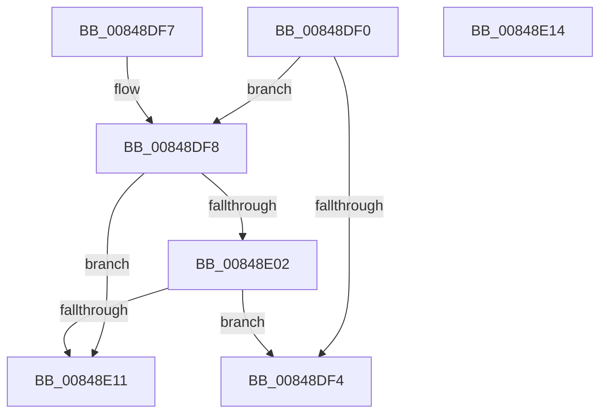

# CmpDoesBufferRequireCapturing

- RVA: `0x00848DF0`–`0x00848E15` (길이 `37` bytes)
- VA: `0x0000000140848DF0`
- 실행 섹션: `PAGE`
- PDB 이름 있음: `예`; PDB Function 태그: `아니요`
- unwind 정보 RVA: `0x000DB714`
- 디코드: `13`개 명령, `37/37` bytes 표시
- 미해석 바이트: `0` (있으면 어셈블리에 `.byte`로 보존)

> 이 문서는 커널 이미지의 기계어와 PDB 기호를 분석해 생성했습니다. 4번과 5번은 함수 원형과 자료형을 바이너리 사용 방식에서 추정한 C 해석이며 원본 소스 복구 결과는 아닙니다.

## 1. Dependencies

- 직접 호출 지점: **0**; 고유 호출 대상: **0**
- 직접 호출자로 확인된 함수: **3**
- RIP 상대 이미지 참조: **1**

### Outgoing calls
- 직접 디코드된 call 명령이 없습니다.

### Direct callers
- [NtRenameKey](../7E/NtRenameKey_function_007E04B0.md) at `0x007E0660`
- [NtDeleteValueKey](NtDeleteValueKey_function_00848770.md) at `0x0084896C`
- [CmpCaptureKeyValueArray](../8B/CmpCaptureKeyValueArray_function_008B1074.md) at `0x008B11C1`
- [CmpCaptureKeyValueArray](../8B/CmpCaptureKeyValueArray_function_008B1074.md) at `0x008B12B3`

### Static image references
- `0x00848DF8` → RVA `0x00EF7208` (`.data`; read)

## 2. Other-region calls and transfers

- 다른 실행 섹션으로 향하는 call: **0**
- 별도 외부 분기/꼬리 이동을 확인하지 못했습니다.

## 3. Assembly (complete function range)

```asm
00848DF0  85 C9                           test ecx, ecx
00848DF2  74 04                           je 0x140848df8
00848DF4  B0 01                           mov al, 1
00848DF6  C3                              ret
00848DF7  CC                              int3
00848DF8  48 83 3D 08 E4 6A 00 00         cmp qword ptr [rip + 0x6ae408], 0
00848E00  74 0F                           je 0x140848e11
00848E02  48 B8 FF FF FE FF FF 7F 00 00   movabs rax, 0x7ffffffeffff
00848E0C  48 3B D0                        cmp rdx, rax
00848E0F  76 E3                           jbe 0x140848df4
00848E11  32 C0                           xor al, al
00848E13  C3                              ret
00848E14  CC                              int3
```

## 4. C-style interpretation (structured pseudocode)

```c
__int64 __fastcall CmpDoesBufferRequireCapturing(int a1, __int64 a2)
{
    __int64 result;

    if (a1 == 0) goto loc_00848DF8;
loc_00848DF4:
    return 1;
loc_00848DF8:
    if ((*(unsigned __int64 *)(v_rip + 7005192)) == 0) goto loc_00848E11;
    if (a2 <= 1) goto loc_00848DF4;
loc_00848E11:
    result = 0;
    return result;
}
```

## 5. (Beta) C Style

```c
int64_t CmpDoesBufferRequireCapturing(int32_t Arg1, int64_t Arg2)
{
    int64_t result;

    if (Arg1 == 0) goto loc_00848DF8;
loc_00848DF4:
    return 1;
loc_00848DF8:
    if ((*(uint64_t *)(v_rip + 0x6AE408)) == 0) goto loc_00848E11;
    if (Arg2 <= 1) goto loc_00848DF4;
loc_00848E11:
    result = 0;
    return result;
}
```

## 6. Execution-region graph

[열기: 2D/3D 그래프와 함수 탐색 컨트롤 패널](../../../control-panel.html?section=page&rva=0x00848DF0&view=graph)

- 2D 그래프는 위에서 아래로 흐르고, 3D 그래프는 빈 공간을 드래그해 회전합니다. Shift+드래그는 이동, 휠은 확대·축소, 함수 노드 선택은 대상 보고서 이동입니다.

### Static fallback


