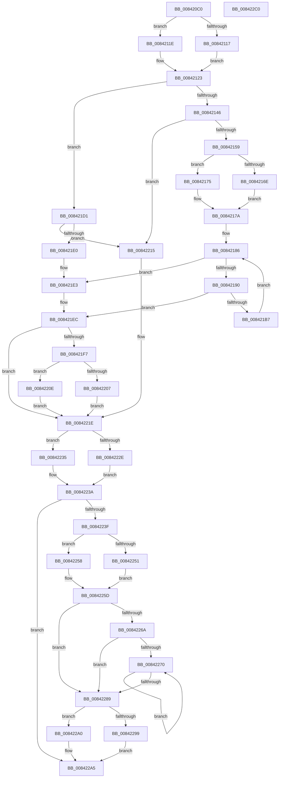

# CmpDuplicateIndex

- RVA: `0x008420C0`–`0x008422C1` (길이 `513` bytes)
- VA: `0x00000001408420C0`
- 실행 섹션: `PAGE`
- PDB 이름 있음: `예`; PDB Function 태그: `아니요`
- unwind 정보 RVA: `0x00068EF0`
- 디코드: `151`개 명령, `513/513` bytes 표시
- 미해석 바이트: `0` (있으면 어셈블리에 `.byte`로 보존)

> 이 문서는 커널 이미지의 기계어와 PDB 기호를 분석해 생성했습니다. 4번과 5번은 함수 원형과 자료형을 바이너리 사용 방식에서 추정한 C 해석이며 원본 소스 복구 결과는 아닙니다.

## 1. Dependencies

- 직접 호출 지점: **16**; 고유 호출 대상: **6**
- 직접 호출자로 확인된 함수: **2**
- RIP 상대 이미지 참조: **0**

### Outgoing calls
- `0x00842117` → [HvpGetCellFlat](../85/HvpGetCellFlat_function_00854C60.md) (function, `0x00854C60`)
- `0x0084211E` → [HvpGetCellPaged](../85/HvpGetCellPaged_function_00854CB0.md) (function, `0x00854CB0`)
- `0x00842149` → [HvDuplicateCell](HvDuplicateCell_function_00843238.md) (function, `0x00843238`)
- `0x0084216E` → [HvpGetCellFlat](../85/HvpGetCellFlat_function_00854C60.md) (function, `0x00854C60`)
- `0x00842175` → [HvpGetCellPaged](../85/HvpGetCellPaged_function_00854CB0.md) (function, `0x00854CB0`)
- `0x008421AB` → [HvDuplicateCell](HvDuplicateCell_function_00843238.md) (function, `0x00843238`)
- `0x008421D4` → [HvDuplicateCell](HvDuplicateCell_function_00843238.md) (function, `0x00843238`)
- `0x00842207` → [HvpReleaseCellFlat](../85/HvpReleaseCellFlat_function_0085CC20.md) (function, `0x0085CC20`)
- `0x0084220E` → [HvpReleaseCellPaged](../85/HvpReleaseCellPaged_function_00855F40.md) (function, `0x00855F40`)
- `0x0084222E` → [HvpReleaseCellFlat](../85/HvpReleaseCellFlat_function_0085CC20.md) (function, `0x0085CC20`)
- `0x00842235` → [HvpReleaseCellPaged](../85/HvpReleaseCellPaged_function_00855F40.md) (function, `0x00855F40`)
- `0x00842251` → [HvpGetCellFlat](../85/HvpGetCellFlat_function_00854C60.md) (function, `0x00854C60`)
- `0x00842258` → [HvpGetCellPaged](../85/HvpGetCellPaged_function_00854CB0.md) (function, `0x00854CB0`)
- `0x00842279` → [HvFreeCell](../85/HvFreeCell_function_0085A72C.md) (function, `0x0085A72C`)
- `0x00842299` → [HvpReleaseCellFlat](../85/HvpReleaseCellFlat_function_0085CC20.md) (function, `0x0085CC20`)
- `0x008422A0` → [HvpReleaseCellPaged](../85/HvpReleaseCellPaged_function_00855F40.md) (function, `0x00855F40`)

### Direct callers
- [CmRenameKey](../7E/CmRenameKey_function_007E8F48.md) at `0x007E9C3B`
- [CmRenameKey](../7E/CmRenameKey_function_007E8F48.md) at `0x007E9C62`
- [CmpLightWeightDuplicateParentLists](../A5/CmpLightWeightDuplicateParentLists_function_00A54BB4.md) at `0x00A54C3E`

### Static image references
- 디코드된 RIP-relative 메모리 참조가 없습니다.

## 2. Other-region calls and transfers

- 다른 실행 섹션으로 향하는 call: **0**
- 별도 외부 분기/꼬리 이동을 확인하지 못했습니다.

## 3. Assembly (complete function range)

```asm
008420C0  48 89 5C 24 10                  mov qword ptr [rsp + 0x10], rbx
008420C5  4C 89 4C 24 20                  mov qword ptr [rsp + 0x20], r9
008420CA  44 89 44 24 18                  mov dword ptr [rsp + 0x18], r8d
008420CF  55                              push rbp
008420D0  56                              push rsi
008420D1  57                              push rdi
008420D2  41 54                           push r12
008420D4  41 55                           push r13
008420D6  41 56                           push r14
008420D8  41 57                           push r15
008420DA  48 8B EC                        mov rbp, rsp
008420DD  48 83 EC 50                     sub rsp, 0x50
008420E1  33 FF                           xor edi, edi
008420E3  48 8B D9                        mov rbx, rcx
008420E6  83 C9 FF                        or ecx, 0xffffffff
008420E9  89 7D F4                        mov dword ptr [rbp - 0xc], edi
008420EC  45 8B E0                        mov r12d, r8d
008420EF  89 4D F0                        mov dword ptr [rbp - 0x10], ecx
008420F2  89 4D E8                        mov dword ptr [rbp - 0x18], ecx
008420F5  4C 8D 45 F0                     lea r8, [rbp - 0x10]
008420F9  44 8D 6F 01                     lea r13d, [rdi + 1]
008420FD  89 4D 40                        mov dword ptr [rbp + 0x40], ecx
00842100  8B F2                           mov esi, edx
00842102  44 8B F7                        mov r14d, edi
00842105  48 8B CB                        mov rcx, rbx
00842108  89 7D EC                        mov dword ptr [rbp - 0x14], edi
0084210B  89 7D E0                        mov dword ptr [rbp - 0x20], edi
0084210E  44 84 AB 8C 00 00 00            test byte ptr [rbx + 0x8c], r13b
00842115  74 07                           je 0x14084211e
00842117  E8 44 2B 01 00                  call 0x140854c60
0084211C  EB 05                           jmp 0x140842123
0084211E  E8 8D 2B 01 00                  call 0x140854cb0
00842123  4C 8B F8                        mov r15, rax
00842126  45 8B C4                        mov r8d, r12d
00842129  B8 72 69 00 00                  mov eax, 0x6972
0084212E  8B D6                           mov edx, esi
00842130  48 8B CB                        mov rcx, rbx
00842133  66 41 39 07                     cmp word ptr [r15], ax
00842137  48 8D 45 40                     lea rax, [rbp + 0x40]
0084213B  48 89 44 24 20                  mov qword ptr [rsp + 0x20], rax
00842140  0F 85 8B 00 00 00               jne 0x1408421d1
00842146  45 33 C9                        xor r9d, r9d
00842149  E8 EA 10 00 00                  call 0x140843238
0084214E  44 8B E8                        mov r13d, eax
00842151  85 C0                           test eax, eax
00842153  0F 88 BC 00 00 00               js 0x140842215
00842159  F6 83 8C 00 00 00 01            test byte ptr [rbx + 0x8c], 1
00842160  4C 8D 45 E8                     lea r8, [rbp - 0x18]
00842164  8B 75 40                        mov esi, dword ptr [rbp + 0x40]
00842167  48 8B CB                        mov rcx, rbx
0084216A  8B D6                           mov edx, esi
0084216C  74 07                           je 0x140842175
0084216E  E8 ED 2A 01 00                  call 0x140854c60
00842173  EB 05                           jmp 0x14084217a
00842175  E8 36 2B 01 00                  call 0x140854cb0
0084217A  4C 8B F0                        mov r14, rax
0084217D  C7 00 72 69 00 00               mov dword ptr [rax], 0x6972
00842183  44 8B E7                        mov r12d, edi
00842186  41 0F B7 47 02                  movzx eax, word ptr [r15 + 2]
0084218B  44 3B E0                        cmp r12d, eax
0084218E  73 53                           jae 0x1408421e3
00842190  44 8B 45 50                     mov r8d, dword ptr [rbp + 0x50]
00842194  48 8D 4D E0                     lea rcx, [rbp - 0x20]
00842198  41 8B C4                        mov eax, r12d
0084219B  41 B1 01                        mov r9b, 1
0084219E  48 89 4C 24 20                  mov qword ptr [rsp + 0x20], rcx
008421A3  48 8B CB                        mov rcx, rbx
008421A6  41 8B 54 87 04                  mov edx, dword ptr [r15 + rax*4 + 4]
008421AB  E8 88 10 00 00                  call 0x140843238
008421B0  44 8B E8                        mov r13d, eax
008421B3  85 C0                           test eax, eax
008421B5  78 35                           js 0x1408421ec
008421B7  8B 45 E0                        mov eax, dword ptr [rbp - 0x20]
008421BA  41 8B CC                        mov ecx, r12d
008421BD  41 89 44 8E 04                  mov dword ptr [r14 + rcx*4 + 4], eax
008421C2  B8 01 00 00 00                  mov eax, 1
008421C7  66 41 01 46 02                  add word ptr [r14 + 2], ax
008421CC  44 03 E0                        add r12d, eax
008421CF  EB B5                           jmp 0x140842186
008421D1  45 8A CD                        mov r9b, r13b
008421D4  E8 5F 10 00 00                  call 0x140843238
008421D9  44 8B E8                        mov r13d, eax
008421DC  85 C0                           test eax, eax
008421DE  78 35                           js 0x140842215
008421E0  8B 75 40                        mov esi, dword ptr [rbp + 0x40]
008421E3  48 8B 45 58                     mov rax, qword ptr [rbp + 0x58]
008421E7  89 30                           mov dword ptr [rax], esi
008421E9  83 CE FF                        or esi, 0xffffffff
008421EC  4D 85 F6                        test r14, r14
008421EF  41 BE 01 00 00 00               mov r14d, 1
008421F5  74 27                           je 0x14084221e
008421F7  48 8D 55 E8                     lea rdx, [rbp - 0x18]
008421FB  48 8B CB                        mov rcx, rbx
008421FE  44 84 B3 8C 00 00 00            test byte ptr [rbx + 0x8c], r14b
00842205  74 07                           je 0x14084220e
00842207  E8 14 AA 01 00                  call 0x14085cc20
0084220C  EB 10                           jmp 0x14084221e
0084220E  E8 2D 3D 01 00                  call 0x140855f40
00842213  EB 09                           jmp 0x14084221e
00842215  8B 75 40                        mov esi, dword ptr [rbp + 0x40]
00842218  41 BE 01 00 00 00               mov r14d, 1
0084221E  48 8D 55 F0                     lea rdx, [rbp - 0x10]
00842222  48 8B CB                        mov rcx, rbx
00842225  44 84 B3 8C 00 00 00            test byte ptr [rbx + 0x8c], r14b
0084222C  74 07                           je 0x140842235
0084222E  E8 ED A9 01 00                  call 0x14085cc20
00842233  EB 05                           jmp 0x14084223a
00842235  E8 06 3D 01 00                  call 0x140855f40
0084223A  83 FE FF                        cmp esi, -1
0084223D  74 66                           je 0x1408422a5
0084223F  4C 8D 45 E8                     lea r8, [rbp - 0x18]
00842243  8B D6                           mov edx, esi
00842245  48 8B CB                        mov rcx, rbx
00842248  44 84 B3 8C 00 00 00            test byte ptr [rbx + 0x8c], r14b
0084224F  74 07                           je 0x140842258
00842251  E8 0A 2A 01 00                  call 0x140854c60
00842256  EB 05                           jmp 0x14084225d
00842258  E8 53 2A 01 00                  call 0x140854cb0
0084225D  48 8B F0                        mov rsi, rax
00842260  B8 72 69 00 00                  mov eax, 0x6972
00842265  66 39 06                        cmp word ptr [rsi], ax
00842268  75 1F                           jne 0x140842289
0084226A  66 3B 7E 02                     cmp di, word ptr [rsi + 2]
0084226E  73 19                           jae 0x140842289
00842270  8B D7                           mov edx, edi
00842272  48 8B CB                        mov rcx, rbx
00842275  8B 54 96 04                     mov edx, dword ptr [rsi + rdx*4 + 4]
00842279  E8 AE 84 01 00                  call 0x14085a72c
0084227E  0F B7 46 02                     movzx eax, word ptr [rsi + 2]
00842282  41 03 FE                        add edi, r14d
00842285  3B F8                           cmp edi, eax
00842287  72 E7                           jb 0x140842270
00842289  48 8D 55 E8                     lea rdx, [rbp - 0x18]
0084228D  48 8B CB                        mov rcx, rbx
00842290  44 84 B3 8C 00 00 00            test byte ptr [rbx + 0x8c], r14b
00842297  74 07                           je 0x1408422a0
00842299  E8 82 A9 01 00                  call 0x14085cc20
0084229E  EB 05                           jmp 0x1408422a5
008422A0  E8 9B 3C 01 00                  call 0x140855f40
008422A5  48 8B 9C 24 98 00 00 00         mov rbx, qword ptr [rsp + 0x98]
008422AD  41 8B C5                        mov eax, r13d
008422B0  48 83 C4 50                     add rsp, 0x50
008422B4  41 5F                           pop r15
008422B6  41 5E                           pop r14
008422B8  41 5D                           pop r13
008422BA  41 5C                           pop r12
008422BC  5F                              pop rdi
008422BD  5E                              pop rsi
008422BE  5D                              pop rbp
008422BF  C3                              ret
008422C0  CC                              int3
```

## 4. C-style interpretation (structured pseudocode)

```c
__int64 __fastcall CmpDuplicateIndex(__int64 a1, int a2, int a3, __int64 a4)
{
    __int64 result;
    __int64 v_r12;
    __int64 v_rdi;
    __int64 v_rsi;
    __int64 v_rsp;
    unsigned int v_stack_m44;
    unsigned int v_stack_m48;
    unsigned int v_stack_m4C;
    unsigned int v_stack_m50;
    unsigned int v_stack_m58;
    unsigned __int64 v_stack_m68;
    unsigned __int64 v_stack_p10;
    unsigned int v_stack_p18;
    unsigned __int64 v_stack_p20;
    unsigned int v_stack_p8;

    v_stack_p10 = v_rbx;
    v_stack_p20 = a4;
    v_stack_p18 = a3;
    v_rsp = (v_rsp) - (80);
    v_rdi = 0;
    a1 = (unsigned int)((a1) | (0xFFFFFFFFULL));
    v_stack_m44 = 0;
    v_stack_m48 = (unsigned int)(a1);
    v_stack_m50 = (unsigned int)(a1);
    v_stack_p8 = (unsigned int)(a1);
    v_stack_m4C = 0;
    v_stack_m58 = 0;
    if (((*(unsigned __int8 *)(a1 + 140)) & ((unsigned __int8)(v_rdi + 1))) == 0) goto loc_0084211E;
    result = HvpGetCellFlat(a1, a2, v_stack_m48, a4);
    goto loc_00842123;
loc_0084211E:
    result = HvpGetCellPaged(a1, a2, v_stack_m48, a4);
loc_00842123:
    v_stack_m68 = v_stack_p8;
    if ((*(unsigned __int16 *)(result)) != ((unsigned __int16)((unsigned int)(0x6972ULL)))) goto loc_008421D1;
    a4 = 0;
    result = HvDuplicateCell(a1, (unsigned int)((unsigned int)((unsigned int)(a2))), (unsigned int)((unsigned int)((unsigned int)(a3))), a4);
    if (sign_flag) goto loc_00842215;
    if (((*(unsigned __int8 *)(a1 + 140)) & (1)) == 0) goto loc_00842175;
    result = HvpGetCellFlat(a1, (unsigned int)((unsigned int)((unsigned int)(v_stack_p8))), v_stack_m50, a4);
    goto loc_0084217A;
loc_00842175:
    result = HvpGetCellPaged(a1, (unsigned int)((unsigned int)((unsigned int)(v_stack_p8))), v_stack_m50, a4);
loc_0084217A:
    *(unsigned int *)(result) = 0x6972ULL;
loc_00842186:
    if (0 >= ((unsigned int)(*(unsigned __int16 *)(result + 2)))) goto loc_008421E3;
    v_stack_m68 = v_stack_m58;
    result = HvDuplicateCell(a1, (unsigned int)(*(unsigned int *)(result + 0 * 4 + 4)), (unsigned int)(v_stack_p18), 1);
    if (sign_flag) goto loc_008421EC;
    *(unsigned int *)(result + 0 * 4 + 4) = (unsigned int)((unsigned int)(v_stack_m58));
    v_r12 = (unsigned int)((0) + (1));
    goto loc_00842186;
loc_008421D1:
    result = HvDuplicateCell(0, (unsigned int)(*(unsigned int *)(result + 0 * 4 + 4)), (unsigned int)(v_stack_p18), (unsigned __int8)((unsigned int)((unsigned int)(result))));
    if (sign_flag) goto loc_00842215;
loc_008421E3:
    *(unsigned int *)(v_stack_p20) = (unsigned int)((unsigned int)(v_stack_p8));
    v_rsi = (unsigned int)(((unsigned int)(v_stack_p8)) | (0xFFFFFFFFULL));
loc_008421EC:
    if (result == 0) goto loc_0084221E;
    if (((*(unsigned __int8 *)(a1 + 140)) & (1)) == 0) goto loc_0084220E;
    result = HvpReleaseCellFlat(a1, v_stack_m50, (unsigned int)(v_stack_p18), (unsigned __int8)((unsigned int)((unsigned int)(result))));
    goto loc_0084221E;
loc_0084220E:
    result = HvpReleaseCellPaged(a1, v_stack_m50, (unsigned int)(v_stack_p18), (unsigned __int8)((unsigned int)((unsigned int)(result))));
    goto loc_0084221E;
loc_00842215:
loc_0084221E:
    if (((*(unsigned __int8 *)(a1 + 140)) & (1)) == 0) goto loc_00842235;
    result = HvpReleaseCellFlat(a1, v_stack_m48, (unsigned int)(v_stack_p18), (unsigned __int8)((unsigned int)((unsigned int)(result))));
    goto loc_0084223A;
loc_00842235:
    result = HvpReleaseCellPaged(a1, v_stack_m48, (unsigned int)(v_stack_p18), (unsigned __int8)((unsigned int)((unsigned int)(result))));
loc_0084223A:
    if (((unsigned int)((unsigned int)(v_stack_p8))) == -1) goto loc_008422A5;
    if (((*(unsigned __int8 *)(a1 + 140)) & (1)) == 0) goto loc_00842258;
    result = HvpGetCellFlat(a1, (unsigned int)((unsigned int)((unsigned int)(v_stack_p8))), v_stack_m50, (unsigned __int8)((unsigned int)((unsigned int)(result))));
    goto loc_0084225D;
loc_00842258:
    result = HvpGetCellPaged(a1, (unsigned int)((unsigned int)((unsigned int)(v_stack_p8))), v_stack_m50, (unsigned __int8)((unsigned int)((unsigned int)(result))));
loc_0084225D:
    if ((*(unsigned __int16 *)(result)) != ((unsigned __int16)((unsigned int)(0x6972ULL)))) goto loc_00842289;
    if (0 >= (*(unsigned __int16 *)(result + 2))) goto loc_00842289;
loc_00842270:
    result = HvFreeCell(a1, (unsigned int)(*(unsigned int *)(result + 0 * 4 + 4)), v_stack_m50, (unsigned __int8)((unsigned int)((unsigned int)(result))));
    v_rdi = (unsigned int)((v_rdi) + (1));
    if (((unsigned int)(v_rdi)) < ((unsigned int)(*(unsigned __int16 *)(result + 2)))) goto loc_00842270;
loc_00842289:
    if (((*(unsigned __int8 *)(a1 + 140)) & (1)) == 0) goto loc_008422A0;
    result = HvpReleaseCellFlat(a1, v_stack_m50, v_stack_m50, (unsigned __int8)((unsigned int)((unsigned int)(result))));
    goto loc_008422A5;
loc_008422A0:
    result = HvpReleaseCellPaged(a1, v_stack_m50, v_stack_m50, (unsigned __int8)((unsigned int)((unsigned int)(result))));
loc_008422A5:
    v_rsp = (v_rsp) + (80);
    return (unsigned int)((unsigned int)((unsigned int)((unsigned int)(result))));
}
```

## 5. (Beta) C Style

```c
int64_t CmpDuplicateIndex(void *Arg1, int32_t Arg2, int32_t Arg3, int64_t Arg4)
{
    uint8_t *arg1 = (uint8_t *)Arg1;

    int64_t result;
    int64_t local_r12;
    int64_t local_rdi;
    int64_t local_rsi;
    int64_t local_rsp;
    uint32_t v_stack_m44;
    uint32_t v_stack_m48;
    uint32_t v_stack_m4C;
    uint32_t v_stack_m50;
    uint32_t v_stack_m58;
    uint64_t v_stack_m68;
    uint64_t v_stack_p10;
    uint32_t v_stack_p18;
    uint64_t v_stack_p20;
    uint32_t v_stack_p8;

    v_stack_p10 = local_rbx;
    v_stack_p20 = Arg4;
    v_stack_p18 = Arg3;
    local_rsp = (local_rsp) - (80);
    local_rdi = 0;
    Arg1 = (uint32_t)((Arg1) | (0xFFFFFFFFULL));
    v_stack_m44 = 0;
    v_stack_m48 = (uint32_t)(Arg1);
    v_stack_m50 = (uint32_t)(Arg1);
    v_stack_p8 = (uint32_t)(Arg1);
    v_stack_m4C = 0;
    v_stack_m58 = 0;
    if (((*(uint8_t *)(arg1 + 0x8C)) & ((uint8_t)(local_rdi + 1))) == 0) goto loc_0084211E;
    result = HvpGetCellFlat(Arg1, Arg2, v_stack_m48, Arg4);
    goto loc_00842123;
loc_0084211E:
    result = HvpGetCellPaged(Arg1, Arg2, v_stack_m48, Arg4);
loc_00842123:
    v_stack_m68 = v_stack_p8;
    if ((*(uint16_t *)(result)) != ((uint16_t)((uint32_t)(0x6972ULL)))) goto loc_008421D1;
    Arg4 = 0;
    result = HvDuplicateCell(Arg1, (uint32_t)((uint32_t)((uint32_t)(Arg2))), (uint32_t)((uint32_t)((uint32_t)(Arg3))), Arg4);
    if (sign_flag) goto loc_00842215;
    if (((*(uint8_t *)(arg1 + 0x8C)) & (1)) == 0) goto loc_00842175;
    result = HvpGetCellFlat(Arg1, (uint32_t)((uint32_t)((uint32_t)(v_stack_p8))), v_stack_m50, Arg4);
    goto loc_0084217A;
loc_00842175:
    result = HvpGetCellPaged(Arg1, (uint32_t)((uint32_t)((uint32_t)(v_stack_p8))), v_stack_m50, Arg4);
loc_0084217A:
    *(uint32_t *)(result) = 0x6972ULL;
loc_00842186:
    if (0 >= ((uint32_t)(*(uint16_t *)(result + 0x2)))) goto loc_008421E3;
    v_stack_m68 = v_stack_m58;
    result = HvDuplicateCell(Arg1, (uint32_t)(*(uint32_t *)(result + 0x0 * 4 + 0x4)), (uint32_t)(v_stack_p18), 1);
    if (sign_flag) goto loc_008421EC;
    *(uint32_t *)(result + 0x0 * 4 + 0x4) = (uint32_t)((uint32_t)(v_stack_m58));
    local_r12 = (uint32_t)((0) + (1));
    goto loc_00842186;
loc_008421D1:
    result = HvDuplicateCell(0, (uint32_t)(*(uint32_t *)(result + 0x0 * 4 + 0x4)), (uint32_t)(v_stack_p18), (uint8_t)((uint32_t)((uint32_t)(result))));
    if (sign_flag) goto loc_00842215;
loc_008421E3:
    *(uint32_t *)(v_stack_p20) = (uint32_t)((uint32_t)(v_stack_p8));
    local_rsi = (uint32_t)(((uint32_t)(v_stack_p8)) | (0xFFFFFFFFULL));
loc_008421EC:
    if (result == 0) goto loc_0084221E;
    if (((*(uint8_t *)(arg1 + 0x8C)) & (1)) == 0) goto loc_0084220E;
    result = HvpReleaseCellFlat(Arg1, v_stack_m50, (uint32_t)(v_stack_p18), (uint8_t)((uint32_t)((uint32_t)(result))));
    goto loc_0084221E;
loc_0084220E:
    result = HvpReleaseCellPaged(Arg1, v_stack_m50, (uint32_t)(v_stack_p18), (uint8_t)((uint32_t)((uint32_t)(result))));
    goto loc_0084221E;
loc_00842215:
loc_0084221E:
    if (((*(uint8_t *)(arg1 + 0x8C)) & (1)) == 0) goto loc_00842235;
    result = HvpReleaseCellFlat(Arg1, v_stack_m48, (uint32_t)(v_stack_p18), (uint8_t)((uint32_t)((uint32_t)(result))));
    goto loc_0084223A;
loc_00842235:
    result = HvpReleaseCellPaged(Arg1, v_stack_m48, (uint32_t)(v_stack_p18), (uint8_t)((uint32_t)((uint32_t)(result))));
loc_0084223A:
    if (((uint32_t)((uint32_t)(v_stack_p8))) == -1) goto loc_008422A5;
    if (((*(uint8_t *)(arg1 + 0x8C)) & (1)) == 0) goto loc_00842258;
    result = HvpGetCellFlat(Arg1, (uint32_t)((uint32_t)((uint32_t)(v_stack_p8))), v_stack_m50, (uint8_t)((uint32_t)((uint32_t)(result))));
    goto loc_0084225D;
loc_00842258:
    result = HvpGetCellPaged(Arg1, (uint32_t)((uint32_t)((uint32_t)(v_stack_p8))), v_stack_m50, (uint8_t)((uint32_t)((uint32_t)(result))));
loc_0084225D:
    if ((*(uint16_t *)(result)) != ((uint16_t)((uint32_t)(0x6972ULL)))) goto loc_00842289;
    if (0 >= (*(uint16_t *)(result + 0x2))) goto loc_00842289;
loc_00842270:
    result = HvFreeCell(Arg1, (uint32_t)(*(uint32_t *)(result + 0x0 * 4 + 0x4)), v_stack_m50, (uint8_t)((uint32_t)((uint32_t)(result))));
    local_rdi = (uint32_t)((local_rdi) + (1));
    if (((uint32_t)(local_rdi)) < ((uint32_t)(*(uint16_t *)(result + 0x2)))) goto loc_00842270;
loc_00842289:
    if (((*(uint8_t *)(arg1 + 0x8C)) & (1)) == 0) goto loc_008422A0;
    result = HvpReleaseCellFlat(Arg1, v_stack_m50, v_stack_m50, (uint8_t)((uint32_t)((uint32_t)(result))));
    goto loc_008422A5;
loc_008422A0:
    result = HvpReleaseCellPaged(Arg1, v_stack_m50, v_stack_m50, (uint8_t)((uint32_t)((uint32_t)(result))));
loc_008422A5:
    local_rsp = (local_rsp) + (80);
    return (uint32_t)((uint32_t)((uint32_t)((uint32_t)(result))));
}
```

### 관측된 메모리 오프셋

구조체 형식이 확인되지 않은 접근은 인자 기준의 오프셋으로만 기록했습니다.

| 기준 인자 | 오프셋 표현 | 폭 (bit) | 접근 |
|---|---:|---:|---|
| `Arg1` | `+ 0x8C` | `8` | `R` |

## 6. Execution-region graph

[열기: 2D/3D 그래프와 함수 탐색 컨트롤 패널](../../../control-panel.html?section=page&rva=0x008420C0&view=graph)

- 2D 그래프는 위에서 아래로 흐르고, 3D 그래프는 빈 공간을 드래그해 회전합니다. Shift+드래그는 이동, 휠은 확대·축소, 함수 노드 선택은 대상 보고서 이동입니다.

### Static fallback


