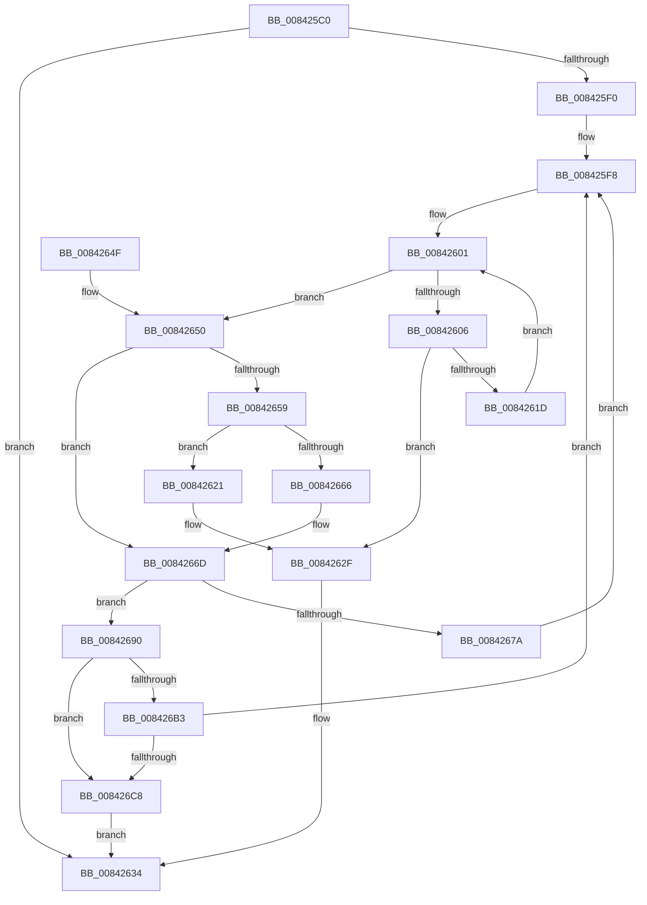

# CmpEnlistKeyBody

- RVA: `0x008425C0`–`0x008426D2` (길이 `274` bytes)
- VA: `0x00000001408425C0`
- 실행 섹션: `PAGE`
- PDB 이름 있음: `예`; PDB Function 태그: `아니요`
- unwind 정보 RVA: `0x00068F60`
- 디코드: `74`개 명령, `274/274` bytes 표시
- 미해석 바이트: `0` (있으면 어셈블리에 `.byte`로 보존)

> 이 문서는 커널 이미지의 기계어와 PDB 기호를 분석해 생성했습니다. 4번과 5번은 함수 원형과 자료형을 바이너리 사용 방식에서 추정한 C 해석이며 원본 소스 복구 결과는 아닙니다.

## 1. Dependencies

- 직접 호출 지점: **3**; 고유 호출 대상: **3**
- 직접 호출자로 확인된 함수: **2**
- RIP 상대 이미지 참조: **0**

### Outgoing calls
- `0x00842694` → [CmpUnlockKcb](../../pagecmrc/BC/CmpUnlockKcb_function_00BC92C0.md) (function, `0x00BC92C0`)
- `0x0084269D` → [CmpLockKcbExclusive](../86/CmpLockKcbExclusive_function_00861EB0.md) (function, `0x00861EB0`)
- `0x008426BB` → [CmpIsKeyStackDeleted](CmpIsKeyStackDeleted_function_008426E0.md) (function, `0x008426E0`)

### Direct callers
- [CmpDoParseKey](../85/CmpDoParseKey_function_0085F750.md) at `0x008613B8`
- [sub_00B16F66](../B1/Unknown_function_00B16F66.md) at `0x00B17449`

### Static image references
- 디코드된 RIP-relative 메모리 참조가 없습니다.

## 2. Other-region calls and transfers

- 다른 실행 섹션으로 향하는 call: **1**
  - `0x00842694` → [CmpUnlockKcb](../../pagecmrc/BC/CmpUnlockKcb_function_00BC92C0.md) (`PAGE` → `PAGECMRC`)
- 별도 외부 분기/꼬리 이동을 확인하지 못했습니다.

## 3. Assembly (complete function range)

```asm
008425C0  48 89 5C 24 08                  mov qword ptr [rsp + 8], rbx
008425C5  48 89 6C 24 10                  mov qword ptr [rsp + 0x10], rbp
008425CA  48 89 74 24 18                  mov qword ptr [rsp + 0x18], rsi
008425CF  57                              push rdi
008425D0  41 56                           push r14
008425D2  41 57                           push r15
008425D4  48 83 EC 20                     sub rsp, 0x20
008425D8  33 F6                           xor esi, esi
008425DA  41 0F B6 E9                     movzx ebp, r9b
008425DE  F7 82 B8 00 00 00 00 00 40 00   test dword ptr [rdx + 0xb8], 0x400000
008425E8  4D 8B F0                        mov r14, r8
008425EB  48 8B D9                        mov rbx, rcx
008425EE  75 44                           jne 0x140842634
008425F0  48 8D 79 20                     lea rdi, [rcx + 0x20]
008425F4  44 8D 7E 01                     lea r15d, [rsi + 1]
008425F8  48 89 7F 08                     mov qword ptr [rdi + 8], rdi
008425FC  8B CE                           mov ecx, esi
008425FE  48 89 3F                        mov qword ptr [rdi], rdi
00842601  83 F9 04                        cmp ecx, 4
00842604  73 4A                           jae 0x140842650
00842606  48 8B 43 08                     mov rax, qword ptr [rbx + 8]
0084260A  8B D1                           mov edx, ecx
0084260C  4C 8D 04 D0                     lea r8, [rax + rdx*8]
00842610  33 C0                           xor eax, eax
00842612  F0 49 0F B1 98 88 00 00 00      lock cmpxchg qword ptr [r8 + 0x88], rbx
0084261B  74 12                           je 0x14084262f
0084261D  FF C1                           inc ecx
0084261F  EB E0                           jmp 0x140842601
00842621  48 89 0F                        mov qword ptr [rdi], rcx
00842624  48 89 47 08                     mov qword ptr [rdi + 8], rax
00842628  48 89 38                        mov qword ptr [rax], rdi
0084262B  48 89 79 08                     mov qword ptr [rcx + 8], rdi
0084262F  66 83 4B 30 40                  or word ptr [rbx + 0x30], 0x40
00842634  48 8B 5C 24 40                  mov rbx, qword ptr [rsp + 0x40]
00842639  8B C6                           mov eax, esi
0084263B  48 8B 74 24 50                  mov rsi, qword ptr [rsp + 0x50]
00842640  48 8B 6C 24 48                  mov rbp, qword ptr [rsp + 0x48]
00842645  48 83 C4 20                     add rsp, 0x20
00842649  41 5F                           pop r15
0084264B  41 5E                           pop r14
0084264D  5F                              pop rdi
0084264E  C3                              ret
0084264F  CC                              int3
00842650  48 8B 4B 08                     mov rcx, qword ptr [rbx + 8]
00842654  40 84 ED                        test bpl, bpl
00842657  74 14                           je 0x14084266d
00842659  48 83 C1 78                     add rcx, 0x78
0084265D  48 8B 41 08                     mov rax, qword ptr [rcx + 8]
00842661  48 39 08                        cmp qword ptr [rax], rcx
00842664  74 BB                           je 0x140842621
00842666  B9 03 00 00 00                  mov ecx, 3
0084266B  CD 29                           int 0x29
0084266D  B8 11 00 00 00                  mov eax, 0x11
00842672  F0 4C 0F B1 79 30               lock cmpxchg qword ptr [rcx + 0x30], r15
00842678  75 16                           jne 0x140842690
0084267A  65 48 8B 04 25 88 01 00 00      mov rax, qword ptr gs:[0x188]
00842683  41 0F B6 EF                     movzx ebp, r15b
00842687  48 89 41 38                     mov qword ptr [rcx + 0x38], rax
0084268B  E9 68 FF FF FF                  jmp 0x1408425f8
00842690  48 8B 4B 08                     mov rcx, qword ptr [rbx + 8]
00842694  E8 27 6C 38 00                  call 0x140bc92c0
00842699  48 8B 4B 08                     mov rcx, qword ptr [rbx + 8]
0084269D  E8 0E F8 01 00                  call 0x140861eb0
008426A2  48 8B 43 08                     mov rax, qword ptr [rbx + 8]
008426A6  41 0F B6 EF                     movzx ebp, r15b
008426AA  F7 40 08 00 00 02 00            test dword ptr [rax + 8], 0x20000
008426B1  75 15                           jne 0x1408426c8
008426B3  48 8B 4C 24 60                  mov rcx, qword ptr [rsp + 0x60]
008426B8  49 8B D6                        mov rdx, r14
008426BB  E8 20 00 00 00                  call 0x1408426e0
008426C0  84 C0                           test al, al
008426C2  0F 84 30 FF FF FF               je 0x1408425f8
008426C8  BE 7C 01 00 C0                  mov esi, 0xc000017c
008426CD  E9 62 FF FF FF                  jmp 0x140842634
```

## 4. C-style interpretation (structured pseudocode)

```c
__int64 __fastcall CmpEnlistKeyBody(__int64 a1, __int64 a2, __int64 a3, unsigned __int8 a4, __int64 a5)
{
    __int64 result;
    __int64 v_rsi;
    __int64 v_rsp;
    unsigned __int64 v_stack_p10;
    unsigned __int64 v_stack_p18;
    unsigned __int64 v_stack_p8;

    v_stack_p8 = v_rbx;
    v_stack_p10 = v_rbp;
    v_stack_p18 = v_rsi;
    v_rsp = (v_rsp) - (32);
    v_rsi = 0;
    if (((*(unsigned int *)(a2 + 184)) & (0x400000ULL)) != 0) goto loc_00842634;
loc_008425F8:
    *(unsigned __int64 *)(a1 + 32 + 8) = a1 + 32;
    *(unsigned __int64 *)(a1 + 32) = a1 + 32;
loc_00842601:
    if (0 >= 4) goto loc_00842650;
    result = 0;
    if (condition_is_equal) goto loc_0084262F;
    a1 = (unsigned int)((0) + 1);
    goto loc_00842601;
loc_00842621:
    *(unsigned __int64 *)(a1 + 32) = a1;
    *(unsigned __int64 *)(a1 + 32 + 8) = 0;
    *(unsigned __int64 *)(result) = a1 + 32;
    *(unsigned __int64 *)(a1 + 8) = a1 + 32;
loc_0084262F:
loc_00842634:
    v_rsp = (v_rsp) + (32);
    return 0;
loc_00842650:
    if ((unsigned __int8)(v_stack_p10) == 0) goto loc_0084266D;
    a1 = (*(unsigned __int64 *)(v_stack_p8 + 8)) + (120);
    if ((*(unsigned __int64 *)(*(unsigned __int64 *)(a1 + 8))) == a1) goto loc_00842621;
loc_0084266D:
    if ((*(unsigned __int64 *)(*(unsigned __int64 *)(a1 + 8))) != a1) goto loc_00842690;
    *(unsigned __int64 *)(3 + 56) = *(unsigned __int64 *)(gs_base + (0 + 392));
    goto loc_008425F8;
loc_00842690:
    result = CmpUnlockKcb(*(unsigned __int64 *)(v_stack_p8 + 8), 0, *(unsigned __int64 *)(a1 + 8) + 0 * 8, a4);
    result = CmpLockKcbExclusive(*(unsigned __int64 *)(v_stack_p8 + 8), 0, *(unsigned __int64 *)(a1 + 8) + 0 * 8, a4);
    if (((*(unsigned int *)(*(unsigned __int64 *)(v_stack_p8 + 8) + 8)) & (0x20000ULL)) != 0) goto loc_008426C8;
    result = CmpIsKeyStackDeleted(a5, a3, *(unsigned __int64 *)(a1 + 8) + 0 * 8, a4);
    if ((unsigned __int8)(result) == 0) goto loc_008425F8;
loc_008426C8:
    goto loc_00842634;
}
```

## 5. (Beta) C Style

```c
int64_t CmpEnlistKeyBody(void *Arg1, void *Arg2, int64_t Arg3, uint8_t Arg4, int64_t Arg5)
{
    uint8_t *arg1 = (uint8_t *)Arg1;
    uint8_t *arg2 = (uint8_t *)Arg2;

    int64_t result;
    int64_t local_rsi;
    int64_t local_rsp;
    uint64_t v_stack_p10;
    uint64_t v_stack_p18;
    uint64_t v_stack_p8;

    v_stack_p8 = local_rbx;
    v_stack_p10 = local_rbp;
    v_stack_p18 = local_rsi;
    local_rsp = (local_rsp) - (32);
    local_rsi = 0;
    if (((*(uint32_t *)(arg2 + 0xB8)) & (0x400000ULL)) != 0) goto loc_00842634;
loc_008425F8:
    *(void **)(arg1 + 0x20 + 0x8) = Arg1 + 32;
    *(void **)(arg1 + 0x20) = Arg1 + 32;
loc_00842601:
    if (0 >= 4) goto loc_00842650;
    result = 0;
    if (condition_is_equal) goto loc_0084262F;
    Arg1 = (uint32_t)((0) + 1);
    goto loc_00842601;
loc_00842621:
    *(void **)(arg1 + 0x20) = Arg1;
    *(uint64_t *)(arg1 + 0x20 + 0x8) = 0;
    *(void **)(result) = Arg1 + 32;
    *(void **)(arg1 + 0x8) = Arg1 + 32;
loc_0084262F:
loc_00842634:
    local_rsp = (local_rsp) + (32);
    return 0;
loc_00842650:
    if ((uint8_t)(v_stack_p10) == 0) goto loc_0084266D;
    Arg1 = (*(uint64_t *)(v_stack_p8 + 0x8)) + (120);
    if ((*(uint64_t *)(*(uint64_t *)(arg1 + 0x8))) == Arg1) goto loc_00842621;
loc_0084266D:
    if ((*(uint64_t *)(*(uint64_t *)(arg1 + 0x8))) != Arg1) goto loc_00842690;
    *(uint64_t *)(3 + 0x38) = *(uint64_t *)(gs_base + (0 + 0x188));
    goto loc_008425F8;
loc_00842690:
    result = CmpUnlockKcb(*(uint64_t *)(v_stack_p8 + 0x8), 0, *(uint64_t *)(arg1 + 0x8) + 0 * 8, Arg4);
    result = CmpLockKcbExclusive(*(uint64_t *)(v_stack_p8 + 0x8), 0, *(uint64_t *)(arg1 + 0x8) + 0 * 8, Arg4);
    if (((*(uint32_t *)(*(uint64_t *)(v_stack_p8 + 0x8) + 0x8)) & (0x20000ULL)) != 0) goto loc_008426C8;
    result = CmpIsKeyStackDeleted(Arg5, Arg3, *(uint64_t *)(arg1 + 0x8) + 0 * 8, Arg4);
    if ((uint8_t)(result) == 0) goto loc_008425F8;
loc_008426C8:
    goto loc_00842634;
}
```

### 관측된 메모리 오프셋

구조체 형식이 확인되지 않은 접근은 인자 기준의 오프셋으로만 기록했습니다.

| 기준 인자 | 오프셋 표현 | 폭 (bit) | 접근 |
|---|---:|---:|---|
| `Arg1` | `+ 0x0` | `64` | `W` |
| `Arg1` | `+ 0x8` | `64` | `R` |
| `Arg1` | `+ 0x8` | `64` | `W` |
| `Arg1` | `+ 0x20` | `64` | `R` |
| `Arg1` | `+ 0x30` | `16` | `R/W` |
| `Arg2` | `+ 0xB8` | `32` | `R` |

## 6. Execution-region graph

[열기: 2D/3D 그래프와 함수 탐색 컨트롤 패널](../../../control-panel.html?section=page&rva=0x008425C0&view=graph)

- 2D 그래프는 위에서 아래로 흐르고, 3D 그래프는 빈 공간을 드래그해 회전합니다. Shift+드래그는 이동, 휠은 확대·축소, 함수 노드 선택은 대상 보고서 이동입니다.

### Static fallback


