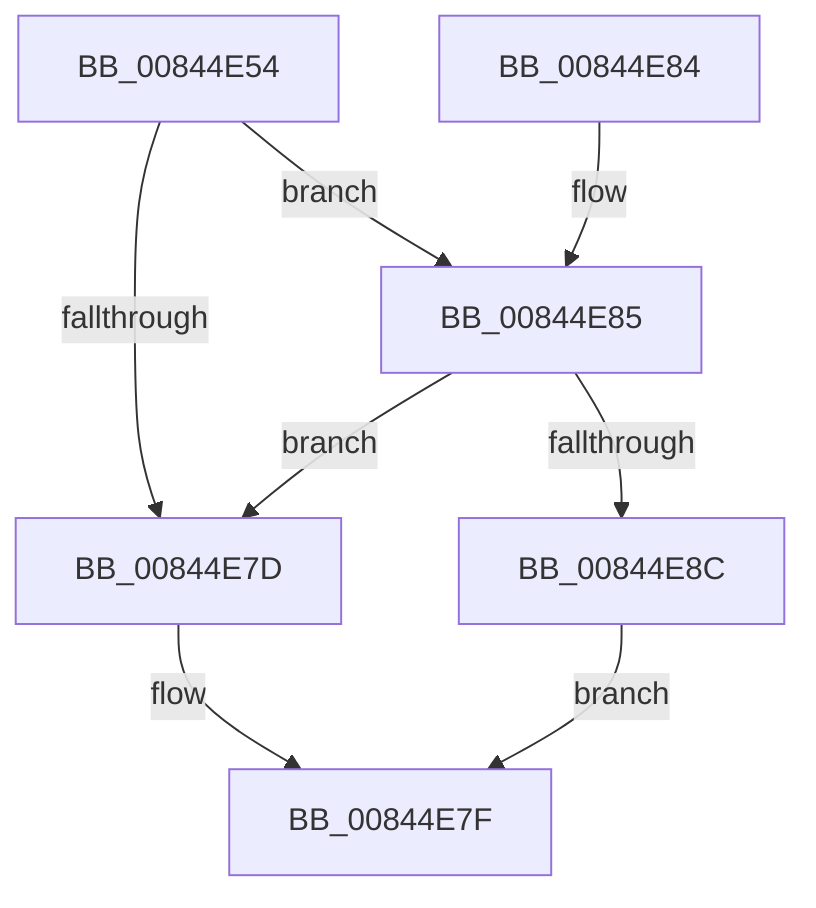

# CmpFindNameInList

- RVA: `0x00844E54`–`0x00844E90` (길이 `60` bytes)
- VA: `0x0000000140844E54`
- 실행 섹션: `PAGE`
- PDB 이름 있음: `예`; PDB Function 태그: `아니요`
- unwind 정보 RVA: `0x000691CC`
- 디코드: `18`개 명령, `60/60` bytes 표시
- 미해석 바이트: `0` (있으면 어셈블리에 `.byte`로 보존)

> 이 문서는 커널 이미지의 기계어와 PDB 기호를 분석해 생성했습니다. 4번과 5번은 함수 원형과 자료형을 바이너리 사용 방식에서 추정한 C 해석이며 원본 소스 복구 결과는 아닙니다.

## 1. Dependencies

- 직접 호출 지점: **1**; 고유 호출 대상: **1**
- 직접 호출자로 확인된 함수: **2**
- RIP 상대 이미지 참조: **0**

### Outgoing calls
- `0x00844E6C` → [CmpFindNameInListWithStatus](CmpFindNameInListWithStatus_function_00846B80.md) (function, `0x00846B80`)

### Direct callers
- [CmQueryMultipleValueKey](CmQueryMultipleValueKey_function_00846EC0.md) at `0x00847592`
- [sub_00B16338](../B1/Unknown_function_00B16338.md) at `0x00B163BB`

### Static image references
- 디코드된 RIP-relative 메모리 참조가 없습니다.

## 2. Other-region calls and transfers

- 다른 실행 섹션으로 향하는 call: **0**
- 별도 외부 분기/꼬리 이동을 확인하지 못했습니다.

## 3. Assembly (complete function range)

```asm
00844E54  48 83 EC 38                     sub rsp, 0x38
00844E58  48 8B 44 24 68                  mov rax, qword ptr [rsp + 0x68]
00844E5D  48 89 44 24 28                  mov qword ptr [rsp + 0x28], rax
00844E62  48 8B 44 24 60                  mov rax, qword ptr [rsp + 0x60]
00844E67  48 89 44 24 20                  mov qword ptr [rsp + 0x20], rax
00844E6C  E8 0F 1D 00 00                  call 0x140846b80
00844E71  BA 00 00 00 80                  mov edx, 0x80000000
00844E76  8D 0C 10                        lea ecx, [rax + rdx]
00844E79  85 CA                           test edx, ecx
00844E7B  74 08                           je 0x140844e85
00844E7D  B0 01                           mov al, 1
00844E7F  48 83 C4 38                     add rsp, 0x38
00844E83  C3                              ret
00844E84  CC                              int3
00844E85  3D 34 00 00 C0                  cmp eax, 0xc0000034
00844E8A  74 F1                           je 0x140844e7d
00844E8C  32 C0                           xor al, al
00844E8E  EB EF                           jmp 0x140844e7f
```

## 4. C-style interpretation (structured pseudocode)

```c
__int64 __fastcall CmpFindNameInList(__int64 a1, __int64 a2, __int64 a3, __int64 a4, __int64 a5, __int64 a6)
{
    __int64 result;
    __int64 v_rsp;
    unsigned __int64 v_stack_m10;
    unsigned __int64 v_stack_m18;

    v_rsp = (v_rsp) - (56);
    v_stack_m10 = a6;
    v_stack_m18 = a5;
    result = CmpFindNameInListWithStatus(a1, a2, a3, a4);
    if ((((unsigned int)((unsigned int)(0x80000000ULL))) & ((unsigned int)(result + (unsigned int)(0x80000000ULL) * 1))) == 0) goto loc_00844E85;
loc_00844E7D:
loc_00844E7F:
    v_rsp = (v_rsp) + (56);
    return 1;
loc_00844E85:
    if (1 == 0xC0000034ULL) goto loc_00844E7D;
    result = 0;
    goto loc_00844E7F;
}
```

## 5. (Beta) C Style

```c
int64_t CmpFindNameInList(int64_t Arg1, int64_t Arg2, int64_t Arg3, int64_t Arg4, int64_t Arg5, int64_t Arg6)
{
    int64_t result;
    int64_t local_rsp;
    uint64_t v_stack_m10;
    uint64_t v_stack_m18;

    local_rsp = (local_rsp) - (56);
    v_stack_m10 = Arg6;
    v_stack_m18 = Arg5;
    result = CmpFindNameInListWithStatus(Arg1, Arg2, Arg3, Arg4);
    if ((((uint32_t)((uint32_t)(0x80000000ULL))) & ((uint32_t)(result + (uint32_t)(0x80000000ULL) * 1))) == 0) goto loc_00844E85;
loc_00844E7D:
loc_00844E7F:
    local_rsp = (local_rsp) + (56);
    return 1;
loc_00844E85:
    if (1 == 0xC0000034ULL) goto loc_00844E7D;
    result = 0;
    goto loc_00844E7F;
}
```

## 6. Execution-region graph

[열기: 2D/3D 그래프와 함수 탐색 컨트롤 패널](../../../control-panel.html?section=page&rva=0x00844E54&view=graph)

- 2D 그래프는 위에서 아래로 흐르고, 3D 그래프는 빈 공간을 드래그해 회전합니다. Shift+드래그는 이동, 휠은 확대·축소, 함수 노드 선택은 대상 보고서 이동입니다.

### Static fallback


