# CmpFindPathByNameEx

- RVA: `0x0084BAAC`–`0x0084BD9D` (길이 `753` bytes)
- VA: `0x000000014084BAAC`
- 실행 섹션: `PAGE`
- PDB 이름 있음: `예`; PDB Function 태그: `아니요`
- unwind 정보 RVA: `0x00069690`
- 디코드: `199`개 명령, `753/753` bytes 표시
- 미해석 바이트: `0` (있으면 어셈블리에 `.byte`로 보존)

> 이 문서는 커널 이미지의 기계어와 PDB 기호를 분석해 생성했습니다. 4번과 5번은 함수 원형과 자료형을 바이너리 사용 방식에서 추정한 C 해석이며 원본 소스 복구 결과는 아닙니다.

## 1. Dependencies

- 직접 호출 지점: **10**; 고유 호출 대상: **6**
- 직접 호출자로 확인된 함수: **5**
- RIP 상대 이미지 참조: **1**

### Outgoing calls
- `0x0084BAFB` → [RtlInitUnicodeString](../../text/42/RtlInitUnicodeString_function_0042A780.md) (function, `0x0042A780`)
- `0x0084BBA0` → [HvpGetCellFlat](../85/HvpGetCellFlat_function_00854C60.md) (function, `0x00854C60`)
- `0x0084BBFA` → [CmpFindSubKeyByNameWithStatus](../85/CmpFindSubKeyByNameWithStatus_function_00852770.md) (function, `0x00852770`)
- `0x0084BC13` → [HvpReleaseCellPaged](../85/HvpReleaseCellPaged_function_00855F40.md) (function, `0x00855F40`)
- `0x0084BC69` → [HvpGetCellPaged](../85/HvpGetCellPaged_function_00854CB0.md) (function, `0x00854CB0`)
- `0x0084BC8F` → [HvpReleaseCellPaged](../85/HvpReleaseCellPaged_function_00855F40.md) (function, `0x00855F40`)
- `0x0084BCBF` → [HvpGetCellFlat](../85/HvpGetCellFlat_function_00854C60.md) (function, `0x00854C60`)
- `0x0084BD65` → [HvpGetCellPaged](../85/HvpGetCellPaged_function_00854CB0.md) (function, `0x00854CB0`)
- `0x0084BD6F` → [HvpReleaseCellFlat](../85/HvpReleaseCellFlat_function_0085CC20.md) (function, `0x0085CC20`)
- `0x0084BD82` → [HvpReleaseCellFlat](../85/HvpReleaseCellFlat_function_0085CC20.md) (function, `0x0085CC20`)

### Direct callers
- [CmpVirtualPathPresent](../7E/CmpVirtualPathPresent_function_007EBDB4.md) at `0x007EBE30`
- [CmpVirtualBranchIsReplicated](CmpVirtualBranchIsReplicated_function_0084A3E0.md) at `0x0084A49E`
- [CmpVEExecuteRealStoreParseLogic](CmpVEExecuteRealStoreParseLogic_function_0084CCD4.md) at `0x0084CDD6`
- [sub_00B169F2](../B1/Unknown_function_00B169F2.md) at `0x00B16AAB`
- [sub_00B4160E](../B4/Unknown_function_00B4160E.md) at `0x00B4164A`

### Static image references
- `0x0084BC94` → RVA `0x00FD9A90` (`PAGEDATA`; read)

## 2. Other-region calls and transfers

- 다른 실행 섹션으로 향하는 call: **1**
  - `0x0084BAFB` → [RtlInitUnicodeString](../../text/42/RtlInitUnicodeString_function_0042A780.md) (`PAGE` → `.text`)
- 별도 외부 분기/꼬리 이동을 확인하지 못했습니다.

## 3. Assembly (complete function range)

```asm
0084BAAC  48 89 5C 24 08                  mov qword ptr [rsp + 8], rbx
0084BAB1  44 89 4C 24 20                  mov dword ptr [rsp + 0x20], r9d
0084BAB6  55                              push rbp
0084BAB7  56                              push rsi
0084BAB8  57                              push rdi
0084BAB9  41 54                           push r12
0084BABB  41 55                           push r13
0084BABD  41 56                           push r14
0084BABF  41 57                           push r15
0084BAC1  48 8B EC                        mov rbp, rsp
0084BAC4  48 83 EC 40                     sub rsp, 0x40
0084BAC8  4C 8B 65 60                     mov r12, qword ptr [rbp + 0x60]
0084BACC  45 33 F6                        xor r14d, r14d
0084BACF  48 8B F9                        mov rdi, rcx
0084BAD2  44 89 75 54                     mov dword ptr [rbp + 0x54], r14d
0084BAD6  83 C9 FF                        or ecx, 0xffffffff
0084BAD9  4C 89 75 F0                     mov qword ptr [rbp - 0x10], r14
0084BADD  89 4D 50                        mov dword ptr [rbp + 0x50], ecx
0084BAE0  4D 8B E8                        mov r13, r8
0084BAE3  41 89 0C 24                     mov dword ptr [r12], ecx
0084BAE7  48 8B DA                        mov rbx, rdx
0084BAEA  48 8B 4D 68                     mov rcx, qword ptr [rbp + 0x68]
0084BAEE  4C 89 31                        mov qword ptr [rcx], r14
0084BAF1  4D 85 C0                        test r8, r8
0084BAF4  74 0E                           je 0x14084bb04
0084BAF6  33 D2                           xor edx, edx
0084BAF8  49 8B C8                        mov rcx, r8
0084BAFB  E8 80 EC BD FF                  call 0x14042a780
0084BB00  48 8B 4D 68                     mov rcx, qword ptr [rbp + 0x68]
0084BB04  0F 10 0B                        movups xmm1, xmmword ptr [rbx]
0084BB07  66 0F 7E CB                     movd ebx, xmm1
0084BB0B  0F 11 4D E0                     movups xmmword ptr [rbp - 0x20], xmm1
0084BB0F  66 85 DB                        test bx, bx
0084BB12  0F 84 D5 01 00 00               je 0x14084bced
0084BB18  66 0F 6F C1                     movdqa xmm0, xmm1
0084BB1C  BA FE FF 00 00                  mov edx, 0xfffe
0084BB21  66 0F 73 D8 08                  psrldq xmm0, 8
0084BB26  41 B8 02 00 00 00               mov r8d, 2
0084BB2C  66 44 0F C5 F9 01               pextrw r15d, xmm1, 1
0084BB32  48 85 FF                        test rdi, rdi
0084BB35  0F 84 C9 01 00 00               je 0x14084bd04
0084BB3B  48 8B 77 20                     mov rsi, qword ptr [rdi + 0x20]
0084BB3F  48 89 31                        mov qword ptr [rcx], rsi
0084BB42  8B 4F 28                        mov ecx, dword ptr [rdi + 0x28]
0084BB45  66 48 0F 7E C7                  movq rdi, xmm0
0084BB4A  41 89 0C 24                     mov dword ptr [r12], ecx
0084BB4E  EB 17                           jmp 0x14084bb67
0084BB50  49 03 F8                        add rdi, r8
0084BB53  66 03 DA                        add bx, dx
0084BB56  66 44 03 FA                     add r15w, dx
0084BB5A  48 89 7D E8                     mov qword ptr [rbp - 0x18], rdi
0084BB5E  66 44 89 7D E2                  mov word ptr [rbp - 0x1e], r15w
0084BB63  66 89 5D E0                     mov word ptr [rbp - 0x20], bx
0084BB67  66 85 DB                        test bx, bx
0084BB6A  74 06                           je 0x14084bb72
0084BB6C  66 83 3F 5C                     cmp word ptr [rdi], 0x5c
0084BB70  74 DE                           je 0x14084bb50
0084BB72  4D 85 ED                        test r13, r13
0084BB75  74 0A                           je 0x14084bb81
0084BB77  0F 10 45 E0                     movups xmm0, xmmword ptr [rbp - 0x20]
0084BB7B  F3 41 0F 7F 45 00               movdqu xmmword ptr [r13], xmm0
0084BB81  66 85 DB                        test bx, bx
0084BB84  0F 84 76 01 00 00               je 0x14084bd00
0084BB8A  F6 86 8C 00 00 00 01            test byte ptr [rsi + 0x8c], 1
0084BB91  4C 8D 45 50                     lea r8, [rbp + 0x50]
0084BB95  8B D1                           mov edx, ecx
0084BB97  48 8B CE                        mov rcx, rsi
0084BB9A  0F 84 C9 00 00 00               je 0x14084bc69
0084BBA0  E8 BB 90 00 00                  call 0x140854c60
0084BBA5  48 8B D0                        mov rdx, rax
0084BBA8  48 85 C0                        test rax, rax
0084BBAB  0F 84 21 01 00 00               je 0x14084bcd2
0084BBB1  33 C0                           xor eax, eax
0084BBB3  48 89 7D F8                     mov qword ptr [rbp - 8], rdi
0084BBB7  66 44 89 75 F0                  mov word ptr [rbp - 0x10], r14w
0084BBBC  8D 48 02                        lea ecx, [rax + 2]
0084BBBF  66 3B C3                        cmp ax, bx
0084BBC2  73 1D                           jae 0x14084bbe1
0084BBC4  41 0F B7 C6                     movzx eax, r14w
0084BBC8  48 D1 E8                        shr rax, 1
0084BBCB  66 83 3C 47 5C                  cmp word ptr [rdi + rax*2], 0x5c
0084BBD0  74 0A                           je 0x14084bbdc
0084BBD2  66 44 03 F1                     add r14w, cx
0084BBD6  66 44 3B F3                     cmp r14w, bx
0084BBDA  72 E8                           jb 0x14084bbc4
0084BBDC  66 44 89 75 F0                  mov word ptr [rbp - 0x10], r14w
0084BBE1  84 4A 02                        test byte ptr [rdx + 2], cl
0084BBE4  0F 85 89 00 00 00               jne 0x14084bc73
0084BBEA  33 C0                           xor eax, eax
0084BBEC  4C 8D 4D 48                     lea r9, [rbp + 0x48]
0084BBF0  89 45 48                        mov dword ptr [rbp + 0x48], eax
0084BBF3  4C 8D 45 F0                     lea r8, [rbp - 0x10]
0084BBF7  48 8B CE                        mov rcx, rsi
0084BBFA  E8 71 6B 00 00                  call 0x140852770
0084BBFF  F6 86 8C 00 00 00 01            test byte ptr [rsi + 0x8c], 1
0084BC06  48 8D 55 50                     lea rdx, [rbp + 0x50]
0084BC0A  48 8B CE                        mov rcx, rsi
0084BC0D  0F 85 5C 01 00 00               jne 0x14084bd6f
0084BC13  E8 28 A3 00 00                  call 0x140855f40
0084BC18  8B 4D 48                        mov ecx, dword ptr [rbp + 0x48]
0084BC1B  83 F9 FF                        cmp ecx, -1
0084BC1E  0F 84 AE 00 00 00               je 0x14084bcd2
0084BC24  48 8B 45 68                     mov rax, qword ptr [rbp + 0x68]
0084BC28  66 45 2B FE                     sub r15w, r14w
0084BC2C  66 41 2B DE                     sub bx, r14w
0084BC30  41 89 0C 24                     mov dword ptr [r12], ecx
0084BC34  66 44 89 7D E2                  mov word ptr [rbp - 0x1e], r15w
0084BC39  66 89 5D E0                     mov word ptr [rbp - 0x20], bx
0084BC3D  48 89 30                        mov qword ptr [rax], rsi
0084BC40  41 0F B7 C6                     movzx eax, r14w
0084BC44  45 33 F6                        xor r14d, r14d
0084BC47  48 D1 E8                        shr rax, 1
0084BC4A  48 8D 3C 47                     lea rdi, [rdi + rax*2]
0084BC4E  48 89 7D E8                     mov qword ptr [rbp - 0x18], rdi
0084BC52  66 85 DB                        test bx, bx
0084BC55  0F 84 A5 00 00 00               je 0x14084bd00
0084BC5B  BA FE FF 00 00                  mov edx, 0xfffe
0084BC60  45 8D 46 02                     lea r8d, [r14 + 2]
0084BC64  E9 FE FE FF FF                  jmp 0x14084bb67
0084BC69  E8 42 90 00 00                  call 0x140854cb0
0084BC6E  E9 32 FF FF FF                  jmp 0x14084bba5
0084BC73  44 8B 62 1C                     mov r12d, dword ptr [rdx + 0x1c]
0084BC77  48 8B CE                        mov rcx, rsi
0084BC7A  48 8B 72 24                     mov rsi, qword ptr [rdx + 0x24]
0084BC7E  48 8D 55 50                     lea rdx, [rbp + 0x50]
0084BC82  F6 81 8C 00 00 00 01            test byte ptr [rcx + 0x8c], 1
0084BC89  0F 85 F3 00 00 00               jne 0x14084bd82
0084BC8F  E8 AC A2 00 00                  call 0x140855f40
0084BC94  48 3B 35 F5 DD 78 00            cmp rsi, qword ptr [rip + 0x78ddf5]
0084BC9B  74 0B                           je 0x14084bca8
0084BC9D  8B 4D 58                        mov ecx, dword ptr [rbp + 0x58]
0084BCA0  85 C9                           test ecx, ecx
0084BCA2  0F 85 E4 00 00 00               jne 0x14084bd8c
0084BCA8  F6 86 8C 00 00 00 01            test byte ptr [rsi + 0x8c], 1
0084BCAF  4C 8D 45 50                     lea r8, [rbp + 0x50]
0084BCB3  41 8B D4                        mov edx, r12d
0084BCB6  48 8B CE                        mov rcx, rsi
0084BCB9  0F 84 A6 00 00 00               je 0x14084bd65
0084BCBF  E8 9C 8F 00 00                  call 0x140854c60
0084BCC4  48 8B D0                        mov rdx, rax
0084BCC7  33 C0                           xor eax, eax
0084BCC9  48 85 D2                        test rdx, rdx
0084BCCC  0F 85 A7 00 00 00               jne 0x14084bd79
0084BCD2  32 C0                           xor al, al
0084BCD4  48 8B 9C 24 80 00 00 00         mov rbx, qword ptr [rsp + 0x80]
0084BCDC  48 83 C4 40                     add rsp, 0x40
0084BCE0  41 5F                           pop r15
0084BCE2  41 5E                           pop r14
0084BCE4  41 5D                           pop r13
0084BCE6  41 5C                           pop r12
0084BCE8  5F                              pop rdi
0084BCE9  5E                              pop rsi
0084BCEA  5D                              pop rbp
0084BCEB  C3                              ret
0084BCEC  CC                              int3
0084BCED  48 85 FF                        test rdi, rdi
0084BCF0  74 E0                           je 0x14084bcd2
0084BCF2  48 8B 47 20                     mov rax, qword ptr [rdi + 0x20]
0084BCF6  48 89 01                        mov qword ptr [rcx], rax
0084BCF9  8B 47 28                        mov eax, dword ptr [rdi + 0x28]
0084BCFC  41 89 04 24                     mov dword ptr [r12], eax
0084BD00  B0 01                           mov al, 1
0084BD02  EB D0                           jmp 0x14084bcd4
0084BD04  48 8B 35 85 DD 78 00            mov rsi, qword ptr [rip + 0x78dd85]
0084BD0B  66 48 0F 7E C7                  movq rdi, xmm0
0084BD10  48 8B 46 40                     mov rax, qword ptr [rsi + 0x40]
0084BD14  8B 48 24                        mov ecx, dword ptr [rax + 0x24]
0084BD17  66 83 3F 5C                     cmp word ptr [rdi], 0x5c
0084BD1B  75 1C                           jne 0x14084bd39
0084BD1D  49 03 F8                        add rdi, r8
0084BD20  66 03 DA                        add bx, dx
0084BD23  66 44 03 FA                     add r15w, dx
0084BD27  48 89 7D E8                     mov qword ptr [rbp - 0x18], rdi
0084BD2B  66 89 5D E0                     mov word ptr [rbp - 0x20], bx
0084BD2F  66 44 89 7D E2                  mov word ptr [rbp - 0x1e], r15w
0084BD34  66 85 DB                        test bx, bx
0084BD37  75 DE                           jne 0x14084bd17
0084BD39  66 85 DB                        test bx, bx
0084BD3C  0F 84 25 FE FF FF               je 0x14084bb67
0084BD42  66 83 3F 5C                     cmp word ptr [rdi], 0x5c
0084BD46  0F 84 1B FE FF FF               je 0x14084bb67
0084BD4C  49 03 F8                        add rdi, r8
0084BD4F  66 03 DA                        add bx, dx
0084BD52  66 44 03 FA                     add r15w, dx
0084BD56  48 89 7D E8                     mov qword ptr [rbp - 0x18], rdi
0084BD5A  66 44 89 7D E2                  mov word ptr [rbp - 0x1e], r15w
0084BD5F  66 89 5D E0                     mov word ptr [rbp - 0x20], bx
0084BD63  EB D4                           jmp 0x14084bd39
0084BD65  E8 46 8F 00 00                  call 0x140854cb0
0084BD6A  E9 55 FF FF FF                  jmp 0x14084bcc4
0084BD6F  E8 AC 0E 01 00                  call 0x14085cc20
0084BD74  E9 9F FE FF FF                  jmp 0x14084bc18
0084BD79  4C 8B 65 60                     mov r12, qword ptr [rbp + 0x60]
0084BD7D  E9 6A FE FF FF                  jmp 0x14084bbec
0084BD82  E8 99 0E 01 00                  call 0x14085cc20
0084BD87  E9 08 FF FF FF                  jmp 0x14084bc94
0084BD8C  85 8E 10 10 00 00               test dword ptr [rsi + 0x1010], ecx
0084BD92  0F 84 3A FF FF FF               je 0x14084bcd2
0084BD98  E9 0B FF FF FF                  jmp 0x14084bca8
```

## 4. C-style interpretation (structured pseudocode)

```c
__int64 __fastcall CmpFindPathByNameEx(__int64 a1, __int64 a2, __int64 a3, int a4, __int64 a5, __int64 a6)
{
    __int64 result;
    __int64 v_r14;
    __int64 v_r15;
    __int64 v_rbx;
    __int64 v_rdi;
    __int64 v_rsp;
    unsigned __int64 v_stack_m40;
    unsigned __int64 v_stack_m48;
    unsigned __int64 v_stack_m50;
    unsigned __int16 v_stack_m56;
    unsigned __int64 v_stack_m58;
    unsigned __int64 v_stack_p10;
    unsigned int v_stack_p18;
    unsigned int v_stack_p1C;
    unsigned int v_stack_p20;
    unsigned __int64 v_stack_p8;

    v_stack_p8 = v_rbx;
    v_stack_p20 = a4;
    v_rsp = (v_rsp) - (64);
    v_r14 = 0;
    v_stack_p1C = 0;
    a1 = (unsigned int)((a1) | (0xFFFFFFFFULL));
    v_stack_m48 = 0;
    v_stack_p18 = (unsigned int)(a1);
    *(unsigned int *)(a5) = (unsigned int)(a1);
    *(unsigned __int64 *)(a6) = 0;
    if (a3 != 0) {
        a2 = 0;
        a1 = a3;
        result = RtlInitUnicodeString(a1, a2, a3, a4);
        a1 = a6;
    }
    v_stack_m58 = v_xmm1;
    if (0 == 0) goto loc_0084BCED;
    if (a1 == 0) goto loc_0084BD04;
    *(unsigned __int64 *)(a1) = *(unsigned __int64 *)(a1 + 32);
    *(unsigned int *)(a5) = (unsigned int)((unsigned int)(*(unsigned int *)(a1 + 40)));
    goto loc_0084BB67;
loc_0084BB50:
    v_rdi = (a1) + (2);
    v_rbx = (unsigned __int16)((a2) + ((unsigned __int16)((unsigned int)(0xFFFEULL))));
    v_r15 = (unsigned __int16)((v_r15) + ((unsigned __int16)((unsigned int)(0xFFFEULL))));
    v_stack_m50 = v_rdi;
    v_stack_m56 = (unsigned __int16)(v_r15);
    v_stack_m58 = (unsigned __int16)(v_rbx);
loc_0084BB67:
    if ((unsigned __int16)(v_rbx) == 0) goto loc_0084BB72;
    if ((*(unsigned __int16 *)(v_rdi)) == 92) goto loc_0084BB50;
loc_0084BB72:
    if (a3 != 0) {
        *(unsigned __int64 *)(a3) = v_xmm0;
    }
    if ((unsigned __int16)(v_rbx) == 0) goto loc_0084BD00;
    if (((*(unsigned __int8 *)(*(unsigned __int64 *)(a1 + 32) + 140)) & (1)) == 0) goto loc_0084BC69;
    result = HvpGetCellFlat(*(unsigned __int64 *)(a1 + 32), (unsigned int)((unsigned int)((unsigned int)(*(unsigned int *)(a1 + 40)))), v_stack_p18, a4);
loc_0084BBA5:
    if (result == 0) goto loc_0084BCD2;
    result = 0;
    v_stack_m40 = v_rdi;
    v_stack_m48 = 0;
    if (0 >= ((unsigned __int16)(v_rbx))) goto loc_0084BBE1;
loc_0084BBC4:
    result = (0) >> (1);
    if ((*(unsigned __int16 *)(v_rdi + result * 2)) == 92) goto loc_0084BBDC;
    v_r14 = (unsigned __int16)((v_r14) + ((unsigned __int16)(result + 2)));
    if (((unsigned __int16)(v_r14)) < ((unsigned __int16)(v_rbx))) goto loc_0084BBC4;
loc_0084BBDC:
    v_stack_m48 = (unsigned __int16)(v_r14);
loc_0084BBE1:
    if (((*(unsigned __int8 *)(result + 2)) & ((unsigned __int8)(result + 2))) != 0) goto loc_0084BC73;
    result = 0;
loc_0084BBEC:
    v_stack_p10 = 0;
    result = CmpFindSubKeyByNameWithStatus(*(unsigned __int64 *)(a1 + 32), result, v_stack_m48, v_stack_p10);
    if (((*(unsigned __int8 *)(*(unsigned __int64 *)(a1 + 32) + 140)) & (1)) != 0) goto loc_0084BD6F;
    result = HvpReleaseCellPaged(*(unsigned __int64 *)(a1 + 32), v_stack_p18, v_stack_m48, v_stack_p10);
loc_0084BC18:
    if (((unsigned int)((unsigned int)(v_stack_p10))) == -1) goto loc_0084BCD2;
    v_r15 = (unsigned __int16)((v_r15) - ((unsigned __int16)(v_r14)));
    v_rbx = (unsigned __int16)((v_rbx) - ((unsigned __int16)(v_r14)));
    *(unsigned int *)(a5) = (unsigned int)((unsigned int)(v_stack_p10));
    v_stack_m56 = (unsigned __int16)(v_r15);
    v_stack_m58 = (unsigned __int16)(v_rbx);
    *(unsigned __int64 *)(a6) = *(unsigned __int64 *)(a1 + 32);
    v_r14 = 0;
    result = ((unsigned __int16)(v_r14)) >> (1);
    v_stack_m50 = v_rdi + result * 2;
    if ((unsigned __int16)(v_rbx) == 0) goto loc_0084BD00;
    goto loc_0084BB67;
loc_0084BC69:
    result = HvpGetCellPaged((unsigned int)(v_stack_p10), (unsigned int)(0xFFFEULL), v_r14 + 2, v_stack_p10);
    goto loc_0084BBA5;
loc_0084BC73:
    if (((*(unsigned __int8 *)(*(unsigned __int64 *)(a1 + 32) + 140)) & (1)) != 0) goto loc_0084BD82;
    result = HvpReleaseCellPaged(*(unsigned __int64 *)(a1 + 32), v_stack_p18, v_r14 + 2, v_stack_p10);
loc_0084BC94:
    if ((*(unsigned __int64 *)((unsigned int)(0xFFFEULL) + 36)) == (*(unsigned __int64 *)(v_rip + 7921141))) goto loc_0084BCA8;
    if ((unsigned int)((unsigned int)(v_stack_p20)) != 0) goto loc_0084BD8C;
loc_0084BCA8:
    if (((*(unsigned __int8 *)(*(unsigned __int64 *)((unsigned int)(0xFFFEULL) + 36) + 140)) & (1)) == 0) goto loc_0084BD65;
    result = HvpGetCellFlat(*(unsigned __int64 *)((unsigned int)(0xFFFEULL) + 36), (unsigned int)((unsigned int)((unsigned int)(*(unsigned int *)((unsigned int)(0xFFFEULL) + 28)))), v_stack_p18, v_stack_p10);
loc_0084BCC4:
    result = 0;
    if (0 != 0) goto loc_0084BD79;
loc_0084BCD2:
    result = 0;
loc_0084BCD4:
    v_rsp = (v_rsp) + (64);
    return result;
loc_0084BCED:
    if (v_rdi + result * 2 == 0) goto loc_0084BCD2;
    *(unsigned __int64 *)(*(unsigned __int64 *)((unsigned int)(0xFFFEULL) + 36)) = *(unsigned __int64 *)(v_rdi + result * 2 + 32);
    *(unsigned int *)((unsigned int)(*(unsigned int *)((unsigned int)(0xFFFEULL) + 28))) = (unsigned int)((unsigned int)(*(unsigned int *)(v_rdi + result * 2 + 40)));
loc_0084BD00:
    goto loc_0084BCD4;
loc_0084BD04:
loc_0084BD17:
    if ((*(unsigned __int16 *)(v_rdi + result * 2)) != 92) goto loc_0084BD39;
    v_rdi = (v_rdi + result * 2) + (v_stack_p18);
    v_rbx = (unsigned __int16)((v_stack_p8) + (0));
    v_r15 = (unsigned __int16)((v_r15) + (0));
    v_stack_m50 = v_rdi;
    v_stack_m58 = (unsigned __int16)(v_rbx);
    v_stack_m56 = (unsigned __int16)(v_r15);
    if ((unsigned __int16)(v_rbx) != 0) goto loc_0084BD17;
loc_0084BD39:
    if ((unsigned __int16)(v_rbx) == 0) goto loc_0084BB67;
    if ((*(unsigned __int16 *)(v_rdi)) == 92) goto loc_0084BB67;
    v_rdi = (v_rdi) + (v_stack_p18);
    v_rbx = (unsigned __int16)((v_rbx) + (0));
    v_r15 = (unsigned __int16)((v_r15) + (0));
    v_stack_m50 = v_rdi;
    v_stack_m56 = (unsigned __int16)(v_r15);
    v_stack_m58 = (unsigned __int16)(v_rbx);
    goto loc_0084BD39;
loc_0084BD65:
    result = HvpGetCellPaged((unsigned int)(*(unsigned int *)(*(unsigned __int64 *)(*(unsigned __int64 *)(v_rip + 7921029) + 64) + 36)), result, v_stack_p18, v_stack_p10);
    goto loc_0084BCC4;
loc_0084BD6F:
    result = HvpReleaseCellFlat((unsigned int)(*(unsigned int *)(*(unsigned __int64 *)(*(unsigned __int64 *)(v_rip + 7921029) + 64) + 36)), result, v_stack_p18, v_stack_p10);
    goto loc_0084BC18;
loc_0084BD79:
    goto loc_0084BBEC;
loc_0084BD82:
    result = HvpReleaseCellFlat((unsigned int)(*(unsigned int *)(*(unsigned __int64 *)(*(unsigned __int64 *)(v_rip + 7921029) + 64) + 36)), result, v_stack_p18, v_stack_p10);
    goto loc_0084BC94;
loc_0084BD8C:
    if (((*(unsigned int *)(*(unsigned __int64 *)(v_rip + 7921029) + 4112)) & ((unsigned int)((unsigned int)(*(unsigned int *)(*(unsigned __int64 *)(*(unsigned __int64 *)(v_rip + 7921029) + 64) + 36))))) == 0) goto loc_0084BCD2;
    goto loc_0084BCA8;
}
```

## 5. (Beta) C Style

```c
int64_t CmpFindPathByNameEx(int64_t Arg1, void *Arg2, int64_t Arg3, int32_t Arg4, void *Arg5, void *Arg6)
{
    uint8_t *arg2 = (uint8_t *)Arg2;
    uint8_t *arg5 = (uint8_t *)Arg5;
    uint8_t *arg6 = (uint8_t *)Arg6;

    int64_t result;
    int64_t local_r14;
    int64_t local_r15;
    int64_t local_rbx;
    int64_t local_rdi;
    int64_t local_rsp;
    uint64_t v_stack_m40;
    uint64_t v_stack_m48;
    uint64_t v_stack_m50;
    uint16_t v_stack_m56;
    uint64_t v_stack_m58;
    uint64_t v_stack_p10;
    uint32_t v_stack_p18;
    uint32_t v_stack_p1C;
    uint32_t v_stack_p20;
    uint64_t v_stack_p8;

    v_stack_p8 = local_rbx;
    v_stack_p20 = Arg4;
    local_rsp = (local_rsp) - (64);
    local_r14 = 0;
    v_stack_p1C = 0;
    Arg1 = (uint32_t)((Arg1) | (0xFFFFFFFFULL));
    v_stack_m48 = 0;
    v_stack_p18 = (uint32_t)(Arg1);
    *(uint32_t *)(arg5) = (uint32_t)(Arg1);
    *(uint64_t *)(arg6) = 0;
    if (Arg3 != 0) {
        Arg2 = 0;
        Arg1 = Arg3;
        result = RtlInitUnicodeString(Arg1, Arg2, Arg3, Arg4);
        Arg1 = Arg6;
    }
    v_stack_m58 = v_xmm1;
    if (0 == 0) goto loc_0084BCED;
    if (Arg1 == 0) goto loc_0084BD04;
    *(uint64_t *)(Arg1) = *(uint64_t *)(Arg1 + 0x20);
    *(uint32_t *)(arg5) = (uint32_t)((uint32_t)(*(uint32_t *)(Arg1 + 0x28)));
    goto loc_0084BB67;
loc_0084BB50:
    local_rdi = (Arg1) + (2);
    local_rbx = (uint16_t)((Arg2) + ((uint16_t)((uint32_t)(0xFFFEULL))));
    local_r15 = (uint16_t)((local_r15) + ((uint16_t)((uint32_t)(0xFFFEULL))));
    v_stack_m50 = local_rdi;
    v_stack_m56 = (uint16_t)(local_r15);
    v_stack_m58 = (uint16_t)(local_rbx);
loc_0084BB67:
    if ((uint16_t)(local_rbx) == 0) goto loc_0084BB72;
    if ((*(uint16_t *)(local_rdi)) == 92) goto loc_0084BB50;
loc_0084BB72:
    if (Arg3 != 0) {
        *(uint64_t *)(Arg3) = v_xmm0;
    }
    if ((uint16_t)(local_rbx) == 0) goto loc_0084BD00;
    if (((*(uint8_t *)(*(uint64_t *)(Arg1 + 0x20) + 0x8C)) & (1)) == 0) goto loc_0084BC69;
    result = HvpGetCellFlat(*(uint64_t *)(Arg1 + 0x20), (uint32_t)((uint32_t)((uint32_t)(*(uint32_t *)(Arg1 + 0x28)))), v_stack_p18, Arg4);
loc_0084BBA5:
    if (result == 0) goto loc_0084BCD2;
    result = 0;
    v_stack_m40 = local_rdi;
    v_stack_m48 = 0;
    if (0 >= ((uint16_t)(local_rbx))) goto loc_0084BBE1;
loc_0084BBC4:
    result = (0) >> (1);
    if ((*(uint16_t *)(local_rdi + result * 2)) == 92) goto loc_0084BBDC;
    local_r14 = (uint16_t)((local_r14) + ((uint16_t)(result + 2)));
    if (((uint16_t)(local_r14)) < ((uint16_t)(local_rbx))) goto loc_0084BBC4;
loc_0084BBDC:
    v_stack_m48 = (uint16_t)(local_r14);
loc_0084BBE1:
    if (((*(uint8_t *)(result + 0x2)) & ((uint8_t)(result + 2))) != 0) goto loc_0084BC73;
    result = 0;
loc_0084BBEC:
    v_stack_p10 = 0;
    result = CmpFindSubKeyByNameWithStatus(*(uint64_t *)(Arg1 + 0x20), result, v_stack_m48, v_stack_p10);
    if (((*(uint8_t *)(*(uint64_t *)(Arg1 + 0x20) + 0x8C)) & (1)) != 0) goto loc_0084BD6F;
    result = HvpReleaseCellPaged(*(uint64_t *)(Arg1 + 0x20), v_stack_p18, v_stack_m48, v_stack_p10);
loc_0084BC18:
    if (((uint32_t)((uint32_t)(v_stack_p10))) == -1) goto loc_0084BCD2;
    local_r15 = (uint16_t)((local_r15) - ((uint16_t)(local_r14)));
    local_rbx = (uint16_t)((local_rbx) - ((uint16_t)(local_r14)));
    *(uint32_t *)(arg5) = (uint32_t)((uint32_t)(v_stack_p10));
    v_stack_m56 = (uint16_t)(local_r15);
    v_stack_m58 = (uint16_t)(local_rbx);
    *(uint64_t *)(arg6) = *(uint64_t *)(Arg1 + 0x20);
    local_r14 = 0;
    result = ((uint16_t)(local_r14)) >> (1);
    v_stack_m50 = local_rdi + result * 2;
    if ((uint16_t)(local_rbx) == 0) goto loc_0084BD00;
    goto loc_0084BB67;
loc_0084BC69:
    result = HvpGetCellPaged((uint32_t)(v_stack_p10), (uint32_t)(0xFFFEULL), local_r14 + 2, v_stack_p10);
    goto loc_0084BBA5;
loc_0084BC73:
    if (((*(uint8_t *)(*(uint64_t *)(Arg1 + 0x20) + 0x8C)) & (1)) != 0) goto loc_0084BD82;
    result = HvpReleaseCellPaged(*(uint64_t *)(Arg1 + 0x20), v_stack_p18, local_r14 + 2, v_stack_p10);
loc_0084BC94:
    if ((*(uint64_t *)((uint32_t)(0xFFFEULL) + 0x24)) == (*(uint64_t *)(v_rip + 0x78DDF5))) goto loc_0084BCA8;
    if ((uint32_t)((uint32_t)(v_stack_p20)) != 0) goto loc_0084BD8C;
loc_0084BCA8:
    if (((*(uint8_t *)(*(uint64_t *)((uint32_t)(0xFFFEULL) + 0x24) + 0x8C)) & (1)) == 0) goto loc_0084BD65;
    result = HvpGetCellFlat(*(uint64_t *)((uint32_t)(0xFFFEULL) + 0x24), (uint32_t)((uint32_t)((uint32_t)(*(uint32_t *)((uint32_t)(0xFFFEULL) + 0x1C)))), v_stack_p18, v_stack_p10);
loc_0084BCC4:
    result = 0;
    if (0 != 0) goto loc_0084BD79;
loc_0084BCD2:
    result = 0;
loc_0084BCD4:
    local_rsp = (local_rsp) + (64);
    return result;
loc_0084BCED:
    if (local_rdi + result * 2 == 0) goto loc_0084BCD2;
    *(uint64_t *)(*(uint64_t *)((uint32_t)(0xFFFEULL) + 0x24)) = *(uint64_t *)(local_rdi + result * 2 + 0x20);
    *(uint32_t *)((uint32_t)(*(uint32_t *)((uint32_t)(0xFFFEULL) + 0x1C))) = (uint32_t)((uint32_t)(*(uint32_t *)(local_rdi + result * 2 + 0x28)));
loc_0084BD00:
    goto loc_0084BCD4;
loc_0084BD04:
loc_0084BD17:
    if ((*(uint16_t *)(local_rdi + result * 2)) != 92) goto loc_0084BD39;
    local_rdi = (local_rdi + result * 2) + (v_stack_p18);
    local_rbx = (uint16_t)((v_stack_p8) + (0));
    local_r15 = (uint16_t)((local_r15) + (0));
    v_stack_m50 = local_rdi;
    v_stack_m58 = (uint16_t)(local_rbx);
    v_stack_m56 = (uint16_t)(local_r15);
    if ((uint16_t)(local_rbx) != 0) goto loc_0084BD17;
loc_0084BD39:
    if ((uint16_t)(local_rbx) == 0) goto loc_0084BB67;
    if ((*(uint16_t *)(local_rdi)) == 92) goto loc_0084BB67;
    local_rdi = (local_rdi) + (v_stack_p18);
    local_rbx = (uint16_t)((local_rbx) + (0));
    local_r15 = (uint16_t)((local_r15) + (0));
    v_stack_m50 = local_rdi;
    v_stack_m56 = (uint16_t)(local_r15);
    v_stack_m58 = (uint16_t)(local_rbx);
    goto loc_0084BD39;
loc_0084BD65:
    result = HvpGetCellPaged((uint32_t)(*(uint32_t *)(*(uint64_t *)(*(uint64_t *)(v_rip + 0x78DD85) + 0x40) + 0x24)), result, v_stack_p18, v_stack_p10);
    goto loc_0084BCC4;
loc_0084BD6F:
    result = HvpReleaseCellFlat((uint32_t)(*(uint32_t *)(*(uint64_t *)(*(uint64_t *)(v_rip + 0x78DD85) + 0x40) + 0x24)), result, v_stack_p18, v_stack_p10);
    goto loc_0084BC18;
loc_0084BD79:
    goto loc_0084BBEC;
loc_0084BD82:
    result = HvpReleaseCellFlat((uint32_t)(*(uint32_t *)(*(uint64_t *)(*(uint64_t *)(v_rip + 0x78DD85) + 0x40) + 0x24)), result, v_stack_p18, v_stack_p10);
    goto loc_0084BC94;
loc_0084BD8C:
    if (((*(uint32_t *)(*(uint64_t *)(v_rip + 0x78DD85) + 0x1010)) & ((uint32_t)((uint32_t)(*(uint32_t *)(*(uint64_t *)(*(uint64_t *)(v_rip + 0x78DD85) + 0x40) + 0x24))))) == 0) goto loc_0084BCD2;
    goto loc_0084BCA8;
}
```

### 관측된 메모리 오프셋

구조체 형식이 확인되지 않은 접근은 인자 기준의 오프셋으로만 기록했습니다.

| 기준 인자 | 오프셋 표현 | 폭 (bit) | 접근 |
|---|---:|---:|---|
| `Arg2` | `+ 0x0` | `128` | `R` |
| `Arg5` | `+ 0x0` | `32` | `W` |
| `Arg6` | `+ 0x0` | `64` | `W` |

## 6. Execution-region graph

[열기: 2D/3D 그래프와 함수 탐색 컨트롤 패널](../../../control-panel.html?section=page&rva=0x0084BAAC&view=graph)

- 2D 그래프는 위에서 아래로 흐르고, 3D 그래프는 빈 공간을 드래그해 회전합니다. Shift+드래그는 이동, 휠은 확대·축소, 함수 노드 선택은 대상 보고서 이동입니다.

### Static fallback

```mermaid
flowchart TD
  bb_0084BAAC[BB_0084BAAC]
  bb_0084BAF6[BB_0084BAF6]
  bb_0084BB04[BB_0084BB04]
  bb_0084BB18[BB_0084BB18]
  bb_0084BB3B[BB_0084BB3B]
  bb_0084BB50[BB_0084BB50]
  bb_0084BB67[BB_0084BB67]
  bb_0084BB6C[BB_0084BB6C]
  bb_0084BB72[BB_0084BB72]
  bb_0084BB77[BB_0084BB77]
  bb_0084BB81[BB_0084BB81]
  bb_0084BB8A[BB_0084BB8A]
  bb_0084BBA0[BB_0084BBA0]
  bb_0084BBA5[BB_0084BBA5]
  bb_0084BBB1[BB_0084BBB1]
  bb_0084BBC4[BB_0084BBC4]
  bb_0084BBD2[BB_0084BBD2]
  bb_0084BBDC[BB_0084BBDC]
  bb_0084BBE1[BB_0084BBE1]
  bb_0084BBEA[BB_0084BBEA]
  bb_0084BBEC[BB_0084BBEC]
  bb_0084BC13[BB_0084BC13]
  bb_0084BC18[BB_0084BC18]
  bb_0084BC24[BB_0084BC24]
  bb_0084BC5B[BB_0084BC5B]
  bb_0084BC69[BB_0084BC69]
  bb_0084BC73[BB_0084BC73]
  bb_0084BC8F[BB_0084BC8F]
  bb_0084BC94[BB_0084BC94]
  bb_0084BC9D[BB_0084BC9D]
  bb_0084BCA8[BB_0084BCA8]
  bb_0084BCBF[BB_0084BCBF]
  bb_0084BCC4[BB_0084BCC4]
  bb_0084BCD2[BB_0084BCD2]
  bb_0084BCD4[BB_0084BCD4]
  bb_0084BCEC[BB_0084BCEC]
  bb_0084BCED[BB_0084BCED]
  bb_0084BCF2[BB_0084BCF2]
  bb_0084BD00[BB_0084BD00]
  bb_0084BD04[BB_0084BD04]
  bb_0084BD17[BB_0084BD17]
  bb_0084BD1D[BB_0084BD1D]
  bb_0084BD39[BB_0084BD39]
  bb_0084BD42[BB_0084BD42]
  bb_0084BD4C[BB_0084BD4C]
  bb_0084BD65[BB_0084BD65]
  bb_0084BD6F[BB_0084BD6F]
  bb_0084BD79[BB_0084BD79]
  bb_0084BD82[BB_0084BD82]
  bb_0084BD8C[BB_0084BD8C]
  bb_0084BD98[BB_0084BD98]
  bb_0084BAAC -->|branch| bb_0084BB04
  bb_0084BAAC -->|fallthrough| bb_0084BAF6
  bb_0084BAF6 -->|flow| bb_0084BB04
  bb_0084BB04 -->|branch| bb_0084BCED
  bb_0084BB04 -->|fallthrough| bb_0084BB18
  bb_0084BB18 -->|branch| bb_0084BD04
  bb_0084BB18 -->|fallthrough| bb_0084BB3B
  bb_0084BB3B -->|branch| bb_0084BB67
  bb_0084BB50 -->|flow| bb_0084BB67
  bb_0084BB67 -->|branch| bb_0084BB72
  bb_0084BB67 -->|fallthrough| bb_0084BB6C
  bb_0084BB6C -->|branch| bb_0084BB50
  bb_0084BB6C -->|fallthrough| bb_0084BB72
  bb_0084BB72 -->|branch| bb_0084BB81
  bb_0084BB72 -->|fallthrough| bb_0084BB77
  bb_0084BB77 -->|flow| bb_0084BB81
  bb_0084BB81 -->|branch| bb_0084BD00
  bb_0084BB81 -->|fallthrough| bb_0084BB8A
  bb_0084BB8A -->|branch| bb_0084BC69
  bb_0084BB8A -->|fallthrough| bb_0084BBA0
  bb_0084BBA0 -->|flow| bb_0084BBA5
  bb_0084BBA5 -->|branch| bb_0084BCD2
  bb_0084BBA5 -->|fallthrough| bb_0084BBB1
  bb_0084BBB1 -->|branch| bb_0084BBE1
  bb_0084BBB1 -->|fallthrough| bb_0084BBC4
  bb_0084BBC4 -->|branch| bb_0084BBDC
  bb_0084BBC4 -->|fallthrough| bb_0084BBD2
  bb_0084BBD2 -->|branch| bb_0084BBC4
  bb_0084BBD2 -->|fallthrough| bb_0084BBDC
  bb_0084BBDC -->|flow| bb_0084BBE1
  bb_0084BBE1 -->|branch| bb_0084BC73
  bb_0084BBE1 -->|fallthrough| bb_0084BBEA
  bb_0084BBEA -->|flow| bb_0084BBEC
  bb_0084BBEC -->|branch| bb_0084BD6F
  bb_0084BBEC -->|fallthrough| bb_0084BC13
  bb_0084BC13 -->|flow| bb_0084BC18
  bb_0084BC18 -->|branch| bb_0084BCD2
  bb_0084BC18 -->|fallthrough| bb_0084BC24
  bb_0084BC24 -->|branch| bb_0084BD00
  bb_0084BC24 -->|fallthrough| bb_0084BC5B
  bb_0084BC5B -->|branch| bb_0084BB67
  bb_0084BC69 -->|branch| bb_0084BBA5
  bb_0084BC73 -->|branch| bb_0084BD82
  bb_0084BC73 -->|fallthrough| bb_0084BC8F
  bb_0084BC8F -->|flow| bb_0084BC94
  bb_0084BC94 -->|branch| bb_0084BCA8
  bb_0084BC94 -->|fallthrough| bb_0084BC9D
  bb_0084BC9D -->|branch| bb_0084BD8C
  bb_0084BC9D -->|fallthrough| bb_0084BCA8
  bb_0084BCA8 -->|branch| bb_0084BD65
  bb_0084BCA8 -->|fallthrough| bb_0084BCBF
  bb_0084BCBF -->|flow| bb_0084BCC4
  bb_0084BCC4 -->|branch| bb_0084BD79
  bb_0084BCC4 -->|fallthrough| bb_0084BCD2
  bb_0084BCD2 -->|flow| bb_0084BCD4
  bb_0084BCEC -->|flow| bb_0084BCED
  bb_0084BCED -->|branch| bb_0084BCD2
  bb_0084BCED -->|fallthrough| bb_0084BCF2
  bb_0084BCF2 -->|flow| bb_0084BD00
  bb_0084BD00 -->|branch| bb_0084BCD4
  bb_0084BD04 -->|flow| bb_0084BD17
  bb_0084BD17 -->|branch| bb_0084BD39
  bb_0084BD17 -->|fallthrough| bb_0084BD1D
  bb_0084BD1D -->|branch| bb_0084BD17
  bb_0084BD1D -->|fallthrough| bb_0084BD39
  bb_0084BD39 -->|branch| bb_0084BB67
  bb_0084BD39 -->|fallthrough| bb_0084BD42
  bb_0084BD42 -->|branch| bb_0084BB67
  bb_0084BD42 -->|fallthrough| bb_0084BD4C
  bb_0084BD4C -->|branch| bb_0084BD39
  bb_0084BD65 -->|branch| bb_0084BCC4
  bb_0084BD6F -->|branch| bb_0084BC18
  bb_0084BD79 -->|branch| bb_0084BBEC
  bb_0084BD82 -->|branch| bb_0084BC94
  bb_0084BD8C -->|branch| bb_0084BCD2
  bb_0084BD8C -->|fallthrough| bb_0084BD98
  bb_0084BD98 -->|branch| bb_0084BCA8
```


