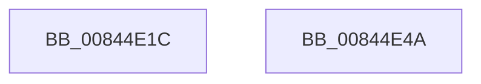

# CmpFindValueByName

- RVA: `0x00844E1C`–`0x00844E4B` (길이 `47` bytes)
- VA: `0x0000000140844E1C`
- 실행 섹션: `PAGE`
- PDB 이름 있음: `예`; PDB Function 태그: `아니요`
- unwind 정보 RVA: `0x0005D2F4`
- 디코드: `12`개 명령, `47/47` bytes 표시
- 미해석 바이트: `0` (있으면 어셈블리에 `.byte`로 보존)

> 이 문서는 커널 이미지의 기계어와 PDB 기호를 분석해 생성했습니다. 4번과 5번은 함수 원형과 자료형을 바이너리 사용 방식에서 추정한 C 해석이며 원본 소스 복구 결과는 아닙니다.

## 1. Dependencies

- 직접 호출 지점: **1**; 고유 호출 대상: **1**
- 직접 호출자로 확인된 함수: **12**
- RIP 상대 이미지 참조: **0**

### Outgoing calls
- `0x00844E3C` → [CmpFindNameInListWithStatus](CmpFindNameInListWithStatus_function_00846B80.md) (function, `0x00846B80`)

### Direct callers
- [CmpMarkCurrentProfileDirty](../7D/CmpMarkCurrentProfileDirty_function_007DBBAC.md) at `0x007DBCB4`
- [CmpMarkCurrentValueDirty](../7D/CmpMarkCurrentValueDirty_function_007DBD1C.md) at `0x007DBDC7`
- [CmpFindControlSet](../7F/CmpFindControlSet_function_007F1A34.md) at `0x007F1B75`
- [CmpFindControlSet](../7F/CmpFindControlSet_function_007F1A34.md) at `0x007F1C69`
- [CmpFindControlSet](../7F/CmpFindControlSet_function_007F1A34.md) at `0x007F1E51`
- [CmpPreserveSystemHiveData](../7F/CmpPreserveSystemHiveData_function_007F2518.md) at `0x007F27AE`
- [CmpPreserveSystemHiveData](../7F/CmpPreserveSystemHiveData_function_007F2518.md) at `0x007F29E7`
- [CmpPreserveSystemHiveData](../7F/CmpPreserveSystemHiveData_function_007F2518.md) at `0x007F2C21`
- [CmQueryMultipleValueKey](CmQueryMultipleValueKey_function_00846EC0.md) at `0x00847568`
- [CmSelectQualifiedInstallLanguage](../../init/C5/CmSelectQualifiedInstallLanguage_function_00C58F58.md) at `0x00C590D5`
- [CmSelectQualifiedInstallLanguage](../../init/C5/CmSelectQualifiedInstallLanguage_function_00C58F58.md) at `0x00C5927B`
- [CmpGetSystemControlValues](../../init/C5/CmpGetSystemControlValues_function_00C5959C.md) at `0x00C5988A`
- [CmpAddDriverToList](../../init/C5/CmpAddDriverToList_function_00C5B758.md) at `0x00C5B8A2`
- [CmpAddDriverToList](../../init/C5/CmpAddDriverToList_function_00C5B758.md) at `0x00C5BBCB`
- [CmpAddDriverToList](../../init/C5/CmpAddDriverToList_function_00C5B758.md) at `0x00C5BC80`
- [CmpAddDriverToList](../../init/C5/CmpAddDriverToList_function_00C5B758.md) at `0x00C5BD47`
- [CmpAddDriverToList](../../init/C5/CmpAddDriverToList_function_00C5B758.md) at `0x00C5BE0E`
- [CmpFindTagIndex](../../init/C5/CmpFindTagIndex_function_00C5C628.md) at `0x00C5C724`
- [CmpGetStateSepKeysRedirectionPathValue](../../init/C5/CmpGetStateSepKeysRedirectionPathValue_function_00C5CA3C.md) at `0x00C5CB0B`
- [CmpIsLoadType](../../init/C5/CmpIsLoadType_function_00C5CBF8.md) at `0x00C5CD1E`
- [CmpIsLoadType](../../init/C5/CmpIsLoadType_function_00C5CBF8.md) at `0x00C5CD72`
- [CmpIsLoadType](../../init/C5/CmpIsLoadType_function_00C5CBF8.md) at `0x00C5CE67`
- [CmpIsLoadType](../../init/C5/CmpIsLoadType_function_00C5CBF8.md) at `0x00C5CEA0`
- [CmpSortDriverList](../../init/C5/CmpSortDriverList_function_00C5D3D0.md) at `0x00C5D4FE`

### Static image references
- 디코드된 RIP-relative 메모리 참조가 없습니다.

## 2. Other-region calls and transfers

- 다른 실행 섹션으로 향하는 call: **0**
- 별도 외부 분기/꼬리 이동을 확인하지 못했습니다.

## 3. Assembly (complete function range)

```asm
00844E1C  48 83 EC 38                     sub rsp, 0x38
00844E20  83 64 24 48 00                  and dword ptr [rsp + 0x48], 0
00844E25  48 8D 44 24 48                  lea rax, [rsp + 0x48]
00844E2A  48 89 44 24 28                  mov qword ptr [rsp + 0x28], rax
00844E2F  48 83 C2 24                     add rdx, 0x24
00844E33  48 83 64 24 20 00               and qword ptr [rsp + 0x20], 0
00844E39  45 33 C9                        xor r9d, r9d
00844E3C  E8 3F 1D 00 00                  call 0x140846b80
00844E41  8B 44 24 48                     mov eax, dword ptr [rsp + 0x48]
00844E45  48 83 C4 38                     add rsp, 0x38
00844E49  C3                              ret
00844E4A  CC                              int3
```

## 4. C-style interpretation (structured pseudocode)

```c
__int64 __fastcall CmpFindValueByName(__int64 a1, __int64 a2, __int64 a3, int a4)
{
    __int64 result;
    __int64 v_rsp;
    unsigned __int64 v_stack_m10;
    unsigned __int64 v_stack_m18;
    unsigned int v_stack_p10;

    v_rsp = (v_rsp) - (56);
    v_stack_m10 = v_stack_p10;
    a2 = (a2) + (36);
    a4 = 0;
    result = CmpFindNameInListWithStatus(a1, a2, a3, a4);
    v_rsp = (v_rsp) + (56);
    return (unsigned int)(v_stack_p10);
}
```

## 5. (Beta) C Style

```c
int64_t CmpFindValueByName(int64_t Arg1, int64_t Arg2, int64_t Arg3, int32_t Arg4)
{
    int64_t result;
    int64_t local_rsp;
    uint64_t v_stack_m10;
    uint64_t v_stack_m18;
    uint32_t v_stack_p10;

    local_rsp = (local_rsp) - (56);
    v_stack_m10 = v_stack_p10;
    Arg2 = (Arg2) + (36);
    Arg4 = 0;
    result = CmpFindNameInListWithStatus(Arg1, Arg2, Arg3, Arg4);
    local_rsp = (local_rsp) + (56);
    return (uint32_t)(v_stack_p10);
}
```

## 6. Execution-region graph

[열기: 2D/3D 그래프와 함수 탐색 컨트롤 패널](../../../control-panel.html?section=page&rva=0x00844E1C&view=graph)

- 2D 그래프는 위에서 아래로 흐르고, 3D 그래프는 빈 공간을 드래그해 회전합니다. Shift+드래그는 이동, 휠은 확대·축소, 함수 노드 선택은 대상 보고서 이동입니다.

### Static fallback


