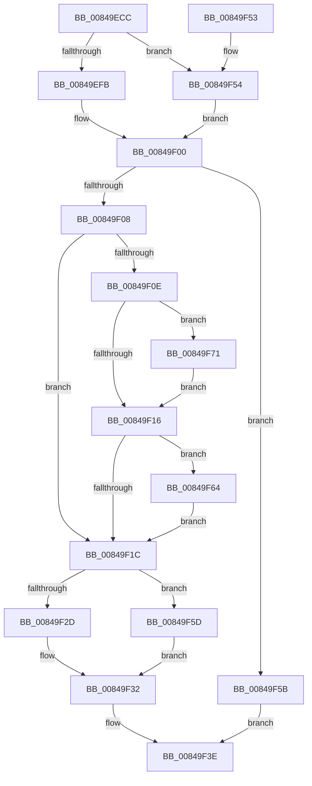

# CmpFreeKeyBody

- RVA: `0x00849ECC`–`0x00849F7B` (길이 `175` bytes)
- VA: `0x0000000140849ECC`
- 실행 섹션: `PAGE`
- PDB 이름 있음: `예`; PDB Function 태그: `아니요`
- unwind 정보 RVA: `0x000694A0`
- 디코드: `53`개 명령, `175/175` bytes 표시
- 미해석 바이트: `0` (있으면 어셈블리에 `.byte`로 보존)

> 이 문서는 커널 이미지의 기계어와 PDB 기호를 분석해 생성했습니다. 4번과 5번은 함수 원형과 자료형을 바이너리 사용 방식에서 추정한 C 해석이며 원본 소스 복구 결과는 아닙니다.

## 1. Dependencies

- 직접 호출 지점: **7**; 고유 호출 대상: **5**
- 직접 호출자로 확인된 함수: **1**
- RIP 상대 이미지 참조: **0**

### Outgoing calls
- `0x00849EFB` → [HvpGetCellFlat](../85/HvpGetCellFlat_function_00854C60.md) (function, `0x00854C60`)
- `0x00849F2D` → [HvpReleaseCellPaged](../85/HvpReleaseCellPaged_function_00855F40.md) (function, `0x00855F40`)
- `0x00849F37` → [HvFreeCell](../85/HvFreeCell_function_0085A72C.md) (function, `0x0085A72C`)
- `0x00849F54` → [HvpGetCellPaged](../85/HvpGetCellPaged_function_00854CB0.md) (function, `0x00854CB0`)
- `0x00849F5D` → [HvpReleaseCellFlat](../85/HvpReleaseCellFlat_function_0085CC20.md) (function, `0x0085CC20`)
- `0x00849F6A` → [HvFreeCell](../85/HvFreeCell_function_0085A72C.md) (function, `0x0085A72C`)
- `0x00849F74` → [HvFreeCell](../85/HvFreeCell_function_0085A72C.md) (function, `0x0085A72C`)

### Direct callers
- [CmpFreeKeyByCell](CmpFreeKeyByCell_function_0084AD70.md) at `0x0084AE97`

### Static image references
- 디코드된 RIP-relative 메모리 참조가 없습니다.

## 2. Other-region calls and transfers

- 다른 실행 섹션으로 향하는 call: **0**
- 별도 외부 분기/꼬리 이동을 확인하지 못했습니다.

## 3. Assembly (complete function range)

```asm
00849ECC  48 8B C4                        mov rax, rsp
00849ECF  48 89 58 10                     mov qword ptr [rax + 0x10], rbx
00849ED3  48 89 68 18                     mov qword ptr [rax + 0x18], rbp
00849ED7  48 89 70 20                     mov qword ptr [rax + 0x20], rsi
00849EDB  57                              push rdi
00849EDC  48 83 EC 20                     sub rsp, 0x20
00849EE0  83 48 08 FF                     or dword ptr [rax + 8], 0xffffffff
00849EE4  4C 8D 40 08                     lea r8, [rax + 8]
00849EE8  33 ED                           xor ebp, ebp
00849EEA  8B F2                           mov esi, edx
00849EEC  F6 81 8C 00 00 00 01            test byte ptr [rcx + 0x8c], 1
00849EF3  48 8B D9                        mov rbx, rcx
00849EF6  89 68 0C                        mov dword ptr [rax + 0xc], ebp
00849EF9  74 59                           je 0x140849f54
00849EFB  E8 60 AD 00 00                  call 0x140854c60
00849F00  48 8B F8                        mov rdi, rax
00849F03  48 85 C0                        test rax, rax
00849F06  74 53                           je 0x140849f5b
00849F08  F6 40 02 02                     test byte ptr [rax + 2], 2
00849F0C  75 0E                           jne 0x140849f1c
00849F0E  8B 50 2C                        mov edx, dword ptr [rax + 0x2c]
00849F11  83 FA FF                        cmp edx, -1
00849F14  75 5B                           jne 0x140849f71
00849F16  66 39 6F 4A                     cmp word ptr [rdi + 0x4a], bp
00849F1A  77 48                           ja 0x140849f64
00849F1C  F6 83 8C 00 00 00 01            test byte ptr [rbx + 0x8c], 1
00849F23  48 8D 54 24 30                  lea rdx, [rsp + 0x30]
00849F28  48 8B CB                        mov rcx, rbx
00849F2B  75 30                           jne 0x140849f5d
00849F2D  E8 0E C0 00 00                  call 0x140855f40
00849F32  8B D6                           mov edx, esi
00849F34  48 8B CB                        mov rcx, rbx
00849F37  E8 F0 07 01 00                  call 0x14085a72c
00849F3C  B0 01                           mov al, 1
00849F3E  48 8B 5C 24 38                  mov rbx, qword ptr [rsp + 0x38]
00849F43  48 8B 6C 24 40                  mov rbp, qword ptr [rsp + 0x40]
00849F48  48 8B 74 24 48                  mov rsi, qword ptr [rsp + 0x48]
00849F4D  48 83 C4 20                     add rsp, 0x20
00849F51  5F                              pop rdi
00849F52  C3                              ret
00849F53  CC                              int3
00849F54  E8 57 AD 00 00                  call 0x140854cb0
00849F59  EB A5                           jmp 0x140849f00
00849F5B  EB E1                           jmp 0x140849f3e
00849F5D  E8 BE 2C 01 00                  call 0x14085cc20
00849F62  EB CE                           jmp 0x140849f32
00849F64  8B 57 30                        mov edx, dword ptr [rdi + 0x30]
00849F67  48 8B CB                        mov rcx, rbx
00849F6A  E8 BD 07 01 00                  call 0x14085a72c
00849F6F  EB AB                           jmp 0x140849f1c
00849F71  48 8B CB                        mov rcx, rbx
00849F74  E8 B3 07 01 00                  call 0x14085a72c
00849F79  EB 9B                           jmp 0x140849f16
```

## 4. C-style interpretation (structured pseudocode)

```c
__int64 __fastcall CmpFreeKeyBody(__int64 a1, int a2)
{
    __int64 result;
    __int64 v_rbp;
    __int64 v_rsp;
    unsigned __int64 v_stack_p10;
    unsigned __int64 v_stack_p18;
    unsigned __int64 v_stack_p20;
    unsigned __int64 v_stack_p8;

    *(unsigned __int64 *)(v_rsp + 16) = v_rbx;
    *(unsigned __int64 *)(v_rsp + 24) = v_rbp;
    *(unsigned __int64 *)(v_rsp + 32) = v_rsi;
    v_rsp = (v_rsp) - (32);
    v_rbp = 0;
    *(unsigned int *)(v_rsp + 12) = 0;
    if (((*(unsigned __int8 *)(a1 + 140)) & (1)) == 0) goto loc_00849F54;
    result = HvpGetCellFlat(a1, a2, v_rsp + 8, a4);
loc_00849F00:
    if (result == 0) goto loc_00849F5B;
    if (((*(unsigned __int8 *)(result + 2)) & (2)) != 0) goto loc_00849F1C;
    if (((unsigned int)((unsigned int)(*(unsigned int *)(result + 44)))) != -1) goto loc_00849F71;
loc_00849F16:
    if ((*(unsigned __int16 *)(result + 74)) > 0) goto loc_00849F64;
loc_00849F1C:
    if (((*(unsigned __int8 *)(a1 + 140)) & (1)) != 0) goto loc_00849F5D;
    result = HvpReleaseCellPaged(a1, v_stack_p8, v_rsp + 8, a4);
loc_00849F32:
    result = HvFreeCell(a1, (unsigned int)((unsigned int)((unsigned int)(a2))), v_rsp + 8, a4);
loc_00849F3E:
    v_rsp = (v_rsp) + (32);
    return 1;
loc_00849F54:
    result = HvpGetCellPaged(a1, (unsigned int)((unsigned int)((unsigned int)(a2))), v_rsp + 8, a4);
    goto loc_00849F00;
loc_00849F5B:
    goto loc_00849F3E;
loc_00849F5D:
    result = HvpReleaseCellFlat(a1, (unsigned int)((unsigned int)((unsigned int)(a2))), v_rsp + 8, a4);
    goto loc_00849F32;
loc_00849F64:
    result = HvFreeCell(v_stack_p10, (unsigned int)(*(unsigned int *)(result + 48)), v_rsp + 8, a4);
    goto loc_00849F1C;
loc_00849F71:
    result = HvFreeCell(v_stack_p10, (unsigned int)(*(unsigned int *)(result + 48)), v_rsp + 8, a4);
    goto loc_00849F16;
}
```

## 5. (Beta) C Style

```c
int64_t CmpFreeKeyBody(void *Arg1, int32_t Arg2)
{
    uint8_t *arg1 = (uint8_t *)Arg1;

    int64_t result;
    int64_t local_rbp;
    int64_t local_rsp;
    uint64_t v_stack_p10;
    uint64_t v_stack_p18;
    uint64_t v_stack_p20;
    uint64_t v_stack_p8;

    *(uint64_t *)(local_rsp + 0x10) = local_rbx;
    *(uint64_t *)(local_rsp + 0x18) = local_rbp;
    *(uint64_t *)(local_rsp + 0x20) = local_rsi;
    local_rsp = (local_rsp) - (32);
    local_rbp = 0;
    *(uint32_t *)(local_rsp + 0xC) = 0;
    if (((*(uint8_t *)(arg1 + 0x8C)) & (1)) == 0) goto loc_00849F54;
    result = HvpGetCellFlat(Arg1, Arg2, local_rsp + 8, a4);
loc_00849F00:
    if (result == 0) goto loc_00849F5B;
    if (((*(uint8_t *)(result + 0x2)) & (2)) != 0) goto loc_00849F1C;
    if (((uint32_t)((uint32_t)(*(uint32_t *)(result + 0x2C)))) != -1) goto loc_00849F71;
loc_00849F16:
    if ((*(uint16_t *)(result + 0x4A)) > 0) goto loc_00849F64;
loc_00849F1C:
    if (((*(uint8_t *)(arg1 + 0x8C)) & (1)) != 0) goto loc_00849F5D;
    result = HvpReleaseCellPaged(Arg1, v_stack_p8, local_rsp + 8, a4);
loc_00849F32:
    result = HvFreeCell(Arg1, (uint32_t)((uint32_t)((uint32_t)(Arg2))), local_rsp + 8, a4);
loc_00849F3E:
    local_rsp = (local_rsp) + (32);
    return 1;
loc_00849F54:
    result = HvpGetCellPaged(Arg1, (uint32_t)((uint32_t)((uint32_t)(Arg2))), local_rsp + 8, a4);
    goto loc_00849F00;
loc_00849F5B:
    goto loc_00849F3E;
loc_00849F5D:
    result = HvpReleaseCellFlat(Arg1, (uint32_t)((uint32_t)((uint32_t)(Arg2))), local_rsp + 8, a4);
    goto loc_00849F32;
loc_00849F64:
    result = HvFreeCell(v_stack_p10, (uint32_t)(*(uint32_t *)(result + 0x30)), local_rsp + 8, a4);
    goto loc_00849F1C;
loc_00849F71:
    result = HvFreeCell(v_stack_p10, (uint32_t)(*(uint32_t *)(result + 0x30)), local_rsp + 8, a4);
    goto loc_00849F16;
}
```

### 관측된 메모리 오프셋

구조체 형식이 확인되지 않은 접근은 인자 기준의 오프셋으로만 기록했습니다.

| 기준 인자 | 오프셋 표현 | 폭 (bit) | 접근 |
|---|---:|---:|---|
| `Arg1` | `+ 0x8C` | `8` | `R` |

## 6. Execution-region graph

[열기: 2D/3D 그래프와 함수 탐색 컨트롤 패널](../../../control-panel.html?section=page&rva=0x00849ECC&view=graph)

- 2D 그래프는 위에서 아래로 흐르고, 3D 그래프는 빈 공간을 드래그해 회전합니다. Shift+드래그는 이동, 휠은 확대·축소, 함수 노드 선택은 대상 보고서 이동입니다.

### Static fallback


