# CmpFreeKeyByCell

- RVA: `0x0084AD70`–`0x0084AF8F` (길이 `543` bytes)
- VA: `0x000000014084AD70`
- 실행 섹션: `PAGE`
- PDB 이름 있음: `예`; PDB Function 태그: `예`
- unwind 정보 RVA: `0x0006959C`
- 디코드: `144`개 명령, `543/543` bytes 표시
- 미해석 바이트: `0` (있으면 어셈블리에 `.byte`로 보존)

> 이 문서는 커널 이미지의 기계어와 PDB 기호를 분석해 생성했습니다. 4번과 5번은 함수 원형과 자료형을 바이너리 사용 방식에서 추정한 C 해석이며 원본 소스 복구 결과는 아닙니다.

## 1. Dependencies

- 직접 호출 지점: **21**; 고유 호출 대상: **12**
- 직접 호출자로 확인된 함수: **16**
- RIP 상대 이미지 참조: **0**

### Outgoing calls
- `0x0084ADAB` → [CmLockHiveSecurityExclusive](CmLockHiveSecurityExclusive_function_0084B1A8.md) (function, `0x0084B1A8`)
- `0x0084ADB9` → [CmpMarkKeyDirty](CmpMarkKeyDirty_function_0084B1FC.md) (function, `0x0084B1FC`)
- `0x0084ADDF` → [HvpGetCellFlat](../85/HvpGetCellFlat_function_00854C60.md) (function, `0x00854C60`)
- `0x0084ADFF` → [CmpRemoveSubKey](CmpRemoveSubKey_function_00849F84.md) (function, `0x00849F84`)
- `0x0084AE23` → [HvpGetCellFlat](../85/HvpGetCellFlat_function_00854C60.md) (function, `0x00854C60`)
- `0x0084AE57` → [HvpReleaseCellPaged](../85/HvpReleaseCellPaged_function_00855F40.md) (function, `0x00855F40`)
- `0x0084AE73` → [CmpFreeSecurityDescriptor](CmpFreeSecurityDescriptor_function_00849E44.md) (function, `0x00849E44`)
- `0x0084AE8C` → [HvpReleaseCellPaged](../85/HvpReleaseCellPaged_function_00855F40.md) (function, `0x00855F40`)
- `0x0084AE97` → [CmpFreeKeyBody](CmpFreeKeyBody_function_00849ECC.md) (function, `0x00849ECC`)
- `0x0084AEAC` → [CmUnlockHiveSecurity](../../pagecmrc/BC/CmUnlockHiveSecurity_function_00BC99C8.md) (function, `0x00BC99C8`)
- `0x0084AECD` → [HvpGetCellPaged](../85/HvpGetCellPaged_function_00854CB0.md) (function, `0x00854CB0`)
- `0x0084AED7` → [HvpGetCellPaged](../85/HvpGetCellPaged_function_00854CB0.md) (function, `0x00854CB0`)
- `0x0084AEF4` → [HvpGetCellFlat](../85/HvpGetCellFlat_function_00854C60.md) (function, `0x00854C60`)
- `0x0084AF0F` → [CmpFreeValue](CmpFreeValue_function_0084AF98.md) (function, `0x0084AF98`)
- `0x0084AF2B` → [HvpReleaseCellPaged](../85/HvpReleaseCellPaged_function_00855F40.md) (function, `0x00855F40`)
- `0x0084AF36` → [HvFreeCell](../85/HvFreeCell_function_0085A72C.md) (function, `0x0085A72C`)
- `0x0084AF40` → [HvpGetCellPaged](../85/HvpGetCellPaged_function_00854CB0.md) (function, `0x00854CB0`)
- `0x0084AF47` → [HvpReleaseCellFlat](../85/HvpReleaseCellFlat_function_0085CC20.md) (function, `0x0085CC20`)
- `0x0084AF51` → [HvpReleaseCellFlat](../85/HvpReleaseCellFlat_function_0085CC20.md) (function, `0x0085CC20`)
- `0x0084AF65` → [HvpReleaseCellFlat](../85/HvpReleaseCellFlat_function_0085CC20.md) (function, `0x0085CC20`)
- `0x0084AF85` → [HvpReleaseCellFlat](../85/HvpReleaseCellFlat_function_0085CC20.md) (function, `0x0085CC20`)

### Direct callers
- [CmpRemoveHiveFromNamespace](../../text/49/CmpRemoveHiveFromNamespace_function_0049C4CC.md) at `0x0049C519`
- [CmpCreateTombstone](../../text/66/CmpCreateTombstone_function_0066AF50.md) at `0x0066B20F`
- [sub_006ED542](../../text/6E/Unknown_function_006ED542.md) at `0x006ED6DA`
- [CmRestoreKey](../7D/CmRestoreKey_function_007DCF04.md) at `0x007DDA3C`
- [CmRestoreKey](../7D/CmRestoreKey_function_007DCF04.md) at `0x007DDAE4`
- [CmRenameKey](../7E/CmRenameKey_function_007E8F48.md) at `0x007EA004`
- [CmpDeleteTree](../7F/CmpDeleteTree_function_007F3E44.md) at `0x007F3F41`
- [CmDeleteKey](CmDeleteKey_function_00848E5C.md) at `0x00849235`
- [CmpTransMgrFreeVolatileData](../87/CmpTransMgrFreeVolatileData_function_00874BDC.md) at `0x00874D8E`
- [CmpPartialPromoteSingleKeyFromKeyNodeStacks](../94/CmpPartialPromoteSingleKeyFromKeyNodeStacks_function_00945808.md) at `0x0094599B`
- [CmpCopyMergeOfLayeredKeyNode](../94/CmpCopyMergeOfLayeredKeyNode_function_00945A78.md) at `0x00945D85`
- [CmpCreateChild](../94/CmpCreateChild_function_0094817C.md) at `0x009491A0`
- [CmpCleanupLightWeightUoWData](../9B/CmpCleanupLightWeightUoWData_function_009B0A68.md) at `0x009B0B28`
- [CmpLightWeightCommitDeleteKeyUoW](../A5/CmpLightWeightCommitDeleteKeyUoW_function_00A54610.md) at `0x00A54661`
- [CmpLightWeightPrepareAddKeyUoW](../A5/CmpLightWeightPrepareAddKeyUoW_function_00A547FC.md) at `0x00A54AC1`
- [CmpSyncSubKeysAfterDelete](../AC/CmpSyncSubKeysAfterDelete_function_00AC5980.md) at `0x00AC5A6E`
- [sub_00B16440](../B1/Unknown_function_00B16440.md) at `0x00B1651C`

### Static image references
- 디코드된 RIP-relative 메모리 참조가 없습니다.

## 2. Other-region calls and transfers

- 다른 실행 섹션으로 향하는 call: **1**
  - `0x0084AEAC` → [CmUnlockHiveSecurity](../../pagecmrc/BC/CmUnlockHiveSecurity_function_00BC99C8.md) (`PAGE` → `PAGECMRC`)
- call이 아닌 외부 분기/꼬리 이동: **1**
  - `0x0084AF7F` → [sub_00B16834](../B1/Unknown_function_00B16834.md) (`tail-transfer`)

## 3. Assembly (complete function range)

```asm
0084AD70  48 89 5C 24 08                  mov qword ptr [rsp + 8], rbx
0084AD75  48 89 74 24 10                  mov qword ptr [rsp + 0x10], rsi
0084AD7A  48 89 7C 24 18                  mov qword ptr [rsp + 0x18], rdi
0084AD7F  55                              push rbp
0084AD80  41 56                           push r14
0084AD82  41 57                           push r15
0084AD84  48 8B EC                        mov rbp, rsp
0084AD87  48 83 EC 30                     sub rsp, 0x30
0084AD8B  83 4D 38 FF                     or dword ptr [rbp + 0x38], 0xffffffff
0084AD8F  33 F6                           xor esi, esi
0084AD91  83 4D F0 FF                     or dword ptr [rbp - 0x10], 0xffffffff
0084AD95  45 8A F8                        mov r15b, r8b
0084AD98  83 4D F8 FF                     or dword ptr [rbp - 8], 0xffffffff
0084AD9C  44 8B F2                        mov r14d, edx
0084AD9F  89 75 3C                        mov dword ptr [rbp + 0x3c], esi
0084ADA2  48 8B D9                        mov rbx, rcx
0084ADA5  89 75 F4                        mov dword ptr [rbp - 0xc], esi
0084ADA8  89 75 FC                        mov dword ptr [rbp - 4], esi
0084ADAB  E8 F8 03 00 00                  call 0x14084b1a8
0084ADB0  45 8A C7                        mov r8b, r15b
0084ADB3  41 8B D6                        mov edx, r14d
0084ADB6  48 8B CB                        mov rcx, rbx
0084ADB9  E8 3E 04 00 00                  call 0x14084b1fc
0084ADBE  8B F8                           mov edi, eax
0084ADC0  85 C0                           test eax, eax
0084ADC2  0F 88 E1 00 00 00               js 0x14084aea9
0084ADC8  F6 83 8C 00 00 00 01            test byte ptr [rbx + 0x8c], 1
0084ADCF  4C 8D 45 38                     lea r8, [rbp + 0x38]
0084ADD3  41 8B D6                        mov edx, r14d
0084ADD6  48 8B CB                        mov rcx, rbx
0084ADD9  0F 84 EE 00 00 00               je 0x14084aecd
0084ADDF  E8 7C 9E 00 00                  call 0x140854c60
0084ADE4  48 8B F8                        mov rdi, rax
0084ADE7  48 85 C0                        test rax, rax
0084ADEA  0F 84 6B 01 00 00               je 0x14084af5b
0084ADF0  41 80 FF 01                     cmp r15b, 1
0084ADF4  75 66                           jne 0x14084ae5c
0084ADF6  8B 50 10                        mov edx, dword ptr [rax + 0x10]
0084ADF9  45 8B C6                        mov r8d, r14d
0084ADFC  48 8B CB                        mov rcx, rbx
0084ADFF  E8 80 F1 FF FF                  call 0x140849f84
0084AE04  84 C0                           test al, al
0084AE06  0F 84 60 01 00 00               je 0x14084af6c
0084AE0C  4C 8D 45 F0                     lea r8, [rbp - 0x10]
0084AE10  8B 57 10                        mov edx, dword ptr [rdi + 0x10]
0084AE13  48 8B CB                        mov rcx, rbx
0084AE16  44 84 BB 8C 00 00 00            test byte ptr [rbx + 0x8c], r15b
0084AE1D  0F 84 B4 00 00 00               je 0x14084aed7
0084AE23  E8 38 9E 00 00                  call 0x140854c60
0084AE28  48 8B C8                        mov rcx, rax
0084AE2B  48 85 C0                        test rax, rax
0084AE2E  0F 84 38 01 00 00               je 0x14084af6c
0084AE34  8B 40 18                        mov eax, dword ptr [rax + 0x18]
0084AE37  03 41 14                        add eax, dword ptr [rcx + 0x14]
0084AE3A  75 07                           jne 0x14084ae43
0084AE3C  66 89 71 34                     mov word ptr [rcx + 0x34], si
0084AE40  89 71 38                        mov dword ptr [rcx + 0x38], esi
0084AE43  F6 83 8C 00 00 00 01            test byte ptr [rbx + 0x8c], 1
0084AE4A  48 8D 55 F0                     lea rdx, [rbp - 0x10]
0084AE4E  48 8B CB                        mov rcx, rbx
0084AE51  0F 85 FA 00 00 00               jne 0x14084af51
0084AE57  E8 E4 B0 00 00                  call 0x140855f40
0084AE5C  F6 47 02 42                     test byte ptr [rdi + 2], 0x42
0084AE60  75 16                           jne 0x14084ae78
0084AE62  39 77 24                        cmp dword ptr [rdi + 0x24], esi
0084AE65  77 7A                           ja 0x14084aee1
0084AE67  83 7F 2C FF                     cmp dword ptr [rdi + 0x2c], -1
0084AE6B  74 0B                           je 0x14084ae78
0084AE6D  41 8B D6                        mov edx, r14d
0084AE70  48 8B CB                        mov rcx, rbx
0084AE73  E8 CC EF FF FF                  call 0x140849e44
0084AE78  F6 83 8C 00 00 00 01            test byte ptr [rbx + 0x8c], 1
0084AE7F  48 8D 55 38                     lea rdx, [rbp + 0x38]
0084AE83  48 8B CB                        mov rcx, rbx
0084AE86  0F 85 BB 00 00 00               jne 0x14084af47
0084AE8C  E8 AF B0 00 00                  call 0x140855f40
0084AE91  41 8B D6                        mov edx, r14d
0084AE94  48 8B CB                        mov rcx, rbx
0084AE97  E8 30 F0 FF FF                  call 0x140849ecc
0084AE9C  F6 D8                           neg al
0084AE9E  BF 9A 00 00 C0                  mov edi, 0xc000009a
0084AEA3  1B C9                           sbb ecx, ecx
0084AEA5  F7 D1                           not ecx
0084AEA7  23 F9                           and edi, ecx
0084AEA9  48 8B CB                        mov rcx, rbx
0084AEAC  E8 17 EB 37 00                  call 0x140bc99c8
0084AEB1  48 8B 5C 24 50                  mov rbx, qword ptr [rsp + 0x50]
0084AEB6  8B C7                           mov eax, edi
0084AEB8  48 8B 7C 24 60                  mov rdi, qword ptr [rsp + 0x60]
0084AEBD  48 8B 74 24 58                  mov rsi, qword ptr [rsp + 0x58]
0084AEC2  48 83 C4 30                     add rsp, 0x30
0084AEC6  41 5F                           pop r15
0084AEC8  41 5E                           pop r14
0084AECA  5D                              pop rbp
0084AECB  C3                              ret
0084AECC  CC                              int3
0084AECD  E8 DE 9D 00 00                  call 0x140854cb0
0084AED2  E9 0D FF FF FF                  jmp 0x14084ade4
0084AED7  E8 D4 9D 00 00                  call 0x140854cb0
0084AEDC  E9 47 FF FF FF                  jmp 0x14084ae28
0084AEE1  F6 83 8C 00 00 00 01            test byte ptr [rbx + 0x8c], 1
0084AEE8  4C 8D 45 F8                     lea r8, [rbp - 8]
0084AEEC  8B 57 28                        mov edx, dword ptr [rdi + 0x28]
0084AEEF  48 8B CB                        mov rcx, rbx
0084AEF2  74 4C                           je 0x14084af40
0084AEF4  E8 67 9D 00 00                  call 0x140854c60
0084AEF9  4C 8B F8                        mov r15, rax
0084AEFC  48 85 C0                        test rax, rax
0084AEFF  74 6B                           je 0x14084af6c
0084AF01  39 77 24                        cmp dword ptr [rdi + 0x24], esi
0084AF04  76 15                           jbe 0x14084af1b
0084AF06  8B D6                           mov edx, esi
0084AF08  48 8B CB                        mov rcx, rbx
0084AF0B  41 8B 14 97                     mov edx, dword ptr [r15 + rdx*4]
0084AF0F  E8 84 00 00 00                  call 0x14084af98
0084AF14  FF C6                           inc esi
0084AF16  3B 77 24                        cmp esi, dword ptr [rdi + 0x24]
0084AF19  72 EB                           jb 0x14084af06
0084AF1B  F6 83 8C 00 00 00 01            test byte ptr [rbx + 0x8c], 1
0084AF22  48 8D 55 F8                     lea rdx, [rbp - 8]
0084AF26  48 8B CB                        mov rcx, rbx
0084AF29  75 3A                           jne 0x14084af65
0084AF2B  E8 10 B0 00 00                  call 0x140855f40
0084AF30  8B 57 28                        mov edx, dword ptr [rdi + 0x28]
0084AF33  48 8B CB                        mov rcx, rbx
0084AF36  E8 F1 F7 00 00                  call 0x14085a72c
0084AF3B  E9 27 FF FF FF                  jmp 0x14084ae67
0084AF40  E8 6B 9D 00 00                  call 0x140854cb0
0084AF45  EB B2                           jmp 0x14084aef9
0084AF47  E8 D4 1C 01 00                  call 0x14085cc20
0084AF4C  E9 40 FF FF FF                  jmp 0x14084ae91
0084AF51  E8 CA 1C 01 00                  call 0x14085cc20
0084AF56  E9 01 FF FF FF                  jmp 0x14084ae5c
0084AF5B  BF 9A 00 00 C0                  mov edi, 0xc000009a
0084AF60  E9 44 FF FF FF                  jmp 0x14084aea9
0084AF65  E8 B6 1C 01 00                  call 0x14085cc20
0084AF6A  EB C4                           jmp 0x14084af30
0084AF6C  F6 83 8C 00 00 00 01            test byte ptr [rbx + 0x8c], 1
0084AF73  48 8D 55 38                     lea rdx, [rbp + 0x38]
0084AF77  BF 9A 00 00 C0                  mov edi, 0xc000009a
0084AF7C  48 8B CB                        mov rcx, rbx
0084AF7F  0F 84 AF B8 2C 00               je 0x140b16834
0084AF85  E8 96 1C 01 00                  call 0x14085cc20
0084AF8A  E9 1A FF FF FF                  jmp 0x14084aea9
```

## 4. C-style interpretation (structured pseudocode)

```c
__int64 __fastcall CmpFreeKeyByCell(__int64 a1, int a2, unsigned __int8 a3)
{
    __int64 result;
    __int64 v_rdi;
    __int64 v_rsi;
    __int64 v_rsp;
    unsigned int v_stack_m1C;
    unsigned int v_stack_m20;
    unsigned int v_stack_m24;
    unsigned int v_stack_m28;
    unsigned __int64 v_stack_p10;
    unsigned __int64 v_stack_p18;
    unsigned int v_stack_p20;
    unsigned int v_stack_p24;
    unsigned __int64 v_stack_p8;

    v_stack_p8 = v_rbx;
    v_stack_p10 = v_rsi;
    v_stack_p18 = v_rdi;
    v_rsp = (v_rsp) - (48);
    v_rsi = 0;
    v_stack_p24 = 0;
    v_stack_m24 = 0;
    v_stack_m1C = 0;
    result = CmLockHiveSecurityExclusive(a1, a2, a3, a4);
    result = CmpMarkKeyDirty(a1, (unsigned int)((unsigned int)((unsigned int)(a2))), a3, a4);
    if (sign_flag) goto loc_0084AEA9;
    if (((*(unsigned __int8 *)(a1 + 140)) & (1)) == 0) goto loc_0084AECD;
    result = HvpGetCellFlat(a1, (unsigned int)((unsigned int)((unsigned int)(a2))), v_stack_p20, a4);
loc_0084ADE4:
    if (result == 0) goto loc_0084AF5B;
    if (a3 != 1) goto loc_0084AE5C;
    result = CmpRemoveSubKey(a1, (unsigned int)(*(unsigned int *)(result + 16)), (unsigned int)((unsigned int)((unsigned int)(a2))), a4);
    if ((unsigned __int8)(result) == 0) goto loc_0084AF6C;
    if (((*(unsigned __int8 *)(a1 + 140)) & (a3)) == 0) goto loc_0084AED7;
    result = HvpGetCellFlat(a1, (unsigned int)(*(unsigned int *)(result + 16)), v_stack_m28, a4);
loc_0084AE28:
    if (result == 0) goto loc_0084AF6C;
    result = (unsigned int)(((unsigned int)(*(unsigned int *)(result + 24))) + (*(unsigned int *)(result + 20)));
    if (!(condition_is_not_equal)) {
        *(unsigned __int16 *)(result + 52) = 0;
        *(unsigned int *)(result + 56) = 0;
    }
    if (((*(unsigned __int8 *)(a1 + 140)) & (1)) != 0) goto loc_0084AF51;
    result = HvpReleaseCellPaged(a1, v_stack_m28, v_stack_m28, a4);
loc_0084AE5C:
    if (((*(unsigned __int8 *)(result + 2)) & (66)) != 0) goto loc_0084AE78;
    if ((*(unsigned int *)(result + 36)) > 0) goto loc_0084AEE1;
loc_0084AE67:
    if ((*(unsigned int *)(result + 44)) != -1) {
        a2 = (unsigned int)((unsigned int)(a2));
        a1 = a1;
        result = CmpFreeSecurityDescriptor(a1, a2, v_stack_m28, a4);
    }
    if (((*(unsigned __int8 *)(a1 + 140)) & (1)) != 0) goto loc_0084AF47;
    result = HvpReleaseCellPaged(a1, v_stack_p20, v_stack_m28, a4);
loc_0084AE91:
    result = CmpFreeKeyBody(a1, (unsigned int)((unsigned int)((unsigned int)(a2))), v_stack_m28, a4);
    result = (unsigned __int8)(-(result));
    a1 = (unsigned int)(~(a1));
    v_rdi = (unsigned int)(((unsigned int)(0xC000009AULL)) & ((unsigned int)(a1)));
loc_0084AEA9:
    result = CmUnlockHiveSecurity(a1, (unsigned int)((unsigned int)((unsigned int)(a2))), v_stack_m28, a4);
    v_rsp = (v_rsp) + (48);
    return (unsigned int)((unsigned int)(v_rdi));
loc_0084AECD:
    result = HvpGetCellPaged(a1, (unsigned int)((unsigned int)((unsigned int)(a2))), v_stack_m28, a4);
    goto loc_0084ADE4;
loc_0084AED7:
    result = HvpGetCellPaged(a1, (unsigned int)((unsigned int)((unsigned int)(a2))), v_stack_m28, a4);
    goto loc_0084AE28;
loc_0084AEE1:
    if (((*(unsigned __int8 *)(v_stack_p8 + 140)) & (1)) == 0) goto loc_0084AF40;
    result = HvpGetCellFlat(v_stack_p8, (unsigned int)(*(unsigned int *)(v_stack_p18 + 40)), v_stack_m20, a4);
loc_0084AEF9:
    if (result == 0) goto loc_0084AF6C;
    if ((*(unsigned int *)(v_stack_p18 + 36)) <= ((unsigned int)(v_stack_p10))) goto loc_0084AF1B;
loc_0084AF06:
    result = CmpFreeValue(v_stack_p8, (unsigned int)(*(unsigned int *)(result + (unsigned int)((unsigned int)(v_stack_p10)) * 4)), v_stack_m20, a4);
    v_rsi = (unsigned int)((v_stack_p10) + 1);
    if (((unsigned int)(v_rsi)) < (*(unsigned int *)(v_stack_p18 + 36))) goto loc_0084AF06;
loc_0084AF1B:
    if (((*(unsigned __int8 *)(v_stack_p8 + 140)) & (1)) != 0) goto loc_0084AF65;
    result = HvpReleaseCellPaged(v_stack_p8, v_stack_m20, v_stack_m20, a4);
loc_0084AF30:
    result = HvFreeCell(v_stack_p8, (unsigned int)(*(unsigned int *)(v_stack_p18 + 40)), v_stack_m20, a4);
    goto loc_0084AE67;
loc_0084AF40:
    result = HvpGetCellPaged(v_stack_p8, (unsigned int)(*(unsigned int *)(v_stack_p18 + 40)), v_stack_m20, a4);
    goto loc_0084AEF9;
loc_0084AF47:
    result = HvpReleaseCellFlat(v_stack_p8, (unsigned int)(*(unsigned int *)(v_stack_p18 + 40)), v_stack_m20, a4);
    goto loc_0084AE91;
loc_0084AF51:
    result = HvpReleaseCellFlat(v_stack_p8, (unsigned int)(*(unsigned int *)(v_stack_p18 + 40)), v_stack_m20, a4);
    goto loc_0084AE5C;
loc_0084AF5B:
    goto loc_0084AEA9;
loc_0084AF65:
    result = HvpReleaseCellFlat(v_stack_p8, (unsigned int)(*(unsigned int *)(v_stack_p18 + 40)), v_stack_m20, a4);
    goto loc_0084AF30;
loc_0084AF6C:
    result = HvpReleaseCellFlat(v_stack_p8, v_stack_p20, v_stack_m20, a4);
    goto loc_0084AEA9;
}
```

## 5. (Beta) C Style

```c
int64_t CmpFreeKeyByCell(void *Arg1, int32_t Arg2, uint8_t Arg3)
{
    uint8_t *arg1 = (uint8_t *)Arg1;

    int64_t result;
    int64_t local_rdi;
    int64_t local_rsi;
    int64_t local_rsp;
    uint32_t v_stack_m1C;
    uint32_t v_stack_m20;
    uint32_t v_stack_m24;
    uint32_t v_stack_m28;
    uint64_t v_stack_p10;
    uint64_t v_stack_p18;
    uint32_t v_stack_p20;
    uint32_t v_stack_p24;
    uint64_t v_stack_p8;

    v_stack_p8 = local_rbx;
    v_stack_p10 = local_rsi;
    v_stack_p18 = local_rdi;
    local_rsp = (local_rsp) - (48);
    local_rsi = 0;
    v_stack_p24 = 0;
    v_stack_m24 = 0;
    v_stack_m1C = 0;
    result = CmLockHiveSecurityExclusive(Arg1, Arg2, Arg3, a4);
    result = CmpMarkKeyDirty(Arg1, (uint32_t)((uint32_t)((uint32_t)(Arg2))), Arg3, a4);
    if (sign_flag) goto loc_0084AEA9;
    if (((*(uint8_t *)(arg1 + 0x8C)) & (1)) == 0) goto loc_0084AECD;
    result = HvpGetCellFlat(Arg1, (uint32_t)((uint32_t)((uint32_t)(Arg2))), v_stack_p20, a4);
loc_0084ADE4:
    if (result == 0) goto loc_0084AF5B;
    if (Arg3 != 1) goto loc_0084AE5C;
    result = CmpRemoveSubKey(Arg1, (uint32_t)(*(uint32_t *)(result + 0x10)), (uint32_t)((uint32_t)((uint32_t)(Arg2))), a4);
    if ((uint8_t)(result) == 0) goto loc_0084AF6C;
    if (((*(uint8_t *)(arg1 + 0x8C)) & (Arg3)) == 0) goto loc_0084AED7;
    result = HvpGetCellFlat(Arg1, (uint32_t)(*(uint32_t *)(result + 0x10)), v_stack_m28, a4);
loc_0084AE28:
    if (result == 0) goto loc_0084AF6C;
    result = (uint32_t)(((uint32_t)(*(uint32_t *)(result + 0x18))) + (*(uint32_t *)(result + 0x14)));
    if (!(condition_is_not_equal)) {
        *(uint16_t *)(result + 0x34) = 0;
        *(uint32_t *)(result + 0x38) = 0;
    }
    if (((*(uint8_t *)(arg1 + 0x8C)) & (1)) != 0) goto loc_0084AF51;
    result = HvpReleaseCellPaged(Arg1, v_stack_m28, v_stack_m28, a4);
loc_0084AE5C:
    if (((*(uint8_t *)(result + 0x2)) & (66)) != 0) goto loc_0084AE78;
    if ((*(uint32_t *)(result + 0x24)) > 0) goto loc_0084AEE1;
loc_0084AE67:
    if ((*(uint32_t *)(result + 0x2C)) != -1) {
        Arg2 = (uint32_t)((uint32_t)(Arg2));
        Arg1 = Arg1;
        result = CmpFreeSecurityDescriptor(Arg1, Arg2, v_stack_m28, a4);
    }
    if (((*(uint8_t *)(arg1 + 0x8C)) & (1)) != 0) goto loc_0084AF47;
    result = HvpReleaseCellPaged(Arg1, v_stack_p20, v_stack_m28, a4);
loc_0084AE91:
    result = CmpFreeKeyBody(Arg1, (uint32_t)((uint32_t)((uint32_t)(Arg2))), v_stack_m28, a4);
    result = (uint8_t)(-(result));
    Arg1 = (uint32_t)(~(Arg1));
    local_rdi = (uint32_t)(((uint32_t)(0xC000009AULL)) & ((uint32_t)(Arg1)));
loc_0084AEA9:
    result = CmUnlockHiveSecurity(Arg1, (uint32_t)((uint32_t)((uint32_t)(Arg2))), v_stack_m28, a4);
    local_rsp = (local_rsp) + (48);
    return (uint32_t)((uint32_t)(local_rdi));
loc_0084AECD:
    result = HvpGetCellPaged(Arg1, (uint32_t)((uint32_t)((uint32_t)(Arg2))), v_stack_m28, a4);
    goto loc_0084ADE4;
loc_0084AED7:
    result = HvpGetCellPaged(Arg1, (uint32_t)((uint32_t)((uint32_t)(Arg2))), v_stack_m28, a4);
    goto loc_0084AE28;
loc_0084AEE1:
    if (((*(uint8_t *)(v_stack_p8 + 0x8C)) & (1)) == 0) goto loc_0084AF40;
    result = HvpGetCellFlat(v_stack_p8, (uint32_t)(*(uint32_t *)(v_stack_p18 + 0x28)), v_stack_m20, a4);
loc_0084AEF9:
    if (result == 0) goto loc_0084AF6C;
    if ((*(uint32_t *)(v_stack_p18 + 0x24)) <= ((uint32_t)(v_stack_p10))) goto loc_0084AF1B;
loc_0084AF06:
    result = CmpFreeValue(v_stack_p8, (uint32_t)(*(uint32_t *)(result + (uint32_t)((uint32_t)(v_stack_p10)) * 4)), v_stack_m20, a4);
    local_rsi = (uint32_t)((v_stack_p10) + 1);
    if (((uint32_t)(local_rsi)) < (*(uint32_t *)(v_stack_p18 + 0x24))) goto loc_0084AF06;
loc_0084AF1B:
    if (((*(uint8_t *)(v_stack_p8 + 0x8C)) & (1)) != 0) goto loc_0084AF65;
    result = HvpReleaseCellPaged(v_stack_p8, v_stack_m20, v_stack_m20, a4);
loc_0084AF30:
    result = HvFreeCell(v_stack_p8, (uint32_t)(*(uint32_t *)(v_stack_p18 + 0x28)), v_stack_m20, a4);
    goto loc_0084AE67;
loc_0084AF40:
    result = HvpGetCellPaged(v_stack_p8, (uint32_t)(*(uint32_t *)(v_stack_p18 + 0x28)), v_stack_m20, a4);
    goto loc_0084AEF9;
loc_0084AF47:
    result = HvpReleaseCellFlat(v_stack_p8, (uint32_t)(*(uint32_t *)(v_stack_p18 + 0x28)), v_stack_m20, a4);
    goto loc_0084AE91;
loc_0084AF51:
    result = HvpReleaseCellFlat(v_stack_p8, (uint32_t)(*(uint32_t *)(v_stack_p18 + 0x28)), v_stack_m20, a4);
    goto loc_0084AE5C;
loc_0084AF5B:
    goto loc_0084AEA9;
loc_0084AF65:
    result = HvpReleaseCellFlat(v_stack_p8, (uint32_t)(*(uint32_t *)(v_stack_p18 + 0x28)), v_stack_m20, a4);
    goto loc_0084AF30;
loc_0084AF6C:
    result = HvpReleaseCellFlat(v_stack_p8, v_stack_p20, v_stack_m20, a4);
    goto loc_0084AEA9;
}
```

### 관측된 메모리 오프셋

구조체 형식이 확인되지 않은 접근은 인자 기준의 오프셋으로만 기록했습니다.

| 기준 인자 | 오프셋 표현 | 폭 (bit) | 접근 |
|---|---:|---:|---|
| `Arg1` | `+ 0x8C` | `8` | `R` |

## 6. Execution-region graph

[열기: 2D/3D 그래프와 함수 탐색 컨트롤 패널](../../../control-panel.html?section=page&rva=0x0084AD70&view=graph)

- 2D 그래프는 위에서 아래로 흐르고, 3D 그래프는 빈 공간을 드래그해 회전합니다. Shift+드래그는 이동, 휠은 확대·축소, 함수 노드 선택은 대상 보고서 이동입니다.

### Static fallback

```mermaid
flowchart TD
  bb_0084AD70[BB_0084AD70]
  bb_0084ADC8[BB_0084ADC8]
  bb_0084ADDF[BB_0084ADDF]
  bb_0084ADE4[BB_0084ADE4]
  bb_0084ADF0[BB_0084ADF0]
  bb_0084ADF6[BB_0084ADF6]
  bb_0084AE0C[BB_0084AE0C]
  bb_0084AE23[BB_0084AE23]
  bb_0084AE28[BB_0084AE28]
  bb_0084AE34[BB_0084AE34]
  bb_0084AE3C[BB_0084AE3C]
  bb_0084AE43[BB_0084AE43]
  bb_0084AE57[BB_0084AE57]
  bb_0084AE5C[BB_0084AE5C]
  bb_0084AE62[BB_0084AE62]
  bb_0084AE67[BB_0084AE67]
  bb_0084AE6D[BB_0084AE6D]
  bb_0084AE78[BB_0084AE78]
  bb_0084AE8C[BB_0084AE8C]
  bb_0084AE91[BB_0084AE91]
  bb_0084AEA9[BB_0084AEA9]
  bb_0084AECC[BB_0084AECC]
  bb_0084AECD[BB_0084AECD]
  bb_0084AED7[BB_0084AED7]
  bb_0084AEE1[BB_0084AEE1]
  bb_0084AEF4[BB_0084AEF4]
  bb_0084AEF9[BB_0084AEF9]
  bb_0084AF01[BB_0084AF01]
  bb_0084AF06[BB_0084AF06]
  bb_0084AF1B[BB_0084AF1B]
  bb_0084AF2B[BB_0084AF2B]
  bb_0084AF30[BB_0084AF30]
  bb_0084AF40[BB_0084AF40]
  bb_0084AF47[BB_0084AF47]
  bb_0084AF51[BB_0084AF51]
  bb_0084AF5B[BB_0084AF5B]
  bb_0084AF65[BB_0084AF65]
  bb_0084AF6C[BB_0084AF6C]
  bb_0084AF85[BB_0084AF85]
  bb_0084AD70 -->|branch| bb_0084AEA9
  bb_0084AD70 -->|fallthrough| bb_0084ADC8
  bb_0084ADC8 -->|branch| bb_0084AECD
  bb_0084ADC8 -->|fallthrough| bb_0084ADDF
  bb_0084ADDF -->|flow| bb_0084ADE4
  bb_0084ADE4 -->|branch| bb_0084AF5B
  bb_0084ADE4 -->|fallthrough| bb_0084ADF0
  bb_0084ADF0 -->|branch| bb_0084AE5C
  bb_0084ADF0 -->|fallthrough| bb_0084ADF6
  bb_0084ADF6 -->|branch| bb_0084AF6C
  bb_0084ADF6 -->|fallthrough| bb_0084AE0C
  bb_0084AE0C -->|branch| bb_0084AED7
  bb_0084AE0C -->|fallthrough| bb_0084AE23
  bb_0084AE23 -->|flow| bb_0084AE28
  bb_0084AE28 -->|branch| bb_0084AF6C
  bb_0084AE28 -->|fallthrough| bb_0084AE34
  bb_0084AE34 -->|branch| bb_0084AE43
  bb_0084AE34 -->|fallthrough| bb_0084AE3C
  bb_0084AE3C -->|flow| bb_0084AE43
  bb_0084AE43 -->|branch| bb_0084AF51
  bb_0084AE43 -->|fallthrough| bb_0084AE57
  bb_0084AE57 -->|flow| bb_0084AE5C
  bb_0084AE5C -->|branch| bb_0084AE78
  bb_0084AE5C -->|fallthrough| bb_0084AE62
  bb_0084AE62 -->|branch| bb_0084AEE1
  bb_0084AE62 -->|fallthrough| bb_0084AE67
  bb_0084AE67 -->|branch| bb_0084AE78
  bb_0084AE67 -->|fallthrough| bb_0084AE6D
  bb_0084AE6D -->|flow| bb_0084AE78
  bb_0084AE78 -->|branch| bb_0084AF47
  bb_0084AE78 -->|fallthrough| bb_0084AE8C
  bb_0084AE8C -->|flow| bb_0084AE91
  bb_0084AE91 -->|flow| bb_0084AEA9
  bb_0084AECC -->|flow| bb_0084AECD
  bb_0084AECD -->|branch| bb_0084ADE4
  bb_0084AED7 -->|branch| bb_0084AE28
  bb_0084AEE1 -->|branch| bb_0084AF40
  bb_0084AEE1 -->|fallthrough| bb_0084AEF4
  bb_0084AEF4 -->|flow| bb_0084AEF9
  bb_0084AEF9 -->|branch| bb_0084AF6C
  bb_0084AEF9 -->|fallthrough| bb_0084AF01
  bb_0084AF01 -->|branch| bb_0084AF1B
  bb_0084AF01 -->|fallthrough| bb_0084AF06
  bb_0084AF06 -->|branch| bb_0084AF06
  bb_0084AF06 -->|fallthrough| bb_0084AF1B
  bb_0084AF1B -->|branch| bb_0084AF65
  bb_0084AF1B -->|fallthrough| bb_0084AF2B
  bb_0084AF2B -->|flow| bb_0084AF30
  bb_0084AF30 -->|branch| bb_0084AE67
  bb_0084AF40 -->|branch| bb_0084AEF9
  bb_0084AF47 -->|branch| bb_0084AE91
  bb_0084AF51 -->|branch| bb_0084AE5C
  bb_0084AF5B -->|branch| bb_0084AEA9
  bb_0084AF65 -->|branch| bb_0084AF30
  bb_0084AF6C -->|fallthrough| bb_0084AF85
  bb_0084AF85 -->|branch| bb_0084AEA9
```


