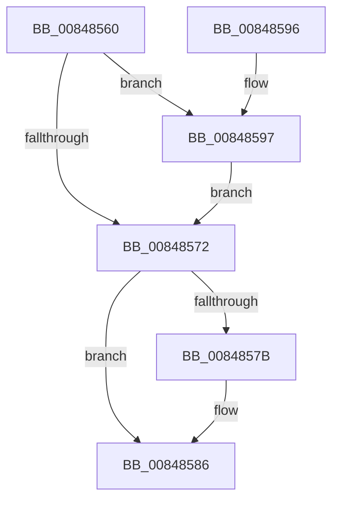

# CmpFreePostBlock

- RVA: `0x00848560`–`0x008485AD` (길이 `77` bytes)
- VA: `0x0000000140848560`
- 실행 섹션: `PAGE`
- PDB 이름 있음: `예`; PDB Function 태그: `아니요`
- unwind 정보 RVA: `0x00068804`
- 디코드: `24`개 명령, `77/77` bytes 표시
- 미해석 바이트: `0` (있으면 어셈블리에 `.byte`로 보존)

> 이 문서는 커널 이미지의 기계어와 PDB 기호를 분석해 생성했습니다. 4번과 5번은 함수 원형과 자료형을 바이너리 사용 방식에서 추정한 C 해석이며 원본 소스 복구 결과는 아닙니다.

## 1. Dependencies

- 직접 호출 지점: **4**; 고유 호출 대상: **2**
- 직접 호출자로 확인된 함수: **10**
- RIP 상대 이미지 참조: **0**

### Outgoing calls
- `0x00848581` → [ExFreePoolWithTag](../../poolcode/B8/ExFreePoolWithTag_function_00B82870.md) (function, `0x00B82870`)
- `0x0084858B` → [ExFreePoolWithTag](../../poolcode/B8/ExFreePoolWithTag_function_00B82870.md) (function, `0x00B82870`)
- `0x0084859B` → [ObDereferenceObjectDeferDelete](../../text/3F/ObDereferenceObjectDeferDelete_function_003FCE40.md) (function, `0x003FCE40`)
- `0x008485A6` → [ExFreePoolWithTag](../../poolcode/B8/ExFreePoolWithTag_function_00B82870.md) (function, `0x00B82870`)

### Direct callers
- [CmpPostApcRunDown](../7E/CmpPostApcRunDown_function_007E1F90.md) at `0x007E2103`
- [CmpSignalDeferredPosts](CmpSignalDeferredPosts_function_008484B0.md) at `0x00848509`
- [CmpSignalDeferredPosts](CmpSignalDeferredPosts_function_008484B0.md) at `0x0084853D`
- [CmpPostNotify](../86/CmpPostNotify_function_008645D8.md) at `0x0086486D`
- [sub_00865B4C](../86/Unknown_function_00865B4C.md) at `0x00865BA4`
- [sub_00865C6D](../86/Unknown_function_00865C6D.md) at `0x00865CFE`
- [CmNotifyRunDown](../90/CmNotifyRunDown_function_00906984.md) at `0x00906C3A`
- [CmpFreeSubordinatePost](../90/CmpFreeSubordinatePost_function_00906CA0.md) at `0x00906CF1`
- [NtNotifyChangeMultipleKeys](../9D/NtNotifyChangeMultipleKeys_function_009DC6B0.md) at `0x009DCA47`
- [NtNotifyChangeMultipleKeys](../9D/NtNotifyChangeMultipleKeys_function_009DC6B0.md) at `0x009DCAB5`
- [NtNotifyChangeMultipleKeys](../9D/NtNotifyChangeMultipleKeys_function_009DC6B0.md) at `0x009DCABD`
- [NtNotifyChangeMultipleKeys](../9D/NtNotifyChangeMultipleKeys_function_009DC6B0.md) at `0x009DCD21`
- [NtNotifyChangeMultipleKeys](../9D/NtNotifyChangeMultipleKeys_function_009DC6B0.md) at `0x009DCD4D`
- [NtNotifyChangeMultipleKeys](../9D/NtNotifyChangeMultipleKeys_function_009DC6B0.md) at `0x009DD0C0`
- [NtNotifyChangeMultipleKeys](../9D/NtNotifyChangeMultipleKeys_function_009DC6B0.md) at `0x009DD0C8`
- [NtNotifyChangeMultipleKeys](../9D/NtNotifyChangeMultipleKeys_function_009DC6B0.md) at `0x009DD23D`
- [NtNotifyChangeMultipleKeys](../9D/NtNotifyChangeMultipleKeys_function_009DC6B0.md) at `0x009DD245`
- [NtNotifyChangeMultipleKeys](../9D/NtNotifyChangeMultipleKeys_function_009DC6B0.md) at `0x009DD25A`
- [NtNotifyChangeMultipleKeys](../9D/NtNotifyChangeMultipleKeys_function_009DC6B0.md) at `0x009DD2A5`
- [NtNotifyChangeMultipleKeys](../9D/NtNotifyChangeMultipleKeys_function_009DC6B0.md) at `0x009DD2AD`
- [CmpPostApc](../AF/CmpPostApc_function_00AF78F0.md) at `0x00AF7A7C`
- [sub_00B3AD0E](../B3/Unknown_function_00B3AD0E.md) at `0x00B3AD11`

### Static image references
- 디코드된 RIP-relative 메모리 참조가 없습니다.

## 2. Other-region calls and transfers

- 다른 실행 섹션으로 향하는 call: **4**
  - `0x00848581` → [ExFreePoolWithTag](../../poolcode/B8/ExFreePoolWithTag_function_00B82870.md) (`PAGE` → `POOLCODE`)
  - `0x0084858B` → [ExFreePoolWithTag](../../poolcode/B8/ExFreePoolWithTag_function_00B82870.md) (`PAGE` → `POOLCODE`)
  - `0x0084859B` → [ObDereferenceObjectDeferDelete](../../text/3F/ObDereferenceObjectDeferDelete_function_003FCE40.md) (`PAGE` → `.text`)
  - `0x008485A6` → [ExFreePoolWithTag](../../poolcode/B8/ExFreePoolWithTag_function_00B82870.md) (`PAGE` → `POOLCODE`)
- 별도 외부 분기/꼬리 이동을 확인하지 못했습니다.

## 3. Assembly (complete function range)

```asm
00848560  40 53                           push rbx
00848562  48 83 EC 20                     sub rsp, 0x20
00848566  48 8B D9                        mov rbx, rcx
00848569  48 8B 49 30                     mov rcx, qword ptr [rcx + 0x30]
0084856D  48 85 C9                        test rcx, rcx
00848570  75 25                           jne 0x140848597
00848572  F7 43 38 00 00 01 00            test dword ptr [rbx + 0x38], 0x10000
00848579  74 0B                           je 0x140848586
0084857B  48 8B 4B 40                     mov rcx, qword ptr [rbx + 0x40]
0084857F  33 D2                           xor edx, edx
00848581  E8 EA A2 33 00                  call 0x140b82870
00848586  33 D2                           xor edx, edx
00848588  48 8B CB                        mov rcx, rbx
0084858B  E8 E0 A2 33 00                  call 0x140b82870
00848590  48 83 C4 20                     add rsp, 0x20
00848594  5B                              pop rbx
00848595  C3                              ret
00848596  CC                              int3
00848597  48 8B 49 10                     mov rcx, qword ptr [rcx + 0x10]
0084859B  E8 A0 48 BB FF                  call 0x1403fce40
008485A0  48 8B 4B 30                     mov rcx, qword ptr [rbx + 0x30]
008485A4  33 D2                           xor edx, edx
008485A6  E8 C5 A2 33 00                  call 0x140b82870
008485AB  EB C5                           jmp 0x140848572
```

## 4. C-style interpretation (structured pseudocode)

```c
__int64 __fastcall CmpFreePostBlock(__int64 a1, int a2)
{
    __int64 result;
    __int64 v_rsp;

    v_rsp = (v_rsp) - (32);
    if (*(unsigned __int64 *)(a1 + 48) != 0) goto loc_00848597;
loc_00848572:
    if (((*(unsigned int *)(a1 + 56)) & (0x10000ULL)) != 0) {
        a1 = *(unsigned __int64 *)(a1 + 64);
        a2 = 0;
        result = ExFreePoolWithTag(a1, a2, a3, a4);
    }
    a2 = 0;
    result = ExFreePoolWithTag(a1, a2, a3, a4);
    v_rsp = (v_rsp) + (32);
    return result;
loc_00848597:
    result = ObDereferenceObjectDeferDelete(*(unsigned __int64 *)(a1 + 16), a2, a3, a4);
    a2 = 0;
    result = ExFreePoolWithTag(*(unsigned __int64 *)(a1 + 48), a2, a3, a4);
    goto loc_00848572;
}
```

## 5. (Beta) C Style

```c
int64_t CmpFreePostBlock(void *Arg1, int32_t Arg2)
{
    uint8_t *arg1 = (uint8_t *)Arg1;

    int64_t result;
    int64_t local_rsp;

    local_rsp = (local_rsp) - (32);
    if (*(uint64_t *)(arg1 + 0x30) != 0) goto loc_00848597;
loc_00848572:
    if (((*(uint32_t *)(arg1 + 0x38)) & (0x10000ULL)) != 0) {
        Arg1 = *(uint64_t *)(arg1 + 0x40);
        Arg2 = 0;
        result = ExFreePoolWithTag(Arg1, Arg2, a3, a4);
    }
    Arg2 = 0;
    result = ExFreePoolWithTag(Arg1, Arg2, a3, a4);
    local_rsp = (local_rsp) + (32);
    return result;
loc_00848597:
    result = ObDereferenceObjectDeferDelete(*(uint64_t *)(arg1 + 0x10), Arg2, a3, a4);
    Arg2 = 0;
    result = ExFreePoolWithTag(*(uint64_t *)(arg1 + 0x30), Arg2, a3, a4);
    goto loc_00848572;
}
```

### 관측된 메모리 오프셋

구조체 형식이 확인되지 않은 접근은 인자 기준의 오프셋으로만 기록했습니다.

| 기준 인자 | 오프셋 표현 | 폭 (bit) | 접근 |
|---|---:|---:|---|
| `Arg1` | `+ 0x30` | `64` | `R` |
| `Arg1` | `+ 0x38` | `32` | `R` |
| `Arg1` | `+ 0x40` | `64` | `R` |

## 6. Execution-region graph

[열기: 2D/3D 그래프와 함수 탐색 컨트롤 패널](../../../control-panel.html?section=page&rva=0x00848560&view=graph)

- 2D 그래프는 위에서 아래로 흐르고, 3D 그래프는 빈 공간을 드래그해 회전합니다. Shift+드래그는 이동, 휠은 확대·축소, 함수 노드 선택은 대상 보고서 이동입니다.

### Static fallback


