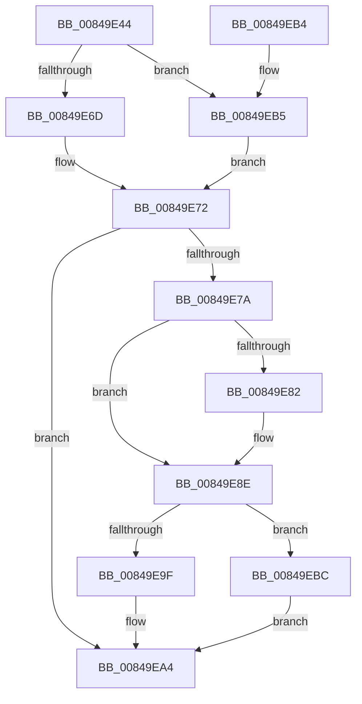

# CmpFreeSecurityDescriptor

- RVA: `0x00849E44`–`0x00849EC3` (길이 `127` bytes)
- VA: `0x0000000140849E44`
- 실행 섹션: `PAGE`
- PDB 이름 있음: `예`; PDB Function 태그: `아니요`
- unwind 정보 RVA: `0x0006948C`
- 디코드: `37`개 명령, `127/127` bytes 표시
- 미해석 바이트: `0` (있으면 어셈블리에 `.byte`로 보존)

> 이 문서는 커널 이미지의 기계어와 PDB 기호를 분석해 생성했습니다. 4번과 5번은 함수 원형과 자료형을 바이너리 사용 방식에서 추정한 C 해석이며 원본 소스 복구 결과는 아닙니다.

## 1. Dependencies

- 직접 호출 지점: **5**; 고유 호출 대상: **5**
- 직접 호출자로 확인된 함수: **4**
- RIP 상대 이미지 참조: **0**

### Outgoing calls
- `0x00849E6D` → [HvpGetCellFlat](../85/HvpGetCellFlat_function_00854C60.md) (function, `0x00854C60`)
- `0x00849E85` → [CmpDereferenceSecurityNode](../../text/4A/CmpDereferenceSecurityNode_function_004A672C.md) (function, `0x004A672C`)
- `0x00849E9F` → [HvpReleaseCellPaged](../85/HvpReleaseCellPaged_function_00855F40.md) (function, `0x00855F40`)
- `0x00849EB5` → [HvpGetCellPaged](../85/HvpGetCellPaged_function_00854CB0.md) (function, `0x00854CB0`)
- `0x00849EBC` → [HvpReleaseCellFlat](../85/HvpReleaseCellFlat_function_0085CC20.md) (function, `0x0085CC20`)

### Direct callers
- [CmpCopySaclToVirtualKey](../7E/CmpCopySaclToVirtualKey_function_007ECA6C.md) at `0x007ECCFA`
- [CmpSyncKeyValues](../7F/CmpSyncKeyValues_function_007F2DF4.md) at `0x007F3023`
- [CmpFreeKeyByCell](CmpFreeKeyByCell_function_0084AD70.md) at `0x0084AE73`
- [CmpCreateChild](../94/CmpCreateChild_function_0094817C.md) at `0x00948D1F`

### Static image references
- 디코드된 RIP-relative 메모리 참조가 없습니다.

## 2. Other-region calls and transfers

- 다른 실행 섹션으로 향하는 call: **1**
  - `0x00849E85` → [CmpDereferenceSecurityNode](../../text/4A/CmpDereferenceSecurityNode_function_004A672C.md) (`PAGE` → `.text`)
- 별도 외부 분기/꼬리 이동을 확인하지 못했습니다.

## 3. Assembly (complete function range)

```asm
00849E44  48 8B C4                        mov rax, rsp
00849E47  48 89 58 10                     mov qword ptr [rax + 0x10], rbx
00849E4B  48 89 68 18                     mov qword ptr [rax + 0x18], rbp
00849E4F  57                              push rdi
00849E50  48 83 EC 20                     sub rsp, 0x20
00849E54  83 48 08 FF                     or dword ptr [rax + 8], 0xffffffff
00849E58  4C 8D 40 08                     lea r8, [rax + 8]
00849E5C  33 ED                           xor ebp, ebp
00849E5E  48 8B D9                        mov rbx, rcx
00849E61  F6 81 8C 00 00 00 01            test byte ptr [rcx + 0x8c], 1
00849E68  89 68 0C                        mov dword ptr [rax + 0xc], ebp
00849E6B  74 48                           je 0x140849eb5
00849E6D  E8 EE AD 00 00                  call 0x140854c60
00849E72  48 8B F8                        mov rdi, rax
00849E75  48 85 C0                        test rax, rax
00849E78  74 2A                           je 0x140849ea4
00849E7A  8B 50 2C                        mov edx, dword ptr [rax + 0x2c]
00849E7D  83 FA FF                        cmp edx, -1
00849E80  74 0C                           je 0x140849e8e
00849E82  48 8B CB                        mov rcx, rbx
00849E85  E8 A2 C8 C5 FF                  call 0x1404a672c
00849E8A  83 4F 2C FF                     or dword ptr [rdi + 0x2c], 0xffffffff
00849E8E  F6 83 8C 00 00 00 01            test byte ptr [rbx + 0x8c], 1
00849E95  48 8D 54 24 30                  lea rdx, [rsp + 0x30]
00849E9A  48 8B CB                        mov rcx, rbx
00849E9D  75 1D                           jne 0x140849ebc
00849E9F  E8 9C C0 00 00                  call 0x140855f40
00849EA4  48 8B 5C 24 38                  mov rbx, qword ptr [rsp + 0x38]
00849EA9  48 8B 6C 24 40                  mov rbp, qword ptr [rsp + 0x40]
00849EAE  48 83 C4 20                     add rsp, 0x20
00849EB2  5F                              pop rdi
00849EB3  C3                              ret
00849EB4  CC                              int3
00849EB5  E8 F6 AD 00 00                  call 0x140854cb0
00849EBA  EB B6                           jmp 0x140849e72
00849EBC  E8 5F 2D 01 00                  call 0x14085cc20
00849EC1  EB E1                           jmp 0x140849ea4
```

## 4. C-style interpretation (structured pseudocode)

```c
__int64 __fastcall CmpFreeSecurityDescriptor(__int64 a1)
{
    __int64 result;
    __int64 v_rbp;
    __int64 v_rsp;
    unsigned __int64 v_stack_p10;
    unsigned __int64 v_stack_p18;
    unsigned __int64 v_stack_p8;

    *(unsigned __int64 *)(v_rsp + 16) = v_rbx;
    *(unsigned __int64 *)(v_rsp + 24) = v_rbp;
    v_rsp = (v_rsp) - (32);
    v_rbp = 0;
    *(unsigned int *)(v_rsp + 12) = 0;
    if (((*(unsigned __int8 *)(a1 + 140)) & (1)) == 0) goto loc_00849EB5;
    result = HvpGetCellFlat(a1, a2, v_rsp + 8, a4);
loc_00849E72:
    if (result == 0) goto loc_00849EA4;
    if (((unsigned int)((unsigned int)(*(unsigned int *)(result + 44)))) != -1) {
        a1 = a1;
        result = CmpDereferenceSecurityNode(a1, (unsigned int)(*(unsigned int *)(result + 44)), v_rsp + 8, a4);
    }
    if (((*(unsigned __int8 *)(a1 + 140)) & (1)) != 0) goto loc_00849EBC;
    result = HvpReleaseCellPaged(a1, v_stack_p8, v_rsp + 8, a4);
loc_00849EA4:
    v_rsp = (v_rsp) + (32);
    return result;
loc_00849EB5:
    result = HvpGetCellPaged(a1, v_stack_p8, v_rsp + 8, a4);
    goto loc_00849E72;
loc_00849EBC:
    result = HvpReleaseCellFlat(a1, v_stack_p8, v_rsp + 8, a4);
    goto loc_00849EA4;
}
```

## 5. (Beta) C Style

```c
int64_t CmpFreeSecurityDescriptor(void *Arg1)
{
    uint8_t *arg1 = (uint8_t *)Arg1;

    int64_t result;
    int64_t local_rbp;
    int64_t local_rsp;
    uint64_t v_stack_p10;
    uint64_t v_stack_p18;
    uint64_t v_stack_p8;

    *(uint64_t *)(local_rsp + 0x10) = local_rbx;
    *(uint64_t *)(local_rsp + 0x18) = local_rbp;
    local_rsp = (local_rsp) - (32);
    local_rbp = 0;
    *(uint32_t *)(local_rsp + 0xC) = 0;
    if (((*(uint8_t *)(arg1 + 0x8C)) & (1)) == 0) goto loc_00849EB5;
    result = HvpGetCellFlat(Arg1, a2, local_rsp + 8, a4);
loc_00849E72:
    if (result == 0) goto loc_00849EA4;
    if (((uint32_t)((uint32_t)(*(uint32_t *)(result + 0x2C)))) != -1) {
        Arg1 = Arg1;
        result = CmpDereferenceSecurityNode(Arg1, (uint32_t)(*(uint32_t *)(result + 0x2C)), local_rsp + 8, a4);
    }
    if (((*(uint8_t *)(arg1 + 0x8C)) & (1)) != 0) goto loc_00849EBC;
    result = HvpReleaseCellPaged(Arg1, v_stack_p8, local_rsp + 8, a4);
loc_00849EA4:
    local_rsp = (local_rsp) + (32);
    return result;
loc_00849EB5:
    result = HvpGetCellPaged(Arg1, v_stack_p8, local_rsp + 8, a4);
    goto loc_00849E72;
loc_00849EBC:
    result = HvpReleaseCellFlat(Arg1, v_stack_p8, local_rsp + 8, a4);
    goto loc_00849EA4;
}
```

### 관측된 메모리 오프셋

구조체 형식이 확인되지 않은 접근은 인자 기준의 오프셋으로만 기록했습니다.

| 기준 인자 | 오프셋 표현 | 폭 (bit) | 접근 |
|---|---:|---:|---|
| `Arg1` | `+ 0x8C` | `8` | `R` |

## 6. Execution-region graph

[열기: 2D/3D 그래프와 함수 탐색 컨트롤 패널](../../../control-panel.html?section=page&rva=0x00849E44&view=graph)

- 2D 그래프는 위에서 아래로 흐르고, 3D 그래프는 빈 공간을 드래그해 회전합니다. Shift+드래그는 이동, 휠은 확대·축소, 함수 노드 선택은 대상 보고서 이동입니다.

### Static fallback


